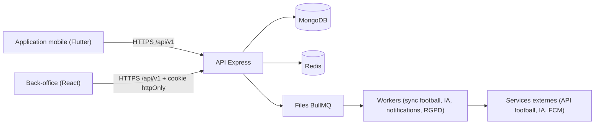
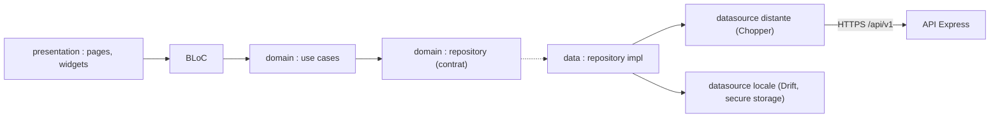

<p align="center"></p>

<h1 align="center">Univers Barça — Application mobile</h1>

<p align="center">Application Flutter (iOS et Android) des supporters : jeux, quiz, fantasy, communauté, calendrier, assistant IA.</p>

<p align="center">
  <a href="https://github.com/TheGoatIA/univers_barca_mobile/actions/workflows/mobile-ci.yml"></a>
  
  
</p>

> Application communautaire **non officielle** pour les supporters du FC Barcelone. Voir [`NOTICE.md`](NOTICE.md) pour les droits d'image et de marque.

## 1. Le produit en bref

**Univers Barça** est une application mobile (iOS / Android) qui rassemble, pour les supporters du FC Barcelone, tout ce qu'ils font autour du club : suivre le calendrier et les matchs, jouer chaque jour (*Guess the Player*, *Quiz adaptatif*), composer une équipe *Fantasy*, découvrir *La Masia*, retrouver d'autres supporters près de chez eux (*carte* et *groupes locaux*), discuter avec un **assistant IA** borné aux faits, générer des **fonds d'écran IA**, recevoir des **notifications** et suivre sa progression dans le *Culé Passport*.

Le projet est composé de **trois dépôts** qui forment un seul système :

| Dépôt | Rôle | Technologie |
| --- | --- | --- |
| [`univers_barca_mobile`](https://github.com/TheGoatIA/univers_barca_mobile) | Application des supporters | Flutter 3.47.7, BLoC, Chopper, Drift |
| [`univers_barca_admin`](https://github.com/TheGoatIA/univers_barca_admin) | Back-office (contenu, modération, supervision) | React 18, Vite, TypeScript, Tailwind |
| [`univers_barca_api`](https://github.com/TheGoatIA/univers_barca_api) | API REST, jobs, données | Node 22, Express, MongoDB, Redis, BullMQ |



## 2. Ce que fait l'application

- **Onboarding et compte** : langue (FR/EN/ES), carrousel, charte, inscription/connexion, pays et ville, joueur préféré, rappels de match.
- **Accueil** : prochain match avec compte à rebours, cartes jeux du jour, anecdote « aujourd'hui dans l'histoire », streak, XI Fantasy, accès rapide à l'assistant.
- **Jeux** : *Guess the Player* (défi quotidien), *Quiz adaptatif*, **Historique** et fiches, **Comparateur GOAT**.
- **Fantasy et Masia** : équipe, journées, classements, ligues, académie.
- **Communauté** : carte (positions approximatives), groupes locaux, posts, événements, signalements.
- **Calendrier** : matchs filtrables, export `.ics`, rappels, abonnement.
- **IA** : assistant **Barça AI** (streaming, quotas) et **wallpapers IA**.
- **Notifications** et **Culé Passport** (XP, badges), **paramètres** (thème, langue, confidentialité, export/suppression RGPD).
- Maquettes : [`docs/maquettes/`](docs/maquettes/) — 233 écrans × clair/sombre × mobile/tablette + planches du design system.

## 3. Architecture technique



Règle de dépendance : `presentation → domain ← data`. Le domaine est du Dart pur ; les erreurs sont des `Either<Failure, T>` (fpdart). Détails : [vue d'ensemble](docs/architecture/01-vue-ensemble.md).

| Brique | Choix |
| --- | --- |
| Framework | Flutter 3.47.7 (Dart ≥ 3.9), Material 3, thèmes clair/sombre |
| État / DI | flutter_bloc, Equatable, GetIt + Injectable |
| Réseau | Chopper (intercepteurs : auth, logs), `Authenticator` de refresh |
| Stockage | Drift (cache hors-ligne), flutter_secure_storage (jetons), shared_preferences |
| Navigation | go_router (ShellRoute à 5 onglets) |
| i18n | `flutter_localizations` + ARB FR (modèle) / EN / ES |
| Firebase | Messaging, Crashlytics, Performance, Analytics (à configurer) |
| Design | Tokens `core/theme`, Barlow Condensed + Inter |

## 4. Structure du dépôt

```text
lib/
  main.dart                  initialisation (env, DI, observateur BLoC)
  core/       constants, error (Failure), network (Chopper), services, theme, utils, widgets
  di/         GetIt + Injectable
  features/   <feature>/{domain,data,presentation}      ← modèle : features/players
  l10n/       app_fr.arb (modèle), app_en.arb, app_es.arb
  routes/     go_router
test/ · integration_test/    tests unitaires, widgets, intégration
android/ · ios/               projets natifs (compileSdk 36, iOS 15+)
docs/         architecture, maquettes (1 032 captures), ADR, pilotage
```

## 5. Démarrage rapide

Prérequis : **Flutter 3.47.7** (stable), Android Studio et/ou Xcode.

```bash
make setup                 # flutter pub get + génération de code + hooks git
cp .env.example .env       # puis adapter API_BASE_URL
make run-dev               # flutter run --dart-define=APP_ENV=development
```

## 6. Configuration

| Variable (`.env`) | Rôle |
| --- | --- |
| `APP_NAME`, `APP_ENV` | Nom et environnement (`development` · `staging` · `production`) |
| `API_BASE_URL`, `API_TIMEOUT` | URL de l'API REST et timeout |
| `OTEL_EXPORTER_OTLP_ENDPOINT`, `API_LOGS_ENDPOINT` | Télémétrie |

Firebase : `google-services.json`, `GoogleService-Info.plist` et `firebase_options.dart` ne sont **jamais versionnés** (voir [DEPLOYMENT](docs/DEPLOYMENT.md)).

## 7. Commandes

| Commande | Description |
| --- | --- |
| `make codegen` · `codegen-watch` | `build_runner` (injectable, json_serializable, chopper, drift) |
| `make analyze` · `format` · `lint` | Analyse (`--fatal-warnings`), formatage (`--line-length 100`) |
| `make test` · `coverage` · `check` | Tests + couverture · pipeline CI local |
| `make build-apk-prod` · `build-aab-prod` · `build-ios-prod` | Builds release obfusqués |

## 8. Qualité et sécurité

- **CI** (`mobile-ci.yml`) : format, `build_runner`, `flutter analyze`, tests + couverture (≥ 60 %), builds Android et iOS, commitlint, TruffleHog/Trivy.
- **Sécurité** : jetons en stockage chiffré, secrets jamais versionnés, signature release via secrets CI, permissions demandées au moment utile (pré-permission avant la demande système).
- **Accessibilité / UX** : zones tactiles ≥ 48 dp, clair/sombre, mobile/tablette, animations fidèles aux planches (réduction des animations respectée).

## 9. CI/CD et déploiement

| Branche | Environnement | Résultat | Tag git |
| --- | --- | --- | --- |
| `dev` | staging | APK/IPA staging, Firebase App Distribution | `staging-AAAAMMJJ.N` |
| `main` | production | APK/IPA production, TestFlight | `vAAAAMMJJ.N` |

Version d'app = `pubspec.yaml` (`--build-name`), numéro de build = numéro d'exécution du workflow. Sans secrets (keystore, Firebase, certificats iOS), les builds restent verts : APK signé en debug et IPA non signée. Voir [DEPLOYMENT](docs/DEPLOYMENT.md) et [Déploiement et CI/CD](docs/architecture/04-deploiement-et-cicd.md).

## 10. Documentation

| Document | Contenu |
| --- | --- |
| [Index de la documentation](docs/architecture/README.md) | Point d'entrée : par où commencer selon votre rôle |
| [Vue d'ensemble de l'architecture](docs/architecture/01-vue-ensemble.md) | Architecture globale, conteneurs, couches, carte des fonctionnalités |
| [Architecture de données](docs/architecture/02-architecture-donnees.md) | Collections, relations, index, Redis, Drift, cycle de vie |
| [Sécurité et RGPD](docs/architecture/03-securite-et-rgpd.md) | Authentification, RBAC, protection des données |
| [Déploiement et CI/CD](docs/architecture/04-deploiement-et-cicd.md) | Environnements, pipelines, versionnage, rollback |
| [Observabilité et qualité](docs/architecture/05-observabilite-et-qualite.md) | Logs, métriques, tests, charge |
| [Glossaire et conventions](docs/architecture/06-glossaire-et-conventions.md) | Vocabulaire, conventions de code et de contribution |
| [Architectures par fonctionnalité](docs/architecture/features/) | 24 documents (flux, données, API, écrans) |
| [Plan de réalisation](docs/pilotage/PLAN_REALISATION.md) · [Suivi Excel](docs/pilotage/Univers-Barca-Plan-de-realisation-et-suivi.xlsx) | Étapes, jalons, Gantt |
| [Contribuer](CONTRIBUTING.md) · [Sécurité](SECURITY.md) · [Journal des changements](CHANGELOG.md) · [Décisions (ADR)](docs/adr/) | Gouvernance du projet |

### Les 24 fonctionnalités

| Réf. | Fonctionnalité | Phase | Document d'architecture |
| --- | --- | --- | --- |
| F01 | Authentification et comptes | 1 | [F01-authentification-et-comptes.md](docs/architecture/features/F01-authentification-et-comptes.md) |
| F02 | Onboarding et personnalisation | 1 | [F02-onboarding-et-personnalisation.md](docs/architecture/features/F02-onboarding-et-personnalisation.md) |
| F03 | Paramètres, confidentialité et RGPD | 1 | [F03-parametres-confidentialite-rgpd.md](docs/architecture/features/F03-parametres-confidentialite-rgpd.md) |
| F04 | États système et résilience | 0-1 | [F04-etats-systeme-et-resilience.md](docs/architecture/features/F04-etats-systeme-et-resilience.md) |
| F05 | Données football et synchronisation | 1 | [F05-donnees-football-et-synchronisation.md](docs/architecture/features/F05-donnees-football-et-synchronisation.md) |
| F06 | Accueil — dashboard | 1 | [F06-accueil-dashboard.md](docs/architecture/features/F06-accueil-dashboard.md) |
| F07 | Historique et fiches | 1 | [F07-historique-et-fiches.md](docs/architecture/features/F07-historique-et-fiches.md) |
| F08 | Calendrier et export agenda | 1 | [F08-calendrier-et-export-agenda.md](docs/architecture/features/F08-calendrier-et-export-agenda.md) |
| F09 | Guess the Player | 1 | [F09-guess-the-player.md](docs/architecture/features/F09-guess-the-player.md) |
| F10 | Quiz adaptatif | 1 | [F10-quiz-adaptatif.md](docs/architecture/features/F10-quiz-adaptatif.md) |
| F11 | Comparateur GOAT | 2 | [F11-comparateur-goat.md](docs/architecture/features/F11-comparateur-goat.md) |
| F12 | Culé Passport et gamification | 2 | [F12-passport-et-gamification.md](docs/architecture/features/F12-passport-et-gamification.md) |
| F13 | Fantasy Barça | 2 | [F13-fantasy-barca.md](docs/architecture/features/F13-fantasy-barca.md) |
| F14 | La Masia Academy | 3 | [F14-la-masia-academy.md](docs/architecture/features/F14-la-masia-academy.md) |
| F15 | Carte communautaire | 2 | [F15-carte-communautaire.md](docs/architecture/features/F15-carte-communautaire.md) |
| F16 | Groupes locaux | 2 | [F16-groupes-locaux.md](docs/architecture/features/F16-groupes-locaux.md) |
| F17 | Modération et sécurité communautaire | 2 | [F17-moderation-et-securite-communautaire.md](docs/architecture/features/F17-moderation-et-securite-communautaire.md) |
| F18 | Assistant IA Barça AI | 1 | [F18-assistant-ia-barca-ai.md](docs/architecture/features/F18-assistant-ia-barca-ai.md) |
| F19 | Wallpapers IA | 3 | [F19-wallpapers-ia.md](docs/architecture/features/F19-wallpapers-ia.md) |
| F20 | Notifications | 1 | [F20-notifications.md](docs/architecture/features/F20-notifications.md) |
| F21 | Back-office : contenu éditorial | 1 | [F21-backoffice-contenu.md](docs/architecture/features/F21-backoffice-contenu.md) |
| F22 | Back-office : supervision et comptes | 1 | [F22-backoffice-supervision-et-comptes.md](docs/architecture/features/F22-backoffice-supervision-et-comptes.md) |
| F23 | Design system et expérience | 0 | [F23-design-system-et-experience.md](docs/architecture/features/F23-design-system-et-experience.md) |
| F24 | Plateforme : jobs, caches, feature flags | 0-1 | [F24-plateforme-jobs-cache-flags.md](docs/architecture/features/F24-plateforme-jobs-cache-flags.md) |

## 11. Backlog et organisation du travail

- Le backlog complet est dans les **issues GitHub** de ce dépôt : titre `[CODE] …`, jalon = phase (0 à 3), labels `priorite:*`, `taille:*`, `type:*`, `module:*`. Chaque issue contient contexte, maquettes (clair/sombre), règles de gestion, contrats d'API, tâches, critères d'acceptation et tests à écrire.
- Ordre de traitement : **phase → priorité (P0, P1, P2) → ordre des codes dans l'épopée**, en respectant la section « Dépendances » (qui peut pointer vers un autre dépôt : `API-…`, `MOB-…`, `ADM-…`). Détails dans [`CLAUDE.md`](CLAUDE.md).
- Git : `main` = production, `dev` = intégration/staging, branches `feat/<n°issue>-<slug>` ; commits [Conventional Commits](https://www.conventionalcommits.org/fr/) ; PR vers `dev` avec CI verte.
- Versions de déploiement : `AAAAMMJJ.N` (tags `staging-…` sur `dev`, `v…` sur `main`).
- Un push sur `dev` déploie le **staging** ; un push sur `main` déploie la **production**.

## 12. Licence et droits

Logiciel propriétaire (voir [`LICENSE`](LICENSE)). L'écusson du FC Barcelone utilisé comme logo reste la propriété du club : voir [`NOTICE.md`](NOTICE.md).
