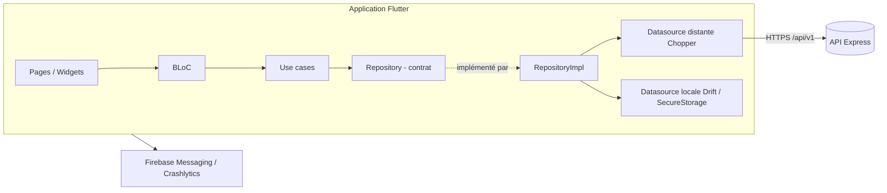
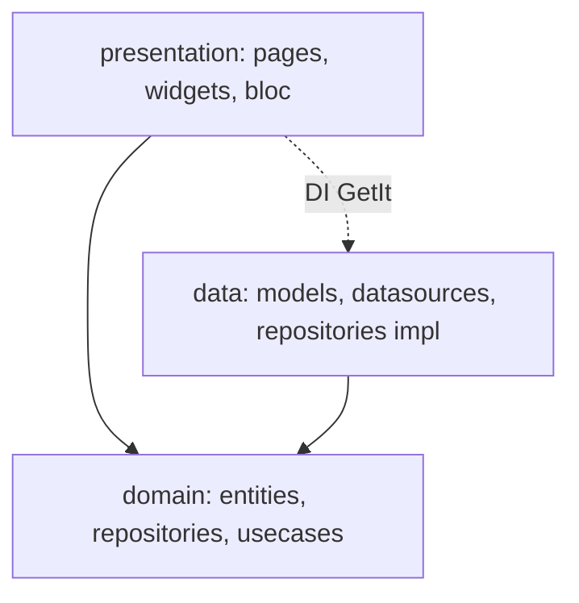

# Architecture de l'application mobile

## Vue d'ensemble

## Couches (par feature)

Règle de dépendance : `presentation → domain ← data`. Le domaine est du Dart pur.

## Réseau

Pile d'intercepteurs Chopper : `AuthInterceptor` (Bearer) → `HttpLoggingInterceptor` ; `AppAuthenticator` rafraîchit le jeton sur 401 (refresh token à rotation côté API). Format de réponse : `{ success, data }` ; listes `{ items, total, page, totalPages, hasMore }`.

## Navigation

`go_router` : splash → onboarding/auth → `ShellRoute` à onglets (Accueil, Jeux, Fantasy, Communauté, Profil). Les gardes d'authentification consomment l'état de l'`AuthBloc`.

## Stockage

- Jetons : `flutter_secure_storage`.
- Préférences : `shared_preferences`.
- Cache hors-ligne : Drift (SQLite), chiffrement SQLCipher prévu.

## Thème & i18n

Tokens de couleur, rayons, espacements et typographies dans `core/theme`. Langues FR (modèle), EN, ES via ARB ; le français est la langue par défaut.

## Environnements

`APP_ENV` (`development` · `staging` · `production`) + `.env`. Les identifiants Firebase par environnement sont fournis par les secrets CI.
