# 01 — Vue d'ensemble d'Univers Barça

> Ce document est la **porte d'entrée** de la documentation d'architecture. Il explique le projet à un développeur qui le découvre : pourquoi il existe, ce qu'il contient, comment les trois dépôts (API, mobile, back-office) s'articulent, quelles technologies ont été choisies et pourquoi, et comment les 24 fonctionnalités (F01 à F24) se relient entre elles. Les autres documents du dossier approfondissent chaque sujet (voir la section 15).

## Sommaire

1. [Comment lire cette documentation](#1-comment-lire-cette-documentation)
2. [Vision et valeur du produit](#2-vision-et-valeur-du-produit)
3. [Personas](#3-personas)
4. [Les modules du produit](#4-les-modules-du-produit)
5. [Vue contexte (C4 niveau 1)](#5-vue-contexte-c4-niveau-1)
6. [Vue conteneurs (C4 niveau 2)](#6-vue-conteneurs-c4-niveau-2)
7. [Architecture de l'API (vue composants)](#7-architecture-de-lapi-vue-composants)
8. [Architecture de l'application Flutter](#8-architecture-de-lapplication-flutter)
9. [Architecture du back-office React](#9-architecture-du-back-office-react)
10. [Carte des fonctionnalités F01 à F24](#10-carte-des-fonctionnalités-f01-à-f24)
11. [Interdépendances entre fonctionnalités](#11-interdépendances-entre-fonctionnalités)
12. [Stack technique et justification des choix](#12-stack-technique-et-justification-des-choix)
13. [Phases et roadmap](#13-phases-et-roadmap)
14. [Cartographie des trois dépôts](#14-cartographie-des-trois-dépôts)
15. [Index de la documentation et points de vigilance](#15-index-de-la-documentation-et-points-de-vigilance)

---

## 1. Comment lire cette documentation

### 1.1 Trois sources qui ne disent pas toujours la même chose

Le projet repose sur trois sources d'information, et il est essentiel de savoir laquelle fait foi sur quel sujet :

| Source | Contenu | Autorité |
| --- | --- | --- |
| **Cahiers des charges (CDC)** : Global, Backend, Flutter, Admin | Vision produit, exigences non fonctionnelles, premiers choix d'architecture | Référence **produit** ; **périmée sur la stack** (voir ci-dessous) |
| **Backlog** (1 322 issues GitHub réparties sur 3 dépôts) | Règles de gestion chiffrées, contrats d'API, modèles, tâches, critères d'acceptation, tests | **Fait foi** pour tout ce qui reste à construire (règle des fichiers `CLAUDE.md`) |
| **Code existant** des 3 dépôts | Socle technique de la phase 0 : API Express (auth, utilisateurs, joueurs, matchs, santé), template Flutter (module `players`), template admin React | **Fait foi** pour ce qui est déjà implémenté |

> **Écart CDC majeur à connaître dès le départ.** Les CDC décrivent encore une API *NestJS + Prisma + PostgreSQL*. La **stack réelle** (ADR `0001-express-mongodb` du dépôt API) est : **Node 22 + TypeScript strict + Express 4 + Mongoose / MongoDB 7 (replica set) + Redis 7 + BullMQ + node-cron + PM2**. Cette documentation décrit la stack réelle et signale l'écart CDC quand il compte (section 15.2).

### 1.2 Ce qui existe aujourd'hui et ce qui est à construire

Le projet est au **début de la phase 0** (le plan de réalisation démarre le 02/11/2026). Conséquence pour le lecteur :

- Les dépôts contiennent un **socle** : l'API expose l'authentification utilisateur et admin, `/users/me`, `/players`, `/matches`, `/health`, `/metrics` ; les modèles Mongoose de tous les domaines sont déjà déclarés (`src/models/*.ts`) ; le mobile contient l'infrastructure (thème, réseau Chopper, DI, un module de référence `players`) ; l'admin contient le routage par rôle, l'authentification et une page joueurs.
- **Tout le reste** (jeux, Fantasy, carte, assistant, wallpapers, notifications, modération, etc.) est **spécifié dans le backlog** mais pas encore codé. Les documents de fonctionnalités (`features/Fxx-*.md`) décrivent donc l'architecture **cible** ; quand un détail vient du code existant, il est dit explicitement, et quand il est une proposition, il est marqué « (proposé) ».

### 1.3 Conventions de notation

- Les codes d'issues s'écrivent `<PRÉFIXE>-<GROUPE>-<NN>` : `API-JEUX-05`, `MOB-D-12`, `ADM-WF-03`. Une **épopée** est le groupe sans numéro : `API-JEUX`, `MOB-D`, `ADM-WF`.
- Les écrans mobiles se codent par lettre d'épopée et numéro (`C-01` = tableau de bord, `A-06` = maintenance) ; les écrans admin par `WA-01`, `WB-02`…
- Les routes sont données relativement au préfixe `/api/v1`.
- Les clés Redis cibles portent le préfixe `ub:` (proposé comme convention globale) ; le code actuel utilise déjà `jwt:bl:<jti>` (liste noire des jetons) et `rl:<limiteur>:` (limiteurs de débit).

---

## 2. Vision et valeur du produit

**Univers Barça** est une application mobile communautaire (iOS et Android, Flutter) pour les supporters du FC Barcelone, avec un accent sur la **diaspora culée francophone et hispanophone** (Afrique, Europe, Amérique latine). Slogan proposé par le CDC : « Ton compagnon culé, au quotidien. »

Le constat de départ : il n'existe aucune application *fan-made* qui combine à la fois :

1. un **assistant conversationnel** (Barça AI) ancré sur des données fiables ;
2. des **jeux quotidiens** engageants (Guess the Player façon Wordle, Quiz adaptatif) ;
3. une **base de connaissance** historique et statistique riche ;
4. une dimension **simulation** (Fantasy, La Masia Academy) ;
5. une **couche communautaire géolocalisée** (carte des culés, groupes locaux) ;
6. l'**export natif du calendrier** des matchs vers l'agenda personnel.

Les applications généralistes (Sofascore, FotMob, OneFootball) couvrent la donnée brute ; l'application officielle du club couvre l'actualité et la billetterie. Aucune ne fait du supporter un **joueur** et un **membre d'une communauté locale**.

### 2.1 Principes directeurs du produit

| Principe | Conséquence concrète |
| --- | --- |
| 100 % gratuit, sans publicité en V1 | Pas de module de paiement ; l'architecture reste prête pour une monétisation ultérieure sans refonte |
| Trois langues dès le lancement (FR / EN / ES) | Contenus dynamiques stockés `{ fr, en, es }` côté API ; textes d'interface via fichiers ARB (mobile) et catalogue figé en français (admin) |
| Thème clair et sombre natifs | Tokens de design partagés mobile/admin (couleurs `#A50044` garnet, `#004D98` navy, `#EDBB00` gold) |
| Identité propre | Aucun logo, écusson ni maillot officiel : le produit assume son statut *fan-made* (CDC Global §10.1) ; les prompts de wallpapers filtrent les marques du club (`API-WALL-05`) |
| Une seule source de vérité par entité | Aucun module ne duplique en écriture une donnée d'un autre module : il passe par l'API |
| Respect de la vie privée par conception | Géolocalisation **approximative** uniquement, consentements distincts et historisés, export et suppression de compte (voir `03-securite-et-rgpd.md`) |
| Coût IA maîtrisé | Quotas quotidiens par utilisateur (assistant 30 messages/jour, wallpapers 3 à 5/jour, configurables), caches, kill switch |

### 2.2 Indicateurs de succès (KPIs du CDC)

| Famille | Indicateur | Cible indicative |
| --- | --- | --- |
| Activation | Complétion de l'onboarding | > 70 % |
| Activation | Action clé le jour de l'inscription (J1) | > 50 % |
| Rétention | J7 / J30 | > 30 % / > 15 % |
| Engagement | Sessions par jour actif les jours de match | > 1,5 |
| Communauté | Utilisateurs géolocalisés ayant rejoint un groupe | > 20 % |
| Technique | Taux d'erreur 5xx | < 0,5 % |
| Technique | Crash-free sessions mobile | > 99,5 % |
| Technique | Latence API p95 hors IA | < 300 ms |
| Technique | Disponibilité | 99,5 % |

---

## 3. Personas

Trois personas orientent les choix produit et UX (CDC Global §1.4). Chacun privilégie des fonctionnalités différentes.

| Persona | Profil | Attentes | Fonctionnalités clés |
| --- | --- | --- | --- |
| **1. Le supporter passionné et actif** | 20-35 ans, suit chaque match, connaît l'histoire du club, plusieurs sessions par jour les jours de match | Contenu pointu, statistiques, débats (GOAT), compétition (quiz, Fantasy) | F10 Quiz, F11 GOAT, F13 Fantasy, F18 Assistant, F20 Notifications |
| **2. Le supporter de la diaspora** | 18-45 ans, vit hors d'Espagne, cherche un groupe local, agenda adapté à son fuseau horaire | Se connecter à d'autres culés autour de lui, calendrier à son fuseau | F15 Carte, F16 Groupes, F08 Calendrier, F02 Onboarding (pays/ville) |
| **3. Le supporter occasionnel** | Tout âge, aime le foot sans être expert, apprécie les jeux type Wordle | Simplicité, jeu quotidien rapide, pas de charge cognitive | F06 Accueil, F09 Guess the Player, F12 Passport (streak) |

Il existe aussi quatre **rôles de back-office**, détaillés dans `03-securite-et-rgpd.md` : `content-manager` (contenu), `moderator` (modération), `super-admin` (tout, dont comptes et configuration) — plus le rôle `user` pour l'utilisateur final.

### 3.1 Un parcours type par persona

**Persona 2, arrivée dans un nouveau pays** : l'utilisateur ouvre l'onglet *Communauté* ; la carte s'affiche (vue monde si pas de géolocalisation, sinon centrée sur sa ville approximative) ; il recherche son pays ; il voit le nombre de culés recensés et les groupes locaux ; il rejoint « Culés Cameroun » en un tap et accède au fil de discussion. À aucun moment il ne voit la position exacte d'un autre utilisateur (RG-MAP-01).

**Persona 1, un jour de match** : notification « Match dans 1 h » (F20) → ouverture de l'app, vérification du XI Fantasy avant verrouillage au coup d'envoi (F13) → pendant le match, question à l'assistant (« Pourquoi ce changement tactique ? », F18) → après le match, vote GOAT (F11) et quiz du jour (F10).

**Persona 3, session courte** : ouverture sans intention précise → le tableau de bord (F06) met le jeu du jour en tête → partie de Guess the Player en moins de 2 minutes (F09) → partage d'une grille d'emojis sans spoiler → rappel discret le lendemain si la série (streak) est active.

---

## 4. Les modules du produit

Le CDC Global liste **15 modules** fonctionnels. Le backlog les découpe en **24 fonctionnalités** (F01 à F24) qui incluent aussi les socles techniques (états système, design system, plateforme). La correspondance est détaillée en section 10.

| # | Module (CDC) | Description | Priorité CDC | Fonctionnalités |
| --- | --- | --- | --- | --- |
| 1 | Assistant IA (Barça AI) | Chat transversal, bulle flottante, RAG strict sur les données internes, FR/EN/ES | P0 | F18 |
| 2 | Dashboard / Accueil | Cartes : prochain match, jeux du jour, anecdote, streak, XI Fantasy | P0 | F06 |
| 3 | Guess the Player | Joueur mystère quotidien, 6 essais, indices vert/jaune/rouge | P0 | F09 |
| 4 | Quiz adaptatif | 5 paliers, 10 questions/jour, classements | P0 | F10 |
| 5 | Historique / Timeline | Frise sur 125 ans, fiches de matchs et de joueurs | P0 | F07, F05 |
| 6 | Comparateur GOAT | Statistiques croisées + vote communautaire (pourcentage, jamais de verdict) | P1 | F11 |
| 7 | Fantasy Barça | XI hebdomadaire, points sur performances réelles, classements | P1 | F13 |
| 8 | La Masia Academy | Simulation de progression d'un jeune joueur virtuel | P2 | F14 |
| 9 | Carte communautaire | Densité de supporters par pays/ville, recherche, groupes locaux | P1 | F15, F16 |
| 10 | Calendrier + export agenda | Liste des matchs, `.ics` ponctuel, abonnement `webcal://` | P0 | F08 |
| 11 | Wallpapers IA | Génération d'images via prompt guidé, galerie, partage | P2 | F19 |
| 12 | Culé Passport | Profil, badges, points, niveaux, séries transverses | P1 | F12 |
| 13 | Notifications push | Rappels de match, série en danger, anniversaires, groupes | P0 | F20 |
| 14 | Authentification & compte | Inscription, social login, RGPD | P0 | F01, F02, F03 |
| 15 | Back-office | Contenu, modération, supervision | P0 | F17, F21, F22 |

> Le CDC classe le Passport en P1, mais le plan de réalisation le place en **phase 2** car il dépend des jeux, du GOAT et de Fantasy qui l'alimentent (voir section 11).

---

## 5. Vue contexte (C4 niveau 1)

La vue contexte montre le système comme une boîte noire : **qui l'utilise** et **avec quels systèmes externes il dialogue**.

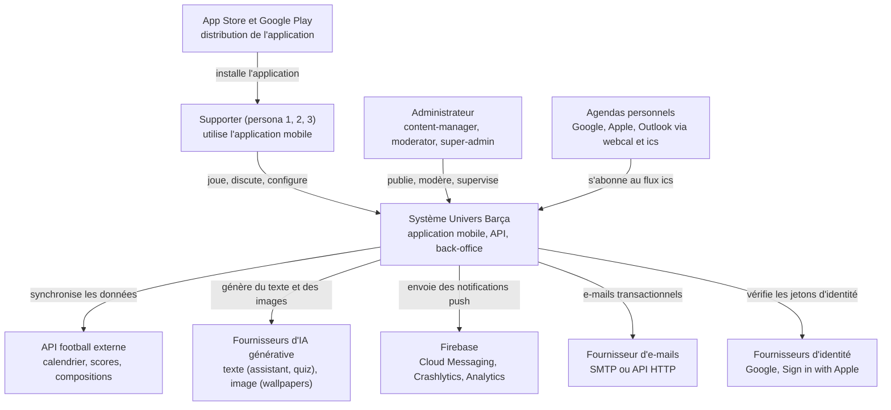

### 5.1 Lecture du diagramme

- **Supporters** et **administrateurs** n'accèdent jamais directement aux données : tout passe par l'API (principe « API-first » du CDC Global §4.3).
- **API football** : source des scores, compositions, événements de match et calendrier officiel. Elle est sous licence commerciale et à quota : l'API ne l'appelle jamais depuis le mobile et met en cache (voir F05).
- **Fournisseurs d'IA** : deux familles distinctes (texte pour l'assistant et la génération de questions ; image pour les wallpapers). Ils sont derrière des interfaces (`LanguageModelProvider`, `ImageGenerationProvider`) pour pouvoir en changer sans réécrire la logique.
- **Firebase** : Cloud Messaging pour les push, Crashlytics/Performance/Analytics côté mobile (analytics soumis à consentement).
- **Agendas personnels** : ils interrogent un flux `.ics` public protégé par un jeton personnel et révocable (F08).

---

## 6. Vue conteneurs (C4 niveau 2)

La vue conteneurs ouvre la boîte : quels **processus et bases** composent le système et comment ils communiquent.

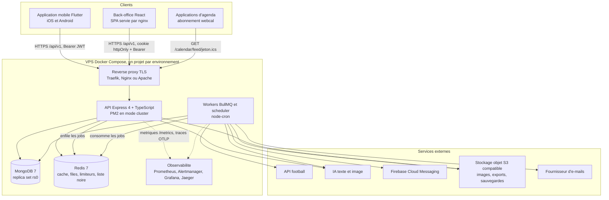

### 6.1 Rôle de chaque conteneur

| Conteneur | Technologie | Rôle | Dépôt |
| --- | --- | --- | --- |
| Application mobile | Flutter 3.47 (Dart ≥ 3.9), BLoC | Interface supporter, cache hors-ligne (Drift), push (FCM) | `univers_barca_mobile` |
| Back-office | React 18 + Vite + TypeScript, Tailwind, TanStack Query | Contenu, modération, supervision ; **français uniquement** | `univers_barca_admin` |
| Reverse proxy | Traefik / Nginx / Apache (au choix sur le VPS) | Terminaison TLS (Let's Encrypt), routage par sous-domaine : `api.univers-barca.app` → 127.0.0.1:5001, `api-staging…` → 5002, `admin…` → 8081, `admin-staging…` → 8082 | VPS |
| API | Node 22, Express 4, Mongoose, PM2 (2 instances par défaut) | Routes REST `/api/v1`, authentification, règles métier, enfilement des jobs | `univers_barca_api` |
| Workers / scheduler | BullMQ + node-cron | Jobs asynchrones (sync football, e-mails, push, IA, RGPD) et tâches planifiées. Aujourd'hui lancés dans le processus API (instance PM2 0, `RUN_CRON`) ; un processus `worker` dédié est prévu (`API-PLAT-35`) | `univers_barca_api` |
| MongoDB | Mongo 7, replica set `rs0` | Source de vérité unique. Replica set même en dev (transactions). Sans authentification mais sur réseau Docker `internal` (ADR 0004) | VPS |
| Redis | Redis 7 avec mot de passe | Cache cache-aside, files BullMQ, limiteurs de débit (`rl:`), liste noire des JWT (`jwt:bl:`), classements (sorted sets) | VPS |
| Observabilité | Prometheus, Alertmanager, Grafana, Jaeger (compose `observability`) | Métriques `ub_*`, alertes, tableaux de bord, traces OpenTelemetry | VPS (réseau `univers_barca_services`) |
| API football | Fournisseur sous licence | Données de match ; interface `FootballDataProvider` | externe |
| IA texte / image | Fournisseurs interchangeables | Assistant, génération de questions, wallpapers | externe |
| FCM | Firebase Cloud Messaging | Push iOS/Android par lots de 500 | externe |
| Stockage objet | S3 compatible | Images de wallpapers, avatars, exports RGPD (lien 7 jours), sauvegardes chiffrées hors VPS | externe |

### 6.2 Trois environnements isolés

| Environnement | Branche | Où | Base | Particularités |
| --- | --- | --- | --- | --- |
| Développement | feature/* | Poste du développeur (`docker-compose.dev.yml`) | MongoDB local, données fictives (`npm run seed`) | Limiteurs désactivables (`RATE_LIMIT_DISABLED`) |
| Staging (recette) | `dev` | VPS, projet `univers-barca-staging`, port 5002 | Mongo dédié, volume distinct | Seed de démonstration, tests de charge `stress` autorisés |
| Production | `main` | VPS, projet `univers-barca-production`, port 5001 | Mongo dédié, sauvegardes quotidiennes | Secrets propres, relecteur obligatoire du déploiement |

Le détail (pipelines, rollback, sauvegardes) est dans `04-deploiement-et-cicd.md`.

---

## 7. Architecture de l'API (vue composants)

L'API suit les conventions « ClicEat » : **routes → middleware → controller → service → model**, sans injection de dépendances ni pattern Repository (ADR 0001). Les contrôleurs sont minces, la logique métier vit dans `services/`, les modèles Mongoose ignorent HTTP.

### 7.1 Les couches

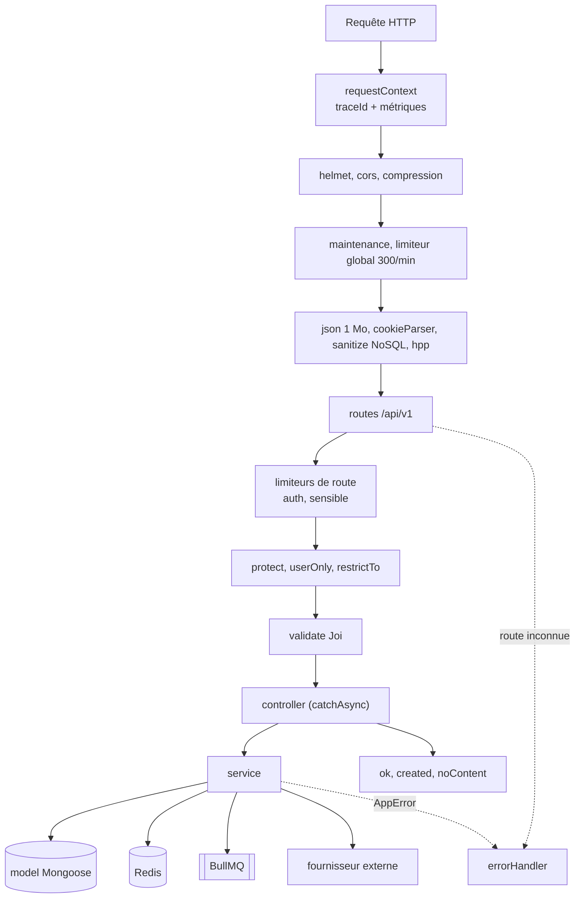

**Légende** : rectangles = middlewares/composants Express ; cylindres = stockage ; double crochet = file BullMQ ; flèches pointillées = chemin d'erreur.

### 7.2 Détail des middlewares (dans l'ordre réel de `src/app.ts`)

| Ordre | Middleware | Rôle | Fichier |
| --- | --- | --- | --- |
| 1 | `requestContext` | Génère/accepte `X-Request-Id` (8-64 caractères) → `req.traceId` ; chronomètre l'histogramme `ub_http_request_duration_seconds` ; journalise `http` (hors `/health*` et `/metrics`) | `middleware/requestLogger.ts` |
| 2 | `helmet`, `cors`, `compression` | En-têtes de sécurité ; CORS strict sur `CORS_ORIGINS` avec `credentials` ; gzip | `app.ts` |
| 3 | Sondes `/health`, `/api/health`, `/health/deep`, `/metrics` | Avant limiteur et maintenance pour rester joignables. `/metrics` réservé à `METRICS_ALLOWED_IPS` | `controllers/health.controller.ts` |
| 4 | `maintenance` | Renvoie 503 si `MAINTENANCE_MODE=true` | `middleware/maintenance.ts` |
| 5 | `globalLimiter` | 300 requêtes / minute (stockage Redis `rl:global:`) | `middleware/rateLimiter.ts` |
| 6 | `express.json`/`urlencoded` 1 Mo, `cookieParser` | Parsing | `app.ts` |
| 7 | `sanitizeInput` + `hpp` | Retire les opérateurs MongoDB (`$`, `.`) de `body` et `params` ; neutralise la pollution de paramètres | `utils/sanitize.ts` |
| 8 | `/api-docs` | Swagger UI derrière Basic auth (`SWAGGER_USER/PASSWORD`) | `app.ts` |
| 9 | Routeur `/api/v1` | Limiteurs de route (`authLimiter` 20/15 min, `sensitiveLimiter` 5/h), `protect`, `restrictTo`, `validate(schéma Joi)` | `routes/index.ts` |
| 10 | `notFound` puis `errorHandler` | Format d'erreur unique `{ success:false, error:{ code, message, details?, traceId } }` | `middleware/errorHandler.ts` |

### 7.3 Cycle de vie d'une requête authentifiée

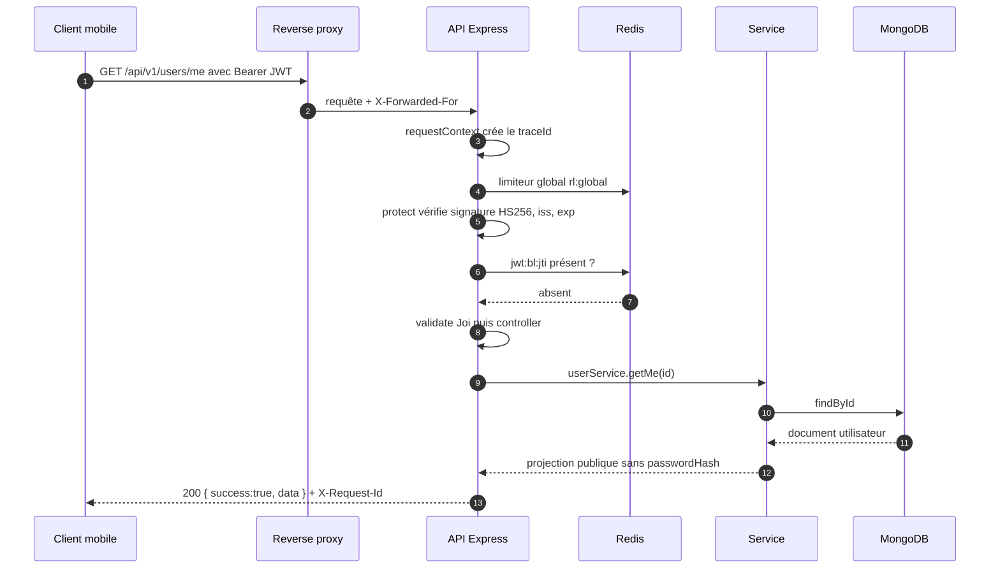

Pas à pas : (1-2) le proxy termine TLS et transmet l'IP réelle (`trust proxy` = 1) ; (3-4) le traceId est créé ou repris ; (5) le limiteur compte la requête dans Redis ; (6-8) `protect` vérifie le JWT puis consulte la liste noire ; (9-12) la validation, le contrôleur mince et le service qui interroge Mongo ; (13) la réponse suit le format constant `{ success, data }`.

### 7.4 Arborescence réelle de l'API

```
src/
  app.ts · server.ts · tracing.ts     Express (createApp), bootstrap + arrêt gracieux, OpenTelemetry (importé en premier)
  config/       env.ts (Joi, échec fatal si invariant violé), database.ts, redis.ts (Redis ou repli mémoire), metrics.ts (prom-client)
  middleware/   auth.ts, validate.ts, errorHandler.ts, rateLimiter.ts, requestLogger.ts, maintenance.ts
  routes/       index.ts (+ JSDoc @swagger)
  controllers/  auth, user, admin-auth, content, health
  services/     auth, token, password, user, admin-auth, health
  validators/   schémas Joi
  models/       _common, user, refresh-token, consent-record, admin-user, football, gamification,
                fantasy, community, moderation, platform
  jobs/         queues.ts (BullMQ), scheduler.ts (node-cron)
  utils/        appError, catchAsync, response (ok/created/noContent), pagination, sanitize, logger (Winston)
scripts/        migrations/ (migrate-mongo), seed-data.ts, backup.sh, restore.sh, setup-vps.sh, export-swagger.ts
tests/          unit · integration · e2e · security · load (k6)
docker/         docker-compose.{dev,staging,production,observability}.yml, prometheus/, grafana/
```

### 7.5 Files BullMQ et tâches planifiées

Le code déclare cinq files (`email`, `notifications`, `football-sync`, `ai-generation`, `rgpd`) plus une file `dead-letter`. Options par défaut : **5 tentatives**, backoff exponentiel de base 2 s, conservation des 1 000 derniers jobs réussis et 5 000 échoués. Les CDC et le backlog en nomment d'autres ; la correspondance :

| Nom CDC (§7) | File / job dans le code et les specs | Épopée |
| --- | --- | --- |
| `send-notifications` | file `notifications` (jobs `match-reminder`, `deliver`, `campaign-send`…) | `API-NOTIF` |
| `sync-live-matches` | file `football-sync` (jobs fixtures, live, lineups, events) | `API-FOOT` |
| `generate-wallpaper` | file `ai-generation`, job `generate-wallpaper` (concurrence 2) | `API-WALL` |
| `generate-daily-challenge` | cron quotidien (fuseau `Europe/Madrid`, pré-génération, idempotence par `(type, date)`) | `API-JEUX-02` |
| `compute-fantasy-scores` | job `compute-fantasy-scores` (provisoire en direct, final après match) | `API-FANT-11` |
| `refresh-calendar-feed` | job d'invalidation du flux `.ics` sur changement d'horaire | `API-CAL-19` |
| `database-backup` | cron 02:00 UTC | `API-PLAT-49` |
| (non nommée au CDC) | file `email`, file `rgpd` (export, purge J+30), file `gamification` (Fantasy/Academy, proposé) | `API-AUTH`, `API-PASS` |

Tâches `node-cron` présentes aujourd'hui : **03:00 Europe/Madrid** purge RGPD des comptes supprimés depuis 30 jours ; **03:30** purge des refresh tokens révoqués (30 jours dans le code, **90 jours** exigés par le CDC et `API-AUTH-13` : écart à corriger).

### 7.6 Format de réponse et d'erreur

```json
{ "success": true, "data": { "id": "665f…", "displayName": "Culé42" } }
```

```json
{ "success": false, "error": { "code": "VALIDATION_ERROR", "message": "Validation échouée", "details": ["email"], "traceId": "3f2c…" } }
```

Les pages de liste suivent `{ items, total, page, totalPages, hasMore, nextCursor }`. Les codes d'erreur (`BAD_REQUEST`, `UNAUTHORIZED`, `FORBIDDEN`, `NOT_FOUND`, `CONFLICT`, `VALIDATION_ERROR`, `RATE_LIMITED`, `INTERNAL_ERROR`…) sont détaillés dans `06-glossaire-et-conventions.md`.

---

## 8. Architecture de l'application Flutter

Le mobile applique la **Clean Architecture « feature-first »** : chaque fonctionnalité est un dossier autonome avec trois couches. Le **modèle de référence** est `lib/features/players`.

### 8.1 Les couches

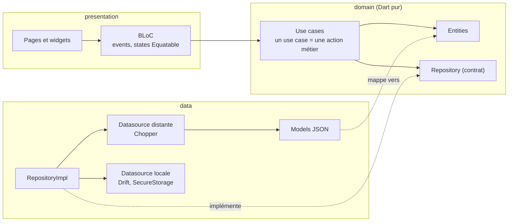

**Règle de dépendance** : `presentation → domain ← data`. Le domaine ne dépend d'aucun framework. Les erreurs voyagent sous forme `Either<Failure, T>` (bibliothèque `fpdart`) : le BLoC ne manipule jamais d'exception brute.

### 8.2 Le module de référence `players`

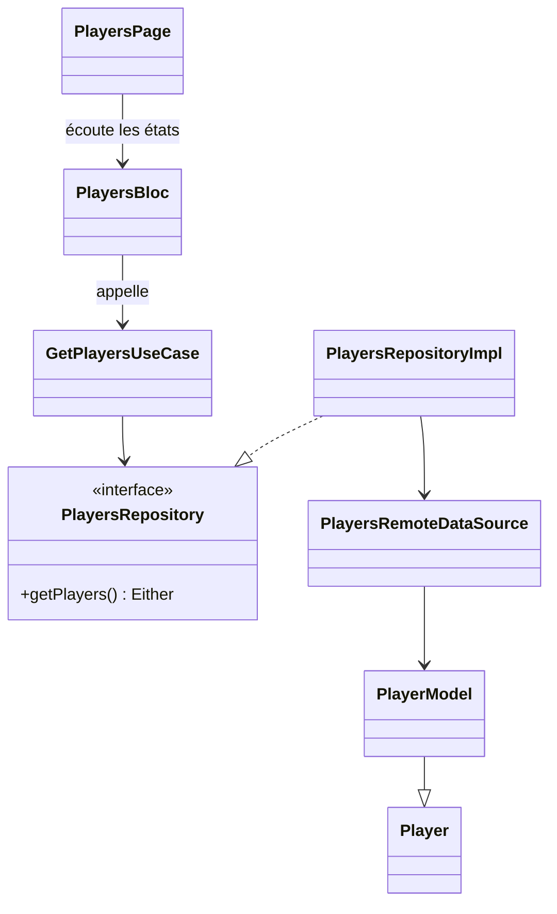

Fichiers réels : `presentation/bloc/players_{bloc,event,state}.dart`, `presentation/pages/players_page.dart`, `domain/{entities,repositories,usecases}`, `data/{models,datasources,repositories}`. Toute nouvelle fonctionnalité copie cette structure.

### 8.3 Injection de dépendances

`GetIt` + `Injectable` : les classes sont annotées (`@injectable`, `@lazySingleton`) et `make codegen` (build_runner) génère `lib/di/injection.config.dart`. `register_module.dart` enregistre les dépendances tierces (client Chopper, stockage sécurisé). Les BLoC sont fournis aux pages via `BlocProvider`.

### 8.4 Réseau : Chopper et pile d'intercepteurs

La cible (`MOB-FND-06` à `MOB-FND-13`) est une pile d'intercepteurs ordonnée :

| Intercepteur | Rôle | Issue |
| --- | --- | --- |
| `AuthInterceptor` | Lit le jeton dans `flutter_secure_storage` et ajoute `Authorization: Bearer` | `MOB-FND-07` |
| `LocaleInterceptor` | `Accept-Language` (fr/en/es) | `MOB-FND-08` |
| `LoggingInterceptor` | Journal + corrélation `X-Request-Id`/traceId | `MOB-FND-09` |
| `RetryInterceptor` | Nouvelles tentatives avec backoff court (lectures idempotentes) | `MOB-FND-10` |
| `ErrorMappingInterceptor` | HTTP → exceptions typées → `Failure` | `MOB-FND-11` |
| `AppAuthenticator` | Sur 401 `TOKEN_EXPIRED` : refresh à rotation **sans course** puis rejeu | `MOB-FND-12` |

> **État du code** : `AuthInterceptor` et un `AppAuthenticator` **squelette** (le refresh est un `À faire`) existent ; le reste est à construire. Le convertisseur JSON (`MOB-FND-13`) gère l'enveloppe `{ success, data }` et les pages.

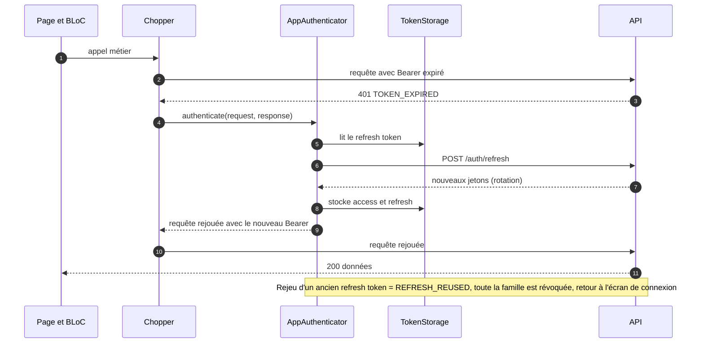

Les appels concurrents qui reçoivent 401 simultanément doivent **attendre le même refresh** (verrou unique) : c'est le sens de « sans course » dans `MOB-FND-12`.

### 8.5 Persistance locale et hors-ligne

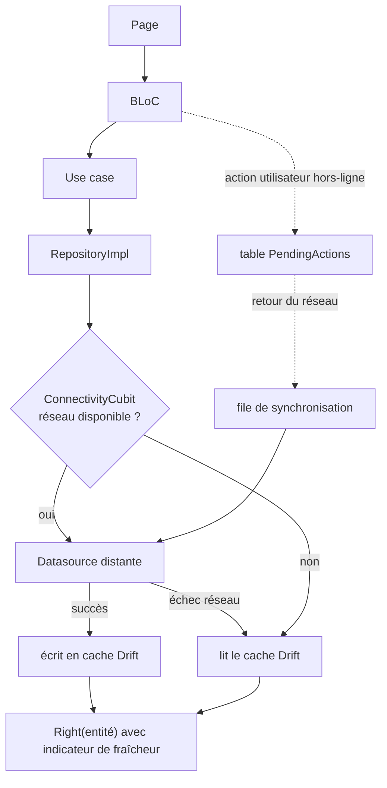

- **Drift (SQLite)** : base `AppDatabase` avec tables socle (cache, file d'actions, préférences), migrations versionnées testées (`MOB-FND-18/19`), chiffrement SQLCipher prévu (`MOB-FND-45`).
- **Politique « cache-then-network »** avec TTL et invalidation (`MOB-FND-20`) : le dashboard, l'historique consulté et le quiz déjà chargé restent disponibles hors-ligne (CDC §3.5).
- **Secrets** : jetons dans `flutter_secure_storage` (Keychain / Keystore) ; préférences simples dans `shared_preferences`.
- **Actions hors-ligne** : `PendingActions` rejoue les actions idempotentes au retour du réseau (`MOB-FND-22`) ; les actions sensibles (vote, tentative de jeu) exigent le serveur.

### 8.6 Navigation, état global, thème, i18n

| Sujet | Choix | Détail |
| --- | --- | --- |
| Navigation | `go_router` 17 | Splash → onboarding/auth → `ShellRoute` à **5 onglets** (Accueil, Jeux, Fantasy, Communauté, Profil) avec piles indépendantes ; gardes lisant l'`AuthBloc` ; deep links (`MOB-FND-17`) |
| État global | `AuthBloc`, `LocaleCubit`, `ThemeCubit`, `ConnectivityCubit` | Restauration de session au démarrage (`MOB-FND-14`) |
| Thème | `core/theme` (`app_colors`, `app_typography`, `app_spacing`, `app_theme`) | Seul endroit autorisé pour couleurs, espacements et typographies ; clair/sombre/système |
| Widgets partagés | `core/widgets` | `app_button`, `app_loading`, `app_error_view` aujourd'hui ; le design system complet (MOB-ZA à ZE) les étend |
| i18n | ARB `app_fr.arb` (modèle), `app_en.arb`, `app_es.arb` | Aucun texte en dur (règle lint `MOB-FND-46`) ; contrôle CI des clés manquantes |
| Environnements | `--dart-define=APP_ENV=development|staging|production` + `.env` | Trois flavors (`MOB-FND-01`) |
| Firebase | Core, Messaging, Crashlytics, Performance, Analytics | Analytics et télémétrie conditionnés au consentement `analytics` |

### 8.7 Quatre états d'écran

Chaque écran gère explicitement **chargement, contenu, vide, erreur** (`MOB-FND-26`) plus les états système globaux de F04 (hors-ligne, 5xx, 429, maintenance, mise à jour forcée). C'est une exigence transverse, pas un détail de présentation.

---

## 9. Architecture du back-office React

SPA **React 18 + Vite + TypeScript strict**, servie par nginx non-root, qui proxifie `/api/` vers l'API : l'admin et l'API partagent **la même origine**, ce qui permet des cookies `SameSite=Strict`.

### 9.1 Les couches

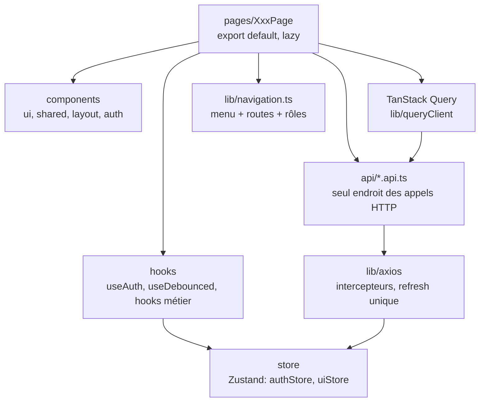

| Règle | Détail |
| --- | --- |
| Pages | `XxxPage` en `export default`, chargées en `lazy` par module |
| Composants | Exports nommés ; styles par **tokens** Tailwind (`bg-surface`, `text-primary`), jamais de couleur en dur |
| Appels HTTP | Uniquement dans `src/api/*.api.ts`, jamais dans un composant |
| Données serveur | TanStack Query (clés `['players', { q, page }]`, `staleTime` 30 s, pas de retry sur 4xx) |
| État global léger | Zustand (`authStore`, `uiStore` pour thème/sidebar) |
| Formulaires | React Hook Form + Zod, messages en français |
| Alias | `@/` pour `src/` |
| Source unique de navigation | `lib/navigation.ts` : menu **et** routes, filtrés par rôle |

### 9.2 Authentification et cloisonnement par rôle

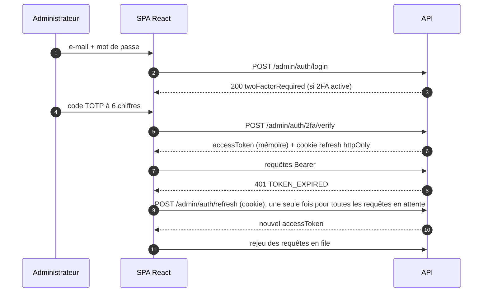

- Le **jeton d'accès n'est jamais persisté** (mémoire uniquement, ADR 0003) ; seul le profil l'est pour l'affichage immédiat.
- `ProtectedRoute allowedRoles` cloisonne chaque section **en plus** du RBAC de l'API (défense en profondeur) : l'API reste la seule autorité.
- Échec du refresh → session purgée → redirection `/login`.
- Détails des rôles et permissions : `03-securite-et-rgpd.md`.

### 9.3 Design system et qualité

Tokens CSS (`src/index.css`) **identiques** à ceux du mobile ; Tailwind les expose ; mode sombre via `[data-theme="dark"]` sans flash (`ADM-FND-09`). Polices Barlow Condensed (titres) et Inter (texte), auto-hébergées. Composants façon shadcn sur primitives Radix, documentés dans Storybook (`ADM-ADS`). Tests : Vitest (unitaires, composants), Playwright (e2e par rôle), axe (accessibilité en CI).

---

## 10. Carte des fonctionnalités F01 à F24

Chaque fonctionnalité fait l'objet d'un document `features/Fxx-<slug>.md` suivant un gabarit commun (résumé, user stories, architecture, écrans, flux, API, données, asynchrone, règles, sécurité, erreurs, connexions, observabilité, points ouverts). Le tableau relie chaque fonctionnalité à ses **épopées de backlog** dans les trois dépôts.

| Code | Fonctionnalité | Phase | Priorité | Épopées API | Épopées mobile | Épopées admin |
| --- | --- | --- | --- | --- | --- | --- |
| **F01** | Authentification et comptes (e-mail, Google, Apple, sessions, appareils) | 1 | P0 | `API-AUTH` (01-20, 32-45) | `MOB-B` | `ADM-WA` |
| **F02** | Onboarding et profil initial (pays/ville, joueur préféré, ancienneté) | 1 | P0 | `API-AUTH-28/29/30` | `MOB-B` | — |
| **F03** | Paramètres, compte et RGPD (consentements, export, suppression) | 1 | P0 | `API-AUTH` (21-27) | `MOB-Q` | `ADM-WJ` (vue utilisateurs) |
| **F04** | États système (hors-ligne, 5xx, 429, maintenance, mise à jour forcée) | 0-1 | P0 | `API-PLAT` (01-07) | `MOB-A` | — |
| **F05** | Données football (joueurs, équipes, compétitions, matchs, synchro) | 1 | P0 | `API-FOOT` | `MOB-F` (lecture) | `ADM-WC`, `ADM-WD` |
| **F06** | Accueil / tableau de bord | 1 | P0 | `API-JEUX-18`, `API-FOOT-14` | `MOB-C` | `ADM-WB` (tableau de bord admin) |
| **F07** | Historique et frise chronologique | 1 | P0 | `API-FOOT` (16-19) | `MOB-F` | `ADM-WE` |
| **F08** | Calendrier et export agenda (`.ics`, `webcal`) | 1 | P0 | `API-CAL` | `MOB-L` | — |
| **F09** | Guess the Player | 1 | P0 | `API-JEUX` (01-10) | `MOB-D` | `ADM-WF` (planification) |
| **F10** | Quiz adaptatif | 1 | P0 | `API-JEUX` (11-31) | `MOB-E` | `ADM-WF` |
| **F11** | Comparateur GOAT et votes | 2 | P1 | `API-GOAT` | `MOB-G` | `ADM-WJ` |
| **F12** | Culé Passport (points, séries, niveaux, badges) | 2 | P1 | `API-PASS` (+ `API-JEUX-19/20`) | `MOB-P` | `ADM-WJ` |
| **F13** | Fantasy Barça | 2 | P1 | `API-FANT` (01-24) | `MOB-H` | `ADM-WJ` (barème) |
| **F14** | La Masia Academy | 3 | P2 | `API-FANT` (25-34) | `MOB-I` | — |
| **F15** | Carte communautaire | 2 | P1 | `API-COMM` (01-14) | `MOB-J` | — |
| **F16** | Groupes locaux, fil, watch parties | 2 | P1 | `API-COMM` (15-33) | `MOB-K` | `ADM-WG` (validation des groupes) |
| **F17** | Modération et audit | 2 | P0 | `API-MODER` | `MOB-K` (signalement) | `ADM-WG` |
| **F18** | Assistant IA Barça AI | 1 | P0 | `API-IA` | `MOB-N` | `ADM-WI` (quotas) |
| **F19** | Wallpapers IA | 3 | P2 | `API-WALL` | `MOB-M` | — |
| **F20** | Notifications push et centre de notifications | 1 | P0 | `API-NOTIF` | `MOB-O` | `ADM-WI` (campagnes) |
| **F21** | Back-office contenu (joueurs, matchs, anecdotes, questions) | 1 | P0 | `API-FOOT` (31-49), `API-JEUX` (25-31) | — | `ADM-WC`, `ADM-WD`, `ADM-WE`, `ADM-WF` |
| **F22** | Back-office supervision, comptes et configuration | 1 | P0 | `API-PLAT` (10-20), `API-AUTH` (32-40) | — | `ADM-WA`, `ADM-WB`, `ADM-WH`, `ADM-WI`, `ADM-WJ` |
| **F23** | Design system (tokens, composants, animations) | 0 | P0 | — | `MOB-ZA` à `MOB-ZE` | `ADM-ADS` |
| **F24** | Plateforme (socle, observabilité, qualité, exploitation) | 0-2 | P0 | `API-PLAT` | `MOB-FND` | `ADM-FND` |

> Les fourchettes `(01-20)` désignent des numéros d'issues dans l'épopée ; elles servent de repère de partage entre fonctionnalités (par exemple `API-AUTH` contient à la fois l'identité F01, le RGPD F03 et l'administration F22). Les documents `features/Fxx` donnent la liste exacte.

### 10.1 Fonctionnalités par couche de valeur

```mermaid
flowchart LR
  subgraph FOND["Fondations"]
    F23["F23 Design system"]
    F24["F24 Plateforme"]
    F04["F04 États système"]
    F01["F01 Auth"]
  end
  subgraph DON["Données et contenu"]
    F05["F05 Données football"]
    F21["F21 BO contenu"]
    F07["F07 Historique"]
    F08["F08 Calendrier"]
  end
  subgraph JEU["Engagement et jeux"]
    F09["F09 Guess"]
    F10["F10 Quiz"]
    F11["F11 GOAT"]
    F13["F13 Fantasy"]
    F14["F14 Masia"]
    F12["F12 Passport"]
  end
  subgraph SOC["Communauté"]
    F15["F15 Carte"]
    F16["F16 Groupes"]
    F17["F17 Modération"]
  end
  subgraph IAS["IA et canaux"]
    F18["F18 Assistant"]
    F19["F19 Wallpapers"]
    F20["F20 Notifications"]
  end
  FOND --> DON
  DON --> JEU
  DON --> IAS
  JEU --> SOC
  SOC --> IAS
```

---

## 11. Interdépendances entre fonctionnalités

Les dépendances déterminent l'**ordre de réalisation** et les **contrats entre modules**. Elles sont lues dans les sections « Dépendances » des issues et dans les contrats inter-modules (par exemple le catalogue d'événements d'activité `API-PASS-28`).

### 11.1 Dépendances de construction (qui doit exister avant qui)

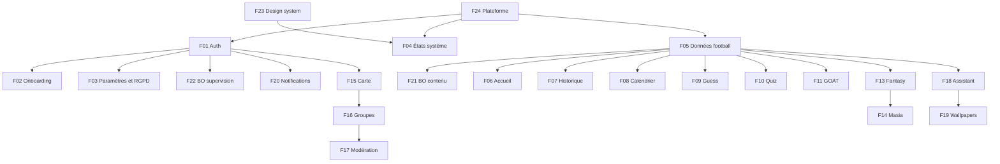

### 11.2 Flux de données entre modules (qui alimente qui)

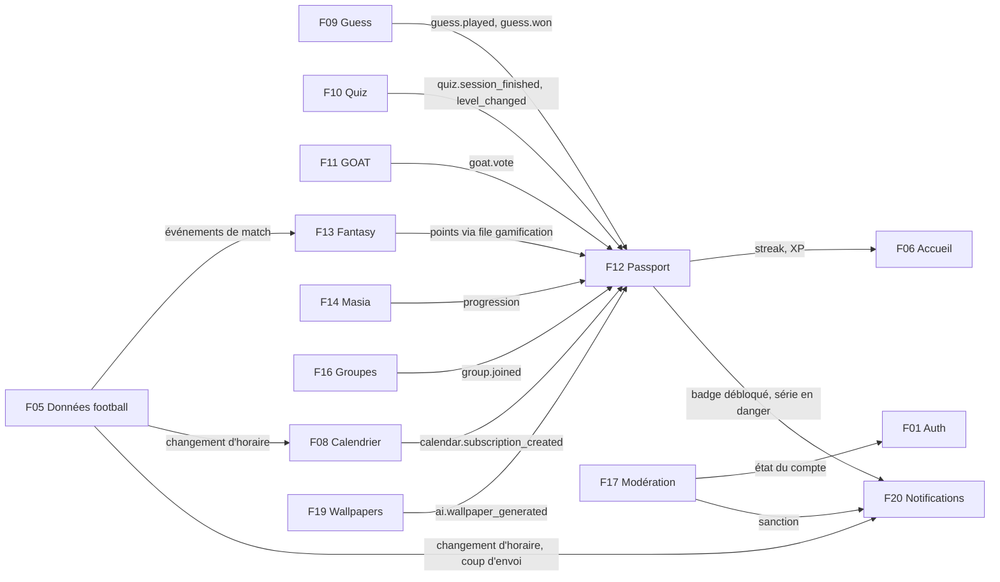

### 11.3 Tableau des interdépendances principales

| Fonctionnalité | Dépend de | Alimente | Mécanisme de couplage |
| --- | --- | --- | --- |
| F01 Auth | F24 (config, e-mails), F17 (états de compte) | toutes les routes authentifiées | JWT + `protect` ; statuts `active|suspended|banned|deleted` |
| F03 RGPD | F01, **toutes** les fonctionnalités qui stockent des données personnelles | F01 (suppression) | Chaque module fournit son export et sa suppression (`API-JEUX-33`, `API-IA-27/28`, `API-WALL-28`, `API-FANT-22`, `API-GOAT-17`, `API-COMM-29`, `API-PASS-29`, `API-CAL-20`) |
| F05 Données football | API football (externe), F21 | F06, F07, F08, F09, F10, F11, F13, F18, F20 | Collections `players`, `matches`, `teams`, `competitions` ; lecture publique avec ETag et cache Redis |
| F09 / F10 Jeux | F05, F21 | F12, F06 | `recordActivity`, hub `GET /games/hub` |
| F12 Passport | F09, F10, F11, F13, F14, F16, F08, F19 | F06, F20, F03 | Point d'entrée unique `recordActivity` ; événements fermés (types déclarés dans `API-PASS-28`) |
| F13 Fantasy | F05 (événements de match) | F12, F06, F14 | Job `compute-fantasy-scores`, barème `ScoringRule` versionné |
| F15 / F16 Carte et groupes | F01 (consentement géoloc), F17 | F20, F12 | Agrégats `locationaggregates` (job toutes les 10 min) |
| F17 Modération | F16, F18, F19 (contenus signalables) | F01, F20 | `ModerationReport`, `ModerationAction` immuables, middleware d'état de compte |
| F18 Assistant | F05, F24 (feature flags, quotas) | F19 (actions), F12 | Pipeline RAG en 8 étapes, kill switch `assistant_enabled` |
| F20 Notifications | F01 (consentement), F05, F12, F16, F17 | toutes | File `notifications`, FCM, préférences par catégorie |
| F22 BO supervision | F24 (métriques, audit), F20 (campagnes) | F18 (quotas), F24 (flags) | Endpoints `/admin/observability/*`, `/admin/config/*` |

### 11.4 Cas concret : un soir de match

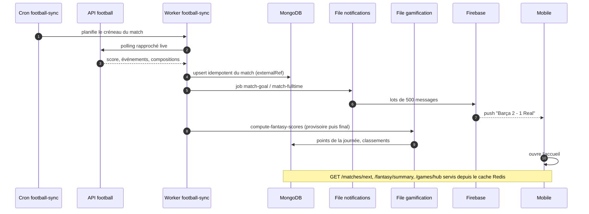

Ce scénario illustre le **pic de trafic** pour lequel les tests de charge `spike` et `soir de match` sont conçus (voir `05-observabilite-et-qualite.md`).

---

## 12. Stack technique et justification des choix

### 12.1 Vue d'ensemble

| Couche | Technologie | Pourquoi ce choix |
| --- | --- | --- |
| API : runtime | **Node 22** + **TypeScript strict** | Écosystème riche pour I/O, typage fort partagé avec l'admin (types générés depuis OpenAPI, `ADM-FND-06`) |
| API : framework | **Express 4** en couches, sans DI ni Repository (ADR 0001) | Stack « ClicEat » déjà maîtrisée, conventions de déploiement éprouvées, peu de magie : moins de coût d'apprentissage qu'un framework à décorateurs |
| API : base | **MongoDB 7** en **replica set** via **Mongoose 9** | Contenus localisés `{fr,en,es}` naturellement embarqués ; événements de match et compositions embarqués ; `2dsphere` pour la carte ; transactions grâce au replica set |
| API : cache et files | **Redis 7** + **BullMQ** | Cache-aside, limiteurs distribués, liste noire JWT, sorted sets de classements, files persistées et reprises après redémarrage |
| API : tâches planifiées | **node-cron** (puis leader unique, `API-PLAT-35`) | Suffisant pour quelques crons ; élection de leader Redis prévue quand il y aura plusieurs réplicas |
| API : process | **PM2** en cluster, 2 instances par défaut | Utilise plusieurs cœurs sans orchestrateur ; `kill_timeout` 30 s pour l'arrêt gracieux |
| API : sécurité | **Argon2id**, **JWT HS256** 15 min + refresh opaque à rotation, **Joi**, **helmet**, **express-rate-limit** + Redis | Standards OWASP (voir `03-securite-et-rgpd.md`) |
| API : doc | **Swagger / OpenAPI** générée depuis JSDoc (`npm run export:swagger`) | Contrat unique mobile/admin ; `check:swagger` bloque la CI si le contrat dérive |
| API : observabilité | **Winston** (JSON), **prom-client**, **OpenTelemetry** (OTLP) | Standards ouverts ; stack Prometheus/Grafana/Jaeger auto-hébergée |
| Mobile | **Flutter 3.47** (Dart ≥ 3.9) | Un code pour iOS et Android, animations riches (exigence « niveau des meilleures apps sportives ») |
| Mobile : état | **flutter_bloc 9** + **Equatable** | États immuables testables (`bloc_test`), séparation nette UI/logique |
| Mobile : DI | **GetIt + Injectable** | Génération de code, pas de réflexion |
| Mobile : réseau | **Chopper** + intercepteurs | Client typé généré, pile d'intercepteurs (auth, retry, erreurs) |
| Mobile : local | **Drift** (SQLite), `flutter_secure_storage`, `shared_preferences` | Cache relationnel hors-ligne, jetons chiffrés par le système |
| Mobile : navigation | **go_router** | Deep links, `ShellRoute`, gardes |
| Mobile : erreurs | **fpdart `Either<Failure, T>`** | Pas d'exception qui traverse les couches |
| Admin | **React 18 + Vite + TypeScript**, **Tailwind** (tokens), **TanStack Query/Table**, **Zustand**, **React Hook Form + Zod**, **axios** | SPA rapide à construire, état serveur géré par Query, tokens partagés avec le mobile |
| Admin : serveur | **nginx non-root** (ADR 0002) | Image minuscule, en-têtes de sécurité, proxy `/api` même origine |
| Push | **Firebase Cloud Messaging** | Gratuit au volume visé, iOS et Android |
| Conteneurs | **Docker multi-stage** + **Docker Compose** sur VPS | Un projet Compose par environnement, isolation par réseaux |
| CI/CD | **GitHub Actions**, images **GHCR**, déploiement SSH avec rollback | Voir `04-deploiement-et-cicd.md` |
| Tests de charge | **k6** | Scénarios JS versionnés, seuils exploitables en CI |

### 12.2 Décisions d'architecture enregistrées (ADR)

| ADR | Dépôt | Décision |
| --- | --- | --- |
| 0001 `express-mongodb` | API | Express 4 + Mongo plutôt que NestJS/PostgreSQL du CDC |
| 0002 `argon2id-jwt-rotation` | API | Argon2id (19 MiB, t=2, p=1), JWT court + refresh à rotation avec détection de rejeu |
| 0003 `versions-aaaammjj-n` | les 3 | Versionnage de déploiement `AAAAMMJJ.N` plutôt que SemVer seul |
| 0004 `mongo-sans-auth-reseau-interne` | API | MongoDB sans `--auth`, isolé par réseau Docker `internal` |
| 0001 `react-vite-spa` | Admin | SPA Vite plutôt que framework SSR |
| 0002 `nginx-plutot-qu-apache` | Admin | nginx non-root pour servir la SPA |
| 0003 `jeton-en-memoire` | Admin | Jeton d'accès jamais persisté |
| 0001 `base-template-flutter` / 0002 `env-dart-define` | Mobile | Template de départ, configuration par `--dart-define` |

### 12.3 Compromis assumés

- **Pas de Repository ni de DI côté API** : on gagne en simplicité, on perd la substitution des dépendances ; les tests d'intégration utilisent une vraie base (conteneur Mongo/Redis) plutôt que des mocks.
- **MongoDB sans authentification** : acceptable tant que le réseau Docker `internal: true` isole la base (aucun port publié) ; à revoir si la base devient accessible hors de ce réseau (ADR 0004).
- **Un seul VPS** : disponibilité cible 99,5 % atteinte par rollback automatique et sauvegardes, pas par redondance ; le CDC mentionne le blue-green comme évolution possible.
- **Admin en français uniquement** : choix assumé du CDC Admin pour limiter le périmètre ; le contenu édité, lui, est **trilingue**.

---

## 13. Phases et roadmap

Le plan de réalisation (`docs/pilotage/PLAN_REALISATION.md`, calculé dans le classeur Excel de pilotage) découpe **1 322 issues** (API 471, mobile 599, admin 252) en quatre phases. Hypothèses par défaut : début le 02/11/2026, focus 80 %, marge 15 %, équipe 3 API / 3 mobile / 2 admin, décalage mobile/admin de 20 jours ouvrés sur l'API.

| Phase | Contenu | Issues | Charge (j·p) | Fin prévue | Jalon (après recette) |
| --- | --- | --- | --- | --- | --- |
| **0 — Socle technique** | Trois dépôts, CI/CD, auth de base, i18n, thèmes, design system, observabilité de base, états système | 223 | 224 | 17/02/2027 | 03/03/2027 |
| **1 — MVP** | Identité complète, données football, accueil, calendrier, jeux, assistant IA, notifications, back-office de base, exploitation | 688 | 714 | 16/08/2027 | 30/08/2027 |
| **2 — Communautaire et compétitif** | Carte, groupes, modération, GOAT, Fantasy, Passport | 313 | 340 | 19/11/2027 | 03/12/2027 |
| **3 — Fonctionnalités avancées** | La Masia, Wallpapers IA, évolutions admin | 98 | 92 | 27/12/2027 | 10/01/2028 |

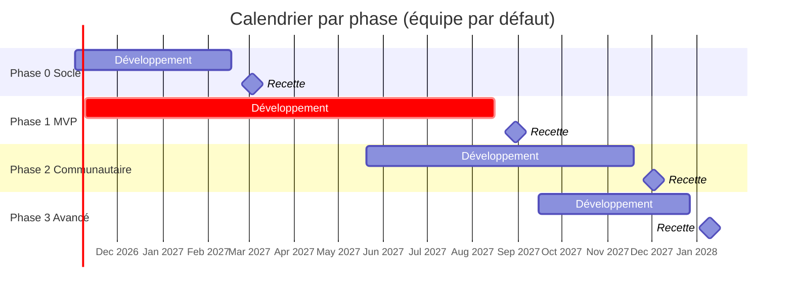

> **À savoir** : la charge totale (~1 372 jours·personne) représente ~14 mois avec 8 développeurs, environ 2,5 ans avec 3, et plusieurs années en solo. Le CDC estimait 26 à 38 semaines pour un développeur unique, sans ce niveau de détail. Le levier principal est le **choix du périmètre par phase** (MVP d'abord).

### 13.1 Étapes de la phase 1 (MVP)

| Étape | Objet | Épopées |
| --- | --- | --- |
| 1.1 | Identité, comptes, paramètres | `API-AUTH`, `MOB-B`, `MOB-Q`, `ADM-WA`, `ADM-WI` |
| 1.2 | Données football, historique, contenu | `API-FOOT`, `MOB-F`, `ADM-WC`, `ADM-WD`, `ADM-WE` |
| 1.3 | Accueil, calendrier, tableau de bord admin | `API-CAL`, `MOB-C`, `MOB-L`, `ADM-WB` |
| 1.4 | Jeux quotidiens | `API-JEUX`, `MOB-D`, `MOB-E`, `ADM-WF` |
| 1.5 | Assistant IA | `API-IA`, `MOB-N` |
| 1.6 | Notifications | `API-NOTIF`, `MOB-O` |
| 1.7 | Exploitation et supervision | `API-PLAT`, `ADM-WH`, `ADM-WJ` |
| 1.8 | Recette MVP et bêta fermée | — |

### 13.2 Règles d'ordonnancement (rappel des `CLAUDE.md`)

1. Jalon le plus ancien non terminé, puis priorité P0 → P1 → P2.
2. Dans une priorité, l'ordre des codes de l'épopée, en respectant la section **« Dépendances »** : on ne commence jamais une issue dont une dépendance n'est pas fermée (même si elle est dans un autre dépôt).
3. **Contrat d'abord** : une issue mobile/admin qui consomme un endpoint attend l'issue API (`API-…`) ; en attendant, le mobile travaille avec un mock.
4. Une issue = une branche = une PR vers `dev` (`Closes #N`).
5. Les points marqués « à confirmer » se signalent avant de coder (feuille *Décisions et risques* du classeur de pilotage).

---

## 14. Cartographie des trois dépôts

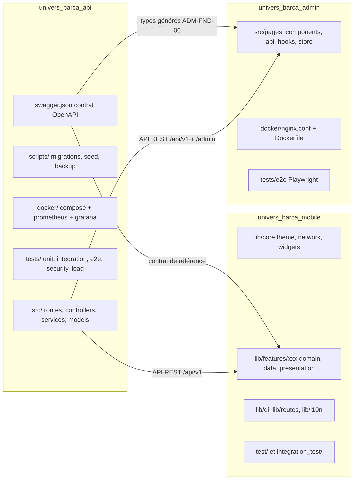

| Aspect | `univers_barca_api` | `univers_barca_mobile` | `univers_barca_admin` |
| --- | --- | --- | --- |
| Langage | TypeScript (Node 22) | Dart ≥ 3.9 / Flutter 3.47.7 | TypeScript (React 18) |
| Issues du backlog | 471 (`API-…`) | 599 (`MOB-…`) | 252 (`ADM-…`) |
| Commandes de contrôle | `npm run lint && format:check && typecheck`, `test:unit|integration|e2e|security`, `check:swagger`, `load:smoke` | `make setup`, `make codegen`, `make check` (analyse + format + tests), `make run-dev` | `npm run lint && format:check && typecheck && test`, `test:e2e` (Playwright) |
| Format | ESLint + Prettier | `dart format --line-length 100` (hors `lib/l10n`), `flutter analyze --fatal-warnings` | ESLint + Prettier |
| Image / livrable | Image Docker GHCR `…/univers_barca_api` | APK / IPA (Firebase App Distribution, TestFlight) | Image Docker GHCR `…/univers_barca_admin` (nginx) |
| Port VPS prod / staging | 5001 / 5002 | — | 8081 / 8082 |
| Workflows | `backend-ci`, `backend-deploy`, `load-test`, `nightly-regression`, `codeql` | `mobile-ci`, `mobile-deploy`, `dependency-audit` | `admin-ci`, `admin-deploy`, `codeql` |
| ADR | `docs/adr/` (4) | `docs/adr/` (3) | `docs/adr/` (4) |
| Docs propres | `docs/{ARCHITECTURE,DATABASE,DEPLOYMENT,DISASTER_RECOVERY,LOAD_TESTING}.md` | `docs/{ARCHITECTURE,DEPLOYMENT,TESTING}.md` | `docs/{ARCHITECTURE,DEPLOYMENT}.md` |

Les trois dépôts partagent : les workflows `labels.yml`, `pr-title.yml`, `dependabot-automerge.yml`, `create-backlog.yml` (création des issues), le dossier `docs/pilotage/` (plan et classeur de suivi) et `docs/maquettes/` (captures des écrans clair/sombre).

### 14.1 Maquettes

Les maquettes servent de **spécification visuelle** : chaque issue d'écran référence ses captures. Elles sont versionnées dans `docs/maquettes/` des dépôts mobile et admin. Exemples (tableau de bord mobile clair/sombre et connexion administrateur) :


---

## 15. Index de la documentation et points de vigilance

### 15.1 Les documents du dossier `docs/architecture/`

| Fichier | Contenu |
| --- | --- |
| `01-vue-ensemble.md` | Ce document |
| `02-architecture-donnees.md` | Modèle de données (collections MongoDB, index, TTL, Redis) |
| `03-securite-et-rgpd.md` | Authentification, RBAC, 2FA, protections, RGPD, STRIDE |
| `04-deploiement-et-cicd.md` | Environnements, pipelines, Docker, rollback, sauvegardes |
| `05-observabilite-et-qualite.md` | Logs, métriques, traces, alertes, tests, k6 |
| `06-glossaire-et-conventions.md` | Glossaire, conventions, comment retrouver l'information dans le backlog |
| `features/F01…F24-*.md` | Un document par fonctionnalité (gabarit en 15 sections) |

**Par où commencer ?** Lire ce document, puis `06` (vocabulaire), puis le document de la fonctionnalité sur laquelle on travaille, puis `03` si elle touche à l'authentification ou aux données personnelles.

### 15.2 Incohérences détectées entre CDC, specs et code

| # | Sujet | CDC | Specs / code | Décision à retenir |
| --- | --- | --- | --- | --- |
| 1 | Stack API | NestJS + Prisma + PostgreSQL | Express 4 + Mongoose + MongoDB | **Code** (ADR 0001) |
| 2 | Branche d'intégration | `develop` + `release/*` + `hotfix/*` | `dev` → `main` uniquement | **Code** (`CONTRIBUTING.md`) |
| 3 | Versionnage | SemVer (CDC Global §6.5) | `AAAAMMJJ.N` + tags `vAAAAMMJJ.N` / `staging-AAAAMMJJ.N` (ADR 0003) | **Code** |
| 4 | Santé | `/health` + `/health/detailed` | `/health`, `/api/health`, `/health/deep` | **Code** |
| 5 | Limite d'authentification | 10 tentatives / 15 min / IP | Code : 20 ; `API-AUTH-07/41` alignent sur 10 + 5 par e-mail | **Spec** (à aligner) |
| 6 | Purge des refresh tokens | 90 jours après révocation | Code : 30 jours | **CDC / spec** (`API-AUTH-13`, `API-PLAT-52`) |
| 7 | Session admin | — | Code : 8 h **absolues** ; spec : 8 h d'**inactivité**, plafond 24 h (`API-AUTH-38`) | **Spec** |
| 8 | Quota wallpapers | 5 / jour (CDC Backend §10.2) | Maquettes : 3 / jour (`API-WALL-08`) | À confirmer (configurable) |
| 9 | Zones tactiles | ≥ 44×44 px (CDC Global §3.3) | `CLAUDE.md` mobile : ≥ 48 dp | **48 dp** (plus strict) |
| 10 | En-tête de trace | `X-Trace-Id` (CDC §6.5) | Code : `X-Request-Id` ; `API-PLAT-05` exige aussi `X-Trace-Id` | Les deux (spec) |
| 11 | Journaux | Graylog (GELF) | Code : Winston JSON console + fichiers 14 j ; GELF = `API-PLAT-25` | **Spec** (à venir) |
| 12 | Seuils de couverture | 70-90 % selon la couche | Code : global 30 %, services auth 60 % ; mobile CI ≥ 60 % ; admin 25 % | **Spec** (`API-PLAT-36`) |
| 13 | Worker | Conteneur `worker` séparé | Code : scheduler dans l'API (instance PM2 0) ; `src/worker.ts` = `API-PLAT-35` | **Spec** |
| 14 | Réseaux Mongo | Auth attendue | ADR 0004 : pas d'auth, réseau interne | **Code** |
| 15 | Suppression de compte | « Tes données ont été effacées » (maquette Q-15) | Purge réelle à J+30 (`API-AUTH-26`) | Arbitrage produit ; l'API renvoie `purgeAt` |
| 16 | Tentatives Guess the Player | 5 à 6 | 6 (`API-JEUX-07`) | **Spec** |
| 17 | Mobile : refresh de jeton | — | `AppAuthenticator` est un squelette | À implémenter (`MOB-FND-12`) |

### 15.3 Où retrouver l'information, en une phrase

- *Une règle chiffrée ?* → l'issue backlog de la fonctionnalité (section « Règles »).
- *Une route ?* → `swagger.json` du dépôt API et le tableau « Contrats d'API » du document `Fxx`.
- *Un modèle de données ?* → `src/models/*.ts` et `docs/DATABASE.md`.
- *Une décision d'architecture ?* → `docs/adr/` du dépôt concerné.
- *Un écran ?* → `docs/maquettes/ecrans/<lettre>/` (mobile) ou `<WA…>` (admin).
