# 02 — Architecture de données

> **À qui s'adresse ce document ?** À toute personne qui rejoint le projet Univers Barça (mobile, admin ou API) et qui doit comprendre **où vivent les données, sous quelle forme, pour combien de temps et comment elles circulent**. Il décrit l'état *réel* du code (dépôt `univers_barca_api`, `src/models/*.ts`) **et** l'état *cible* demandé par le backlog (issues `API-*`, `MOB-*`, `ADM-*`). Les deux sont toujours distingués.

## Sommaire

1. [Vue d'ensemble : quatre magasins de données](#1-vue-densemble--quatre-magasins-de-données)
2. [Conventions transverses](#2-conventions-transverses)
3. [Inventaire complet des collections MongoDB](#3-inventaire-complet-des-collections-mongodb)
4. [Diagrammes entité-relation par domaine](#4-diagrammes-entité-relation-par-domaine)
5. [Références ou documents embarqués : les choix et leurs raisons](#5-références-ou-documents-embarqués--les-choix-et-leurs-raisons)
6. [Index et requêtes critiques](#6-index-et-requêtes-critiques)
7. [Cycle de vie des données et RGPD](#7-cycle-de-vie-des-données-et-rgpd)
8. [Volumétrie et croissance](#8-volumétrie-et-croissance)
9. [Redis : clés, TTL et usages](#9-redis--clés-ttl-et-usages)
10. [Files BullMQ, tâches planifiées et payloads](#10-files-bullmq-tâches-planifiées-et-payloads)
11. [Stockage objet](#11-stockage-objet)
12. [Mobile : base locale Drift et synchronisation hors-ligne](#12-mobile--base-locale-drift-et-synchronisation-hors-ligne)
13. [DTO ↔ modèles](#13-dto--modèles)
14. [Migrations (migrate-mongo) et seed](#14-migrations-migrate-mongo-et-seed)
15. [Dictionnaire de données](#15-dictionnaire-de-données)
16. [Flux de données de bout en bout](#16-flux-de-données-de-bout-en-bout)
17. [Écarts détectés et points ouverts](#17-écarts-détectés-et-points-ouverts)
18. [Pour aller plus loin](#18-pour-aller-plus-loin)

---

## 1. Vue d'ensemble : quatre magasins de données

Univers Barça n'utilise pas « une base de données » mais **quatre magasins complémentaires**, chacun choisi pour ce qu'il fait de mieux. Comprendre cette répartition est la clé de toute l'architecture de données.

| Magasin | Technologie | Ce qu'on y met | Ce qu'on n'y met **jamais** | Perte = ? |
| --- | --- | --- | --- | --- |
| **Base de référence** | MongoDB 7 en *replica set* (même en dev, pour les transactions) via Mongoose | Toute donnée durable : comptes, football, jeux, fantasy, communauté, modération, audit | Fichiers binaires, compteurs très chauds | Grave (restauration depuis `mongodump`, RPO 24 h, RTO 2 h) |
| **Cache et coordination** | Redis 7 (ioredis, BullMQ, rate-limit-redis) | Caches à TTL, verrous, compteurs de quotas, classements (ZSET), files de jobs, blacklist JWT | Donnée qui n'existe nulle part ailleurs | Aucune perte durable : les utilisateurs doivent se reconnecter, les caches se reconstruisent |
| **Stockage objet** | S3-compatible (MinIO en dev, bucket en prod) ; disque local en test | Images (avatars, joueurs, wallpapers générés, médiathèque), archives d'export RGPD, sauvegardes chiffrées | Métadonnées métier (elles restent dans Mongo, l'objet n'est référencé que par une *clé*) | Moyenne (sauvegardes hors VPS) |
| **Cache local mobile** | SQLite via Drift (Flutter) | Snapshots d'affichage hors-ligne, brouillons, file d'actions à rejouer | Jetons (→ Keychain/Keystore), vérité métier (progression, badges, Fantasy) | Aucune : la source de vérité est l'API |

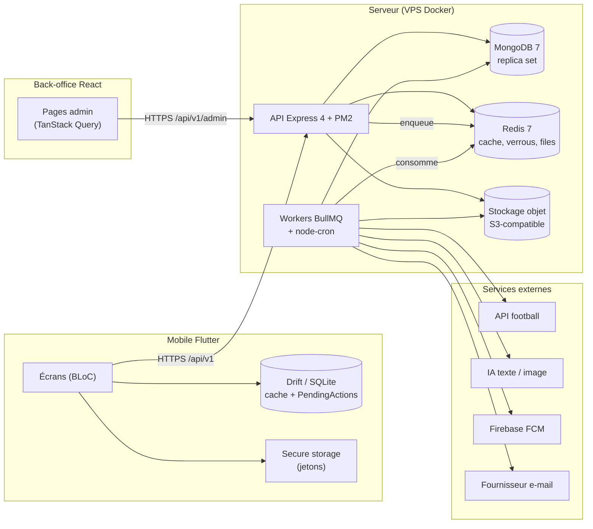

**Légende.** Les flèches pleines sont des appels applicatifs. Redis est à la fois un cache (lu par l'API) et le *bus* des files BullMQ (écrit par l'API, lu par les workers). Les workers tournent aujourd'hui dans le même processus que l'API ; le backlog (`API-PLAT-35`) prévoit un processus `src/worker.ts` séparé, avec un seul ordonnanceur élu par verrou Redis.

### Écart avec les cahiers des charges (CDC)

Les CDC (§4 « Modèle de données (schéma Prisma) », CDC Backend) décrivent **PostgreSQL 16 + PostGIS + Prisma + NestJS**. La stack **réellement retenue** est **Express 4 + TypeScript + Mongoose + MongoDB (replica set) + Redis + BullMQ + node-cron + PM2** (décision tracée dans `docs/adr/0001-express-mongodb.md`). Conséquences concrètes sur les données :

| CDC (Prisma / PostgreSQL) | Réalité (Mongoose / MongoDB) |
| --- | --- |
| Tables relationnelles normalisées, clés étrangères `ON DELETE CASCADE` / `SET NULL` | Références `ObjectId` **sans contrainte** ; la cascade est réalisée **par le code** (purge RGPD, hooks) |
| PostGIS pour la proximité | Index **`2dsphere`** MongoDB sur `GeoJSON Point` |
| `match_events`, `match_lineups`, `player_stat_seasons`, `quiz_answers` = tables séparées | **Embarqués** dans `matches`, `players.stats[]`, `quizsessions.answers[]` (voir §5) |
| Identifiants `uuid` | `ObjectId` (24 hex), exposé en JSON sous la clé `id` (transform `withJson`) |
| `JSONB` pour contenus localisés | Sous-document `{ fr, en, es }` (`i18nField`) |
| Migrations Prisma (`migrate deploy`) | **migrate-mongo**, fichiers `scripts/migrations/AAAAMMJJHHMMSS-*.js` |

---

## 2. Conventions transverses

Ces règles s'appliquent à **toutes** les collections (elles viennent de `src/models/_common.ts`).

1. **Noms de collections** : Mongoose met le nom du modèle au pluriel en minuscules (`User` → `users`, `UserProgress` → `userprogresses`, `Match` → `matches`, `AiQuota` → `aiquotas`). Le backlog et les CDC utilisent parfois du `snake_case` (`user_progress`, `daily_challenges`, `media_assets`) : **c'est le même objet, seul le nom de collection exact fait foi dans le code**. Ce document donne le nom Mongoose (« `userprogresses` ») et signale l'alias backlog quand il existe.
2. **Horodatage** : `timestamps: true` → `createdAt`, `updatedAt` (UTC). Les journaux immuables (`moderationactions`, `auditlogs`) n'ont que `createdAt`.
3. **`versionKey: false`** : pas de champ `__v`. Le contrôle de concurrence optimiste est fait par champs métier (`version`, `If-Match` sur `updatedAt`) quand il est nécessaire.
4. **Sérialisation JSON** (`withJson`) : `_id` devient `id` (string) et `__v` est supprimé. Les champs sensibles (`passwordHash`, `totpSecret`, hachages de jetons…) sont déclarés `select: false` : ils ne sortent jamais d'une requête normale.
5. **Contenus localisés** : champ `{ fr, en, es }` (`i18nField`). Le **français est obligatoire**, EN/ES sont exigés **avant publication** (statut intermédiaire `awaiting-translation`). Un champ dérivé `missingLocales[]` est prévu par le backlog (`API-FOOT-01`, `API-JEUX-11`).
6. **Dates calendaires** (« le défi du jour », « la semaine ISO ») : stockées en **chaîne `AAAA-MM-JJ`** (`dayKey`, `date`, `lastActivityDate`) dans le **fuseau de référence `Europe/Madrid`** ; les instants (`kickoffAt`, `createdAt`) sont toujours en **UTC**.
7. **Unicité optionnelle** : index `unique + sparse` (ex. `users.email`, `players.externalRef`) pour autoriser l'absence de valeur sans collision.
8. **Pas de donnée personnelle dans les clés Redis ni dans les journaux** (userId opaque uniquement ; voir §9).
9. **Idempotence par clé d'unicité** : chaque écriture rejouable (tentative de jeu, attribution de points, calcul de journée) s'appuie sur un **index unique composite** pour que le rejeu échoue proprement (erreur `E11000`) au lieu de dupliquer.

---

## 3. Inventaire complet des collections MongoDB

**Légende de statut**

* **E** = *existant dans le code* (`src/models/*.ts`, schéma déjà présent ; peut être « durci » par une issue).
* **B** = *à créer selon le backlog* (nouvelle collection décrite dans une issue).
* « durci par » = le schéma existe mais gagne des champs/index via l'issue citée.

### 3.1 Synthèse chiffrée

| | Nombre |
| --- | --- |
| Collections **existantes** dans le code (`src/models`) | **35** |
| Collections **à créer** selon le backlog (dont la collection technique `counters`) | **48** |
| Total cible (hors collection interne de migrate-mongo `migrations_changelog`) | **83** |

### 3.2 Identité et compte

| Collection | Statut | Rôle | Issues |
| --- | --- | --- | --- |
| `users` | **E** (durci) | Compte supporter : profil, préférences, état (`active/suspended/banned/deleted`), localisation approximative | `API-AUTH-04/08/10/26/28/29`, `API-COMM-01`, `API-MODER-03`, `API-PASS-19` |
| `refreshtokens` | **E** (durci) | Refresh tokens hachés, rotation, détection de rejeu par `familyId`, TTL | `API-AUTH-13/14` |
| `consentrecords` | **E** (durci) | Historique **append-only** des consentements RGPD | `API-AUTH-21/22`, `API-COMM-04`, `API-NOTIF-06` |
| `legaldocuments` | **B** | Versions des CGU, confidentialité, charte ; re-acceptation | `API-AUTH-22` |
| `dataexports` | **B** | Demandes d'export RGPD (statut, clé de l'archive, expiration) | `API-AUTH-24/25` |
| `purgereports` | **B** | Rapport de purge J+30 par compte, **sans donnée personnelle** (TTL 1 an) | `API-AUTH-27` |
| `blockedidentities` (`blocked_identities`) | **B** | Hash salé des e-mails bannis (pas de ré-inscription) | `API-MODER-03` |
| `adminusers` | **E** (durci) | Comptes du back-office (rôles `content-manager`, `moderator`, `super-admin`), 2FA TOTP | `API-AUTH-34` |
| `adminsessions` | **E** | Sessions admin (cookie httpOnly, TTL) | — |

### 3.3 Football (référentiel et éditorial)

| Collection | Statut | Rôle | Issues |
| --- | --- | --- | --- |
| `players` | **E** (durci) | Fiche joueur : bio i18n, stats par saison **embarquées**, statut éditorial | `API-FOOT-01`, `API-CAL-01`, `API-WALL-02` |
| `teams` | **E** (durci) | Équipes (clubs/sélections), écusson, `isOwnClub` | `API-FOOT-02`, `API-CAL-01` |
| `competitions` | **E** (durci) | Compétitions (Liga, LDC, Coupe du Roi, amicaux) | `API-FOOT-02`, `API-CAL-01` |
| `matches` | **E** (durci) | Match avec **événements et compositions embarqués**, conflits de synchro | `API-FOOT-03`, `API-FANT-09`, `API-CAL-02` |
| `anecdotes` | **E** (durci) | « Aujourd'hui dans l'histoire » | `API-FOOT-04` |
| `mediaassets` (`media_assets`) | **B** | Médiathèque : clé de stockage, taille, dimensions, `usageCount` | `API-FOOT-05`, `ADM-WE-10/11/12` |
| `syncruns` | **B** | Journal de chaque exécution de synchronisation football | `API-FOOT-24/25` |
| `playermatchstats` | **B** | Statistiques normalisées par joueur et par match (alimente le Fantasy) | `API-FANT-09` |
| `calendartombstones` | **B** | « Pierres tombales » de matchs supprimés, émis `CANCELLED` 30 j dans le flux ICS (TTL 30 j) | `API-CAL-11` |

### 3.4 Jeux et gamification

| Collection | Statut | Rôle | Issues |
| --- | --- | --- | --- |
| `dailychallenges` (`daily_challenges`) | **E** (durci) | Un défi par jour et par type (`guess_player`, `quiz`) | `API-JEUX-01/02` |
| `guessattempts` (`guess_attempts`) | **E** (durci) | Tentatives Guess the Player (≤ 6) | `API-JEUX-01/07` |
| `guessplays` | **B** | Synthèse d'une partie (en cours / gagnée / perdue) | `API-JEUX-01` |
| `quizquestions` | **E** (durci) | Banque de questions trilingues | `API-JEUX-11/25/29`, `ADM-WF-02` |
| `quizsessions` | **E** (durci) | Session de 10 questions avec `answers[]` embarqué | `API-JEUX-11/16` |
| `questionstatdailies` (`question_stats_daily`) | **B** | Statistiques quotidiennes par question (TTL 400 j) | `API-JEUX-11` |
| `userseenquestions` (`user_seen_questions`) | **B** | Anti-répétition des questions (TTL 45 j) | `API-JEUX-13` |
| `quizleagues` (`quiz_leagues`) | **B** | Ligues privées `BARCA-XXXX` | `API-JEUX-23` |
| `userprogresses` (`user_progress`) | **E** (durci) | Agrégat de progression : points, séries, niveau, badges | `API-PASS-01`, `API-JEUX-12/19` |
| `badges` | **E** | Catalogue de badges | `API-PASS-07` |
| `scoringrules` | **E** (durci) | Barème (Fantasy versionné ; points jeux) | `API-FANT-08`, `API-JEUX-20` |
| `pointsledger` (`points_ledger`) | **B** | Registre idempotent d'attribution de points | `API-JEUX-20` |
| `useractivities` | **B** | Journal d'activité Passport (source de vérité des points) | `API-PASS-02/03` |
| `userbadges` | **B** | Badges débloqués (source de vérité) | `API-PASS-*` |
| `passportpointrules` | **B** | Barème de points Passport et plafonds quotidiens | `API-PASS-03/24` |
| `userstatsweeklies` (`UserStatsWeekly`) | **B** | Agrégation hebdomadaire après 24 mois | `API-PASS-02` |
| `sharetokens` | **B** | Jetons de partage de badge/profil (hash, TTL `expiresAt`) | `API-PASS-23/30` |
| `goatvotes` (`goat_votes`) | **B** | Vote d'un utilisateur dans un duel | `API-GOAT-01` |
| `goatduels` (`goat_duels`) | **B** | Agrégat d'un duel (clé `pairKey`) | `API-GOAT-01` |
| `goathourlystats` | **B** | Votes agrégés par heure (TTL 90 j) | `API-GOAT-26` |
| `goatcriteria` (config) | **B** | Catalogue des critères de vote | `API-GOAT-02` |
| `counters` | **B** (technique) | Compteurs atomiques (n° de défi, code lisible `q-00481`) | `API-JEUX-01/11` |

### 3.5 Fantasy et La Masia

| Collection | Statut | Rôle | Issues |
| --- | --- | --- | --- |
| `fantasyteams` (`fantasy_teams`) | **E** (durci) | XI hebdomadaire d'un utilisateur (11 sélections embarquées) | `API-FANT-02` |
| `fantasygameweekscores` (`fantasy_gameweek_scores`) | **B** | Détail des points par journée | `API-FANT-02` |
| `gameweeks` | **B** | Définition d'une journée (matchs, verrouillage, statut) | `API-FANT-01` |
| `scoringrulesets` | **B** | Version du barème (activée à partir d'une journée) | `API-FANT-08` |
| `fantasyleagues` | **E** (durci) | Ligues privées entre amis | `API-FANT-17` |
| `fantasyleaguemembers` | **B** | Appartenance détaillée à une ligue | `API-FANT-*` |
| `fantasystandings` | **B** | Classement matérialisé (source de vérité du classement) | `API-FANT-14` |
| `modulenotifyintents` | **B** | « Me prévenir » quand un module est activé | `API-FANT-20` |
| `academyplayers` | **E** (durci) | Joueur d'académie (un actif par utilisateur) | `API-FANT-25` |
| `academydecisions` | **B** | Décision hebdomadaire (sortie du tableau embarqué) | `API-FANT-25` |
| `academyweekreports` | **B** | Bilan hebdomadaire | `API-FANT-25` |
| `academyprogresspoints` | **B** | Snapshots hebdomadaires pour les graphiques | `API-FANT-25` |

### 3.6 Communauté

| Collection | Statut | Rôle | Issues |
| --- | --- | --- | --- |
| `communitygroups` | **E** (durci) | Groupes locaux ; centre = **ville**, jamais un utilisateur | `API-COMM-15` |
| `groupmemberships` | **E** | Appartenance (unique `groupId + userId`) | `API-COMM-15` |
| `groupposts` | **E** | Messages du fil de groupe (≤ 500 car.) | `API-COMM-*` |
| `groupevents` | **B** | Événements d'un groupe (sortis du tableau embarqué) | `API-COMM-15` |
| `eventattendances` | **B** | RSVP unique par événement et utilisateur | `API-COMM-15` |
| `locationaggregates` | **E** (durci) | Compteurs par zone, recalculés toutes les 10 min | `API-COMM-07/08` |
| `geocities` | **B** | Référentiel de villes (centre, GeoNames) | `API-COMM-01/02/03` |
| `uploads` | **B** | Images téléversées (avatar de groupe, pièces jointes) | `API-COMM-18` |

### 3.7 Modération et audit

| Collection | Statut | Rôle | Issues |
| --- | --- | --- | --- |
| `moderationreports` | **E** (durci) | Signalements, SLA, snapshot de preuve | `API-MODER-01` |
| `moderationactions` | **E** (durci) | Journal **immuable** des sanctions | `API-MODER-02` |
| `auditlogs` | **E** (durci) | Piste d'audit **immuable**, chaînée par hachage | `API-MODER-02`, `API-PLAT-18/19` |
| `moderationterms` | **B** | Dictionnaire de mots interdits | `API-MODER-06`, `API-PASS-19` |

### 3.8 Plateforme, IA, notifications, calendrier

| Collection | Statut | Rôle | Issues |
| --- | --- | --- | --- |
| `featureflags` | **E** (durci) | Interrupteurs de modules, déploiement progressif | `API-PLAT-08/09/10` |
| `platformsettings` (`platform_settings`) | **B** | Config clé/valeur : maintenance, version minimale | `API-PLAT-01/03/04` |
| `aiquotas` | **E** (durci) | Limites configurées (messages/jour, générations/jour) | `API-IA-03`, `API-PLAT-11` |
| `aiusages` | **B** | Consommation par utilisateur/jour (TTL 40 j) | `API-IA-03` |
| `aicalllogs` | **B** | Journal des appels IA sans contenu (TTL 400 j) | `API-IA-04` |
| `aiusagedailies` (`ai_usage_daily`) | **B** | Agrégats quotidiens tokens/coût | `API-IA-04`, `API-PLAT-17` |
| `chatconversations` | **E** (éclaté) | Conversations Barça AI | `API-IA-01` |
| `chatmessages` | **B** | Messages (sortis du tableau embarqué) | `API-IA-01` |
| `generatedwallpapers` | **E** (durci) | Wallpapers générés, statut, modération | `API-WALL-01` |
| `wallpaperstyles`, `wallpaperoccasions`, `prompttemplates` | **B** | Catalogue de génération | `API-WALL-02` |
| `notificationpreferences` | **E** (durci) | Préférences par utilisateur (unique) | `API-NOTIF-01` |
| `devicetokens` | **E** (durci) | Jetons FCM par appareil | `API-NOTIF-01` |
| `notificationlogs` | **E** (durci) | Boîte de réception et journal d'envoi (TTL 90 j) | `API-NOTIF-01` |
| `notificationcampaigns` | **B** | Campagnes manuelles (WI-07/08) | `API-NOTIF-01`, `ADM-WI` |
| `calendarsubscriptions` | **E** (durci) | Abonnement webcal personnel (jeton haché) | `API-CAL-10/13/14` |
| `exportjobs` | **B** | Exports CSV/Excel admin (TTL 24 h) | `API-PLAT-20` |
| `deadletters` | **B** | Jobs en échec définitif (TTL 30 j) | `API-PLAT-53` |

> **Décompte.** Existant (**E**) : 5 identité/admin + 5 football + 7 gamification + 3 fantasy/masia + 4 communauté + 3 modération/audit + 8 plateforme = **35**. À créer (**B**) : 4 identité + 4 football + 15 gamification (dont `counters`) + 9 fantasy/masia + 4 communauté + 1 modération + 11 plateforme = **48**.

> **Important pour un nouveau développeur.** Beaucoup de modèles **E** n'ont encore ni service ni route : seuls `auth`, `users`, `admin-auth`, `players`, `matches` et `health` sont câblés (`src/routes/index.ts`). Les autres modèles existent pour figer le contrat de données ; leurs services arrivent avec les épopées `API-*`.

---

## 4. Diagrammes entité-relation par domaine

**Comment lire les diagrammes.** Un trait entre deux collections est une **référence logique** (un champ `ObjectId` qui pointe vers l'autre collection) : MongoDB ne la vérifie pas, c'est le code qui garantit la cohérence. Une relation libellée « embarque » signifie que le sous-document vit **dans** le document parent (pas de collection séparée). `PK` = `_id`, `UK` = index unique, `FK` = référence `ObjectId`. Les collections **à créer** (B) sont signalées par la mention `backlog` dans leur premier champ commenté ; l'inventaire du §3 reste la référence de statut.

### 4.1 Identité et compte

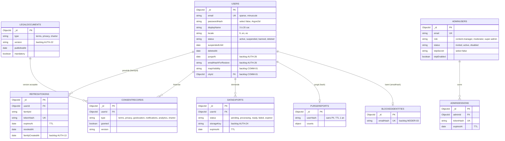

**Lecture.** `users` est le noeud central : presque toutes les autres collections portent un `userId`. Les jetons (`refreshtokens`, `adminsessions`) sont **hachés** et expirent automatiquement par index TTL. Les consentements sont un **historique** (une ligne par changement, jamais d'écrasement) : l'état courant d'un consentement est la ligne la plus récente de `{ userId, type }`. `purgereports` ne contient **aucun identifiant réversible** : c'est une preuve d'exécution, pas une donnée personnelle.

### 4.2 Football et contenu éditorial

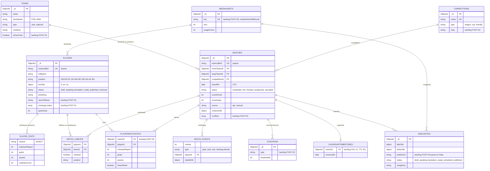

**Lecture.** Le choix structurant du domaine football est de **ne pas normaliser** les événements et compositions d'un match : ils sont lus *toujours avec le match* (écran de détail F-07 à F-10), jamais seuls, et leur nombre est borné (≤ 22 titulaires, quelques dizaines d'événements). Ils sont donc **embarqués** (un seul accès disque par fiche match). À l'inverse, `playermatchstats` est une **collection dérivée** (calculée par un job à partir de `matches.events` + `matches.lineups`), car le Fantasy a besoin d'interroger *par joueur* sur plusieurs matchs.

### 4.3 Jeux, gamification et Passport

```mermaid
erDiagram
    USERS ||--o| USERPROGRESSES : "agrège"
    USERS ||--o{ GUESSPLAYS : "joue"
    DAILYCHALLENGES ||--o{ GUESSPLAYS : "partie"
    DAILYCHALLENGES ||--o{ GUESSATTEMPTS : "tentatives"
    PLAYERS ||--o{ GUESSATTEMPTS : "deviné"
    USERS ||--o{ QUIZSESSIONS : "joue"
    QUIZSESSIONS ||--o{ QUIZ_ANSWERS : "embarque"
    QUIZQUESTIONS ||--o{ QUIZ_ANSWERS : "répondue"
    QUIZQUESTIONS ||--o{ QUESTIONSTATDAILIES : "statistiques"
    USERS ||--o{ USERSEENQUESTIONS : "a vu"
    USERS ||--o{ POINTSLEDGER : "gagne"
    USERS ||--o{ USERACTIVITIES : "journalise"
    USERS ||--o{ GOATVOTES : "vote"
    GOATDUELS ||--o{ GOATVOTES : "pairKey"
    USERPROGRESSES ||--o{ USERBADGES : "débloque"
    BADGES ||--o{ USERBADGES : "catalogue"
    DAILYCHALLENGES {
        ObjectId _id PK
        string type "guess_player, quiz"
        string date "AAAA-MM-JJ, UK avec type"
        object payload "backlog typé"
        int number "backlog JEUX-01"
    }
    GUESSATTEMPTS {
        ObjectId userId FK
        ObjectId challengeId FK
        int attemptNumber "1 à 6, UK"
        ObjectId guessedPlayerId FK
        boolean isCorrect
        string clientAttemptId "backlog, idempotence"
    }
    GUESSPLAYS {
        ObjectId userId FK "backlog JEUX-01"
        ObjectId challengeId FK
        string status "in_progress, won, lost"
        int attemptsUsed
        int pointsAwarded
    }
    QUIZQUESTIONS {
        ObjectId _id PK
        object questionI18n
        array optionsI18n "4 options"
        int correctOption
        int difficultyLevel "1 à 5"
        string status "pending-ai, draft, published, rejected, archived"
        string origin "editorial, ai"
    }
    QUIZSESSIONS {
        ObjectId _id PK
        ObjectId userId FK
        string mode "daily, practice"
        int score
        string dayKey "backlog JEUX-11"
    }
    QUIZ_ANSWERS {
        ObjectId questionId FK
        boolean isCorrect
        int timeMs
    }
    QUESTIONSTATDAILIES {
        ObjectId questionId FK "backlog, TTL 400 j"
        string dayKey
        int answers
        int correct
    }
    USERSEENQUESTIONS {
        ObjectId userId FK "backlog JEUX-13, TTL 45 j"
        ObjectId questionId FK
    }
    USERPROGRESSES {
        ObjectId _id PK
        ObjectId userId UK
        int currentStreak
        int bestStreak
        string lastActivityDate
        int totalPoints
        int quizLevel "1 à 5"
        array recentAnswers
    }
    POINTSLEDGER {
        ObjectId userId FK "backlog JEUX-20"
        string source "guess, quiz, fantasy, masia"
        string refId "UK avec userId et source"
        int points
    }
    USERACTIVITIES {
        ObjectId userId FK "backlog PASS-02"
        string type
        string refId
        int points
    }
    GOATVOTES {
        ObjectId userId FK "backlog GOAT-01"
        string pairKey
        string choice "a ou b"
    }
    GOATDUELS {
        string pairKey UK "backlog GOAT-01"
        int votesA
        int votesB
    }
    BADGES {
        string code UK
        object labelI18n
        int threshold
    }
    USERBADGES {
        ObjectId userId FK "backlog PASS"
        string badgeCode
        date unlockedAt
    }
```

**Lecture.** Trois idées à retenir. (1) **Un défi par jour et par type, identique pour tous** : l'unicité `{ type, date }` garantit qu'un job de génération rejoué ne crée pas de doublon. (2) **Un seul système de points** : `userprogresses` est l'*agrégat de lecture rapide*, alimenté par un **registre idempotent** (`pointsledger` côté `API-JEUX-20`, `useractivities` côté `API-PASS-02`). *Les deux issues décrivent un journal de points : voir l'écart signalé au §17.* (3) Les **tentatives** portent une clé d'idempotence (`clientAttemptId`, UUID fourni par le mobile) pour qu'un rejeu hors-ligne ne compte pas deux fois.

### 4.4 Fantasy et La Masia

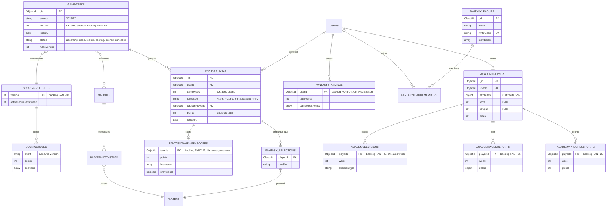

**Lecture.** Le **barème est versionné** (`scoringrulesets`) et *figé à l'ouverture de la journée* (`gameweeks.rulesVersion`) : modifier le barème ne réécrit jamais l'histoire. Le **détail des points** est stocké à part (`fantasygameweekscores`) pour ne pas alourdir le document équipe, qui n'en garde que le total (copie dénormalisée). Le **classement mondial** est *matérialisé* dans `fantasystandings` (source de vérité) et **doublé dans des ZSET Redis** (lecture en O(log N)) reconstructibles à tout moment (`npm run fantasy:rebuild-standings`).

### 4.5 Communauté et carte

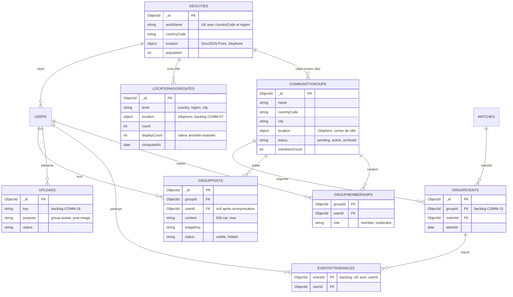

**Lecture.** **Principe de confidentialité n°1 : aucune coordonnée précise d'un utilisateur n'est jamais stockée.** On ne garde que `countryCode`, `city` et `cityId` (référence au *centre* d'une ville du référentiel `geocities`, coordonnées arrondies à 2 décimales ≈ 1 km). `locationaggregates` ne contient que des **compteurs par zone** (recalculés toutes les 10 min) ; `displayCount` est la valeur arrondie exposée par l'API pour éviter d'identifier un utilisateur dans une zone très peuplée de peu de personnes.

### 4.6 Modération et audit

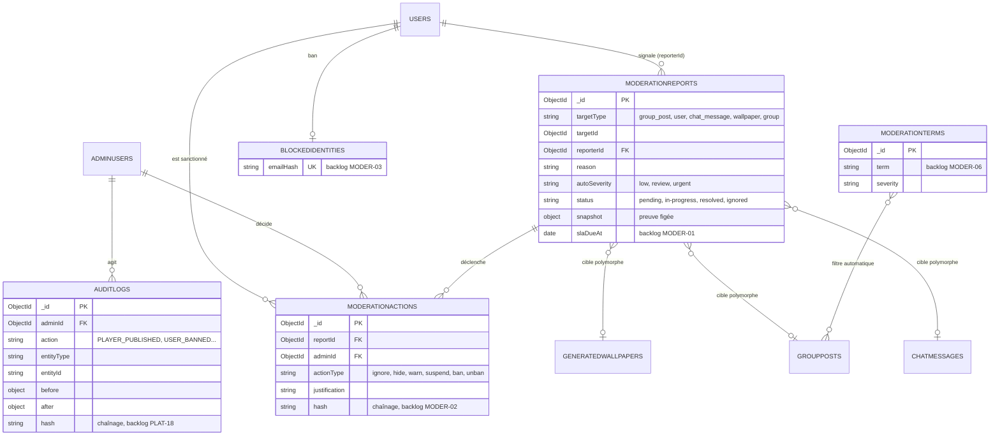

**Lecture.** `moderationactions` et `auditlogs` sont **immuables** : aucun `update`/`delete` n'est autorisé (hooks Mongoose `IMMUTABLE_DOCUMENT`), l'utilisateur MongoDB applicatif de production n'a même pas le droit `remove`, et chaque entrée contient `prevHash` + `hash` (SHA-256) pour **détecter toute altération** a posteriori. Elles ne sont **jamais purgées** (valeur d'audit, CDC Backend §5.7). Un signalement cible un contenu **polymorphe** (`targetType` + `targetId`) et en conserve un `snapshot` (texte + 3 messages de contexte) pour que la preuve survive à une suppression par l'auteur (12 mois après résolution).

### 4.7 Plateforme, IA et wallpapers

```mermaid
erDiagram
    USERS ||--o{ CHATCONVERSATIONS : "converse"
    CHATCONVERSATIONS ||--o{ CHATMESSAGES : "contient"
    USERS ||--o{ GENERATEDWALLPAPERS : "génère"
    WALLPAPERSTYLES ||--o{ GENERATEDWALLPAPERS : "style"
    WALLPAPEROCCASIONS ||--o{ GENERATEDWALLPAPERS : "occasion"
    PROMPTTEMPLATES ||--o{ GENERATEDWALLPAPERS : "templateVersion"
    USERS ||--o{ AIUSAGES : "consomme"
    AIQUOTAS ||--o{ AIUSAGES : "limite (key)"
    AICALLLOGS }o--o{ AIUSAGEDAILIES : "agrégés"
    ADMINUSERS ||--o{ FEATUREFLAGS : "modifie"
    ADMINUSERS ||--o{ PLATFORMSETTINGS : "modifie"
    ADMINUSERS ||--o{ EXPORTJOBS : "demande"
    CHATCONVERSATIONS {
        ObjectId _id PK
        ObjectId userId FK
        string title
        date lastMessageAt
        int messageCount "backlog IA-01"
        array messages "existant embarqué, sorti par IA-01"
    }
    CHATMESSAGES {
        ObjectId conversationId FK "backlog IA-01"
        ObjectId userId FK
        string role "user, assistant"
        string clientMessageId "idempotence"
        string status
    }
    GENERATEDWALLPAPERS {
        ObjectId _id PK
        ObjectId userId FK
        string prompt
        string status "PENDING, GENERATING, READY, REJECTED"
        string imageKey
        string moderationStatus "pending, approved, rejected"
        boolean isFavorite
    }
    AIQUOTAS {
        string key UK "assistant.messages, wallpaper.generations"
        int limit
        string period "day, month"
    }
    AIUSAGES {
        ObjectId userId FK "backlog IA-03, TTL 40 j"
        string key
        date periodStart
        int count
    }
    AICALLLOGS {
        string feature "backlog IA-04, TTL 400 j"
        int tokensIn
        int tokensOut
        string userHash "HMAC, sans contenu"
    }
    AIUSAGEDAILIES {
        string day "backlog IA-04"
        string feature
        int calls
        number costEstimateEur
    }
    FEATUREFLAGS {
        string key UK "snake_case immuable"
        boolean enabled
        int rolloutPercent "0 à 100"
        boolean killSwitch "backlog PLAT-08"
    }
    PLATFORMSETTINGS {
        string key UK "maintenance, appVersion"
        object value "backlog PLAT-03/04"
    }
    EXPORTJOBS {
        string dataset "players, users, reports"
        string status "backlog PLAT-20, TTL 24 h"
    }
    WALLPAPERSTYLES {
        string key UK "backlog WALL-02"
    }
    WALLPAPEROCCASIONS {
        string key UK "backlog WALL-02"
    }
    PROMPTTEMPLATES {
        string version "backlog WALL-02"
    }
```

**Lecture.** Le motif « **un quota = une configuration + un compteur** » est partout : `aiquotas` (la limite, modifiable en back-office WI-06) et `aiusages` (la consommation par utilisateur/jour, TTL 40 j). La consommation est **atomique** (`findOneAndUpdate` avec `count < limit` + upsert) : deux requêtes simultanées ne peuvent pas dépasser le quota. Le journal `aicalllogs` **ne stocke aucun contenu** de message ou de prompt (RGPD) : seulement des tokens, une latence, un coût estimé et un `userHash` (HMAC).

### 4.8 Notifications et calendrier

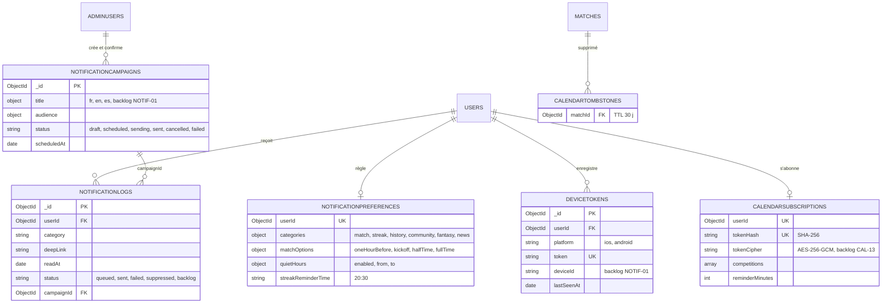

**Lecture.** `notificationlogs` joue un **double rôle** : *journal d'envoi* (statut `sent/failed/suppressed` et motif de suppression : heures calmes, préférence, absence de consentement) et *boîte de réception in-app* (`readAt`, écran O-xx du mobile). Il expire à 90 jours, sauf catégorie `moderation` (conservée). Dans `calendarsubscriptions`, le jeton est stocké **haché** (pour l'authentification du flux) **et chiffré** (pour pouvoir ré-afficher l'URL dans l'app, écran L-09) : décision documentée dans l'ADR de `API-CAL-14`.

---

## 5. Références ou documents embarqués : les choix et leurs raisons

MongoDB permet d'imbriquer des données **ou** de les relier. Le projet applique une règle simple, issue de `docs/DATABASE.md` : *« données du domaine contenu embarquées ; références pour les entités indépendantes »*. Voici l'arbre de décision, puis les cas concrets.

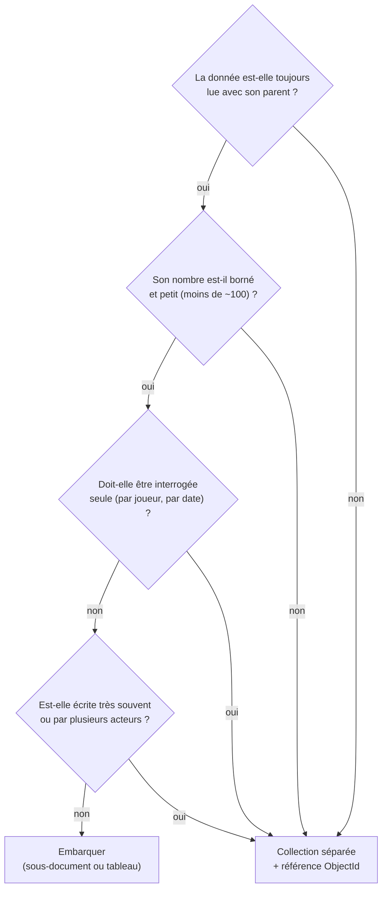

| Donnée | Choix | Pourquoi |
| --- | --- | --- |
| `matches.events[]`, `matches.lineups[]` | **Embarqué** | Toujours lus avec le match, bornés (≤ 22 titulaires, dizaines d'événements), écrits par un seul processus (la synchro). Un seul accès pour la fiche F-07. |
| `players.stats[]` (saisons) | **Embarqué** | ~20 saisons max par joueur, toujours affichées avec la fiche. *Le CDC prévoit une table `player_stat_seasons` ; `MOB-F-01` parle de `playerstatseasons`* : écart documenté §17. |
| `players.bioI18n`, tout `*I18n` | **Embarqué** | Les trois langues sont lues ensemble ; la complétude se calcule sur le même document. |
| `quizsessions.answers[]` / `questions[]` | **Embarqué** | 10 réponses par session, toujours lues avec la session. Remplace la table `quiz_answers` du CDC. |
| `fantasyteams.selections[]` | **Embarqué** | Exactement 11 sélections, jamais lues seules. |
| `userprogresses.badges[]` | **Embarqué (copie)** | Lecture rapide du Passport ; la **source de vérité** est `userbadges` (backlog). |
| `chatconversations.messages[]` | **Embarqué → à éclater** | Tableau **non borné** (cause de l'éclatement `API-IA-01` : au-delà de quelques centaines de messages le document devient trop gros et la pagination par curseur est impossible). Devient `chatmessages`. |
| `communitygroups.events[]` | **Embarqué → à éclater** | Besoin de pagination, d'index `{ groupId, startsAt }` et de RSVP unique (`API-COMM-15`). Devient `groupevents` + `eventattendances`. |
| `academyplayers.decisions[]` | **Embarqué → à éclater** | Historique long, unicité `{ playerId, week }` (`API-FANT-25`). |
| `refreshtokens`, `consentrecords` | **Référence (`userId`)** | Beaucoup par utilisateur, cycle de vie propre (TTL, historique). |
| `guessattempts`, `quizsessions`, `groupposts`, `notificationlogs` | **Référence** | Forte volumétrie, interrogés par utilisateur/date, expirent ou se paginent. |
| `moderationreports.snapshot` | **Embarqué (copie figée)** | Doit **survivre** à la suppression du contenu source : on copie volontairement, on ne référence pas. |
| `matches.homeTeamId/awayTeamId/competitionId` | **Référence** | Entités indépendantes, partagées par des centaines de matchs. |
| `fantasyleagues.memberIds[]` | **Embarqué (dénormalisé)** + `fantasyleaguemembers` | Compteur et lecture rapide ; l'historique détaillé est en collection séparée. |

**Dénormalisation assumée.** Quelques copies existent pour la performance de lecture : `fantasyteams.points` (total) / `fantasygameweekscores.points` (détail), `communitygroups.membersCount`, `players.goatVotes` / `goatduels.votesA/B`, `userprogresses.totalPoints` / `pointsledger`. Règle : **la copie est toujours recalculable** depuis la source ; un job nocturne de **réconciliation** compare et corrige (ex. `API-JEUX-20`, `API-PASS-02`).

**Pas de transaction partout.** MongoDB tourne en *replica set* précisément pour autoriser les **transactions multi-documents** là où l'atomicité est indispensable (attribution de points : registre + `$inc totalPoints`). Ailleurs, on préfère **l'idempotence par index unique** à la transaction : plus simple, plus rapide, rejouable.

---

## 6. Index et requêtes critiques

> **Pourquoi c'est important.** L'objectif de performance est un **p95 < 300 ms** hors IA (CDC Global §3.1) et un soir de match concentre la charge (dashboard, quiz, classements, live). Une requête sans index (`COLLSCAN`) casse ce budget. Les index sont **déclarés dans les schémas Mongoose** *et* garantis par migration (`20261015000000-initial-indexes` pour les trois index vitaux ; les autres migrations arrivent avec chaque épopée). `API-PLAT-31` ajoute un script `explain-audit` qui **échoue en CI** si une requête type fait un `COLLSCAN` ou examine plus de 10× les documents retournés.

### 6.1 Index par collection

**Types d'index utilisés** : *unique* (garantit l'idempotence), *sparse* (ignore les documents sans le champ), *TTL* (suppression automatique), *2dsphere* (géospatial), *composé* (plusieurs champs, l'ordre compte), *partiel* (uniquement sur un sous-ensemble).

#### Existants (déclarés dans le code)

| Collection | Index | Type | Usage |
| --- | --- | --- | --- |
| `users` | `{ email: 1 }` | unique + sparse | Connexion, unicité (un compte social peut ne pas avoir d'e-mail) |
| `users` | `{ status: 1 }` | simple | Filtrage admin, levée des suspensions |
| `users` | `{ countryCode: 1, city: 1 }` | composé | Agrégats carte |
| `refreshtokens` | `{ tokenHash: 1 }` | unique | Rotation du refresh |
| `refreshtokens` | `{ userId: 1 }`, `{ familyId: 1 }` | simples | Révocation de session / de famille |
| `refreshtokens` | `{ expiresAt: 1 }` `expireAfterSeconds: 0` | **TTL** | Suppression à l'expiration |
| `consentrecords` | `{ userId: 1, type: 1, createdAt: -1 }` | composé | État courant d'un consentement |
| `adminusers` | `{ email: 1 }` | unique | Connexion admin |
| `adminsessions` | `{ tokenHash: 1 }` unique ; `{ adminId: 1 }` ; `{ expiresAt: 1 }` TTL 0 | unique / TTL | Session admin 8 h |
| `players` | `{ externalRef: 1 }` | unique + sparse | Rattachement à l'API football |
| `players` | `{ fullName: 1 }`, `{ nationality: 1 }`, `{ isActive: 1 }`, `{ status: 1 }`, `{ status: 1, position: 1 }` | simples / composé | Listes publiées et admin |
| `competitions` | `{ name: 1 }` | unique | Référentiel |
| `matches` | `{ externalRef: 1 }` unique sparse ; `{ kickoffAt: 1 }` ; `{ status: 1 }` ; `{ competitionId: 1, kickoffAt: -1 }` | mixtes | Calendrier, matchs à venir, historique |
| `dailychallenges` | `{ type: 1, date: 1 }` | **unique** | Un défi par jour et par type |
| `guessattempts` | `{ userId: 1, challengeId: 1, attemptNumber: 1 }` | **unique** | Idempotence des tentatives |
| `quizquestions` | `{ difficultyLevel: 1 }`, `{ category: 1 }`, `{ status: 1 }` | simples | Tirage des questions |
| `quizsessions` | `{ userId: 1 }` | simple | Historique |
| `userprogresses` | `{ userId: 1 }` | unique | Un document par utilisateur |
| `badges`, `scoringrules`, `featureflags`, `aiquotas` | `{ code }` / `{ event }` / `{ key }` | unique | Référentiels |
| `fantasyteams` | `{ userId: 1, gameweek: 1 }` | **unique** | Une équipe par utilisateur et journée |
| `fantasyleagues` | `{ inviteCode: 1 }` | unique | Rejoindre par code |
| `academyplayers` | `{ userId: 1 }` | simple | Joueur de l'utilisateur |
| `communitygroups` | `{ countryCode }`, `{ city }`, `{ status }` ; `{ location: '2dsphere' }` sparse | simples / **2dsphere** | Recherche, « près de moi » |
| `groupmemberships` | `{ groupId: 1, userId: 1 }` | **unique** | Un seul adhésion par groupe |
| `groupposts` | `{ groupId: 1 }`, `{ groupId: 1, createdAt: -1 }` | composé | Fil d'un groupe, tri récent |
| `moderationreports` | `{ status: 1 }`, `{ status: 1, autoSeverity: 1, createdAt: 1 }` | composé | File de modération par gravité puis ancienneté |
| `auditlogs` | `{ adminId: 1 }`, `{ action: 1 }`, `{ createdAt: -1 }` | simples | Journal filtré |
| `chatconversations` | `{ userId: 1 }` | simple | Historique |
| `generatedwallpapers` | `{ userId: 1 }`, `{ status: 1 }` | simples | Galerie, supervision |
| `notificationpreferences` | `{ userId: 1 }` | unique | Préférences |
| `devicetokens` | `{ token: 1 }` unique ; `{ userId: 1 }` | unique | Envoi push |
| `notificationlogs` | `{ userId: 1 }` | simple | Boîte de réception |
| `calendarsubscriptions` | `{ userId: 1 }` unique ; `{ tokenHash: 1 }` unique | unique | Flux webcal |
| `anecdotes` | `{ publishOn: 1 }` | simple | Anecdote du jour |

#### À créer selon le backlog (principaux)

| Collection | Index | Type | Issue |
| --- | --- | --- | --- |
| `players` | `{ slug }` unique sparse ; `{ searchName: 1 }` ; `{ status: 1, missingLocales: 1 }` ; `{ nationality: 1, position: 1 }` ; `{ clubCurrent: 1 }` | mixtes | `API-FOOT-01` |
| `teams` | `{ isOwnClub: 1 }` **unique partiel** (`isOwnClub: true`) ; `externalRef` unique sparse | partiel | `API-FOOT-02` |
| `matches` | `{ status: 1, kickoffAt: 1 }` ; `{ homeTeamId: 1, awayTeamId: 1, kickoffAt: -1 }` (confrontations) ; `{ isHistorical: 1, kickoffAt: -1 }` ; `{ 'conflicts.resolvedAt': 1 }` | composés | `API-FOOT-03` |
| `anecdotes` | `{ publishOn: 1, status: 1 }` ; `{ monthDay: 1, status: 1 }` | composés | `API-FOOT-04` |
| `playermatchstats` | `{ matchId: 1, playerId: 1 }` unique ; `{ playerId: 1, createdAt: -1 }` | unique | `API-FANT-09` |
| `gameweeks` | `{ season: 1, number: 1 }` unique ; `{ locksAt: 1 }` ; `{ status: 1 }` | unique | `API-FANT-01` |
| `fantasyteams` | `{ gameweek: 1, points: -1 }` (classement de journée) ; `{ userId: 1, gameweek: -1 }` | composés | `API-FANT-02` |
| `fantasygameweekscores` | `{ teamId: 1, gameweek: 1 }` unique | unique | `API-FANT-02` |
| `fantasystandings` | `{ userId: 1, season: 1 }` unique | unique | `API-FANT-14` |
| `academyplayers` | `{ userId: 1 }` **unique partiel** (`status: 'active'`) | partiel | `API-FANT-25` |
| `academydecisions` | `{ playerId: 1, week: 1 }` unique | unique | `API-FANT-25` |
| `guessattempts` | `{ userId, challengeId, clientAttemptId }` unique | unique | `API-JEUX-01` |
| `guessplays` | `{ userId: 1, challengeId: 1 }` unique ; `{ userId: 1, dayKey: -1 }` | unique | `API-JEUX-01` |
| `quizsessions` | `{ userId: 1, dayKey: 1, mode: 1 }` **unique partiel** (`mode: 'daily'`) | partiel | `API-JEUX-11` |
| `questionstatdailies` | `{ questionId: 1, dayKey: 1 }` unique + TTL 400 j | TTL | `API-JEUX-11` |
| `userseenquestions` | `{ userId: 1, seenAt: -1 }` + TTL 45 j | TTL | `API-JEUX-13` |
| `pointsledger` | `{ userId: 1, source: 1, refId: 1 }` **unique** ; `{ userId: 1, createdAt: -1 }` ; `{ weekKey: 1, userId: 1 }` | unique | `API-JEUX-20` |
| `quizleagues` | `{ code: 1 }` unique ; `{ 'members.userId': 1 }` | unique | `API-JEUX-23` |
| `userprogresses` | `{ totalPoints: -1 }` | simple | `API-PASS-01` |
| `sharetokens` | `{ tokenHash: 1 }` unique + TTL `expiresAt` | TTL | `API-PASS-30` |
| `goatvotes` | `{ userId: 1, pairKey: 1, criterion: 1 }` unique ; `{ pairKey: 1, criterion: 1 }` ; `{ castAt: 1 }` | unique | `API-GOAT-01` |
| `goatduels` | `{ pairKey: 1 }` unique ; `{ total: -1 }` ; `{ featured: 1, total: -1 }` | unique | `API-GOAT-01` |
| `goathourlystats` | `{ pairKey: 1, hour: 1 }` unique + TTL 90 j | TTL | `API-GOAT-26` |
| `geocities` | `{ location: '2dsphere' }` ; `{ countryCode: 1, asciiName: 1, region: 1 }` unique ; `{ countryCode: 1, population: -1 }` | **2dsphere** | `API-COMM-01` |
| `locationaggregates` | `{ location: '2dsphere' }` ; `{ level, countryCode, region, cityId }` unique ; `{ level: 1, count: -1 }` | **2dsphere** | `API-COMM-07` |
| `communitygroups` | `{ status: 1, countryCode: 1, city: 1, membersCount: -1 }` ; `{ createdBy: 1, status: 1 }` ; texte sur `name` ; `slug` unique | composés | `API-COMM-15` |
| `groupevents` | `{ groupId: 1, startsAt: 1 }` | composé | `API-COMM-15` |
| `moderationreports` | `{ reporterId, targetType, targetId }` **unique partiel** ; `{ status, autoSeverity, slaDueAt }` ; `{ targetOwnerId: 1, createdAt: -1 }` | partiel | `API-MODER-01` |
| `moderationactions` | `{ targetUserId: 1, createdAt: -1 }` | composé | `API-MODER-02` |
| `auditlogs` | `{ entityType: 1, entityId: 1, createdAt: -1 }` ; `{ adminId: 1, createdAt: -1 }` ; `{ action: 1, createdAt: -1 }` | composés | `API-PLAT-18` |
| `chatconversations` | `{ userId: 1, lastMessageAt: -1 }` ; texte `{ title, preview }` | composé | `API-IA-01` |
| `chatmessages` | `{ conversationId: 1, createdAt: -1, _id: -1 }` (curseur) ; `{ conversationId: 1, clientMessageId: 1 }` unique partiel ; texte `content` | composé | `API-IA-01` |
| `aiusages` | `{ userId: 1, key: 1, periodStart: 1 }` **unique** + TTL 40 j | TTL | `API-IA-03` |
| `aicalllogs` | `{ createdAt: -1 }` TTL 400 j ; `{ feature: 1, createdAt: -1 }` | TTL | `API-IA-04` |
| `generatedwallpapers` | `{ userId: 1, createdAt: -1, _id: -1 }` ; `{ userId: 1, isFavorite: 1, createdAt: -1 }` ; `{ status: 1, createdAt: 1 }` ; unique partiel `{ userId, idempotencyKey }` ; TTL sur `deletedAt` (+24 h) | partiel / TTL | `API-WALL-01` |
| `devicetokens` | `{ userId: 1, deviceId: 1 }` unique sparse ; TTL logique 60 j sur `lastSeenAt` | sparse | `API-NOTIF-01` |
| `notificationlogs` | `{ userId: 1, createdAt: -1 }` ; `{ userId: 1, readAt: 1 }` ; **TTL 90 j** sur `createdAt` (exempt. `retainForever`) | TTL | `API-NOTIF-01` |
| `dataexports` | `{ userId: 1, requestedAt: -1 }` ; TTL `expiresAt` + 1 j | TTL | `API-AUTH-24` |
| `exportjobs` | TTL 24 h | TTL | `API-PLAT-20` |
| `deadletters` | TTL 30 j | TTL | `API-PLAT-53` |
| `calendartombstones` | TTL 30 j | TTL | `API-CAL-11` |
| `refreshtokens` | TTL supplémentaire sur `revokedAt` + 90 j | TTL | `API-AUTH-13` |

### 6.2 Requêtes critiques

| Parcours (écran / endpoint) | Requête | Index utilisé | Budget |
| --- | --- | --- | --- |
| Connexion (`POST /auth/login`) | `users.findOne({ email })` + `select('+passwordHash')` | `users.email` unique | p95 < 300 ms (Argon2id domine) |
| Rotation de session (`POST /auth/refresh`) | `findOneAndUpdate({ tokenHash, revokedAt: {$exists:false}, expiresAt: {$gt: now} }, { revokedAt: now })` | `refreshtokens.tokenHash` unique | atomique : un seul gagnant |
| Joueurs publiés par poste (`GET /players`) | `find({ status: 'published', position })` paginé | `{ status, position }` | p95 < 300 ms ; cache Redis 1 h par fiche |
| Prochain match / calendrier (`GET /matches`, `/calendar/matches`) | `find({ status: 'scheduled', kickoffAt: {$gte: now} }).sort({ kickoffAt: 1 })` | `{ status, kickoffAt }` | cache 15 min |
| Anecdote du jour (C-xx) | `findOne({ monthDay, status: 'published' })` | `{ monthDay, status }` | cache 1 h par date et langue |
| Défi du jour (D-01) | `findOne({ type, date })` | `{ type, date }` unique | cache 60 s |
| Soumission d'une tentative | `insert` GuessAttempt | unique `{ userId, challengeId, attemptNumber }` | idempotent (`E11000` = déjà jouée) |
| Tirage de 10 questions (E-02) | `aggregate([{ $match: { status: 'published', difficultyLevel } }, { $sample }])` moins les `userseenquestions` | `{ status }`, `{ difficultyLevel }` | pool Redis 10 min |
| XI de la journée (H-xx) | `findOne({ userId, gameweek })` | `{ userId, gameweek }` unique | p95 < 150 ms |
| Classement monde/journée | Redis `ZREVRANGE` ; repli Mongo `sort({ points: -1 }).limit(100)` | `{ gameweek, points: -1 }` | repli limité à 100 lignes |
| Groupes proches (K-xx) | `find({ location: { $nearSphere: … }, status: 'active' })` | `communitygroups.location` 2dsphere | cache 10 min (carte) |
| Carte : agrégats par bbox (J-xx) | `find({ location: { $geoWithin: { $box: … } }, level })` | `locationaggregates.location` 2dsphere | cache Redis 10 min |
| Fil d'un groupe | `find({ groupId, status: 'visible' }).sort({ createdAt: -1 }).limit(20)` | `{ groupId, createdAt: -1 }` | pagination curseur |
| File de modération (WG-01) | `find({ status: 'pending' }).sort({ autoSeverity: 1, createdAt: 1 })` | `{ status, autoSeverity, createdAt }` | cache compteurs 10 s |
| Boîte de réception (O-xx) | `find({ userId }).sort({ createdAt: -1 })` | `{ userId, createdAt: -1 }` | compteur non-lu cache 30 s |
| Historique du chat (N-xx) | `find({ conversationId }).sort({ createdAt: -1, _id: -1 }).limit(30)` | `{ conversationId, createdAt: -1, _id: -1 }` | 30 messages par page |
| Consommation d'un quota IA | `findOneAndUpdate({ userId, key, periodStart, count: {$lt: limit} }, { $inc: { count: 1 } }, { upsert: true })` | unique `{ userId, key, periodStart }` | atomique |
| Flux calendrier webcal | `findOne({ tokenHash })` | `calendarsubscriptions.tokenHash` unique | 404 identique si inconnu (anti-énumération) |
| Journal d'audit filtré (WH-05) | `find({ entityType, entityId }).sort({ createdAt: -1 })` | `{ entityType, entityId, createdAt: -1 }` | export CSV ≤ 50 000 lignes |

---

## 7. Cycle de vie des données et RGPD

### 7.1 Cycle de vie d'un compte

Le droit à l'effacement est appliqué en **deux temps** : effets *immédiats* (le compte disparaît de l'application) puis **purge définitive à J+30** (jeu de données supprimé ou anonymisé). Le délai de 30 jours permet d'annuler (`POST /auth/restore-account`) et de traiter les jobs en cours.

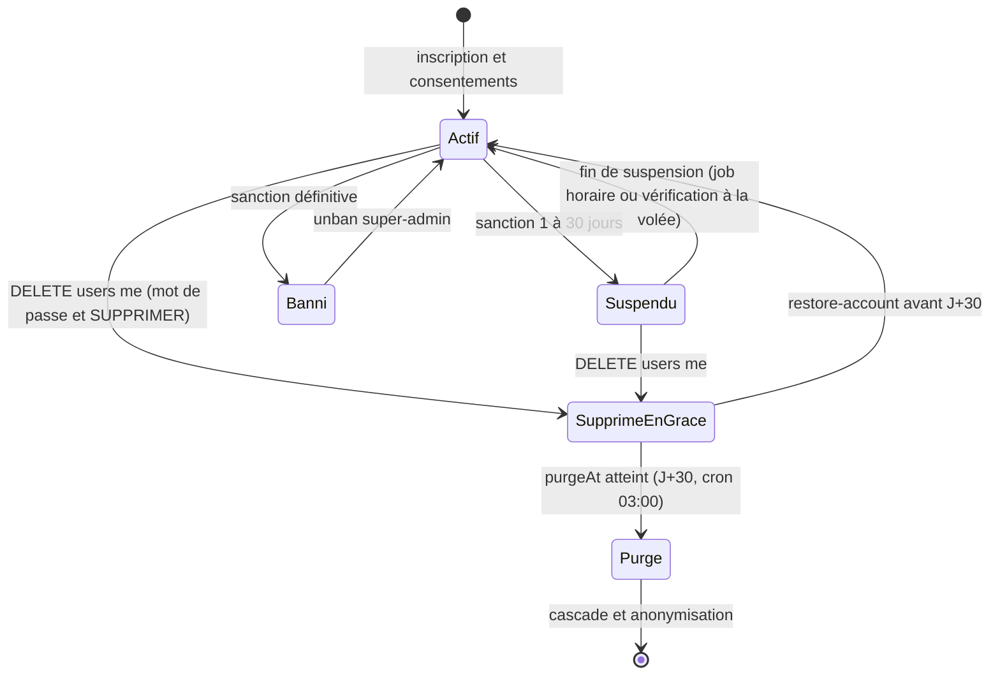

**Effets immédiats à la demande de suppression** (`API-AUTH-26`) : `status='deleted'`, `deletedAt=now`, `purgeAt=now+30 j`, révocation de toutes les sessions et jetons push, retrait des cartes/classements (ZREM Redis), pseudo remplacé par « Utilisateur supprimé » dans les contenus publiés, annulation des exports en cours. L'e-mail n'est conservé que **haché** (`emailHashForRestore`) pour permettre l'annulation.

> **Code actuel (écart).** Le cron `purgeDeletedAccounts` (03:00 Europe/Madrid, `src/jobs/scheduler.ts`) ne fait qu'un `User.deleteMany({ status: 'deleted', deletedAt < J-30 })` : **aucune cascade**. `API-AUTH-27` le remplace par un planificateur qui enfile un job `rgpd:purge-user` par compte (lots de 100) avec un registre de « purgeurs » par domaine.

### 7.2 Matrice de purge (CDC Backend §4.8 / `API-AUTH-27`)

| Donnée | Traitement à J+30 | Collections |
| --- | --- | --- |
| Profil, préférences, e-mail, jetons, sessions, jetons push | **Suppression définitive** | `users`, `refreshtokens`, `devicetokens`, `notificationpreferences`, `calendarsubscriptions` |
| Historique de jeu personnel (Guess, Quiz, GOAT) | **Suppression** | `guessattempts`, `guessplays`, `quizsessions`, `userseenquestions`, `goatvotes` |
| Progression, badges, séries, points | **Suppression** | `userprogresses`, `userbadges`, `pointsledger` / `useractivities` |
| Fantasy et La Masia | **Suppression** (+ ZREM Redis, transfert de propriété des ligues) | `fantasyteams`, `fantasygameweekscores`, `fantasystandings`, `fantasyleaguemembers`, `academy*` |
| Conversations IA, wallpapers générés (fichiers objet inclus), exports | **Suppression** | `chatconversations`, `chatmessages`, `generatedwallpapers`, `dataexports`, objets S3 |
| Contenus publiés dans les groupes | **Conservés, auteur anonymisé** (`userId = null`, affichage « Utilisateur supprimé ») | `groupposts` |
| Journal de modération et d'audit le concernant | **Conservé**, identifiant technique **dissocié** de toute donnée directement identifiante | `moderationactions`, `auditlogs`, `moderationreports` |
| Consentements | **Conservés 5 ans, pseudonymisés** (`userId` remplacé par un HMAC irréversible) pour preuve | `consentrecords` |
| Compteurs agrégés | **Conservés** (aucune donnée personnelle) | `locationaggregates`, `goatduels` |
| Identité d'un compte **banni** | Hash salé de l'e-mail conservé (pas de ré-inscription) | `blockedidentities` |
| Rapport d'exécution de la purge | Conservé **1 an**, sans PII | `purgereports` |

### 7.3 Table de rétention des données techniques

Centralisée (cible) dans `src/config/retention.ts` (`API-PLAT-52`) ; implémentée par **index TTL** quand la date de péremption est un champ unique, sinon par le job `retention-purge` (quotidien 03:30 UTC, lots de 1 000, simulation `--dry-run`, **abandon si > 20 % de la collection** serait supprimé).

| Donnée | Durée | Mécanisme |
| --- | --- | --- |
| `refreshtokens` expirés | à `expiresAt` | TTL |
| `refreshtokens` révoqués | 90 jours après révocation *(le code actuel purge à 30 j : écart)* | TTL / job |
| Durée de vie d'une famille de refresh | 30 j glissants, **90 j max** (24 h si « se souvenir de moi » désactivé) | `familyCreatedAt` |
| `adminsessions` | 8 h d'inactivité | TTL |
| `notificationlogs` | 90 jours (sauf catégorie `moderation`) | TTL |
| `devicetokens` invalides | 30 jours ; TTL logique 60 j sur `lastSeenAt` | job |
| `aiusages` | 40 jours après `periodStart` | TTL |
| `aicalllogs` | 400 jours | TTL |
| `aiusagedailies` | 24 mois | job |
| `questionstatdailies` | 400 jours | TTL |
| `userseenquestions` | 45 jours | TTL |
| `goathourlystats` | 90 jours | TTL |
| `calendartombstones` | 30 jours | TTL |
| `exportjobs` | 24 heures | TTL |
| `dataexports` | `expiresAt` + 1 jour ; archive S3 7 jours | TTL + règle de cycle de vie |
| `deadletters` | 30 jours | TTL |
| `purgereports` | 1 an | TTL |
| `generatedwallpapers` supprimés | 24 h après `deletedAt` | TTL |
| `uploads` non rattachés | 24 h | job quotidien |
| `useractivities` détaillés | 24 mois, puis agrégation `userstatsweeklies` | job |
| Snapshot d'un signalement | 12 mois après résolution | job |
| `consentrecords` | 5 ans (pseudonymisés après suppression de compte) | job de purge |
| `moderationactions`, `auditlogs` | **jamais purgés** | exclus des jobs |
| Logs applicatifs (Graylog) | 90 jours | rétention Graylog |
| Traces OpenTelemetry détaillées | 14 jours | rétention collecteur |
| Sauvegardes MongoDB | 30 quotidiennes + 26 hebdomadaires (≈ 6 mois) | `database-backup` |

---

## 8. Volumétrie et croissance

**Sources.** Les volumes cibles viennent du seed de charge `API-PLAT-42` : **100 000 utilisateurs, 1 000 joueurs, 8 000 matchs, 300 000 refresh tokens actifs, 2 000 000 notificationlogs, 5 000 groupes, 200 000 posts**. Les autres lignes sont des **estimations proposées** (hypothèses H1 à H4 ci-dessous) à valider par la mesure (`API-PLAT-43/44`, journal de capacité).

* **H1** : 100 000 comptes (cible du seed de charge).
* **H2** : 30 % d'utilisateurs actifs par jour (la cible de rétention J7 > 30 % du CDC Global sert de proxy) *(proposé)*.
* **H3** : un utilisateur actif joue en moyenne 1 partie Guess (≈ 3,5 tentatives) et 1 quiz (10 réponses) par jour *(proposé)*.
* **H4** : taille moyenne d'un document = taille JSON ×1,3 (index non inclus) *(proposé)*.

| Collection | Volume cible | Taille / doc | Taille totale | Croissance |
| --- | --- | --- | --- | --- |
| `users` | 100 000 | ~1,2 Ko | ~120 Mo | linéaire (inscriptions) |
| `refreshtokens` | 300 000 | ~0,5 Ko | ~150 Mo | **plafonnée** (TTL, purge 90 j) |
| `consentrecords` | ~500 000 (5 par compte) | ~0,25 Ko | ~125 Mo | linéaire, conservation 5 ans |
| `players` | 1 000 | jusqu'à ~15 Ko (3 bios × 4 000 car. + stats) | ~15 Mo | quasi nulle |
| `matches` | 8 000 | ~6 Ko (événements + compositions) | ~50 Mo | ~70 matchs/saison première équipe + historiques saisis |
| `anecdotes` | ~1 500 | ~2 Ko | ~3 Mo | éditoriale |
| `dailychallenges` | 730/an | ~1 Ko | < 1 Mo | 2/jour |
| `guessattempts` | ~105 000/jour *(H1-H3)* | ~0,15 Ko | **~16 Mo/jour, ~5,7 Go/an** | **forte** : candidate à archivage/agrégation (point ouvert §17) |
| `quizsessions` | ~30 000/jour | ~2 Ko (10 réponses) | ~60 Mo/jour | **forte** (~22 Go/an) : idem |
| `questionstatdailies` | ≤ nombre de questions × 400 j | ~0,1 Ko | faible | **plafonnée** (TTL 400 j) |
| `userprogresses` | 100 000 | ~1 Ko | ~100 Mo | linéaire |
| `fantasyteams` | ~35 par utilisateur actif/saison | ~1 Ko | ~120 Mo/saison *(si 100 % actifs)* | par journée |
| `communitygroups` | 5 000 | ~1 Ko | ~5 Mo | lente |
| `groupposts` | 200 000 | ~0,6 Ko | ~120 Mo | linéaire (modération) |
| `locationaggregates` | ≈ nombre de villes distinctes (≤ ~25 000 géocodées) | ~0,3 Ko | < 10 Mo | recalculé (écrasement) |
| `geocities` | ~25 000 (GeoNames cities15000) | ~0,4 Ko | ~10 Mo | statique |
| `notificationlogs` | **2 000 000** | ~0,6 Ko | **~1,2 Go** | **plafonnée par TTL 90 j** |
| `chatmessages` | ≤ 40 messages/jour/utilisateur actif (quota) | ~1 Ko | variable | forte, bornée par quota et 1 000/conversation |
| `aicalllogs` | 1 par appel IA | ~0,3 Ko | modérée | **plafonnée** (TTL 400 j) |
| `auditlogs`, `moderationactions` | faible (actions admin) | ~1 Ko | quelques Mo | linéaire, **jamais purgé** |

**Ordre de grandeur global** à 100 000 comptes : **quelques Go** de données chaudes (hors croissance des collections de jeu), **dominées par `notificationlogs`, `quizsessions` et `guessattempts`**. Redis dimensionné à 512 Mo (compose de production) ; MongoDB à 2 Go de RAM, 1 CPU (valeurs de départ à valider par `API-PLAT-44`).

**Stratégies de maîtrise de la croissance** : (1) TTL sur tout ce qui est technique ou journalier ; (2) agrégation hebdomadaire des activités après 24 mois (`userstatsweeklies`) ; (3) décisions d'archivage des collections de jeu **à confirmer** une fois les premières mesures réelles disponibles ; (4) plafonds fonctionnels (1 000 messages par conversation, 200 conversations actives par utilisateur, 5 ligues par utilisateur).

---

## 9. Redis : clés, TTL et usages

**Rôle de Redis** : *cache jetable*, *coordination* (verrous, élection du planificateur, compteurs) et *bus de jobs* (BullMQ). **Perdre Redis ne perd aucune donnée durable** (DISASTER_RECOVERY.md : Redis n'est pas sauvegardé). Conséquences : tout code qui lit Redis doit prévoir un **repli Mongo** (« mode dégradé, jamais d'erreur 5xx », `API-PLAT-32`) et toute clé doit pouvoir être reconstruite.

**Convention de nommage.** Cible (proposée) : toutes les clés sont préfixées **`ub:`** (puis éventuellement l'environnement), via l'option `keyPrefix` du client ioredis, pour qu'un Redis partagé ou un `FLUSHDB` ciblé n'entre jamais en collision. Dans les tableaux ci-dessous, les clés sont données **sans** ce préfixe pour rester lisibles. **Écart actuel** : le code existant (`jwt:bl:<jti>`, `rl:<nom>:`) n'applique pas encore le préfixe `ub:` ; les autres clés n'existent que dans le backlog. Interdits (`API-PLAT-32`, `API-JEUX-32`) : toute donnée personnelle dans une clé *partagée* (seuls `userId` opaques, avec TTL ≤ 5 min pour les clés par utilisateur), et tout cache de donnée sensible ou de **solution** de jeu.

**Politique mémoire recommandée** : `maxmemory-policy allkeys-lru` pour le Redis de cache (`API-JEUX-32`). Anti-*stampede* (cache expiré sollicité par des milliers de requêtes) : verrou `SET NX PX 5000` + *stale-while-revalidate* 30 s ; TTL avec **jitter ±10 %** (`API-PLAT-32`).

### 9.1 Clés réellement présentes dans le code

| Clé | Type | TTL | Usage | Source |
| --- | --- | --- | --- | --- |
| `jwt:bl:<jti>` | string `'1'` | durée restante de l'access token (≤ 15 min) | **Blacklist** d'un access token à la déconnexion | `token.service.ts` |
| `rl:global:*`, `rl:auth:*`, `rl:sensitive:*` | compteurs (rate-limit-redis) | fenêtre (60 s / 15 min / 1 h) | Limitation de débit : global 300/min, auth 20/15 min, sensible 5/h | `rateLimiter.ts` |
| `bull:<file>:*` | structures BullMQ | variables | Files `email`, `notifications`, `football-sync`, `ai-generation`, `rgpd`, `dead-letter` | `queues.ts` |

> En développement/test sans `REDIS_URL`, l'API bascule sur un **magasin mémoire** (`MemoryStore`) ; en production `REDIS_URL` est **obligatoire** (démarrage refusé sinon).

### 9.2 Clés prévues par le backlog

**Authentification et sessions**

| Clé | TTL | Usage | Issue |
| --- | --- | --- | --- |
| `login:fail:<emailHash>` | 15 min | Compteur d'échecs de connexion (5 échecs → verrou) | `API-AUTH-07` |
| `login:lock:<emailHash>` | 15 min / 1 h / 24 h (progressif) | Verrouillage de compte | `API-AUTH-07` |
| `user:status:<id>` (aussi `acct:state:<userId>`) | 60 s | Cache d'état de compte : un compte sanctionné perd l'accès en ≤ 60 s | `API-AUTH-08`, `API-MODER-04` |
| `session:revoked:<sid>` | 15 min | Rejet immédiat d'un access token d'une session révoquée | `API-AUTH-09/16` |
| `replacedByToken` (clé de grâce de rotation) | 10 s | Successeur du refresh renvoyé en cas de rejeu légitime | `API-AUTH-13` |
| `fp:<emailHash>` | 1 h | Limiteur « mot de passe oublié » 3/h par e-mail | `API-AUTH-17` |
| `admin:2fa:<token>` | 5 min | Challenge 2FA admin (usage unique) | `API-AUTH-34` |
| `totp:used:<adminId>:<counter>` | 90 s | Anti-rejeu d'un code TOTP | `API-AUTH-34` |
| cache rôle admin | 60 s | Rôle revérifié en base | `API-AUTH-32` |
| cache `requireLatestLegal` | 5 min | Version légale courante | `API-AUTH-22` |

**Configuration, drapeaux et plateforme**

| Clé / canal | TTL | Usage | Issue |
| --- | --- | --- | --- |
| `cfg:v1:<platform>` | 15 s | Réponse de `GET /config` par plateforme (ios, android) | `API-PLAT-01` |
| canal pub/sub `flags:invalidate` | — | Propagation d'un changement de flag en < 5 s sur toutes les instances PM2 | `API-PLAT-08/10` |
| cache mémoire flags | 30 s | Évaluation locale | `API-PLAT-08` |
| `cache:v1:<domaine>:<hash>` + `cache:tag:<tag>` (SADD) | par domaine (jitter ±10 %) | Cache-aside standard + invalidation par étiquette | `API-PLAT-32` |
| verrou `SET NX EX 30` par job | 30 s | Relance manuelle idempotente d'un job (WH-02) | `API-PLAT-15` |
| clé de leader du scheduler | 30 s | Élection d'un unique ordonnanceur | `API-PLAT-35` |
| `ai:quota:limit:<key>` | 60 s | Cache de la limite configurée | `API-IA-03` |

**Football, calendrier, carte**

| Clé | TTL | Usage | Issue |
| --- | --- | --- | --- |
| `live:match:{id}` | 120 s | Snapshot live (consommé par `/matches/live`) | `API-FOOT-27` |
| canal pub/sub `match:updated` | — | Événement de mise à jour (SSE futur) | `API-FOOT-27` |
| `match:{id}:{locale}` | 24 h (terminé) / 15 s (live) | Fiche match | `API-FOOT-16` |
| `match:next` | 5 min | Prochain match | `API-FOOT-14` |
| `player:{id}:{locale}` | 1 h | Fiche joueur | `API-FOOT-12` |
| `anecdote:today:{date}:{locale}` | 1 h | Anecdote du jour | `API-FOOT-19` |
| `football:quota:{yyyymmdd}`, `football:quota:min:{ts}` | jour / minute | Budget de l'API football (réserve 20 % pour le live) | `API-FOOT-23` |
| `cal:list:{hash(filters,tz,lang)}` | 900 s | Liste calendrier | `API-CAL-18` |
| `cal:feed:{tokenHash}` | 900 s | Flux ICS d'un abonné | `API-CAL-18` |
| `cal:match:{id}:{tz}` | 5 min | Détail d'un match | `API-CAL-06` |
| `map:{level}:{bbox arrondie}:{filtre}` | 600 s | Agrégats de carte | `API-COMM-09` |
| `lock:community:aggregates` | 9 min | Un seul recalcul des agrégats à la fois | `API-COMM-08` |

**Jeux, Fantasy, GOAT, Passport**

| Clé | Type / TTL | Usage | Issue |
| --- | --- | --- | --- |
| `lb:world:week:{weekKey}` / `lb:world:month:{monthKey}` / `lb:world:all` / `lb:league:{leagueId}:week:{weekKey}` | **ZSET**, hebdo 14 j après la fin de semaine, mensuel 62 j | Classements jeux temps réel (rang et voisinage en O(log N), 100 000 membres/ZSET) | `API-JEUX-22` |
| `fantasy:lb:{season}:world`, `fantasy:lb:{season}:gw:{n}`, `fantasy:lb:league:{leagueId}` | **ZSET**, journées +120 j | Classements Fantasy | `API-FANT-14` |
| `fantasy:scoring:active` | 1 h | Barème actif | `API-FANT-08/23` |
| `fantasy:players:{group}:{q}:{sort}:{cursor}` | 60 s | Liste de joueurs filtrée | `API-FANT-04` |
| `fantasy:summary:{userId}` | 30 s | Résumé utilisateur | `API-FANT-19` |
| `fantasy:lock:compute:{season}:{number}` | 10 min | Un seul calcul de journée | `API-FANT-12` |
| `academy:state:{userId}`, `academy:lock:tick:{playerId}` | 30 s / verrou | État Masia, verrou du tick hebdo | `API-FANT-28/29` |
| `guess:search:{locale}:{q}` | 300 s | Autocomplétion de joueurs | `API-JEUX-06` |
| `guess:lock:{userId}:{challengeId}` | 3 s (`SET NX PX 3000`) | Anti double envoi de tentative | `API-JEUX-07` |
| `game:guess:stats:{userId}`, `game:hub:{userId}` | 60 s / 30 s | Statistiques, hub des jeux | `API-JEUX-10/18` |
| `quiz:pool:v{n}` | 10 min (versionné) | Pool de questions par niveau | `API-JEUX-32` |
| `quiz:import:{importId}` | 30 min | Dry-run d'un import admin | `API-JEUX-26` |
| `goat:duel:{pairKey}:counts` | HASH, miroir de Mongo | Compteurs de vote | `API-GOAT-11` |
| `goat:compare:{locale}:{pairKey}` | 3 600 s | Résultat du comparateur (sans `myVote`) | `API-GOAT-14` |
| `goat:vote:idem:{userId}:{pairKey}:{choice}` | 10 s | Idempotence courte d'un vote | `API-GOAT-08` |
| `goat:fp:{fp}` (SADD userId) | 24 h | Détection multi-comptes (HMAC IP+appareil, sel quotidien) | `API-GOAT-12` |
| `passport:progress:{userId}` | 60 s | Progression | `API-PASS-11` |
| `passport:stats:{userId}:{tab}` | 5 min | Statistiques | `API-PASS-15` |
| `passport:cap:{userId}:{type}:{dayKey}` | 36 h | Plafond quotidien de points | `API-PASS-24` |
| `public:{userId}` | 5 min | Profil public | `API-PASS-22` |

**IA, modération, notifications**

| Clé | TTL | Usage | Issue |
| --- | --- | --- | --- |
| `ai:lock:conv:<id>` | 45 s | Un message à la fois par conversation (409 `MESSAGE_IN_PROGRESS`) | `API-IA-15` |
| `ai:cb:<provider>` | état partagé | Disjoncteur du fournisseur IA entre instances | `API-IA-07` |
| `ai:modblocks:<userId>` / `ai:cooldown:<userId>` | 10 min / cooldown | Blocages de modération IA | `API-IA-11/20` |
| `ai:ctx:<hash>` / `ai:faq:<promptVersion>:<lang>:<hash>` | 5 min / 1 h | Cache de contexte / de réponses FAQ (premier message uniquement) | `API-IA-25` |
| `wall:check:<hash>` | — | Cache de vérification de prompt wallpaper | `API-WALL-07` |
| `rl:report:<userId>` | fenêtre | Limiteur de signalements | `API-MODER-05` |
| verrou de prise en charge | 1 800 s (`SET NX EX`) | Un modérateur par signalement | `API-MODER-10` |
| `dedupe:{userId}:{type}:{refId}` | 24 h | Déduplication des notifications | `API-NOTIF-08` |
| `{matchId}:{type}:{minute}:{scorerId}` | 6 h | Anti-doublon des buts en direct | `API-NOTIF-14` |
| `streak:{userId}:{yyyy-mm-dd}` | 36 h | Un seul rappel de série par jour local | `API-NOTIF-16` |
| `group-batch:{groupId}:{userId}` | 15 min | Regroupement des notifications de groupe | `API-NOTIF-18` |
| `campaign:user:{id}:7d` / `:24h` | 7 j / 24 h | Plafond de campagnes par utilisateur (3/7 j, 1/24 h) | `API-NOTIF-27` |
| `notif:prefs:{userId}` | 5 min | Cache des préférences pour le worker | `API-NOTIF-04` |
| compteur non-lu | 30 s | `GET /notifications/unread-count` | `API-NOTIF-21` |
| `wallpaper_ready:<id>` | idempotence | Une seule notification « wallpaper prêt » | `API-WALL-21` |

---

## 10. Files BullMQ, tâches planifiées et payloads

**Principe (CDC Backend §7).** Tout traitement long, planifié ou dépendant d'un service externe passe par une **file BullMQ** (stockée dans Redis), *jamais* dans le cycle requête/réponse HTTP. Une file par domaine, des *processors* **idempotents** (rejouables sans effet double), et un `jobId` **déterministe** pour dédupliquer.

### 10.1 Réglages communs (code actuel : `src/jobs/queues.ts`)

| Paramètre | Valeur | Remarque |
| --- | --- | --- |
| Tentatives par défaut | **5** | `attempts: 5` |
| Backoff | exponentiel, base **2 s** | 2 s, 4 s, 8 s, 16 s… |
| Conservation des jobs terminés | 1 000 derniers | `removeOnComplete: 1000` |
| Conservation des jobs en échec | 5 000 derniers | `removeOnFail: 5000` |
| Concurrence par worker | 5 (défaut `registerWorker`) | ajustable par file |
| Échec définitif | job copié dans la file **`dead-letter`** + métrique `ub_jobs_failed_total{queue}` | `registerWorker` |
| Redis absent | `enqueue` journalise un warning et **ignore** le job (dev/test) | en production Redis est obligatoire |

**Politique cible par file** (`API-PLAT-53`, `src/jobs/policies.ts`) : `email` 5 tentatives ; `notifications` 5 ; `football-sync` **3** (délai 30 s) ; `ai-generation` **2** (coûteux) ; `rgpd` **8** (sur 24 h) ; `exports` 2. Erreurs **permanentes** (`UnrecoverableError` : validation, 4xx fournisseur) = pas de retry, directement en dead-letter ; erreurs **transitoires** (timeout, 5xx, 429) = retry avec backoff + jitter. La dead-letter devient un document `deadletters` `{ queue, jobId, name, data (masqué), failedReason, attempts, firstFailedAt, manualRetries }` conservé 30 jours, avec **rejeu groupé** par file et motif (limité à 10 jobs/s, audité).

### 10.2 Inventaire des files

| File | Statut | Rôle | Concurrence / limites | Équivalent CDC |
| --- | --- | --- | --- | --- |
| `email` | **E** (sans worker) | E-mails transactionnels (vérification, reset, export prêt, invitation admin, alerte de sécurité) | 5 ; 20 jobs/s | — |
| `notifications` | **E** (sans worker) | Push FCM, rappels, campagnes | lots de 500 ; `NOTIFICATIONS_MAX_RATE` 3 000 msg/s | `send-notifications` |
| `football-sync` | **E** (sans worker) | Synchronisation API football ; `refresh-calendar-feed` | 2 | `sync-live-matches`, `refresh-calendar-feed` |
| `ai-generation` | **E** (sans worker) | Wallpapers, résumés de conversation | 2 à 3 ; 20 images/min globales | `generate-wallpaper`, `assistant-response` |
| `rgpd` | **E** (sans worker) | Export, purge J+30, rétention | — | — |
| `dead-letter` | **E** | Échecs définitifs | — | « dead letter » |
| `daily-challenge` | **B** | `generate-guess`, `generate-quiz` | — | `generate-daily-challenge` |
| `gamification` | **B** | `recordActivity` asynchrone (Fantasy, Masia) | 10 | — |
| `fantasy` | **B** | Verrouillage de journée, calcul des scores, classements | — | `compute-fantasy-scores` |
| `community` | **B** | `recompute-aggregates`, digests de groupe | — | — |
| `goat-aggregates` | **B** | Événements de vote GOAT | — | — |
| `exports` | **B** | Exports CSV/Excel admin | 1 | — |
| `database-backup` | **B** | Sauvegarde MongoDB (ou cron conteneur) | worker dédié | `database-backup` |

> **Écart de nommage.** La maquette WH-02 affiche des noms de files `calendar-sync`, `notifications`, `wallpapers`, `quiz-generation` qui ne correspondent pas à `QUEUE_NAMES`. `API-PLAT-14` impose une **table de correspondance documentée** entre noms CDC, noms réels et libellés admin. Le CDC utilise aussi des noms par *type de job* (`sync-live-matches`…) là où le code a une file par *domaine* avec des jobs nommés : la mise en oeuvre retient **file = domaine, job = type**.

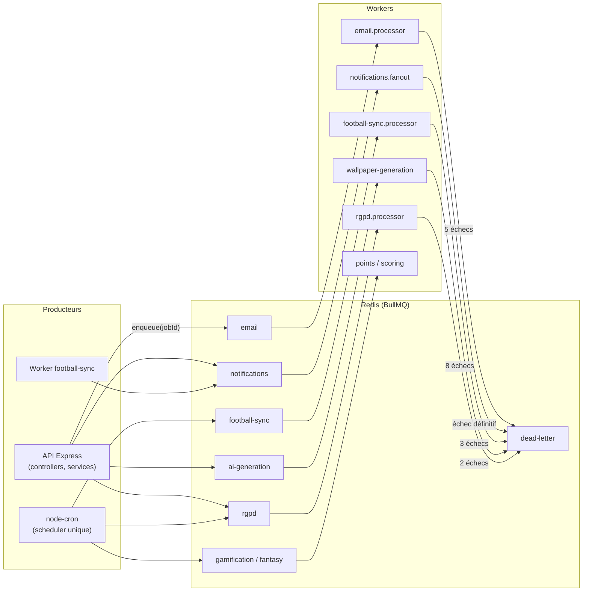

### 10.3 Jobs, `jobId` et payloads

Le `jobId` déterministe est la **clé d'idempotence** : réenfiler le même job (rejeu, double clic, redéploiement) est un *no-op* tant que le premier existe. Les payloads marqués *(proposé)* sont déduits des règles de l'issue (la forme exacte sera figée à l'implémentation).

| File | Job | Payload | `jobId` | Déclencheur | Issue |
| --- | --- | --- | --- | --- | --- |
| `email` | `send` | `{ template, to, locale, data, dedupeKey }` | `dedupeKey` (ex. `verify:<userId>:<tokenHashPrefix>`) | inscription, reset, export prêt, alerte sécurité | `API-AUTH-02` |
| `notifications` | `match-reminder` / `match-kickoff` | `{ matchId, icsSequence }` *(proposé)* | `match-reminder:{matchId}:{icsSequence}` | planification 48 h avant le match, **délayé** à `kickoffAt − 60 min` | `API-NOTIF-13` |
| `notifications` | `campaign-send` | `{ campaignId }` | `campaign:{id}` | clic « Envoyer » ou programmation (WI-07/08) | `API-NOTIF-24/25` |
| `notifications` | `daily-challenge` | `{ date }` | `daily-challenge:{date}` | fin de `generate-daily-challenge`, 08:00 locale par fuseau | `API-NOTIF-15` |
| `notifications` | `match-schedule-changed` | `{ matchId, … }` | déterministe | changement d'horaire | `API-CAL-19` |
| `notifications` | `send-push` (wallpaper prêt) | `{ wallpaperId }` | `wallpaper_ready:<id>` | fin de génération | `API-WALL-21` |
| `football-sync` | `sync-fixtures` | `{ season }` | clé de répétition stable | cron `0 */6 * * *` | `API-FOOT-25/26` |
| `football-sync` | `sync-live` | `{ matchId }` | `sync-live:{matchId}` | fenêtre T-15 min → T+135 min ; se ré-enfile avec *delay* (15 s en match) | `API-FOOT-27` |
| `football-sync` | `sync-lineups` | `{ matchId }` | déterministe | T-60 min | `API-FOOT-25` |
| `football-sync` | `sync-teams` / `sync-players` | `{}` | clé de répétition | quotidien 03:00 / hebdo | `API-FOOT-26` |
| `football-sync` | `refresh-calendar-feed` | `{ matchId, previousKickoffAt, newKickoffAt, changeType }` | `refresh-cal-{matchId}-{icsSequence}` | changement d'horaire détecté | `API-CAL-19` |
| `ai-generation` | `generate-wallpaper` | `{ wallpaperId }` | `wallpaperId` | `POST /wallpapers` (202) | `API-WALL-09/11` |
| `ai-generation` | `summarize-conversation` | `{ conversationId, upTo }` | `conversationId:upTo` | `messageCount − summarizedUpTo ≥ 10` | `API-IA-26` |
| `rgpd` | `export-user-data` | `{ userId, exportId }` *(proposé)* | déterministe | `POST /users/me/export` | `API-AUTH-24` |
| `rgpd` | `purge-user` | `{ userId }` | déterministe | cron 03:00 (comptes `deleted` et `purgeAt ≤ now`) | `API-AUTH-27` |
| `rgpd` | `cleanup-exports`, `apply-consent`, `moderation-retention` | — | — | cron / retrait de consentement | `API-AUTH-25`, `API-NOTIF-06`, `API-MODER-28` |
| `daily-challenge` | `generate-guess`, `generate-quiz` | `{ dayKey }` | `${type}:${dayKey}` | 22:00 Madrid (pré-génération), activation 00:00 | `API-JEUX-02` |
| `gamification` | `record-activity` | `{ userId, source, type, refId, occurredAt, meta }` | `idempotencyKey` | fin de gameweek / tick Masia | `API-PASS-03` |
| `fantasy` | `lock-gameweek` | `{ season, number }` | `lock:{season}:{number}` | **délayé** à `locksAt` | `API-FANT-07` |
| `fantasy` | `derive-player-stats` | `{ matchId }` | `derive:{matchId}:{sourceHash}` | après upsert d'un match live/terminé | `API-FANT-09` |
| `fantasy` | `compute-scores` | `{ season, number, reason }` | `compute:{season}:{number}:{statsVersion}` | fin de match / post-journée | `API-FANT-11` |
| `fantasy` | `rebuild-standings`, `emit-passport-events` | `{ season, number }` | `rebuild:{season}:{n}` | fin du calcul | `API-FANT-11/14` |
| `community` | `recompute-aggregates` | `{ scope }` | verrou Redis 9 min | cron `*/10 * * * *` ; scope *user* sur changement de zone | `API-COMM-06/08` |
| `goat-aggregates` | `goat.vote.cast` | `{ pairKey, criterion, action, choice, previousChoice?, userId, at }` | `${pairKey}:${userId}:${castAt}` | vote | `API-GOAT-26` |
| `exports` | `export` | `{ dataset, format, filters, requestedBy }` | `exportId` | `POST /admin/exports` | `API-PLAT-20` |
| `moderation` *(file à préciser)* | `moderation-sanction-expiry`, `moderation-sla-check` | — | — | cron `*/5 * * * *` | `API-MODER-13/21` |
| `database-backup` | `database-backup` | `{}` | date | cron 02:00 UTC + avant chaque déploiement prod | `API-PLAT-49` |

### 10.4 Tâches planifiées (node-cron)

**Existantes dans le code** (`src/jobs/scheduler.ts`, instance PM2 0 uniquement) :

| Cron | Fuseau | Action |
| --- | --- | --- |
| `0 3 * * *` | Europe/Madrid | `purgeDeletedAccounts` (J+30) |
| `30 3 * * *` | (défaut) | Purge des refresh tokens révoqués depuis plus de 30 jours *(le CDC demande 90 jours)* |

**Prévues par le backlog** (le planificateur doit être **unique** : élection de leader par verrou Redis TTL 30 s, `API-PLAT-35`) :

| Cron | Action | Issue |
| --- | --- | --- |
| `0 * * * *` | `liftExpiredSuspensions` | `API-AUTH-08` |
| `*/5 * * * *` | Levée de sanction, SLA modération, réconciliation des campagnes `scheduled` | `API-MODER-13/21`, `API-NOTIF-25` |
| `* * * * *` | Filet de verrouillage des journées Fantasy ; balayage des wallpapers `GENERATING` orphelins (> 5 min) | `API-FANT-07`, `API-WALL-11` |
| `*/10 * * * *` | Recalcul des agrégats de carte | `API-COMM-08` |
| `0 */6 * * *` | `sync-fixtures` (90 jours à venir) | `API-FOOT-26` |
| `0 3 * * *` | `sync-teams` ; purge RGPD | `API-FOOT-26`, `API-AUTH-27` |
| `45 3 * * *` | Purge des jetons d'appareil morts | `API-NOTIF-11` |
| `30 3 * * *` (Madrid) / `30 3 * * *` (UTC) | Réconciliation des points / `retention-purge` | `API-JEUX-20`, `API-PLAT-52` |
| `0 4 * * *` (Madrid) | Recalcul de la difficulté mesurée des questions | `API-JEUX-29` |
| `0 4 * * *` | Réconciliation du flux calendrier | `API-CAL-19` |
| `15 4 * * *` | Recalcul des maxima GOAT ; purge physique des notifications supprimées | `API-GOAT-07`, `API-NOTIF-21` |
| `0 6 * * *` (Europe/Paris) | Diffusion des anecdotes planifiées | `API-FOOT-10` |
| `0 6 * * *` | `ai-budget-check` (projection de dépassement) | `API-PLAT-17` |
| `0 2 * * *` (UTC) | `database-backup` | `API-PLAT-49` |
| lundi 08:00 (Europe/Paris) | `weekly-report` e-mail super-admin | `API-PLAT-20` |
| 22:00 / 00:00 (Madrid) | Pré-génération / activation du défi du lendemain | `API-JEUX-02` |
| hebdomadaire | Vérification de la chaîne d'audit (`audit:verify`) | `API-PLAT-18` |

---

## 11. Stockage objet

**Règle** : MongoDB ne contient **jamais** de binaire. Il stocke une **clé opaque** (`avatarKey`, `photoKey`, `imageKey`, `thumbKey`, `crestKey`, `storageKey`) ; l'URL publique ou signée est **construite par l'API au moment de répondre** (on ne renvoie jamais l'URL du fournisseur d'origine, pour les droits d'image). Un service `StorageProvider` (`put/get/delete/signedUrl`) a deux implémentations : **local** (dev/test) et **S3** (variable `STORAGE_DRIVER`).

| Contenu | Bucket | Clé d'objet | Accès | Cycle de vie | Issue |
| --- | --- | --- | --- | --- | --- |
| Avatar utilisateur | public (CDN) | `avatars/<userId>/<sha256-court>.webp` (512×512 et 128×128), immuable | URL publique `CDN_BASE_URL` | ancien objet supprimé au remplacement | `API-AUTH-31` |
| Médiathèque éditoriale (photos joueurs, illustrations) | public | `media/AAAA/MM/<uuid>.<ext>` | URL publique | suppression refusée (409) si `usageCount > 0` | `API-FOOT-05` |
| Écussons d'équipes | public | `crestKey` | URL construite par l'API | — | `API-FOOT-02` |
| Avatar de groupe, pièces jointes de posts | public | `imageKey` = UUID opaque (WebP ≤ 1 600 px, avatar 512) | URL signée de lecture (15 min) | non rattaché sous 24 h → purgé ; image masquée par modération → plus servie | `API-COMM-18` |
| Wallpapers générés | privé | `imageKey`, `thumbKey` (miniatures 240×520) | **URLs signées** : miniature 24 h, image 1 h, téléchargement 5 min (`Content-Disposition: attachment`), partage 7 j révocable (`shareNonce`) | purge physique 24 h après `deletedAt` ; cache JPEG avec règle de cycle de vie | `API-WALL-13/20` |
| Archives d'export RGPD | privé | `exports/<userId>/univers-barca-export-<userId>-<date>.zip` | pré-signé 7 j max, 5 téléchargements | suppression automatique à 7 j (règle de bucket + job `rgpd:cleanup-exports`) | `API-AUTH-25` |
| Exports admin CSV/Excel | privé | fichier temporaire | URL signée 15 min | supprimé après 24 h | `API-PLAT-20` |
| Sauvegardes MongoDB | privé hors VPS | archive chiffrée (age / AES-256) | clé distincte | 30 quotidiennes + 26 hebdomadaires | `API-PLAT-49` |

Variables d'environnement : `STORAGE_DRIVER`, `S3_ENDPOINT`, `S3_BUCKET_PRIVATE`, `S3_BUCKET_PUBLIC`, `S3_ACCESS_KEY`, `S3_SECRET_KEY`, `CDN_BASE_URL`, `EXPORT_TTL_DAYS=7`, `BACKUP_S3_*`.

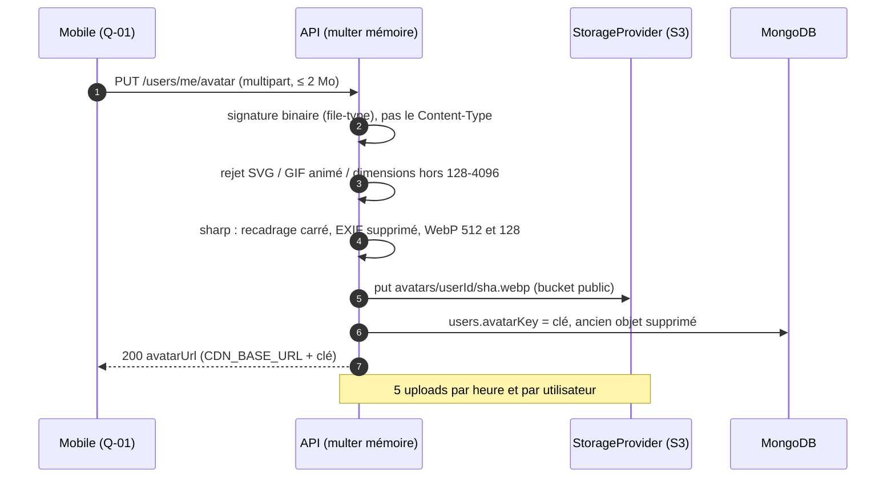

**Pas à pas.** L'étape 2 est une règle de sécurité : on ne fait jamais confiance au `Content-Type` ni à l'extension (fichiers piégés). L'étape 4 supprime les métadonnées EXIF qui peuvent contenir une **position GPS** : une image de profil ne doit pas révéler où l'utilisateur habite (cohérent avec le principe « aucune coordonnée précise »).

---

## 12. Mobile : base locale Drift et synchronisation hors-ligne

### 12.1 Principes (CDC Flutter §5, `MOB-FND-18` à `MOB-FND-22`)

1. **Drift est un cache de lecture, jamais la source de vérité.** Les données de compte (progression, badges, séries, Fantasy) sont **toujours** rechargées dès le retour du réseau (CDC Flutter §12.1).
2. **Jetons** : jamais dans Drift ni dans SharedPreferences, mais dans `flutter_secure_storage` (Keychain iOS / Keystore Android ; `encryptedSharedPreferences: true`, `first_unlock_this_device`).
3. Base ouverte via `drift_flutter` en *isolate* (`NativeDatabase.createInBackground`) ; en test : `AppDatabase.forTesting(NativeDatabase.memory())`.
4. Dates en UTC (epoch) ; JSON dans une colonne `payloadJson` (snapshot complet pour l'affichage hors-ligne).
5. **Chiffrement SQLCipher prévu mais bloqué** (Dart ≥ 3.10 requis ; `sqlcipher_flutter_libs` commenté dans `pubspec.yaml`) : suivi par `MOB-FND-45`. Aujourd'hui : base **en clair**, contenant uniquement des données d'affichage.
6. **Aucun fichier `lib/core/local_storage` n'existe encore** dans le dépôt mobile : tout ce qui suit est la **cible spécifiée** (`pubspec.yaml` déclare `drift ^2.21.0`, `drift_flutter ^0.2.7`, `drift_dev ^2.21.2`).

### 12.2 Schéma local

```mermaid
erDiagram
    PENDINGACTIONS {
        string id PK "uuid"
        string type "enum enregistré"
        string payloadJson
        string idempotencyKey
        datetime createdAt
        int attempts
        string lastError
        string status "pending, inflight, failed, done"
    }
    SYNCMETADATA {
        string key PK "lastSuccessfulSyncAt, appConfigJson"
        string valueText
        datetime updatedAt
    }
    LOCALPREFS {
        string key PK
        string value
        datetime updatedAt
    }
    CACHEDMATCHES {
        string id PK
        string homeTeam
        string awayTeam
        datetime kickoffAt
        string payloadJson
        datetime cachedAt
    }
    CACHEDPLAYERS {
        string id PK
        string payloadJson
        datetime cachedAt
    }
    CACHEDPROFILE {
        string userId PK
        string payloadJson
        datetime cachedAt
    }
    CACHEDDASHBOARDCARDS {
        string cardKey PK
        string payloadJson
        datetime cachedAt
        int schemaVersion
    }
    CACHEDQUIZQUESTIONS {
        string id PK
        string payloadJson
    }
    CACHEDPLAYERSEARCH {
        string queryKey PK
        string payloadJson
        datetime cachedAt
    }
    FAVORITEMATCHES {
        string matchId PK
        datetime createdAt
    }
```

> `PENDINGACTIONS` ne doit **jamais perdre de lignes** lors d'une migration de schéma (`MOB-FND-19`).

| Table | Rôle | Source de vérité / péremption | Issue |
| --- | --- | --- | --- |
| `PendingActions` | File d'actions d'écriture à rejouer | Purge des `done` > 24 h ; purge totale au logout | `MOB-FND-22` |
| `SyncMetadata` | `lastSuccessfulSyncAt`, `appConfigJson` / `appConfigFetchedAt` (config distante, TTL 10 min) | — | `MOB-A-03/08` |
| `LocalPrefs` | Préférences d'appareil (dont niveau de quiz local, brouillons) | conservées au « changer de compte » sauf données liées | `MOB-FND-18` |
| `CachedMatches` | Matchs consultés (prochain match, historique) | **historique : lecture cache sans resynchronisation** (7 j) ; favori = exclu de la purge LRU | `MOB-F-03/04/19` |
| `CachedDashboardCards` | 5 cartes de l'accueil | **cache-then-network** ; périmé après 24 h (bandeau d'ancienneté) | `MOB-C-04` |
| `CachedPlayers`, `CachedPlayerSearch` | Fiches joueurs, 200 derniers résultats de recherche | 24 h | `MOB-D-27`, `MOB-H-15` |
| `CachedProfile` | Profil de l'utilisateur connecté | 1 h ; sert à A-09 hors-ligne | `MOB-FND-14`, `MOB-A-13` |
| `CachedQuizQuestions` | Questions du quiz du jour (lisibles, **correction non stockée**) | jusqu'à minuit | `MOB-E-04` |
| `CachedGuessHistory`, résultats | Historique Guess (1re page, 200 derniers) | **jamais** de `solution`/`playerId` avant la fin | `MOB-D-12/23/25` |
| `fantasy_teams_cache`, `fantasy_leaderboard_cache`, `fantasy_rules_cache` | Fantasy | stale-while-revalidate ; classement 2 min | `MOB-H-03` |
| `academy_player_cache`, `passport_cache` | Masia (10 min), Passport (5 min) | cache-then-network | `MOB-I-02`, `MOB-P-02` |
| `cached_groups`, `cached_group_posts`, `cached_group_events`, `hidden_users` | Communauté | TTL 15 min, lecture seule hors-ligne ; fil jamais mis en cache pour un groupe non suivi | `MOB-K-28/15/17` |
| `user_zone`, `pending_consents` | Zone (pays/ville, **aucune coordonnée**), consentements en attente de rejeu | synchronisation différée | `MOB-J-17/19` |
| `matchReminders`, `AddedCalendarEvents` | Rappels de match activés, événements ajoutés à l'agenda | local | `MOB-C-22`, `MOB-L-22` |
| `wallpapers_cache`, `wallpaper_draft` | Galerie (stale-while-revalidate), id de la génération en cours | — | `MOB-M-09/17` |
| `chat_conversations_cache`, `chat_messages_cache` | Historique Barça AI (lecture seule hors-ligne) | **API = source de vérité** (multi-appareils) | `MOB-N-04/21` |
| `cached_notifications` | Boîte de réception | consultable hors-ligne ; « lu » appliqué localement puis envoyé | `MOB-O-04/19` |
| Brouillons | `draft_group_{id}` (24 h), brouillon d'XI Fantasy (debounce 500 ms), brouillon Masia (24 h) | restaurés à l'ouverture | `MOB-K-10`, `MOB-H-29`, `MOB-I-10` |

### 12.3 Stratégie de synchronisation

`CachePolicy` : `cacheThenNetwork`, `networkFirst`, `cacheOnly`, `networkOnly` (`lib/core/cache/cached_fetcher.dart`, cible). Le repository émet un `Stream<Either<Failure, CachedValue<T>>>` : **d'abord le cache** (`fromCache: true, cachedAt`), puis le réseau. Hors-ligne et sans cache : `Left(NetworkFailure)`.

| Donnée | Politique | TTL cible |
| --- | --- | --- |
| Dashboard | cache-then-network | 15 min (périmé > 24 h) |
| **Défi du jour** | **réseau prioritaire, repli cache** ; la tentative hors-ligne n'est **jamais évaluée localement** (la solution n'est pas connue du client) | jusqu'à minuit (fuseau utilisateur) |
| Historique (matchs, fiches) | cache-first, **sans resynchronisation** | 7 j |
| Fiches joueurs | cache-then-network | 24 h |
| Profil | cache-then-network | 1 h |
| Assistant Barça AI | **aucun mode hors-ligne** ; message conservé en file locale, retry manuel | — |
| Config distante (`/config`) | cache-then-network | 10 min |

**Actions mises en file** (`PendingActions`) : tentative de quiz/Guess *validée localement mais non évaluée*, préférences de notification (patchs fusionnés), lecture « lu », consentements, révocation de session (`logout_revoke`), changement de langue. **Actions interdites hors-ligne** (affichent un état « hors-ligne » plutôt que de simuler) : **vote GOAT, chat de groupe, défi du jour, assistant IA**.

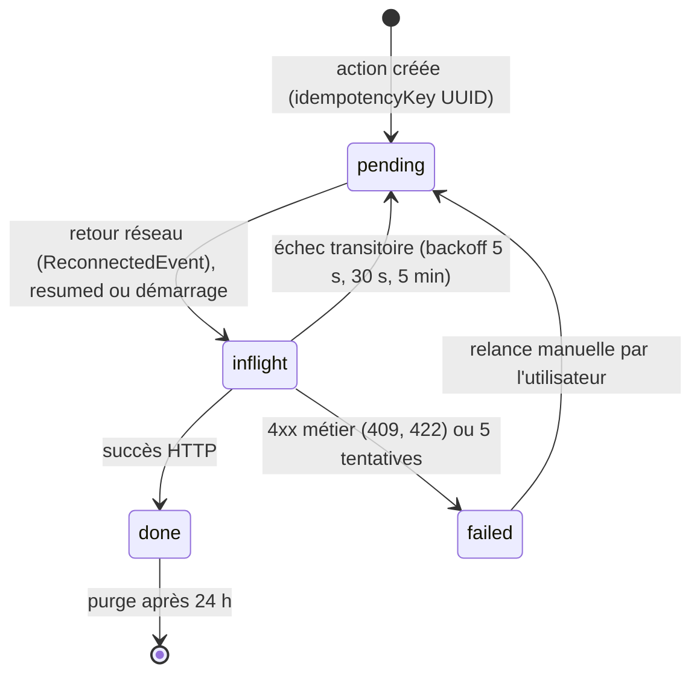

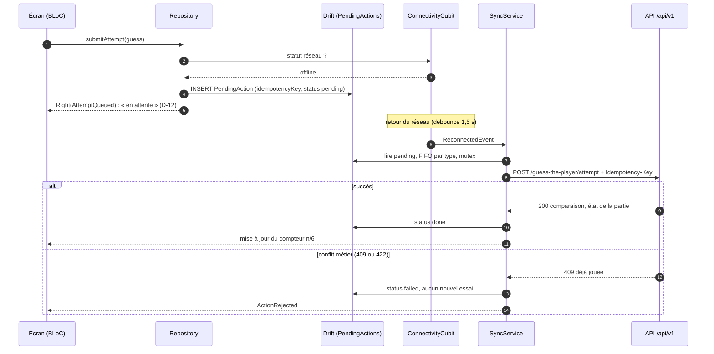

**Pas à pas.** (1-3) Sans réseau, rien n'est évalué localement. (4-5) L'action est stockée avec sa **clé d'idempotence** (UUID v4) et l'UI affiche « en attente ». (7-9) Au retour réseau, le `SyncService` rejoue **séquentiellement** (FIFO par type, un mutex empêche deux boucles) en envoyant `Idempotency-Key` ; côté API l'**index unique** `{ userId, challengeId, clientAttemptId }` garantit qu'un rejeu ne crée pas de doublon. (10-13) Un 409/422 est une décision *métier* : l'action est marquée `failed` sans retry. **Dépendance API à confirmer** : l'API doit accepter l'en-tête `Idempotency-Key` sur tous les POST rejouables (`MOB-FND-22`).

### 12.4 Migrations Drift et purge

* `schemaVersion = 1` au départ ; `onUpgrade = stepByStep` ; **interdiction de `deleteAll` en production** ; schémas exportés dans `drift_schemas/drift_schema_v<N>.json` ; tests de migration générés ; échec de migration → base renommée `.bak` et recréée, file d'actions **exportée dans un log** (`MOB-FND-19`).
* **Déconnexion / suppression de compte** : `LocalDataCleaner` vide toutes les tables (sauf préférences d'appareil comme langue/thème), supprime tokens, jeton FCM, caches d'images et fichiers temporaires (`MOB-FND-14`, `MOB-Q-23`). « Changer de compte » purge les données liées au compte (`ClearLocalAccountDataUseCase`, `MOB-A-12`).
* Stockages non-Drift : `flutter_secure_storage` (access/refresh, clé SQLCipher future), `SharedPreferences` (drapeaux d'onboarding : `assistant_discovery_seen`, `first_run_done`, `coach_ai_fab_seen`, `resetsAt` de quota).

---

## 13. DTO ↔ modèles

**Les quatre représentations d'une même donnée.** Une donnée « match » existe sous quatre formes ; confondre les couches est la première source de bugs.

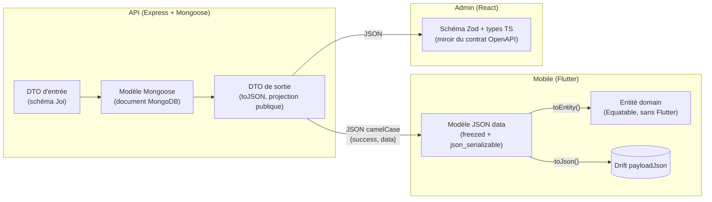

**Règles de contrat.**

* **Enveloppe** : succès `{ success: true, data }` ; pages `{ items, total, page, totalPages, hasMore, nextCursor }` ; erreurs `{ success: false, error: { code, message, details, traceId } }` (`utils/response.ts`, `AppError.*`).
* **Nommage JSON** : `camelCase`, `id` (string) à la place de `_id`, dates **ISO 8601 UTC**. Les noms `snake_case` du CDC (`user_id`, `created_at`) ne sont **pas** ceux du JSON réel.
* **Validation d'entrée** : schémas **Joi** sur tout `body/query/params` (`validate(schema, 'query')`), assainissement NoSQL (`sanitize`) avant le contrôleur ; le DTO d'entrée n'est jamais le modèle.
* **Projection de sortie** : le modèle contient des champs que le client ne doit **jamais** voir ; la sortie passe par `toJSON`/projections. Exemples : `passwordHash`, `tokenHash`, `totpSecret` (`select: false`) ; `dailychallenges.payload.playerId` d'un défi **actif** (jamais sérialisé) ; `GeneratedWallpaper.finalPrompt` ; `statusHistory` du joueur (masqué côté public) ; `cityId`/`locationSource` d'un autre utilisateur ; `Match.scoreHome/Away` seulement si `status != scheduled`.
* **Contrat OpenAPI** : généré depuis les annotations `@swagger` ; `npm run check:swagger` échoue si le contrat n'est pas à jour ; l'admin et le mobile s'alignent dessus.

### Correspondances principales

| Domaine | Modèle Mongoose | DTO API (sortie) | Mobile `data` → `domain` | Admin |
| --- | --- | --- | --- | --- |
| Profil | `User` | `UserProfile` (sans secrets) | `UserProfileModel` → `UserProfile`, `AuthSession`, `ConsentType` (`MOB-B-06`) | — |
| Joueur | `Player` | `PlayerPublic` / `PlayerAdmin` | `PlayerModel` → `Player` ; module de référence `lib/features/players` | types `Player` + Zod (`ADM-WC-02`) |
| Match | `Match` | `MatchSummary` / `MatchDetail` | `CachedMatches.payloadJson` ; modèles frise/match (`MOB-F-01`) | `Match`, `MatchEvent`, `MatchLineup`, `SyncConflict` (`ADM-WD-01`) |
| Défi Guess | `DailyChallenge`, `GuessAttempt`, `GuessPlay` | sans `playerId` actif | modèles freezed Guess (`MOB-D-02`) | — |
| Quiz | `QuizQuestion`, `QuizSession` | question sans `correctOption` avant réponse | `QuizAnswer`, `UserQuizLevel` (`MOB-E-02`) | question complète + audit (`ADM-WF-02`) |
| Fantasy | `FantasyTeam`, `FantasyGameweekScore` | `FantasyTeam` (`captainId`, `locksAt` injecté) | `fantasy_teams`, `fantasy_selections`, `fantasy_gameweek_scores` (`MOB-H-01`) | barème (WJ) |
| Passport | `UserProgress`, `Badge` | `UserProgress` (champs publics) | `passport_cache` (`MOB-P-01`) | — |
| Carte | `LocationAggregate` | `MapAggregate` (`displayCount`, centre de zone uniquement) | agrégats + zone (`MOB-J-02/19`) | — |
| Groupes | `CommunityGroup`, `GroupPost` | `CommunityGroupDto` | `cached_groups`, posts (`MOB-K-01`) | modération (`ADM-WG-02`) |
| Chat IA | `ChatConversation`, `ChatMessage` | message + `metadata` (langue, sources) | `chat_*_cache` (`MOB-N-01`) | — |
| Wallpaper | `GeneratedWallpaper` | `toPublicWallpaper()` : `imageUrl` et `thumbUrl` signées, `moderationStatus` ok/rejected/pending | `generated_wallpapers` (`MOB-M-01`) | — |
| Notifications | `NotificationPreference`, `DeviceToken`, `NotificationLog` | idem | `cached_notifications` (`MOB-O-02`) | campagnes (`ADM-WI`) |
| Flags / config | `FeatureFlag`, `PlatformSetting` | `AppConfig`, flags évalués booléens | `SyncMetadata.appConfigJson` (`MOB-A-08`) | `FeatureFlagAdmin` (WI-05) |

---

## 14. Migrations (migrate-mongo) et seed

**Outil** : `migrate-mongo`. **Situation actuelle** : une seule migration, `scripts/migrations/20261015000000-initial-indexes.js`, qui crée `users.email` (unique sparse), `refreshtokens.expiresAt` (TTL 0), `refreshtokens.tokenHash` (unique) et `communitygroups.location` (2dsphere, erreur ignorée). Les index des autres collections sont, à ce jour, créés par Mongoose à la connexion (`autoIndex`) ; le backlog (`API-PLAT-31/51/52`) impose de les **garantir par migration** avant la production.

**Règles** (`API-PLAT-51`) :

1. Nom `AAAAMMJJHHMMSS-description.js` ; chaque migration est **idempotente** (rejouable sans effet), avec `up` **et** `down` (le `down` est *non destructif* quand c'est impossible : « les index sont conservés »).
2. **Aucune dépendance au code applicatif** (pas d'import de modèles Mongoose) : une migration doit rester valide même si le modèle évolue.
3. Exécution **unique** : verrou de migrate-mongo (collection `migrations_changelog`, `migrate-mongo-config.js`) + conteneur `migrator` joué *avant* le démarrage de l'API.
4. **Migrations destructives en deux temps** (CDC Backend §9.5) : (a) déprécier (garder l'ancien champ en lecture, écrire les deux), (b) supprimer à la version suivante — car des versions mobiles anciennes restent en circulation.
5. **Seed** : dev = jeu riche (`npm run seed`) ; staging = jeu anonymisé + volumétrie optionnelle (`seed-volume.ts`, garde `NODE_ENV !== 'production'`) ; **production = uniquement des référentiels indispensables** (flags, quotas, barème, compétitions) **via migration**, jamais de données de test ; `scripts/seed-data.ts` (existant) doit refuser la production (garde demandée par `API-PLAT-51`).
6. Le premier **super-admin** est créé par `ADMIN_BOOTSTRAP_EMAIL` / `ADMIN_BOOTSTRAP_PASSWORD` (puis ces variables sont retirées ; mot de passe à changer à la première connexion).

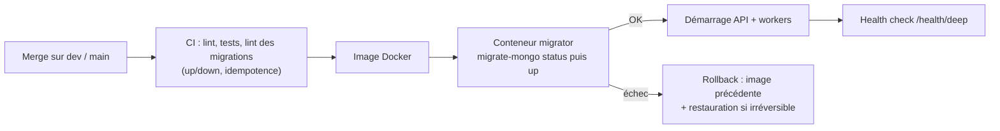

**Migrations annoncées par le backlog** (liste non exhaustive, à créer) :

| Migration | Effet | Issue |
| --- | --- | --- |
| `*-player-search-fields` | backfill `searchName`, `missingLocales`, `slug` | `API-FOOT-01` |
| `*-team-competition-slug` | backfill `slug`, `shortName`, index partiel `isOwnClub` | `API-FOOT-02` |
| conversion `matches.syncConflict` → `conflicts[]`, `isHistorical=false` | | `API-FOOT-03` |
| conversion `anecdotes.publishOn` String → Date + `monthDay` | | `API-FOOT-04` |
| `*-user-map-visibility` | `mapVisibility='hidden'` par défaut | `API-COMM-01` |
| conversion `locationaggregates` lat/lng → GeoJSON | | `API-COMM-07` |
| déplacement des `communitygroups.events[]` → `groupevents` | | `API-COMM-15` |
| `*-fantasy-team-status` | `status='open'`, `rulesVersion=1` | `API-FANT-02` |
| `decisions` embarquées → `academydecisions` | | `API-FANT-25` |
| `*-guess-daychallenge` | `date` → `dayKey`, attribution de `number` | `API-JEUX-01` |
| `*-split-chat-messages` | `chatconversations.messages[]` → `chatmessages` (lots de 500, marqueur `migratedAt`) | `API-IA-01` |
| `*-seed-feature-flags` | 4 flags (désactivés) | `API-PLAT-08` |
| `*-user-moderation` | `warningsCount=0` | `API-MODER-03` |
| `*-report-fields` | valeurs par défaut des signalements | `API-MODER-01` |
| `*-goat-models` | création des index, backfill `GoatDuel.total` | `API-GOAT-01` |
| `*-user-progress-counters` | recalcul des compteurs depuis les sessions | `API-PASS-01` |
| index TTL manquants (`revokedAt`+90 j, etc.) | | `API-PLAT-52` |

---

## 15. Dictionnaire de données

**Mode d'emploi.** Pour chaque collection : **champ**, **type** Mongoose, **contraintes / défaut**, **signification**. Les champs **sans mention** existent dans le code (`src/models`). Les champs marqués **(B `API-XXX`)** sont à ajouter selon l'issue citée. Tous les documents ont en plus `_id` (ObjectId), `createdAt` et `updatedAt` (sauf journaux immuables : `createdAt` seul), et sont exposés avec `id` à la place de `_id`.

### 15.1 `users` — compte supporter

| Champ | Type | Contraintes / défaut | Signification |
| --- | --- | --- | --- |
| `email` | String | minuscule, `trim`, **unique sparse** | Identifiant de connexion ; absent pour un compte purement social |
| `passwordHash` | String | `select: false` ; Argon2id | Mot de passe haché ; absent pour un compte social |
| `displayName` | String | requis, 3–20 car., `trim` | Pseudo public |
| `locale` | String | enum `fr`/`en`/`es`, défaut `fr` | Langue des contenus et e-mails |
| `themePreference` | String | enum `system`/`light`/`dark`, défaut `system` | Thème |
| `countryCode` | String | ISO 3166-1 alpha-2, majuscule | Pays (localisation approximative) |
| `city` | String | `trim` | Ville (nom normalisé) |
| `avatarKey` | String | — | Clé d'objet de l'avatar |
| `favoritePlayerId` | ObjectId | ref `Player` | Joueur préféré (onboarding) |
| `supporterSince` | Number | ≥ 1899 | Année depuis laquelle l'utilisateur supporte le club |
| `timezone` | String | défaut `Europe/Madrid` | Fuseau pour les rappels et le jour d'activité |
| `emailVerifiedAt` | Date | — | Date de vérification de l'e-mail |
| `emailVerificationTokenHash`, `emailVerificationExpiresAt` | String, Date | `select: false` | Code de vérification haché et son expiration |
| `passwordResetTokenHash`, `passwordResetExpiresAt` | String, Date | `select: false` | Jeton de réinitialisation haché |
| `passwordChangedAt` | Date | — | Invalide les anciens jetons |
| `authProviders[]` | `{ provider: google|apple, providerUserId }` | `_id: false` | Comptes sociaux liés |
| `status` | String | enum `active`/`suspended`/`banned`/`deleted`, défaut `active`, indexé | État du compte |
| `suspendedUntil` | Date | — | Fin de suspension |
| `lastActiveAt` | Date | — | Dernière activité |
| `termsAcceptedAt` | Date | — | Acceptation des CGU |
| `deletedAt` | Date | — | Début de la période de grâce de suppression |
| `purgeAt`, `emailHashForRestore` | Date, String | (B `API-AUTH-26`) | Échéance de purge et hash d'e-mail pour l'annulation |
| `followSystemLocale`, `accessibility` | Boolean, objet | (B `API-AUTH-28`) | Préférences d'accessibilité |
| `supporterLevel`, `onboarding` | String, objet | (B `API-AUTH-29`) | Profil d'onboarding |
| `displayNameKey` | String | unique, insensible à la casse (B `API-PASS-19`) | Unicité du pseudo |
| `mapVisibility` | String | enum `city`/`country`/`hidden`, défaut `hidden` (B `API-COMM-01`) | Visibilité sur la carte (opt-in) |
| `locationSource`, `locationUpdatedAt`, `cityId` | String, Date, ObjectId | (B `API-COMM-01`) | Origine (`gps-approx`/`manual`) de la zone ; référence `geocities` |
| `moderation` | objet | (B `API-MODER-03`) | `warningsCount`, `lastWarningAt`, `activeSanctionId`, motif public (≤ 280 car.), `bannedAt` |

*Index* : `email` unique sparse ; `status` ; `{ countryCode, city }`.

### 15.2 `refreshtokens`, `consentrecords`, `adminusers`, `adminsessions`

| Collection | Champ | Type | Contraintes | Signification |
| --- | --- | --- | --- | --- |
| `refreshtokens` | `userId` | ObjectId | requis, indexé | Propriétaire |
| | `familyId` | String | requis, indexé | **Famille de rotation** : le rejeu d'un ancien jeton révoque toute la famille |
| | `tokenHash` | String | requis, **unique** | SHA-256 du jeton opaque (jamais en clair) |
| | `deviceId`, `platform`, `userAgent`, `ip` | String | `platform` ∈ `ios`/`android`/`web` | Appareil (écran « Mes appareils » Q-xx) |
| | `expiresAt` | Date | requis, **TTL 0** | Expiration (glissante 30 j) |
| | `revokedAt`, `replacedByHash`, `lastUsedAt` | Date, String | — | Révocation et chaînage de rotation |
| | `familyCreatedAt` | Date | (B `API-AUTH-13`) | Borne absolue de 90 jours |
| | `persistent` | Boolean | (B `API-AUTH-14`) | « Se souvenir de moi » (30 j) ou session 24 h |
| `consentrecords` | `userId` | ObjectId | requis, indexé | Utilisateur |
| | `type` | String | enum `terms`/`privacy`/`geolocation`/`notifications`/`analytics` (+ `charter` B `API-AUTH-22`) | Finalité |
| | `granted` | Boolean | requis | Accordé ou retiré |
| | `version` | String | défaut `'1.0'` | Version du document accepté |
| | `grantedAt`, `revokedAt` | Date | — | Horodatages |
| | `source`, `ipPrefix`, `userAgent` | String | (B `API-AUTH-21`) | Preuve de consentement (préfixe d'IP seulement) |
| `adminusers` | `email` | String | requis, unique | Connexion back-office |
| | `name` | String | requis | Nom affiché dans l'audit |
| | `passwordHash` | String | `select: false` | Argon2id |
| | `role` | String | enum `content-manager`/`moderator`/`super-admin` | Rôle RBAC |
| | `status` | String | `invited`/`active`/`disabled`, défaut `invited` | Cycle de l'invitation |
| | `totpSecret`, `totpEnabled` | String, Boolean | secret `select: false` (chiffré AES-256-GCM, B `API-AUTH-34`) | 2FA TOTP |
| | `inviteTokenHash`, `inviteExpiresAt` | String, Date | `select: false` | Invitation consommée à la première connexion |
| | `failedLogins`, `lockedUntil`, `lastLoginAt` | Number, Date | — | Verrouillage 15 min après 5 échecs |
| | `backupCodes` | [String] | 8 codes hachés Argon2id (B `API-AUTH-34`) | Codes de secours 2FA |
| `adminsessions` | `adminId` | ObjectId | requis, indexé | Admin |
| | `tokenHash` | String | requis, unique | Refresh admin haché (cookie httpOnly) |
| | `userAgent`, `ip`, `lastActivityAt` | | | Contexte de session |
| | `expiresAt` | Date | requis, **TTL 0** | Expiration (inactivité 8 h) |
| | `revokedAt` | Date | — | Révocation (WI-03) |

### 15.3 Football : `players`, `teams`, `competitions`

| Collection | Champ | Type | Contraintes | Signification |
| --- | --- | --- | --- | --- |
| `players` | `externalRef` | String | unique sparse | Identifiant dans l'API football |
| | `fullName`, `shortName` | String | `fullName` requis, indexé | Noms |
| | `birthDate`, `nationality` | Date, String | `nationality` indexé | Identité sportive |
| | `position` | String | enum `GB DD DC DG MD MC MO AD AG BU` | Poste (libellé localisé côté client) |
| | `shirtNumber`, `previousClub` | Number, String | — | Numéro, club précédent |
| | `isActive` | Boolean | défaut `true`, indexé | Dans l'effectif |
| | `bioI18n` | `{fr,en,es}` | défaut `''` | Biographie (≤ 4 000 car./langue, B `API-FOOT-01`) |
| | `photoKey` | String | — | Clé de la photo (médiathèque) |
| | `status` | String | `draft`/`awaiting-translation`/`ready`/`published`/`archived`, indexé | Workflow éditorial |
| | `stats[]` | `{ season, matchesPlayed, goals, assists, trophiesCount }` | `season` requis, `_id: false`, format `AAAA/AA` unique par joueur (B) | Statistiques par saison |
| | `goatVotes` | Number | défaut 0 | Compteur dénormalisé du comparateur GOAT |
| | `slug`, `searchName`, `missingLocales[]`, `statusHistory[]`, `foot`, `birthPlace`, `trainedAt`, `contractUntil`, `publishedAt`, `archivedAt`, `clubCurrent` | divers | (B `API-FOOT-01`) | Recherche insensible aux accents, complétude i18n, historique de statut (50 max) |
| | `featuredForWallpaper` | Boolean | (B `API-WALL-02`) | Joueur mis en avant pour les wallpapers |
| `teams` | `name` | String | requis | Nom |
| | `shortName` | String | — | Code 3 lettres (FCB, RMA) |
| | `type` | String | `club`/`national`, défaut `club` | Type |
| | `crestKey` | String | — | Clé de l'écusson |
| | `externalRef`, `slug`, `country`, `isOwnClub`, `colors` | divers | (B `API-FOOT-02`) ; un seul `isOwnClub=true` (index partiel) | Identité synchronisée |
| `competitions` | `name` | String | requis, **unique** | « Liga », « Ligue des champions »… |
| | `type` | String | `league`/`cup`/`friendly`, requis | Type |
| | `externalRef`, `slug`, `shortName`, `order`, `isActive`, `code` | divers | (B `API-FOOT-02`, `API-CAL-01`) | Filtre du calendrier mobile |

### 15.4 `matches`

| Champ | Type | Contraintes | Signification |
| --- | --- | --- | --- |
| `externalRef` | String | unique sparse | Clé de rapprochement avec l'API football |
| `homeTeamId`, `awayTeamId` | ObjectId | requis, ref `Team` | Équipes |
| `competitionId` | ObjectId | requis, ref `Competition` | Compétition |
| `matchday` | String | — | Journée / tour (« J10 », « 1/8 ») |
| `kickoffAt` | Date | requis, indexé, **UTC** | Coup d'envoi |
| `status` | String | `scheduled`/`live`/`finished`/`postponed`/`cancelled`, indexé | Transitions autorisées : `scheduled→live→finished`, `scheduled→postponed→scheduled`, `*→cancelled` (B `API-FOOT-03`) |
| `scoreHome`, `scoreAway` | Number | — | Score (exposé si `status != scheduled`) |
| `venue` | String | — | Stade |
| `source` | String | `api`/`manual`, défaut `api` | Origine : un match `manual` n'est jamais supprimé par la synchro |
| `contextI18n` | `{fr,en,es}` | — | Contexte des matchs historiques |
| `lineups[]` | `{ playerId, teamId, isStarter, position }` | `_id: false` | Compositions **embarquées** |
| `events[]` | `{ minute, type, playerId, detailI18n }` | `type` ∈ `goal`/`card`/`sub` (étendu B : `own-goal`, `penalty`, `card-yellow`, `card-red`, `sub_in`/`sub_out`, `assistPlayerId`) | Événements **embarqués** |
| `syncConflict` | `{ field, apiValue, editorialValue }` | existant | Conflit synchro vs correction éditoriale (devient `conflicts[]`, B `API-FOOT-03`) |
| `venueTimezone`, `minute` (0–130), `period` (1H/HT/2H/ET/PEN), `halfTimeHome/Away`, `stats`, `formations`, `coaches`, `standingsSnapshot`, `editedFields[]`, `lastSyncedAt`, `isHistorical`, `contentHash` | divers | (B `API-FOOT-03/24`) | Live, mi-temps, champs protégés de l'écrasement, détection de no-op |
| `scheduleChanges[]`, `icsSequence`, `updatedAtSchedule` | divers | (B `API-CAL-02`) | Historique des changements d'horaire et numéro de séquence ICS |

### 15.5 Jeux et progression

| Collection | Champ | Type | Contraintes | Signification |
| --- | --- | --- | --- | --- |
| `dailychallenges` | `type` | String | `guess_player`/`quiz`, requis | Type de défi |
| | `date` | String | requis ; **unique avec `type`** | Jour `AAAA-MM-JJ` (fuseau Madrid) ; devient `dayKey` (B `API-JEUX-01`) |
| | `payload` | Mixed | — | Contenu du défi (typé en B : `{ playerId, hints }` / `{ seed, questionCount: 10 }`) ; **jamais sérialisé** pour un défi actif |
| | `number`, `status`, `source` | Number, String | (B) `scheduled`/`active`/`closed` ; `auto`/`admin` | « Défi n°214 » |
| `guessattempts` | `userId`, `challengeId`, `guessedPlayerId` | ObjectId | requis | Qui, quel défi, quel joueur proposé |
| | `attemptNumber` | Number | requis ; **unique avec userId+challengeId** ; 1–6 (B) | Rang de l'essai |
| | `isCorrect` | Boolean | requis | Résultat |
| | `clientAttemptId`, `comparison` | String, objet | (B `API-JEUX-01`) | Idempotence du rejeu, indices figés |
| `quizquestions` | `questionI18n` | `{fr,en,es}` | — | Énoncé |
| | `optionsI18n[]` | tableau de `{fr,en,es}` | exactement 4 (B) | Options |
| | `correctOption` | Number | requis, 0–3 | Bonne réponse (jamais envoyée avant la réponse) |
| | `explanationI18n` | `{fr,en,es}` | — | Explication affichée après réponse |
| | `difficultyLevel` | Number | requis, 1–5, indexé | Niveau éditorial |
| | `category` | String | indexé | `players`/`history`/`stats`/`matches`/`trophies`/`masia` (B) |
| | `playerId` | ObjectId | ref `Player` | Joueur concerné |
| | `status` | String | `pending-ai`/`draft`/`published`/`rejected`/`archived`, défaut `draft`, indexé | Workflow (file de validation IA) |
| | `origin` | String | `editorial`/`ai` | Provenance |
| | `rejectionReason` | String | — | Motif de rejet (obligatoire si rejeté, B) |
| | `stats` | `{ answers, correct }` | défaut 0 | Compteurs de réponses |
| | `code` (`q-00481`), `measuredLevel`, `missingLocales`, `createdBy`, `reviewedBy`, `reviewedAt`, `rejectionComment`, `tags`, `pinnedLevel`, `successRate30d` | divers | (B `API-JEUX-11/29`, `ADM-WF-02`) | Édition et difficulté mesurée |
| `quizsessions` | `userId` | ObjectId | requis, indexé | Joueur |
| | `mode` | String | `daily`/`practice`, requis | Quiz du jour ou entraînement (practice = 0 point) |
| | `levelAtStart`, `startedAt`, `finishedAt`, `score` | | `score` défaut 0 | Déroulé |
| | `answers[]` | `{ questionId, isCorrect, answeredAt, timeMs }` | `_id: false` | Réponses embarquées |
| | `dayKey`, `status`, `questions[]`, `expiresAt` (+30 min), `pointsTotal`, `levelAfter`, `levelChange` | divers | (B `API-JEUX-11`) | Anti-rejeu ; unique `(userId, dayKey, daily)` |
| `userprogresses` | `userId` | ObjectId | requis, **unique** | Un document par utilisateur |
| | `currentStreak`, `bestStreak` | Number | défaut 0 ; `current ≤ best` (B) | Série de jours consécutifs |
| | `lastActivityDate` | String | `AAAA-MM-JJ` | Dernier jour d'activité (fuseau utilisateur) |
| | `totalPoints` | Number | défaut 0 | Total (somme du registre) |
| | `quizLevel` | Number | 1–5, défaut 1 | Niveau adaptatif |
| | `recentAnswers` | [Boolean] | défaut `[]` | Fenêtre glissante de **10** réponses pour l'adaptation |
| | `badges[]` | `{ badgeCode, unlockedAt }` | `_id: false` | Copie dénormalisée |
| | `passportLevel`, `counters`, `pointsBySource`, `lastActivityDayKey`, `streakStartedOn`, `bestStreakEndedOn`, `flags`, `levelHistory` | divers | (B `API-PASS-01`, `API-JEUX-12`) | Compteurs par jeu, niveau Passport |
| `badges` | `code` | String | requis, unique | Identifiant du badge |
| | `labelI18n`, `descriptionI18n` | `{fr,en,es}` | — | Libellés |
| | `icon`, `threshold` | String, Number | — | Clé d'icône côté mobile, seuil de déblocage |
| `scoringrules` | `event` | String | requis, unique (unique **avec `version`** en B) | Événement (`goal_forward`, `captain_multiplier`…) |
| | `points` | Number | requis | Points (entiers signés, bornés −20…+20 en Fantasy) |
| | `positions[]` | [String] | — | Postes concernés |

### 15.6 Fantasy et Masia

| Collection | Champ | Type | Contraintes | Signification |
| --- | --- | --- | --- | --- |
| `fantasyteams` | `userId` | ObjectId | requis | Propriétaire |
| | `gameweek` | Number | requis ; **unique avec `userId`** | N° de journée (devient référence logique `gameweeks.number`) |
| | `formation` | String | `4-3-3`/`4-2-3-1`/`3-5-2` (+ `4-4-2` B), défaut `4-3-3` | Schéma tactique |
| | `captainPlayerId` | ObjectId | doit appartenir aux sélections (B) | Capitaine (points ×2 par défaut) |
| | `selections[]` | `{ playerId, roleSlot }` | exactement 11, `playerId` uniques (B) | XI embarqué |
| | `points` | Number | défaut 0 | Total (copie ; détail dans `fantasygameweekscores`) |
| | `lockedAt`, `computedAt` | Date | — | Verrouillage au coup d'envoi, calcul |
| | `status`, `rulesVersion`, `submittedAt`, `version` | divers | `open`/`locked`/`scored` (B `API-FANT-02`) | État et version du barème |
| `fantasyleagues` | `name`, `ownerId`, `inviteCode` (unique), `memberIds[]` | | | Ligue privée entre amis |
| `academyplayers` | `userId` | ObjectId | requis, indexé ; **un actif** par utilisateur (B) | Propriétaire |
| | `name`, `position`, `age`, `foot` | | `name` requis ; `foot` ∈ `left`/`right`/`both` | Joueur créé |
| | `attributes` | `{ technique, physique, intelligence, vitesse, mental, finition }` | entiers 0–99 | Radar de compétences |
| | `form`, `fatigue` | Number | défauts 70 et 20 ; 0–100 | État de forme |
| | `week` | Number | défaut 1 | Semaine courante |
| | `category` | String | défaut `'Cadet A'` | Catégorie d'âge |
| | `decisions[]` | `{ week, type, appliedAt }` | `type` ∈ `technical`/`physical`/`tactical`/`rest`/`nutrition` | Décisions (sorties en collection par B `API-FANT-25`) |
| | `global`, `startAttributes`, `status`, `milestones[]`, `lastTickWeek`, `preferredFoot` | divers | (B `API-FANT-25`) | Note globale, jalons |

### 15.7 Communauté

| Collection | Champ | Type | Contraintes | Signification |
| --- | --- | --- | --- | --- |
| `communitygroups` | `name` | String | requis, `trim` (3–60 B) | Nom |
| | `countryCode`, `city` | String | requis, indexés | Localisation du groupe |
| | `description` | String | ≤ 500 (B) | Présentation |
| | `location` | GeoJSON `Point` | `coordinates` défaut `undefined`, **2dsphere sparse** | **Centre de la ville**, jamais d'un utilisateur |
| | `createdBy` | ObjectId | ref `User` | Créateur |
| | `status` | String | `pending`/`active`/`archived`, défaut `pending`, indexé | Validation par modération |
| | `membersCount` | Number | défaut 0 | Compteur dénormalisé |
| | `events[]` | `{ title, matchId, startsAt, venueName, city, attendeeIds, status }` | tableau embarqué | Événements (sortis en `groupevents` par B `API-COMM-15`) |
| | `district`, `avatarKey`, `visibility`, `cityId`, `rejectionReason`, `validatedBy`, `validatedAt`, `lastActivityAt`, `slug` | divers | (B `API-COMM-15`) | |
| `groupmemberships` | `groupId`, `userId` | ObjectId | requis ; **unique ensemble** | Appartenance |
| | `role` | String | `member`/`moderator` | Rôle local |
| | `joinedAt` | Date | défaut `now` | |
| `groupposts` | `groupId` | ObjectId | requis, indexé | Groupe |
| | `userId` | ObjectId | ref `User` ; `null` après suppression de compte | Auteur |
| | `content` | String | requis, ≤ **500** | Message |
| | `imageKey`, `likes` | String, Number | `likes` défaut 0 | Pièce jointe |
| | `status` | String | `visible`/`hidden`, défaut `visible` | Masquage par modération **sans suppression physique** |
| `locationaggregates` | `level` | String | `country`/`region`/`city` | Granularité |
| | `countryCode`, `city`, `lat`, `lng`, `count`, `computedAt` | | | Compteur d'une zone |
| | `location`, `region`, `cityId`, `displayCount` | divers | (B `API-COMM-07`) | GeoJSON, valeur arrondie exposée |

### 15.8 Modération et audit

| Collection | Champ | Type | Contraintes | Signification |
| --- | --- | --- | --- | --- |
| `moderationreports` | `targetType` | String | `group_post`/`user`/`chat_message`/`wallpaper`/`group` (étendu B) | Type de cible |
| | `targetId` | ObjectId | requis | Cible (polymorphe) |
| | `reporterId` | ObjectId | requis | Auteur du signalement (jamais révélé à la personne signalée) |
| | `reason` | String | requis | Motif (devient `reasonCode` + `reasonText` ≤ 500, B) |
| | `autoSeverity` | String | `low`/`review`/`urgent`, défaut `low` | Gravité automatique (filtre de mots, liens) |
| | `status` | String | `pending`/`in-progress`/`resolved`/`ignored`, défaut `pending`, indexé | Workflow |
| | `snapshot` | Mixed | — | Copie figée du contenu (preuve) |
| | `slaDueAt` (urgent 1 h, review 24 h, low 72 h), `assignedTo`, `takenAt`, `resolvedAt`, `resolution`, `reportCount`, `targetOwnerId`, `number` | divers | (B `API-MODER-01`) | SLA et prise en charge |
| `moderationactions` | `reportId`, `adminId`, `targetUserId` | ObjectId | `adminId` requis | Qui a fait quoi sur qui |
| | `actionType` | String | `ignore`/`hide`/`warn`/`suspend`/`ban`/`unban` (+ `restore` B) | Décision |
| | `severity`, `recidivismRank`, `justification`, `suspendedUntil` | | | Gravité, rang de récidive, motif, durée (1–30 j) |
| | `hash`, `prevHash`, `adminRole`, `contentRef` | | (B `API-MODER-02`) | Chaînage d'intégrité |
| `auditlogs` | `adminId`, `adminName` | ObjectId, String | indexé | Auteur |
| | `action` | String | requis, indexé | `PLAYER_PUBLISHED`, `USER_BANNED`, `FEATURE_FLAG_TOGGLED`, `MAINTENANCE_TOGGLED`… |
| | `entityType`, `entityId` | String | — | Objet concerné |
| | `before`, `after` | Mixed | secrets exclus | Valeurs modifiées uniquement |
| | `justification`, `ip` | String | IP tronquée (B) | |
| | `hash`, `prevHash`, `traceId` | | (B `API-PLAT-18`) | Chaînage SHA-256 |

### 15.9 Plateforme, IA, notifications, calendrier

| Collection | Champ | Type | Contraintes | Signification |
| --- | --- | --- | --- | --- |
| `featureflags` | `key` | String | requis, unique ; `^[a-z][a-z0-9_]{2,60}$`, immuable (B) | `fantasy_module_enabled`, `academy_module_enabled`, `wallpapers_module_enabled`, `assistant_streaming_enabled` |
| | `enabled`, `rolloutPercent`, `description` | | défaut `false` / `100` | Évaluation : `enabled` **et** `bucket(userId, key) < rolloutPercent` (FNV-1a % 100) |
| | `label`, `phase`, `platforms[]`, `minAppVersion`, `killSwitch`, `exposed`, `updatedBy` | divers | (B `API-PLAT-08/09`) | `killSwitch` force `false` sans toucher au pourcentage |
| `platformsettings` | `key` | String | unique : `maintenance`, `appVersion` (B `API-PLAT-03/04`) | |
| | `value` | Mixed | maintenance `{ enabled, startsAt, endsAt, messageI18n, notifyOnReturn }` ; version `{ ios:{min,latest,storeUrl}, android:{…}, releaseNotesI18n }` | |
| `aiquotas` | `key` | String | unique : `assistant.messages`, `wallpaper.generations`, `quiz.questions` | Limite configurée |
| | `limit`, `period` | Number, String | `day`/`month`, défaut `day` | |
| `chatconversations` | `userId`, `title`, `lastMessageAt` | | `userId` indexé | Conversation |
| | `messages[]` | `{ role, content, createdAt, metadata }` | existant embarqué | **À éclater** vers `chatmessages` (B `API-IA-01`) |
| | `preview`, `messageCount`, `status`, `summary`, `summarizedUpTo` | divers | (B) | Limites : 200 conversations actives, 1 000 messages |
| `chatmessages` | `conversationId`, `userId`, `role`, `content`, `clientMessageId`, `status`, `lang`, `metadata` | | (B `API-IA-01`) ; `content` ≤ 500 (user) / 4 000 (assistant) ; `status` ∈ `ok`/`out_of_scope`/`moderated`/`no_data`/`error`/`interrupted` | Un message ; `metadata` = langue détectée + sources utilisées |
| `generatedwallpapers` | `userId` | ObjectId | requis, indexé | Propriétaire |
| | `prompt`, `style`, `occasion` | String | `prompt` requis | Demande |
| | `status` | String | `PENDING`/`GENERATING`/`READY`/`REJECTED`, indexé | Statuts figés par le CDC |
| | `imageKey` | String | — | Image stockée |
| | `moderationStatus` | String | `pending`/`approved`/`rejected` | Modération |
| | `isFavorite` | Boolean | défaut `false` | |
| | `playerId`, `theme`, `details`, `lang`, `finalPrompt` (jamais renvoyé), `progress` (0–100), `thumbKey`, `width`, `height`, `bytes`, `checksum`, `failureReason`, `quotaRefunded`, `notifyOnReady`, `idempotencyKey`, `shareNonce`, `deletedAt` | divers | (B `API-WALL-01/13`) | |
| `notificationpreferences` | `userId` | ObjectId | requis, **unique** | |
| | `categories` | `{ match, streak, history, community, fantasy, news }` | défauts `true,true,true,false,true,false` | Catégories activées (`moderation` non désactivable, hors schéma) |
| | `matchOptions` | `{ oneHourBefore, kickoff, halfTime, fullTime }` | défauts `true,false,true,true` | Options de match |
| | `quietHours` | `{ enabled, from, to }` | défauts `false`, `'23:00'`, `'07:00'` | Heures calmes |
| | `streakReminderTime` | String | défaut `'20:30'` | Rappel de série |
| | `matchOptions.liveGoals`, `matchOptions.competitions[]`, `quietHours.days[]`, `timezone` | divers | (B `API-NOTIF-01`) | |
| `devicetokens` | `userId`, `platform` (`ios`/`android`), `token` (**unique**) | | | Jeton FCM |
| | `deviceId`, `appVersion`, `osVersion`, `locale`, `timezone`, `lastSeenAt`, `invalidatedAt`, `failureCount` | divers | (B `API-NOTIF-01`) | Invalidé à 5 échecs ; purge `lastSeenAt` > 60 j |
| `notificationlogs` | `userId` | ObjectId | indexé | Destinataire |
| | `category`, `title`, `body`, `deepLink` | String | | Contenu |
| | `readAt`, `sentAt` | Date | | Lecture, envoi |
| | `type`, `data` (≤ 1 Ko), `status`, `suppressedReason`, `campaignId`, `channel`, `deletedAt`, `fcmMessageIds[]`, `retainForever` | divers | (B `API-NOTIF-01`) ; `status` ∈ `queued`/`sent`/`failed`/`suppressed` ; motif ∈ `quiet-hours`/`preference`/`no-consent`/`no-device` | TTL 90 j |
| `calendarsubscriptions` | `userId` | ObjectId | requis, unique | |
| | `tokenHash` | String | requis, **unique** | SHA-256 du jeton de l'URL webcal |
| | `competitions[]`, `reminderMinutes` | | défaut 60 | Filtres et rappel (VALARM) |
| | `tokenCipher`, `lastFetchedAt`, `reminders` | divers | (B `API-CAL-10/13/14/17`) | Jeton chiffré AES-256-GCM (`CALENDAR_TOKEN_KEY`) pour ré-affichage |
| `anecdotes` | `titleI18n`, `bodyI18n` | `{fr,en,es}` | titre ≤ 120, corps ≤ 600 car. (B) | Contenu |
| | `category` | String | enum B : `club-history`/`match`/`player`/`trophy`/`culture` | |
| | `publishOn` | String | indexé ; devient **Date** (B `API-FOOT-04`) | Jour de diffusion |
| | `status` | String | `draft`/`awaiting-translation`/`ready`/`scheduled`/`published` (+ `archived` B) | |
| | `imageKey` | String | — | |
| | `monthDay`, `year`, `matchId`, `readingMinutes`, `publishedAt`, `createdBy` | divers | (B) | « 15 octobre · 2011 », « Lecture 1 min » |

### 15.10 Principales collections à créer (extraits)

| Collection | Champs (clés) | Contraintes | Issue |
| --- | --- | --- | --- |
| `mediaassets` | `key`, `filename`, `mime`, `size`, `width`, `height`, `sha256`, `variants`, `uploadedBy`, `rightsNote`, `usageCount`, `tags[]` | JPEG/PNG/WebP, **2 Mo max**, 4 000 px max, **pas de SVG** ; `rightsNote` obligatoire ; suppression refusée si `usageCount > 0` ; badge « Nouveau » < 7 j | `API-FOOT-05`, `ADM-WE-10..12` |
| `gameweeks` | `season`, `number`, `startsAt`, `endsAt`, `locksAt`, `matchIds[]`, `status`, `rulesVersion`, `openedAt`, `lockedAt`, `scoredAt` | unique `{ season, number }` ; `locksAt` = coup d'envoi du premier match | `API-FANT-01` |
| `pointsledger` | `userId`, `source`, `event`, `refId`, `points`, `dayKey`, `weekKey`, `monthKey` | unique `{ userId, source, refId }` ; pas de point négatif ; practice = 0 | `API-JEUX-20` |
| `useractivities` | `userId`, `type`, `source`, `refId`, `points`, `countsForStreak`, `dayKey` | idempotent ; 24 mois puis agrégation hebdomadaire | `API-PASS-02` |
| `notificationcampaigns` | `title{fr,en,es}`, `body{fr,en,es}`, `deepLink`, `audience{type,countryCodes,groupIds,locales,categories}`, `status`, `scheduledAt`, `sentAt`, `createdBy`, `confirmedBy`, `recipientCount`, `stats{sent,failed,suppressed,opened}` | double confirmation si audience « Tous » ; plafond 3 campagnes/7 j par utilisateur | `API-NOTIF-01/24/27` |
| `geocities` | `name`, `asciiName`, `countryCode`, `region`, `population`, `location` | unique `{ countryCode, asciiName, region }` ; coordonnées arrondies à 2 décimales | `API-COMM-01/02` |
| `dataexports` | `userId`, `status`, `requestedAt`, `readyAt`, `expiresAt`, `sizeBytes`, `storageKey` | 1 demande active ; 1 nouvelle/24 h ; 500 Mo max | `API-AUTH-24/25` |
| `legaldocuments` | `type`, `version`, `publishedAt`, `url{fr,en,es}`, `mandatory` | version courante = plus récente `publishedAt ≤ now` | `API-AUTH-22` |
| `aiusages` | `userId`, `key`, `periodStart`, `count`, `refunded` | unique `{ userId, key, periodStart }` ; TTL 40 j | `API-IA-03` |
| `aicalllogs` | `feature`, `provider`, `model`, `promptVersion`, `tokensIn`, `tokensOut`, `imageCount`, `costEstimateEur`, `latencyMs`, `status`, `errorCode`, `traceId`, `userHash` | **aucun contenu** ; TTL 400 j | `API-IA-04` |
| `goatvotes` / `goatduels` | `userId`, `pairKey`, `playerAId`, `playerBId`, `choice`, `criterion`, `castAt`, `lastChangedAt`, `changeCount` / `pairKey`, `votesA`, `votesB`, `total`, `featured`, `hidden`, `byCriterion` | unique `{ userId, pairKey, criterion }` ; vote modifiable 1×/semaine ; IP **jamais** persistée | `API-GOAT-01` |

---

## 16. Flux de données de bout en bout

### 16.1 De l'API football au mobile : synchronisation, base, cache, affichage

C'est le flux de données le plus important du produit (cartes de match, calendrier, live, Fantasy). Il traverse **les quatre magasins**.

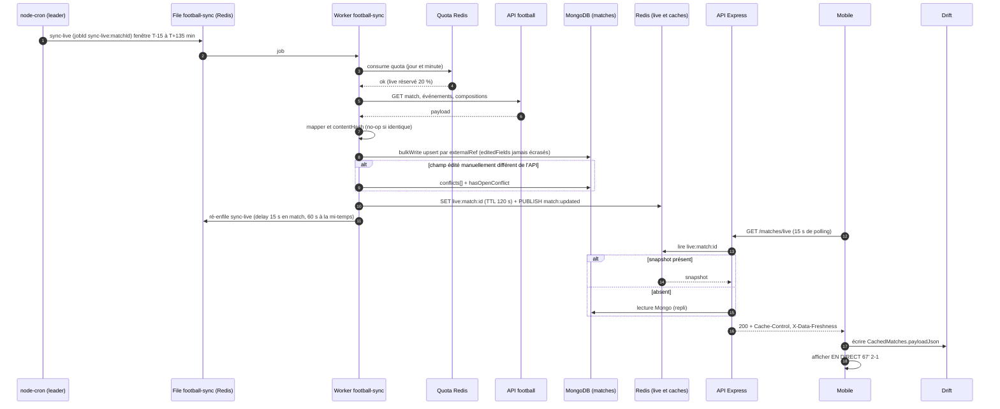

**Pas à pas.**

1-2. Le planificateur (unique, élu par verrou) ou la fin du job précédent enfile `sync-live` avec un `jobId` **déterministe** : pas de doublon même si le cron s'exécute deux fois.
3-4. Avant **chaque** appel externe, le worker consomme le **budget de quota** (compteurs Redis `football:quota:*`) ; à 100 % les jobs non-live sont reportés à minuit UTC et le live passe à 60 s (`API-FOOT-23`).
5-7. La charge utile est transformée par le *mapper* ; un `contentHash` évite de réécrire un document inchangé. L'**upsert idempotent** (`bulkWrite`, `ordered: false`, clé `externalRef`) garantit que rejouer deux fois ne crée aucun doublon.
8-9. **Règle d'or éditoriale** : un champ listé dans `editedFields` (corrigé à la main par un content-manager) n'est **jamais** écrasé ; un désaccord crée un **conflit** à résoudre dans l'admin (WD-09), sans bloquer la synchro du reste du match.
10. Le snapshot live est publié dans Redis (**TTL 120 s**) et un événement `match:updated` est diffusé (futur SSE).
11. Le job se ré-enfile lui-même avec un délai (15 s pendant l'action).
12-18. Le mobile interroge `/matches/live` : l'API lit **Redis d'abord** (repli Mongo si absent). La réponse porte `X-Data-Freshness` ; si le fournisseur est en panne, les endpoints servent Mongo/Redis avec `stale: true` au-delà de **15 min** (calendrier) ou **90 s** (live).
19-20. Le mobile met à jour `CachedMatches` (Drift) puis affiche ; hors-ligne, il afficherait le dernier snapshot avec la mention « Hors-ligne ».

**Fin de match** : passage `live → finished`, dernier `sync-lineups/events` complet, **invalidation** des caches (match, forme, confrontations, calendrier), puis enfilage de `derive-player-stats` → `compute-scores` (Fantasy) → `rebuild-standings` → `emit-passport-events`.

### 16.2 Quiz : de la réponse au classement

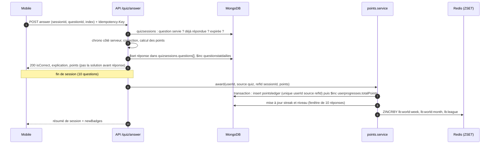

**Pas à pas.** (2-3) Le **chronomètre est côté serveur** (anti-triche) et la correction n'est jamais envoyée avant la réponse. (4) `$inc` sur les statistiques quotidiennes alimente la *difficulté mesurée*. (7-8) L'attribution de points est **idempotente** : l'index unique `{ userId, source, refId }` fait qu'une même session ne crédite qu'une fois, même si la requête est rejouée ; la transaction (replica set) lie le registre au `$inc`. (10) Les classements Redis sont **reconstruisibles** depuis le registre (`npm run games:rebuild-leaderboards`) ; si Redis est indisponible, repli sur agrégation Mongo limitée à 100 lignes.

### 16.3 Suppression de compte, de la demande à la purge

```mermaid
sequenceDiagram
    autonumber
    participant M as Mobile (Q-14)
    participant API as API
    participant DB as MongoDB
    participant R as Redis
    participant S as Stockage objet
    participant CR as Cron 03:00
    participant W as Worker rgpd
    M->>API: DELETE /users/me (mot de passe, SUPPRIMER)
    API->>DB: users : status deleted, purgeAt J+30, emailHashForRestore
    API->>DB: révocation refreshtokens, devicetokens retirés
    API->>R: ZREM classements, blacklist des sessions
    API-->>M: 200 purgeAt (date réelle de suppression)
    M->>M: purge locale (Drift, secure storage, FCM)
    Note over API,W: jusqu'à J+30 : POST /auth/restore-account possible
    CR->>DB: comptes deleted et purgeAt échu (lots de 100)
    CR->>W: enqueue purge-user (userId)
    W->>DB: registre de purgeurs : suppression et anonymisation (matrice 7.2)
    W->>S: suppression avatar, wallpapers, exports
    W->>DB: insert purgereports (hash, compteurs, sans PII)
    alt échec partiel
        W-->>W: retry (8 tentatives sur 24 h) puis alerte Slack
    end
```

---

## 17. Écarts détectés et points ouverts

### 17.1 Écarts entre CDC, specs backlog et code

| # | Écart | Détail | Décision proposée / issue |
| --- | --- | --- | --- |
| 1 | **CDC = PostgreSQL/Prisma/NestJS** ; réalité = MongoDB/Mongoose/Express | Tables normalisées, PostGIS, `ON DELETE CASCADE` du CDC §4.7 | Cascade appliquée par le code ; 2dsphere à la place de PostGIS (ADR 0001) |
| 2 | **Deux journaux de points** | `API-JEUX-20` crée `pointsledger` (`{userId, source, refId}`), `API-PASS-02` crée `useractivities` (« source de vérité des points ») et `API-PASS-03` `recordActivity` comme *point d'entrée unique* | Fusionner : retenir **un seul** registre (probablement `useractivities` via `recordActivity`) et faire de `pointsledger` une vue/alias ; à arbitrer avant implémentation |
| 3 | **Barèmes multiples** | `scoringrules` (Fantasy versionné, `API-FANT-08`), événements `guess_win_1..6`/`quiz_base_l1..l5` dans le même modèle (`API-JEUX-20`), `passportpointrules` (`API-PASS-03`) | Clarifier la frontière : barème de **jeu** (JEUX/PASS) vs barème **Fantasy** (versionné par journée) |
| 4 | **Quotas IA : 30 messages / 5 wallpapers (CDC §10.2) vs 40 / 3 (maquettes N-14, M-12)** | `API-IA-03` | Valeurs d'amorçage par variables d'env, modifiables en WI-06 ; ADR à rédiger |
| 5 | **Purge des refresh tokens révoqués : 30 j (code) vs 90 j (CDC §5.7)** | `scheduler.ts` | Corriger à 90 j (`API-AUTH-13`) |
| 6 | **Rate limits : auth 20/15 min et global 300/min (code) vs 10/15 min et 120/min par utilisateur (CDC §10.2)** | `rateLimiter.ts` | Aligner (`API-PLAT-06`) |
| 7 | **Pool MongoDB : `maxPoolSize: 20` (code) vs 50 par instance (spec)** | `database.ts` vs `API-PLAT-33` | À confirmer par test de charge |
| 8 | **Noms de files** | WH-02 (`calendar-sync`, `wallpapers`, `quiz-generation`) ≠ `QUEUE_NAMES` ≠ CDC (`sync-live-matches`…) | Table de correspondance (`API-PLAT-14`) |
| 9 | **Noms de collections** | snake_case backlog/CDC (`user_progress`, `media_assets`) vs pluriel Mongoose (`userprogresses`, `mediaassets`) | Le nom Mongoose fait foi ; documenter l'alias |
| 10 | **Clés Redis sans préfixe `ub:`** dans le code existant (`jwt:bl:`, `rl:*`) | | Appliquer `keyPrefix` ioredis (proposé) |
| 11 | **Statistiques par saison, événements, compositions, réponses de quiz** embarqués (code) vs tables séparées (CDC §4.2/4.3, `MOB-F-01` : `playerstatseasons`, `matchevents`) | | Embarqué retenu (§5) ; le mobile consomme un JSON agrégé, pas des collections |
| 12 | **`AuditLog.createdAt` (code) vs champ `timestamp` (CDC Admin §6.4, `API-PLAT-18`)** | | Aligner l'index `{ timestamp: -1 }` sur `createdAt` ou renommer |
| 13 | **Suppression de compte : Q-15 « données effacées » vs purge différée à J+30** | `API-AUTH-26` | L'API renvoie `purgeAt` ; wording à arbitrer par le produit |
| 14 | **Fuseaux** : Madrid (jeux, purge), Paris (anecdotes 06:00, rapport hebdo), UTC (backups, rétention) | | Documenté par tâche ; `GAME_TZ=Europe/Madrid` |
| 15 | **Numérotation des journées Fantasy** : fenêtre lundi→dimanche Madrid « à confirmer » ; `FantasyTeam.gameweek` est un entier, `gameweeks` prend `{season, number}` | `API-FANT-01` | Référence logique à `gameweeks.number` de la saison courante |
| 16 | **Modèles sans route** : seuls auth, users, admin-auth, players, matches, health sont câblés | | Les autres arrivent avec leurs épopées |
| 17 | **Chiffrement SQLCipher mobile bloqué** (Dart ≥ 3.10) | `MOB-FND-45` | Base en clair (données d'affichage) en attendant |
| 18 | **Clés de quotas IA** | `API-IA-03` : `assistant.messages`, `wallpaper.generations`, `quiz.questions` ; `API-PLAT-11` : `assistant_messages_per_user_day`, `wallpaper_generations_per_user_day`, `quiz_ai_questions_per_user_day` + budgets mensuels `ai_text_tokens_month`, `ai_image_budget_month` | Figer **un seul** jeu de clés dans `aiquotas` avant d'implémenter WI-06 |
| 19 | **Contrat de `/config` : mobile vs API** | `MOB-A-08` attend `GET /config/app` avec `minVersion/latestVersion/storeUrl/maintenance{until}` et l'en-tête `X-Platform` ; `API-PLAT-01` expose `GET /config` avec `appVersion{min,latest,forceUpdate,storeUrl}`, `maintenance{startsAt,endsAt}` et `X-App-Platform` ; code d'erreur 426 `UPDATE_REQUIRED` (mobile) vs `UPGRADE_REQUIRED` (API) | Voir `features/F24-plateforme-jobs-cache-flags.md` §17 ; aligner sur l'API |

### 17.2 Points ouverts à confirmer (repris du backlog)

* **Archivage/agrégation** de `guessattempts` et `quizsessions` (croissance de plusieurs Go/an) : à décider après mesure réelle.
* **Fenêtre d'une journée Fantasy** (lundi 00:00 → dimanche 23:59 Europe/Madrid ?) et numérotation sur toutes compétitions (`API-FANT-01`).
* **Minutes jouées** : prolongations non comptées, plafonnées à 90 ; règle du clean sheet (`>= 60 min` ?) (`API-FANT-09`).
* **Garde `Idempotency-Key`** acceptée par l'API sur tous les POST rejouables (`MOB-FND-22`).
* **File des jobs de modération** (nom de la file pour `moderation-sanction-expiry` / `moderation-sla-check`) (`API-MODER-13/21`).
* **Consentement `ai_processing`** : existe-t-il dans `ConsentRecord` ? (`API-IA-28`).
* **Sauvegarde horaire** (RPO 1 h) activée ou non (`API-PLAT-49`).

---

## 18. Pour aller plus loin

* **Code** (dépôt API) : `src/models/*.ts` (35 schémas), `src/models/_common.ts`, `src/config/redis.ts`, `src/jobs/queues.ts`, `src/jobs/scheduler.ts`, `scripts/migrations/`, `docs/DATABASE.md`, `docs/ARCHITECTURE.md`, `docs/DISASTER_RECOVERY.md`, `docs/adr/`.
* **Code** (dépôt mobile) : `lib/core/`, `docs/ARCHITECTURE.md` (cache Drift), module de référence `lib/features/players`.
* **CDC** : CDC Backend §4 (modèle de données), §4.8 (anonymisation), §5.6 (cache), §5.7 (rétention), §7 (BullMQ), §9.5-9.6 (migrations, sauvegardes), §10.2 (quotas) ; CDC Flutter §5 (cache hors-ligne, synchronisation) ; CDC Global §10 (RGPD), §12.
* **Épopées backlog** : `API-AUTH`, `API-FOOT`, `API-CAL`, `API-JEUX`, `API-PASS`, `API-GOAT`, `API-FANT`, `API-COMM`, `API-MODER`, `API-IA`, `API-WALL`, `API-NOTIF`, `API-PLAT` ; `MOB-FND` (`MOB-FND-18` à `MOB-FND-22`), `MOB-A`, `MOB-C`, `MOB-D` ; `ADM-WD`, `ADM-WE`, `ADM-WH`, `ADM-WI`.
* **Documents liés** : `features/F24-plateforme-jobs-cache-flags.md` (plateforme transverse : jobs, cache, flags, maintenance, version minimale).
