# 03 — Sécurité et RGPD

> Ce document décrit comment Univers Barça protège ses utilisateurs, ses administrateurs et ses données : authentification, autorisations, protections applicatives, gestion des secrets, conformité RGPD et modèle de menaces. Il distingue ce qui est **déjà implémenté** dans le code (socle de la phase 0) de ce qui est **spécifié dans le backlog** (phase 1+). Les valeurs chiffrées viennent du code ou des issues citées ; ce qui n'y figure pas est marqué « (proposé) ».

## Sommaire

1. [Principes et posture de sécurité](#1-principes-et-posture-de-sécurité)
2. [Surface d'attaque et zones de confiance](#2-surface-dattaque-et-zones-de-confiance)
3. [Authentification de l'utilisateur final](#3-authentification-de-lutilisateur-final)
4. [Authentification du back-office](#4-authentification-du-back-office)
5. [Autorisations : états de compte et RBAC](#5-autorisations--états-de-compte-et-rbac)
6. [Limitation de débit et anti-abus](#6-limitation-de-débit-et-anti-abus)
7. [Validation des entrées et protection des données en base](#7-validation-des-entrées-et-protection-des-données-en-base)
8. [En-têtes HTTP, CSP, CORS, cookies et CSRF](#8-en-têtes-http-csp-cors-cookies-et-csrf)
9. [Secrets et configuration](#9-secrets-et-configuration)
10. [Protections spécifiques : SSRF, IA, uploads, mobile](#10-protections-spécifiques--ssrf-ia-uploads-mobile)
11. [RGPD : cadre général](#11-rgpd--cadre-général)
12. [Consentements](#12-consentements)
13. [Géolocalisation approximative](#13-géolocalisation-approximative)
14. [Droits des personnes : export et suppression](#14-droits-des-personnes--export-et-suppression)
15. [Rétention des données](#15-rétention-des-données)
16. [Registre des traitements](#16-registre-des-traitements)
17. [Journal d'audit et traçabilité](#17-journal-daudit-et-traçabilité)
18. [Modèle de menaces STRIDE](#18-modèle-de-menaces-stride)
19. [Tests de sécurité et automatisation](#19-tests-de-sécurité-et-automatisation)
20. [Écarts entre code, CDC et specs](#20-écarts-entre-code-cdc-et-specs)

---

## 1. Principes et posture de sécurité

| Principe | Mise en œuvre |
| --- | --- |
| **Sécurité par conception** | Authentification, autorisation et validation sont appliquées à chaque couche, pas seulement en périphérie (CDC Global §4.3) |
| **Défense en profondeur** | Exemple : le back-office cloisonne par rôle côté React (`ProtectedRoute`) **et** côté API (`restrictTo`) ; MongoDB est isolée par réseau **et** seul le service `backend` l'atteint |
| **Moindre privilège** | Rôles admin distincts, jetons d'accès de 15 min, conteneurs non-root (`USER node`, nginx unprivileged) |
| **Minimisation** | On ne collecte que ce qui sert une fonctionnalité : la ville suffit à la carte, le GPS précis n'est **jamais stocké** |
| **Secrets hors du dépôt** | Variables d'environnement, fichiers `.env.<env>` en droits 600 sur le VPS, TruffleHog en CI |
| **Anti-énumération** | Mêmes réponses (statut, corps, timing ±15 %) que le compte existe ou non (`API-AUTH-42`) |
| **Auditabilité** | Toute action d'administration et de modération est journalisée dans un journal immuable |

Les contrôles décrits ici s'appliquent aux trois briques ; les chiffres de TLS (1.2+ de bout en bout), d'Argon2id et de durée des jetons proviennent du CDC Global §3.2 et du CDC Backend §5.

---

## 2. Surface d'attaque et zones de confiance

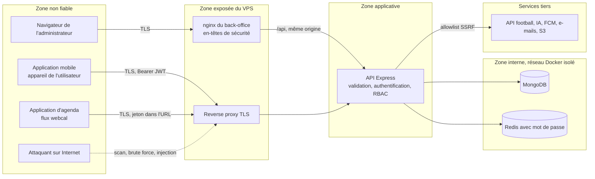

| Point d'entrée | Exposé à | Contrôles principaux |
| --- | --- | --- |
| `/api/v1/*` (utilisateurs) | Internet | Rate limit global 300/min, Joi, sanitization NoSQL, JWT, liste noire Redis |
| `/api/v1/admin/*` | Internet (mais réservé aux admins) | Cookie `httpOnly`, 2FA TOTP, RBAC, verrouillage de compte, audit |
| `/calendar/feed/:token.ics` | Agendas de tiers | Jeton aléatoire stocké **haché**, révocable, rate limit 60/min/IP (`API-CAL-14/15/17`) |
| `/metrics` | Réseau interne | Liste blanche `METRICS_ALLOWED_IPS` (+ jeton `METRICS_TOKEN` prévu) |
| `/api-docs` | Équipe | Basic auth `SWAGGER_USER/PASSWORD` (≥ 16 car. en production) |
| `/health`, `/health/deep` | Sondes | Aucune donnée sensible |
| Ports Mongo/Redis | Aucun | Réseau Docker `internal: true`, aucun port publié ; l'API n'est publiée que sur `127.0.0.1:5001/5002` |

---

## 3. Authentification de l'utilisateur final

### 3.1 Vue d'ensemble des jetons

| Jeton | Format | Durée | Stockage serveur | Stockage client |
| --- | --- | --- | --- | --- |
| **Access token** | JWT **HS256**, claims `id`, `role`, `kind` (`user`/`admin`), `jti`, `iss=univers-barca` | **15 minutes** (`JWT_ACCESS_TTL`) | Aucun ; liste noire Redis `jwt:bl:<jti>` à la déconnexion (TTL = durée restante) | Mémoire (mobile) |
| **Refresh token** | Chaîne opaque aléatoire de 48 octets (base64url) | **30 jours glissants**, famille bornée à **90 jours** (`API-AUTH-13`) ; 24 h non glissant sans « rester connecté » (`API-AUTH-14`) | **Haché SHA-256** dans `refreshtokens` (`tokenHash`, `familyId`, `deviceId`, `revokedAt`, `replacedByHash`) | `flutter_secure_storage` (Keychain / Keystore) |
| Jeton d'e-mail / reset | 32 octets aléatoires | 24 h (vérification) ; reset à usage unique | Haché SHA-256 dans `users` | — |
| Jeton d'abonnement calendrier | Aléatoire | Jusqu'à révocation | Haché (`API-CAL-14`) | URL `webcal` |

Mots de passe : **Argon2id** (ADR 0002), paramètres OWASP du code `password.service.ts` : mémoire 19 456 KiB (19 MiB), `timeCost` 2, `parallelism` 1. Politique actuelle : 8 à 128 caractères avec minuscule, majuscule et chiffre (`PASSWORD_POLICY`) ; `API-AUTH-06` ajoute la liste de mots de passe courants et un indicateur de force. `needsRehash` permet de relever les paramètres sans migration forcée.

### 3.2 Inscription et connexion

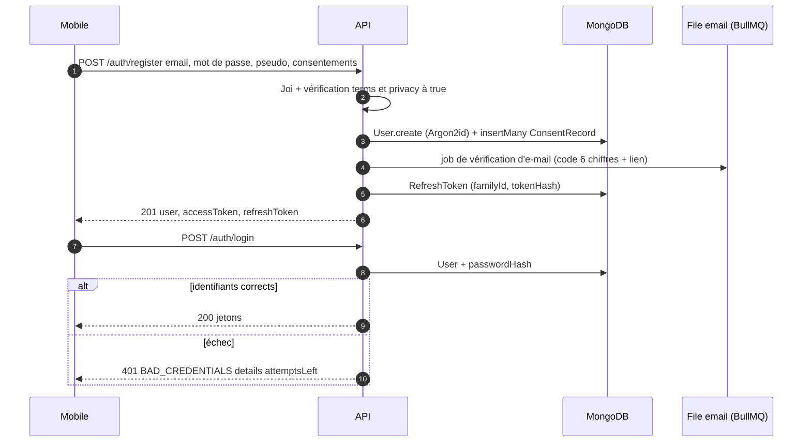

Règles clés :

- **Consentements obligatoires à l'inscription** : `terms` et `privacy` doivent être `true`, sinon 422 ; chaque consentement crée une ligne `consentrecords` (jamais d'écrasement).
- **Anti-énumération** : un e-mail inexistant produit la même forme de réponse qu'un mauvais mot de passe (compteur fantôme par e-mail + IP, `API-AUTH-07`).
- **Verrouillage progressif** (`API-AUTH-07`) : compteur Redis `login:fail:<emailHash>` (TTL 15 min) ; après 5 échecs, premier verrou 15 min, deuxième dans les 24 h : 1 h, troisième : 24 h ; réponse 429 `ACCOUNT_LOCKED` avec `Retry-After`. Même un mot de passe correct est refusé pendant le verrou.
- **Alerte nouvel appareil** : e-mail `new-device-login` si le `deviceId` est inconnu.
- **Vérification d'e-mail** : code à 6 chiffres + lien, renvoi avec délai de 60 s (`API-AUTH-04`).
- **Connexion sociale** : Google et Sign in with Apple (obligatoire sur iOS) — l'**id token est vérifié côté serveur** auprès du fournisseur, jamais cru sur parole (`API-AUTH-10/11`) ; rattachement/détachement possibles tant qu'un autre moyen de connexion subsiste (`API-AUTH-12`).

### 3.3 Rotation du refresh token et détection de rejeu

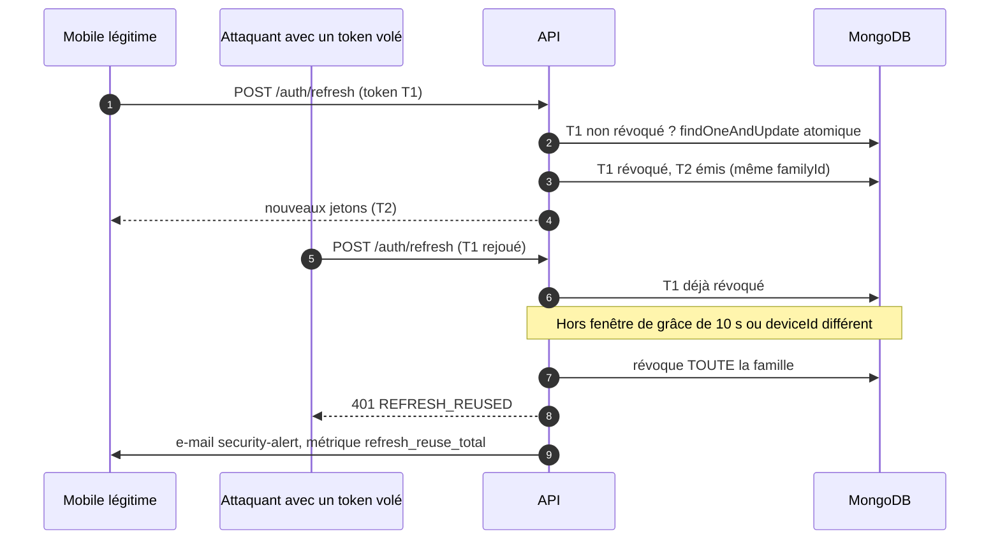

- **Code actuel** (`rotateRefreshToken`) : recherche par `tokenHash`; si `revokedAt` est posé → révocation de la famille entière + `REFRESH_REUSED` ; expiré → `REFRESH_EXPIRED` ; inconnu → `REFRESH_INVALID`.
- **Durcissement spécifié** (`API-AUTH-13`) : rotation **atomique** par `findOneAndUpdate` (un seul appelant gagne en cas de requêtes concurrentes), **fenêtre de grâce de 10 s** pour le même `deviceId` (le client qui a perdu la réponse récupère le successeur au lieu de tout casser), famille limitée à 90 jours, métrique `refresh_reuse_total`.
- **Contrat mobile** (`API-AUTH-09`) : codes 401 distincts — `TOKEN_EXPIRED` (refresh silencieux), `TOKEN_REVOKED`/`REFRESH_REUSED`/`REFRESH_EXPIRED` (retour à la connexion, écran A-08).

### 3.4 Déconnexion, liste noire et appareils

| Action | Effet |
| --- | --- |
| `POST /auth/logout` | `jti` du JWT ajouté à la liste noire Redis (TTL = temps restant) ; refresh token révoqué |
| `POST /auth/logout-all` | Tous les refresh tokens de l'utilisateur révoqués (`revokeAllForUser`) |
| `GET /users/me/sessions` | Liste des appareils connectés (`API-AUTH-15`) |
| Révocation d'un appareil | Révoque la famille de refresh tokens de cet appareil (`API-AUTH-16`) |
| Changement / reset de mot de passe | Déconnexion de toutes les sessions + e-mail d'alerte (`API-AUTH-18/19`) |

La liste noire est **vérifiée à chaque requête protégée** (`verifyAccessToken` → `getStore().get('jwt:bl:'+jti)`). Si Redis est absent en développement, un store mémoire prend le relais ; la production **exige** `REDIS_URL` (validation Joi au démarrage).

### 3.5 États du compte utilisateur

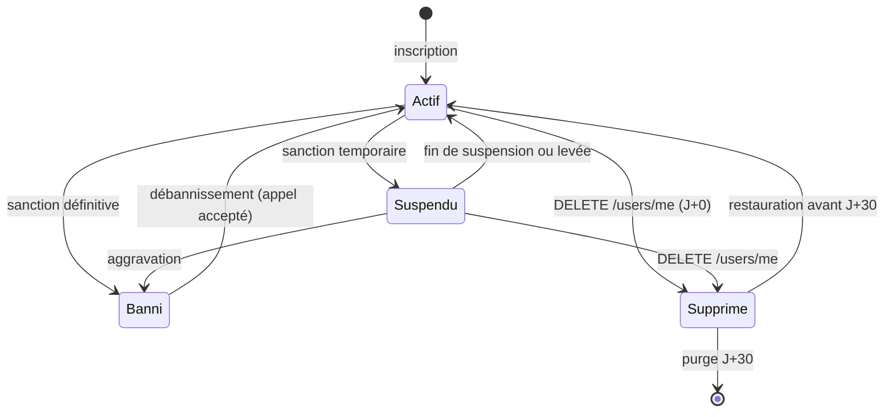

Statuts du modèle `User.status` : `active | suspended | banned | deleted`. Les contrats d'erreur A-09 (suspendu) et A-10 (banni) sont définis par `API-AUTH-08` et appliqués par le middleware de restriction `API-MODER-04`. Un compte suspendu ou banni ne gagne plus de points (`API-PASS-03`).

---

## 4. Authentification du back-office

Le back-office utilise un circuit **distinct** de celui des utilisateurs (`/admin/auth/*`, modèle `AdminUser`, `kind: 'admin'` dans le JWT) afin qu'un jeton utilisateur ne soit jamais accepté sur une route admin (`restrictTo` vérifie `kind === 'admin'`).

### 4.1 Connexion avec double authentification

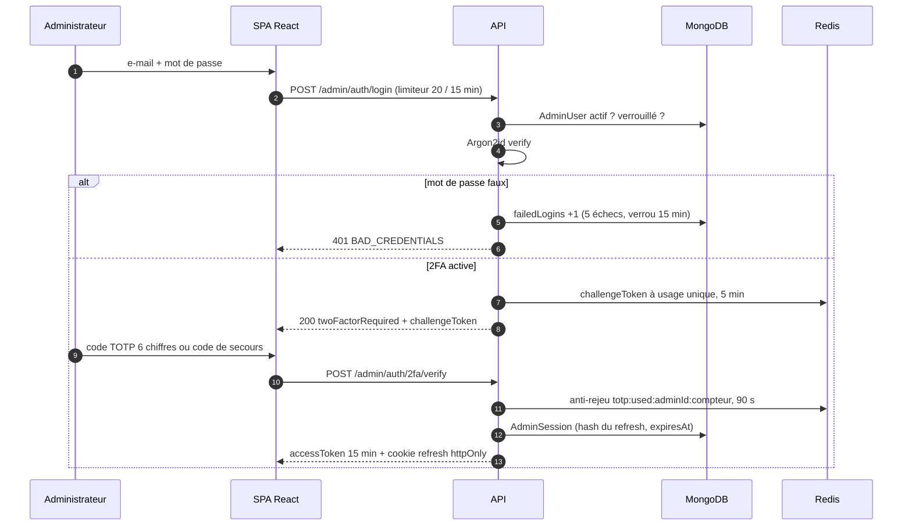

Valeurs du code actuel (`admin-auth.service.ts`) : **5 échecs** → verrou **15 minutes** ; TOTP via `speakeasy` avec fenêtre ±1 pas (30 s) ; session de **8 h** ; cookie `httpOnly`, `secure` (staging/production), `sameSite=strict`, `path=/api/v1/admin/auth`. Le refresh token n'est **jamais** renvoyé dans le corps JSON (posé en cookie par le contrôleur).

### 4.2 Spécification cible (`API-AUTH-32` à `API-AUTH-40`)

| Sujet | Règle |
| --- | --- |
| 2FA | Challenge à usage unique de 5 min ; TOTP 6 chiffres ±1 pas avec **anti-rejeu** ; 5 erreurs → challenge invalidé et comptées dans le verrouillage |
| Codes de secours | **8 codes** de 10 caractères (`XXXXX-XXXXX`), affichés **une seule fois**, stockés hachés Argon2id, à usage unique ; régénération avec mot de passe + TOTP |
| Super-admin | 2FA **obligatoire** : sans 2FA, `twoFactorSetupRequired:true` et seul `/admin/auth/2fa/*` est accessible (claim `scope:'2fa-setup'`) |
| Secret TOTP | Chiffré au repos (AES-256-GCM, clé `TOTP_ENC_KEY`), `select:false` ; `setup` ne remplace le secret qu'après `confirm` |
| Invitation | `POST /admin/accounts` crée un compte `invited` sans mot de passe ; jeton 32 octets haché SHA-256, **48 h**, usage unique ; renvoi limité à 5/jour |
| Activation | Définition du mot de passe (écran WA-05) puis configuration 2FA |
| Session | Expiration glissante **8 h d'inactivité**, plafond absolu **24 h** ; code distinct `SESSION_EXPIRED_INACTIVITY` (écran WA-07) ; rotation du refresh avec détection de rejeu |
| Gestion des sessions | `GET /admin/accounts/:id/sessions`, révocation à distance immédiate (liste noire Redis) + e-mail à l'intéressé |
| Mot de passe oublié admin | Lien à usage unique ou réinitialisation par un super-admin |
| Verrouillage | « Essais restants », déblocage par un super-admin (`API-AUTH-33`) |
| CSRF | En-tête `X-CSRF-Token` en double-submit sur les mutations cookie-authentifiées |

### 4.3 États d'un compte admin

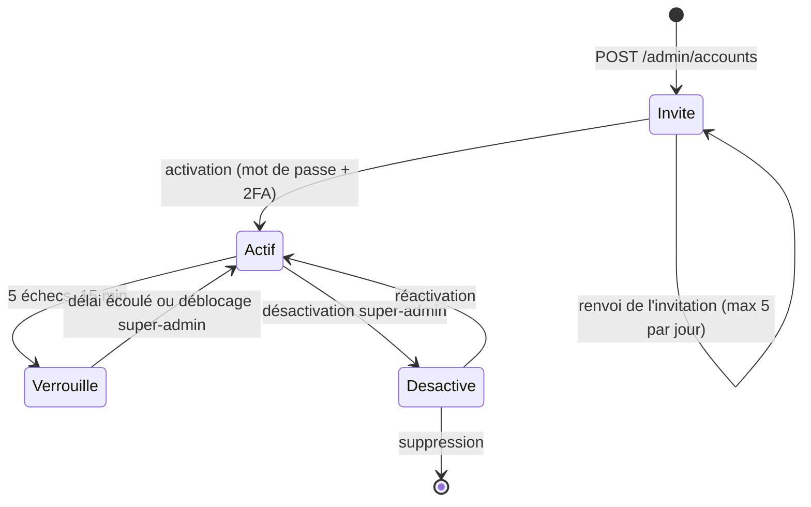

Un compte `disabled` perd l'accès en moins de 60 s : le rôle et le statut sont **revérifiés en base** avec un cache Redis de 60 s (`API-AUTH-32`).

---

## 5. Autorisations : états de compte et RBAC

### 5.1 Rôles

| Rôle | Portée |
| --- | --- |
| `user` | Utilisateur mobile : uniquement ses propres ressources (règle anti-IDOR : toute lecture/écriture est filtrée par `req.auth.id`) |
| `content-manager` | Joueurs, matchs, anecdotes, questions de quiz |
| `moderator` | Signalements, sanctions, groupes, vue utilisateurs |
| `super-admin` | Tout, dont comptes admin, configuration, supervision, campagnes « Tous » |

### 5.2 Matrice de permissions (`API-AUTH-32`)

| Permission | content-manager | moderator | super-admin |
| --- | :---: | :---: | :---: |
| `players:write` | oui | non | oui |
| `history:publish` | oui | non | oui |
| `quiz:validate` | oui | non | oui |
| `moderation:review` | non | oui | oui |
| `moderation:ban` | non | oui | oui |
| `logs:read` | non | non | oui |
| `accounts:manage` | non | non | oui |
| `config:ai-quotas` | non | non | oui |
| `audit:read` | non | non | oui |
| `observability:read` | non | non | oui |

Le refus renvoie `403 FORBIDDEN_ROLE` avec `details:{required:[…], role}` sans lister toutes les permissions ; **chaque 403 est écrit dans l'audit** (`ACCESS_DENIED`). Les gardes disponibles dans le code : `protect` (JWT valide, non révoqué), `identify` (authentification optionnelle pour les contenus publics enrichis), `userOnly`, `restrictTo(...roles)`.

### 5.3 Règles anti-escalade

- Le rôle et le statut d'un admin sont revérifiés en base (cache 60 s) : rétrograder un rôle coupe l'accès sous 60 s.
- Une campagne de notification « Tous » exige le rôle `super-admin` **et** une double confirmation (`API-NOTIF-24`).
- Les routes `/admin/*` sont couvertes par les tests de sécurité d'élévation de privilèges (`API-MODER-31`, `API-FOOT-51`).

---

## 6. Limitation de débit et anti-abus

Le limiteur (`express-rate-limit` 8 + `rate-limit-redis`, en-têtes standard `RateLimit-*` draft-7) répond `429` avec `{ code: 'RATE_LIMITED' }`. En production le stockage est Redis (repli mémoire interdit, `API-AUTH-41`). Il n'est désactivable que **hors production** (`RATE_LIMIT_DISABLED=true`, utilisé par les tests de charge).

| Limiteur / route | Fenêtre | Limite | Source |
| --- | --- | --- | --- |
| Global (toute l'API) | 1 min | 300 / IP | code `globalLimiter` |
| `authLimiter` (register, login, refresh, verify-email, admin login/refresh) | 15 min | **20** dans le code ; **10** cible (CDC §10.2) | code / `API-AUTH-41` |
| `sensitiveLimiter` (forgot/reset password, export, suppression) | 1 h | 5 | code |
| Connexion | 15 min | 10 / IP + 5 / e-mail | `API-AUTH-41` |
| Inscription | 1 h | 5 / IP | `API-AUTH-41` |
| Mot de passe oublié | 1 h | 5 / IP + 3 / e-mail | `API-AUTH-41` |
| Vérification d'e-mail | 15 min | 10 / IP, 5 essais par code | `API-AUTH-41` |
| Renvoi de vérification | 1 h | 5 / compte | `API-AUTH-41` |
| Export RGPD | 24 h | 1 / compte | `API-AUTH-24/41` |
| 2FA admin | par challenge | 5 | `API-AUTH-34/41` |
| Lecture API authentifiée | 1 min | 120 / utilisateur | CDC §10.2 |
| Endpoints publics (ex. flux calendrier) | 1 min | 60 / IP | CDC §10.2, `API-PLAT-01` |
| Assistant IA | 60 s / 1 h | 6 messages / utilisateur et 30 / IP | `API-IA-20` |
| Quota assistant | 1 jour | 30 messages (configurable) | `API-IA-19` |
| Quota wallpapers | 1 jour UTC | 3 (maquettes) à 5 (CDC) | `API-WALL-08` |
| Communauté (messages) | 10 s / jour | 1 par 10 s, 30 / jour ; 5 / 10 min / groupe | `API-COMM-27` |
| Création de groupe | 1 h | 5 requêtes, 1 en attente, 3 au total | `API-COMM-27` |

Quatre mécanismes d'anti-abus complètent les limiteurs :

1. **Quotas métier** (`QUOTA_EXCEEDED`, distinct de `RATE_LIMITED`) : l'API renvoie `limit`, `used`, `resetsAt` et `Retry-After`.
2. **Plafonds de points** et signaux de rafale du Passport (`API-PASS-24`).
3. **Anti-triche Guess the Player** : la solution ne fuit jamais avant la fin de partie, tentatives idempotentes et horloge serveur (`API-JEUX-08`, `API-FANT-21`).
4. **Anti-abus des votes GOAT** : éligibilité, limites, détection d'anomalies, empreintes éphémères (`API-GOAT-12/13`).

---

## 7. Validation des entrées et protection des données en base

### 7.1 Chaîne de validation

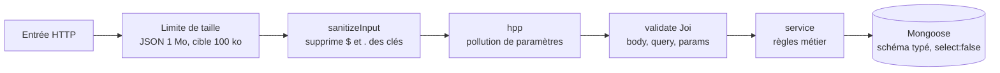

- **Joi sur toute entrée** (`validate(schéma, 'body' | 'query' | 'params')`) : un `{"email":{"$ne":null}}` est rejeté par le schéma avant même d'atteindre la base ; `mongo-sanitize` est une seconde barrière.
- **Échappement des regex** (`escapeRegex`) pour toutes les recherches textuelles.
- **XSS** : le contenu communautaire (posts, pseudos, noms de groupes) est assaini côté API et encodé côté client ; l'admin ne rend jamais de HTML brut. `API-MODER-31` teste les vecteurs XSS.
- **Champs sensibles `select:false`** : `passwordHash`, jetons de vérification et de reset, `totpSecret`, `inviteTokenHash` ne sont chargés que si le service les demande explicitement, jamais renvoyés par l'API.
- **Erreurs** : en production, aucune pile d'appels ni message d'exception brut ; un 5xx expose un `incidentId` `UB-XXXX-XXXX` et le `traceId` (`API-PLAT-05`).

### 7.2 Hachage et secrets en base

| Donnée | Protection |
| --- | --- |
| Mot de passe | Argon2id (jamais en clair, jamais loggé) |
| Refresh token, jeton d'e-mail, de reset, d'invitation, d'abonnement calendrier | Seul le **hash SHA-256** est stocké ; le secret n'existe qu'un instant chez l'utilisateur |
| Secret TOTP | Chiffré AES-256-GCM (cible) |
| Codes de secours | Hachés Argon2id |
| E-mail de restauration (compte supprimé) | `emailHashForRestore` (haché) |
| Consentements conservés après suppression | `userId` remplacé par un pseudonyme **HMAC irréversible** (`API-AUTH-27`) |

---

## 8. En-têtes HTTP, CSP, CORS, cookies et CSRF

### 8.1 API (`helmet` + règles de `API-PLAT-26`)

| En-tête | Valeur cible |
| --- | --- |
| `Strict-Transport-Security` | `max-age=31536000; includeSubDomains` (production) |
| `X-Content-Type-Options` | `nosniff` |
| `X-Frame-Options` | `DENY` |
| `Referrer-Policy` | `no-referrer` |
| `Cross-Origin-Resource-Policy` | `same-site` |
| `Permissions-Policy` | vide |
| `Content-Security-Policy` | API JSON : `default-src 'none'; frame-ancestors 'none'` ; `/api-docs` seulement : script/style `'self'` + hash pour Swagger UI |
| `X-Powered-By` | supprimé (`app.disable('x-powered-by')`) |
| `Cache-Control` | `no-store` sur les réponses d'authentification |

### 8.2 CORS

`cors({ origin })` n'autorise que les **origines exactes** de `CORS_ORIGINS` (admin staging et production) ; une origine inconnue produit `CORS_NOT_ALLOWED` → `403 CORS`. `credentials: true` uniquement parce que l'admin utilise un cookie ; jamais de `*` avec credentials. Le mobile n'est pas un navigateur : il n'est pas concerné. Cible : méthodes `GET/POST/PATCH/PUT/DELETE`, `Access-Control-Max-Age` 600.

### 8.3 Back-office (nginx)

Le conteneur admin ajoute, sur **chaque** `location` (`ADM-FND-22`), les en-têtes suivants (extrait réel de `docker/nginx.conf`) :

| En-tête | Valeur |
| --- | --- |
| `Content-Security-Policy` | `default-src 'self'; img-src 'self' data: blob: https:; style-src 'self' 'unsafe-inline'; font-src 'self' data:; connect-src 'self'; frame-ancestors 'none'; base-uri 'self'; form-action 'self'` |
| `X-Frame-Options` | `DENY` |
| `X-Content-Type-Options` | `nosniff` |
| `Referrer-Policy` | `strict-origin-when-cross-origin` |
| `Permissions-Policy` | `geolocation=(), camera=(), microphone=()` |
| Cache | `/assets/` : `public, immutable` 1 an ; `index.html` : `no-store` |

`ADM-FND-23` prévoit une CSP **stricte** déployée d'abord en `Report-Only` (suppression de `'unsafe-inline'`).

### 8.4 Cookies et CSRF

- Cookie du refresh admin : `HttpOnly`, `Secure`, `SameSite=Strict`, `Path=/api/v1/admin/auth`, durée alignée sur la session.
- Comme l'admin et l'API partagent la **même origine** (proxy nginx), `SameSite=Strict` protège déjà contre la plupart des CSRF ; le jeton `X-CSRF-Token` en double-submit s'ajoute sur les mutations.
- Les routes utilisateurs mobiles utilisent un en-tête `Authorization`, donc ne sont pas exposées au CSRF.

---

## 9. Secrets et configuration

### 9.1 Principes

- **Aucun secret dans Git** : `.env.example` versionné sans valeurs, `.env.<env>` hors dépôt ; analyse **TruffleHog** (`--only-verified`) sur chaque PR et gitleaks prévu (`API-PLAT-28`).
- Validation au démarrage (`config/env.ts`, Joi) : **échec fatal** si un invariant est violé. Exemples : `JWT_ACCESS_SECRET` ≥ 32 caractères, `JWT_REFRESH_SECRET` ≥ 32 caractères **et différent** du secret d'accès, `REDIS_URL` obligatoire en production, `SWAGGER_PASSWORD` ≥ 16 caractères en production, `MONGODB_URI` au schéma `mongodb`/`mongodb+srv`.
- Fichiers `.env.staging` / `.env.production` sur le VPS en **droits 600**, propriétaire `deploy`, sauvegardés chiffrés hors VPS (`API-PLAT-47`).
- Secrets **distincts par environnement** (JWT, Redis, Mongo, projet Firebase). Garde-fou : staging refuse une URI Mongo contenant le nom de la base de production.

### 9.2 Inventaire des secrets

| Secret | Variable | Rotation cible |
| --- | --- | --- |
| Signature JWT d'accès | `JWT_ACCESS_SECRET` (puis `JWT_ACCESS_SECRETS='kid1:s1,kid2:s2'`) | 180 jours, via `kid` : la première clé signe, toutes vérifient |
| Signature du refresh | `JWT_REFRESH_SECRET` | 180 jours |
| Mot de passe Redis | `REDIS_PASSWORD` | 365 jours |
| Clé de chiffrement TOTP | `TOTP_ENC_KEY` | à la demande (re-chiffrement) |
| Clé API football / IA / FCM | `FOOTBALL_API_KEY`, `AI_TEXT_API_KEY`, `AI_IMAGE_API_KEY`, `FCM_SERVICE_ACCOUNT_BASE64` | 365 jours ou immédiate en cas de fuite |
| Webhook Slack | `SLACK_WEBHOOK_URL` | à la demande |
| Accès SSH de déploiement | `VPS_SSH_KEY` (secret d'environnement GitHub) | à la demande |
| Secrets de signature mobile | keystore Android, certificat iOS, clés App Store Connect (secrets GitHub en base64) | selon les stores |

### 9.3 Procédure en cas de fuite

1. **Rotation immédiate** du secret concerné (script `scripts/rotate-secrets.sh`, cible `API-PLAT-28`) et redéploiement.
2. **Révocation des sessions** : purge de la collection `refreshtokens` (tous les utilisateurs se reconnectent).
3. **Compromission d'un compte admin** : `status: disabled`, révocation des `adminsessions`, revue des `auditlogs`.
4. **Revue des journaux** sur la période d'exposition ; notification CNIL sous 72 h si des données personnelles sont concernées (obligation RGPD, art. 33).
5. **Post-mortem** : cause, chronologie, actions correctives (`docs/DISASTER_RECOVERY.md`).

---

## 10. Protections spécifiques : SSRF, IA, uploads, mobile

### 10.1 SSRF (appels sortants)

Un client HTTP sortant unique (`API-PLAT-30`) applique : **liste blanche** par fournisseur (football, IA texte/image, FCM, stockage objet ; hôtes internes Prometheus/Graylog listés explicitement) ; refus des IP privées / loopback / link-local (`10/8`, `172.16/12`, `192.168/16`, `127/8`, `169.254/16`, `::1`, `fc00::/7`) ; schéma `https` obligatoire ; résolution DNS **puis** vérification de l'IP (anti DNS-rebinding) ; timeout 5 s ; réponse max 10 Mo ; redirections non suivies hors allowlist ; refus journalisés (`ub_ssrf_blocked_total`). Toute URL fournie par un utilisateur ou un admin (ex. image de joueur) passe par le même contrôle.

### 10.2 Abus de l'assistant IA

| Menace | Mesure |
| --- | --- |
| Prompt injection | Séparation stricte prompt système / entrée utilisateur ; contexte injecté limité ; jeu d'or de non-régression (`API-IA-31`) |
| Contenu hors périmètre | Réponse de recadrage ; classification d'intention ; modération d'entrée **et** de sortie (`API-IA-11/12`) |
| Hallucination sur des faits | RAG strict : pour toute donnée factuelle disponible en base, la base prime ; « information introuvable » sinon |
| Coût | Quotas, rate limit, bascule de fournisseur et disjoncteur, kill switch `assistant_enabled` |
| Conversations sensibles | Suppression à la demande, rétention définie, export RGPD (`API-IA-27/28`) |

### 10.3 Wallpapers et images

Modération du prompt avant génération et de l'image avant mise à disposition ; **aucun logo ni écusson** du club dans les prompts ; images servies par **URL signées** (miniature 24 h, plein format 1 h, partage 7 jours révocable) ; EXIF nettoyé à l'upload (`API-COMM-18`) ; limite de taille 5 Mo ; seul le propriétaire accède à ses images (404 sinon) ; les URL signées ne sont jamais journalisées en clair.

### 10.4 Application mobile (`MOB-FND-45`)

Chiffrement de la base locale (SQLCipher prévu), pinning de certificat optionnel, détection de root/jailbreak (avertissement), masquage de l'écran dans le sélecteur d'applications, jetons dans Keychain/Keystore, aucune donnée sensible dans les journaux (`MOB-FND-03` : masquage), analytics et Crashlytics soumis au consentement.

---

## 11. RGPD : cadre général

### 11.1 Bases légales

| Traitement | Base légale (art. 6) |
| --- | --- |
| Compte, authentification, jeux, Fantasy, historique | **Exécution du contrat** (CGU acceptées) |
| Géolocalisation approximative | **Consentement** explicite, distinct, révocable |
| Notifications push | **Consentement** (permission système + préférences par catégorie) |
| Statistiques d'usage (analytics) | **Consentement** (`analytics`) ; agrégats anonymes en intérêt légitime encadré |
| Journaux techniques, sécurité, audit des administrateurs | **Intérêt légitime** (sécurité du service) |
| Preuve des consentements | **Obligation légale / intérêt légitime** (conservation 5 ans dissociée) |

### 11.2 Données traitées

| Catégorie | Exemples | Sensibilité |
| --- | --- | --- |
| Identité de compte | e-mail, pseudo, hash du mot de passe, fournisseurs sociaux | Personnelle |
| Préférences | langue, thème, accessibilité, joueur préféré, ancienneté de supporter | Personnelle |
| Localisation déclarée | pays, ville (déclaratif ou ville la plus proche) | Personnelle, **jamais précise** |
| Activité | tentatives de jeux, quiz, votes GOAT, équipes Fantasy, badges, séries | Personnelle |
| Contenus générés | messages de l'assistant, prompts et images de wallpapers, messages de groupe | Personnelle, potentiellement sensible |
| Technique | jetons de notification (FCM), appareils, IP tronquée, user-agent | Personnelle |
| Modération | signalements, sanctions, motifs | Personnelle |

---

## 12. Consentements

### 12.1 Modèle

`ConsentRecord` est un **journal en ajout seul** : une ligne par changement, jamais de mise à jour ni de suppression par l'utilisateur.

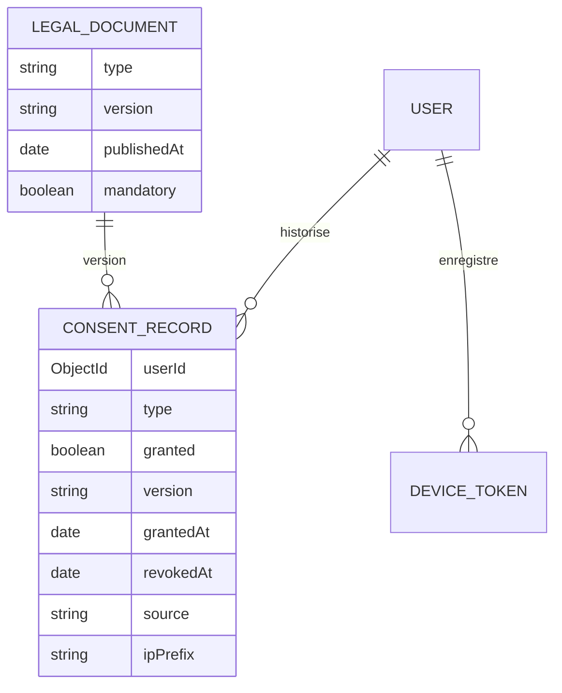

| Type de consentement | Obligatoire ? | Effet du retrait |
| --- | --- | --- |
| `terms` (CGU) | Oui, à l'inscription | Non retirable par `PATCH /users/me/consents` ; re-acceptation lors d'une nouvelle version obligatoire (`403 REACCEPT_REQUIRED`) |
| `privacy` (confidentialité) | Oui | Idem |
| `charter` (charte communautaire) | Oui (écran B-08) | Idem (à ajouter à l'enum, `API-AUTH-22`) |
| `geolocation` | Non | Suppression des données de localisation dérivées en **5 minutes** ; pays/ville déclarés **conservés** (RG-MAP-03) ; visibilité carte plafonnée à `country` |
| `notifications` | Non | `DeviceToken.enabled=false`, arrêt de toute émission FCM ; rétabli au ré-opt-in |
| `analytics` | Non | `analyticsOptOut=true` ; événements existants conservés sous forme agrégée anonyme |

Le code actuel accepte les cinq types `terms, privacy, geolocation, notifications, analytics`. Le backlog ajoute `charter` et les champs `source` (`signup|settings|reaccept|system`), `ipPrefix` (IP anonymisée /24) et `userAgent` tronqué à 120 caractères (`API-AUTH-21`). Le retrait déclenche l'événement `consent.changed` et le job idempotent `rgpd:apply-consent` (5 tentatives).

### 12.2 Parcours de consentement

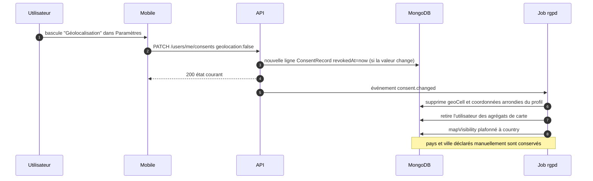

Autres règles : lecture de l'état courant et de l'historique paginé via `GET /users/me/consents` ; `POST /auth/consents` est déprécié (en-tête `Deprecation: true`) et délègue au même service ; les documents légaux versionnés sont servis par `GET /legal/documents` (cache 1 h).

---

## 13. Géolocalisation approximative

La géolocalisation est le point RGPD le plus sensible du produit (CDC Global §2.8, RG-MAP-01 à 05). Elle repose sur **trois barrières successives** :

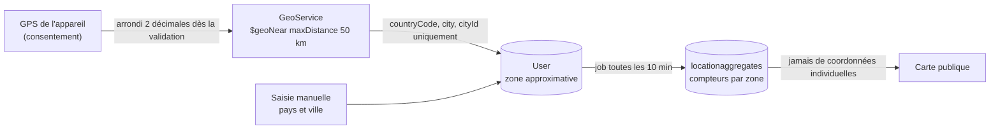

| Règle | Détail |
| --- | --- |
| Pas de stockage du GPS | Les coordonnées reçues sont arrondies, converties en **ville la plus proche** (référentiel `GeoCity`, centres de villes), puis **jetées** : ni base, ni logs, ni traces (`API-COMM-03`) |
| Masquage dans les logs et traces | `lat`, `lng`, `latitude`, `longitude` sont masqués dans `requestLogger` et exclus des attributs OpenTelemetry |
| Visibilité choisie | `mapVisibility ∈ {hidden, country, city}` ; `hidden` n'est jamais compté |
| Jamais de position individuelle | Seuls des agrégats par zone sont visibles (RG-MAP-01) ; les centres d'agrégats sont des centres de villes |
| Consentement distinct | Séparé du consentement d'inscription, révocable à tout moment (RG-MAP-02) |
| Alternative sans consentement | Déclaration manuelle pays/ville (RG-MAP-03) |
| Test de non-fuite | Parcours automatisé de toutes les routes `/community/*` : aucune clé `lat/lng/latitude/longitude/coordinates` hors centre d'agrégat (`API-COMM-31`) |
| Seuils de confidentialité | Pas d'affichage de compteurs très faibles de nature à ré-identifier (seuil à fixer, proposé) |

Revue RGPD obligatoire de la géolocalisation avant la sortie de la phase 2 (critère de sortie de l'étape 2.1 du plan).

---

## 14. Droits des personnes : export et suppression

### 14.1 Correspondance droits ↔ fonctionnalités

| Droit RGPD | Mise en œuvre | Issue |
| --- | --- | --- |
| Accès / portabilité (art. 15, 20) | Archive ZIP de JSON par domaine, lien pré-signé 7 jours | `API-AUTH-24/25` |
| Rectification (art. 16) | `PATCH /users/me`, changement d'e-mail avec code, changement de mot de passe | `API-AUTH-19/20/28` |
| Effacement (art. 17) | Suppression de compte, délai de grâce 30 jours, purge en cascade | `API-AUTH-26/27` |
| Limitation / opposition (art. 18, 21) | Retrait des consentements, préférences de notification, `mapVisibility` | `API-AUTH-23` |
| Retrait du consentement (art. 7) | `PATCH /users/me/consents` | `API-AUTH-21` |
| Information (art. 13) | Documents légaux versionnés, registre des traitements | `API-AUTH-22`, `API-PLAT-54` |

### 14.2 Export des données

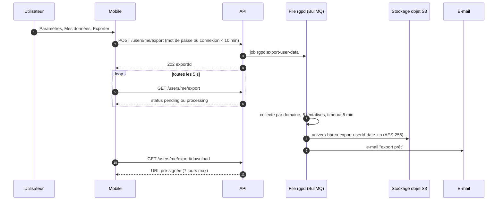

Contenu de l'archive : `profile.json`, `consents.json`, `sessions.json` (sans IP), `gamification.json`, `ai-conversations.json`, `fantasy-masia.json`, `wallpapers.json` + images, et un `README.txt` FR/EN/ES. **Jamais exportés** : `passwordHash`, hachages de jetons, secrets TOTP, données d'autres utilisateurs (dans un groupe, uniquement les messages écrits par la personne). Limites : une seule demande active ; nouvelle demande après 24 h (`429 EXPORT_TOO_SOON`) ; téléchargement limité à 5 fois ; taille max 500 Mo (au-delà, scission en parties). Chaque module fournit son bloc d'export : `API-JEUX-33`, `API-IA-27`, `API-WALL-28`, `API-FANT-22`, `API-GOAT-17`, `API-COMM-29`, `API-PASS-29`, `API-CAL-20`, `API-NOTIF-28`.

### 14.3 Suppression de compte

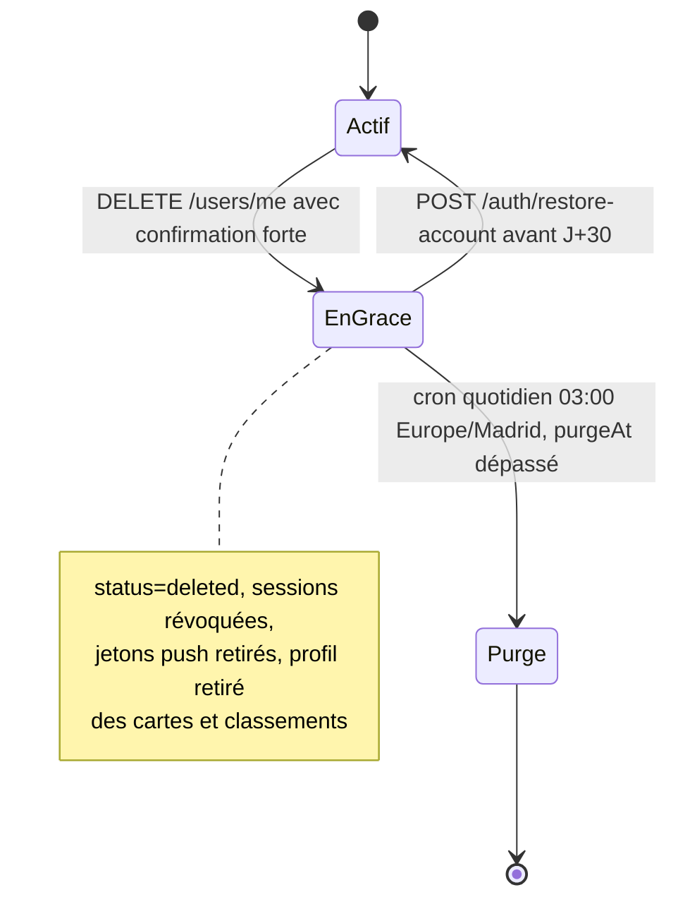

Effets **immédiats** (J+0) : `status='deleted'`, `deletedAt`, `purgeAt = now + 30 j`, révocation de toutes les sessions, retrait des jetons push, désabonnement des e-mails, retrait des cartes/classements, pseudo remplacé par « Utilisateur supprimé » dans les contenus publiés. La confirmation exige `{ password, confirmation:'SUPPRIMER' }` (ou connexion récente pour un compte social).

**Purge à J+30** (matrice §4.8 du CDC Backend, `API-AUTH-27`) :

| Catégorie | Traitement |
| --- | --- |
| Profil, préférences, jetons, sessions, `DeviceToken` | **Supprimés** |
| Historique Guess the Player / Quiz, progression, badges, séries | **Supprimés** |
| Équipes Fantasy, joueurs La Masia | **Supprimés** |
| Conversations de l'assistant, wallpapers (fichiers objet inclus), exports | **Supprimés** |
| Contenus de groupe (messages) | **Anonymisés** : auteur → référence neutre, `authorId=null` |
| Journal de modération | **Conservé**, ID technique dissocié, sans donnée directement identifiante |
| Compteurs agrégés | **Conservés** (sans lien individuel) |
| Consentements | **Conservés 5 ans**, `userId` remplacé par un pseudonyme HMAC irréversible |

Un rapport par compte (`PurgeReport`) est stocké ; un échec partiel est rejoué et alerté (jamais de purge à moitié silencieuse). **Désaccord à arbitrer** : la maquette Q-15 affiche « Tes données ont été effacées » alors que la purge prend 30 jours ; l'API renvoie `purgeAt` pour que le mobile affiche la date réelle.

---

## 15. Rétention des données

| Donnée | Durée | Mécanisme | Source |
| --- | --- | --- | --- |
| Compte supprimé | 30 jours puis purge | Cron 03:00 Europe/Madrid, lots de 100 | `API-AUTH-27` |
| Refresh tokens expirés | À l'expiration | Index TTL `expiresAt` (code) | modèle `RefreshToken` |
| Refresh tokens révoqués | 90 jours après révocation | Cron 03:30 (code : 30 jours, à corriger) | CDC §5.7, `API-PLAT-52` |
| Sessions admin | À l'expiration | Index TTL `adminsessions.expiresAt` | modèle `AdminSession` |
| Logs applicatifs | 90 jours (Graylog) ; fichiers locaux 14 jours | Rotation | CDC §5.7, `API-PLAT-25` |
| Traces OpenTelemetry détaillées | 14 jours | Backend de traces | CDC §5.7 |
| `notificationlogs` | 90 jours | Job de rétention | `API-PLAT-52` |
| `devicetokens` invalides | 30 jours | Job de rétention | `API-PLAT-52` |
| Jobs d'export | 24 h ; archives 7 jours | Règle de cycle de vie S3 + job | `API-AUTH-25`, `API-PLAT-52` |
| `ai_usage_daily` | 24 mois | Job de rétention | `API-PLAT-52` |
| Sauvegardes de base | 30 quotidiennes + 26 hebdomadaires (≈ 6 mois) | Rotation, copie hors VPS chiffrée | `API-PLAT-49` |
| Consentements (preuve) | 5 ans après suppression, dissociés | Pseudonymisation HMAC | `API-AUTH-21/27` |
| `auditlogs`, actions de modération | **Jamais purgés** (valeur d'audit) | Collections immuables | `API-MODER-02`, `API-PLAT-18` |
| Rétention de modération (contenus signalés) | Définie par politique | Job dédié | `API-MODER-28` |

Garde-fous du job `retention-purge` (`API-PLAT-52`) : lots de 1 000, mode `--dry-run`, **abandon si le volume à supprimer dépasse 20 % de la collection**, journalisation `{ collection, supprimés, durée }`, métrique `ub_retention_deleted_total{collection}`.

---

## 16. Registre des traitements

Le registre (art. 30 RGPD) est un document versionné `docs/rgpd/REGISTRE.md` (`API-PLAT-54`). Il liste pour chaque traitement : finalité, base légale, catégories de données, personnes concernées, destinataires et sous-traitants, transferts hors UE, durée de conservation, mesures de sécurité, collections concernées. Un test annote les schémas Mongoose contenant des données personnelles (`pii:true`) et **échoue** si une collection n'apparaît pas au registre. Toute PR ajoutant un champ personnel coche une case dédiée dans le modèle de PR.

| # | Traitement | Finalité | Base légale | Données | Durée | Collections |
| --- | --- | --- | --- | --- | --- | --- |
| T1 | Comptes et authentification | Accès au service | Contrat | E-mail, pseudo, hash MDP, sessions | Vie du compte + 30 j | `users`, `refreshtokens` |
| T2 | Consentements | Preuve de conformité | Obligation légale | Type, valeur, version, IP /24 | 5 ans (dissociés) | `consentrecords`, `legaldocuments` |
| T3 | Profil et localisation approximative | Carte communautaire | Consentement (géoloc.) | Pays, ville, visibilité | Vie du compte | `users`, `locationaggregates` |
| T4 | Jeux et gamification | Service de jeux, classements | Contrat | Tentatives, points, badges, séries | Vie du compte | `guessattempts`, `quizsessions`, `userprogresses`, `useractivities` |
| T5 | Fantasy et Masia | Service | Contrat | Équipes, décisions | Vie du compte | `fantasyteams`, `academyplayers` |
| T6 | Notifications push | Rappels | Consentement | Jeton FCM, préférences | Vie du compte ; jetons morts 30 j | `devicetokens`, `notificationpreferences`, `notificationlogs` |
| T7 | Assistant IA | Réponses conversationnelles | Contrat | Messages, usage | Jusqu'à suppression ; usage 24 mois | `chatconversations`, `chatmessages`, `aiquotas` |
| T8 | Wallpapers IA | Génération d'images | Contrat | Prompts, images | Jusqu'à suppression | `generatedwallpapers` |
| T9 | Communauté | Groupes, fil, événements | Contrat | Messages, appartenances | Vie du compte (anonymisés après) | `communitygroups`, `groupmemberships`, `groupposts` |
| T10 | Modération | Espace sain | Intérêt légitime | Signalements, sanctions | Audit long | `moderationreports`, `moderationactions` |
| T11 | Journaux techniques | Sécurité, diagnostic | Intérêt légitime | IP, traceId, userId pseudonymisé | 90 jours | Graylog |
| T12 | Audit d'administration | Responsabilité | Intérêt légitime | Identité admin, action | Longue | `auditlogs` |
| T13 | Sauvegardes | Continuité | Intérêt légitime | Copie de la base | 30 j + ~6 mois | Stockage objet chiffré |
| T14 | Analytics d'usage | Amélioration | Consentement | Événements agrégés | Agrégats | Firebase Analytics |

### 16.1 Sous-traitants et transferts

| Sous-traitant | Rôle | Remarque RGPD |
| --- | --- | --- |
| Hébergeur du VPS | Hébergement de toutes les données | Choix d'une région UE recommandé (proposé) |
| Fournisseur d'IA texte / image | Traitement des messages et prompts | Contrat de traitement (DPA) ; **aucune donnée personnelle directe** dans les prompts (proposé) ; transfert hors UE à documenter |
| Firebase (Google) | Push, Crashlytics, Analytics | DPA Google ; analytics soumis au consentement |
| Fournisseur d'API football | Données de matchs | Aucune donnée personnelle utilisateur transmise |
| Fournisseur d'e-mails | Envoi transactionnel | DPA ; e-mails localisés |
| Stockage objet S3 | Images, exports, sauvegardes | Chiffrement serveur AES-256 ; sauvegardes chiffrées avec clé distincte |
| Apple / Google | Connexion sociale, stores | Jetons d'identité vérifiés côté serveur |

---

## 17. Journal d'audit et traçabilité

| Mécanisme | Détail |
| --- | --- |
| Collections | `auditlogs` et `moderationactions` : **immuables** (aucune mise à jour/suppression applicative, `API-MODER-02`) |
| Helper | `audit()` écrit `{ actorId, role, action, resource, ip, traceId, at }` (`API-AUTH-39`, `API-FOOT-33`) |
| Actions auditées | Connexions admin, `ACCESS_DENIED`, invitations, révocations de session, changements de rôle, publications de contenu, sanctions de modération, toggles de maintenance, changements de flags et de quotas IA, campagnes de notification, version minimale (`APP_MIN_VERSION_CHANGED`) |
| Consultation | `GET /admin/audit-logs` (permission `audit:read`, super-admin), filtres complets, export CSV (`API-PLAT-18`) |
| Corrélation | Chaque requête porte un `traceId` (`X-Request-Id`/`X-Trace-Id`) retrouvé dans les logs et les traces |
| Pseudonymisation | `userId` HMAC dans les logs (`API-PLAT-25`) ; le registre de modération survit à la suppression de compte sous forme dissociée |
| Masquage | Winston masque `password`, `token`, `refreshToken`, `accessToken`, `authorization`, `secret`, `cookie` (liste du code) ; cible étendue à `totp`, `email`, `lat/lng` |

---

## 18. Modèle de menaces STRIDE

### 18.1 Frontières de confiance et flux sensibles

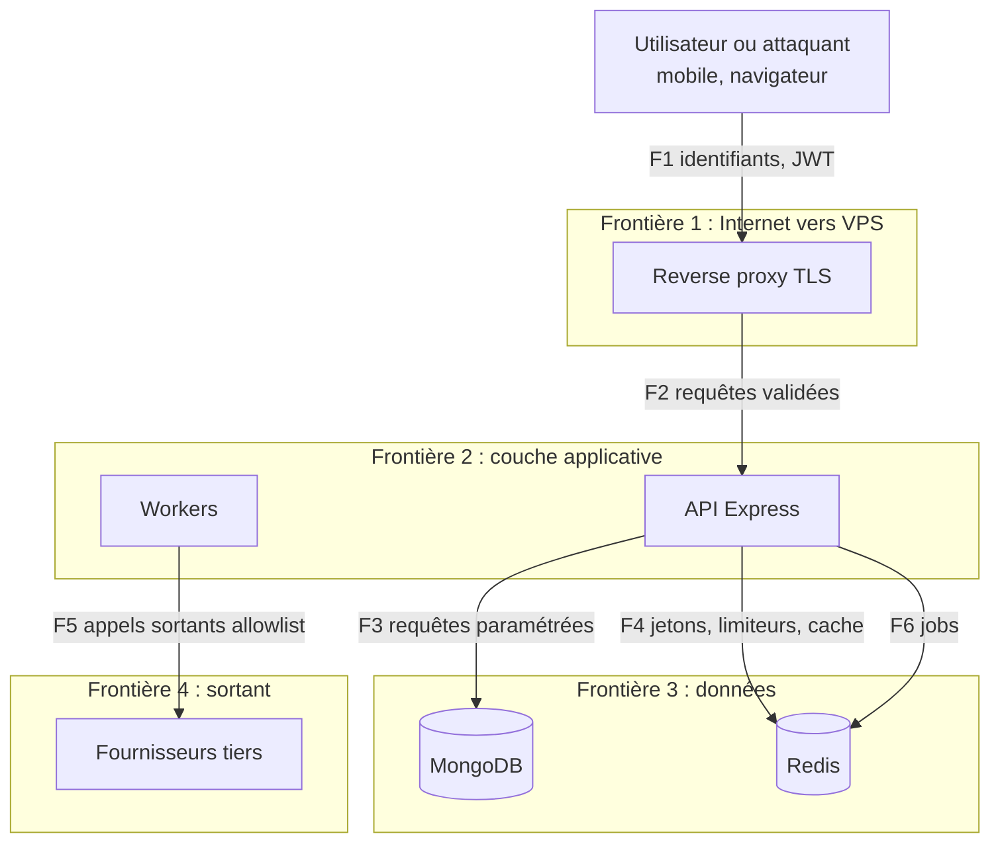

### 18.2 Analyse par catégorie

| Cat. | Menace | Cible | Scénario | Mesures | Risque résiduel |
| --- | --- | --- | --- | --- | --- |
| **S** (usurpation) | Vol d'identifiants / credential stuffing | Comptes utilisateurs | Essais massifs de couples e-mail/mot de passe | Argon2id, verrouillage progressif, rate limit IP + e-mail, anti-énumération, alerte nouvel appareil | Faible |
| S | Vol de refresh token | Sessions | Token copié depuis un appareil | Rotation + détection de rejeu (famille révoquée), Keychain/Keystore, liste des appareils | Faible |
| S | Faux jeton d'identité social | Connexion sociale | Id token forgé | Vérification côté serveur auprès de Google/Apple | Très faible |
| S | Usurpation d'un admin | Back-office | Mot de passe d'admin compromis | 2FA TOTP obligatoire super-admin, verrouillage 15 min, cookie httpOnly | Faible |
| **T** (altération) | Injection NoSQL | Base de données | `{"$ne":null}` dans le login | Joi, `mongo-sanitize`, schémas typés | Très faible |
| T | Triche aux jeux / votes | Classements | Rejeu de requêtes, bots | Idempotence, horloge serveur, anti-abus GOAT, plafonds de points | Moyen (course permanente) |
| T | Modification de contenu en transit | Échanges | Attaque de l'homme du milieu | TLS 1.2+, HSTS, pinning optionnel | Faible |
| T | Altération d'un flux `.ics` | Agendas | Jeton deviné | Jeton aléatoire long, haché, révocable | Faible |
| **R** (répudiation) | Action d'admin niée | Modération, contenu | « Ce n'est pas moi qui ai banni » | Audit immuable, identité + horodatage, traceId | Faible |
| R | Contestation d'un consentement | RGPD | « Je n'ai pas accepté » | Journal de consentements versionné, IP /24, conservé 5 ans | Faible |
| **I** (divulgation) | Fuite de données personnelles | Base, sauvegardes, logs | Dump de base, log verbeux | `select:false`, hash des jetons, masquage des logs, sauvegardes chiffrées, DB sur réseau interne | Moyen |
| I | Fuite de position | Carte | Triangulation de la position d'un tiers | GPS jamais stocké, agrégats par zone, tests de non-fuite | Faible |
| I | Énumération de comptes | Auth | Différence de réponse | Réponses indiscernables, timing ±15 % | Faible |
| I | Fuite de la solution du jeu | Guess the Player | Réponse trop bavarde | Solution jamais renvoyée avant la fin, tests de sécurité | Faible |
| I | IDOR | Ressources utilisateur | Accès à l'id d'un autre | Filtrage systématique par `req.auth.id`, 404 pour les non-propriétaires | Faible |
| **D** (déni de service) | Inondation de requêtes | API | Botnet | Limiteur global Redis, quotas, PM2 cluster, reverse proxy | Moyen (VPS unique) |
| D | Épuisement du budget IA | Coûts | Spam de l'assistant | Quotas, rate limit, kill switch, alertes de dépassement | Faible |
| D | Saturation des files | Notifications | Campagne massive | Lots de 500, backoff, dead-letter, alerte `QueueBacklog` | Faible |
| D | Panne du fournisseur externe | Football, IA | API indisponible | Disjoncteurs, cache + indicateur de fraîcheur, repli | Faible |
| **E** (élévation) | Élévation de rôle admin | RBAC | Modification du JWT, route non protégée | HS256 forcé, `alg:none` refusé, rôle revérifié en base (60 s), `restrictTo`, tests | Faible |
| E | SSRF | Appels sortants | URL interne via image de joueur | Allowlist, blocage des IP privées, anti DNS-rebinding | Faible |
| E | Prompt injection | Assistant | « Ignore tes instructions » | Séparation prompt/entrée, modération sortie, jeu d'or | Moyen |
| E | Compte banni qui contourne | Communauté | Nouvelle inscription | Restrictions de nouveau compte (< 24 h lecture seule), signaux de flood | Moyen |

> Le risque résiduel « Moyen » désigne les menaces où l'on réduit la probabilité sans pouvoir l'éliminer : elles font l'objet de métriques et d'alertes (tableau de bord Sécurité de Grafana : échecs d'authentification, déclenchements de rate limit, signalements en attente).

---

## 19. Tests de sécurité et automatisation

| Niveau | Outil | Portée | Déclencheur |
| --- | --- | --- | --- |
| Tests de sécurité API | Jest (`npm run test:security`, dossier `tests/security`) | JWT (`alg:none`, signature altérée, `iss`, expiration, `kind` user sur route admin, blacklist après logout), en-têtes helmet, énumération de comptes, injection NoSQL, XSS dans `displayName`, absence de secrets dans les réponses | Chaque PR (job `integration-tests`) |
| Tests dédiés par module | Jest | Fuite de solution (`API-JEUX-36`), anti-abus GOAT (`API-GOAT-20`), non-fuite de position (`API-COMM-31`), XSS/IDOR/élévation de privilèges en modération (`API-MODER-31`), RBAC admin football (`API-FOOT-51`) | Chaque PR |
| Audit des dépendances | `npm audit --omit=dev --audit-level=high`, Dependabot, licences | Dépendances npm | PR + nuit (`npm audit --audit-level=moderate`) |
| Scan de secrets | TruffleHog (`--only-verified`), gitleaks (cible) | Historique de la PR | Chaque PR (3 dépôts) |
| Scan de vulnérabilités | Trivy (système de fichiers et image Docker) | Dépôts et images | PR, déploiement (non bloquant sur l'image), cible bloquant (`API-PLAT-27`) |
| Analyse statique | CodeQL (`codeql.yml`) | API et admin | Planifié et PR |
| DAST / pentest | OWASP ZAP, plan de pentest (OWASP API Top 10) | API déployée en staging | Récurrent (`API-PLAT-29`) |
| Mobile | `dependency-audit.yml`, TruffleHog, Trivy | Dépendances Dart | PR |
| Accessibilité automatisée | axe | Admin | PR |

Règle d'équipe : toute PR qui touche à l'authentification, aux autorisations ou à une donnée personnelle ajoute ou met à jour au moins un test de `tests/security` ou d'intégration, et coche la case « données personnelles » du modèle de PR.

---

## 20. Écarts entre code, CDC et specs

| # | Sujet | Constat | Action |
| --- | --- | --- | --- |
| 1 | Limiteur d'authentification | Code : 20 / 15 min ; CDC et `API-AUTH-07` : 10 / 15 min / IP | Aligner sur 10 + 5 par e-mail |
| 2 | Purge des refresh tokens | Code : 30 jours ; CDC et spec : 90 jours | Corriger le cron 03:30 |
| 3 | Session admin | Code : 8 h absolues ; spec : 8 h d'inactivité, 24 h max | Implémenter `API-AUTH-38` |
| 4 | Enum des consentements | Code : 5 types ; spec : + `charter`, `source`, `ipPrefix` | Migration du modèle (`API-AUTH-21/22`) |
| 5 | Export RGPD | Code : `GET /users/me/export` synchrone ; spec : asynchrone (`202`) | Remplacer (changement documenté au changelog) |
| 6 | `JWT` à clé unique | Code : un secret ; spec : `kid` multiples | `API-PLAT-28` |
| 7 | Hachage des codes de secours / chiffrement TOTP | Code : secret TOTP en clair (`select:false`) | Chiffrement AES-256-GCM (`API-AUTH-34`) |
| 8 | CSRF admin | Cookie `SameSite=Strict` seul | Ajouter le double-submit (`API-AUTH-38`, `API-PLAT-26`) |
| 9 | MongoDB sans authentification | ADR 0004 ; CDC attendait une base authentifiée | Accepté tant que le réseau reste interne |
| 10 | Désaccord de wording de suppression (Q-15) | « effacées » vs purge à J+30 | Arbitrage produit |
| 11 | Hébergement des données | Région du VPS non précisée au CDC | Confirmer (proposé : UE) |
| 12 | Durée de rétention des signalements de modération | Non chiffrée dans le CDC | À fixer (`API-MODER-28`) |

Ces points sont repris dans la feuille « Décisions et risques » du classeur de pilotage ; il faut les trancher **avant** de coder les issues concernées.
