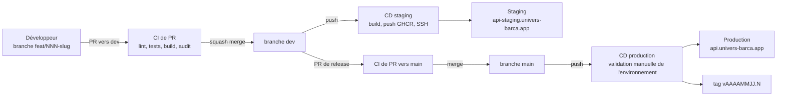
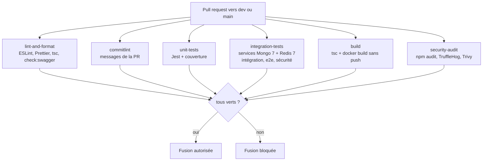
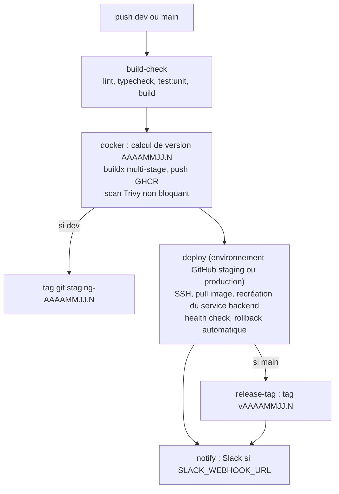
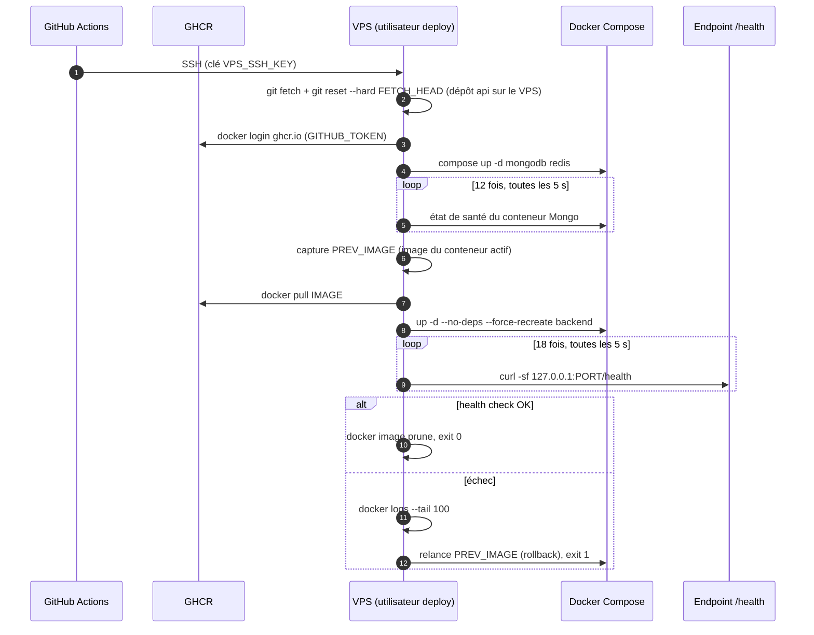
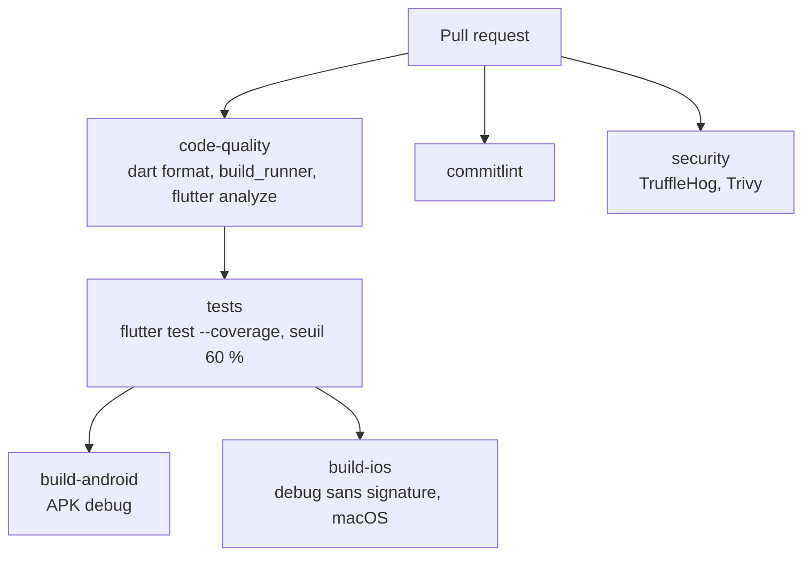
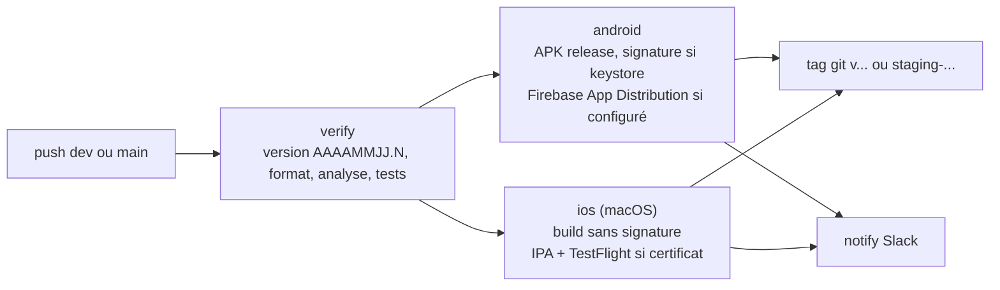
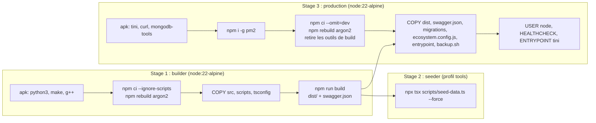
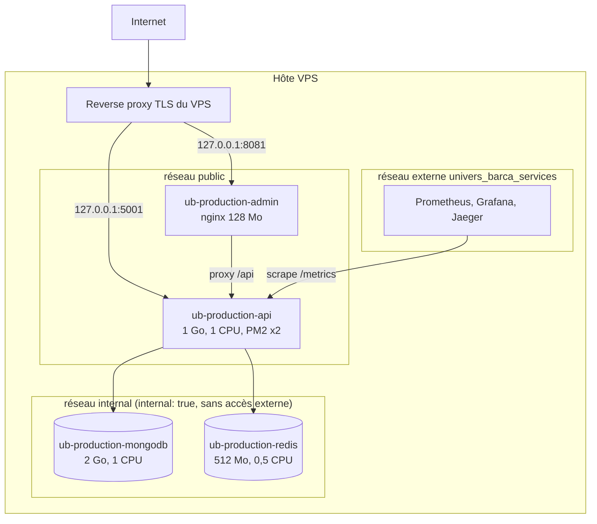
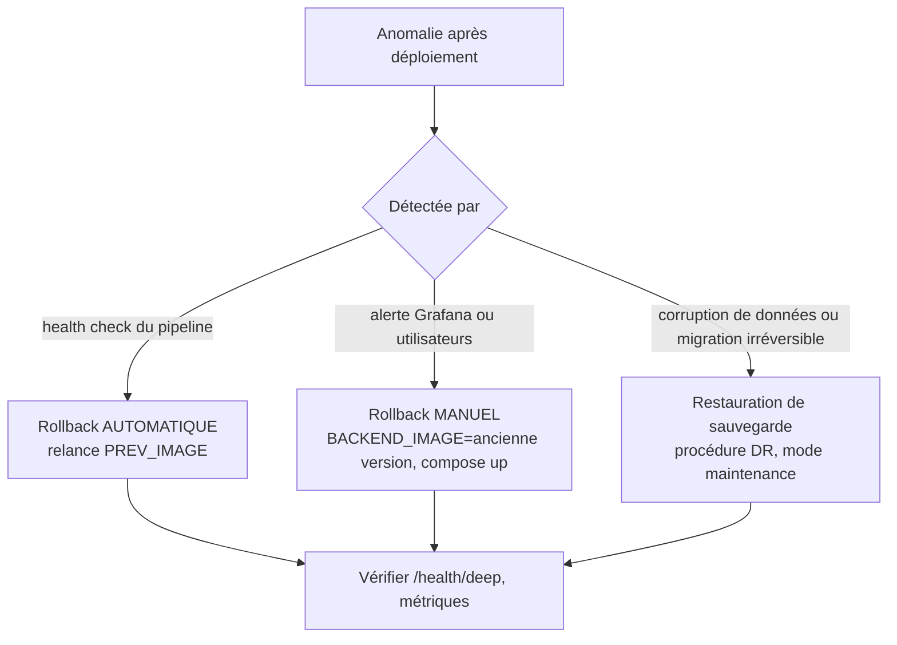
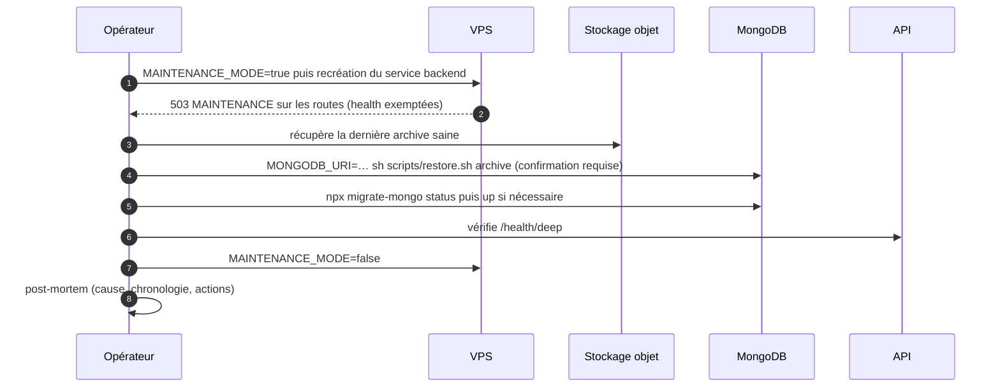

# 04 — Déploiement et CI/CD

> Ce document explique comment le code des trois dépôts (API, mobile, back-office) devient un service en production : environnements, branches, pipelines GitHub Actions, images Docker, Compose sur VPS, reverse proxy, secrets, versionnage, rollback, sauvegardes et reprise après sinistre. Il s'appuie sur les workflows réellement présents dans `.github/workflows/`, sur `docker/`, `Dockerfile` et `docs/DEPLOYMENT.md` de chaque dépôt, et sur le backlog (`API-PLAT-45` à `API-PLAT-55`, `ADM-FND-20` à `22`, `MOB-FND-42/43`).

## Sommaire

1. [Vue d'ensemble](#1-vue-densemble)
2. [Environnements](#2-environnements)
3. [Branches, Git flow simplifié et revue](#3-branches-git-flow-simplifié-et-revue)
4. [Versionnage `AAAAMMJJ.N` et tags](#4-versionnage-aaaammjjn-et-tags)
5. [CI/CD de l'API](#5-cicd-de-lapi)
6. [CI/CD du back-office](#6-cicd-du-back-office)
7. [CI/CD de l'application mobile](#7-cicd-de-lapplication-mobile)
8. [Workflows transverses](#8-workflows-transverses)
9. [Docker : images multi-stage](#9-docker--images-multi-stage)
10. [Docker Compose sur le VPS](#10-docker-compose-sur-le-vps)
11. [Reverse proxy et domaines](#11-reverse-proxy-et-domaines)
12. [Secrets et environnements GitHub](#12-secrets-et-environnements-github)
13. [Migrations de base de données](#13-migrations-de-base-de-données)
14. [Rollback](#14-rollback)
15. [Sauvegardes et reprise après sinistre](#15-sauvegardes-et-reprise-après-sinistre)
16. [Caches de CI et performances des pipelines](#16-caches-de-ci-et-performances-des-pipelines)
17. [Préparer un VPS et checklist de mise en production](#17-préparer-un-vps-et-checklist-de-mise-en-production)
18. [Écarts et points ouverts](#18-écarts-et-points-ouverts)

---

## 1. Vue d'ensemble



Principes :

- **Deux branches longues** : `dev` (intégration, déploie le **staging**) et `main` (déploie la **production**). Aucun push direct sur ces branches : tout passe par une **PR** avec CI verte.
- **Une seule image Docker par version**, taguée `staging-AAAAMMJJ.N` ou `prod-AAAAMMJJ.N`, publiée sur **GHCR** (GitHub Container Registry) et déployée par **SSH** sur un VPS.
- **Rollback automatique** : si le health check échoue après déploiement, le pipeline relance l'image précédente.
- **Le pipeline reste vert sans secrets** : sans `VPS_HOST` (ou sans secrets de signature mobile), l'image/l'artefact est construit et publié mais le déploiement est ignoré avec un avis (`::notice::`). Cela permet de développer avant d'avoir un serveur.

---

## 2. Environnements

| Environnement | Où | Branche | Base de données | Particularités |
| --- | --- | --- | --- | --- |
| **Développement** | Poste local, `docker/docker-compose.dev.yml` (MongoDB replica set + Redis, API en option via le profil `full`) | `feat/*` | Mongo local sur `127.0.0.1:27017`, `npm run seed` | Limiteurs désactivables (`RATE_LIMIT_DISABLED=true`) ; ports locaux exposés |
| **Staging (recette)** | VPS, projet Compose `univers-barca-staging` | `dev` | Mongo dédié, volume `mongo_data` propre | Données de démonstration (`seeder`), tests `stress`/`spike`/`soak` autorisés, observation 48 h avant promotion |
| **Production** | VPS, projet Compose `univers-barca-production` | `main` | Mongo dédié, sauvegardes quotidiennes | Secrets distincts, environnement GitHub `production` avec relecteur obligatoire (recommandé) |

**Principe d'isolation** (CDC Backend §9.2) : chaque environnement dispose de son propre fichier `.env.<env>`, de ses propres volumes nommés, de son projet Compose (donc de ses réseaux `internal` et `public`) et de son sous-domaine. Aucune variable ni volume n'est partagé entre staging et production. Le seul réseau commun est `univers_barca_services` (observabilité), externe aux deux environnements.

Des **garde-fous de configuration** protègent la production (`config/env.ts` + `API-PLAT-47`) : en production, `REDIS_URL` est obligatoire, `SWAGGER_PASSWORD` ≥ 16 caractères, `METRICS_ALLOWED_IPS` non vide, `CORS_ORIGINS` sans `*` ; le staging refuse une URI Mongo contenant le nom de la base de production.

### 2.1 Matrice de configuration (extrait)

| Variable | Dev | Staging | Production |
| --- | --- | --- | --- |
| `NODE_ENV` | `development` | `staging` | `production` |
| `MONGODB_URI` | `mongodb://localhost:27017/…?replicaSet=rs0` | `mongodb://mongodb:27017/univers_barca?replicaSet=rs0` | idem, autre volume/réseau |
| `REDIS_URL` | vide possible (repli mémoire) | `redis://:${REDIS_PASSWORD}@redis:6379` | idem, mot de passe différent |
| `LOG_LEVEL` | `debug` | `info` | `info` |
| `CORS_ORIGINS` | `http://localhost:5173` | admin staging | admin production |
| `PM2_INSTANCES` | — | 2 | 2 |
| `RATE_LIMIT_DISABLED` | possible | **non** (sauf campagne de charge locale) | interdit |
| Firebase | projet de dev | projet staging | projet production |
| `APP_ENV` (mobile) | `development` | `staging` | `production` |

---

## 3. Branches, Git flow simplifié et revue

```
main  ← production (protégée, déploiement automatique + tag vAAAAMMJJ.N)
dev   ← intégration / staging (protégée, cible des PR et de Dependabot)
feat/<n°issue>-<slug>   fix/…   refactor/…   docs/…   chore/…   ci/…   test/…
```

| Règle | Détail |
| --- | --- |
| Création | Toute branche part de `dev` : `git switch dev && git pull && git switch -c feat/123-inscription-email` |
| Commits | **Conventional Commits** `type(scope): sujet` (≤ 100 car., sans majuscule initiale ni point final) ; types `feat fix docs style refactor perf test build ci chore revert` ; hook `commit-msg` (Husky + commitlint) |
| PR | Vers `dev`, avec le modèle de PR, `Closes #N`, captures clair + sombre pour toute UI ; **titre** validé par `pr-title.yml` (`amannn/action-semantic-pull-request`) |
| Fusion | **Squash** : le titre de la PR devient le Conventional Commit |
| Release | `dev` → `main` par PR de release ; le déploiement de production suit le merge |
| Protection | PR obligatoire, CI verte, 1 revue CODEOWNERS (recommandé), « Allow auto-merge » activé pour Dependabot |
| Hooks locaux | Husky : `commit-msg` (commitlint), `pre-commit` (lint-staged : ESLint + Prettier), typecheck |

> Le CDC Global §6.2 prévoyait `develop`, `release/*`, `hotfix/*`. Le projet a retenu un flux plus simple (`dev`/`main`) ; un correctif urgent suit le même chemin (branche `fix/…` → PR → `dev` → release) ou, exceptionnellement, une PR directe vers `main` portée par le propriétaire du dépôt.

---

## 4. Versionnage `AAAAMMJJ.N` et tags

Chaque déploiement reçoit une version `AAAAMMJJ.N` où `AAAAMMJJ` est la **date UTC du jour** et `N` un compteur journalier : `N = 1 + plus grand N déjà tagué ce jour-là` (tags `v…` et `staging-…` confondus). Jamais d'étiquette `latest` seule. Les trois dépôts appliquent la même règle (ADR 0003 dans chacun).

| Objet | Staging (`dev`) | Production (`main`) |
| --- | --- | --- |
| Tag Git | `staging-AAAAMMJJ.N` | `vAAAAMMJJ.N` |
| Image Docker API | `ghcr.io/thegoatia/univers_barca_api:staging-AAAAMMJJ.N` (+ `staging-latest`) | `…:prod-AAAAMMJJ.N` (+ `prod-latest`) |
| Image Docker admin | `ghcr.io/thegoatia/univers_barca_admin:staging-AAAAMMJJ.N` | `…:prod-AAAAMMJJ.N` |
| Mobile | APK/IPA staging + tag `staging-AAAAMMJJ.N` | APK/IPA production + tag `vAAAAMMJJ.N` |

Algorithme exécuté par les pipelines (extrait réel) :

```bash
DATE=$(date -u +%Y%m%d)
LAST=$( (git tag -l "v${DATE}.*" "staging-${DATE}.*" || true) | sed -E "s/^(v|staging-)${DATE}\.//" | sort -n | tail -1)
N=$(( ${LAST:-0} + 1 ))
VERSION="${DATE}.${N}"
```

Exemple : si `staging-20261015.1` et `staging-20261015.2` existent, le prochain déploiement du jour est `20261015.3`.

**Deux notions de version à ne pas confondre** :

| Notion | Où | Rôle |
| --- | --- | --- |
| Version de **déploiement** `AAAAMMJJ.N` | Tag Git, image Docker, variable `APP_VERSION` de l'API (affichée dans `/health` et `GET /version`) | Traçabilité d'un déploiement |
| Version de l'**application mobile** | `version:` de `pubspec.yaml` (`--build-name`) et `github.run_number` (`--build-number`) | Version vue par les stores et utilisée par le contrôle de version minimale (`X-App-Version`, `426 UPGRADE_REQUIRED`) |

L'API injecte la version dans l'image via `--build-arg APP_VERSION=…` → `ENV APP_VERSION`.

---

## 5. CI/CD de l'API

### 5.1 CI de pull request (`backend-ci.yml`)

Déclenchée sur toute PR vers `dev` ou `main` (hors `docs/maquettes/**` et `.github/backlog/**`). Annule les runs obsolètes (`concurrency … cancel-in-progress`).



| Job | Contenu | Bloquant ? |
| --- | --- | --- |
| `lint-and-format` | `npm run lint` (ESLint `--max-warnings 0`), `format:check` (Prettier), `typecheck` (`tsc --noEmit`), `check:swagger` (le `swagger.json` versionné doit correspondre aux routes) | Oui |
| `commitlint` | `commitlint --from base.sha --to head.sha` (ignoré pour Dependabot) | Oui |
| `unit-tests` | `npm run test:coverage` (Jest, projet `unit`), artefact `coverage-unit` 7 jours | Oui (seuils de couverture) |
| `integration-tests` | Services Docker `mongo:7-jammy` et `redis:7-alpine` avec health checks ; `test:integration`, `test:e2e`, `test:security` | Oui |
| `build` | `npm run build` puis `docker/build-push-action` cible `production`, `push: false`, cache GHA | Oui |
| `security-audit` | `npm audit --omit=dev --audit-level=high` (non bloquant), **TruffleHog** `--only-verified`, **Trivy** FS (CRITICAL/HIGH, sarif) | TruffleHog oui ; audit/Trivy en `continue-on-error` aujourd'hui, **bloquants** à terme (`API-PLAT-27`) |

La section « Portes de qualité du pipeline : charge, contrat, sécurité avant staging et production » (`API-PLAT-45`) prévoit d'ajouter au flux : tests de contrat OpenAPI, garde « chaque nouvelle route a son scénario k6 » (`API-PLAT-39`) et seuils k6.

### 5.2 CD (`backend-deploy.yml`)

Déclenché sur `push` vers `dev` et `main` (et manuellement). `concurrency: backend-deploy-<ref>` avec `cancel-in-progress: false` : **un déploiement à la fois, jamais interrompu en route**.



Détail des jobs :

| Job | Contenu |
| --- | --- |
| `build-check` | `npm ci`, `lint`, `typecheck`, `test:unit`, `build` (échec = aucun déploiement) |
| `docker` | Calcule `version`, `env_name` (`prod`/`staging`), `image` ; login GHCR avec `GITHUB_TOKEN` ; `docker/build-push-action` (cible `production`, `build-args: APP_VERSION`, tags `…:<env>-<version>` et `…:<env>-latest`, cache GHA `mode=max`) ; scan Trivy CRITICAL non bloquant ; pour `dev`, crée le tag `staging-<version>` via l'API Git |
| `deploy` | Environnement GitHub `staging` ou `production` ; vérifie la présence de `VPS_HOST` ; sinon notice et sortie verte ; sinon SSH (voir ci-dessous) |
| `release-tag` | Production uniquement : crée le tag `v<version>` |
| `notify` | `always()` : message Slack avec statut, acteur et lien du run |

### 5.3 Séquence de déploiement SSH



- **Port** : production `5001`, staging `5002` (liés à `127.0.0.1`, jamais publiés).
- **Recréation ciblée** : `--no-deps --force-recreate backend` ne touche ni MongoDB ni Redis, donc pas de coupure des données ; la coupure de service dure le temps du redémarrage du conteneur API (rolling restart simple en V1, blue-green envisagé plus tard — CDC §9.5).
- **Fenêtre d'attente** : jusqu'à 90 s (18 × 5 s) pour que `/health` réponde 200.
- **Migrations** : exécutées par l'`entrypoint.sh` avant le démarrage de l'application (voir §13).

### 5.4 Workflows complémentaires de l'API

| Workflow | Déclencheur | Rôle |
| --- | --- | --- |
| `load-test.yml` | push `dev` (code/tests de charge), lundi 01:00 UTC, manuel | k6 : `smoke` + `load` réduit à chaque push, `stress` + `spike` chaque semaine, profil libre en manuel (cible : runner ou staging) |
| `nightly-regression.yml` | Quotidien 02:30 UTC | `npm run test:all` sur `dev` + `npm audit --audit-level=moderate` |
| `codeql.yml` | PR / planifié | Analyse statique CodeQL |
| `dependabot-automerge.yml` | PR Dependabot vers `dev` | Auto-merge des mises à jour mineures et patchs après CI verte |
| `labels.yml`, `create-backlog.yml` | manuel / push | Synchronisation des labels, création des issues du backlog |
| `pr-title.yml` | PR | Valide le titre Conventional Commit |

---

## 6. CI/CD du back-office

| Étape | `admin-ci.yml` (PR) | `admin-deploy.yml` (push dev/main) |
| --- | --- | --- |
| Qualité | `npm ci`, `lint`, `format:check`, `typecheck`, `test:coverage` (Vitest) | `lint`, `typecheck`, `npm test`, `build` |
| Build | `npm run build` avec `VITE_API_URL=https://api-staging.univers-barca.app/api/v1`, `VITE_ENV=ci`, artefact `admin-build-<sha>` | Image Docker multi-stage (Vite → nginx), `VITE_*` injectées par `--build-arg` |
| Livraison | — | Push GHCR, scan Trivy, tag `staging-…`, SSH |

Déploiement SSH de l'admin : pull de l'image → `docker compose up -d --force-recreate admin` → health check `http://127.0.0.1:<port>/healthz` (12 × 5 s, ports **8081** prod / **8082** staging) → **rollback** vers l'image précédente en cas d'échec → tag `v…` (production) → Slack. Sans `VPS_HOST`, l'étape est ignorée (pipeline vert).

Spécificités :

- Les variables `VITE_API_URL` (défaut `/api/v1`) et `VITE_ENV` sont **figées au build** (visibles dans le bundle ; aucun secret).
- Le conteneur nginx proxifie `/api/` vers `ub-<env>-api:5000` (variable `API_UPSTREAM`) : l'admin partage donc **la même origine** que l'API. Prérequis : le réseau Docker de l'API (`univers-barca-<env>_public`) existe (déclaré `external: true` dans le compose admin).
- La cible du backlog (`ADM-FND-20/21`) ajoute : jobs bloquants, e2e Playwright sur `dev`, budgets de bundle, **validation manuelle avant la production** et smoke tests post-déploiement.

---

## 7. CI/CD de l'application mobile

### 7.1 CI de PR (`mobile-ci.yml`)



| Job | Détail |
| --- | --- |
| `code-quality` | Flutter **3.47.7** (stable, cache), `dart format --output=none --set-exit-if-changed --line-length 100 lib/core lib/di lib/features lib/routes lib/main.dart test integration_test`, `build_runner build --delete-conflicting-outputs`, `.env` copié depuis `.env.example`, `flutter analyze --fatal-warnings` |
| `tests` | `flutter test --coverage` puis **seuil de couverture ≥ 60 %** calculé sur `lcov.info` ; artefact `coverage` 7 jours |
| `build-android` | JDK 17 Temurin, `flutter build apk --debug --dart-define=APP_ENV=development`, artefact 3 jours |
| `build-ios` | `macos-latest`, `flutter build ios --debug --no-codesign`, cache CocoaPods |
| `security` | TruffleHog `--only-verified`, Trivy FS |

### 7.2 CD (`mobile-deploy.yml`)



- **Staging** (`dev`) → distribution interne : Firebase App Distribution (groupes `android-staging`, `ios-staging`). **Production** (`main`) → APK/IPA de production et **TestFlight** ; la mise en ligne sur les stores reste **manuelle** à partir des artefacts (AAB : `make build-aab-prod`) ; fiche, captures et textes sont suivis dans des issues « Publication ».
- Le `.env` est reconstitué à partir de `.env.example` : `API_BASE_URL` remplacé par le secret `API_BASE_URL_STAGING` ou `API_BASE_URL_PROD`, `APP_ENV` fixé à l'environnement.
- **Signature** : keystore Android, certificat iOS et profil de provisionnement viennent de secrets base64 ; **sans eux**, l'APK est signé avec la clé de debug (distribution interne uniquement) et l'IPA n'est pas produite. Les fichiers déchiffrés sont supprimés en fin de job (`if: always()` : `release.jks`, `key.properties`, `google-services.json`, trousseau iOS, `.env`).
- `--build-name` provient de `pubspec.yaml`, `--build-number` de `github.run_number`.
- La cible `MOB-FND-43` remplace ces étapes par **Fastlane** (`match` pour les certificats, `supply` pour Google Play).

---

## 8. Workflows transverses

| Workflow | Dépôts | Rôle |
| --- | --- | --- |
| `pr-title.yml` | 3 | Titre de PR conforme aux Conventional Commits, sujet sans majuscule initiale |
| `labels.yml` | 3 | Crée/synchronise les labels `priorite:*`, `taille:*`, `type:*`, `module:*` |
| `create-backlog.yml` | 3 | Crée les issues du backlog (titre `[CODE] …`, jalon = phase) depuis `.github/backlog/` |
| `dependabot-automerge.yml` | 3 | Auto-merge des mises à jour mineures/patchs Dependabot (cible `dev`) |
| `.github/dependabot.yml` | API, admin | Hebdomadaire (lundi 06:00 `Africa/Douala`), cible `dev`, groupes (express, mongoose, security-libs…), préfixe `build(deps)` |
| `dependency-audit.yml` | Mobile | Lundi 09:00 UTC : `flutter pub outdated` (rapport) |
| `codeql.yml` | API, admin | Analyse statique |
| `CODEOWNERS`, `pull_request_template.md`, `ISSUE_TEMPLATE/` | 3 | Revue obligatoire, modèle de PR (case « données personnelles »), formulaires d'issues |

---

## 9. Docker : images multi-stage

### 9.1 Image de l'API (`Dockerfile`)



Points notables :

- **Trois cibles** : `builder` (compilation), `seeder` (peuplement optionnel, profil Compose `tools`), `production` (image finale, **cible utilisée par la CI**).
- `npm ci --ignore-scripts` puis `npm rebuild argon2` : Husky ne s'installe pas dans l'image, mais le module natif Argon2 est reconstruit.
- L'image finale ne contient **ni sources TypeScript ni outils de compilation** (supprimés par `apk del`), mais `mongodb-tools` pour `backup.sh` (`mongodump`).
- **`tini`** gère les signaux (PID 1) ; `pm2-runtime ecosystem.config.js --env production` lance le **cluster** (`PM2_INSTANCES`, 2 par défaut, `max_memory_restart: 1G`, `kill_timeout: 30000`).
- Exécution **non-root** (`USER node`) ; `HEALTHCHECK` toutes les 30 s sur `http://localhost:5000/health` (3 échecs = `unhealthy`).
- `entrypoint.sh` : exécute `npx migrate-mongo up` avant le démarrage (désactivable avec `RUN_MIGRATIONS=false`), puis `exec "$@"`.
- `ARG APP_VERSION` → `ENV APP_VERSION` : la version est connue de l'application (logs, `/health`).

### 9.2 Image du back-office

| Stage | Base | Contenu |
| --- | --- | --- |
| `builder` | `node:22-alpine` | `npm ci --ignore-scripts`, `ARG VITE_API_URL=/api/v1`, `ARG VITE_ENV=production`, `npm run build` (les `VITE_*` sont injectées **au build**, jamais au runtime) |
| `production` | `nginxinc/nginx-unprivileged:1.29-alpine` | `docker/nginx.conf` comme template (`API_UPSTREAM` substitué au démarrage), `dist/` dans `/usr/share/nginx/html`, port 8080, `HEALTHCHECK wget /healthz` |

Le compose de production durcit le conteneur : `read_only: true` avec `tmpfs` (`/tmp`, `/var/cache/nginx`, `/etc/nginx/conf.d`), `no-new-privileges`, limites 128 Mo / 0,25 CPU.

### 9.3 Application mobile

Il n'y a pas d'image Docker : les artefacts sont l'APK/AAB (Android) et l'IPA (iOS). L'environnement est choisi à la compilation par `--dart-define=APP_ENV=…` et les URL d'API par le `.env` généré (ADR 0002 mobile).

---

## 10. Docker Compose sur le VPS

### 10.1 Fichiers Compose de l'API

| Fichier | Usage | Contenu |
| --- | --- | --- |
| `docker/docker-compose.dev.yml` | Local | `mongodb` (replica set `rs0`), `mongo-init` (initialisation idempotente), `redis`, `api` (profil `full`) ; ports liés à `127.0.0.1` |
| `docker/docker-compose.staging.yml` | VPS staging | Variante « lean » : `mongodb`, `redis`, `backend` ; conteneurs `ub-staging-*` ; port `127.0.0.1:5002:5000` |
| `docker/docker-compose.production.yml` | VPS production | Idem avec `ub-production-*` ; port `127.0.0.1:5001:5000` |
| `docker/docker-compose.observability.yml` | VPS (mutualisé) | `prometheus` (v2.55.1), `alertmanager` (v0.27.0), `grafana` (11.3.0), `jaeger` (1.62.0) sur le réseau `univers_barca_services` |

### 10.2 Topologie réseau d'un environnement



Éléments de durcissement du compose de production :

- **MongoDB** n'est attachée qu'au réseau `internal` (déclaré `internal: true`, donc **sans route vers Internet** et sans port publié) — c'est la justification de l'ADR 0004 (pas d'authentification Mongo). Commande : `--replSet rs0 --bind_ip_all --wiredTigerCacheSizeGB 1` ; le `healthcheck` initialise le replica set si nécessaire (`rs.initiate`).
- **Redis** : `--appendonly yes --requirepass ${REDIS_PASSWORD}`, volume `redis_data`.
- **Backend** : image `${BACKEND_IMAGE:-…:prod-latest}`, `env_file` `/var/www/univers-barca/.env.production`, `depends_on` avec `service_healthy`, `healthcheck` Node (30 s), ressources 1 Go / 1 CPU (réservation 512 Mo), réseaux `internal`, `public`, `services`.
- **Redémarrage** `unless-stopped` et rotation des logs Docker (`json-file`, `max-size` 10 Mo × 3 pour les bases, 50 Mo × 5 pour l'API).
- **Volumes nommés** `mongo_data`, `redis_data` : indépendants entre staging et production grâce au nom de projet Compose.

### 10.3 Dimensionnement de départ

| Service | Mémoire (limite) | CPU | Remarque |
| --- | --- | --- | --- |
| MongoDB | 2 Go | 1,0 | Cache WiredTiger 1 Go |
| Redis | 512 Mo | 0,5 | AOF activé |
| API (PM2 × 2) | 1 Go | 1,0 | Instances ajustables par `PM2_INSTANCES` |
| Admin (nginx) | 128 Mo | 0,25 | Fichiers statiques |
| Prometheus | 1 Go | 0,5 | Stack mutualisée |

Ces valeurs sont **sobres et à ajuster d'après Grafana** et les campagnes `stress` (protocole `API-PLAT-44` : retenir ~60 % de la capacité mesurée comme charge nominale).

### 10.4 Évolution prévue : processus `worker` dédié

Le CDC prévoit un conteneur `worker` (même image, autre commande) pour isoler les jobs. Le code lance aujourd'hui les workers et le scheduler dans le processus API (instance PM2 0, `RUN_CRON`). `API-PLAT-35` introduit `src/worker.ts`, un **leader unique** de scheduler (verrou Redis TTL 30 s), un `/health/ready` qui passe en 503 dès `SIGTERM`, un arrêt gracieux (requêtes en cours 25 s, jobs actifs 60 s, `stopGracePeriod` 70 s).

---

## 11. Reverse proxy et domaines

| Sous-domaine | Cible locale | Environnement |
| --- | --- | --- |
| `api.univers-barca.app` | `127.0.0.1:5001` | Production |
| `api-staging.univers-barca.app` | `127.0.0.1:5002` | Staging |
| `admin.univers-barca.app` | `127.0.0.1:8081` | Production |
| `admin-staging.univers-barca.app` | `127.0.0.1:8082` | Staging |
| Grafana / Jaeger | `127.0.0.1:3001` / `127.0.0.1:16686` | Accès restreint (tunnel SSH ou authentification du proxy) |

Le choix du reverse proxy (Traefik, Nginx ou Apache) est laissé au VPS : le dépôt API fournit un dossier `docker/traefik/` pour Traefik. Responsabilités : terminaison **TLS** (certificats Let's Encrypt à renouvellement automatique), transmission de `X-Forwarded-For`/`X-Forwarded-Proto` (l'API déclare `trust proxy = 1`), redirection HTTP → HTTPS, éventuellement limitation de taille de requête. Le pare-feu `ufw` n'autorise que SSH, 80 et 443 ; `fail2ban` protège SSH.

---

## 12. Secrets et environnements GitHub

### 12.1 Environnements GitHub

Chaque dépôt déclare deux **environnements** (`Settings → Environments`) : `staging` et `production`. Les jobs de déploiement les utilisent (`environment: staging|production`), ce qui permet :

- des **secrets distincts** par environnement ;
- des **protections** : relecteur obligatoire pour `production` (recommandé), restriction de branche.

### 12.2 Secrets par dépôt

| Dépôt | Secrets (par environnement) |
| --- | --- |
| API | `VPS_HOST`, `VPS_USER`, `VPS_SSH_KEY`, `VPS_PORT` (optionnel, 22 par défaut), `SLACK_WEBHOOK_URL` (optionnel) ; `GITHUB_TOKEN` fourni automatiquement pour GHCR et les tags |
| Admin | Mêmes secrets VPS et Slack |
| Mobile | `API_BASE_URL_STAGING`, `API_BASE_URL_PROD`, `ANDROID_KEYSTORE_BASE64`, `ANDROID_KEYSTORE_PASSWORD`, `ANDROID_KEY_ALIAS`, `ANDROID_KEY_PASSWORD`, `GOOGLE_SERVICES_JSON_BASE64`, `FIREBASE_APP_ID_ANDROID`, `FIREBASE_SERVICE_ACCOUNT_JSON`, `IOS_CERTIFICATE_BASE64`, `IOS_CERTIFICATE_PASSWORD`, `IOS_PROVISIONING_PROFILE`, `IOS_KEYCHAIN_PASSWORD`, `APP_STORE_CONNECT_API_KEY_ID`, `APP_STORE_CONNECT_API_ISSUER_ID`, `APP_STORE_CONNECT_API_KEY_CONTENT`, `SLACK_WEBHOOK_URL` |

### 12.3 Secrets applicatifs sur le VPS

Les secrets applicatifs (JWT, Redis, clés football/IA/FCM…) **ne passent pas par GitHub** : ils vivent dans `/var/www/univers-barca/.env.staging` et `.env.production` (droits 600, propriétaire `deploy`), lus par Compose (`env_file`). Modèle : `.env.example`. Le script `scripts/check-env.mjs` (cible `API-PLAT-47`) compare ce modèle aux fichiers déployés sans afficher de valeur. Voir `03-securite-et-rgpd.md` pour la rotation.

### 12.4 Permissions des workflows

Principe du moindre privilège : `permissions: contents: read` par défaut ; `contents: write` + `packages: write` uniquement pour les jobs qui poussent des images et des tags ; le `GITHUB_TOKEN` sert aussi à `docker login ghcr.io` sur le VPS pour le `pull`.

---

## 13. Migrations de base de données

| Aspect | Règle |
| --- | --- |
| Outil | `migrate-mongo` (fichiers dans `scripts/migrations/`, config `migrate-mongo-config.js`) |
| Exécution | **Automatique au démarrage du conteneur** (`entrypoint.sh`, `RUN_MIGRATIONS=true`) ; manuelle : `docker exec ub-production-api npx migrate-mongo status|up|down` |
| Écriture | `npm run migrate:create <nom>`, `up` **idempotent**, `down` non destructif si possible |
| Index | Définis dans les schémas **et** garantis par la migration `20261015000000-initial-indexes` |
| Migration destructive | **Deux temps** : dépréciation (compatibilité avec les versions mobiles encore en circulation) puis suppression à la version suivante (CDC §9.5) |
| Échec | Le conteneur s'arrête (`exit 1`), le health check échoue, **le rollback relance l'image précédente** ; si la migration était irréversible, restaurer la sauvegarde pré-déploiement |
| Seed | `npm run seed` (dev), service `seeder` (profil `tools`) en **staging uniquement** |

Une sauvegarde supplémentaire est déclenchée **avant chaque déploiement de production** (`API-PLAT-49`).

---

## 14. Rollback

### 14.1 Trois niveaux



| Niveau | Déclencheur | Action | Durée typique |
| --- | --- | --- | --- |
| Automatique | `/health` en échec pendant 90 s (API) ou `/healthz` pendant 60 s (admin) | Le script SSH relance l'image capturée avant le déploiement (`PREV_IMAGE`) | ~2 min |
| Manuel | Régression fonctionnelle détectée après coup | `BACKEND_IMAGE=ghcr.io/thegoatia/univers_barca_api:prod-20261015.2 docker compose --env-file … -f docker/docker-compose.production.yml up -d --no-deps --force-recreate backend` | quelques minutes |
| Données | Migration irréversible, corruption | `MAINTENANCE_MODE=true`, restauration de la dernière sauvegarde (`scripts/restore.sh`), `migrate-mongo status/up`, vérification, fin de maintenance | RTO cible 2 h |

Les images étant **immuables et conservées dans GHCR** avec leur version, n'importe quelle version antérieure est redéployable. `API-PLAT-46` prévoit de **tester** le rollback (image précédente + migration inverse) avant chaque montée de version majeure.

### 14.2 Rollback côté mobile

Une application publiée ne se « rollback » pas. Les leviers sont : **retirer** la mise à disposition dans la console du store, publier un correctif, ou protéger l'API : la version minimale requise (`426 UPGRADE_REQUIRED`) bloque les versions défectueuses (relevée seulement quand ≥ 90 % du parc est à jour — `API-PLAT-04`), et les **feature flags** (`/config`) permettent de couper un module à distance (par exemple `assistant_enabled`, kill switch wallpapers).

---

## 15. Sauvegardes et reprise après sinistre

### 15.1 Objectifs

| Objectif | Valeur |
| --- | --- |
| **RPO** (perte de données maximale) | 24 h avec sauvegarde quotidienne ; 1 h si la sauvegarde horaire est activée |
| **RTO** (remise en service) | 2 h |
| Disponibilité cible | 99,5 % (CDC Global §3.1) |

### 15.2 Sauvegardes

| Élément | Aujourd'hui (code) | Cible (`API-PLAT-49`) |
| --- | --- | --- |
| Outil | `scripts/backup.sh` : `mongodump --archive --gzip` | Job BullMQ `database-backup` (cron 02:00 UTC) ou cron conteneur |
| Planification | Cron VPS recommandé : `0 2 * * * docker exec ub-production-api /scripts/backup.sh` | Idem + sauvegarde **avant chaque déploiement de production** |
| Rétention locale | 7 jours (`BACKUP_KEEP_DAYS`) | 30 quotidiennes + 26 hebdomadaires (dimanche) ≈ 6 mois |
| Copie hors VPS | Manuelle (stockage objet chiffré, 30 jours) | Automatique, **chiffrée** (age/AES-256, clé distincte), vérification sha256 + `mongorestore --dryRun` |
| Métriques | — | `ub_backup_last_success_timestamp`, `ub_backup_size_bytes`, `ub_backup_duration_seconds` ; alerte `BackupFailed` si > 26 h sans succès |
| Redis | **Non sauvegardé** : cache, blacklists et files uniquement (sa perte force les utilisateurs à se reconnecter, sans perte durable) | Idem |
| Configuration | — | Compose et `.env` chiffrés, séparés du VPS |

Les sauvegardes contiennent des données personnelles : accès restreint, durée alignée sur le registre des traitements (voir `03-securite-et-rgpd.md`).

### 15.3 Restauration



### 15.4 Scénarios de sinistre

| Scénario | Réponse |
| --- | --- |
| Déploiement défectueux | Rollback automatique du pipeline, sinon manuel (§14) |
| Corruption de données | Restauration de la dernière sauvegarde saine |
| Perte du VPS | Nouveau VPS via `setup-vps.sh`, restauration, bascule DNS |
| Fuite de secret | Rotation immédiate, purge de `refreshtokens`, audit des logs |
| Compromission d'un compte admin | Désactivation (`status: disabled`), révocation des `adminsessions`, revue de `auditlogs` |
| Panne de fournisseur externe | Disjoncteurs et repli (cache football, assistant en `503 AI_UNAVAILABLE`, push reportés) |

### 15.5 Test de restauration

`API-PLAT-50` automatise un **workflow mensuel** : télécharge la dernière sauvegarde de production chiffrée, la restaure sur une instance MongoDB **éphémère isolée** (sans Internet sortant, sans e-mail/FCM actifs — RGPD), lance `migrate:status`, des requêtes d'intégrité (comptes de collections, index, TTL) et les smoke tests API, consigne RTO/RPO dans `docs/dr-journal.md`, puis détruit l'environnement. Un échec ouvre automatiquement une issue **P0**. Le scénario « perte du VPS » complet est joué une fois avant la production. En attendant l'automatisation, `docs/DISASTER_RECOVERY.md` impose un test trimestriel manuel.

---

## 16. Caches de CI et performances des pipelines

| Cache | Où | Clé | Gain |
| --- | --- | --- | --- |
| npm | `actions/setup-node` (`cache: npm`) | `package-lock.json` | Installation rapide des dépendances (API, admin) |
| Couches Docker | `docker/build-push-action` (`cache-from/to: type=gha`, `mode=max`) | Couches de l'image | Reconstruction de seules les couches modifiées |
| Flutter SDK + pub | `subosito/flutter-action` (`cache: true`) | Version 3.47.7 | Évite le téléchargement du SDK |
| `build_runner` | `actions/cache` sur `.dart_tool/build` | `pubspec.lock` + hash de `lib/**/*.dart` (+ restore-keys sur `pubspec.lock`) | Génération incrémentale (injectable, json_serializable, chopper, drift) |
| CocoaPods | `actions/cache` sur `ios/Pods` | `pubspec.lock` + `ios/Podfile` | Build iOS plus court |
| Gradle | `actions/setup-java` (`cache: gradle`) | Fichiers Gradle | Build Android plus court |

Autres optimisations : `concurrency` avec annulation des runs de PR obsolètes ; `paths-ignore` pour `docs/maquettes/**` et `.github/backlog/**` (une PR qui n'ajoute que des captures ne relance pas la CI) ; jobs parallèles (qualité, tests, audit) ; `needs` entre jobs pour ne builder les APK/IPA qu'après les tests. Le build iOS (macOS) est le job le plus coûteux : il n'est lancé qu'après `tests` et seulement en mode debug sans signature en PR.

---

## 17. Préparer un VPS et checklist de mise en production

### 17.1 Préparation initiale (une fois)

```bash
sudo PROJECT=univers-barca bash scripts/setup-vps.sh      # Docker, ufw, fail2ban, unattended-upgrades, utilisateur deploy
docker network create univers_barca_services              # réseau d'observabilité mutualisé
git clone https://github.com/TheGoatIA/univers_barca_api.git /var/www/univers-barca/api
git clone https://github.com/TheGoatIA/univers_barca_admin.git /var/www/univers-barca/admin
# créer /var/www/univers-barca/.env.staging et .env.production (modèle .env.example), droits 600
# ajouter la clé publique de déploiement dans ~deploy/.ssh/authorized_keys
# configurer le reverse proxy TLS (voir §11) et les DNS
```

Le script `setup-vps.sh` installe Docker, crée l'utilisateur `deploy`, les répertoires `/var/www/univers-barca/{api,backups}`, active `ufw` (SSH, 80, 443 uniquement) et `fail2ban`.

### 17.2 Checklist de release (CDC Backend §13.3, résumée)

1. CI verte sur la PR `dev → main` ; couverture au-dessus des seuils.
2. Contrat OpenAPI à jour (`check:swagger`), changelog mis à jour.
3. Aucune anomalie bloquante ou majeure ouverte sur le périmètre.
4. Observation du **staging pendant 48 h** sans anomalie dans les tableaux de bord.
5. Migrations relues (non destructives ou en deux temps), sauvegarde pré-déploiement déclenchée.
6. Tests de charge récents sur staging si de nouvelles routes sont exposées (règle : chaque route a son scénario k6).
7. Validation du relecteur de l'environnement `production`.
8. Après déploiement : `/health/deep`, métriques et alertes surveillées, tag `v…` présent, notification Slack reçue.
9. Pour le mobile : artefact signé testé sur appareils (TestFlight / Firebase App Distribution) avant publication.

---

## 18. Écarts et points ouverts

| # | Sujet | Constat | Suite |
| --- | --- | --- | --- |
| 1 | Branches | CDC : `develop`, `release/*`, `hotfix/*` ; réel : `dev`, `main` | Réel retenu |
| 2 | Versionnage | CDC : SemVer ; réel : `AAAAMMJJ.N` | Réel retenu (ADR 0003) |
| 3 | Registre d'images | CDC : `registry.local` ; réel : GHCR | Réel retenu |
| 4 | Worker séparé | CDC : conteneur `worker` ; réel : jobs dans l'API | `API-PLAT-35` |
| 5 | Déploiement prod | CDC : validation manuelle ; réel : dépend de la protection de l'environnement GitHub | Activer le relecteur obligatoire |
| 6 | Pile de logs | CDC : Graylog + Elasticsearch ; réel : Winston JSON (fichiers 14 j) | `API-PLAT-25` |
| 7 | Gates qualité | Audit/Trivy non bloquants | `API-PLAT-27`, `API-PLAT-45` |
| 8 | Sauvegarde | Script local 7 jours, copie manuelle | `API-PLAT-49` |
| 9 | Test de restauration | Trimestriel manuel | `API-PLAT-50` (mensuel automatisé) |
| 10 | Déploiement sans interruption | Redémarrage simple | Blue-green à étudier si la disponibilité l'exige |
| 11 | Mobile : publication stores | Manuelle | Fastlane (`MOB-FND-43`) |
| 12 | Choix du reverse proxy | Traefik, Nginx ou Apache non tranché | À confirmer lors de l'étape 0.1 du plan |
