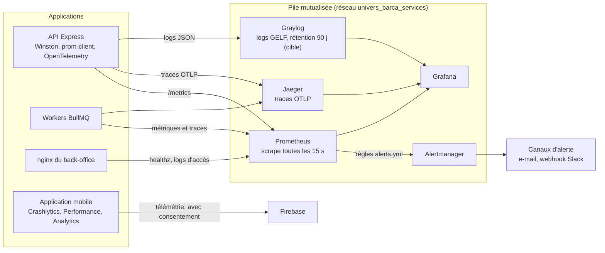
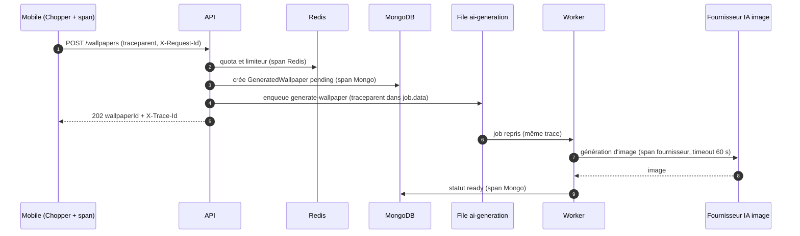
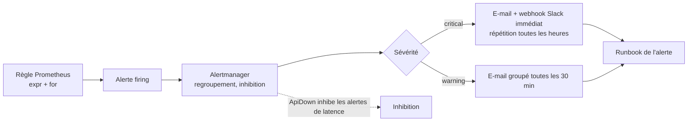
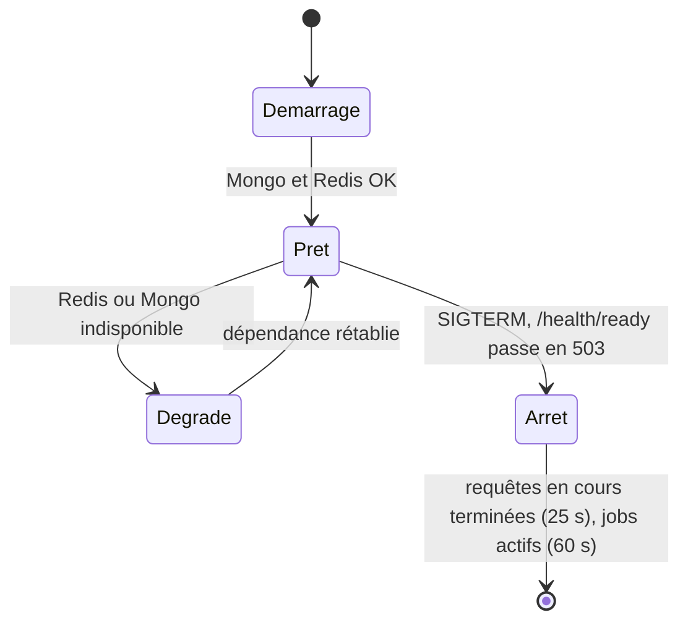
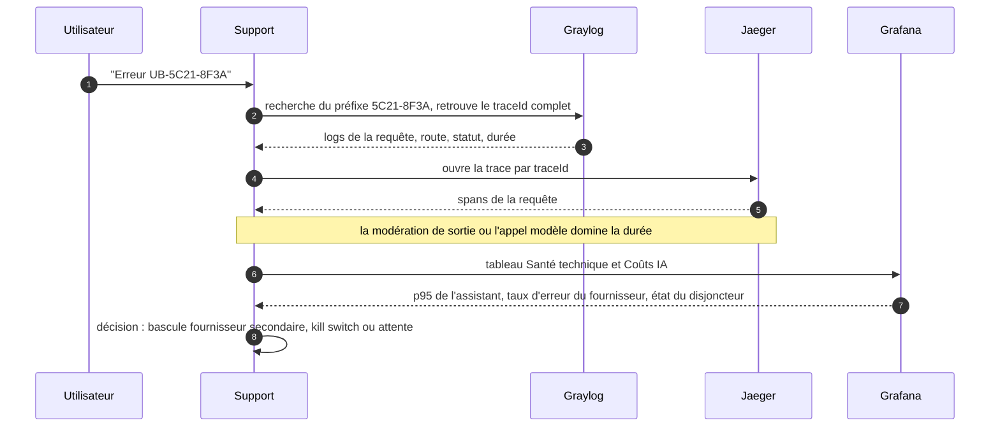
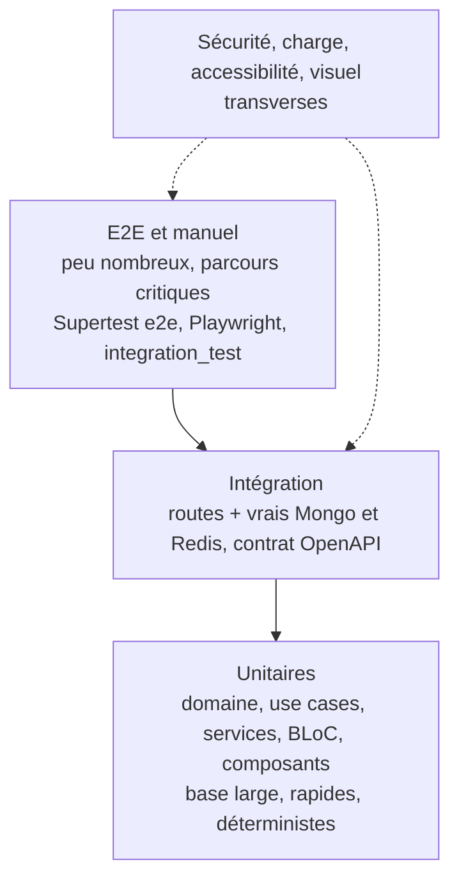
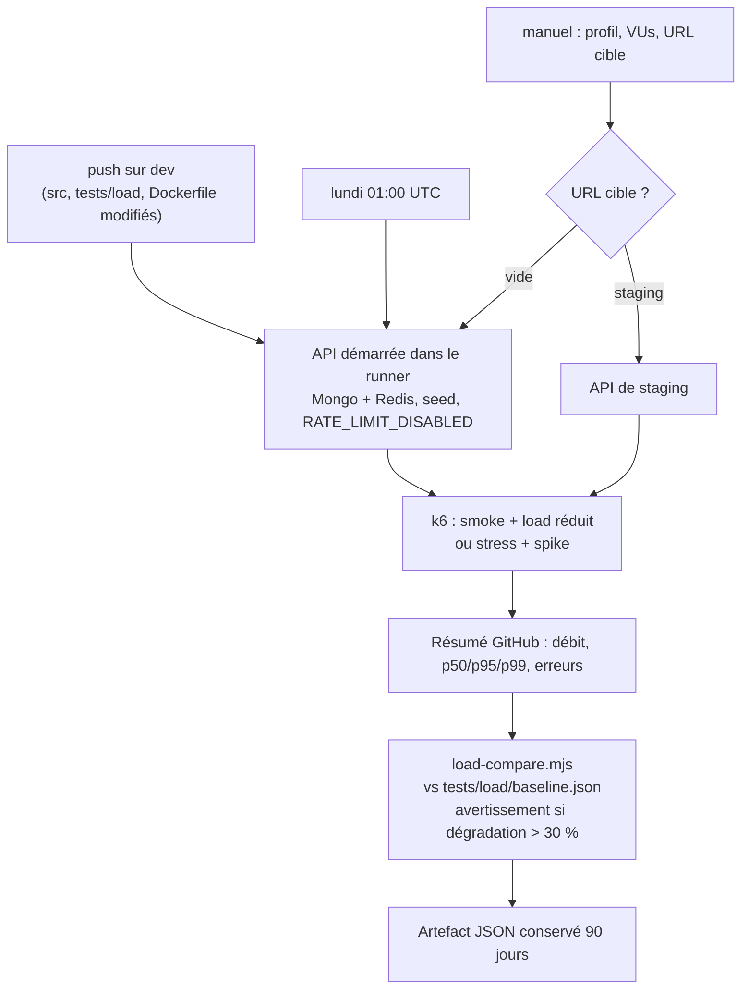
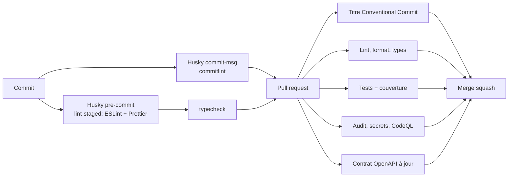

# 05 — Observabilité et qualité

> Ce document explique comment on **voit** le système fonctionner (logs, métriques, traces, alertes, health checks) et comment on s'assure qu'il **fonctionne correctement** (pyramide de tests, couverture, tests de charge k6, qualité de code). Il distingue l'existant (code et compose des dépôts) de la cible spécifiée dans le backlog (`API-PLAT-21` à `API-PLAT-25`, `API-PLAT-36` à `API-PLAT-45`, `MOB-FND-30/34/37/39-42`, `ADM-FND-17-20/24/25`).

## Sommaire

1. [Principes](#1-principes)
2. [Vue d'ensemble de la pile d'observabilité](#2-vue-densemble-de-la-pile-dobservabilité)
3. [Logs](#3-logs)
4. [Métriques](#4-métriques)
5. [Traces distribuées](#5-traces-distribuées)
6. [Alertes](#6-alertes)
7. [Tableaux de bord](#7-tableaux-de-bord)
8. [Health checks et readiness](#8-health-checks-et-readiness)
9. [Observabilité côté mobile et admin](#9-observabilité-côté-mobile-et-admin)
10. [Diagnostiquer un incident : exemple de bout en bout](#10-diagnostiquer-un-incident--exemple-de-bout-en-bout)
11. [Pyramide de tests](#11-pyramide-de-tests)
12. [Tests par dépôt](#12-tests-par-dépôt)
13. [Couverture de code](#13-couverture-de-code)
14. [Tests de charge k6](#14-tests-de-charge-k6)
15. [Qualité de code](#15-qualité-de-code)
16. [Définitions de « prêt » et de « terminé »](#16-définitions-de-prêt-et-de-terminé)
17. [Écarts et points ouverts](#17-écarts-et-points-ouverts)

---

## 1. Principes

| Principe | Signification concrète |
| --- | --- |
| **Observabilité par défaut** | Logs structurés, métriques et traces sont posés dès la conception de chaque module, pas ajoutés après coup (CDC Global §4.3) |
| **Corrélation** | Un identifiant `traceId` suit une requête de l'appareil jusqu'aux fournisseurs externes et aux jobs |
| **Zéro donnée sensible** | Mots de passe, jetons, e-mails, coordonnées GPS et URL signées sont masqués avant écriture |
| **Mesurer avant de dimensionner** | La capacité du serveur vient de campagnes de charge sur staging, pas d'intuitions |
| **Qualité bloquante** | Lint, types, tests, audit et contrat OpenAPI sont des portes de CI : on ne fusionne pas en rouge |
| **Tester le comportement, pas l'implémentation** | Pyramide de tests, vrais Mongo/Redis en intégration |

Objectifs de service chiffrés (CDC Global §3.1 et §8.3) :

| Indicateur | Cible |
| --- | --- |
| Latence API p95 hors IA | < 300 ms |
| Premier token de l'assistant | < 2 s |
| Génération d'un wallpaper | < 15 s |
| Dashboard à froid | < 2 s en 4G, < 1 s en cache |
| Taux d'erreur 5xx | < 0,5 % |
| Disponibilité | 99,5 % |
| Crash-free sessions mobile | > 99,5 % |

---

## 2. Vue d'ensemble de la pile d'observabilité



| Composant | État | Détail |
| --- | --- | --- |
| Winston (JSON) | **Présent** | Console + fichiers `api-%DATE%.log` en production (rotation quotidienne, 14 jours, compression) |
| prom-client (`/metrics`) | **Présent** | Histogramme de latence, jobs en échec, échecs d'authentification, métriques Node (`ub_` + défaut) |
| OpenTelemetry | **Présent, activé si `OTEL_EXPORTER_OTLP_ENDPOINT`** | `NodeSDK` + auto-instrumentations (sans `fs`) |
| Prometheus, Alertmanager, Grafana, Jaeger | **Présents** dans `docker-compose.observability.yml` | Images Prometheus 2.55.1, Alertmanager 0.27.0, Grafana 11.3.0, Jaeger 1.62.0 ; ports locaux Grafana `127.0.0.1:3001`, Jaeger `127.0.0.1:16686` |
| Règles d'alerte | **4 règles** présentes | `ApiDown`, `HighLatencyP95`, `HighErrorRate`, `JobsFailing` ; le reste est cible |
| Graylog (GELF) | **Cible** (`API-PLAT-25`) | Remplace/complète la sortie console |
| Dashboards Grafana provisionnés | **Cible** (`API-PLAT-22`) | Dossier `docker/grafana` |

---

## 3. Logs

### 3.1 Format et champs

Winston produit du **JSON** en production (ou si `LOG_FORMAT=json`) et un format coloré lisible en développement. `defaultMeta` ajoute `service: 'univers-barca-api'`.

```json
{
  "level": "http",
  "message": "http",
  "service": "univers-barca-api",
  "timestamp": "2026-10-15T20:41:07.512Z",
  "method": "GET",
  "url": "/api/v1/users/me",
  "status": 200,
  "traceId": "3f2c9d1e-0b6a-4d77-9c4a-7a1e5b2f8c10"
}
```

Champs cibles (CDC Backend §6.1, `API-PLAT-25`) : `timestamp`, `level`, `service` (`api` ou `worker`), `module`, `traceId`, `userId` **pseudonymisé** (HMAC), `message`, `context`.

### 3.2 Niveaux

| Niveau | Usage | Environnements |
| --- | --- | --- |
| `error` | Exceptions non gérées, 5xx, échec de job définitif, échec de purge | tous |
| `warn` | Erreurs client (4xx métier), file Redis absente, refus SSRF, circuit ouvert | tous |
| `info` | Démarrage/arrêt, purge RGPD, planificateur démarré, événements métier importants | staging, production |
| `http` | Une ligne par requête (hors `/health*` et `/metrics`) | tous (échantillonnage à 10 % des succès si volume élevé, cible) |
| `debug` | Détails de développement | développement uniquement |

`LOG_LEVEL` (`error|warn|info|http|debug`) règle le seuil ; défaut `info` en production, `debug` sinon.

### 3.3 Masquage des données sensibles

Un format Winston `redact` parcourt l'objet de log (profondeur 4) et remplace par `[REDACTED]` toute clé dont le nom **contient** : `password`, `token`, `refreshToken`, `accessToken`, `authorization`, `secret`, `cookie`. Cibles ajoutées (`API-PLAT-25`, `API-COMM-03`, `API-WALL-13`) : `totp`, `email` (masqué), `lat`/`lng`/`latitude`/`longitude`, paramètre `X-Signature` des URL signées. Un test injecte ces clés et vérifie l'absence de fuite.

### 3.4 Corrélation par `traceId`

Le middleware `requestContext` accepte un `X-Request-Id` entrant (8 à 64 caractères `[\w-]`) sinon génère un UUID ; il le pose sur `req.traceId`, le renvoie dans l'en-tête de réponse et l'inscrit dans chaque log de la requête, dans le corps des erreurs (`error.traceId`) et dans les spans. Cible (`API-PLAT-05`) : l'en-tête `X-Trace-Id` est ajouté à **toutes** les réponses ; un 5xx expose aussi un code d'incident `UB-XXXX-XXXX` dérivé du `traceId` (recherchable par préfixe dans Graylog) pour que l'utilisateur puisse le communiquer au support.

### 3.5 Rétention et centralisation

| Source | Rétention | Cible |
| --- | --- | --- |
| Fichiers Winston sur le conteneur | 14 jours, compressés | Conservés |
| Logs Docker (`json-file`) | 10 Mo × 3 (bases), 50 Mo × 5 (API) | Rotation |
| Graylog (GELF UDP/TCP vers `GRAYLOG_HOST:12201`) | **90 jours**, rotation quotidienne, replicas 0 (VPS unique) | `API-PLAT-25` : file tampon de 1 000 messages, repli console si Graylog est indisponible, **sans bloquer l'API** |

L'interface admin (écran WH-03, `GET /admin/observability/logs`) offre une recherche Graylog filtrée **et masquée** réservée au super-admin.

---

## 4. Métriques

### 4.1 Métriques présentes dans le code

| Métrique | Type | Labels | Rôle |
| --- | --- | --- | --- |
| `ub_http_request_duration_seconds` | Histogramme (buckets 0,01 – 5 s) | `method`, `route`, `status` | Latence et volume par route (le label `route` est le **template Express**, ex. `/api/v1/players/:id`, jamais l'URL brute) |
| `ub_jobs_failed_total` | Compteur | `queue` | Échecs de jobs BullMQ |
| `ub_auth_failures_total` | Compteur | `reason` (`missing`, `invalid`) | Échecs d'authentification |
| `ub_*` par défaut | Gauges/compteurs | — | CPU, mémoire, boucle d'événements, GC Node (`collectDefaultMetrics`, préfixe `ub_`) |

### 4.2 Métriques cibles (`API-PLAT-21`, `API-PLAT-34`, `API-PLAT-49`…)

| Famille | Métriques | Labels |
| --- | --- | --- |
| **RED** par route | `ub_http_requests_total` | `method`, `route`, `status_class` |
| Files | `ub_queue_jobs`, `ub_job_duration_seconds`, `ub_dead_letter_total` | `queue`, `state`, `job` |
| Fournisseurs externes | `ub_external_call_duration_seconds`, `ub_circuit_state` (0 fermé, 1 demi, 2 ouvert), `ub_ssrf_blocked_total` | `provider`, `outcome` |
| Cache | `ub_cache_hits_total` (objectif de ratio > 80 % sur les lectures catalogue) | `cache`, `result` |
| Base | `ub_mongo_op_duration_seconds` | `collection`, `op` |
| IA | `ub_ai_request_duration_seconds`, coûts et tokens, `ub_wallpaper_failures_total` | `feature` |
| Sécurité | `refresh_reuse_total`, `rate_limit_hits_total`, `ub_rate_limited_total`, `auth_failures_total{reason='locked'}` | `route`, `scope` |
| Produit | `ub_daily_challenges_played_total`, sessions de quiz, groupes actifs, notifications envoyées/supprimées | — |
| Sauvegarde et rétention | `ub_backup_last_success_timestamp`, `ub_backup_size_bytes`, `ub_backup_duration_seconds`, `ub_retention_deleted_total` | `collection` |

Règles de cardinalité : **jamais** d'identifiant utilisateur ni de user-agent en label ; budget **< 5 000 séries**, vérifié par un test automatisé. `/metrics` est restreint aux IP de `METRICS_ALLOWED_IPS` (défaut `127.0.0.1,::1`) et, en cible, à un jeton `METRICS_TOKEN`.

### 4.3 Collecte

Prometheus (`prometheus.yml`) scrute toutes les **15 s** les jobs `univers-barca-api-production` (`ub-production-api:5000`) et `univers-barca-api-staging` (`ub-staging-api:5000`) sur `/metrics`, via le réseau Docker commun `univers_barca_services`.

---

## 5. Traces distribuées

L'instrumentation OpenTelemetry est initialisée **avant** Express (`src/tracing.ts` importé en premier dans `server.ts`) pour patcher les modules. Elle n'est active que si `OTEL_EXPORTER_OTLP_ENDPOINT` est défini ; sinon l'application tourne sans surcoût. Export OTLP HTTP vers `<endpoint>/v1/traces`, `OTEL_SERVICE_NAME` (défaut `univers-barca-api`).

| Sujet | Règle (cible `API-PLAT-24`) |
| --- | --- |
| Collecteur | Export OTLP vers `otel-collector` puis Jaeger/Tempo ; rétention des traces détaillées **14 jours**, métriques agrégées plus longtemps |
| Échantillonnage | 100 % des erreurs et des requêtes > 1 s ; **10 %** du reste en production ; 100 % en staging (`ParentBased` + `TraceIdRatio`) |
| Propagation | En-tête W3C `traceparent` sur les appels sortants ; dans les jobs BullMQ via `job.data._trace` pour relier requête et worker |
| Spans personnalisés | Étapes du pipeline IA : récupération de contexte, appel modèle, modération de sortie ; spans Mongo/Redis/BullMQ |
| Confidentialité | Aucun attribut personnel (ni e-mail, ni corps de requête, ni coordonnées GPS) |



Le même `traceId` apparaît dans les logs du mobile (`MOB-FND-09`), de l'API, du worker et dans Jaeger : on reconstitue le parcours complet d'une requête.

---

## 6. Alertes

### 6.1 Règles existantes (`docker/prometheus/alerts.yml`)

| Alerte | Expression (résumé) | Durée | Sévérité |
| --- | --- | --- | --- |
| `ApiDown` | `up{job=~"univers-barca-api.*"} == 0` | 2 min | critical |
| `HighLatencyP95` | p95 de `ub_http_request_duration_seconds` sur 5 min > 1 s | 10 min | warning |
| `HighErrorRate` | taux de 5xx > 5 % sur 5 min | 5 min | critical |
| `JobsFailing` | `increase(ub_jobs_failed_total[15m]) > 10` | — | warning |

Alertmanager est présent (`group_by: [alertname]`, récepteur `default`) ; le canal réel (Slack/e-mail) est à brancher par un **fichier monté depuis le VPS**, jamais committé.

### 6.2 Règles cibles (`API-PLAT-23`)

| Alerte | Condition | Sévérité |
| --- | --- | --- |
| `FootballApiDown` | > 50 % d'échecs `provider='football'` sur 10 min | critical |
| `QueueBacklog` | `ub_queue_jobs{state='waiting'}` > 10 pendant 10 min | warning |
| `QueueStalled` | aucun job complété depuis 15 min avec `waiting > 0` | critical |
| `BackupFailed` | `ub_backup_last_success_timestamp` > 26 h | critical |
| `AiBudgetOverrun` | consommation IA au-delà du budget (WH-04) | warning |
| `RedisDown`, `MongoDown` | sonde en échec | critical |
| `DiskUsage` | > 85 % | warning |
| `CertExpiry` | certificat TLS expire dans < 14 jours | warning |
| Hits de rate limit | > 100 hits/min (`API-AUTH-41`) | warning |

Chaque règle porte les labels `severity`, `resource_type`, `resource_id` et les annotations `summary` + `runbook_url` (lien vers `docs/runbooks/<alerte>.md`, un runbook par alerte — `API-PLAT-48`).



Une alerte de test (`vector(1)`) vérifie de bout en bout que le canal fonctionne. Le tableau de bord admin (WH-01) affiche les **alertes actives** via Alertmanager (`API-PLAT-13`).

---

## 7. Tableaux de bord

Quatre tableaux de bord Grafana sont prévus (CDC Backend §6.3, provisionnés par `API-PLAT-22`) :

| Tableau | Contenu |
| --- | --- |
| **Santé technique** | Taux d'erreur par endpoint, latence p50/p95/p99, disponibilité, état des files BullMQ, CPU/RAM des conteneurs |
| **Usage produit** | Défis quotidiens joués, sessions de quiz, messages assistant, wallpapers générés, groupes actifs |
| **Coûts IA** | Volume de requêtes aux fournisseurs d'IA, tokens, coût estimé, consommation vs quotas |
| **Sécurité** | Échecs de connexion, déclenchements de rate limit, réutilisations de refresh token, signalements en attente |

En parallèle, le **back-office** expose une vue « temps quasi réel » pour le super-admin (épopée `ADM-WH`) : santé agrégée et séries p50/p95/p99 (`GET /admin/observability/health`), état des files (`/queues`) avec relance d'un job en échec (`POST …/retry`), recherche de logs, consommation IA, journal d'audit.

---

## 8. Health checks et readiness

| Endpoint | Où | Réponse | Utilisation |
| --- | --- | --- | --- |
| `GET /health` (alias `/api/health`) | API | `{ status:'ok', uptime, version }` — **liveness** légère, toujours 200 si le processus répond | `HEALTHCHECK` Docker (30 s), pipeline de déploiement (rollback), reverse proxy |
| `GET /health/deep` | API | `{ status, checks:{ mongo, redis }, version, uptime }` — **readiness** : 200 si Mongo **et** Redis répondent, **503** `degraded` sinon | Supervision, workflow de charge (attente de disponibilité), restauration |
| `GET /health/ready` (cible `API-PLAT-35`) | API | 503 dès `SIGTERM` | Arrêt gracieux sans perdre de requêtes |
| `GET /metrics` | API | Format Prometheus | Scrape (IP autorisées) |
| `GET /healthz` | Admin (nginx) | `200 ok` texte | Healthcheck du conteneur et du déploiement |
| `GET /config`, `GET /version` | API | Config publique, version | Démarrage du mobile |

Ces routes sont déclarées **avant** le limiteur de débit et le mode maintenance : elles restent joignables pendant une maintenance (`API-PLAT-03` exempte `/health*`, `/config`, `/version`, `/metrics`).



---

## 9. Observabilité côté mobile et admin

### 9.1 Mobile (`MOB-FND-30`, `MOB-FND-34`, `MOB-FND-37`)

| Outil | Rôle | Condition |
| --- | --- | --- |
| Crashlytics | Plantages et erreurs non fatales ; zone d'erreurs globale (Flutter, plateforme, BLoC — `MOB-FND-04`) | Consentement `analytics` |
| Firebase Performance | Démarrage, traces HTTP | Consentement |
| Firebase Analytics | Événements d'usage | Consentement `analytics` (retrait = `analyticsOptOut`) |
| Logger structuré | Journal local avec masquage des données sensibles (`MOB-FND-03`) | Toujours |
| OpenTelemetry (spans HTTP) | Propage `traceparent` et `X-Request-Id` | `MOB-FND-34` |
| Budget de frames | Mesure du jank, démarrage < 2 s sur milieu de gamme | `MOB-FND-37` |

### 9.2 Admin (`ADM-FND-24/25`)

Journaux front structurés, remontée des erreurs non capturées par les frontières d'erreur de route, événements d'usage internes, **Web Vitals** et budgets de bundle (découpage par route, chargement différé).

---

## 10. Diagnostiquer un incident : exemple de bout en bout

Scénario : « le chat de l'assistant est lent ».



---

## 11. Pyramide de tests



| Niveau | Objet | Vitesse | Où il tourne |
| --- | --- | --- | --- |
| **Unitaire** | Logique métier isolée (domaine, services, utilitaires, BLoC, composants) | Millisecondes | PR (job rapide), hook local |
| **Intégration** | Interactions réelles : route → middleware → service → Mongo/Redis ; contrat OpenAPI | Secondes | PR (services Docker Mongo 7 + Redis 7) |
| **E2E** | Parcours complets (API `health-and-content`, Playwright admin par rôle, `integration_test` mobile) | Dizaines de secondes | PR / nuit |
| **Sécurité** | JWT, en-têtes, énumération, injections, IDOR (voir `03-securite-et-rgpd.md`) | Secondes | PR |
| **Charge** | k6 : `smoke`, `load`, `stress`, `spike`, `soak` | Minutes | push `dev`, hebdomadaire, manuel |
| **Accessibilité** | axe, parcours clavier (admin) ; contraste, taille de texte, sémantique (mobile) | Secondes | PR |
| **Visuel** | Golden tests (2 tailles × 2 thèmes × 3 langues) mobile ; Storybook admin | Secondes | PR |
| **Recette (UAT)** | Validation des user stories sur staging par le porteur de projet | Jours | Avant chaque mise en production |

Le backlog consacre à chaque épopée une issue « Tests d'intégration et e2e » et une issue « Tests de sécurité » (ex. `API-AUTH-42/43`, `API-JEUX-35/36`, `API-COMM-31/32`).

---

## 12. Tests par dépôt

### 12.1 API (Jest + Supertest)

| Projet Jest | Dossier | Commande | Particularités |
| --- | --- | --- | --- |
| `unit` | `tests/unit/` (`env`, `password`, `token`, `utils`) | `npm run test:unit` / `test:coverage` | Sans base ; mocks |
| `integration` | `tests/integration/` (`auth.test.ts`) | `npm run test:integration` | `globalSetup` prépare l'environnement de test ; `--runInBand` |
| `e2e` | `tests/e2e/` (`health-and-content.test.ts`) | `npm run test:e2e` | Application complète via Supertest |
| `security` | `tests/security/` (`security.test.ts`) | `npm run test:security` | Voir doc sécurité |
| `all` | — | `npm run test:all` (couverture, nuit) | — |
| charge | `tests/load/` | `npm run load:smoke|load|stress|spike|soak` | k6 |

Timeout de test : 60 s. Les limiteurs de débit sont **désactivés en test** (`NODE_ENV=test`) sauf `RATE_LIMIT_IN_TESTS=true` (utilisé par la régression nocturne pour valider les limiteurs). La CI fournit `MONGODB_URI=mongodb://localhost:27017/univers_barca_ci` et `REDIS_URL=redis://localhost:6379`. Cible (`API-PLAT-38`) : fixtures, factories et jeu de données de test partagés.

### 12.2 Mobile (flutter_test, bloc_test, mocktail)

Approche « tests unitaires first » centrée sur domaine + data + BLoC (`docs/TESTING.md`, `test/TESTING_POLICY.md`) :

| Cible | Quoi tester | Quoi ne pas tester |
| --- | --- | --- |
| Use cases | Un fichier par use case, cas succès + échec | — |
| Repositories | Chaque méthode publique avec datasources moquées ; branches connecté/déconnecté | Datasources (moquées dans les repositories) |
| BLoC | Chaque event avec `blocTest`, états `loading/success/failure` | — |
| Entités | Égalité `Equatable`, `copyWith` | — |
| Widgets | Smoke tests ; **golden tests** (planches ZA-ZE) via `MOB-FND-40` | Code généré (`*.g.dart`, `injection.config.dart`) |

Mocks centralisés dans `test/helpers/mocks.dart`, données dans `test/helpers/test_data.dart`. Convention de nommage : `should <résultat> when <condition>` ; BLoC : `emit [loading, success] when …`. Tests d'intégration/E2E : `integration_test` + Patrol (`MOB-FND-41`). Les tests golden couvrent **2 tailles d'écran × 2 thèmes × 3 langues** pour détecter toute régression visuelle.

### 12.3 Admin (Vitest, Testing Library, Playwright)

Vitest pour unités et composants (`npm test`, `test:coverage`, `@vitest/coverage-v8`), **Playwright** pour l'e2e (`tests/e2e`, fixtures d'authentification **par rôle**, `ADM-FND-18`), **axe** pour l'accessibilité automatisée et la politique d'exceptions (`ADM-FND-19`), Storybook pour la documentation vivante et les tests visuels du design system (`ADM-ADS-36/37`).

---

## 13. Couverture de code

### 13.1 Seuils exigés (CDC Backend §8.2 et Flutter) vs seuils actifs aujourd'hui

| Dépôt / couche | Cible CDC | Seuil appliqué actuellement |
| --- | --- | --- |
| **API** : Domain / entités | 90 % | — (global : lignes 30 %, fonctions 30 %, branches 15 %, statements 30 %) |
| API : Application / services | 85 % | `auth.service`, `token.service`, `password.service` : **lignes ≥ 60 %** chacun |
| API : Infrastructure | 70 % | — |
| API : Contrôleurs / routes | 70 % | — |
| **Mobile** : Domain | 90 % | **Global ≥ 60 %** (script Python sur `lcov.info` en CI) |
| Mobile : Data | 80 % | — |
| Mobile : Presentation (BLoC) | 85 % | — |
| Mobile : Core | 75 % | — |
| **Admin** | par couche (CDC Admin) | Vitest : lignes 25 %, fonctions 30 %, branches 30 %, statements 25 % |

Les seuils actuels sont des **planchers de démarrage** adaptés à un socle encore petit ; `API-PLAT-36` prévoit d'appliquer les **seuils par couche** du CDC en CI (échec du pipeline s'ils ne sont pas atteints) et de les relever à mesure que les modules arrivent. L'API exclut de la mesure `server.ts`, `tracing.ts`, `types/`, `i18n/`, `docs/`, `jobs/` et `models/` (`collectCoverageFrom`).

### 13.2 Ce que la couverture ne dit pas

Un pourcentage élevé n'est pas un objectif en soi : il faut aussi les tests de **contrat OpenAPI** (`API-PLAT-37`), la **régression nocturne** (`nightly-regression.yml`), la non-régression des garde-fous IA (jeu d'or de prompts, `API-IA-31`) et les tests de sécurité spécifiques.

---

## 14. Tests de charge k6

Les tests de charge sont **obligatoires** : ils servent à mesurer la capacité, dimensionner le serveur et suivre les performances version après version (`docs/LOAD_TESTING.md`).

### 14.1 Profils

| Profil | Commande | Objectif | Durée |
| --- | --- | --- | --- |
| `smoke` | `npm run load:smoke` | La plateforme répond (1 utilisateur virtuel) | 30 s |
| `load` | `npm run load:load` | Charge nominale : `LOAD_VUS` (50), palier de 5 min | ≈ 7 min |
| `stress` | `npm run load:stress` | Paliers 50 → 400 : point de rupture et goulot (CPU, Mongo, Redis) | ≈ 8 min |
| `spike` | `npm run load:spike` | Pic brutal (annonce de match, push) puis récupération | ≈ 3 min |
| `soak` | `npm run load:soak` | Charge modérée de 30 min : fuites mémoire, dégradation lente | ≈ 33 min |

### 14.2 Trafic simulé et seuils

Mélange réaliste (`tests/load/lib.js`) : **70 %** lecture du catalogue (`/players`, `/players/:id`, `/matches`), **20 %** profil authentifié (`/users/me`), **8 %** connexion (Argon2id, volontairement coûteux), **2 %** santé. Temps de réflexion `THINK_TIME` 0,5 s (`0` = débit brut maximal). Les comptes de test sont créés dans `setup()` (`…@loadtest.univers-barca.app`, mot de passe de charge, consentements `terms/privacy`) et peuvent être purgés (`db.users.deleteMany({email:/@loadtest\./})`).

| Seuil | Valeur par défaut | Variable |
| --- | --- | --- |
| Taux d'échec HTTP | < 1 % | `ERROR_RATE` (0,01) |
| Latence globale p95 / p99 | < 1 500 ms / < 3 000 ms | `P95_MS`, `P99_MS` |
| Latence de navigation p95 | < 800 ms | `P95_BROWSE_MS` |
| Erreurs métier | < 1 % | — |
| Vérifications (`checks`) | > 99 % | — |

Métriques k6 métier : `ub_login_duration`, `ub_register_duration`, `ub_browse_duration`, `ub_authed_duration`, `ub_business_errors`, `ub_requests_total`. Les seuils CI sont **volontairement larges** (runners GitHub de 2 vCPU partagés, donc bruités) : ils servent de garde-fou et de tendance ; les chiffres de **dimensionnement** doivent venir de **staging** sur un VPS identique à la production.

### 14.3 Automatisation



| Déclencheur | Profils | Cible |
| --- | --- | --- |
| Push `dev` (code ou scripts de charge modifiés) | `smoke` + `load` réduit (30 VU, 1 min) | API du runner |
| Chaque lundi 01:00 UTC | `stress` + `spike` | API du runner |
| Manuel (Actions → *Tests de montée en charge*) | Au choix, `vus` et `target_url` libres | Runner ou **staging** |

**Règles d'or** : ne lancer `stress`/`spike`/`soak` que sur staging ou en local, **jamais en production** ; **chaque nouvelle route** est ajoutée au mélange de trafic (`mixedIteration`) avec sa propre métrique `Trend` — une garde CI échoue sinon (`API-PLAT-39`, règle rappelée dans les `CLAUDE.md`).

### 14.4 Cibles du backlog

`API-PLAT-40` (seuils par endpoint), `API-PLAT-41` (profils « soir de match », « annonce push », « ouverture d'app »), `API-PLAT-42` (seed volumétrique de 100 000 utilisateurs), `API-PLAT-43` (baseline versionnée et **journal des capacités mesurées**), `API-PLAT-44` (dimensionnement) ; scénarios par domaine : `API-CAL-23`, `API-GOAT-21` (duel viral), `API-IA-33` (chat JSON et SSE), `API-JEUX-37` (soir de match), `API-NOTIF-30` (fan-out de 100 000 notifications).

### 14.5 Dimensionner le serveur

1. Lancer `stress` sur staging avec Grafana ouvert (latence `ub_http_request_duration_seconds`, CPU/RAM des conteneurs).
2. Repérer le palier où **p95 > 1 s** ou **erreurs > 1 %** : c'est la **capacité maximale** (req/s, utilisateurs simultanés).
3. Retenir **~60 %** de cette capacité comme charge nominale.
4. Identifier le goulot : CPU API saturé (→ plus d'instances PM2), latence Mongo (→ index, cache Redis), connexions (→ `maxPoolSize`), Argon2id (→ limiter les connexions par seconde).
5. Consigner le résultat dans le journal des capacités et mettre à jour `tests/load/baseline.json`.

Référence indicative locale (FerretDB, 1 cœur, sans Redis) : `load` 30 VU ≈ 70 req/s, p95 ≈ 11 ms, 0 % d'erreur — **non représentative** de la production.

---

## 15. Qualité de code

### 15.1 Portes automatiques



| Dépôt | Lint | Format | Types | Autres |
| --- | --- | --- | --- | --- |
| API | ESLint `--max-warnings 0` | Prettier (`src`, `tests`, `scripts`, md/json/yml) | `tsc --noEmit` (strict) | `check:swagger`, commitlint, licences (`npm run licenses`) |
| Admin | ESLint (+ règles de frontières de couches `ADM-FND-02`) | Prettier | `tsc` strict | axe, budgets de bundle, catalogue de textes figé (lint des chaînes en dur) |
| Mobile | `flutter analyze --fatal-warnings` (règles strictes `MOB-FND-46` : pas de valeur ni de texte en dur) | `dart format --line-length 100` (hors `lib/l10n`) | — | contrôle CI des clés ARB FR/EN/ES |

### 15.2 Conventions structurantes

| Règle | API | Mobile | Admin |
| --- | --- | --- | --- |
| Architecture | routes → middleware → controller → service → model | domain ← data ; presentation (BLoC) | pages → hooks → api ; Query pour le serveur |
| Erreurs | `AppError.*` + `catchAsync` | `Either<Failure, T>` | Zod + états d'erreur de route |
| Validation | Joi sur toute entrée | Validation de formulaire + serveur | RHF + Zod |
| Textes | Messages d'erreur FR/EN/ES (`API-AUTH-44`) | ARB uniquement | Catalogue FR figé |
| Style | tokens | `core/theme` uniquement | tokens Tailwind uniquement |

### 15.3 Revue de code

Pull request obligatoire même en solo (auto-revue outillée + check-list du modèle de PR). Checklist (CONTRIBUTING) : sécurité (autorisations, validation), performance (index, N+1), erreurs gérées, tests, docs/Swagger, absence de secrets, **compatibilité ascendante de l'API** (sinon label `breaking-change` et nouvelle version de préfixe), données personnelles (case dédiée).

### 15.4 Dette, dépendances et licences

Dependabot hebdomadaire (groupes thématiques), auto-merge des mineures/patchs après CI verte, audit des dépendances à chaque PR et chaque nuit, vérification des licences (`license-checker`), rapport des paquets obsolètes côté mobile (`flutter pub outdated`, lundi 09:00 UTC).

---

## 16. Définitions de « prêt » et de « terminé »

**Definition of Ready (avant de coder)** — issue lue en entier, captures ouvertes, épopée parente et dépendances **fermées**, points « à confirmer » tranchés, contrat d'API connu (sinon mock côté client).

**Definition of Done (CDC Global §15.2)** :

1. Toutes les user stories de l'issue sont implémentées et validées.
2. Les **critères d'acceptation** de l'issue sont vérifiés un à un ; les **tests à écrire** sont écrits.
3. Seuils de couverture atteints ; aucune anomalie bloquante ou majeure ouverte.
4. Swagger et k6 mis à jour pour toute nouvelle route ; README/changelog à jour.
5. UI vérifiée en **clair et sombre**, mobile et tablette, zones tactiles ≥ 48 dp.
6. PR vers `dev` avec `Closes #N`, captures UI, écarts à l'issue mentionnés.
7. Après fusion : pipeline `dev` (staging) **vert**, tableaux de bord sans anomalie sur la période d'observation (48 h avant promotion en production).

---

## 17. Écarts et points ouverts

| # | Sujet | Constat | Suite |
| --- | --- | --- | --- |
| 1 | Journaux | CDC : Graylog/GELF ; code : console + fichiers 14 j | `API-PLAT-25` |
| 2 | Corrélation | CDC : `X-Trace-Id` ; code : `X-Request-Id` seul | `API-PLAT-05` ajoute `X-Trace-Id` et `incidentId` |
| 3 | Alertes | 4 règles sur ~10 ciblées ; canal Alertmanager non branché | `API-PLAT-23` |
| 4 | Dashboards | Aucun provisionné (dossier `docker/grafana` vide) | `API-PLAT-22` |
| 5 | Seuils de couverture | Planchers bas (30 % API, 60 % mobile, 25 % admin) vs 70-90 % du CDC | `API-PLAT-36` |
| 6 | Santé | CDC : `/health/detailed` ; code : `/health/deep` | Code retenu |
| 7 | Traces | Collecteur OTLP + rétention 14 jours à déployer (Jaeger seul pour l'instant) | `API-PLAT-24` |
| 8 | Charge | Journal de capacité vide (« à remplir au premier run sur staging ») | `API-PLAT-43/44` |
| 9 | Garde CI « route sans scénario k6 » | Règle écrite, garde automatique non encore en place | `API-PLAT-39` |
| 10 | Tests mobile | La politique actuelle exclut les widgets ; le backlog ajoute goldens et intégration | `MOB-FND-40/41` |
| 11 | Canal d'alerte | E-mail, webhook ou messagerie personnelle : « à définir » | À trancher à l'étape 0.1 du plan |
