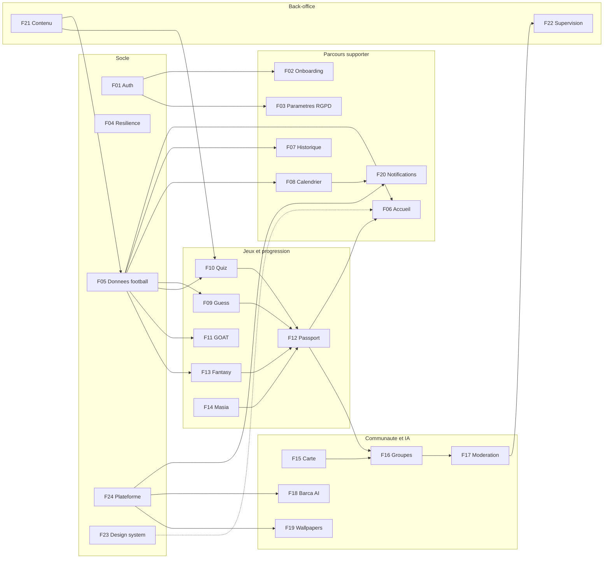

# Documentation d'architecture — Univers Barça

Cette documentation explique **ce que fait le projet, comment il est construit et comment ses morceaux se connectent**. Elle est identique dans les trois dépôts (`univers_barca_api`, `univers_barca_admin`, `univers_barca_mobile`) sous `docs/architecture/`.

> Stack réelle : API Express 4 + TypeScript + Mongoose/MongoDB (replica set) + Redis + BullMQ + node-cron + PM2 ; mobile Flutter (BLoC, GetIt/Injectable, Chopper, Drift, go_router, fpdart) ; back-office React 18 + Vite. Les cahiers des charges citent encore NestJS/Prisma/PostgreSQL : chaque document signale l'écart quand il compte.

## Par où commencer ?

| Vous êtes… | Lisez dans cet ordre |
|---|---|
| Nouveau sur le projet | [01 Vue d'ensemble](01-vue-ensemble.md) → [06 Glossaire](06-glossaire-et-conventions.md) → la fonctionnalité qui vous concerne |
| Développeur API | 01 → [02 Données](02-architecture-donnees.md) → [03 Sécurité](03-securite-et-rgpd.md) → F05, F24, puis votre fonctionnalité |
| Développeur mobile | 01 → 06 → F01, F04, F23 → votre fonctionnalité |
| Développeur back-office | 01 → F22, F21, F23 → votre écran |
| DevOps | [04 Déploiement et CI/CD](04-deploiement-et-cicd.md) → [05 Observabilité et qualité](05-observabilite-et-qualite.md) |
| Juriste / DPO | 03 → F03 → F17 |

## Documents transverses

| Document | Contenu |
|---|---|
| [01 Vue d'ensemble](01-vue-ensemble.md) | Produit, acteurs, architecture globale, découpage en couches des trois applications |
| [02 Architecture des données](02-architecture-donnees.md) | Collections MongoDB, index, TTL, clés Redis, files BullMQ, cycle de vie des données |
| [03 Sécurité et RGPD](03-securite-et-rgpd.md) | Authentification, autorisations, protection des données, droits RGPD |
| [04 Déploiement et CI/CD](04-deploiement-et-cicd.md) | Branches, pipelines, images Docker, versions `AAAAMMJJ.N`, déploiement et rollback |
| [05 Observabilité et qualité](05-observabilite-et-qualite.md) | Logs, métriques, traces, stratégie de tests, charge k6 |
| [06 Glossaire et conventions](06-glossaire-et-conventions.md) | Vocabulaire, conventions de code, nommage, codes d'erreur |

## Fonctionnalités

Chaque document suit le même plan en 15 sections : résumé, acteurs, architecture, écrans, flux, contrats d'API, données, asynchrone et cache, règles de gestion, sécurité, erreurs, connexions, observabilité et tests, points ouverts, pour aller plus loin.

| Code | Fonctionnalité | Socle / Phase |
|---|---|---|
| [F01](features/F01-authentification-et-comptes.md) | Authentification et comptes | Socle |
| [F02](features/F02-onboarding-et-personnalisation.md) | Onboarding et personnalisation | Socle |
| [F03](features/F03-parametres-confidentialite-rgpd.md) | Paramètres, confidentialité, RGPD | Socle |
| [F04](features/F04-etats-systeme-et-resilience.md) | États système et résilience | Socle |
| [F05](features/F05-donnees-football-et-synchronisation.md) | Données football et synchronisation | Socle |
| [F06](features/F06-accueil-dashboard.md) | Accueil / dashboard | MVP |
| [F07](features/F07-historique-et-fiches.md) | Historique et fiches | MVP |
| [F08](features/F08-calendrier-et-export-agenda.md) | Calendrier et export agenda | MVP |
| [F09](features/F09-guess-the-player.md) | Guess the Player | MVP |
| [F10](features/F10-quiz-adaptatif.md) | Quiz adaptatif | MVP |
| [F11](features/F11-comparateur-goat.md) | Comparateur GOAT | MVP |
| [F12](features/F12-passport-et-gamification.md) | Passport et gamification | MVP |
| [F13](features/F13-fantasy-barca.md) | Fantasy Barça | Communautaire |
| [F14](features/F14-la-masia-academy.md) | La Masia Academy | Communautaire |
| [F15](features/F15-carte-communautaire.md) | Carte communautaire | Communautaire |
| [F16](features/F16-groupes-locaux.md) | Groupes locaux | Communautaire |
| [F17](features/F17-moderation-et-securite-communautaire.md) | Modération et sécurité communautaire | Communautaire |
| [F18](features/F18-assistant-ia-barca-ai.md) | Assistant IA Barça AI | Avancé |
| [F19](features/F19-wallpapers-ia.md) | Wallpapers IA | Avancé |
| [F20](features/F20-notifications.md) | Notifications | Transverse |
| [F21](features/F21-backoffice-contenu.md) | Back-office : contenu | Admin |
| [F22](features/F22-backoffice-supervision-et-comptes.md) | Back-office : supervision et comptes | Admin |
| [F23](features/F23-design-system-et-experience.md) | Design system et expérience | Transverse |
| [F24](features/F24-plateforme-jobs-cache-flags.md) | Plateforme : jobs, cache, feature flags | Socle |

## Comment les fonctionnalités se connectent

Lecture : une flèche signifie « fournit des données ou un service à ». Le détail de chaque lien est dans la section 12 de chaque document de fonctionnalité.

## Conventions de lecture

* Les codes `MOB-X-NN`, `ADM-X-NN`, `API-X-NN` renvoient au backlog (issues GitHub de chaque dépôt) ; `(proposé)` signale une information absente des cahiers des charges.
* Chaque document termine par des **points ouverts** : décisions à confirmer et incohérences détectées entre cahiers des charges, backlog et code.
* Les diagrammes sont en Mermaid, rendus nativement par GitHub.
