# F01 — Authentification et comptes

> Document de fonctionnalité de l'architecture Univers Barça. Il explique **comment un utilisateur (mobile) ou un administrateur (back-office) prouve son identité**, comment sa session est maintenue et révoquée, et comment son compte peut être suspendu ou banni. Il part du besoin utilisateur, descend jusqu'aux collections MongoDB et aux clés Redis, et signale chaque écart entre le code existant, les issues du backlog et les cahiers des charges (CDC).
>
> Convention de lecture : **(existant)** = présent dans le dépôt aujourd'hui ; **(backlog)** = décrit dans les issues mais pas encore codé ; **(proposé)** = non spécifié dans les CDC/issues, suggestion de ce document.

---

## 1. Résumé et fiche

### 1.1 Valeur utilisateur

Un supporter crée son compte en moins d'une minute (e-mail + mot de passe, ou Google / Apple), confirme son adresse avec un code à 6 chiffres, puis reste connecté sur son téléphone pendant des semaines sans jamais retaper son mot de passe. S'il perd son téléphone, il peut retirer l'appareil à distance ; s'il oublie son mot de passe, un lien sécurisé lui permet d'en choisir un nouveau. Côté équipe, les administrateurs entrent dans le back-office uniquement sur invitation, avec un second facteur (TOTP) et des droits strictement limités à leur rôle.

Pourquoi c'est structurant : **toutes** les autres fonctionnalités (jeux, Fantasy, groupes, carte, assistant IA, modération) supposent une identité fiable et une session révocable. Un défaut ici est un défaut de sécurité pour toute la plateforme.

### 1.2 Fiche

| Champ | Valeur |
|---|---|
| Phase | Phase 0 (`API-AUTH-01`, `API-AUTH-02` : e-mails) puis Phase 1 — MVP (tout le reste) |
| Priorité | P0 pour l'inscription, la connexion, le refresh, les états de compte, la connexion admin et le 2FA ; P1 pour les sessions/appareils, l'OAuth de rattachement, la gestion des comptes admin ; P2 pour « Rester connecté » différencié (`API-AUTH-14`) |
| Épopées backlog | `API-AUTH` (45 issues), `MOB-B` (tunnel auth, issues `MOB-B-05` à `MOB-B-29`), `MOB-A` (états bloquants de compte et session : `MOB-A-11` à `MOB-A-15`), `ADM-WA` (19 issues), `ADM-WI` (`ADM-WI-03` à `ADM-WI-09`, comptes admin) |
| Écrans mobile | `B-05` à `B-10`, `B-16` à `B-20` (inscription, vérification, connexion, mot de passe oublié), `A-08` (session expirée), `A-09` (compte suspendu), `A-10` (compte banni), `Q-10` (appareils connectés, détaillé en F03) |
| Écrans admin | `WA-01` à `WA-09` (connexion, blocage, TOTP, activation, 2FA, session expirée, 403, 404/500), `WI-01` à `WI-04` (comptes admin, invitation, sessions, désactivation) |
| Dépôts concernés | `univers_barca_api` (Express/Mongoose/Redis/BullMQ), `univers_barca_mobile` (Flutter), `univers_barca_admin` (React/Vite) |
| Référence CDC | CDC Backend §3.1, §5.1, §5.2, §10.2, §11.6 ; CDC Global §2.13, §3.2, §10.2, §10.3 ; CDC Admin §3, §6 ; CDC Flutter §7.1 |

### 1.3 État d'avancement du code (à la date du document)

| Brique | État |
|---|---|
| API : `register`, `login`, `refresh` (rotation + réutilisation), `logout`, `logout-all`, `verify-email` (jeton lien), `forgot-password`, `reset-password`, `consents`, `users/me` | **(existant)** dans `src/services/auth.service.ts`, `token.service.ts`, `routes/index.ts` |
| API admin : `admin/auth/login` (avec `totp` optionnel), `refresh`, `logout`, `2fa/setup`, `2fa/confirm`, verrouillage 5 échecs / 15 min | **(existant)** dans `admin-auth.service.ts` |
| API : e-mails réels (transport + worker), code à 6 chiffres, OAuth Google/Apple, sessions/appareils, états de compte détaillés, RBAC par permissions, invitation admin, codes de secours, audit des connexions | **(backlog)** |
| Mobile : `AppAuthenticator` (refresh) et `AuthInterceptor` | **(existant, squelette)** : le refresh est un `TODO`, les jetons sont lus dans `flutter_secure_storage` ; `lib/routes` ne contient que des pages provisoires |
| Admin : `LoginPage`, `ProtectedRoute`, `authStore` (Zustand), intercepteur axios avec refresh mutualisé, `ForbiddenPage`, `NotFoundPage` | **(existant, base)** ; 2FA, activation, session expirée à compléter |

---

## 2. Acteurs et user stories

| Acteur | Description |
|---|---|
| Visiteur | Personne n'ayant pas encore de compte ou non connectée sur l'appareil |
| Utilisateur | Compte `users` au statut `active` |
| Utilisateur restreint | Compte `suspended` (temporaire) ou `banned` (définitif) |
| Administrateur | Compte `adminusers` de rôle `content-manager`, `moderator` ou `super-admin` |
| Super-admin | Seul rôle autorisé à créer/inviter/désactiver des comptes admin |
| Système | Jobs BullMQ (e-mails), crons (levée des suspensions, purge des jetons) |

| # | User story | Critères d'acceptation clés |
|---|---|---|
| US1 | En tant que visiteur, je crée un compte avec pseudo, e-mail et mot de passe afin de rejoindre la communauté. | Pseudo 3–20 caractères unique (insensible casse/accents) ; mot de passe 8–128 avec majuscule, minuscule, chiffre ; consentements `terms` + `privacy` obligatoires ; `409 EMAIL_TAKEN` affiché sous le champ e-mail (`API-AUTH-05`, `MOB-B-10`) |
| US2 | En tant que nouvel utilisateur, je vérifie mon e-mail avec un code à 6 chiffres afin de sécuriser mon compte. | Code valable 15 min, 5 essais, renvoi après 60 s, 5 renvois/heure ; succès → `B-10` (`API-AUTH-04`, `MOB-B-14`) |
| US3 | En tant qu'utilisateur, je me connecte et reste connecté plusieurs semaines. | Access token 15 min, refresh 30 jours glissants ; « Rester connecté » coché par défaut ; erreur unique « Identifiants incorrects » (`API-AUTH-07`, `API-AUTH-14`, `MOB-B-21/22`) |
| US4 | En tant qu'utilisateur, je me connecte avec Google ou Apple. | Jeton vérifié côté serveur (JWKS) ; compte créé au premier passage ; charte `B-08` imposée si consentements absents ; Apple obligatoire sur iOS (`API-AUTH-10/11`, `MOB-B-23`) |
| US5 | En tant qu'utilisateur, je récupère mon compte si j'oublie mon mot de passe. | Réponse identique que le compte existe ou non ; lien valable 1 h à usage unique ; toutes les sessions révoquées ; e-mail d'alerte (`API-AUTH-17/18`, `MOB-B-24/25/26`) |
| US6 | En tant qu'utilisateur, je vois et retire mes appareils connectés. | Liste triée, appareil courant marqué, retrait immédiat (access token compris) (`API-AUTH-15/16`, `Q-10`) |
| US7 | En tant qu'utilisateur dont la session est révoquée ou expirée, je suis guidé vers `A-08`. | Un seul refresh tenté ; 401 définitif → `A-08` avec e-mail pré-rempli (`API-AUTH-09`, `MOB-A-11/12`) |
| US8 | En tant qu'utilisateur sanctionné, je comprends pourquoi et jusqu'à quand je suis bloqué. | `A-09` : date de fin, motif, charte, contestation ; `A-10` : accès retiré, contact support (`API-AUTH-08`, `MOB-A-13/14/15`) |
| US9 | En tant qu'administrateur invité, j'active mon compte via un lien à usage unique et configure mon 2FA. | Lien valable 48 h ; mot de passe ≥ 12 caractères avec symbole ; QR + 8 codes de secours affichés une seule fois (`API-AUTH-35/36`, `ADM-WA-09/10`) |
| US10 | En tant qu'administrateur, je me connecte avec e-mail, mot de passe et code TOTP. | 5 échecs → blocage 15 min avec compte à rebours ; 8 h d'inactivité → `WA-07` (`API-AUTH-33/34/38`, `ADM-WA-03` à `ADM-WA-12`) |
| US11 | En tant que super-admin, je gère les comptes admin (invitation, rôle, sessions, désactivation). | Garde-fous : dernier super-admin protégé, pas d'auto-désactivation, justification ≥ 10 caractères (`API-AUTH-37`, `ADM-WI-03` à `ADM-WI-09`) |
| US12 | En tant qu'administrateur, j'accède uniquement aux modules autorisés par mon rôle. | 403 `FORBIDDEN_ROLE` + page `WA-08` ; refus journalisé (`API-AUTH-32`, `ADM-WA-13/14`) |

---

## 3. Architecture de la fonctionnalité

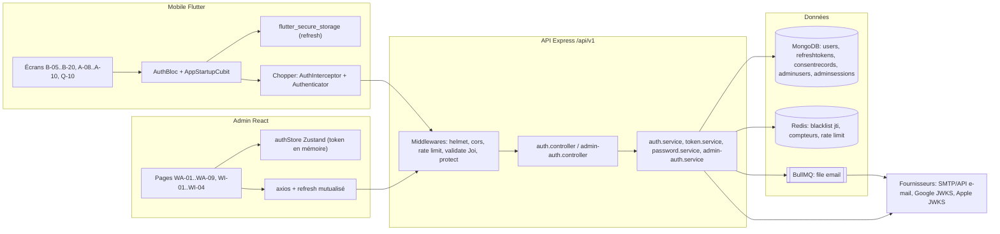

**Légende.** Les rectangles sont des composants applicatifs, les cylindres des stockages, le double rectangle une file BullMQ. Points à retenir :

* **Deux mondes d'identité séparés** : `users` (mobile, JWT de `kind:'user'`) et `adminusers` (back-office, JWT de `kind:'admin'`). Un jeton utilisateur est refusé sur une route admin et inversement (`restrictTo` vérifie `req.auth.kind === 'admin'`, `userOnly` vérifie `'user'`).
* **Pourquoi un access token court + refresh long ?** L'access token (JWT HS256, 15 min, `iss: univers-barca`, `jti` unique) est vérifié sans requête base à chaque appel ; s'il fuit, il expire vite. Le refresh token (30 jours) est opaque, stocké **haché** (SHA-256) en base, et **tourné à chaque usage** : c'est ce mécanisme qui permet de détecter un vol.
* **Redis** sert à trois choses : liste noire des `jti` d'access tokens révoqués (clé `jwt:bl:<jti>` **(existant)**), compteurs anti-bruteforce et verrous **(backlog)**, stockage des limiteurs de débit (préfixe `rl:<nom>:` **(existant)**). Le préfixe global `ub:` demandé par le brief de documentation n'est pas encore appliqué dans le code : les clés existantes n'ont pas ce préfixe ; les clés du backlog sont citées telles que dans les issues.
* **Le mot de passe n'est jamais stocké** : Argon2id (19 456 KiB de mémoire, 2 itérations, parallélisme 1, paramètres OWASP) dans `passwordHash` (`select:false`).
* **E-mails** : l'API ne parle jamais directement au fournisseur dans la requête HTTP ; elle met un job dans la file `email` (`API-AUTH-02`) pour que la réponse reste rapide et que la panne du fournisseur ne casse pas l'inscription.

---

## 4. Écrans et navigation

### 4.1 Tableau des écrans

| Code | Nom | Rôle dans la fonctionnalité |
|---|---|---|
| `B-05` | Bienvenue — créer ou se connecter | Point d'entrée non authentifié ; boutons « Créer un compte », « J'ai déjà un compte », Apple, Google |
| `B-06` | Inscription | Étape 1/4 : pseudo, e-mail, mot de passe avec jauge de force |
| `B-07` | Inscription — erreurs de validation | États d'erreur par champ (bordure rouge, message) |
| `B-08` | Charte de la communauté | Étape 2/4 : acceptation charte + CGU + confidentialité ; **déclenche `POST /auth/register`** |
| `B-09` | Vérification de l'e-mail | Étape 3/4 : code à 6 chiffres, renvoi après 60 s, « Modifier l'adresse e-mail » |
| `B-10` | E-mail vérifié | Succès ; mène à la personnalisation (F02) ou « Plus tard » |
| `B-16` | Connexion | E-mail, mot de passe, « Rester connecté », sociaux |
| `B-17` | Connexion — erreur et chargement | Carte « Identifiants incorrects… N essais », spinner, verrouillage |
| `B-18` | Mot de passe oublié | Envoi du lien (réponse neutre) |
| `B-19` | Nouveau mot de passe | Saisie + confirmation, checklist de robustesse |
| `B-20` | Mot de passe modifié | Confirmation, retour à `B-16` |
| `A-08` | Session expirée | « Me reconnecter » / « Changer de compte » |
| `A-09` | Compte suspendu | Date de fin, motif, charte, contestation |
| `A-10` | Compte banni (« Accès retiré ») | Contact support, déconnexion |
| `Q-10` | Appareils connectés | Liste des sessions, « Retirer », « Se déconnecter de tous les appareils » (détail en F03) |
| `WA-01` | Connexion administrateur | E-mail pro, mot de passe, « Rester connecté 8 h » |
| `WA-02` | Connexion — erreur | Bandeau « Identifiants incorrects », tentatives restantes |
| `WA-03` | Compte temporairement bloqué | Compte à rebours MM:SS (15 min) |
| `WA-04` | Double authentification (TOTP) | 6 cases, « Code de secours », « Expire dans 00:SS » |
| `WA-05` | Première connexion — définir le mot de passe | Activation par invitation, jauge 4 critères |
| `WA-06` | Configuration du 2FA — QR code | QR, clé copiable, 8 codes de secours |
| `WA-07` | Session expirée — inactivité | Reconnexion rapide après 8 h d'inactivité |
| `WA-08` | Accès non autorisé (403) | Rôle insuffisant, « Demander l'accès » |
| `WA-09` | Page introuvable (404) et erreur | 404 contextuelle, 500 avec identifiant de corrélation |
| `WI-01` | Comptes administrateurs | Liste, rôles, statuts, 2FA, dernière activité |
| `WI-02` | Inviter un administrateur | Modale nom/e-mail/rôle |
| `WI-03` | Sessions actives d'un administrateur | Panneau latéral 480 px, révocation |
| `WI-04` | Désactiver un compte administrateur | Confirmation, suppression renforcée |

### 4.2 Captures

<p>


</p>

*De gauche à droite : `B-09` (6 cases OTP, compte à rebours de renvoi « 00:42 », lien « Modifier l'adresse e-mail »), `B-16` (connexion), `A-08` (session expirée), `Q-10` (« iPhone 15 · Yaoundé — Actuel », « Retirer » sur les autres appareils).*

<p>


</p>

*Back-office : écran scindé (hero grenat « GÉRER L'UNIVERS DES CULÉS. » à gauche, panneau formulaire à droite). `WA-04` : 6 cases, bouton « Vérifier », « Code de secours » et « Expire dans 00:21 » (fenêtre TOTP de 30 s).*

### 4.3 Navigation mobile (décision de routage au démarrage et tunnel)

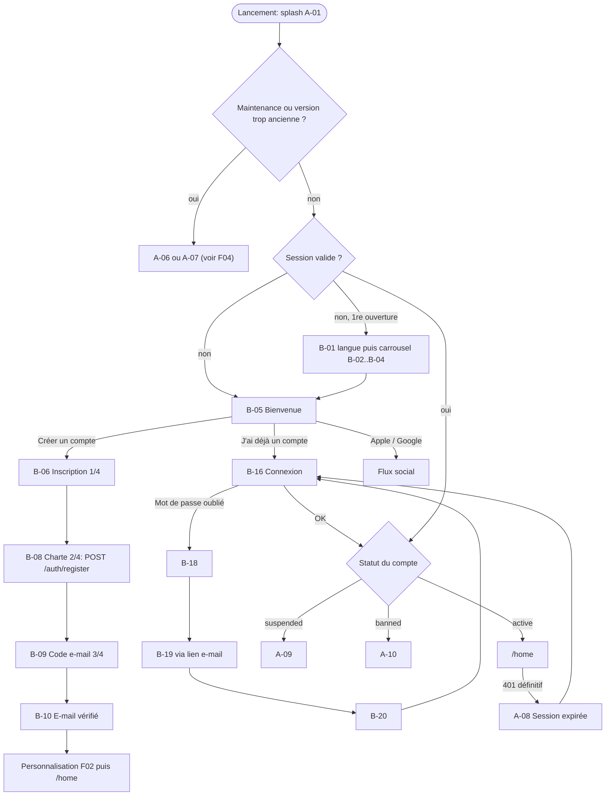

> Ordre exact de décision au démarrage (`MOB-A-01`) : 1) maintenance, 2) version < minimum, 3) langue non choisie → `B-01`, 4) pas de session et onboarding non vu → carrousel, 5) pas de session → `B-05`, 6) `suspended` → `A-09`, 7) `banned` → `A-10`, 8) première connexion sur cet appareil → `A-02` (synchro, voir F04), 9) `/home`.

### 4.4 Navigation back-office

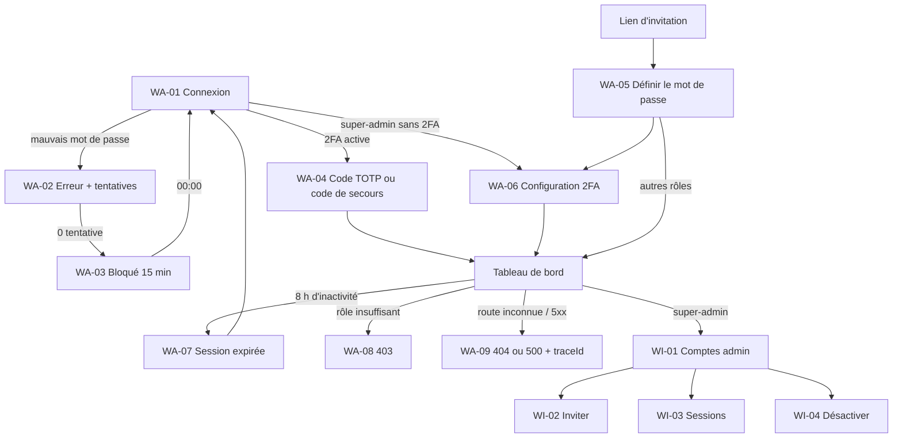

---

## 5. Flux détaillés

### 5.1 Inscription, envoi du code et vérification de l'e-mail (nominal)

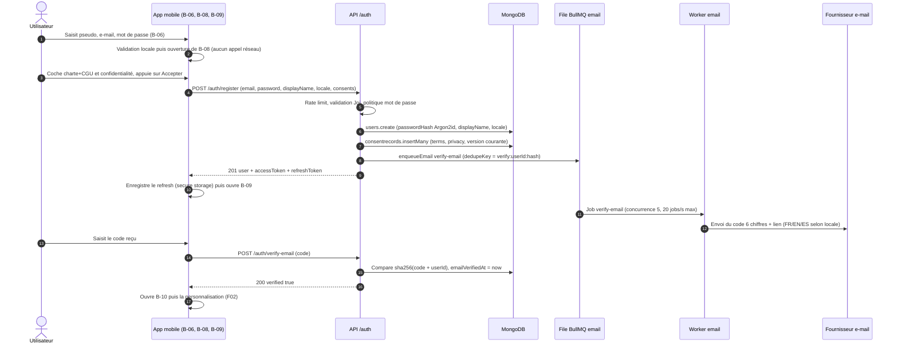

**Pas à pas.**

1. **B-06 → B-08 sans appel réseau** : l'appel `register` n'est fait qu'à la validation de la charte pour y joindre les consentements en une seule transaction (`MOB-B-09`, `MOB-B-12`).
2. **(3)–(5)** Le serveur crée l'utilisateur puis une ligne `consentrecords` par consentement fourni (`terms`, `privacy` obligatoires, `notifications`/`geolocation`/`analytics` à `false` par défaut, jamais pré-cochés).
3. **(6)** L'e-mail passe par la file `email` ; `jobId = dedupeKey` évite un double envoi si la requête est rejouée (`API-AUTH-02`).
4. **(7)** L'utilisateur est **déjà authentifié** dès l'inscription : les jetons sont renvoyés tout de suite (le guard autorise `/home` à `AuthStatus.authenticated`), l'e-mail non vérifié ne bloque pas l'app (`MOB-B-15`).
5. **(12)** Le code est généré par `crypto.randomInt(0, 1_000_000)` zéro-complété, stocké haché dans `emailVerificationCodeHash`, valable 15 min ; le lien (jeton 32 octets base64url) reste valable 24 h (`API-AUTH-04`).

> Écart code/backlog : le code actuel **(existant)** n'envoie qu'un jeton « lien » (`emailVerificationTokenHash`, 24 h) et expose `_devVerificationToken` hors production ; le code à 6 chiffres, `resend-verification` et le worker d'e-mails sont **(backlog)** (`API-AUTH-01` à `API-AUTH-04`).

### 5.2 Connexion, verrouillage progressif et états de compte (erreurs et cas limites)

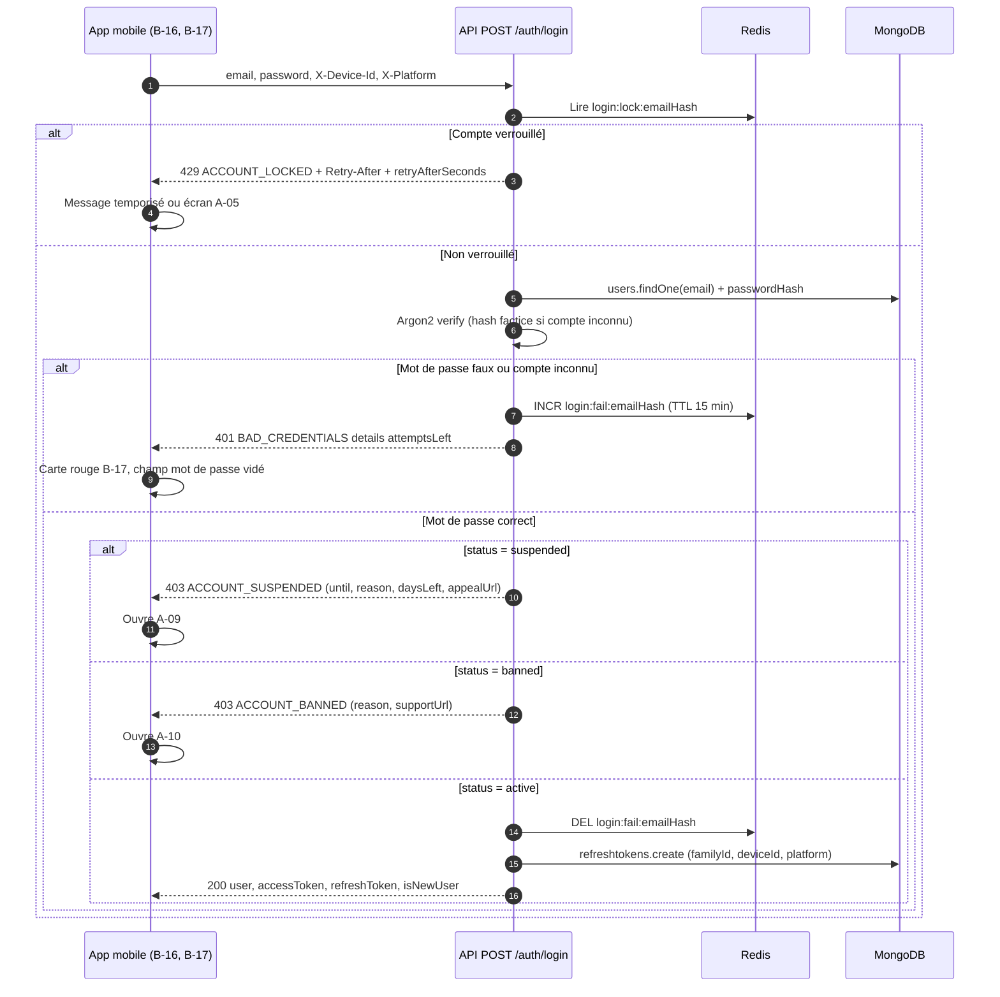

**Cas limites expliqués.**

* **Anti-énumération** : pour un e-mail inexistant, le serveur renvoie la **même** forme de réponse (compteur « fantôme » par e-mail+IP, hachage factice pour égaliser le temps de calcul). Un attaquant ne peut donc pas savoir si un compte existe (`API-AUTH-07`, test de timing ±15 % dans `API-AUTH-42`).
* **Verrouillage progressif** : seuil 5 échecs ; 1er verrou 15 min, 2e dans les 24 h → 1 h, 3e → 24 h. Même un bon mot de passe est refusé pendant le verrou.
* **Compte supprimé** : indiscernable d'un compte inexistant (`401 BAD_CREDENTIALS`) ; le statut `deleted` n'est jamais divulgué.
* **Suspension échue** : si `suspendedUntil <= now`, le login (ou le refresh) remet `status='active'` et purge le bloc `suspension` (`API-AUTH-08`).
* **Conflit de codes d'erreur (à trancher)** : le code actuel renvoie `ACCOUNT_DISABLED` pour banni **et** supprimé, et `MOB-A-05`/`MOB-B-06` s'appuient sur ce code ; le backlog API (`API-AUTH-08`) introduit `ACCOUNT_BANNED` et traite `deleted` en `BAD_CREDENTIALS`. Voir §14.

### 5.3 Refresh à rotation et détection de réutilisation

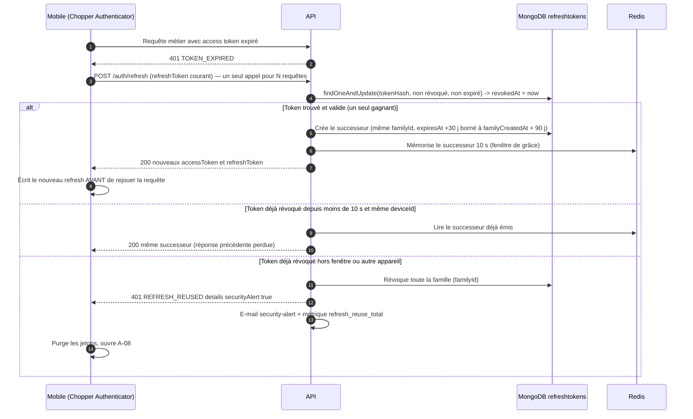

**Pourquoi la rotation ?** Si un attaquant vole un refresh token et l'utilise, le vrai client présentera ensuite l'ancien jeton (déjà consommé) : le serveur comprend qu'il y a **deux porteurs** et coupe toute la « famille » (tous les jetons issus du même login). C'est la détection de réutilisation du CDC Backend §5.1.

* **Atomicité** : la rotation utilise `findOneAndUpdate` avec condition ; si deux requêtes concurrentes présentent le même jeton, une seule gagne (`API-AUTH-13`). Le code actuel **(existant)** fait `findOne` puis `save`, ce qui laisse une fenêtre de course : correction prévue.
* **Fenêtre de grâce 10 s** (`REFRESH_GRACE_SECONDS`) : couvre le cas « réponse perdue en réseau mobile ».
* **Durées** : TTL glissant 30 jours, plafond de famille 90 jours ; `rememberMe=false` → 24 h non glissant ; web → 24 h max (`API-AUTH-14`).
* **Côté mobile** (`MOB-A-11`) : un 401 n'ouvre `A-08` **qu'après échec du refresh** ; les écritures sensibles ne sont pas rejouées automatiquement après reconnexion.

### 5.4 Connexion sociale Google / Apple

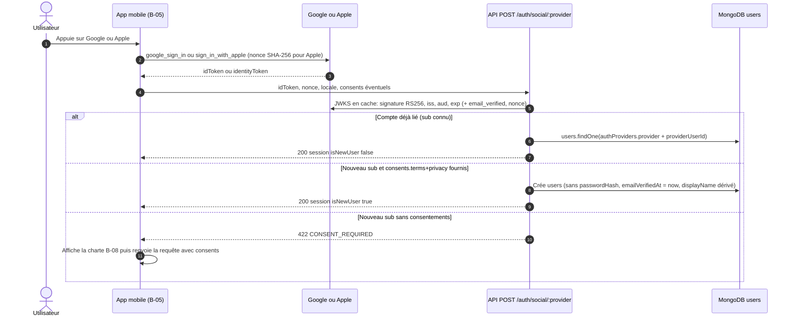

Règles clés : le `sub` du fournisseur est l'identité (pas l'e-mail) ; pas de fusion automatique avec un compte mot de passe tant que son e-mail n'est pas vérifié ; e-mail relais Apple accepté (`emailIsRelay=true`) ; Apple impose aussi un endpoint serveur-à-serveur `POST /auth/apple/notifications` pour `consent-revoked` / `account-delete` (`API-AUTH-10`, `API-AUTH-11`, `API-AUTH-12`). Toute cette brique est **(backlog)** : `POST /auth/social/:provider` « prévu au CDC, non encore implémenté » (`MOB-B-23`).

### 5.5 Mot de passe oublié et réinitialisation

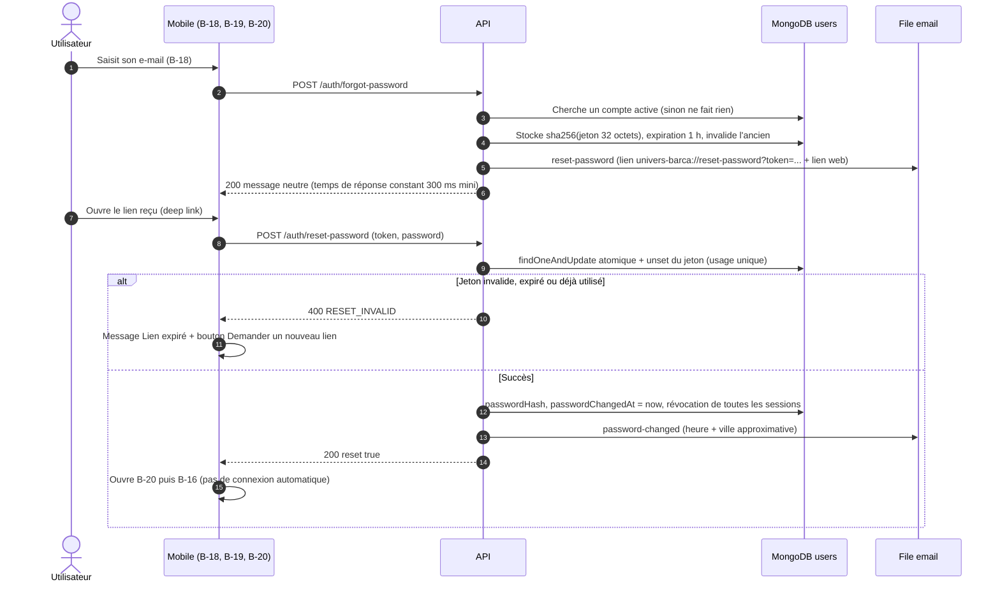

* **Anti-énumération** : réponse 200 identique que le compte existe ou non ; limites 3 demandes/heure/adresse et 5/heure/IP (`sensitiveLimiter`).
* **Compte social** sans mot de passe : l'e-mail explique qu'il faut passer par Google/Apple (aucun jeton émis) ; compte suspendu : jeton émis (le reset ne lève pas la sanction) ; banni/supprimé : aucun e-mail (`API-AUTH-17`).
* **Après reset** : tout access token émis avant `passwordChangedAt` est refusé (`SESSION_REVOKED`) ; nouveau mot de passe différent des 3 derniers (`passwordHistory`) (`API-AUTH-18`).
* **Écart de politique** : la maquette `B-19` affiche « 12 caractères ou plus / un symbole » alors que la politique API bloquante est 8–128 + maj + min + chiffre (`MOB-B-25`, `API-AUTH-06`). Décision produit à trancher (§14).

### 5.6 Connexion admin avec 2FA TOTP

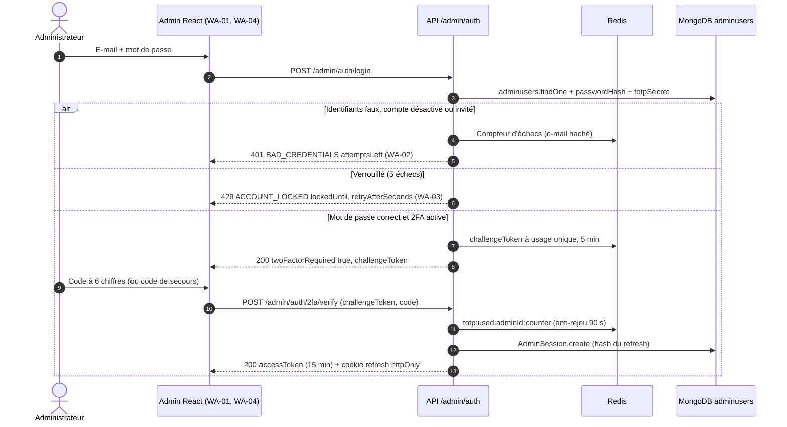

* **Anti-rejeu TOTP** : un même code ne peut servir deux fois (clé Redis 90 s), fenêtre ±1 (30 s) ; 5 codes faux invalident le challenge et comptent dans le verrouillage (`API-AUTH-34`).
* **Cookie** : `ub_admin_rt`, `HttpOnly; Secure; SameSite=Strict; Path=/api/v1/admin/auth` **(existant)** ; l'access token n'est **jamais** persisté côté navigateur (`authStore` ne persiste que le profil, pas le jeton) ; jeton CSRF double-submit en plus pour les mutations (`X-CSRF-Token`, `API-AUTH-38`, `ADM-WA-17`).
* **Super-admin sans 2FA** : après le mot de passe, `twoFactorSetupRequired:true` ; seules les routes `/admin/auth/2fa/*` sont accessibles (claim `scope:'2fa-setup'`).
* **Écart de contrat (à trancher)** : le code **(existant)** fait un login en **une seule requête** avec `totp` optionnel et renvoie `TOTP_REQUIRED` (401) ; le backlog API (`API-AUTH-34`) impose un flux en **deux étapes** avec `challengeToken` ; le backlog admin (`ADM-WA-01`, `ADM-WA-03`) suppose le premier modèle (`TOTP_REQUIRED` puis nouvel envoi avec e-mail/mot de passe gardés en mémoire). Voir §14.

### 5.7 Invitation et activation d'un administrateur

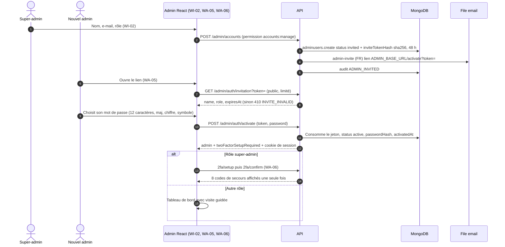

### 5.8 Cycles de vie (machines à états)

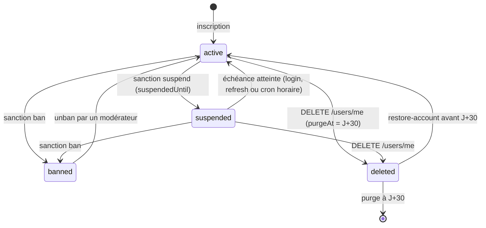

*Statut utilisateur (`users.status`). Les actions `suspend`, `ban`, `unban` viennent de `moderationactions` (module modération). La levée automatique d'une suspension et la restauration sont **(backlog)** ; aujourd'hui le seul contrôle est `suspendedUntil > now` dans `login`.*

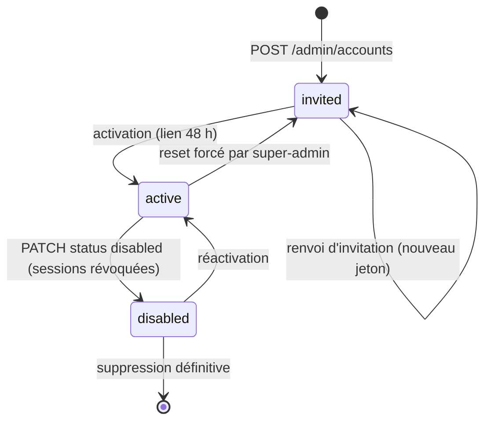

*Statut d'un compte admin (`adminusers.status`).*

---

## 6. Contrats d'API

Toutes les routes sont préfixées `/api/v1` ; réponse de succès `{ success:true, data }` ; erreur `{ success:false, error:{ code, message, details?, traceId } }`.

### 6.1 Utilisateurs finaux

| Méthode | Chemin | Auth | Rate limit | Requête | Réponse | Erreurs principales |
|---|---|---|---|---|---|---|
| POST | `/auth/register` | public | 20/15 min/IP **(existant)** → 5/h/IP (`API-AUTH-41`) | `{email,password,displayName,locale,consents{terms,privacy,...}}` | `201 {user,accessToken,refreshToken}` | `409 EMAIL_TAKEN`, `422` (`details[{field,code,message}]`), `409 LEGAL_VERSION_OUTDATED` |
| POST | `/auth/login` | public | 10/15 min/IP + 5/15 min/e-mail | `{email,password}` + en-têtes `X-Device-Id`, `X-Platform` | `200 {user,accessToken,refreshToken}` | `401 BAD_CREDENTIALS` (`attemptsLeft`), `429 ACCOUNT_LOCKED`, `403 ACCOUNT_SUSPENDED / ACCOUNT_BANNED` |
| POST | `/auth/social/:provider` (`google`, `apple`) | public | 20/15 min/IP | `{idToken,nonce?,fullName?,locale?,consents?}` | `{user,accessToken,refreshToken,isNewUser}` | `422 CONSENT_REQUIRED`, `401` jeton invalide, `409 PROVIDER_ALREADY_LINKED` |
| POST | `/auth/refresh` | refresh dans le corps | 20/15 min/IP | `{refreshToken}` | `200 {accessToken,refreshToken}` | `401 REFRESH_INVALID / REFRESH_EXPIRED / REFRESH_REUSED` |
| POST | `/auth/logout` | Bearer | — | `{refreshToken?}` | `204` | — |
| POST | `/auth/logout-all` | Bearer | — | — | `204` | — |
| POST | `/auth/verify-email` | public | 10/15 min/IP + 5 essais/code | `{token}` **(existant)** → `{code}` ou `{token}` (`API-AUTH-04`) | `200 {verified:true}` | `400 VERIFY_INVALID`, `429 VERIFY_ATTEMPTS_EXCEEDED` |
| POST | `/auth/resend-verification` | Bearer | 5/h/compte, 60 s mini | — | `200` + `retryAfterSeconds` | `429` + `Retry-After` |
| POST | `/auth/forgot-password` | public | 5/h/IP + 3/h/e-mail | `{email}` | `200 {message}` (toujours) | `429 RATE_LIMITED` |
| POST | `/auth/reset-password` | public | 5/h/IP | `{token,password}` | `200 {reset:true}` | `400 RESET_INVALID`, `422` politique |
| POST | `/auth/password-strength` | public | 30/min/IP | `{password}` | `{score,label,suggestions[]}` | — |
| GET | `/users/me/sessions` | Bearer | 120/min | — | `{items:[{id,deviceName,platform,approxCity,approxCountry,createdAt,lastActiveAt,current}],total}` | — |
| DELETE | `/users/me/sessions/:id` | Bearer | — | — | `204` idempotent | `404` si pas à l'utilisateur |
| DELETE | `/users/me/sessions?except=current` | Bearer | — | — | `204` | — |
| GET | `/users/me/auth-methods` | Bearer | — | — | `{password,providers[]}` | — |
| POST/DELETE | `/users/me/auth-methods/:provider` | Bearer | — | idToken (+ mot de passe) | `204` | `409 PROVIDER_ALREADY_LINKED`, `422 LAST_AUTH_METHOD` |

Les routes mot de passe connecté (`/users/me/password/change`), e-mail (`/users/me/email`), consentements, export et suppression relèvent de **F03**.

### 6.2 Back-office

| Méthode | Chemin | Auth / permission | Rate limit | Requête | Réponse | Erreurs |
|---|---|---|---|---|---|---|
| POST | `/admin/auth/login` | public | 10/15 min/IP | `{email,password,totp?}` **(existant)** | `{admin,accessToken}` + cookie ; ou `{twoFactorRequired,challengeToken}` (`API-AUTH-34`) | `401 BAD_CREDENTIALS`, `429 ACCOUNT_LOCKED`, `401 TOTP_REQUIRED/TOTP_INVALID` |
| POST | `/admin/auth/2fa/verify` | challenge | 5/challenge | `{challengeToken,code\|backupCode}` | `{admin,accessToken}` | `401 TOTP_INVALID` |
| POST | `/admin/auth/refresh` | cookie | 20/15 min | — | `{accessToken}` | `401 REFRESH_INVALID`, `401 SESSION_EXPIRED_INACTIVITY` |
| POST | `/admin/auth/logout` | cookie | — | — | `204` | — |
| POST | `/admin/auth/2fa/setup` | Bearer admin | — | — | `{secret,otpauthUrl,qrDataUrl}` | — |
| POST | `/admin/auth/2fa/confirm` | Bearer admin | — | `{token}` **(existant)** / `{code}` (spec admin) | `{backupCodes[8]}` (une fois) | `400` |
| POST | `/admin/auth/2fa/backup-codes/regenerate` | Bearer + mot de passe + TOTP | — | — | `{backupCodes[8]}` | — |
| GET | `/admin/auth/invitation?token=` | public | limité | — | `{name,role,expiresAt}` | `410 INVITE_INVALID` |
| POST | `/admin/auth/activate` | public | 5/15 min/IP | `{token,password}` | `{admin,twoFactorSetupRequired}` + cookie | `410 INVITE_INVALID`, `422` |
| POST | `/admin/auth/forgot-password` / `reset-password` | public | 3/h/adresse | `{email}` / `{token,password,totp?}` | `200` neutre | `400` |
| GET/POST | `/admin/accounts` | `accounts:manage` | — | `{email,name,role}` | page `{items,total,page,totalPages,hasMore}` / `201` | `409`, `422` |
| PATCH/DELETE | `/admin/accounts/:id` | `accounts:manage` | — | `{role?,name?,status?,justification}` | compte | `409 LAST_SUPER_ADMIN` |
| POST | `/admin/accounts/:id/unlock`, `/invite/resend`, `/reset`, `/2fa/reset` | `accounts:manage` | 5/jour (renvoi) | — | `204` | — |
| GET/DELETE | `/admin/accounts/:id/sessions[/:sessionId]` | `accounts:manage` | — | — | liste / `204` | — |
| GET | `/admin/audit/logins` | `audit:read` | — | filtres + `?format=csv` (≤ 10 000 lignes) | page | — |

**Exemple — échec de connexion mobile (`API-AUTH-07`)**

```json
{ "success": false,
  "error": { "code": "BAD_CREDENTIALS", "message": "Email ou mot de passe incorrect",
             "details": { "attemptsLeft": 3 }, "traceId": "9f1c2a7e-..." } }
```

**Exemple — compte suspendu (`API-AUTH-08`)**

```json
{ "success": false,
  "error": { "code": "ACCOUNT_SUSPENDED", "message": "Compte suspendu",
             "details": { "until": "2026-10-22T00:00:00Z", "daysLeft": 7,
                          "reason": "Propos inappropriés dans le groupe « Culés Paris ».",
                          "reasonCode": "HARASSMENT", "appealUrl": "mailto:support@…", "charterUrl": "https://…" } } }
```

**Contrat 401 d'authentification (`API-AUTH-09`)** : `TOKEN_EXPIRED` → le client tente **un** refresh ; `REFRESH_EXPIRED | REFRESH_INVALID | REFRESH_REUSED | TOKEN_REVOKED | SESSION_REVOKED` → écran `A-08`. Toute 401 d'auth porte `WWW-Authenticate: Bearer error="invalid_token"` et un `traceId`.

---

## 7. Modèle de données

### 7.1 Collections et champs utiles

| Collection | Champs clés | Index / TTL |
|---|---|---|
| `users` **(existant)** | `email` (minuscule), `passwordHash` (`select:false`), `displayName` (3–20), `locale`, `status` (`active|suspended|banned|deleted`), `suspendedUntil`, `emailVerifiedAt`, `emailVerificationTokenHash`/`ExpiresAt`, `passwordResetTokenHash`/`ExpiresAt`, `passwordChangedAt`, `authProviders[{provider,providerUserId}]`, `termsAcceptedAt`, `deletedAt`, `lastActiveAt` | `email` unique sparse ; `status` ; `{countryCode,city}` |
| `users` **(backlog)** | `displayNameKey` (NFD normalisé), `emailVerificationCodeHash`/`Attempts`, `passwordHistory[3]`, `suspension{reason,until,actionId}`, `banReason`, `pendingEmail`, `emailIsRelay`, `purgeAt`, `emailHashForRestore`, `analyticsOptOut`, `mapVisibility` | `displayNameKey` unique ; `{authProviders.provider,authProviders.providerUserId}` unique |
| `refreshtokens` **(existant)** | `userId`, `familyId`, `tokenHash` (unique), `deviceId`, `platform`, `userAgent`, `ip`, `expiresAt`, `revokedAt`, `replacedByHash`, `lastUsedAt` | TTL `expiresAt` (0 s) ; `userId`, `familyId` |
| `refreshtokens` **(backlog)** | `familyCreatedAt`, `persistent`, `deviceName`, `approxCity`, `approxCountry` ; IP anonymisée (dernier octet à 0) après 30 jours | — |
| `consentrecords` | `userId`, `type`, `granted`, `version`, `grantedAt`, `revokedAt` (détail F03) | `{userId,type,createdAt:-1}` |
| `adminusers` **(existant)** | `email` unique, `name`, `passwordHash`, `role`, `status` (`invited|active|disabled`), `totpSecret`, `totpEnabled`, `inviteTokenHash`, `inviteExpiresAt`, `failedLogins`, `lockedUntil`, `lastLoginAt` | `email` unique |
| `adminusers` **(backlog)** | `backupCodes[8]` (Argon2id), `totpSecret` chiffré AES-256-GCM (`TOTP_ENC_KEY`), `activatedAt`, `scope` | — |
| `adminsessions` **(existant)** | `adminId`, `tokenHash` (unique), `userAgent`, `ip`, `expiresAt`, `revokedAt`, `lastActivityAt` | TTL `expiresAt` ; `adminId` |
| `moderationactions` | `targetUserId`, `actionType` (`suspend|ban|unban…`), `justification`, `suspendedUntil` : source du motif affiché en `A-09` | — |
| `adminauditlogs` **(backlog, nom proposé)** | `adminId?`, `emailHash?`, `event`, `reason`, `ip`, `userAgent`, `createdAt` ; schéma immuable (hooks Mongoose refusant `update`/`delete`) | `{adminId,createdAt}` |

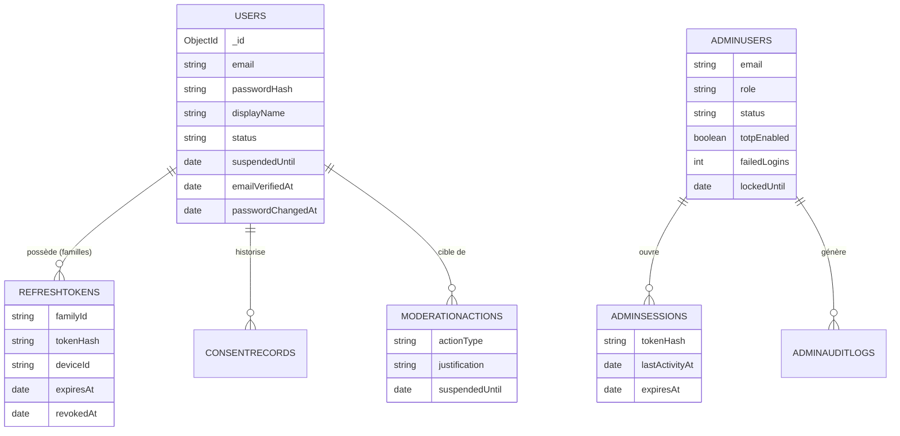

### 7.2 Clés Redis

| Clé | Rôle | TTL | État |
|---|---|---|---|
| `jwt:bl:<jti>` | access token révoqué (logout) | jusqu'à l'expiration du jeton | **(existant)** |
| `rl:global:*`, `rl:auth:*`, `rl:sensitive:*` | compteurs `express-rate-limit` (store Redis) | fenêtre | **(existant)** |
| `login:fail:<emailHash>` | échecs de connexion consécutifs | 15 min | (backlog) |
| `login:lock:<emailHash>` | verrou progressif (15 min, 1 h, 24 h) | selon palier | (backlog) |
| `user:status:<userId>` | statut de compte mis en cache pour `protect` | 60 s, invalidé à chaque sanction | (backlog) |
| `session:revoked:<sid>` | session retirée depuis un autre appareil | 15 min | (backlog) |
| `refresh:grace:<hash>` | successeur chiffré pour la fenêtre de grâce | 10 s | (backlog) |
| `totp:used:<adminId>:<counter>` | anti-rejeu TOTP | 90 s | (backlog) |
| challenge admin (opaque) | étape 2 du login admin | 5 min | (backlog) |

### 7.3 Migrations

Les évolutions de schéma (`displayNameKey`, index uniques OAuth, `familyCreatedAt`, `persistent`) passent par des scripts idempotents dans `scripts/migrations` (règle API) ; le remplissage de `displayNameKey` sur l'existant doit gérer les collisions éventuelles (suffixe numérique, procédure **proposée**). La collection `legaldocuments` et `dataexports` sont décrites en F03.

---

## 8. Traitements asynchrones et cache

| Traitement | Mécanisme | Détails |
|---|---|---|
| Envoi des e-mails transactionnels | File BullMQ `email` (`API-AUTH-02`) | Job `{template,to,locale,data,dedupeKey}` ; `jobId = dedupeKey` (idempotence) ; 5 tentatives, backoff exponentiel 2 s ; concurrence 5 ; limiteur 20 jobs/s ; erreurs 4xx fournisseur = `UnrecoverableError` ; échec définitif → file `dead-letter` + métrique `jobs_failed_total{queue="email"}` ; `removeOnComplete:true` (les jetons en clair ne restent pas en Redis), `removeOnFail` 7 jours |
| Modèles d'e-mail | Handlebars + MJML précompilés (`src/templates/dist`) | 7 modèles × FR/EN/ES : `verify-email`, `reset-password`, `password-changed`, `new-device-login`, `export-ready`, `account-deletion-scheduled`, `admin-invite` ; HTML < 100 Ko, aucun pixel de suivi |
| Levée automatique des suspensions | Cron horaire (`node-cron`, file `rgpd`/maintenance) | Traite les `suspendedUntil <= now`, remet `active`, notifie (`API-AUTH-08`) |
| Purge des refresh tokens révoqués | Cron `30 3 * * *` **(existant)** | Purge à **30 jours** dans le code ; le CDC §5.7 impose **90 jours** : à corriger (`API-AUTH-13`) |
| Anonymisation d'IP des sessions | Job planifié (proposé) | Dernier octet à 0 après 30 jours (`API-AUTH-15`) |
| Cache statut de compte | Redis `user:status:<id>` 60 s | Invalidé à l'application d'une sanction ; sinon un compte sanctionné perd l'accès sous 60 s |
| Cache RBAC admin | Redis 60 s | Un rôle rétrogradé ou un compte `disabled` perd ses droits sous 60 s (`API-AUTH-32`) |
| JWKS Google / Apple | Cache mémoire (Apple 24 h) | Évite un appel réseau à chaque connexion sociale |

**Idempotence** : l'envoi d'e-mail (dedupeKey), la rotation de refresh (condition atomique), la révocation de session (`204` idempotent) et la consommation de jeton (`findOneAndUpdate` + `$unset`) sont conçues pour supporter les rejeux.

---

## 9. Règles de gestion

1. **Pseudo** : 3–20 caractères, regex `^[\p{L}\p{N}_.-]+$`, unicité insensible à la casse et aux accents (`displayNameKey` NFD), pseudos réservés refusés (`admin`, `support`, `univers_barca`…).
2. **E-mail** : minuscules, trim, ≤ 254 caractères, domaines jetables refusés (`DISPOSABLE_EMAIL_DOMAINS`) ; un e-mail déjà inscrit renvoie `409 EMAIL_TAKEN` (≤ 10 essais/15 min/IP), ou 202 neutre si `REGISTER_NEUTRAL_RESPONSE=true`.
3. **Mot de passe utilisateur** : 8–128 caractères, ≥ 1 minuscule, ≥ 1 majuscule, ≥ 1 chiffre ; refus des 10 000 mots de passe courants et de l'e-mail/pseudo ; score de force 0–4 (zxcvbn-ts) : `weak` < 2, `medium` = 2, `strong` ≥ 3. **Mot de passe admin** : 12–128, majuscule, chiffre, symbole, ≠ e-mail/nom (4 critères sur `WA-05` : longueur ≥ 12, majuscule, chiffre, symbole, jauge 4 segments).
4. **Hachage** : Argon2id (m = 19 456 KiB, t = 2, p = 1) ; re-hachage automatique à la connexion si les paramètres évoluent (`needsRehash`).
5. **Access token** : JWT HS256, 15 min (`JWT_ACCESS_TTL`), `iss` = `univers-barca`, `jti` unique ; le secret de refresh doit différer du secret d'access (validation Joi au démarrage).
6. **Refresh token** : opaque 48 octets base64url, haché SHA-256 ; TTL 30 jours glissants ; plafond de famille 90 jours ; `rememberMe=false` → 24 h ; 20 sessions actives max par utilisateur (la plus ancienne est révoquée au-delà).
7. **Réutilisation** : un refresh déjà révoqué présenté hors fenêtre de grâce de 10 s (ou depuis un autre `deviceId`) révoque la famille entière et envoie un e-mail d'alerte.
8. **Code de vérification** : 6 chiffres, 15 min, 5 essais, invalidé au 6e ; renvoi minimum 60 s, 5 par heure ; lien alternatif 24 h.
9. **Verrouillage utilisateur** : 5 échecs/15 min → verrou 15 min ; 2e verrou dans les 24 h → 1 h ; 3e → 24 h ; limite IP alignée sur 10/15 min (le code actuel est à 20).
10. **Verrouillage admin** : 5 échecs consécutifs → blocage 15 min (`MAX_FAILS`, `LOCK_MS`) ; déblocage manuel par super-admin ; compteur remis à 0 uniquement après une connexion réussie.
11. **Statuts de compte** : `suspended` bloque jusqu'à `suspendedUntil` (levée automatique), `banned` est définitif, `deleted` est invisible (indiscernable d'un compte inexistant) ; un avertissement (`warn`) ne bloque pas l'app.
12. **Réinitialisation de mot de passe** : jeton 32 octets, 1 h, usage unique ; nouveau mot de passe ≠ 3 derniers ; toutes les sessions révoquées ; pas de connexion automatique.
13. **OAuth** : l'identité est le `sub` du fournisseur ; `email_verified=true` exigé chez Google ; `nonce` = SHA-256 du nonce brut chez Apple ; dernière méthode de connexion non retirable (`LAST_AUTH_METHOD`).
14. **Sessions admin** : access token 15 min ; session glissante 8 h d'inactivité, plafond absolu 24 h (le code actuel applique 8 h absolues sans glissement) ; rotation du refresh admin à chaque usage avec détection de rejeu.
15. **2FA admin** : TOTP 6 chiffres, fenêtre ±1 (30 s), anti-rejeu 90 s ; 8 codes de secours de 10 caractères (`XXXXX-XXXXX`) à usage unique, hachés Argon2id, affichés une seule fois ; obligatoire pour les super-admins, recommandée pour les autres.
16. **RBAC** : `content-manager` → `players:write`, `history:publish`, `quiz:validate` ; `moderator` → `moderation:review`, `moderation:ban` ; `super-admin` → toutes (`logs:read`, `accounts:manage`, `config:ai-quotas`, `audit:read`, `observability:read`).
17. **Invitation admin** : jeton 32 octets, 48 h, usage unique, renvoi max 5/jour ; rôle ∈ `content-manager|moderator|super-admin`.
18. **Garde-fous comptes admin** : impossible de se désactiver ou supprimer soi-même, impossible de retirer le dernier super-admin actif (`409 LAST_SUPER_ADMIN`), changement de rôle avec justification ≥ 10 caractères, suppression définitive avec e-mail saisi + justification.
19. **Rate limiting** (catalogue `API-AUTH-41`) : login 10/15 min/IP + 5/15 min/e-mail ; register 5/h/IP ; social 20/15 min/IP ; forgot-password 5/h/IP + 3/h/e-mail ; verify-email 10/15 min/IP ; resend 5/h/compte ; password-strength 30/min/IP ; admin login 10/15 min/IP ; 2FA verify 5/challenge. Repli mémoire interdit en production.

---

## 10. Sécurité, RGPD et anti-abus

* **Stockage des secrets** : aucun mot de passe, jeton ou secret TOTP en clair dans les réponses, journaux, traces OTel ou rapports Sentry. Les jetons sont stockés hachés (SHA-256), le secret TOTP chiffré (AES-256-GCM, clé `TOTP_ENC_KEY`), les codes de secours en Argon2id.
* **Mobile** : refresh token dans `flutter_secure_storage` (Android `encryptedSharedPreferences`, iOS `first_unlock_this_device`) ; access token **en mémoire uniquement** (`MOB-B-07`). *Écart : le squelette `AuthInterceptor` actuel lit `access_token` dans le stockage sécurisé ; à aligner.* Jamais de jeton dans `SharedPreferences`, logs, Sentry ou presse-papiers. Champs mot de passe : `obscureText`, `enableSuggestions:false`, `autocorrect:false` ; masquage de l'aperçu multitâche (`MOB-B-27`).
* **Admin** : refresh en cookie `HttpOnly; Secure; SameSite=Strict; Path=/api/v1/admin/auth`, access token en mémoire, jeton CSRF double-submit, CSP stricte (`default-src 'self'; frame-ancestors 'none'`), `X-Content-Type-Options`, `Referrer-Policy: no-referrer`, HSTS, règle ESLint `react/no-danger`. Le jeton d'invitation est retiré de l'URL (`history.replaceState`) après lecture. Le paramètre `from` de `WA-07` est validé par liste blanche pour éviter une redirection ouverte.
* **Anti-énumération** : `login`, `forgot-password`, `register` (mode neutre), `resend-verification`, login admin produisent des réponses indiscernables (statut, corps, taille, durée ±15 %).
* **Injection** : validation Joi sur toute entrée, `express-mongo-sanitize`, rejet de `{ "email": {"$ne": null} }`, liste blanche pour `PATCH /users/me` (impossible de modifier `status`, `role`, `passwordHash`, `emailVerifiedAt`).
* **JWT** : `alg:none` refusé, algorithme HS256 forcé, `iss` vérifié, blacklist après logout ; `kind` vérifié pour séparer utilisateurs et admins.
* **RGPD** : minimisation (IP jamais renvoyée au client, anonymisée à 30 jours ; ville approximative seulement) ; logs avec adresse e-mail masquée (`b***@exemple.com`) ; consentements historisés (F03) ; e-mail `new-device-login` pour transparence ; suppression de compte avec purge J+30 (F03).
* **Journalisation d'audit admin** : `ADMIN_LOGIN_SUCCESS`, `ADMIN_LOGIN_FAILED` (raison : `bad_password|unknown_email|locked|disabled|bad_totp`), `ADMIN_LOCKED`, `ADMIN_UNLOCKED`, `ADMIN_2FA_ENABLED`, `ADMIN_BACKUP_CODE_USED`, `ADMIN_LOGOUT`, `ADMIN_PASSWORD_RESET`, `ADMIN_ACTIVATED`, `ACCESS_DENIED`, `ADMIN_INVITED`, `ADMIN_INVITE_RESENT`, `ADMIN_SESSION_REVOKED`, `ADMIN_ROLE_CHANGED`, `ADMIN_DISABLED`, `ADMIN_DELETED`. Pour un e-mail inconnu : `emailHash` seulement. IP complète conservée 90 jours puis tronquée. Rétention longue durée (non purgé automatiquement, CDC §5.7).
* **Apple** : `POST /auth/apple/notifications` (serveur-à-serveur) pour traiter `consent-revoked` et `account-delete` : déclenche la suppression RGPD du compte lié.

---

## 11. Erreurs et états dégradés

| Situation | Côté serveur | Côté client |
|---|---|---|
| Hors-ligne à la connexion | — | `B-16` : SnackBar « Pas de connexion » ; boutons sociaux désactivés ; la saisie est conservée ; au démarrage avec session et cache : `/home` + bannière `A-03` (F04) |
| Redis indisponible | Limiteurs et blacklist dégradés ; **repli mémoire interdit en production** (démarrage en échec si `REDIS_URL` absent) ; en dev sans Redis, e-mails envoyés en direct | Réponses 5xx → `A-04` avec `traceId` |
| Fournisseur e-mail en panne | Jobs réessayés (5 tentatives, backoff exponentiel) puis dead-letter ; l'inscription réussit quand même | `B-09` : bouton « Renvoyer le code » (60 s) ; message « Réessaie plus tard » au-delà de 5 renvois/h |
| Fournisseur Google/Apple en panne ou jeton invalide | `401` (jeton invalide) ou `503 SERVICE_UNAVAILABLE` (circuit breaker, F04) | « Connexion impossible, réessaie » ; annulation par l'utilisateur : aucun message |
| 429 | `RATE_LIMITED` ou `ACCOUNT_LOCKED` + `Retry-After` | Compte à rebours `A-05` ou message « Trop de tentatives, réessaie dans {minutes} min » ; bouton désactivé le temps du délai |
| 401 `TOKEN_EXPIRED` | — | Un seul refresh partagé entre requêtes concurrentes ; rejeu transparent en cas de succès |
| Refresh invalide/réutilisé/révoqué | `REFRESH_*`, `SESSION_REVOKED` | `A-08` unique (un seul écran empilé) ; jetons purgés, cache Drift conservé ; « Changer de compte » purge le cache après confirmation |
| Compte suspendu pendant une session | `protect` renvoie 403 `ACCOUNT_SUSPENDED` (cache 60 s) | Événement diffusé via `SystemEventBus` → `A-09` ; à l'échéance : « Ta suspension est terminée » + « Continuer » |
| Compte banni | `403 ACCOUNT_BANNED` (ou `ACCOUNT_DISABLED` aujourd'hui) | `A-10`, retour Android bloqué, aucune création de compte avec le même e-mail |
| Jeton d'invitation expiré / utilisé | `410 INVITE_INVALID` (message unique) | `WA-05` : « Lien expiré — demande une nouvelle invitation » / « Ce lien a déjà été utilisé » *(distinction côté UI à trancher)* |
| Rôle admin insuffisant | `403 FORBIDDEN_ROLE` + `details.required`, audit `ACCESS_DENIED` | `WA-08` sans redirection vers `/login` ; toast « Action non autorisée pour ton rôle » sur une mutation |
| Inactivité admin 8 h | `401 SESSION_EXPIRED_INACTIVITY` | Toast d'avertissement à 7 h 55 (« Rester connecté »), `WA-07`, brouillons de formulaires restaurés (`draft:<route>:<adminId>`, purgés après 7 jours) |
| Erreur 5xx admin | `traceId` + `X-Trace-Id` | `WA-09` « ERREUR SERVEUR » avec identifiant de corrélation copiable ; toast sans doublon (fenêtre 3 s) |

---

## 12. Connexions avec les autres fonctionnalités

| Fonctionnalité | Lien | Nature |
|---|---|---|
| F02 — Onboarding et personnalisation | alimenté par F01 | L'inscription (`B-06` à `B-10`) enchaîne sur pays/ville, joueur préféré, ancienneté ; `AuthBloc` décide de reprendre à `B-11` si l'onboarding est incomplet |
| F03 — Paramètres, confidentialité et RGPD | partage | Consentements à l'inscription, appareils connectés (`Q-10`), changement de mot de passe/e-mail, suppression de compte révoquent les sessions |
| F04 — États système et résilience | alimente / dépend | `A-08`, `A-09`, `A-10` sont des états bloquants ; contrat 401/403/429 documenté en F04 ; limites et `traceId` |
| Modération (`API-MODER`, `ADM-WB`…) | dépend de | `ModerationAction` (`suspend`, `ban`, `unban`) fixe `status`, `suspendedUntil`, motif ; sanctions appliquées → invalidation de `user:status:<id>` |
| Notifications (`API-NOTIF`) | partage | Retrait de consentement `notifications` désactive les `DeviceToken` ; notification de fin de suspension |
| Jeux, Fantasy, carte, assistant IA | dépend de | Toutes les routes métier exigent `protect` + `userOnly` ; quotas par utilisateur |
| Observabilité (`API-PLAT`, `ADM-WH`) | alimente | Métriques `ub_auth_failures_total{reason}`, `refresh_reuse_total`, journal d'audit consultable en `WH-05` |

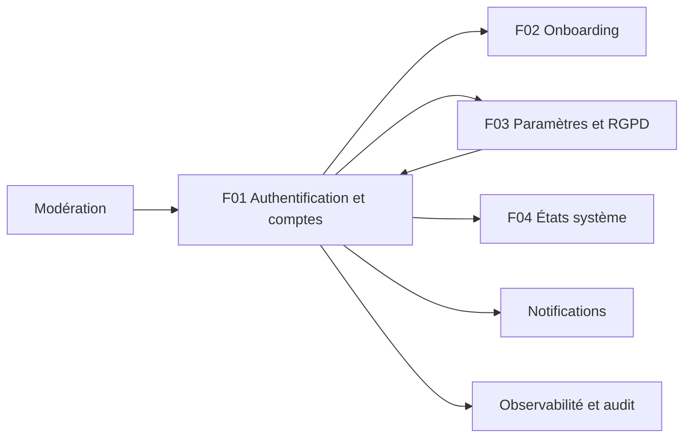

---

## 13. Observabilité et tests

**Métriques Prometheus** : `ub_auth_failures_total{reason}` (`missing`, `invalid`, `bad_credentials`, `locked`) **(existant en partie)**, `refresh_reuse_total`, `rate_limit_hits_total{route,scope}` (alerte > 100 hits/min), `ub_jobs_failed_total{queue="email"}`, `ub_rate_limited_total{scope}`. **Logs** : `logger.info('Compte créé', {userId})`, e-mails masqués, `traceId` systématique (`X-Trace-Id`), incident court `UB-XXXX-XXXX` (F04).

**Tests API** (`API-AUTH-42`, `API-AUTH-43`) : scénarios d'intégration avec `mongodb-memory-server` (replica set) et Redis conteneur, worker BullMQ démarré dans le test, horloge simulée ; seuil de couverture 80 % lignes sur `services/auth*`, `token`, `consent`, `rgpd`, `admin-*` ; suite sécurité : `alg:none`, signature altérée, `kind` user sur route admin, blacklist, en-têtes helmet, énumération indiscernable, injection NoSQL, absence de secret dans les logs.

**Tests de charge k6** (obligatoires pour toute nouvelle route) : `login` (10/15 min/IP), `refresh`, `register` ; scénarios « ouverture d'app » et « annonce push » (F04).

**Cas de tests clés** :

| # | Cas | Résultat attendu |
|---|---|---|
| T1 | Inscription → e-mail dans l'outbox → code → `emailVerifiedAt` renseigné | 201 puis 200 `verified:true` |
| T2 | 6 mauvais codes de vérification | 6e essai : `429 VERIFY_ATTEMPTS_EXCEEDED`, code invalidé |
| T3 | 5 mauvais mots de passe puis le bon | `429 ACCOUNT_LOCKED` même avec le bon mot de passe |
| T4 | Même refresh présenté deux fois (> 10 s) | `REFRESH_REUSED`, famille révoquée, e-mail d'alerte |
| T5 | Deux refresh concurrents identiques | un seul succès ; l'autre dans la grâce reçoit le même successeur |
| T6 | Compte suspendu avec `suspendedUntil` dépassé | login réussi, `status='active'` |
| T7 | Reset de mot de passe puis ancien access token | `SESSION_REVOKED` |
| T8 | Admin : 2e usage du même code TOTP | refusé (anti-rejeu) |
| T9 | Dernier super-admin désactivé | `409 LAST_SUPER_ADMIN` |
| T10 | Mobile : 3 requêtes 401 simultanées | un seul `POST /auth/refresh`, un seul écran `A-08` en cas d'échec |
| T11 | Mobile : golden `A-08/A-09/A-10`, `B-05` à `B-20` | 360×640 et 430×932, clair/sombre (`MOB-A-19`, `MOB-B-29`) |
| T12 | Admin Playwright : connexion `content-manager`, `moderator`, `super-admin` avec secrets TOTP de CI | accès conformes à la matrice (`ADM-WA-19`) |

---

## 14. Points ouverts et décisions à confirmer

1. **Code d'erreur banni/supprimé** : `ACCOUNT_DISABLED` (code existant, utilisé par `MOB-A-05`, `MOB-A-13`, `MOB-B-06`, `MOB-B-21`) vs `ACCOUNT_BANNED` + `deleted → BAD_CREDENTIALS` (`API-AUTH-08`). Proposition : conserver `ACCOUNT_DISABLED` comme alias déprécié le temps de la migration mobile.
2. **Compteur d'essais** : `details.attemptsLeft` (`API-AUTH-07`, `API-AUTH-33`) vs `details.remainingAttempts` (`MOB-B-22`, `ADM-WA-01`, `ADM-WA-04`). À harmoniser avant le codage.
3. **Login admin en 1 ou 2 étapes** : `totp` dans la requête de login + `TOTP_REQUIRED` (code existant, `ADM-WA-01`) vs `challengeToken` (`API-AUTH-34`).
4. **Contrats d'invitation admin** : API `GET /admin/auth/invitation?token=` + `POST /admin/auth/activate` + `410 INVITE_INVALID` ; admin `ADM-WA-09` utilise `GET /admin/auth/invitations/:token` + `POST /admin/auth/accept-invite` et distingue `INVITE_EXPIRED` (410) / `INVITE_USED` (409) ; `ADM-WI-05` rejoint `activate`. Corps du 2FA confirm : `{token}` (code) vs `{code}` (`ADM-WA-10`) ; `backupCodes` et `twoFactorSetupRequired` vs `requires2fa`.
5. **Politique de mot de passe utilisateur** : 8–128 (API, `MOB-B-10`) vs checklist 12 caractères + symbole sur `B-19` (`MOB-B-25`).
6. **Durée de session admin** : 8 h absolues (code existant) vs 8 h d'inactivité glissante avec plafond 24 h (`API-AUTH-38`) ; case « Rester connecté 8 h » de `WA-01`.
7. **Purge des refresh révoqués** : 30 jours (code) vs 90 jours (CDC §5.7, `API-AUTH-13`).
8. **Limite IP login/inscription** : 20/15 min (code) vs 10/15 min (CDC §10.2) vs 5/h pour `register` (`API-AUTH-41`).
9. **Adresse du support / contestation** (`A-09`, `A-10`) : constante de configuration « à confirmer avec l'équipe produit » (`MOB-A-14`).
10. **Mode neutre d'inscription** (`REGISTER_NEUTRAL_RESPONSE`) : contradictoire avec l'erreur « Cette adresse est déjà utilisée » de `B-07` ; à décider (UX vs énumération).
11. **Stockage de l'access token mobile** : mémoire uniquement (`MOB-B-07`) vs squelette actuel dans `flutter_secure_storage`.
12. **Nom du header de plateforme** : `X-Platform` (`MOB-A-08`) vs `X-App-Platform` (`API-PLAT-01`) — voir F04.
13. **Stack CDC** : le CDC Backend évoque NestJS Guards (`JwtAuthGuard`, `RolesGuard`) et Prisma ; la stack réelle est Express (`protect`, `restrictTo`, `requirePermission` à venir) + Mongoose.

---

## 15. Pour aller plus loin

**Épopées** : `API-AUTH`, `MOB-B`, `MOB-A`, `MOB-Q` (appareils), `ADM-WA`, `ADM-WI`, `API-PLAT` (états système, audit transverse).

**Issues repères** : `API-AUTH-04` (code e-mail), `API-AUTH-07` (verrouillage), `API-AUTH-08` (états de compte), `API-AUTH-09` (contrat 401), `API-AUTH-13` (rotation), `API-AUTH-15/16` (sessions), `API-AUTH-32` (RBAC), `API-AUTH-34` (2FA), `API-AUTH-35/36` (invitation), `API-AUTH-41` (rate limits), `MOB-B-07` (stockage jetons), `MOB-B-08` (`AuthBloc`), `MOB-A-11` (session expirée), `MOB-A-13` (restriction), `ADM-WA-10` (2FA), `ADM-WA-11` (inactivité), `ADM-WA-13` (RequireRole), `ADM-WI-06` à `ADM-WI-09` (garde-fous comptes).

**CDC** : CDC Backend §3.1 (module Users), §4.8 (anonymisation), §5.1 (authentification et sessions), §5.2 (RBAC), §5.3 (menaces), §5.7 (rétention), §10.2 (rate limiting), §11.6 (codes HTTP) ; CDC Global §2.13, §3.2, §10.2, §10.3 (charte, sanctions) ; CDC Admin §3 (authentification), §6 (sécurité) ; CDC Flutter §6.4, §7.1, §13.1.

**Fichiers de code**

* API : `src/services/auth.service.ts`, `token.service.ts`, `password.service.ts`, `admin-auth.service.ts`, `src/middleware/auth.ts`, `rateLimiter.ts`, `errorHandler.ts`, `src/controllers/auth.controller.ts`, `admin-auth.controller.ts`, `src/validators/auth.validator.ts`, `src/models/user.model.ts`, `refresh-token.model.ts`, `consent-record.model.ts`, `admin-user.model.ts`, `src/jobs/queues.ts`, `scheduler.ts`, `src/routes/index.ts`.
* Mobile : `lib/core/network/authenticator.dart`, `interceptors.dart`, `api_client.dart`, `lib/core/error/failure.dart`, `lib/routes/`, `lib/core/constants/route_constants.dart`, modèle de référence `lib/features/players`.
* Admin : `src/api/auth.api.ts`, `src/lib/axios.ts`, `src/store/authStore.ts`, `src/components/auth/ProtectedRoute.tsx`, `src/pages/auth/LoginPage.tsx`, `src/pages/errors/ForbiddenPage.tsx`, `NotFoundPage.tsx`, `src/lib/navigation.ts`.
