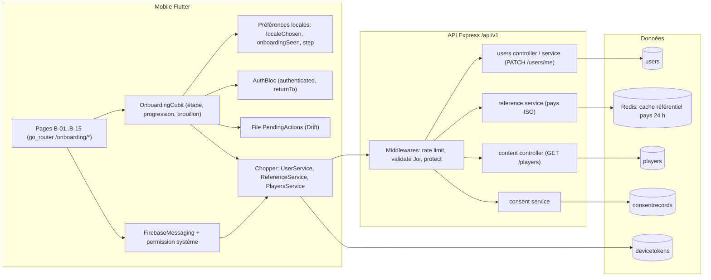
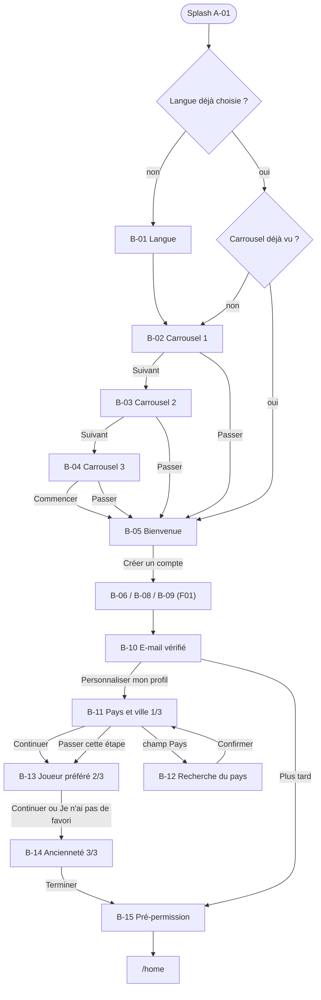
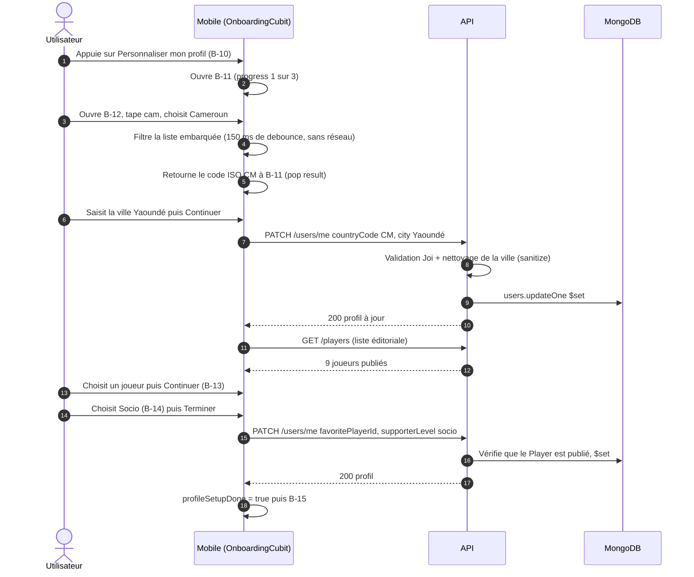
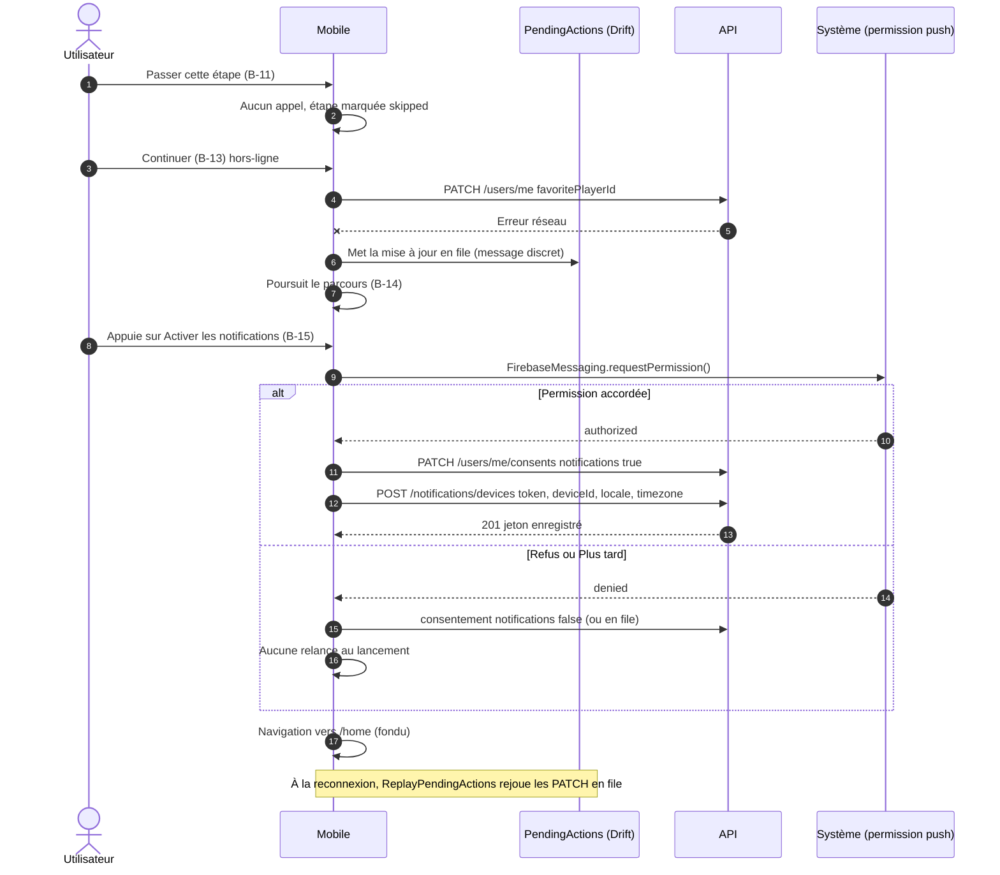
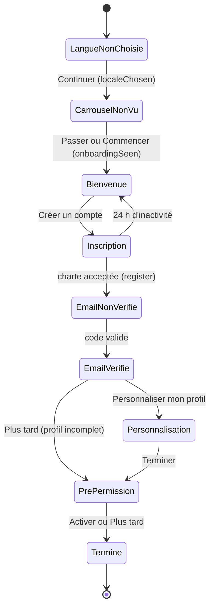
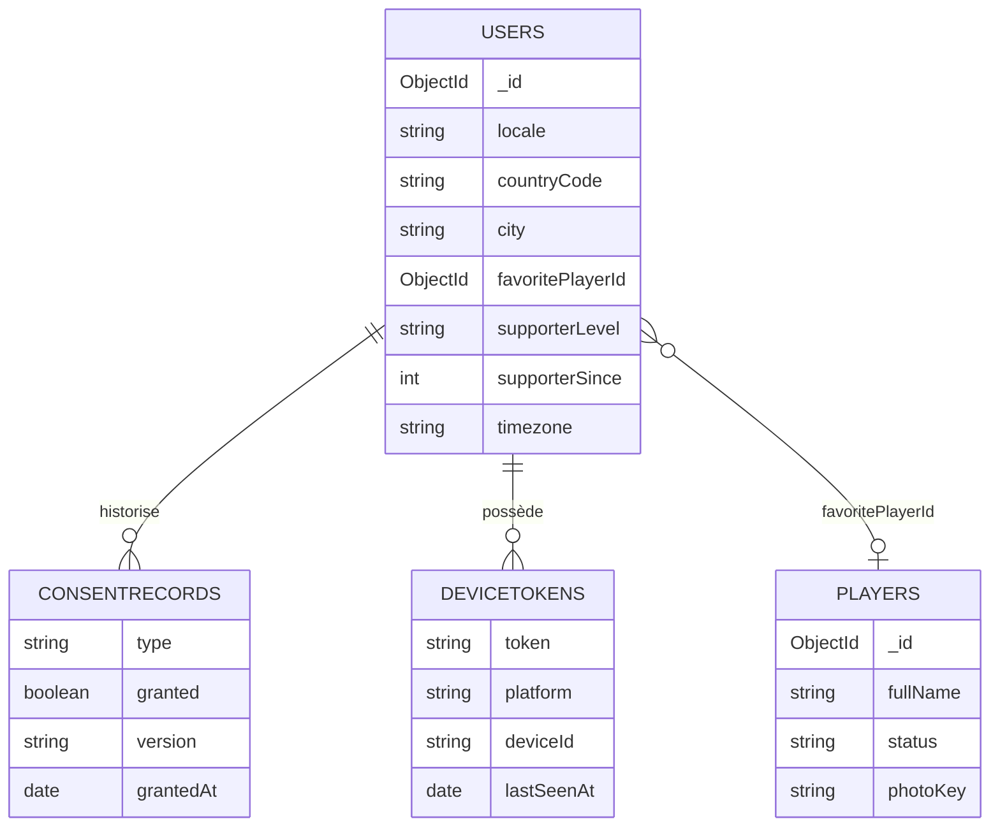
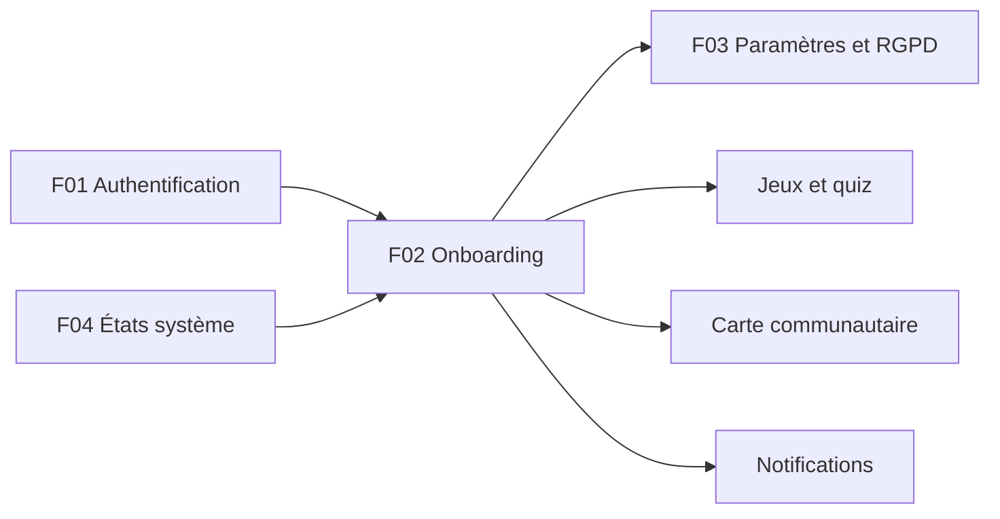

# F02 — Onboarding et personnalisation

> Document de fonctionnalité de l'architecture Univers Barça. Il décrit le **premier contact** avec l'application : choix de la langue, carrousel de présentation, charte, puis la personnalisation facultative du profil (pays/ville, joueur préféré, ancienneté de supporter) et la pré-permission de notifications. Il explique pourquoi chaque étape existe, ce qui est stocké, et comment le parcours reste robuste (reprise, hors-ligne, étapes sautées).
>
> Convention : **(existant)** = présent dans le dépôt ; **(backlog)** = décrit dans une issue, pas encore codé ; **(proposé)** = suggestion de ce document absente des CDC/issues.

---

## 1. Résumé et fiche

### 1.1 Valeur utilisateur

Dans les deux premières minutes, l'application doit donner envie de rester et collecter juste ce qu'il faut pour adapter l'expérience : la langue (FR/EN/ES), un aperçu des trois piliers du produit (assistant, défis quotidiens, communauté), puis, **sans jamais bloquer**, le pays et la ville (pour proposer des groupes locaux et l'heure des matchs), le joueur préféré (pour personnaliser l'accueil et les notifications) et l'ancienneté de supporter (pour régler la difficulté de départ des quiz). Un dernier écran explique **pourquoi** les notifications sont utiles avant de déclencher la demande système, ce qui augmente le taux d'acceptation sans piéger l'utilisateur.

Principe directeur : **minimisation et consentement**. Aucune position GPS n'est demandée, seule une ville saisie est conservée ; aucun consentement n'est pré-coché ; chaque étape de personnalisation peut être passée.

### 1.2 Fiche

| Champ | Valeur |
|---|---|
| Phase | Phase 1 — MVP |
| Priorité | P0 : langue, carrousel, bienvenue, reprise du parcours, consentements ; P1 : pays/ville, joueur préféré, ancienneté, pré-permission ; P2 : illustrations animées du carrousel (`MOB-B-04`) |
| Épopées backlog | `MOB-B` (issues `MOB-B-01` à `MOB-B-05`, `MOB-B-12` à `MOB-B-20`, `MOB-B-28`, `MOB-B-29`), `API-AUTH` (`API-AUTH-28` préférences, `API-AUTH-29` profil d'onboarding, `API-AUTH-30` profil public/privé, `API-AUTH-21` à `API-AUTH-23` consentements), `API-NOTIF` (enregistrement du jeton d'appareil) |
| Écrans | `B-01` (langue), `B-02` à `B-04` (carrousel), `B-05` (bienvenue), `B-08` (charte), `B-10` (e-mail vérifié, porte d'entrée de la personnalisation), `B-11` (pays et ville), `B-12` (recherche du pays), `B-13` (joueur préféré), `B-14` (ancienneté), `B-15` (pré-permission notifications) |
| Dépôts concernés | `univers_barca_mobile` (essentiel), `univers_barca_api` (référentiels, `PATCH /users/me`, consentements) ; aucun écran admin |
| Référence CDC | CDC Flutter §6.4 (aucune permission au lancement), §7.1, §8.1 (langue), §12.1 ; CDC Global §2.13, §10.1 (mention « non officielle »), §10.2 ; CDC Backend §3.1 |

### 1.3 État d'avancement du code

| Brique | État |
|---|---|
| Modèle `User` : `locale`, `countryCode` (2 car. majuscules), `city`, `favoritePlayerId` (ObjectId → `Player`), `supporterSince` (≥ 1899), `timezone` (défaut `Europe/Madrid`) | **(existant)** dans `src/models/user.model.ts` |
| `PATCH /users/me` avec `updateMeSchema` : accepte `displayName`, `locale`, `themePreference`, `countryCode`, `city` (≤ 80), `supporterSince`, `timezone` | **(existant)** ; **refuse** aujourd'hui `favoritePlayerId` et `supporterLevel` |
| `supporterLevel`, `onboarding`, `GET /reference/countries`, `PATCH /users/me/onboarding`, `GET /users/me/preferences` | **(backlog)** (`API-AUTH-28`, `API-AUTH-29`) |
| Mobile : `RouteConstants.onboarding = '/onboarding'`, splash provisoire de 2 s, aucune page de tunnel | **(existant, squelette)** ; tout le tunnel est **(backlog)** |

---

## 2. Acteurs et user stories

| Acteur | Rôle |
|---|---|
| Visiteur / nouvel utilisateur | Parcourt le tunnel à la première ouverture |
| Utilisateur existant sur un nouvel appareil | Ne revoit pas langue/carrousel si déjà vus ; reprend la personnalisation si incomplète |
| API | Valide et stocke le profil, sert les référentiels |

| # | User story | Critères d'acceptation clés |
|---|---|---|
| US1 | En tant que visiteur, je choisis ma langue dès le premier écran. | Pré-sélection = langue système si fr/en/es sinon fr ; l'interface se traduit en direct ; `localeChosen=true` à « Continuer » (`MOB-B-02`) |
| US2 | En tant que visiteur, je découvre l'app en 3 pages que je peux passer. | Textes exacts des 3 pages ; « Passer » visible partout ; `onboardingSeen=true` ; balayage = bouton « Suivant » (`MOB-B-03`) |
| US3 | En tant que visiteur, je reprends mon inscription là où je l'ai laissée. | Étape courante, pseudo, e-mail, langue persistés (**jamais** le mot de passe) ; retour à `B-05` après 24 h d'inactivité (`MOB-B-01`) |
| US4 | En tant que nouvel utilisateur, j'indique mon pays et ma ville. | Pays par recherche locale (≈ 249, insensible aux accents), ville libre 2–80 car. ; aucune position GPS ; « Passer cette étape » sans appel (`MOB-B-16/17`, `API-AUTH-29`) |
| US5 | En tant que nouvel utilisateur, je choisis mon joueur préféré. | Grille 3×3, sélection unique, « Je n'ai pas de favori » accepté ; `favoritePlayerId` doit référencer un joueur publié (`MOB-B-18`) |
| US6 | En tant que nouvel utilisateur, je précise mon ancienneté. | 4 niveaux, aucune présélection ; règle la difficulté initiale du quiz adaptatif (`MOB-B-19`) |
| US7 | En tant que nouvel utilisateur, je choisis d'activer ou non les rappels de match. | Pré-permission expliquée ; permission système uniquement après « Activer » ; « Plus tard » = `notifications=false`, app pleinement utilisable (`MOB-B-20`, `MOB-B-13`) |
| US8 | En tant que nouvel utilisateur, je peux sauter la personnalisation (« Plus tard »). | Le profil à compléter est reproposé plus tard (carte de profil, hors périmètre) ; l'étape est marquée `skipped` |

---

## 3. Architecture de la fonctionnalité



**Légende et choix techniques.**

* **`OnboardingCubit`** : une seule source de vérité pour l'étape courante et la progression (segments « 1/4 », « 1/3 »). Chaque écran du tunnel est une route enfant de `/onboarding`, ce qui permet à go_router de reconstruire la pile après un redémarrage.
* **Persistance locale minimale** : `localeChosen`, `onboardingSeen` et l'étape courante dans les préférences ; pseudo/e-mail/langue comme brouillon non sensible ; **jamais** le mot de passe ni un jeton.
* **File `PendingActions` (Drift)** : si un `PATCH /users/me` échoue pendant l'onboarding (réseau), le parcours continue et la mise à jour est rejouée à la reconnexion (max 3 tentatives, ordre de création) ; l'utilisateur ne perd jamais sa saisie.
* **Référentiel des pays embarqué côté mobile** (liste ISO 3166-1 localisée fr/en/es, `MOB-B-17`) : aucune requête réseau pendant la recherche. L'API expose aussi `GET /reference/countries` (cache 24 h) pour les autres clients et la validation ; les deux listes doivent rester alignées (voir §14).
* **Pas de compte, pas d'API pour les premiers écrans** : `B-01` à `B-05` n'appellent rien ; l'appel `register` est fait seulement à la validation de la charte (F01).

---

## 4. Écrans et navigation

### 4.1 Tableau des écrans

| Code | Nom | Rôle |
|---|---|---|
| `B-01` | Choix de la langue | « CHOISIS TA LANGUE » : Français / English / Español (drapeaux emoji), traduction en direct, bouton « Continuer » |
| `B-02` | Carrousel 1 — Assistant IA | « Un assistant qui connaît le Barça » |
| `B-03` | Carrousel 2 — Jeux quotidiens | « Un défi chaque jour » |
| `B-04` | Carrousel 3 — Communauté | « Retrouve les culés autour de toi » ; bouton « Commencer » |
| `B-05` | Bienvenue | « Bienvenue, culé ! » : créer un compte / J'ai déjà un compte / Apple / Google |
| `B-08` | Charte de la communauté | Étape 2/4 : 4 cartes de règles + 2 cases d'acceptation (voir F01 pour l'appel `register`) |
| `B-10` | E-mail vérifié | « Adresse confirmée ! » : « Personnaliser mon profil » ou « Plus tard » |
| `B-11` | Pays et ville | « D'OÙ SUPPORTES-TU ? » étape 1/3 : sélecteur de pays, ville libre, encart de confidentialité |
| `B-12` | Recherche du pays | « CHOISIS TON PAYS » : recherche filtrée, « Confirmer » |
| `B-13` | Joueur préféré | « TON JOUEUR PRÉFÉRÉ ? » étape 2/3 : grille 3×3, « Je n'ai pas de favori » |
| `B-14` | Ancienneté | « DEPUIS QUAND ES-TU CULÉ ? » étape 3/3 : 4 cartes, bouton « Terminer » |
| `B-15` | Pré-permission notifications | « Ne rate plus un match » : « Activer les notifications » / « Plus tard » |

### 4.2 Captures

<p>


</p>

*De gauche à droite : `B-01` (cartes de langue, case cochée bordeaux sur l'option active), `B-11` (pays « Cameroun », ville « Yaoundé », encart « Seule ta ville pourra apparaître sur la carte, jamais ta position exacte »), `B-13` (grille de joueurs, carte active bordée bordeaux), `B-15` (pré-permission).*

### 4.3 Navigation



**Reprise.** Application relancée à l'étape 3/4 (e-mail non vérifié) : `B-09` est réaffiché avec le même e-mail. Utilisateur authentifié avec onboarding incomplet : reprise à `B-11`. Au-delà de 24 h d'inactivité dans le tunnel d'inscription, retour à `B-05`.

---

## 5. Flux détaillés

### 5.1 Parcours nominal de personnalisation après vérification de l'e-mail



**Explications.**

1. La progression « 1/3 » est calculée par `OnboardingCubit.progress` (3 segments pour la personnalisation, 4 pour l'inscription).
2. **Pays** : le code stocké est un ISO 3166-1 alpha-2 en majuscules (2 caractères) ; le fuseau `timezone` est déduit du pays/appareil, `Europe/Madrid` par défaut côté serveur.
3. **Ville** : texte libre de 2 à 80 caractères, nettoyé côté serveur (balises HTML retirées) ; désactivée tant qu'aucun pays n'est choisi ; elle peut rester vide.
4. **Joueur** : l'API valide que `favoritePlayerId` référence un `Player` au statut `published` (sinon `422`). La liste de 9 joueurs vient de `GET /players` filtrée sur des identifiants éditoriaux (joueurs actuels et légendes), avec repli sur une liste embarquée hors-ligne.
5. **Ancienneté** : `supporterLevel ∈ {casual, cule, socio, historian}` initialise la difficulté de départ du quiz adaptatif (module jeux) ; `supporterSince` (année ≥ 1899) reste facultatif.
6. L'enregistrement final peut être regroupé en un seul `PATCH` (mobile) ou passer par `PATCH /users/me/onboarding` (backlog API) pour mettre à jour `onboarding.completedSteps` et `completedAt`.

### 5.2 Étapes passées, hors-ligne, pré-permission et refus (erreurs et cas limites)



**Cas limites.**

* **Erreur 422 `PLAYER_NOT_FOUND`/joueur non publié** (nom de code **proposé**) : le mobile retire le joueur de la liste et affiche un message non bloquant.
* **Refus définitif du système** : ne jamais redemander ; proposer d'ouvrir les réglages **uniquement** depuis les paramètres (F03).
* **Android < 13** : permission accordée par défaut, message identique.
* **Consentement avant jeton** : l'API refuse l'enregistrement du jeton si le dernier consentement `notifications` n'est pas `granted:true` (`403 NOTIFICATIONS_CONSENT_REQUIRED`, `API-NOTIF`) ; l'ordre de l'enchaînement mobile est donc **consentement puis jeton**.
* **Échec d'envoi du consentement** après inscription : mise en file `PendingActions` (`MOB-B-13`).

### 5.3 Cycle de vie de l'onboarding



*Chaque état correspond à une route `/onboarding/*`. `Termine` positionne `profileSetupDone` ; un profil non terminé reste proposé via une carte « à compléter » (hors périmètre de cette fonctionnalité).*

---

## 6. Contrats d'API

Les écrans `B-01` à `B-05` n'appellent aucune route. Contrats utiles ensuite (préfixe `/api/v1`) :

| Méthode | Chemin | Auth / rôle | Rate limit | Requête | Réponse | Erreurs |
|---|---|---|---|---|---|---|
| PATCH | `/users/me` | Bearer `user` | global 300/min | `{countryCode?,city?,supporterSince?,locale?,themePreference?,timezone?}` **(existant)** + `{favoritePlayerId?,supporterLevel?}` **(backlog)** | `200 {user}` | `422` (champ inconnu, borne, joueur introuvable), `401` |
| PATCH | `/users/me/onboarding` | Bearer `user` | idem | `{step, skipped?}` ou `{completedSteps}` | `200 {onboarding:{completedSteps,completedAt}}` | `422` |
| GET | `/users/me/preferences` | Bearer | idem | — | objet complet avec défauts (`fr`, `system`, `textScale` 1) | — |
| GET | `/reference/countries?q=cam&locale=fr` | public | 60/min/IP | — | `[{code:'CM',name:'Cameroun'}]` (≈ 249, cache 24 h) | `422` locale |
| GET | `/players?limit=50` (`featured=true` **proposé**) | public | global | pagination `listQuerySchema` | page de joueurs publiés | — |
| PATCH | `/users/me/consents` | Bearer | idem | `{notifications?:bool, geolocation?:bool, analytics?:bool}` (backlog) ; `POST /auth/consents {type,granted}` **(existant, déprécié)** | `200 {current,...}` | `422` |
| POST | `/notifications/devices` | Bearer | 20/h/utilisateur | `{token,platform,deviceId,appVersion,locale,timezone}` | `201 {id,platform,registeredAt}` | `403 NOTIFICATIONS_CONSENT_REQUIRED` |

**Exemple — `PATCH /users/me` à la fin de la personnalisation**

```json
// requête
{ "countryCode": "CM", "city": "Yaoundé",
  "favoritePlayerId": "65f1c0a2b7d4e3a1c9d0e1f2", "supporterLevel": "socio" }
// réponse
{ "success": true,
  "data": { "id": "…", "displayName": "Boris_Culé", "locale": "fr",
            "countryCode": "CM", "city": "Yaoundé",
            "favoritePlayerId": "65f1c0a2b7d4e3a1c9d0e1f2", "supporterLevel": "socio" } }
```

**Exemple — référentiel des pays** (`q=cam`, `fr`) : `[{"code":"KH","name":"Cambodge"},{"code":"CM","name":"Cameroun"},{"code":"CA","name":"Canada"},{"code":"CV","name":"Cap-Vert"}]` (ordre alphabétique localisé).

---

## 7. Modèle de données

| Collection | Champs concernés | Index |
|---|---|---|
| `users` **(existant)** | `locale` (`fr|en|es`, défaut `fr`), `countryCode` (2 car., majuscules), `city`, `favoritePlayerId` (ObjectId → `players`), `supporterSince` (Number ≥ 1899), `timezone` | `{countryCode,city}` |
| `users` **(backlog)** | `supporterLevel` (`casual|cule|socio|historian`), `onboarding{completedSteps[{step,skipped}],completedAt}`, `notificationsPrompted`, `followSystemLocale`, `mapVisibility` | — |
| `players` | `status = 'published'` requis pour être choisi ; `fullName`, `photoKey` | `status`, `isActive` |
| `consentrecords` | une ligne par changement (`notifications`, `geolocation`, `analytics`, `terms`, `privacy`) | `{userId,type,createdAt:-1}` |
| `devicetokens` | `userId`, `platform`, `token` (unique), `deviceId`, `locale`, `timezone`, `lastSeenAt` | `{userId,deviceId}` unique sparse |



**Stockage local mobile** (préférences + Drift) : `localeChosen`, `onboardingSeen`, étape courante, brouillon (pseudo, e-mail, langue), `profileSetupDone`, `lastEmail`, table `PendingActions`.

**Redis** : cache du référentiel pays (`GET /reference/countries`, 24 h, clé par `locale`, **proposé**). **Migrations** : ajout idempotent de `supporterLevel` et `onboarding` (valeurs par défaut absentes) ; aucune donnée à reprendre.

---

## 8. Traitements asynchrones et cache

* **Aucun job BullMQ propre à l'onboarding.** Les effets de bord (e-mail de vérification, enregistrement de jeton) relèvent de F01 et du module notifications.
* **Cache** : `GET /reference/countries` — `Cache-Control` 24 h côté client/CDN et cache Redis (proposé) ; invalidation = redéploiement (liste ISO quasi statique). `GET /players` suit les TTL du module football (fiches joueurs 1 h, CDC §5.6).
* **Rejeu côté mobile** : `ReplayPendingActionsUseCase` déclenché par `ConnectivityCubit` à la reconnexion ; max 3 tentatives, ordre de création ; idempotent car `PATCH` partiel (un doublon ne change pas le résultat).
* **Effet du `supporterLevel`** : consommé plus tard par le module quiz pour la difficulté initiale (mapping unitaire testé dans `API-AUTH-29`) ; aucune tâche différée ici.

---

## 9. Règles de gestion

1. **Langue** : supportées `fr`, `en`, `es` ; pré-sélection = langue système si supportée, sinon `fr` ; modifiable à tout moment dans les paramètres (F03) ; envoyée à l'inscription (`locale`) et en `Accept-Language` (`LocaleInterceptor`) sur toutes les requêtes.
2. **Affichage unique** : langue (`localeChosen`) et carrousel (`onboardingSeen`) ne s'affichent qu'une seule fois par installation ; « Passer » et « Commencer » positionnent tous deux `onboardingSeen=true`.
3. **Carrousel** : 3 pages ; « Suivant » (pages 1–2) puis « Commencer » (page 3) ; pas de boucle ; mention « Application communautaire non officielle · fan-made » en pied (CDC Global §10.1).
4. **Reprise** : étape et champs non sensibles persistés ; mot de passe **jamais** ; au bout de 24 h d'inactivité → `B-05`. Retour (flèche/système) : étape précédente sans perte ; depuis `B-09`, retour vers `B-06` pour « Modifier l'adresse e-mail ».
5. **Étapes facultatives** : pays/ville, joueur et ancienneté ne sont jamais bloquantes (« Passer cette étape », « Je n'ai pas de favori », « Plus tard ») ; elles n'enregistrent rien mais marquent l'étape `skipped`.
6. **Pays** : code ISO 3166-1 alpha-2 majuscules ; recherche insensible à la casse et aux diacritiques (« cote » trouve « Côte d'Ivoire »), sur préfixe de mot, debounce 150 ms, résultat vide « Aucun pays trouvé ».
7. **Ville** : texte libre 2–80 caractères nettoyé, jamais de coordonnées ; seule la ville peut apparaître sur la carte (RG-MAP) ; désactivée tant que le pays est vide.
8. **Joueur préféré** : sélection unique parmi 9 joueurs ; `null` accepté ; doit référencer un joueur `published`.
9. **Ancienneté** : 4 niveaux, aucune présélection, « Terminer » désactivé sans choix ; mapping vers la difficulté de départ du quiz.
10. **Notifications** : aucune permission native au lancement (CDC Flutter §6.4) ; la pré-permission n'apparaît qu'en fin d'onboarding ; `requestPermission()` seulement après « Activer » ; refus ou « Plus tard » → `notifications=false` et aucune relance au lancement ; refus définitif OS → pas de nouvelle demande.
11. **Consentements** : types `terms`, `privacy`, `geolocation`, `notifications`, `analytics` ; chaque changement crée une nouvelle ligne (jamais d'écrasement) avec `version` ; **aucun interrupteur pré-coché** (géolocalisation, notifications, analytics à `false` par défaut) ; la version des documents acceptés est une constante `legalDocsVersion` (`'1.0'`, puis registre `legaldocuments` en F03).
12. **Géolocalisation** : aucune position GPS dans l'onboarding ; la géolocalisation approximative de la carte est un opt-in dédié ultérieur.

---

## 10. Sécurité, RGPD et anti-abus

* **Minimisation** : seul le pays/ville déclarés sont stockés ; aucune permission de localisation demandée ; `B-11` l'écrit explicitement (« Aucune position GPS n'est utilisée ici »).
* **Consentement explicite** : cases `B-08` non pré-cochées, `analytics=false` par défaut, Sentry limité aux crashs pseudonymisés avant consentement ; historique append-only (F03).
* **Mass assignment** : `PATCH /users/me` utilise une liste blanche (`status`, `role`, `passwordHash`, `emailVerifiedAt`, `email` interdits) ; champs inconnus rejetés en `422` (`API-AUTH-28`).
* **Assainissement** : la ville passe par `sanitize` (suppression des balises, test XSS dans `API-AUTH-29`) ; `displayName` neutralisé (F01).
* **Validation d'objet** : `favoritePlayerId` vérifié en base (existence + `published`) ; `countryCode` validé contre la liste ISO.
* **Anti-abus** : limiteur global 300/min ; référentiel pays public limité à 60/min/IP ; enregistrement du jeton 20/h/utilisateur.
* **Données de l'écran** : le brouillon local ne contient pas de donnée sensible ; il est purgé à la déconnexion/suppression (`MOB-Q-23`).
* **Transparence** : mention « Application communautaire non officielle · fan-made » conservée sur le carrousel et le splash.

---

## 11. Erreurs et états dégradés

| Situation | Serveur | Client |
|---|---|---|
| Hors-ligne à `B-05` | — | Boutons visibles ; actions sociales désactivées avec infobulle ; la création de compte ouvre `B-06` qui échouera proprement à `B-08` |
| `PATCH /users/me` en échec réseau | — | Parcours poursuivi, mise à jour mise en file (`PendingActions`), message discret ; rejeu à la reconnexion |
| `GET /players` en erreur | `5xx` | `BarcaErrorState` (variante serveur) + liste embarquée de repli ; squelette 9 cartes (shimmer) pendant le chargement |
| Joueur non publié/inexistant | `422` | Message non bloquant, retrait de la carte |
| Photos de joueur indisponibles | — | `cached_network_image` avec placeholder rond ; illustrations de secours locales |
| 429 sur `PATCH` | `RATE_LIMITED` + `Retry-After` | Bouton verrouillé le temps du délai ; message temporisé (F04, `A-05`) |
| Permission notifications refusée | `403 NOTIFICATIONS_CONSENT_REQUIRED` si jeton sans consentement | Aucune relance ; rappel non intrusif dans les paramètres |
| Échec d'enregistrement du jeton FCM | — | Mise en file silencieuse |
| Rotation d'écran / tablette | — | État de page conservé ; cartes centrées, largeur max 480 dp |
| Animations réduites | — | Carrousel et coche de succès sans animation (`MediaQuery.disableAnimations`) |

---

## 12. Connexions avec les autres fonctionnalités

| Fonctionnalité | Lien | Nature |
|---|---|---|
| F01 — Authentification et comptes | dépend de | `B-05`, `B-08`, `B-09`, `B-10` sont dans F01 ; l'utilisateur est authentifié dès `register` ; `AuthBloc` route vers `B-11` si l'onboarding est incomplet |
| F03 — Paramètres, confidentialité et RGPD | alimente / partage | Les choix (langue, consentements, pays/ville) sont modifiables dans `Q-02`, `Q-05`, `Q-06` ; l'historique de consentement démarre ici |
| F04 — États système et résilience | partage | `PendingActions`, `ConnectivityCubit`, `A-05` pour les 429 |
| Jeux / Quiz (`API-JEUX`, `MOB-D`) | alimente | `supporterLevel` règle la difficulté de départ |
| Carte communautaire (`MOB-M`, `API-COMM`) | alimente | `countryCode` / `city` alimentent les compteurs ; `mapVisibility` (F03) |
| Notifications (`API-NOTIF`, `MOB-O`) | alimente | `favoritePlayerId`, `locale`, `timezone`, consentement et `DeviceToken` |
| Tableau de bord / Culé Passport | alimente | Joueur préféré et profil affichés sur l'accueil |



---

## 13. Observabilité et tests

* **Métriques** : mobile (Sentry, événements pseudonymisés, après consentement `analytics`) ; API : taux de `PATCH /users/me` en `422`, volume d'enregistrements de jetons ; k6 : `GET /reference/countries` (public, 60/min/IP) et `GET /players` à ajouter aux scénarios (règle « toute nouvelle route dans k6 »).
* **Logs** : pas de ville ni de pays dans les logs ; `userId` pseudonymisé.
* **Tests mobile** (`MOB-B-29`) : golden `B-01` à `B-15` en 360×640 et 430×932 × clair/sombre ; parcours d'intégration « inscription complète + vérification + personnalisation » et « inscription avec Plus tard » ; reprise après arrêt de l'app à l'étape 3/4 ; couverture `features/auth` ≥ 80 % ; accessibilité (zones ≥ 48 dp, `textScale` 2,0 sans overflow, apostrophes typographiques et espaces insécables, `MOB-B-28`).
* **Tests API** (`API-AUTH-29`) : recherche pays dans les 3 langues (`q=cam` → Cambodge, Cameroun, Canada, Cap-Vert), joueur inexistant → `422`, normalisation d'accents, mapping niveau → difficulté, XSS dans la ville, `completedSteps` contenant `{step, skipped:true}`.

| # | Cas | Résultat attendu |
|---|---|---|
| T1 | `supporterLevel='socio'` | niveau de départ du quiz « Socio » |
| T2 | `favoritePlayerId` inconnu | `422`, aucun changement |
| T3 | Étape passée | `completedSteps` contient `{step, skipped:true}` |
| T4 | Kill de l'app à l'étape 3/4 | `B-09` réaffiché avec le même e-mail, renvoi à nouveau actif |
| T5 | `PATCH` hors-ligne | file `PendingActions`, rejeu à la reconnexion |
| T6 | `city` avec `<script>` | balises retirées |

---

## 14. Points ouverts et décisions à confirmer

1. **Niveaux de supporter** : l'API (`API-AUTH-29`) définit `casual | cule | socio | historian`, le mobile (`MOB-B-19`) `occasional | cule | socio | historian` ; harmoniser (proposition : `casual`). Tant que l'API n'accepte pas `supporterLevel`, le niveau est stocké localement et envoyé plus tard.
2. **`favoritePlayerId` refusé par l'API actuelle** : le champ existe dans le modèle `User` mais pas dans `updateMeSchema` ; à ouvrir (`API-AUTH-29`).
3. **Liste des 9 joueurs** : `API-AUTH-29` propose `GET /players?featured=true` (paramètre absent du `listQuerySchema` actuel) ; `MOB-B-18` parle d'une « liste éditoriale d'identifiants » côté mobile. À trancher : drapeau éditorial dans le modèle `Player` ou configuration.
4. **Deux listes de pays** : liste embarquée mobile vs `GET /reference/countries` ; à garder synchronisées (source unique recommandée : fichier généré).
5. **Conflit « Plus tard »** : `B-10` « Plus tard » mène à `B-15` puis `/home` ; la carte « profil à compléter » est hors périmètre (à planifier dans le module Passport/dashboard).
6. **Passer = ne rien enregistrer** (`API-AUTH-29`) vs marquer `skipped` : confirmer si `skipped` est persisté côté serveur (`onboarding.completedSteps`) ou seulement local.
7. **Consentements pendant l'onboarding** : route actuelle `POST /auth/consents` (déprécié par `API-AUTH-21`) vs `PATCH /users/me/consents` ; migration mobile à prévoir.
8. **Android : Apple Sign-In** affiché via flux web (maquette `B-05`) : valider le coût de la configuration web d'Apple.
9. **Fuseau horaire** : déduit du pays/appareil (`MOB-B-16`) — la règle de déduction (appareil prioritaire ?) n'est pas précisée (proposé : fuseau de l'appareil).
10. **Écart CDC** : le CDC évoque NestJS/Prisma ; la stack réelle est Express + Mongoose (pas de DTO class-validator, validation Joi).

---

## 15. Pour aller plus loin

**Épopées** : `MOB-B`, `API-AUTH`, `API-NOTIF`, `MOB-O` (préférences de notifications détaillées), `MOB-M` (carte).

**Issues repères** : `MOB-B-01` (parcours et reprise), `MOB-B-02` (langue), `MOB-B-03` (carrousel), `MOB-B-13` (consentements), `MOB-B-16` à `MOB-B-20` (personnalisation), `MOB-B-28/29` (accessibilité et tests), `API-AUTH-28` (préférences), `API-AUTH-29` (profil d'onboarding), `API-AUTH-30` (profil public/privé).

**CDC** : CDC Flutter §6.4, §7.1, §8.1, §9.6 (accessibilité), §12.1 ; CDC Global §2.13, §10.1, §10.2 ; CDC Backend §3.1, §4.8.

**Fichiers de code** : `univers_barca_api/src/models/user.model.ts`, `src/validators/auth.validator.ts` (`updateMeSchema`), `src/services/user.service.ts`, `src/models/football.model.ts` (`Player`), `src/models/platform.model.ts` (`DeviceToken`) ; mobile : `lib/core/constants/route_constants.dart`, `lib/routes/`, `lib/features/players` (modèle de référence), `lib/l10n/app_fr.arb` ; maquettes `docs/maquettes/ecrans/B/`.
