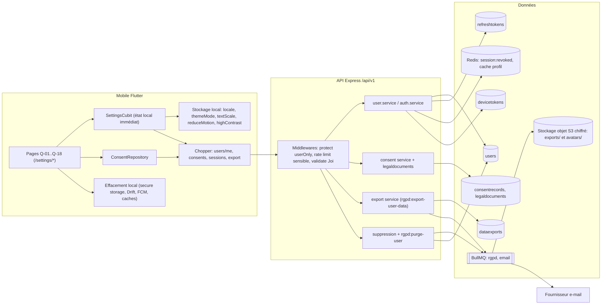
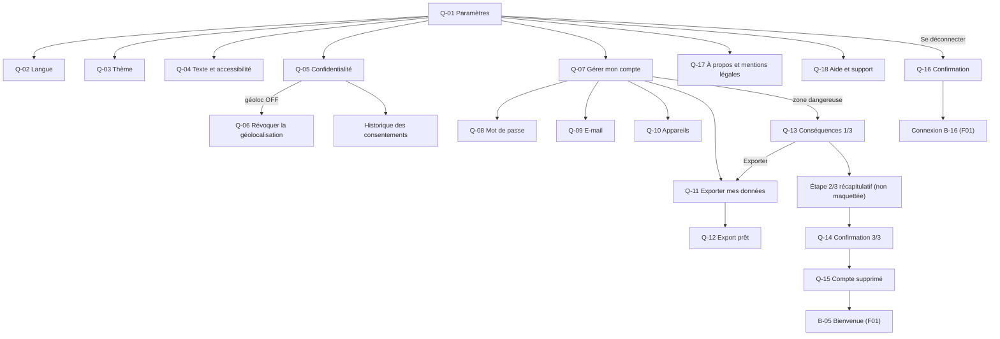
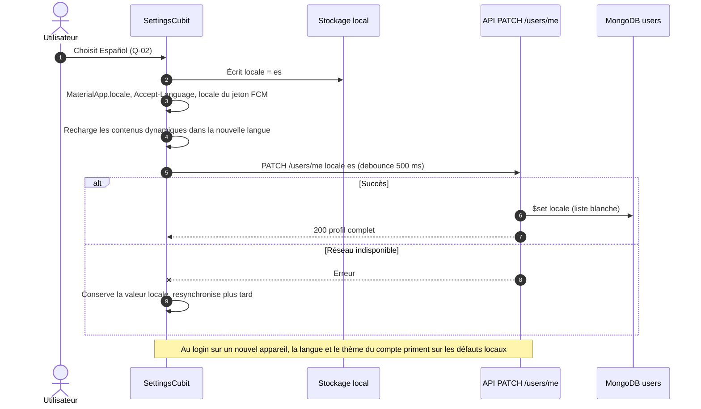
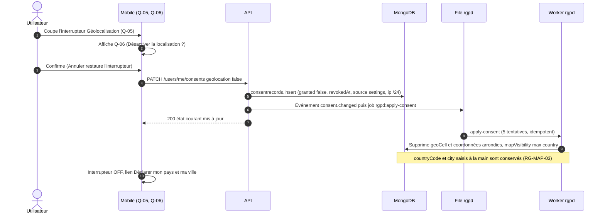
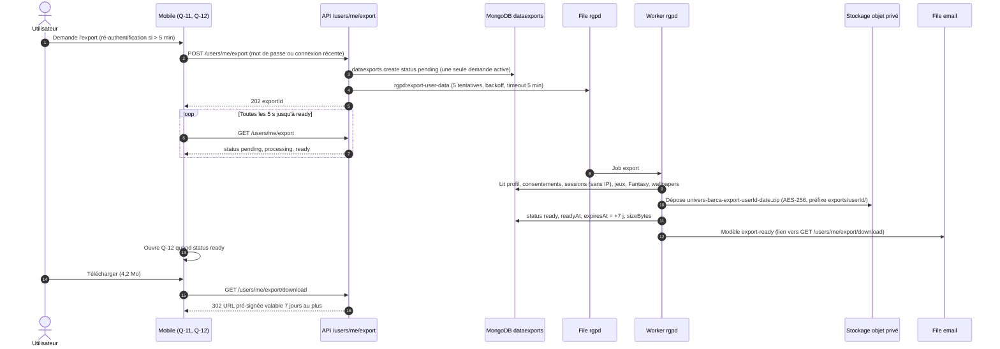
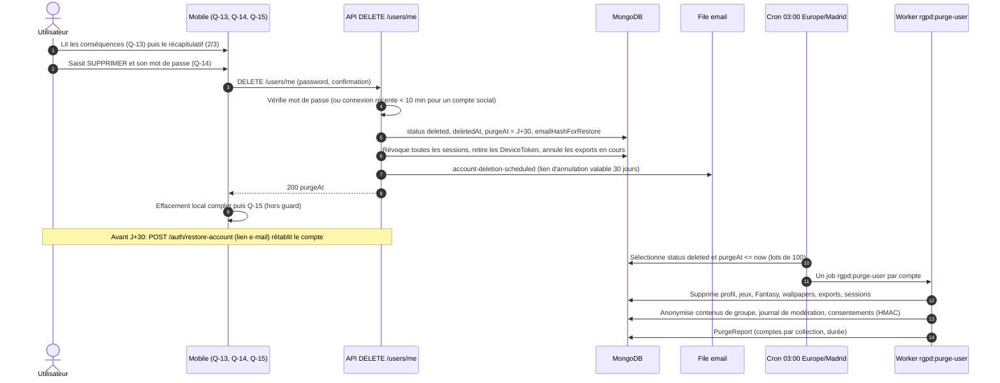
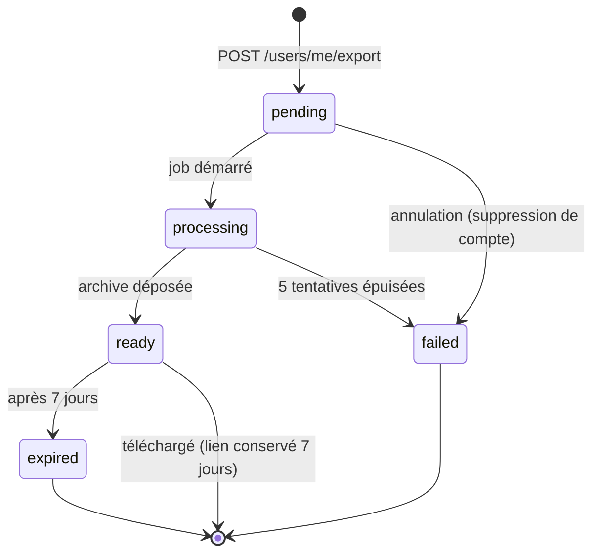
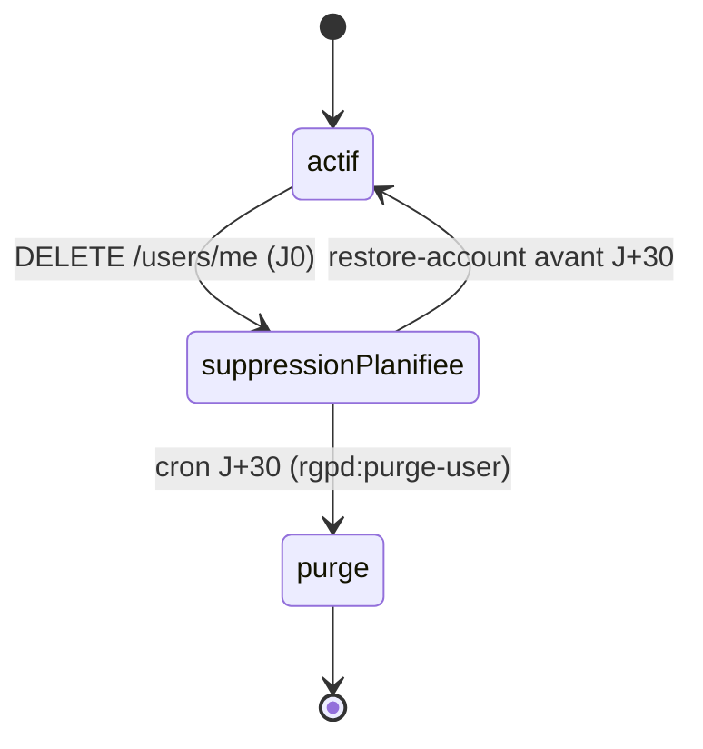
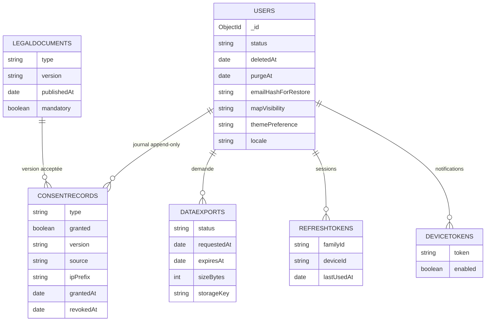
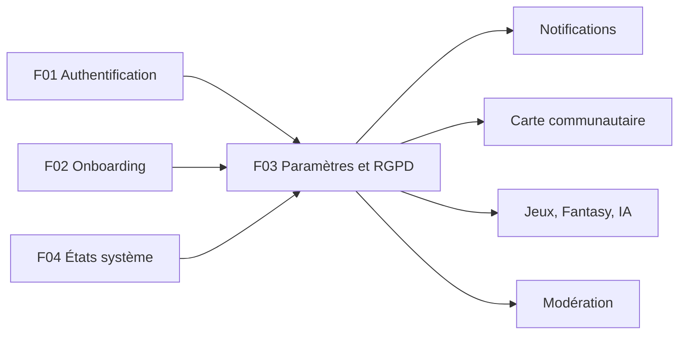

# F03 — Paramètres, confidentialité et RGPD

> Document de fonctionnalité de l'architecture Univers Barça. Il décrit l'espace **Paramètres et compte** de l'application mobile (langue, thème, accessibilité, consentements, appareils, mot de passe, e-mail) et les **droits RGPD** de l'utilisateur : consentements historisés, export asynchrone de ses données, suppression de compte avec délai de grâce de 30 jours puis purge. Il explique le « pourquoi » de chaque règle et signale les écarts entre code existant, backlog et CDC.
>
> Convention : **(existant)** = présent dans le dépôt ; **(backlog)** = décrit dans une issue, pas encore codé ; **(proposé)** = suggestion de ce document.

---

## 1. Résumé et fiche

### 1.1 Valeur utilisateur

L'utilisateur garde la main sur son expérience et sur ses données : il change la langue, le thème ou la taille du texte et voit l'effet immédiatement ; il active ou retire chaque consentement (géolocalisation approximative, notifications, statistiques anonymes) indépendamment des autres, avec un historique daté ; il retire un appareil perdu en un geste ; il télécharge une archive complète de ses données ; il peut supprimer son compte en trois étapes en sachant exactement ce qui est effacé, ce qui est conservé de façon anonyme, et qu'il dispose de 30 jours pour changer d'avis.

Côté produit et juridique, cette fonctionnalité est ce qui rend l'application **conforme au RGPD** (droit d'accès, de portabilité, d'effacement, de retrait du consentement) sans intervention manuelle d'un administrateur.

### 1.2 Fiche

| Champ | Valeur |
|---|---|
| Phase | Phase 1 — MVP |
| Priorité | P0 : paramètres d'affichage, consentements, export, suppression, déconnexion, sécurité des actions sensibles ; P1 : accessibilité fine, appareils, e-mail, mentions légales, aide, visibilité carte |
| Épopées backlog | `MOB-Q` (31 issues), `API-AUTH` (issues `API-AUTH-12`, `API-AUTH-15` à `API-AUTH-16`, `API-AUTH-19` à `API-AUTH-31`) ; effets transverses avec `API-PLAT` (purges, registre RGPD : `API-PLAT-52`, `API-PLAT-54`) |
| Écrans | `Q-01` Paramètres, `Q-02` Langue, `Q-03` Thème, `Q-04` Taille du texte et accessibilité, `Q-05` Confidentialité et consentements, `Q-06` Révoquer la géolocalisation, `Q-07` Gérer mon compte, `Q-08` Changer le mot de passe, `Q-09` Changer l'e-mail, `Q-10` Appareils connectés, `Q-11` Exporter mes données, `Q-12` Export prêt, `Q-13` Suppression — conséquences, `Q-14` Suppression — confirmation, `Q-15` Compte supprimé, `Q-16` Confirmation de déconnexion, `Q-17` À propos et mentions légales, `Q-18` Aide et support |
| Dépôts concernés | `univers_barca_mobile` (écrans), `univers_barca_api` (routes `users/me/*`, jobs `rgpd`) ; l'admin n'a pas d'écran dédié (back-office de purge hors périmètre) |
| Référence CDC | CDC Global §2.13, §2.15, §10.2 ; CDC Backend §4.8 (anonymisation), §5.7 (rétention) ; CDC Flutter §7.12, §8, §9, §13 |

### 1.3 État d'avancement du code

| Brique | État |
|---|---|
| `GET/PATCH /users/me` (langue, thème), `POST /auth/consents` (ligne par changement), `GET /users/me/export` **synchrone** (profil + consentements + sessions), `DELETE /users/me` (statut `deleted`, e-mail et mot de passe effacés, sessions révoquées) | **(existant)** dans `user.service.ts`, `auth.service.ts` |
| Cron `0 3 * * *` (Europe/Madrid) `purgeDeletedAccounts` : `User.deleteMany` des comptes `deleted` depuis plus de 30 jours | **(existant)** dans `jobs/scheduler.ts`, mais **ne supprime que la collection `users`** (pas de cascade ni d'anonymisation) |
| Modèle `ConsentRecord` : `terms|privacy|geolocation|notifications|analytics`, `granted`, `version`, `grantedAt`, `revokedAt` ; modèle `NotificationPreference`, `DeviceToken` | **(existant)** |
| Historique de consentements (`GET /users/me/consents`), registre `legaldocuments`, export asynchrone (`dataexports`, job `rgpd`), archive ZIP, restauration, purge en cascade, sessions/appareils, changement de mot de passe/e-mail, avatar, `mapVisibility` | **(backlog)** |
| Mobile : aucune page `settings` (seule la constante de route `RouteConstants.settings`) | **(backlog)** |

---

## 2. Acteurs et user stories

| Acteur | Rôle |
|---|---|
| Utilisateur | Propriétaire du compte, exerce ses droits |
| Système (jobs) | Construit l'archive, envoie les e-mails, purge à J+30 |
| Support / DPO | Reçoit les demandes d'aide ; consulte le registre RGPD |

| # | User story | Critères d'acceptation clés |
|---|---|---|
| US1 | Je change la langue et le thème sans redémarrer l'app. | Application locale immédiate puis `PATCH /users/me` (debounce 500 ms) ; « Suivre la langue du système » ; synchro sur un autre appareil (`MOB-Q-05`, `API-AUTH-28`) |
| US2 | J'ajuste la taille du texte et l'accessibilité. | Multiplicateur 85 %–150 % par pas de 5 % ; réduire les animations ; contraste renforcé ≥ 7:1 ; réglages **locaux à l'appareil** (`MOB-Q-09`) |
| US3 | Je contrôle chaque consentement séparément. | Aucun interrupteur pré-activé ; une ligne d'historique par changement ; retrait de la géolocalisation → confirmation `Q-06` (`MOB-Q-10/11/12`) |
| US4 | Je consulte l'historique de mes consentements. | Liste datée type/accordé-révoqué/date/version, « 3 enregistrements » (`API-AUTH-21`) |
| US5 | Je gère mon compte (mot de passe, e-mail). | Mot de passe actuel requis ; autres sessions révoquées ; e-mail changé après code ; comptes sociaux en lecture seule (`MOB-Q-14` à `MOB-Q-17`) |
| US6 | Je vois et retire mes appareils. | Appareil courant sans bouton ; retrait immédiat ; « Se déconnecter de tous les appareils » (`API-AUTH-15/16`, `MOB-Q-18`) |
| US7 | Je demande l'export de mes données. | Asynchrone, une demande active, archive ZIP, lien valable 7 jours, taille en Mo (`API-AUTH-24/25`, `MOB-Q-19/20`) |
| US8 | Je supprime mon compte en 3 étapes. | Conséquences claires ; confirmation `SUPPRIMER` + mot de passe ; effet immédiat d'anonymisation ; 30 jours pour annuler (`API-AUTH-26`, `MOB-Q-21/22/24`) |
| US9 | Je me déconnecte proprement. | `POST /auth/logout`, jeton FCM supprimé, effacement local, déconnexion locale même hors-ligne (`MOB-Q-25`) |
| US10 | Je consulte mentions légales, licences et l'aide. | Versions légales datées ; FAQ localisée avec recherche ; e-mail de support pré-rempli (`MOB-Q-26/27`) |

---

## 3. Architecture de la fonctionnalité



**Légende et choix techniques.**

* **Local d'abord** : toute préférence est appliquée sur l'appareil **avant** l'appel réseau ; en cas d'échec la valeur locale est conservée et resynchronisée plus tard (jamais de retour arrière visible). Seules la langue et le thème sont synchronisés avec le compte ; taille du texte, animations réduites et contraste restent propres à l'appareil.
* **Consentements = journal append-only** : jamais d'`update` d'une ligne existante ; l'état courant est « la dernière ligne par type ». C'est ce qui permet de prouver un consentement.
* **Export et purge = jobs asynchrones** sur la file `rgpd` : ils peuvent durer (zip, images, cascade) et doivent survivre à un redémarrage ; ils sont idempotents et réessayés (jusqu'à 8 tentatives sur 24 h selon `API-PLAT-53`).
* **Limiteur « sensible »** (5/heure) sur export et suppression pour empêcher l'abus et le bruteforce du mot de passe de confirmation.
* **Stockage objet privé** pour les archives (chiffrement côté serveur AES-256, suppression automatique à 7 jours) ; l'avatar est dans un bucket public/CDN distinct (`API-AUTH-31`).

---

## 4. Écrans et navigation

### 4.1 Tableau des écrans

| Code | Nom | Rôle |
|---|---|---|
| `Q-01` | Paramètres | Liste groupée (icône teintée, titre, sous-titre de valeur, chevron) ; pied « Se déconnecter » et `v{version}` |
| `Q-02` | Langue | Français / English / Español / « Suivre la langue du système » |
| `Q-03` | Thème | Automatique (système) / Clair / Sombre, transition 200 ms |
| `Q-04` | Taille du texte et accessibilité | Curseur 85–150 %, réduire les animations, contraste renforcé |
| `Q-05` | Confidentialité et consentements | 3 interrupteurs distincts (géolocalisation approximative, notifications push, statistiques d'usage anonymes) + visibilité sur la carte + politique + historique |
| `Q-06` | Révoquer la géolocalisation | Dialogue « Désactiver la localisation ? » avec repli pays/ville manuel |
| `Q-07` | Gérer mon compte | Mot de passe (« Modifié il y a 3 mois »), e-mail, appareils, export, zone dangereuse |
| `Q-08` | Changer le mot de passe | Actuel + nouveau + confirmation, jauge |
| `Q-09` | Changer l'e-mail | Nouvelle adresse puis code à 6 chiffres |
| `Q-10` | Appareils connectés | Liste (« iPhone 15 · Yaoundé — Actuel »), « Retirer », « Se déconnecter de tous les appareils » |
| `Q-11` | Exporter mes données | Demande d'export, statut en cours |
| `Q-12` | Export prêt | « TON ARCHIVE EST PRÊTE », « Télécharger (4,2 Mo) », « Renvoyer l'e-mail » |
| `Q-13` | Suppression — conséquences (1/3) | Ce qui est supprimé / conservé anonymement ; « Exporter », « Annuler » |
| `Q-14` | Suppression — confirmation (3/3) | Mot de confirmation + mot de passe |
| `Q-15` | Compte supprimé | Écran de fin hors session |
| `Q-16` | Confirmation de déconnexion | Dialogue de confirmation |
| `Q-17` | À propos et mentions légales | Version, build, environnement, CGU/confidentialité, licences |
| `Q-18` | Aide et support | FAQ localisée, contact (« Réponse sous 48 h »), signaler un bug |

> Étape **2/3** de la suppression : non maquettée (l'écart entre maquettes et spec est signalé dans `MOB-Q-21`) ; en attendant, elle est un récapitulatif des éléments supprimés.

### 4.2 Captures

<p>


</p>

*`Q-05` : « Chaque consentement est distinct et révocable à tout moment » — géolocalisation approximative (activée), notifications push (activée), statistiques d'usage anonymes (désactivée), puis « Visibilité sur la carte — Ville uniquement », politique de confidentialité et « Historique de mes consentements — 3 enregistrements ». `Q-12` : archive prête, lien valable 7 jours, bouton « Télécharger (4,2 Mo) », « Renvoyer l'e-mail ».*

### 4.3 Navigation



---

## 5. Flux détaillés

### 5.1 Changer la langue ou le thème (local d'abord, synchro différée)



* L'effet est visible **avant** toute réponse réseau : jamais de retour arrière visible.
* Côté serveur, `user.locale` pilote immédiatement la langue des e-mails, notifications et contenus générés (`API-AUTH-28`) ; l'en-tête `Accept-Language` sert d'appoint pour les non-authentifiés.
* `textScale`, `reduceMotion`, `highContrast` ne sont **pas** envoyés au serveur dans `MOB-Q-05` ; l'API (`API-AUTH-28`) prévoit toutefois `accessibility{textScale 0.85..1.5, reduceMotion, highContrast}` : décision à trancher (§14).

### 5.2 Retrait d'un consentement (géolocalisation) avec effets en cascade



**Pourquoi un événement + job ?** Le retrait doit produire des effets durables (purge de données dérivées dans les agrégats de la carte, dans les 5 minutes) sans ralentir la réponse HTTP ; le job est idempotent donc rejouable.

Effets par type (`API-AUTH-23`) :

| Consentement retiré | Effet |
|---|---|
| `geolocation` | Suppression des données de localisation dérivées ; `mapVisibility` plafonné à `country` ; pays/ville déclarés conservés |
| `notifications` | `DeviceToken.enabled=false` (tous les jetons), arrêt de toute émission FCM ; côté mobile, jeton FCM supprimé ; rétabli au ré-opt-in |
| `analytics` | `analyticsOptOut=true` renvoyé par `GET /users/me` et la config ; arrêt immédiat de l'envoi d'événements côté mobile ; données existantes conservées sous forme agrégée anonyme |
| `terms`, `privacy` | Non modifiables par cette route (re-acceptation dédiée via `POST /users/me/legal/accept`) |

### 5.3 Export RGPD asynchrone



**Explications.**

1. **Pourquoi asynchrone ?** L'ancienne route synchrone **(existant)** retourne tout en une réponse JSON ; avec jeux, Fantasy, conversations IA et images générées elle deviendrait lente et fragile. La nouvelle version enfile un job et expose un état.
2. **Une seule demande active** ; nouvelle demande permise 1 fois / 24 h (`429 EXPORT_TOO_SOON`) ; `409 EXPORT_ALREADY_PENDING` côté mobile si une demande est en cours.
3. **Contenu** de l'archive : un JSON par domaine (`profile.json`, `consents.json`, `sessions.json` sans IP, `gamification.json`, `ai-conversations.json`, `fantasy-masia.json`, `wallpapers.json` + images dans `wallpapers/`) et un `README.txt` FR/EN/ES décrivant le schéma ; dates ISO 8601 UTC ; taille max 500 Mo (au-delà, scission en parties).
4. **Jamais exporté** : `passwordHash`, hachages de jetons, secrets TOTP ; données d'autres utilisateurs exclues (messages de groupe : uniquement ceux écrits par l'utilisateur).
5. **Lien** : l'e-mail pointe vers `/users/me/export/download` (jeton à usage limité à 5 téléchargements) qui redirige vers l'URL pré-signée ; `POST /users/me/export/resend` renvoie l'e-mail (1 fois/heure ; le mobile limite à 3 renvois par demande avec délai 60 s — à confirmer).
6. **Échec définitif** (5 tentatives) : `status=failed` + e-mail d'excuse ; après 7 jours : `expired`, `Q-12` affiche « Lien expiré — refaire une demande ».

### 5.4 Suppression de compte, délai de grâce et purge à J+30



**Pourquoi un délai de 30 jours ?** C'est un filet de sécurité (suppression accidentelle ou compte piraté) ; pendant ce délai le compte est déjà **invisible** (profil retiré des cartes et classements, pseudo remplacé par « Utilisateur supprimé » dans les contenus publiés, e-mails désabonnés) mais **restaurable**. Après J+30, la suppression est irréversible.

**Matrice de purge** (CDC Backend §4.8 et `API-AUTH-27`) :

| Donnée | Traitement |
|---|---|
| Profil, préférences, jetons, sessions, `DeviceToken` | Suppression définitive |
| Historique Guess the Player / Quiz, progression, badges, séries | Suppression définitive |
| Équipes Fantasy, joueurs Masia, conversations IA, wallpapers (fichiers objet inclus), exports | Suppression définitive |
| Contenus publiés dans les groupes | Conservés, `authorId=null`, affichage « Utilisateur supprimé » |
| Journal de modération | Conservé, identifiant technique dissocié de toute donnée identifiante |
| Consentements | Conservés 5 ans dissociés (`userId` remplacé par un pseudonyme HMAC irréversible) pour preuve |
| Statistiques agrégées | Conservées, aucune donnée personnelle résiduelle |

* **Idempotence et alerte** : un échec partiel est réessayé (jamais de purge à moitié silencieuse) ; alerte Slack via le webhook existant ; rapport `PurgeReport`.
* **Écart UX à arbitrer** : `Q-15` affiche « Tes données ont été effacées » alors que la purge réelle intervient à J+30 ; l'API renvoie `purgeAt` pour afficher la date réelle (`API-AUTH-26`).
* **Écart de code** : la suppression actuelle **(existant)** efface l'e-mail immédiatement (impossible de restaurer ni de détecter le même e-mail) et le cron ne supprime que `users`.

### 5.5 Cycles de vie



*Statut d'un export (`dataexports.status`).*



*Cycle de suppression (vu côté `users.status` : `active` → `deleted` → entité supprimée). Les consentements dissociés survivent 5 ans.*

---

## 6. Contrats d'API

Préfixe `/api/v1` ; toutes les routes ci-dessous exigent `protect` + `userOnly` (Bearer utilisateur). Erreurs `{success:false,error:{code,message,details?,traceId}}`.

| Méthode | Chemin | Rate limit | Requête | Réponse | Erreurs principales |
|---|---|---|---|---|---|
| GET | `/users/me` | 120/min | — | profil privé (+ `passwordChangedAt`, `analyticsOptOut`, `mapVisibility`) | `401` |
| PATCH | `/users/me` | 300/min | `{locale?,themePreference?,mapVisibility?,...}` partiel `min(1)` | profil complet | `422` (champ inconnu, `locale` hors `fr/en/es`, `textScale` hors borne) |
| GET/PATCH | `/users/me/preferences` | 120/min | `{locale,followSystemLocale,themePreference,accessibility{textScale,reduceMotion,highContrast}}` | objet complet avec défauts | `422` |
| GET | `/users/me/consents` | 120/min | — | `{current{terms,privacy,geolocation,notifications,analytics},history[…],total}` | — |
| PATCH | `/users/me/consents` | 20/h | `{geolocation?,notifications?,analytics?}` | état courant | `422` (valeur inchangée = idempotent) |
| POST | `/auth/consents` | 20/h | `{type,granted,version?}` **(existant, déprécié : `Deprecation: true`)** | `201` ligne créée | `422` |
| GET | `/legal/documents` | public, cache 1 h | — | versions et URLs FR/EN/ES | — |
| POST | `/users/me/legal/accept` | 5/h | `{type,version}` | `204` | `409 LEGAL_VERSION_OUTDATED` |
| GET | `/users/me/sessions` | 120/min | — | `{items:[{id,deviceName,platform,approxCity,approxCountry,createdAt,lastActiveAt,current}],total}` | — |
| DELETE | `/users/me/sessions/:id` | 20/h | — | `204` idempotent | `404` |
| DELETE | `/users/me/sessions?except=current` | 5/h | — | `204` | — |
| POST | `/auth/logout-all` | 5/h | — | `204` | — |
| POST | `/users/me/password/change` | 5/h + 3 erreurs/15 min | `{currentPassword,newPassword}` | `200` `revokedOtherSessions` | `401 CURRENT_PASSWORD_INVALID`, `422 WEAK_PASSWORD`, `429` |
| POST | `/users/me/password` | 5/h | `{newPassword}` (compte social sans mot de passe, connexion < 10 min) | `204` | `409`, `422` |
| POST | `/users/me/email` | 3/24 h | `{newEmail,password}` | `202` | `409 EMAIL_TAKEN`, `401` |
| POST | `/users/me/email/confirm` | 5 essais | `{code}` | `200` | `400`, `429` |
| POST | `/users/me/export` | sensible 1/24 h | `{password}` | `202 {exportId}` | `429 EXPORT_TOO_SOON`, `409 EXPORT_ALREADY_PENDING` |
| GET | `/users/me/export` | 120/min | — | `{id,status,requestedAt,readyAt,expiresAt,sizeBytes}` | `404` |
| GET | `/users/me/export/download` | 5 téléchargements/lien | — | `302` ou `{url}` | `410` expiré |
| POST | `/users/me/export/resend` | 1/h | — | `204` | `429` |
| DELETE | `/users/me` | sensible 5/h | `{password,confirmation:'SUPPRIMER'}` | `{purgeAt}` | `401`, `422` (confirmation inexacte), `429` |
| POST | `/auth/restore-account` | public, limité | `{token}` (lien e-mail 30 j) | `200` session | `410` |
| PUT/DELETE | `/users/me/avatar` | 5/h | multipart `file` (JPEG/PNG/WebP ≤ 2 Mo) | `{avatarUrl}` | `422` |

**Exemple — état des consentements**

```json
{ "success": true, "data": {
  "current": {
    "terms":         { "granted": true,  "version": "2026-10-01", "at": "2026-10-15T09:41:00Z" },
    "privacy":       { "granted": true,  "version": "2026-10-01", "at": "2026-10-15T09:41:00Z" },
    "geolocation":   { "granted": false, "version": "1.0", "at": "2026-10-20T18:02:11Z" },
    "notifications": { "granted": true,  "version": "1.0", "at": "2026-10-15T09:47:30Z" },
    "analytics":     { "granted": false, "version": "1.0", "at": "2026-10-15T09:41:00Z" } },
  "history": [ { "type": "geolocation", "granted": false, "source": "settings", "createdAt": "2026-10-20T18:02:11Z" } ],
  "total": 3 } }
```

**Exemple — export prêt**

```json
{ "success": true, "data": { "id": "6730…", "status": "ready", "requestedAt": "2026-10-15T10:00:00Z",
  "readyAt": "2026-10-15T10:02:41Z", "expiresAt": "2026-10-22T10:02:41Z", "sizeBytes": 4404019 } }
```

> Les contrats **proposés** par le mobile (`MOB-Q-03`) diffèrent de ceux de l'API sur plusieurs noms (voir §14).

---

## 7. Modèle de données

| Collection | Champs / index |
|---|---|
| `users` **(existant)** | `locale`, `themePreference`, `status`, `deletedAt`, `passwordChangedAt`, `avatarKey`, `countryCode`, `city`, `termsAcceptedAt` |
| `users` **(backlog)** | `followSystemLocale`, `accessibility{textScale,reduceMotion,highContrast}`, `mapVisibility` (`hidden|country|city`), `analyticsOptOut`, `purgeAt`, `emailHashForRestore`, `pendingEmail`, `passwordHistory[3]` |
| `consentrecords` | `userId`, `type` (`terms|privacy|geolocation|notifications|analytics` + `charter`), `granted`, `version`, `grantedAt`, `revokedAt`, **(backlog)** `source` (`signup|settings|reaccept|system`), `ipPrefix` (/24), `userAgent` (≤ 120) ; index `{userId,type,createdAt:-1}` ; append-only |
| `legaldocuments` **(backlog)** | `type` (`terms|privacy|charter`), `version` (ex. `2026-10-01`), `publishedAt`, `url{fr,en,es}`, `mandatory` |
| `dataexports` **(backlog)** | `userId`, `status` (`pending|processing|ready|failed|expired`), `requestedAt`, `readyAt`, `expiresAt`, `sizeBytes`, `storageKey` |
| `refreshtokens` | sessions = familles (voir F01) : `familyId`, `deviceId`, `platform`, `approxCity`, `lastUsedAt` |
| `devicetokens` | `enabled` (**backlog**), `deviceId`, `locale`, `timezone` |
| `purgereports` **(backlog, nom proposé)** | `userIdHash`, `counts{collection:n}`, `durationMs` |



**Redis** : `session:revoked:<sid>` (15 min) après retrait d'un appareil ; cache profil invalidé par hook `post-save` (`API-AUTH-28`) ; compteur de 3 erreurs de mot de passe actuel (15 min, clé **proposée** `pwdchange:fail:<userId>`).

**Mobile (local)** : `locale` (`fr|en|es|system`), `themeMode`, `textScale`, `reduceMotion`, `highContrast`, `lastSyncedAt`, drapeau `wipe_pending`.

**Migrations** : création de `legaldocuments` avec la version `1.0` historique ; ajout de `source` aux `consentrecords` existants (valeur `signup`) ; initialisation `purgeAt` des comptes déjà `deleted` (`deletedAt + 30 j`) ; stockage objet : règle de cycle de vie à 7 jours sur `exports/`.

---

## 8. Traitements asynchrones et cache

| Traitement | Mécanisme | Détails |
|---|---|---|
| Application d'un changement de consentement | EventEmitter `consent.changed` + job `rgpd:apply-consent` (file `rgpd`) | Idempotent, 5 tentatives ; purge des données de localisation sous 5 min |
| Export de données | `rgpd:export-user-data` | 5 tentatives, backoff exponentiel, timeout 5 min ; concurrence 1 (exports coûteux, `API-PLAT-53`) ; échec définitif → `failed` + e-mail d'excuse |
| Nettoyage des exports | Règle de cycle de vie objet + job de nettoyage | Suppression à 7 jours ; statut `expired` |
| Envoi des e-mails `export-ready`, `account-deletion-scheduled`, `password-changed`, `security-change` | File `email` | `jobId = dedupeKey`, 5 tentatives (F01) |
| Sélection des comptes à purger | Cron quotidien `03:00 Europe/Madrid` **(existant, à étendre)** | Lots de 100 ; un job `rgpd:purge-user {userId}` par compte |
| Purge d'un compte | `rgpd:purge-user` | Idempotent, audité (`PurgeReport`), retry 8 fois sur 24 h ; échec partiel → alerte Slack |
| Anonymisation d'IP des sessions | Job planifié (proposé) | Dernier octet à 0 après 30 jours |
| Politique de rétention des données techniques | Jobs de purge (`API-PLAT-52`) | Refresh révoqués 90 jours, logs 90 jours, traces 14 jours (CDC §5.7) |
| Cache | Profil Redis invalidé à chaque PATCH ; `GET /legal/documents` 1 h ; liste de sessions non mise en cache | — |

**Idempotence** : `PATCH /users/me/consents` ne crée une ligne que si la valeur change ; `DELETE` de session répond `204` même si déjà révoquée ; la purge peut être rejouée sans effet double.

---

## 9. Règles de gestion

1. **Préférences** : `locale ∈ {fr,en,es}`, `themePreference ∈ {system,light,dark}`, `textScale` 0,85 à 1,5 par pas de 0,05 (Q-04 affiche « 100 % » = 1,0) ; défauts `fr`, `system`, 1.
2. **Langue système** : « Suivre la langue du système » désactive la sélection manuelle et applique `PlatformDispatcher.locale` (repli `fr`) ; le changement met à jour `MaterialApp.locale`, `Accept-Language`, la `locale` du jeton FCM et le compte.
3. **Synchronisation** : appliquer local d'abord ; `PATCH` avec debounce 500 ms ; sur nouvel appareil, langue/thème du compte prioritaires.
4. **Accessibilité** : réduire les animations initialisé depuis `MediaQuery.disableAnimations` (consommé par jeux et notifications) ; contraste renforcé ≥ 7:1 avec indicateurs non colorés.
5. **Consentements** : types modifiables `geolocation`, `notifications`, `analytics` ; `terms`/`privacy` non révocables ici (lecture seule, re-acceptation dédiée) ; une ligne par changement ; **jamais** d'`update` ni de suppression ; preuve conservée 5 ans après suppression sous forme dissociée.
6. **Géolocalisation** : opt-in explicite, jamais pré-activé (RG-MAP-02) ; la position GPS précise n'est jamais stockée ni affichée ; le retrait supprime les données dérivées, conserve pays/ville déclarés (RG-MAP-03).
7. **Visibilité carte** : `mapVisibility ∈ {hidden, country, city}` (défaut proposé : `city`) ; `geolocation` retiré force `country` au maximum.
8. **Mot de passe** : changement avec mot de passe actuel (Argon2) ; 3 erreurs/15 min → `429` ; nouveau ≠ actuel et ≠ 3 derniers ; succès → `passwordChangedAt=now`, autres sessions révoquées (la courante reçoit un nouveau refresh), e-mail `password-changed` ; « Modifié il y a 3 mois » dérivé de `passwordChangedAt` (« Jamais modifié » pour un compte social).
9. **E-mail** : `pendingEmail` + code 6 chiffres (15 min côté API ; 10 min suggérés côté mobile, à confirmer), 5 essais, 3 demandes/24 h ; l'ancienne adresse reste valide jusqu'à confirmation, puis est notifiée (annulation possible 7 jours).
10. **Sessions** : session = famille de refresh non révoquée et non expirée ; courante en premier ; 20 sessions max ; retirer = révoquer la famille ; effet immédiat sur l'access token (`session:revoked:<sid>`) ; e-mail `security-change` seulement pour « tous les appareils ».
11. **Ré-authentification** : si la dernière authentification a plus de 5 minutes (mobile) — ou connexion récente < 10 min côté API pour comptes sociaux — pour changer mot de passe/e-mail, exporter, supprimer.
12. **Export** : une demande active ; 1 / 24 h ; archive ≤ 500 Mo ; lien ≤ 7 jours ; 5 téléchargements ; renvoi de l'e-mail 1/h (API) ; jamais de secret ni de donnée d'un tiers.
13. **Suppression** : confirmation exacte (`SUPPRIMER`, `DELETE`, `ELIMINAR` selon locale) + mot de passe (ou réauthentification sociale) ; effets immédiats (statut `deleted`, révocation, retrait jetons push, retrait des cartes/classements) ; délai de grâce 30 jours avec `POST /auth/restore-account` ; purge quotidienne 03:00 (lots de 100) ; matrice de conservation du §5.4.
14. **Déconnexion** : `POST /auth/logout` + suppression du jeton FCM + effacement des caches liés au compte ; langue/thème/taille du texte de l'appareil conservés ; déconnexion locale même sans réseau (appel de révocation mis en file).
15. **Effacement local complet** (suppression) : `flutter_secure_storage`, toutes les tables Drift, préférences utilisateur (sauf langue/thème système), jeton FCM, caches d'images, fichiers temporaires ; idempotent, repris au lancement via `wipe_pending`.
16. **Textes légaux** : versions courantes dans `legaldocuments` ; si le document accepté est plus ancien et `mandatory`, les routes authentifiées répondent `403 REACCEPT_REQUIRED` (sauf `/legal/*`, `/users/me`, `/auth/logout`).

---

## 10. Sécurité, RGPD et anti-abus

* **Base légale et droits** : consentement (géolocalisation, notifications, statistiques), exécution du contrat (compte), droits d'accès/portabilité (export), effacement (suppression + purge), rectification (profil), retrait du consentement à tout moment (`Q-05`). Le registre des traitements et la revue de conformité sont portés par `API-PLAT-54`.
* **Preuve de consentement** : `ConsentRecord` append-only avec `version`, `source`, IP anonymisée (/24), `userAgent` tronqué ; conservée 5 ans, dissociée (`HMAC`) après suppression du compte.
* **Actions sensibles** : ré-authentification, limiteur « sensible » (5/h), 429 géré côté mobile avec `Retry-After` (bouton verrouillé) ; aucune saisie sensible dans les logs, l'observer BLoC ou les analytics ; masquage de l'aperçu multitâche sur `Q-08`, `Q-09`, `Q-14` (`FLAG_SECURE`, à valider).
* **Données minimales dans l'archive** : pas de secrets, pas de données tierces, `sessions.json` sans IP ; stockage objet privé chiffré AES-256 ; lien pré-signé ≤ 7 jours ; suppression automatique.
* **IP** : jamais renvoyée au client ; anonymisée (dernier octet à 0) après 30 jours ; ville approximative uniquement.
* **Mass assignment** : liste blanche sur `PATCH /users/me` (impossible de modifier `status`, `role`, `passwordHash`, `emailVerifiedAt`, `email`).
* **Avatar** : contrôle par signature binaire (magic bytes), refus SVG/GIF animés, ré-encodage `sharp` (suppression EXIF/GPS) en WebP 512×512 et 128×128, 2 Mo max, 5 uploads/heure.
* **Apple / Google** : la suppression de compte côté Apple (`account-delete`) déclenche la même purge (F01).
* **Anti-abus** : un seul export actif, 1/24 h ; confirmation exacte pour supprimer ; restauration par lien à usage temporaire.
* **Pas de relance** de permission refusée ; rappel non intrusif uniquement dans `Q-05`/paramètres.

---

## 11. Erreurs et états dégradés

| Situation | Serveur | Client |
|---|---|---|
| Hors-ligne pendant un changement de préférence | — | Valeur locale conservée, resynchronisation ultérieure, aucun retour arrière visible |
| Hors-ligne pendant un changement de consentement | — | État optimiste, rollback si échec ; mise en file recommandée pour `analytics` et `notifications` |
| Retrait d'un consentement en échec | `5xx` | Rollback de l'interrupteur + SnackBar ; pas de purge locale partielle |
| Export déjà demandé | `409 EXPORT_ALREADY_PENDING` | Message et affichage du statut courant |
| Export trop fréquent | `429 EXPORT_TOO_SOON` + `Retry-After` | Bouton verrouillé, message de patience |
| Export en échec définitif | `status=failed` + e-mail d'excuse | `Q-11` affiche l'échec et propose de refaire une demande |
| Lien d'export expiré | `410` / `status=expired` | `Q-12` : « Lien expiré — refaire une demande » |
| Mot de passe actuel faux | `401 CURRENT_PASSWORD_INVALID` (ou `INVALID_CREDENTIALS` dans le contrat mobile) | Erreur sous le champ « Mot de passe actuel » |
| Mot de passe faible | `422 WEAK_PASSWORD` / détails de champ | Message ciblé, bouton désactivé tant que le formulaire est invalide |
| Trop de tentatives | `429 RATE_LIMITED` + `Retry-After` | Message « Trop de tentatives, réessaie plus tard », bouton verrouillé |
| Suppression : confirmation inexacte | `422` | Bouton inactif tant que la saisie ≠ mot attendu |
| Suppression : réseau coupé | — | Saisie conservée ; aucun effacement local sans succès serveur |
| Suppression réussie mais effacement local interrompu | — | `wipe_pending` repris au prochain lancement |
| Déconnexion hors-ligne | — | Déconnexion locale immédiate ; révocation en file |
| Mentions légales hors-ligne | — | Message « Connexion nécessaire » |
| Purge partielle | Retry puis alerte Slack | Aucun message utilisateur (invisible) ; aucun compte « à moitié purgé » ne reste actif |
| Re-acceptation légale requise | `403 REACCEPT_REQUIRED` + `documents[]` | Écran d'acceptation bloquant |

---

## 12. Connexions avec les autres fonctionnalités

| Fonctionnalité | Lien | Nature |
|---|---|---|
| F01 — Authentification et comptes | dépend de | Sessions/appareils, mot de passe, e-mail, `restore-account` ; la suppression révoque tous les refresh |
| F02 — Onboarding | dépend de | Consentements initiaux, langue choisie, pays/ville |
| F04 — États système | partage | `A-05` (429), `A-03` (hors-ligne), `A-08` si la session est retirée depuis un autre appareil |
| Notifications (`API-NOTIF`, `MOB-O`) | alimente | Retrait de `notifications` désactive les `DeviceToken` ; la langue règle la locale des push |
| Carte communautaire (`API-COMM`, `MOB-M`) | alimente | Retrait de `geolocation`, `mapVisibility`, retrait des profils supprimés des compteurs |
| Jeux, Fantasy, assistant IA, wallpapers | alimente | Leurs données sont incluses dans l'export et supprimées par la purge ; quotas inchangés |
| Modération (`API-MODER`) | partage | Journal de modération conservé, auteur dissocié |
| Observabilité / audit (`API-PLAT`) | alimente | Métriques des jobs `rgpd`, registre des traitements |



---

## 13. Observabilité et tests

**Métriques / alertes** : `jobs_failed_total{queue="rgpd"}`, durée et taux d'échec de `rgpd:export-user-data` et `rgpd:purge-user`, nombre d'exports `failed`, comptes en attente de purge (`purgeAt` dépassé), `ub_dead_letter_total{queue}` ; alerte Slack sur purge partielle. **Logs** : aucune donnée personnelle ; `userId` pseudonymisé ; `PurgeReport` conserve des compteurs par collection, pas de contenu.

**Tests API** (`API-AUTH-43`) : consentements (historique et idempotence), export (job exécuté en synchrone dans le test), suppression → purge à J+30 avec horloge simulée, restauration avant J+30, matrice de conservation, révocation de sessions (liste + retrait), mass assignment, bornes `textScale`.

**Tests mobile** (`MOB-Q-31`) : couverture ≥ 80 % sur domaine et cubits ; golden `Q-01` à `Q-18` (2 tailles × 2 thèmes) ; scénarios : thème/langue sans redémarrage, révocation géolocalisation, changement de mot de passe, export, suppression complète, déconnexion, hors-ligne.

**Scénarios k6** : `GET /users/me`, `PATCH /users/me`, `GET /users/me/sessions`, `POST /users/me/export` (sous le limiteur) ajoutés à `tests/load`.

| # | Cas | Résultat attendu |
|---|---|---|
| T1 | `PATCH {themePreference:'dark'}` | réponse `dark` ; un second appareil le lit par GET |
| T2 | `PATCH {locale:'de'}` | `422` |
| T3 | `PATCH {status:'active'}` d'un utilisateur suspendu | `422`, aucun changement |
| T4 | Retrait `geolocation` | nouvelle ligne `granted:false` ; données de localisation purgées sous 5 min ; pays/ville conservés |
| T5 | Même `PATCH` consentement répété | une seule ligne créée |
| T6 | Deux demandes d'export à moins de 24 h | `429 EXPORT_TOO_SOON` |
| T7 | Archive d'export | ne contient ni `passwordHash`, ni hachages de jetons, ni secrets TOTP |
| T8 | Suppression puis restauration à J+10 | compte rétabli ; sessions restent révoquées |
| T9 | Purge à J+30 | profil, jeux, Fantasy supprimés ; contenus de groupe avec `authorId=null` ; consentements dissociés |
| T10 | Retrait d'un appareil | access token de cette session refusé (`SESSION_REVOKED`) immédiatement |

---

## 14. Points ouverts et décisions à confirmer

1. **Texte de `Q-15`** : « Tes données ont été effacées » vs purge réelle à J+30 : afficher `purgeAt` ? (à arbitrer par le produit, `API-AUTH-26`).
2. **Étape 2/3 de la suppression** : non maquettée (raison facultative ou récapitulatif ?).
3. **Mot de confirmation** de suppression : `SUPPRIMER` seul (mobile `MOB-Q-22`, accepte `DELETE`/`ELIMINAR` par locale) vs libellé localisé dans l'API (`API-AUTH-26`).
4. **Noms de routes et d'erreurs divergents entre mobile et API** : `POST /users/me/password` (mobile) vs `/users/me/password/change` (API) ; `/users/me/email/verify` vs `/users/me/email/confirm` ; `GET /users/me/export/status` vs `GET /users/me/export` ; sessions `locationLabel`/`isCurrent` vs `approxCity`/`current` ; `INVALID_CREDENTIALS` vs `CURRENT_PASSWORD_INVALID` ; `EMAIL_ALREADY_USED` vs `EMAIL_TAKEN` ; `EXPORT_ALREADY_PENDING` côté mobile non défini côté API (qui renvoie `429 EXPORT_TOO_SOON`).
5. **Consentements** : mobile `POST /auth/consents` (+`version`) vs API `PATCH /users/me/consents` ; `charter` à ajouter à l'énumération.
6. **Réglages d'accessibilité** : locaux à l'appareil (`MOB-Q-05`) vs synchronisés (`accessibility` dans `API-AUTH-28`).
7. **Fenêtre de ré-authentification** : 5 min (mobile) vs 10 min (API) ; durée du code e-mail : 10 min (mobile) vs 15 min (API).
8. **Renvoi de l'e-mail d'export** : 3 par demande avec délai 60 s (mobile, à confirmer) vs 1/heure (API).
9. **Plage de `textScale`** : « 85 % à 150 % par pas de 5 % (à valider) ».
10. **`mapVisibility`** : champ API « à créer (à confirmer) » ; valeur par défaut (`city` vs `hidden`) à décider avec la carte.
11. **Adresse du support et contestation** : `mailto:` de configuration à confirmer.
12. **FAQ** : assets JSON embarqués vs API (`MOB-Q-27`, à confirmer).
13. **Écart de purge** : le cron actuel ne supprime que `users` ; la matrice complète (`API-AUTH-27`) doit être implémentée avant mise en production, sous peine de non-conformité.
14. **Écart CDC** : le CDC Backend §4.8 décrit un « droit à l'oubli » générique ; le délai de grâce de 30 jours et la restauration sont des décisions du backlog (`API-AUTH-26`) qui ne figurent pas dans le CDC.

---

## 15. Pour aller plus loin

**Épopées** : `MOB-Q`, `API-AUTH` (RGPD), `API-PLAT` (purges, registre), `MOB-O` (préférences de notification détaillées), `MOB-M` (carte).

**Issues repères** : `MOB-Q-05` (SettingsCubit), `MOB-Q-10` (consentements), `MOB-Q-19/20` (export), `MOB-Q-21/22/24` (suppression), `MOB-Q-23` (effacement local), `MOB-Q-28` (actions sensibles), `API-AUTH-21` à `API-AUTH-23` (consentements et effets), `API-AUTH-24/25` (export), `API-AUTH-26/27` (suppression et purge), `API-AUTH-28` (préférences), `API-AUTH-31` (avatar), `API-PLAT-52` et `API-PLAT-54` (rétention, registre RGPD).

**CDC** : CDC Global §2.13, §2.15, §10.2 ; CDC Backend §4.8 (anonymisation), §5.7 (rétention) ; CDC Flutter §7.12, §8, §9, §13.

**Fichiers de code** : API `src/services/user.service.ts` (`exportData`, `deleteAccount`), `src/services/auth.service.ts` (`setConsent`), `src/models/consent-record.model.ts`, `src/models/user.model.ts`, `src/models/platform.model.ts` (`DeviceToken`, `NotificationPreference`), `src/jobs/scheduler.ts` (`purgeDeletedAccounts`), `src/jobs/queues.ts` (file `rgpd`), `src/routes/index.ts` ; mobile `lib/core/constants/route_constants.dart`, `lib/l10n/*.arb`, `lib/core/error/failure.dart` ; maquettes `docs/maquettes/ecrans/Q/`.
