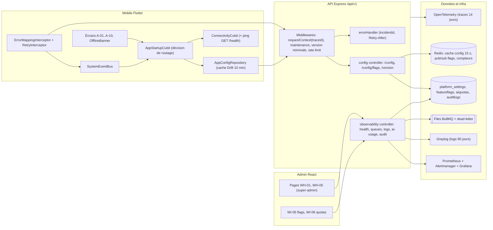
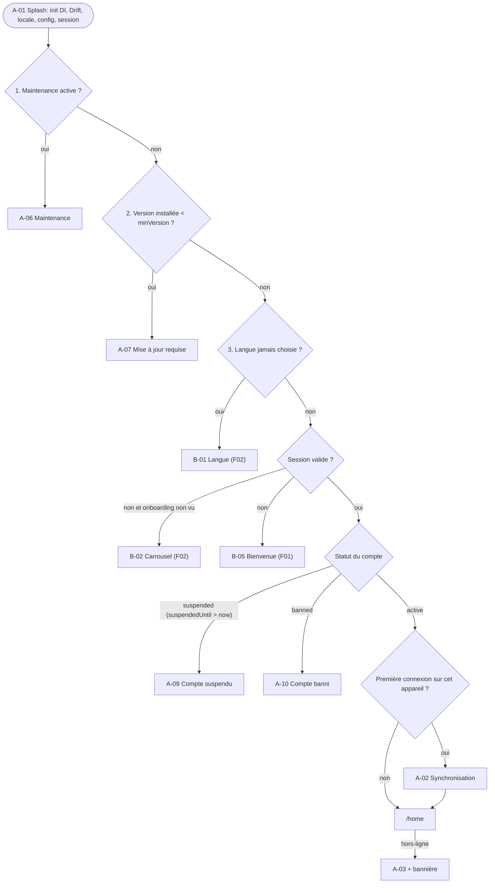
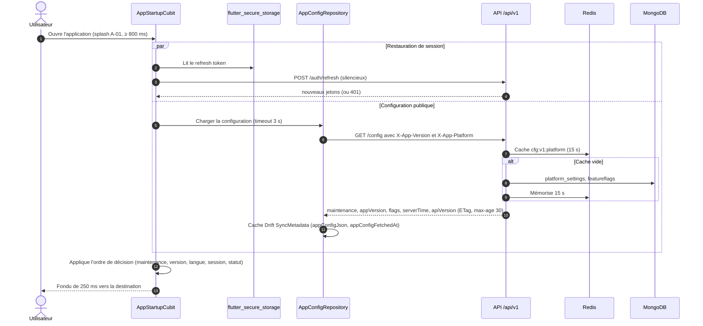
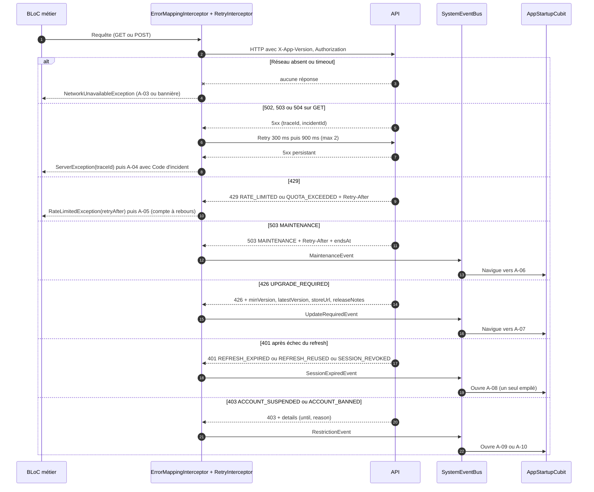
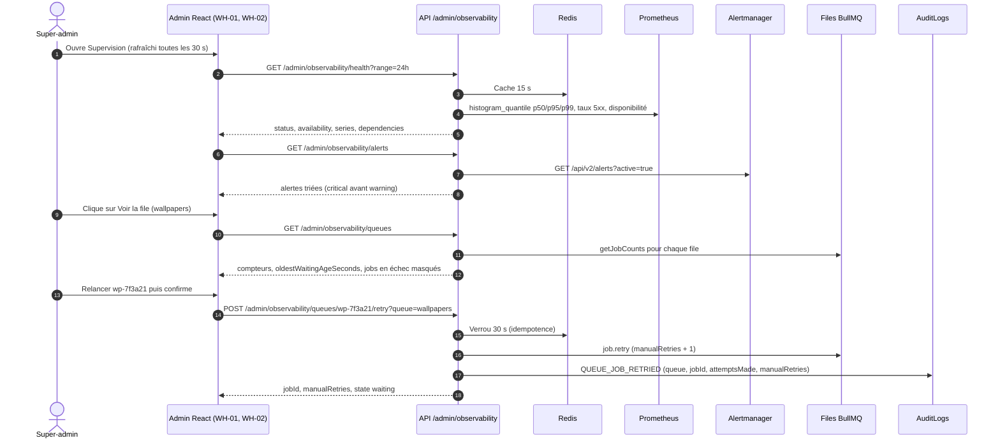
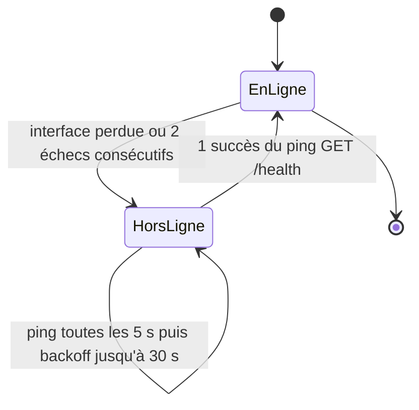
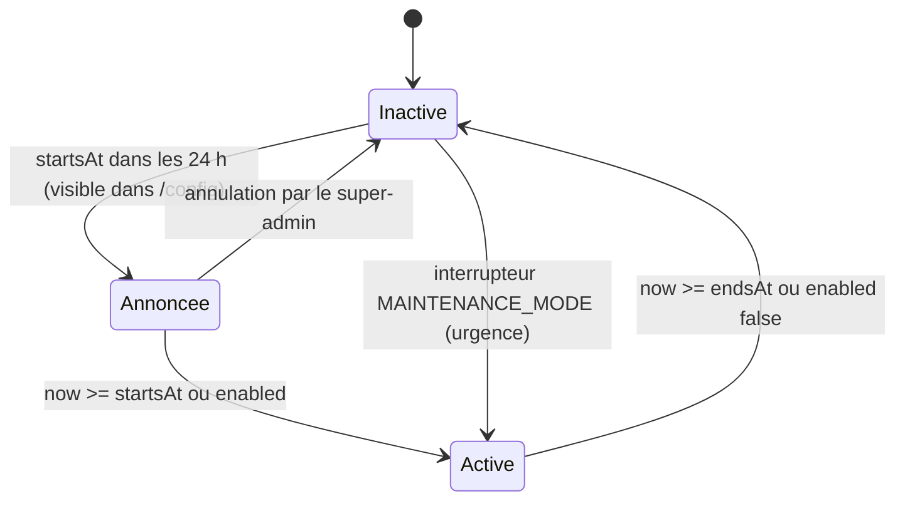
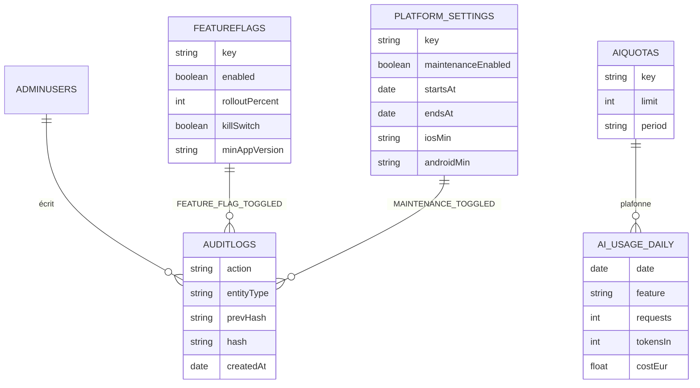
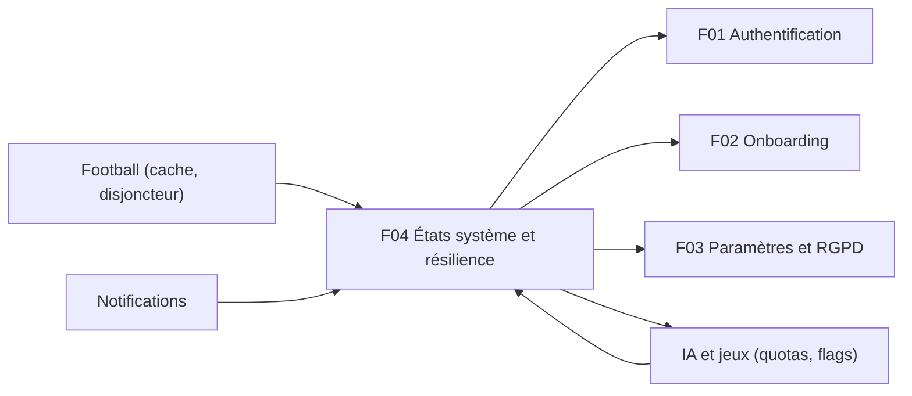

# F04 — États système et résilience

> Document de fonctionnalité de l'architecture Univers Barça. Il décrit comment l'application **démarre vite**, comment elle **réagit quand quelque chose ne va pas** (hors-ligne, erreur serveur, trop de requêtes, maintenance, mise à jour obligatoire, session expirée, compte suspendu ou banni), comment le serveur **pilote ces états** (`/config`, versions, maintenance, feature flags) et comment le back-office **supervise** la santé du système (files BullMQ, logs, consommation IA, journal d'audit).
>
> Convention : **(existant)** = présent dans le dépôt ; **(backlog)** = décrit dans une issue, pas encore codé ; **(proposé)** = suggestion de ce document.

---

## 1. Résumé et fiche

### 1.1 Valeur utilisateur

L'utilisateur ne doit **jamais** voir un écran blanc, un message technique ou une application figée. Au lancement, un splash de marque s'affiche puis l'app l'oriente vers le bon écran en moins de 2 secondes ; si le réseau tombe, il continue de consulter le contenu déjà synchronisé avec une bannière claire ; si le serveur a un souci, il voit un message rassurant avec un code d'incident à communiquer au support ; si une maintenance est planifiée ou si sa version est trop ancienne, l'app l'explique et lui indique quoi faire ; si sa session expire ou si son compte est sanctionné, il comprend pourquoi.

Pour l'équipe, ces états sont **pilotés à chaud** (sans redéployer) : un super-admin peut planifier une maintenance, relever la version minimale, couper un module par feature flag ou relancer un job en échec, et dispose d'un tableau de bord de supervision.

### 1.2 Fiche

| Champ | Valeur |
|---|---|
| Phase | Phase 0 (socle : observabilité, CI, sauvegardes) puis Phase 1 — MVP (états côté mobile et supervision admin) |
| Priorité | P0 : démarrage, hors-ligne, 5xx, maintenance, mise à jour requise, session expirée, restrictions de compte, `/config`, flags, métriques ; P1 : 429 détaillé, synchro nouvel appareil, observabilité mobile, supervision WH-01 à WH-05 |
| Épopées backlog | `MOB-A` (19 issues), `API-PLAT` (`API-PLAT-01` à `API-PLAT-11` états système et configuration, `API-PLAT-12` à `API-PLAT-25` supervision et observabilité, `API-PLAT-33/34` timeouts et circuit breakers, `API-PLAT-53` dead-letter), `ADM-WH` (15 issues) |
| Écrans mobile | `A-01` Splash, `A-02` Synchronisation nouvel appareil, `A-03` Hors-ligne, `A-04` Erreur serveur 5xx, `A-05` Trop de requêtes 429, `A-06` Maintenance planifiée, `A-07` Mise à jour requise, `A-08` Session expirée, `A-09` Compte suspendu, `A-10` Compte banni |
| Écrans admin | `WH-01` Santé technique, `WH-02` Files d'attente BullMQ, `WH-03` Explorateur de logs, `WH-04` Consommation IA, `WH-05` Journal d'audit ; en lien : `WI-05` Feature flags, `WI-06` Quotas IA |
| Dépôts concernés | `univers_barca_mobile`, `univers_barca_api`, `univers_barca_admin` |
| Référence CDC | CDC Flutter §5, §6.1, §6.3, §9.5, §12.1, §13.1 ; CDC Backend §6 (observabilité), §7 (jobs), §9.6 (sauvegardes), §10.2, §11.6 ; CDC Admin §4.7, §6.4 ; CDC Global §3.8, §10.3 |

### 1.3 État d'avancement du code

| Brique | État |
|---|---|
| API : `GET /health` (liveness), `GET /health/deep` (Mongo + Redis, 503 si dégradé), `GET /metrics` (restreint par IP), métriques Prometheus `ub_http_request_duration_seconds`, `ub_jobs_failed_total`, `ub_auth_failures_total` | **(existant)** (`health.service.ts`, `metrics.ts`) |
| API : middleware `maintenance` piloté par `MAINTENANCE_MODE=true` (503 `MAINTENANCE`, exemption de `/health` seulement) | **(existant)** |
| API : `traceId` par requête (`X-Request-Id` accepté ou UUID généré, renvoyé en en-tête), format d'erreur `{success:false,error:{code,message,details?,traceId}}`, limiteurs `global` 300/min, `auth` 20/15 min, `sensitive` 5/h (réponse 429 `RATE_LIMITED`) | **(existant)** |
| API : files BullMQ `email`, `notifications`, `football-sync`, `ai-generation`, `rgpd` + `dead-letter` créée à la volée ; options par défaut 5 tentatives, backoff exponentiel 2 s | **(existant)** (`jobs/queues.ts`) |
| API : modèles `FeatureFlag` (`key`, `enabled`, `rolloutPercent`, `description`), `AiQuota`, `AuditLog` | **(existant)** |
| API : `/config`, `/config/flags`, `/version`, `platform_settings`, 426, `incidentId`, `Retry-After` normalisé, supervision `/admin/observability/*`, circuit breakers, OpenTelemetry, Graylog | **(backlog)** |
| Mobile : `ApiClient` Chopper, `AppAuthenticator` (squelette), `Failure` (`ServerFailure`, `NetworkFailure`…), `AppErrorView`, splash provisoire 2 s | **(existant, squelette)** ; tout le reste **(backlog)** |
| Admin : `ForbiddenPage`, `NotFoundPage`, intercepteur axios, `health.api.ts` | **(existant, base)** ; écrans `WH-*` **(backlog)** |

---

## 2. Acteurs et user stories

| Acteur | Rôle |
|---|---|
| Utilisateur mobile | Subit/consulte les états système |
| Super-admin | Planifie la maintenance, change les versions minimales, bascule les flags, relance les jobs |
| Système | Surveille (Prometheus, Alertmanager), journalise (Graylog), sauvegarde |

| # | User story | Critères d'acceptation clés |
|---|---|---|
| US1 | Je lance l'app et j'arrive au bon endroit en moins de 2 s. | Démarrage à froid < 2 s ; splash ≥ 800 ms et ≤ 6 s ; ordre de décision déterministe (`MOB-A-01`) |
| US2 | Je suis informé quand je suis hors-ligne mais je consulte mon contenu. | Bannière « Hors-ligne · derniers contenus synchronisés il y a 12 min » ; écran `A-03` seulement sans cache (`MOB-A-03/04`) |
| US3 | Je comprends une erreur serveur et je peux la signaler. | « Petit souci de notre côté » + « Code d'incident : UB-5C21-8F3A » copiable (`MOB-A-06`, `API-PLAT-05`) |
| US4 | Je sais quand je pourrai réessayer après un 429. | Compte à rebours mm:ss basé sur `Retry-After` (`MOB-A-07`, `API-PLAT-06`) |
| US5 | Je suis prévenu d'une maintenance et de l'heure de retour. | `A-06` avec heure locale ; annonce 24 h avant dans `/config` ; retour automatique (`MOB-A-09`, `API-PLAT-03`) |
| US6 | Je suis guidé vers la mise à jour si ma version est trop ancienne. | `426 UPGRADE_REQUIRED` + notes de version + lien de store (`MOB-A-10`, `API-PLAT-04`) |
| US7 | Je retrouve mes données sur un nouvel appareil. | `A-02` : 4 étapes avec progression, < 5 s visé (`MOB-A-16`) |
| US8 | Je suis reconduit à la connexion si ma session expire. | Un seul `A-08` ; e-mail pré-rempli (`MOB-A-11/12`, F01) |
| US9 | Je vois pourquoi mon compte est suspendu ou banni. | `A-09` : date, motif, charte, contestation ; `A-10` : accès retiré (`MOB-A-13/14/15`, F01) |
| US10 | En super-admin, je planifie une maintenance sans redéploiement. | `PUT /admin/config/maintenance` ; audit `MAINTENANCE_TOGGLED` (`API-PLAT-03`) |
| US11 | En super-admin, je vois la santé du système d'un coup d'œil. | Statut Opérationnel/Dégradé/Incident, KPI, services, alertes (`WH-01`) |
| US12 | En super-admin, je relance un job en échec avec traçabilité. | Confirmation, ≤ 5 relances manuelles, audit (`WH-02`, `API-PLAT-15`) |
| US13 | En super-admin, j'explore les logs sans voir de donnée personnelle. | Masquage serveur + client, rétention 90 jours (`WH-03`) |

---

## 3. Architecture de la fonctionnalité



**Légende et choix techniques.**

* **Le serveur décide, le client obéit** : maintenance, version minimale, flags et quotas sont lus dans la base (`platform_settings`, `featureflags`, `aiquotas`) et exposés par `GET /config`. Un client trop ancien ne pourrait jamais apprendre qu'il doit se mettre à jour si `/config` était lui-même bloqué : c'est pourquoi `/config`, `/version`, `/health*` et `/auth/logout` sont **exemptés** des contrôles de maintenance et de version.
* **`SystemEventBus` côté mobile** : un 503 `MAINTENANCE`, un 426, un 403 `ACCOUNT_SUSPENDED` ou un 401 définitif peuvent survenir sur n'importe quel appel d'un module ; plutôt que de dupliquer la logique dans chaque BLoC, l'intercepteur publie un événement global écouté par `AppStartupCubit` qui navigue vers l'écran bloquant (`MOB-A-05`).
* **Deux niveaux de connectivité** : l'interface (`connectivity_plus`) **et** la joignabilité réelle de l'API (`GET /health`), car un Wi-Fi sans Internet reste « connecté ».
* **Pourquoi Prometheus + Alertmanager + Graylog + OpenTelemetry ?** Métriques (que se passe-t-il globalement), alertes (qui prévenir), logs (que s'est-il passé), traces (où a-t-on perdu du temps) : quatre outils complémentaires (CDC Backend §6). Le back-office n'en expose qu'une vue filtrée et masquée.
* **Cache Redis court** (15 s) sur les routes de configuration et de santé : elles sont appelées à chaque ouverture d'app ou toutes les 30 s par l'admin.

---

## 4. Écrans et navigation

### 4.1 Tableau des écrans

| Code | Nom | Rôle |
|---|---|---|
| `A-01` | Splash | Logo, « Ton compagnon culé, au quotidien. », barre de progression liée aux étapes de démarrage ; mention « Application non officielle » |
| `A-02` | Synchronisation nouvel appareil | « PRÉPARATION DE TON COMPTE » : 4 étapes (profil et préférences, progression et badges, équipe Fantasy, historique de l'assistant) |
| `A-03` | Hors-ligne | « PAS DE CONNEXION », « Réessayer », « Voir le contenu en cache » ; bannière `OfflineBanner` |
| `A-04` | Erreur serveur 5xx | « Petit souci de notre côté », « Réessayer », « Code d'incident : UB-5C21-8F3A » |
| `A-05` | Trop de requêtes 429 | « Doucement, champion ! » + compte à rebours « 00:42 » |
| `A-06` | Maintenance planifiée | « Maintenance en cours », heure de retour, « Suivre le statut » |
| `A-07` | Mise à jour requise | « Nouvelle version disponible », carte « Nouveautés », « Mettre à jour » |
| `A-08` | Session expirée | « Me reconnecter » / « Changer de compte » (détail F01) |
| `A-09` | Compte suspendu | Date de fin, motif, « Lire la charte », « Contester la décision » (détail F01) |
| `A-10` | Compte banni | « Accès retiré », « Contacter le support », « Se déconnecter » (détail F01) |
| `WH-01` | Santé technique | Statut global, KPI (disponibilité 24 h, erreurs 5xx, p95), services, graphique p50/p95/p99, alertes |
| `WH-02` | Files d'attente BullMQ | Cartes par file (En attente, Échecs, Terminés), tableau dead-letter, Relancer / Marquer traité |
| `WH-03` | Explorateur de logs | Recherche Graylog filtrée (service, niveau, période, `traceId`), table masquée |
| `WH-04` | Consommation IA | Budgets texte/image, projection de dépassement |
| `WH-05` | Journal d'audit | Table filtrable de la piste immuable, export CSV |

### 4.2 Captures

<p>


</p>

*`A-04` : médaillon rosé avec icône serveur, titre « PETIT SOUCI DE NOTRE CÔTÉ », bouton « Réessayer », pied « Code d'incident : UB-5C21-8F3A » ; la barre d'onglets et le titre de page (« QUIZ ») sont conservés : l'erreur s'affiche dans la zone de contenu.*

<p>


</p>

*`WH-02` : une carte par file (`calendar-sync`, `notifications`, `wallpapers` avec 14 jobs en attente en jaune et 2 échecs en rouge, `quiz-generation`) et un tableau « Jobs en échec · dead letter » (job `wp-7f3a21`, erreur « Timeout fournisseur image (15 s) », tentatives 5/5, relances manuelles 1, boutons « Relancer » et « Marquer traité »).*

### 4.3 Décision de routage au démarrage



> Cas dérogatoires : hors-ligne avec session et cache → `/home` + bannière ; hors-ligne sans cache ni session → `B-05` ; hors-ligne avec session mais sans cache → `A-03` ; erreur 5xx sur la configuration → on poursuit avec la dernière configuration en cache (ou les valeurs par défaut), le démarrage n'est **jamais** bloqué pour une erreur de configuration ; au retour au premier plan après plus de 30 minutes, nouvelle évaluation (`didChangeAppLifecycleState(resumed)`).

---

## 5. Flux détaillés

### 5.1 Démarrage à froid et configuration distante (nominal)



**Explications.**

1. **Parallélisme** : la restauration de session et la lecture de configuration sont lancées en même temps pour tenir les 2 secondes ; le splash dure au minimum 800 ms (pas de flash) et au maximum 6 s (puis bascule vers l'écran hors-ligne ou erreur).
2. **`GET /config` est public, léger (< 2 Ko) et cacheable** : `Cache-Control: public, max-age=30` + `ETag`, cache Redis 15 s, objectif p95 < 50 ms ; rate limit dédié 60 req/min/IP.
3. **`serverTime`** permet au mobile de corriger sa dérive d'horloge et d'afficher « il y a 12 min » de façon fiable.
4. Aucune permission native n'est demandée au lancement ; les jetons sont lus uniquement depuis `flutter_secure_storage` ; une lecture en échec = « pas de session », sans crash.

### 5.2 Erreurs HTTP : 5xx, 429, maintenance, mise à jour requise, session et restriction (cas limites)



**Règles clés du mapping** (`MOB-A-05`) :

| HTTP / situation | Exception typée | Écran / réaction |
|---|---|---|
| Absence de réseau / timeout | `NetworkUnavailableException` | Bannière `A-03` ou écran `A-03` |
| 400 / 422 | `ValidationException` | Erreurs sous les champs |
| 401 `BAD_CREDENTIALS` sur `/auth/login` | erreur de formulaire (jamais une session expirée) | `B-17` (F01) |
| 401 après échec du refresh | `UnauthorizedException` | `A-08` |
| 409 | `ConflictException` | message métier |
| 429 | `RateLimitedException(retryAfter)` | `A-05` |
| 5xx | `ServerException(traceId)` | `A-04` (compacte inline sur une carte du dashboard) |
| 503 `MAINTENANCE` | événement global | `A-06` |
| 426 | événement global | `A-07` |
| 403 `ACCOUNT_SUSPENDED` / banni | événement global | `A-09` / `A-10` |

* **`RetryInterceptor`** : uniquement erreurs réseau transitoires et 502/503/504 sur méthodes idempotentes (GET), backoff 300 ms / 900 ms, maximum 2 retries, **jamais sur 4xx**.
* **Aucun message technique brut** n'est affiché ; aucun jeton ni contenu de conversation journalisé ; les 5xx partent vers Sentry avec `traceId` (et sans corps de requête).
* **`A-05`** : le compte à rebours s'appuie sur l'horloge monotone (survit à la rotation et à la mise en arrière-plan) ; durée > 1 h → `h:mm:ss` ; `Retry-After` absent → 60 s ; plusieurs 429 successifs prolongent, jamais ne raccourcissent. À 00:00 le bouton redevient actif et relance la requête d'origine.

### 5.3 Supervision : santé, alertes et relance d'un job en échec (back-office)



* **Prometheus injoignable** : la route répond `200` avec `status:'unknown'` et `degradedSource:'prometheus'` (jamais `500`) ; le front affiche les dernières données grisées avec le bandeau « Données obsolètes ».
* **Statut agrégé** : **Incident** si `ApiDown` ou 5xx > 5 % sur 5 min ; **Dégradé** si une dépendance est `down`, p95 > 1 s sur 10 min ou une alerte est active ; sinon **Opérationnel**.
* **Relance** : ≤ 5 relances manuelles (`409 RETRY_LIMIT_REACHED`), seulement sur un job `failed` ou en dead-letter (`409 JOB_NOT_FAILED`), pas de mise à jour optimiste dans l'UI.

### 5.4 Cycles de vie (machines à états)



*Connectivité mobile (`ConnectivityCubit`). À la reprise : `ReplayPendingActionsUseCase` (ordre de création, max 3 tentatives), bannière verte « De retour en ligne » 2 s.*



*Maintenance (`platform_settings.maintenance`). Elle est active si `enabled` **ou** `startsAt <= now < endsAt` ; la variable `MAINTENANCE_MODE=true` reste un interrupteur d'urgence prioritaire. Chaque bascule est auditée (`MAINTENANCE_TOGGLED`).*

---

## 6. Contrats d'API

Préfixe `/api/v1`. Erreur : `{success:false,error:{code,message,details?,traceId}}`.

### 6.1 Routes publiques de configuration

| Méthode | Chemin | Auth | Rate limit | Requête | Réponse | Erreurs |
|---|---|---|---|---|---|---|
| GET | `/health` | public | exempté | — | `{status:'ok',uptime,version}` **(existant)** | — |
| GET | `/health/deep` | public | exempté | — | `{status,checks{mongo,redis},version,uptime}` **(existant)** ; providers à ajouter | `503` si dégradé |
| GET | `/config` | public | 60/min/IP | En-têtes `X-App-Version`, `X-App-Platform` | voir ci-dessous (`ETag`, `Cache-Control: public, max-age=30`) | — |
| GET | `/config/flags` | optionnelle (JWT sinon `X-Device-Id`) | 60/min | — | `{flags:{key:boolean}}` (clés `exposed=true`), `Cache-Control: private, max-age=60` | — |
| GET | `/version` | public | 60/min | — | `{version,build,commit,builtAt,openapi,environment}` | — |
| GET | `/metrics` | IP autorisées (`METRICS_ALLOWED_IPS`) + jeton optionnel | — | — | texte Prometheus **(existant)** | `403` |

**Exemple — `GET /config`**

```json
{ "success": true, "data": {
  "maintenance": { "active": false, "startsAt": null, "endsAt": null, "message": null },
  "appVersion":  { "min": "1.2.0", "latest": "1.2.0", "forceUpdate": false, "storeUrl": "https://…" },
  "flags": { "fantasy_module_enabled": true, "assistant_streaming_enabled": true },
  "serverTime": "2026-10-15T09:41:00Z", "apiVersion": "0.1.0" } }
```

### 6.2 Réponses d'erreur système normalisées

| HTTP | `error.code` | En-têtes | `details` | Écran |
|---|---|---|---|---|
| 500 / 502 / 503 | `INTERNAL_ERROR`, `BAD_GATEWAY`, `SERVICE_UNAVAILABLE` | `X-Trace-Id`, `Retry-After: 30` (503 dépendance) | `{incidentId:'UB-5C21-8F3A'}` | `A-04` |
| 503 | `MAINTENANCE` | `Retry-After` (secondes jusqu'à `endsAt`, sinon 300) | `{endsAt,startsAt}` | `A-06` |
| 503 | `REQUEST_TIMEOUT` | — | — | `A-04` |
| 426 | `UPGRADE_REQUIRED` | — | `{minVersion,latestVersion,storeUrl,releaseNotes[]}` | `A-07` |
| 429 | `RATE_LIMITED` | `Retry-After`, `RateLimit-*` (draft-7) | `{scope,limit,remaining:0,retryAfterSeconds,resetAt}` | `A-05` |
| 429 | `QUOTA_EXCEEDED` | idem | `{scope:'assistant'|'wallpaper'|'quiz'|'global',...}` | `A-05` |
| 401 | `TOKEN_EXPIRED` puis `REFRESH_*`, `SESSION_REVOKED` | `WWW-Authenticate` | `{securityAlert?}` | `A-08` |
| 403 | `ACCOUNT_SUSPENDED`, `ACCOUNT_BANNED` | — | `{until,reason,daysLeft,...}` | `A-09`, `A-10` |

Tout code applicatif est une constante de `src/utils/errorCodes.ts` ; le catalogue est généré dans `docs/ERROR_CODES.md` et vérifié en CI (`API-PLAT-07`).

### 6.3 Routes d'administration (super-admin + 2FA)

| Méthode | Chemin | Rôle / permission | Corps | Réponse | Erreurs |
|---|---|---|---|---|---|
| PUT | `/admin/config/maintenance` | super-admin | `{enabled,startsAt,endsAt,messageI18n{fr,en,es},notifyOnReturn}` | `{active,endsAt}` | `422` |
| PUT | `/admin/config/app-version` | super-admin | `{ios{min,latest,storeUrl},android{…},releaseNotesI18n}` | version | `422` |
| GET/PATCH | `/admin/config/feature-flags[/:key]` | super-admin | `{enabled?,rolloutPercent?,killSwitch?,justification?}` + `If-Match` | flag | `409 CONFLICT`, `403` |
| GET/PATCH | `/admin/config/ai-quotas` | super-admin | `{perUser{…},global{…}}` | plafonds | `422` |
| GET | `/admin/observability/health` | `observability:read` | `?range=1h|24h|7d` | statut + séries | — |
| GET | `/admin/observability/alerts` | idem | — | alertes actives | — |
| GET | `/admin/observability/queues` | idem | — | compteurs par file | — |
| GET | `/admin/observability/queues/:name/jobs` | idem | `?state=failed&cursor=` | jobs (20/page, masqués) | — |
| POST | `/admin/observability/queues/:jobId/retry` | idem | `?queue=` | `{jobId,manualRetries,state}` | `409 RETRY_LIMIT_REACHED`, `409 JOB_NOT_FAILED` |
| POST | `/admin/observability/dead-letter/replay` | idem | `{queue,reason,max:100}` | résumé | `429` (10 jobs/s) |
| GET | `/admin/observability/logs` | `logs:read` | `?service&level&from&to&traceId&q&limit=50` | logs masqués | `422` (> 90 j) |
| GET | `/admin/observability/ai-usage` | idem | `?period=day|week|month` | consommation vs budgets | — |
| GET | `/admin/audit-logs` (`export.csv`) | `audit:read` | filtres | page / CSV (50 000 lignes max) | — |

---

## 7. Modèle de données

| Collection | Champs / index |
|---|---|
| `platform_settings` **(backlog)** | `key` unique (`maintenance`, `appVersion`) ; `maintenance{enabled,startsAt,endsAt,messageI18n{fr,en,es},notifyOnReturn}` ; `appVersion{ios{min,latest,storeUrl},android{…},releaseNotesI18n}` |
| `featureflags` **(existant, à durcir)** | `key` unique, `enabled`, `rolloutPercent` (0–100), `description` ; **(backlog)** `label`, `phase` (1/2/3), `platforms[]`, `minAppVersion`, `killSwitch`, `exposed`, `updatedBy`, `updatedAt` |
| `aiquotas` **(existant)** | `key` unique, `limit`, `period` (`day|month`) |
| `ai_usage_daily` **(backlog)** | `date`, `kind`, `feature`, `requests`, `tokensIn/Out`, `images`, `costEur`, `errors` (aucun prompt stocké) |
| `auditlogs` **(existant)** | `adminId`, `adminName`, `action`, `entityType`, `entityId`, `before`, `after`, `justification`, `ip`, `createdAt` ; **(backlog)** `traceId`, `prevHash`, `hash` (chaîne SHA-256), schéma immuable, index `{createdAt:-1}` |
| `dead-letter` **(file BullMQ existante)** / document **(backlog)** | `{queue,jobId,name,data masquée,failedReason,attempts,firstFailedAt,manualRetries}`, rétention 30 jours |



**Clés Redis** : `cfg:v1:<platform>` (cache de `/config`, 15 s) ; canal pub/sub `flags:invalidate` (propagation < 5 s sur toutes les instances PM2) ; cache mémoire des flags 30 s ; verrou de relance `retry:<jobId>` (30 s) ; cache des routes d'observabilité 15 s (queues 5 s) ; `rl:*` (limiteurs, existant). **Mobile (Drift)** : table `SyncMetadata` (`appConfigJson`, `appConfigFetchedAt`, `lastSyncAt`, `deviceSyncedForUserId`), file `PendingActions`. **Migrations** : amorçage des quatre flags initiaux (`fantasy_module_enabled`, `academy_module_enabled`, `wallpapers_module_enabled`, `assistant_streaming_enabled`) et de `platform_settings` par script idempotent (création/suppression de flags interdites via l'API, seulement par migration).

---

## 8. Traitements asynchrones et cache

| Traitement | Mécanisme | Détails |
|---|---|---|
| Files BullMQ | `email`, `notifications`, `football-sync`, `ai-generation`, `rgpd` (+ `dead-letter`) | Politique par file (`src/jobs/policies.ts`, backlog) : email 5 tentatives (2 s exp.), notifications 5, football-sync 3 (délai 30 s), ai-generation 2 (coûteux, concurrence 2), rgpd 8 (sur 24 h), exports 2 (concurrence 1) |
| Dead-letter | Bascule après épuisement des tentatives (listener `failed` **(existant)**) | Erreurs permanentes (`UnrecoverableError` : validation, 4xx fournisseur) → pas de retry ; transitoires (timeout, 5xx, 429) → backoff + jitter ; rejeu groupé limité à 10 jobs/s |
| Sauvegardes | Job `database-backup` (`API-PLAT-49`) | Rétention 30 jours quotidiennes + 6 mois hebdomadaires, copie hors VPS ; alerte `BackupFailed` si > 26 h |
| Purges techniques | Jobs de rétention (`API-PLAT-52`) | Logs 90 jours, traces 14 jours, refresh révoqués 90 jours, dead-letter 30 jours |
| Évaluation d'alertes | Prometheus + Alertmanager | `QueueBacklog` (> 10 waiting pendant 10 min), `QueueStalled`, `FootballApiDown`, `RedisDown`, `MongoDown`, `DiskUsage > 85 %`, `CertExpiry < 14 j`, `AiBudgetOverrun` ; routage critical → e-mail + Slack immédiat, warning → e-mail groupé 30 min |
| Cache serveur | Redis | `/config` 15 s, observabilité 15 s, files 5 s ; flags 30 s en mémoire + invalidation pub/sub |
| Cache client | HTTP + Drift | `ETag`/`max-age=30` sur `/config`, TTL Drift 10 min, `lastSyncAt` relatif |
| Circuit breakers | `opossum` par fournisseur | Ouverture si ≥ 50 % d'échecs sur 20 appels, demi-ouverture après 30 s ; replis : football → cache + indicateur de fraîcheur ; IA texte → `503 SERVICE_UNAVAILABLE` + `Retry-After: 30` ; wallpaper → job reporté ; e-mail → file avec retries |

**Idempotence** : relance de job protégée par verrou Redis 30 s et `jobId` d'origine conservé ; rejeu dead-letter idempotent par `jobId` ; bascule de maintenance et de flag = `PUT/PATCH` idempotents avec `If-Match`.

---

## 9. Règles de gestion

1. **Démarrage** : cible < 2 s sur appareil milieu de gamme ; splash ≥ 800 ms, ≤ 6 s ; ordre : maintenance → version → langue → onboarding → connexion → suspendu → banni → première connexion sur l'appareil (`A-02`) → `/home`.
2. **Connectivité** : passage hors-ligne après 2 échecs consécutifs ou perte d'interface ; retour en ligne après 1 succès ; ping 5 s puis backoff jusqu'à 30 s ; mode avion = hors-ligne immédiat ; `lastSyncAt` affiché en relatif (« il y a 12 min »).
3. **Hors-ligne** : bannière (pousse le contenu) tant que du cache existe ; `OfflinePage` plein écran sans cache ; l'assistant IA n'a **jamais** de mode hors-ligne (champ désactivé avec libellé) ; défi du jour, vote GOAT et chat de groupe affichent un état explicite plutôt qu'un faux comportement.
4. **Retries** : GET uniquement, 502/503/504 et réseau, backoff 300 / 900 ms, max 2 ; jamais sur 4xx ni sur écriture.
5. **Incident** : `incidentId` = `UB-` + 4 puis 4 caractères hexadécimaux majuscules dérivés du `traceId` ; appui long = copie ; « Réessayer » avec anti-rebond 1 s, délai de 5 s imposé après 3 échecs consécutifs.
6. **429** : `RATE_LIMITED` (fenêtre glissante : lecture 120/min/utilisateur, public 60/min/IP, auth 10/15 min/IP) distinct de `QUOTA_EXCEEDED` (quota métier journalier : assistant 30 messages/jour, wallpapers 5/jour, configurables WI-06) ; `Retry-After` en secondes (≥ 1), pour un quota journalier jusqu'à minuit UTC du fuseau de référence ; `Retry-After` absent → 60 s côté client.
7. **Maintenance** : active si `enabled` ou `startsAt <= now < endsAt` ; réponse `503` + `Retry-After` (jusqu'à `endsAt`, sinon 300) ; exemptions : `/health*`, `/config`, `/version`, `/metrics`, `/admin/*` d'un super-admin authentifié ; annonce dès 24 h avant ; poll client toutes les 60 s sur `A-06` ; interrupteur d'urgence `MAINTENANCE_MODE`.
8. **Version** : comparaison SemVer stricte (pas lexicographique, build metadata ignorée) ; `installed < min` → `426` ; `min <= installed < latest` → en-tête `X-Update-Available: true` (bandeau non bloquant) ; exemptions : `/config`, `/version`, `/health*`, `/auth/logout` ; `min` relevée seulement après ≥ 90 % de parc à jour (CDC Global §3.8) ; changement audité (`APP_MIN_VERSION_CHANGED`).
9. **Notes de version** : 3 puces maximum, localisées FR/EN/ES ; la carte « Nouveautés » est masquée sans notes.
10. **Feature flags** : clé `^[a-z][a-z0-9_]{2,60}$` immuable ; évaluation déterministe `enabled && bucket(userId,key) < rolloutPercent` avec `bucket = FNV-1a(userId + ':' + key) % 100` ; `killSwitch=true` force `false` sans toucher au pourcentage ; un flag désactivé est aussi appliqué côté serveur (`requireFlag`) — le masquage mobile n'est jamais la seule protection.
11. **Quotas IA** : entier 0–1000 par utilisateur/jour (0 = fonction coupée), budgets mensuels globaux (ex. 10 000 000 tokens) ; effet immédiat ; statuts `Dans le budget` (< 80 %), `À surveiller` (80–100 %), `Dépassement anticipé` (projection > 100 %).
12. **Timeouts** : `requestTimeout` 30 s, `headersTimeout` 66 s, `keepAliveTimeout` 65 s, timeout applicatif 15 s → `503 REQUEST_TIMEOUT` ; Mongo `maxPoolSize` 50, `serverSelectionTimeoutMS` 5 000, `maxTimeMS` 5 000 ; ioredis `commandTimeout` 2 s ; appels sortants : football 8 s, IA texte 30 s, IA image 60 s, FCM 10 s ; corps JSON 100 ko, uploads 5 Mo.
13. **Synchro nouvel appareil** : écran `A-02` seulement si l'appareil n'a jamais été synchronisé pour ce compte (`deviceSyncedForUserId`) ; durée visée < 5 s ; > 15 s → lien « Continuer en arrière-plan » ; l'étape en échec se réessaie seule, les autres continuent ; la source de vérité reste le serveur (Drift = cache).
14. **Supervision** : statut Opérationnel / Dégradé / Incident ; KPI cibles : disponibilité 99,5 %, 5xx < 0,5 %, p95 < 300 ms ; rafraîchissement 30 s ; relance de job ≤ 5 fois ; justification ≥ 10 caractères pour « Marquer traité » (API) ; accès **super-admin + 2FA uniquement**.
15. **Logs** : rétention 90 jours ; masquage serveur (e-mails `a***@d***.com`, jetons `[REDACTED]`, IP /24) et défensif côté client ; plage max 7 jours/requête ; recherche par e-mail complet refusée.

---

## 10. Sécurité, RGPD et anti-abus

* **Pas de fuite d'information** : jamais de stack ni de message d'exception en production ; message générique localisé + `incidentId` ; `/health/deep` et `/version` ne divulguent ni dépendances ni chemins ; `/metrics` restreint aux IP autorisées (jeton Bearer optionnel `METRICS_TOKEN`).
* **Contrôle d'accès** : toutes les routes `/admin/observability/*` et `/admin/config/*` sont réservées au **super-admin** avec 2FA ; chaque mutation est auditée (`MAINTENANCE_TOGGLED`, `APP_MIN_VERSION_CHANGED`, `FEATURE_FLAG_TOGGLED`, `AI_QUOTA_CHANGED`, `QUEUE_JOB_RETRIED`, `AUDIT_EXPORTED`) via le middleware `auditMutation` (un test d'architecture échoue si une mutation admin n'est pas déclarée).
* **Audit immuable** : hooks Mongoose interdisant `update`/`delete` ; rôle MongoDB applicatif sans droit `remove` ; chaîne de hachage (`prevHash` / `hash`) vérifiable par `npm run audit:verify` ; `before`/`after` sans secret (liste noire) ; export CSV protégé contre l'injection de formules (préfixe `'` pour `= + - @`), UTF-8 avec BOM.
* **RGPD** : logs sans mot de passe/jeton/e-mail en clair (redaction à l'écriture, pas seulement à la lecture), `userId` pseudonymisé par HMAC, attributs OpenTelemetry sans donnée personnelle, `ai_usage_daily` sans prompt, top utilisateurs anonymisés ; Sentry limité aux crashs pseudonymisés et soumis au consentement `analytics`. Registre des traitements : `API-PLAT-54`.
* **Anti-abus** : `/config` 60/min/IP ; `GET /config/flags` mis en cache ; rate limits Redis (repli mémoire interdit en production) ; 429 comptés dans `ub_rate_limited_total{scope}` ; alerte sécurité sur pic.
* **SSRF et fournisseurs** : client HTTP sortant avec liste blanche de domaines (`API-PLAT-30`) ; l'hôte Graylog est en liste blanche, jeton de service en lecture seule.
* **Durcissement navigateur (admin)** : CSP stricte, `frame-ancestors 'none'`, cookies `HttpOnly; Secure; SameSite=Strict`, CSRF (voir F01) ; liens externes (Grafana) en `rel="noopener noreferrer"`.
* **Clés et secrets** : rotation JWT à clés multiples (`kid`) et procédure documentée (`API-PLAT-28`) ; secrets hors dépôt.

---

## 11. Erreurs et états dégradés

| Situation | Côté serveur | Côté client (mobile ou admin) |
|---|---|---|
| Hors-ligne | — | Bannière `A-03` + cache Drift ; boutons réseau désactivés avec libellé ; reprise automatique et rejeu de `PendingActions` |
| Wi-Fi sans Internet | `GET /health` échoue | Considéré hors-ligne après 2 échecs |
| Erreur 5xx ponctuelle | `INTERNAL_ERROR` + `incidentId` + `X-Trace-Id` | 2 retries (GET) puis `A-04` ; version compacte inline sur une carte du dashboard |
| Fournisseur externe en panne | Circuit breaker ouvert → `503 SERVICE_UNAVAILABLE` + `Retry-After: 30` ; football → cache + indicateur de fraîcheur | `A-04` ou « dernière mise à jour il y a X minutes » |
| Mongo ou Redis indisponible | `/health/deep` en `503` ; Redis absent en production → démarrage refusé | `A-04` ; l'admin voit le service « Incident » |
| Quota ou limite atteint | `429` `RATE_LIMITED` / `QUOTA_EXCEEDED` + `Retry-After` | `A-05` avec compte à rebours ; assistant : champ désactivé |
| Maintenance planifiée / en cours | `503 MAINTENANCE` ; `/config` annonce 24 h avant | Bandeau d'annonce puis `A-06` bloquant (retour système désactivé) ; poll 60 s |
| Version trop ancienne | `426 UPGRADE_REQUIRED` | `A-07` non fermable ; hors-ligne : bouton actif (le store gère sa connexion) ; échec d'ouverture du store : SnackBar + copie du lien |
| Configuration inaccessible | `/config` en erreur | Dernière configuration en cache (TTL 10 min) ou valeurs par défaut ; démarrage jamais bloqué |
| Session expirée / révoquée | `401 TOKEN_EXPIRED` puis `REFRESH_*` | Un refresh partagé ; puis un seul `A-08` |
| Compte restreint | `403 ACCOUNT_SUSPENDED` / `ACCOUNT_BANNED` | `A-09` / `A-10` ; à l'échéance « Ta suspension est terminée » |
| Étape de synchro en échec | `5xx` | `A-02` : icône d'alerte et « Réessayer » sur la ligne ; autres étapes continuent ; perte réseau = pause puis reprise |
| Prometheus / Alertmanager / Graylog indisponible | `200` avec `status:'unknown'` et `degradedSource` ; logs : liste vide + avertissement | Bandeau « Données obsolètes » ; `ErrorState` avec `traceId` |
| Job en échec définitif | Dead-letter + métrique `ub_dead_letter_total{queue}` + alerte | Ligne dans `WH-02` avec Relancer / Marquer traité |
| Rôle insuffisant (admin) | `403 FORBIDDEN_ROLE` | `WA-08` (sans appel API pour la route refusée) |

---

## 12. Connexions avec les autres fonctionnalités

| Fonctionnalité | Lien | Nature |
|---|---|---|
| F01 — Authentification et comptes | partage | `A-08`, `A-09`, `A-10` sont des états bloquants ; contrat 401/403 défini par `API-AUTH-08/09` ; `WH-05` expose l'audit transverse (le journal des connexions admin est dans `API-AUTH-39`) |
| F02 — Onboarding | alimente | La décision de routage décide d'ouvrir `B-01`/`B-02`/`B-05` ; la langue initiale = langue système |
| F03 — Paramètres et RGPD | partage | `A-05` pour les 429 des actions sensibles ; jobs `rgpd` supervisés en `WH-02` ; registre RGPD (`API-PLAT-54`) |
| Notifications (`API-NOTIF`) | dépend de | Notification « fin de maintenance » (`notifyOnReturn`) ; file `notifications` supervisée |
| IA : assistant, wallpapers, quiz (`API-IA`, `API-JEUX`) | alimente / dépend de | Quotas (`WI-06`), flags (`WI-05`), budget IA (`WH-04`), kill switch automatique, disjoncteur IA |
| Football (`API-FOOT`) | dépend de | Circuit breaker, indicateur de fraîcheur, file `football-sync` |
| Tous les modules mobiles | alimente | `BarcaErrorState`, `OfflineBanner`, états de chargement/erreur homogènes (CDC Flutter §9.5) ; `X-App-Version` sur chaque requête |
| Back-office (`ADM-WI`, `ADM-WH`) | alimente | Config (flags, quotas, maintenance, version), supervision, audit |



---

## 13. Observabilité et tests

**Métriques Prometheus** (préfixe `ub_`) : **(existant)** `ub_http_request_duration_seconds{method,route,status}`, `ub_jobs_failed_total{queue}`, `ub_auth_failures_total{reason}`, métriques process par défaut ; **(backlog)** `ub_http_requests_total{method,route,status_class}`, `ub_http_5xx_total{route}`, `ub_rate_limited_total{scope}`, `ub_queue_jobs{queue,state}`, `ub_job_duration_seconds{queue,job}`, `ub_external_call_duration_seconds{provider,outcome}`, `ub_circuit_state{provider}` (0 fermé, 1 demi, 2 ouvert), `ub_dead_letter_total{queue}`, `ub_cache_hits_total{cache,result}`, `ub_backup_last_success_timestamp`, `ub_ai_request_duration_seconds{feature}` ; budget de cardinalité < 5 000 séries, étiquette `route` = template Express (jamais l'URL brute).

**Alertes** : `ApiDown`, 5xx anormal, `FootballApiDown`, `QueueBacklog`, `QueueStalled`, `BackupFailed`, `AiBudgetOverrun`, `RedisDown`, `MongoDown`, `DiskUsage`, `CertExpiry`, chacune avec `runbook_url` (`docs/runbooks/<alerte>.md`). **Tableaux de bord Grafana** provisionnés (santé, usage, coûts IA, sécurité). **Traces OpenTelemetry** : OTLP, 100 % des erreurs et requêtes > 1 s, 10 % du reste en production, propagation W3C `traceparent` jusque dans les jobs BullMQ. **Logs** : Winston → Graylog (GELF), champs `timestamp, level, service, module, traceId, userId pseudonymisé, message, context`. **Mobile** : Sentry (`system.server_error`, `system.rate_limited`, `system.maintenance_shown`, `system.update_required_shown`, `system.session_expired`), échantillonnage perf 0,2 en production, désactivé en flavor `dev`.

**Tests de charge k6** : seuils par endpoint (p95/p99/erreurs, `API-PLAT-40`), profils réalistes « soir de match », « annonce push », « ouverture d'app » (appels `GET /config`, `GET /config/flags`, `POST /auth/refresh`) ; seed volumétrique 100 000 utilisateurs ; garde CI : toute nouvelle route est ajoutée aux scénarios (`API-PLAT-39`) ; objectif global p95 < 300 ms hors IA, p95 < 50 ms pour `/config`.

**Tests** : golden `A-01` à `A-10` (360×640 et 430×932, clair/sombre = 4 images par écran), couverture des cubits système ≥ 80 %, intégration des états bloquants (maintenance, mise à jour, session expirée, suspension, ban, hors-ligne, 5xx, 429) avec `FakeAppConfigRepository` et Chopper factice ; API : test de complétude des codes d'erreur (3 langues), tests de contrat OpenAPI, cache `/config`, exemptions de maintenance/version ; admin : E2E Playwright supervision et audit (`ADM-WH-15`).

| # | Cas | Résultat attendu |
|---|---|---|
| T1 | Démarrage à froid, milieu de gamme | `/home` en < 2 s (splash ≥ 800 ms) |
| T2 | `installed 1.1.0`, `min 1.2.0` | `426 UPGRADE_REQUIRED`, `A-07` non fermable ; `/config` reste accessible |
| T3 | `installed 1.2.0`, `latest 1.3.0` | en-tête `X-Update-Available: true`, aucun blocage |
| T4 | Maintenance activée par `PUT /admin/config/maintenance` | 503 `MAINTENANCE` + `Retry-After` ; `/config` et `/health` exemptés ; super-admin exempté |
| T5 | 429 avec `Retry-After: 42` | `A-05` compte à rebours 00:42, bouton actif à 00:00 |
| T6 | Trois 5xx consécutifs sur `Réessayer` | délai de 5 s imposé, `incidentId` conservé |
| T7 | Coupure réseau au démarrage avec cache | `/home` + bannière hors-ligne |
| T8 | Flag `killSwitch=true` | `GET /config` renvoie `false` en moins de 5 s sur toutes les instances ; route serveur refusée |
| T9 | Prometheus coupé | `GET /admin/observability/health` répond `200 status:'unknown'` |
| T10 | Deux relances simultanées d'un même job | une seule exécution (verrou Redis 30 s) |
| T11 | Altération d'une ligne d'audit | `npm run audit:verify` signale la rupture de chaîne |
| T12 | Job `email` en échec définitif | dead-letter, `ub_dead_letter_total`, ligne dans `WH-02` |

---

## 14. Points ouverts et décisions à confirmer

1. **Route et en-têtes de configuration** : le mobile (`MOB-A-08`) attend `GET /config/app` avec `X-Platform` et les champs `minVersion`, `latestVersion`, `storeUrl`, `maintenance.until` ; l'API (`API-PLAT-01`) définit `GET /config` avec `X-App-Platform` et `appVersion{min,latest,forceUpdate,storeUrl}`, `maintenance{endsAt}`. À aligner (proposition : suivre `API-PLAT-01`).
2. **Code de la mise à jour obligatoire** : `UPDATE_REQUIRED` (`MOB-A-05`) vs `UPGRADE_REQUIRED` (`API-PLAT-04`, `426`).
3. **Code des comptes restreints** : `ACCOUNT_DISABLED` (existant, mobile) vs `ACCOUNT_BANNED` (`API-AUTH-08`) ; `TOKEN_REUSED` (`MOB-A-11`) vs `REFRESH_REUSED` (`API-AUTH-09`) (voir F01).
4. **Identifiant d'incident** : `error.details.incidentId` (`API-PLAT-05`) vs `error.incidentId` (`API-AUTH-45`) vs dérivé côté mobile du `traceId` (`MOB-A-05/06`) ; le `traceId` actuel est un UUID (36 car.) tandis que `UB-XXXX-XXXX` suppose 8 hexadécimaux : définir la dérivation (proposé : 8 premiers hexadécimaux sans tirets, en majuscules).
5. **En-tête de trace** : le code renvoie `X-Request-Id` ; le backlog ajoute `X-Trace-Id` (`API-PLAT-05`, `API-AUTH-44`) et le front admin lit `x-trace-id` (`ADM-WA-15`).
6. **Noms de files** : code `email`, `notifications`, `football-sync`, `ai-generation`, `rgpd` ; maquette `WH-02` : `calendar-sync`, `notifications`, `wallpapers`, `quiz-generation` ; CDC §7 : `sync-live-matches`, `generate-daily-challenge`, `compute-fantasy-scores`, `send-notifications`, `generate-wallpaper`, `refresh-calendar-feed` ; la file `dead-letter` n'est pas dans `QUEUE_NAMES`. À aligner (`API-PLAT-14` le signale).
7. **Types d'audit** : `JOB_RETRIED` / `JOB_MARKED_HANDLED` (`ADM-WH-07`) vs `QUEUE_JOB_RETRIED` (`API-PLAT-15`, `API-PLAT-19`) ; deux journaux : actions admin (`/admin/audit-logs`, `API-PLAT-18`) et connexions admin (`/admin/audit/logins`, `API-AUTH-39`) — à unifier ou documenter.
8. **Maintenance** : le middleware actuel n'exempte que `/health` (et pas `/config`) ; l'aligner avec `API-PLAT-03`. Page de statut publique (URL de configuration) : non définie (« Suivre le statut » relance la vérification sans URL).
9. **Libellé de base de données** : le CDC cite PostgreSQL ; la stack réelle est MongoDB. L'API doit renvoyer le libellé (`WH-01`) sans le coder en dur.
10. **Limites 429** : `MOB-A-07` cite 300 req/min global, 20/15 min auth, 5/h sensible ; le CDC §10.2 : 10/15 min auth, 120/min lecture, 60/min public ; le code actuel : 300/min global, 20/15 min auth.
11. **Synchro nouvel appareil** (`A-02`) : les routes qui alimentent les 4 étapes (profil, progression et badges, Fantasy, historique de l'assistant) ne sont pas listées dans `MOB-A-16` ; à définir avec les modules concernés ; décider si un endpoint d'agrégation est nécessaire.
12. **Adresse du support**, URL de page de statut, URL de charte : constantes de configuration « à confirmer ».
13. **Notification de fin de maintenance** (`notifyOnReturn`, carte « Active les notifications » de `A-06`) : le canal d'envoi (push ciblé ?) n'est pas précisé.
14. **Seuil d'alerte file** : « > 10 jobs en attente » (`API-PLAT-23`) vs seuil par file (`ADM-WH-06`) ; exemple de `WH-02` à 14 jobs `wallpapers`.
15. **Kill switch automatique IA** (au-delà de 100 % du budget) : facultatif et désactivé par défaut (`API-PLAT-17`) ; décision produit.

---

## 15. Pour aller plus loin

**Épopées** : `MOB-A`, `API-PLAT`, `ADM-WH`, `ADM-WI` (`WI-05`, `WI-06`), `API-AUTH` (contrat 401/403), `API-NOTIF`.

**Issues repères** : `MOB-A-01` (démarrage), `MOB-A-03` (connectivité), `MOB-A-05` (mapping d'erreurs), `MOB-A-08` (configuration distante), `MOB-A-16` (synchro), `MOB-A-17` (Sentry), `API-PLAT-01` à `API-PLAT-07` (config, version, maintenance, 426, 5xx, 429, catalogue d'erreurs), `API-PLAT-08` à `API-PLAT-11` (flags et quotas), `API-PLAT-12` à `API-PLAT-18` (supervision), `API-PLAT-21` à `API-PLAT-25` (métriques, alertes, traces, logs), `API-PLAT-33/34` (timeouts, circuit breakers), `API-PLAT-53` (dead-letter), `ADM-WH-03` (santé), `ADM-WH-06/07` (files), `ADM-WH-09` (masquage des logs), `ADM-WH-11` (audit).

**CDC** : CDC Flutter §5 (persistance et hors-ligne), §6.1 et §6.3 (navigation, cycle de vie), §9.5 (états d'écran homogènes), §12.1 (synchronisation multi-appareils), §13.1 (erreurs réseau) ; CDC Backend §5.7 (rétention), §6 (observabilité : logs, métriques, traces), §7 (jobs), §9.6 (sauvegardes), §10.2 (rate limiting), §11.6 (codes HTTP) ; CDC Admin §4.7, §4.8.1 (feature flags), §6.4 (audit) ; CDC Global §3.8 (parc de versions), §10.3.

**Fichiers de code**

* API : `src/middleware/maintenance.ts`, `rateLimiter.ts`, `requestLogger.ts`, `errorHandler.ts`, `src/services/health.service.ts`, `src/controllers/health.controller.ts`, `src/config/metrics.ts`, `redis.ts`, `env.ts` (`MAINTENANCE_MODE`, `APP_VERSION`, `METRICS_ALLOWED_IPS`, `SLACK_WEBHOOK_URL`), `src/jobs/queues.ts`, `scheduler.ts`, `src/models/platform.model.ts` (`FeatureFlag`, `AiQuota`), `src/models/moderation.model.ts` (`AuditLog`), `src/app.ts` ; `docs/ARCHITECTURE.md`, `DEPLOYMENT.md`, `DISASTER_RECOVERY.md`, `LOAD_TESTING.md`.
* Mobile : `lib/core/network/api_client.dart`, `authenticator.dart`, `interceptors.dart`, `network_info.dart`, `lib/core/error/failure.dart`, `lib/core/widgets/app_error_view.dart`, `app_loading.dart`, `lib/routes/`.
* Admin : `src/api/health.api.ts`, `src/lib/axios.ts`, `src/pages/errors/ForbiddenPage.tsx`, `NotFoundPage.tsx`, `src/lib/navigation.ts` ; maquettes `docs/maquettes/ecrans/WH/` et `docs/maquettes/ecrans/A/`.
