# F05 — Données football et synchronisation

> Documentation d'architecture · Univers Barça · fonctionnalité **F05**. Ce document explique d'où viennent les joueurs, équipes, compétitions et matchs affichés dans l'application, comment ils sont synchronisés depuis une API football externe, comment l'équipe éditoriale les corrige et les publie depuis le back-office, et ce qui se passe quand tout cela tombe en panne.

## 1. Résumé et fiche

**Valeur utilisateur.** Le supporter voit des scores, des compositions, des fiches joueurs et un calendrier **toujours à jour** et dans sa langue (FR, EN, ES), même quand le fournisseur de données est indisponible. L'équipe éditoriale garde la main : elle peut corriger un score, écrire une biographie trilingue, saisir un match historique que l'API ne couvre pas, et **arbitrer explicitement** les désaccords entre ce que dit l'API et ce que l'éditorial a corrigé.

**Pourquoi c'est structurant.** Ce module est la **source de vérité unique** du référentiel football (CDC Backend §3.2) : Historique, Calendrier, Dashboard, GOAT, Quiz, Guess the Player, Fantasy et l'assistant IA lisent tous ces mêmes collections. Une erreur ici se répercute partout.

| Élément | Valeur |
|---|---|
| Phase / priorité | Phase 1 — MVP, priorité majoritairement P0 (quelques issues P1 : médiathèque, actions de masse, CRUD équipes) |
| Épopées backlog | `API-FOOT` (56 issues), `ADM-WC` (28), `ADM-WD` (14) ; consommateurs : `MOB-C`, `MOB-F`, `MOB-L`, `ADM-WB` (recherche globale, dashboard) |
| Écrans admin | `WC-01` à `WC-12` (joueurs), `WD-01` à `WD-04` (matchs), `WB-06` / `WB-07` (recherche Ctrl+K) |
| Écrans mobile qui consomment les données | `C-04`, `C-11` (match), `F-07` à `F-14` (fiche match, fiche joueur), `L-01` à `L-06` (calendrier) |
| Dépôts concernés | **API** (modèles, routes, worker, cron), **admin** (React), **mobile** (lecture seule) |
| Documents voisins | F06 (accueil), F07 (historique et fiches), F08 (calendrier) |

### Vocabulaire

* **Référentiel** : l'ensemble des données de base (joueurs, équipes, compétitions, matchs).
* **externalRef** : identifiant de l'objet chez le fournisseur d'API football ; sert à rejouer une synchronisation sans créer de doublons.
* **Upsert idempotent** : « insérer ou mettre à jour », de telle façon que rejouer deux fois la même opération laisse la base dans le même état.
* **editedFields** : liste des champs d'un match corrigés à la main ; la synchro n'a pas le droit de les écraser.
* **Conflit** : situation où l'API propose une valeur différente d'un champ corrigé à la main.
* **Mode live** : polling rapproché (toutes les 15 s) pendant un match.
* **Fraîcheur** : âge de la dernière synchronisation réussie, exposé au client (`X-Data-Freshness`, `stale`).

### Écart avec les CDC

Les CDC citent NestJS, Prisma et PostgreSQL (tables `players`, `player_stat_seasons`, `match_events`…). **La stack réelle est Express 4 + TypeScript + Mongoose/MongoDB (replica set) + Redis + BullMQ + node-cron + PM2.** Conséquences : les statistiques par saison, les événements et les compositions sont **embarqués** dans les documents `Player` et `Match` (pas de tables de jointure) ; la file CDC `sync-live-matches` devient la file BullMQ **`football-sync`** qui porte plusieurs types de jobs.

> État du code à la date de rédaction : seuls `GET /api/v1/players`, `GET /api/v1/players/:id` et `GET /api/v1/matches` existent (`src/controllers/content.controller.ts`, filtrage minimal) ; les modèles `Player`, `Team`, `Competition`, `Match` sont dans `src/models/football.model.ts` ; la file `football-sync` est déclarée dans `src/jobs/queues.ts` mais **aucun worker football n'est encore branché**. Tout le reste de ce document décrit la cible du backlog.

## 2. Acteurs et user stories

| Acteur | Besoin | Critères d'acceptation clés |
|---|---|---|
| Supporter | Voir la fiche d'un joueur dans ma langue | Seuls les joueurs `published` sont visibles ; bio dans la langue demandée avec repli FR et `localeFallback:true` ; `404 PLAYER_NOT_FOUND` sinon |
| Supporter | Suivre un match en direct | Score, minute et 5 derniers événements ; données de moins de 90 s sinon `stale:true` ; limite 30 req/min |
| Supporter | Consulter calendrier et résultats même hors connexion Redis/API | L'API répond depuis Mongo avec `X-Data-Freshness` |
| Content-manager | Compléter une fiche joueur (identité, bio FR/EN/ES, stats, photo) puis la publier | Publication bloquée tant que les 3 langues ne sont pas renseignées (`422 PLAYER_NOT_READY` + `missingLocales`) |
| Content-manager | Corriger l'horaire ou le score d'un match | Le champ corrigé entre dans `editedFields` ; la synchro ne l'écrase plus, elle crée un conflit |
| Content-manager | Arbitrer un conflit de synchro | Trois décisions (API, éditorial, valeur personnalisée), journalisées avant/après |
| Content-manager | Saisir un match historique (ex. finale LDC 28/05/2011, 3-1) | `source=manual`, contexte trilingue, doublon refusé (`409`) |
| Super-admin | Déclencher une synchro, consulter le journal d'audit | 1 déclenchement manuel / 2 min / admin ; audit complet réservé au super-admin |
| Système | Survivre à une panne du fournisseur | Retries, circuit breaker, dead-letter, alerte après 3 échecs consécutifs |

## 3. Architecture de la fonctionnalité

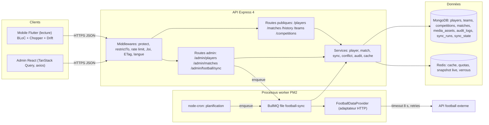

**Légende.** Les clients ne parlent jamais au fournisseur : seul l'adaptateur `FootballDataProvider` le fait, depuis le worker. Les routes publiques lisent Redis puis Mongo ; les routes admin écrivent Mongo, invalident Redis et, pour la synchro manuelle, ajoutent un job à la file. Les cases `sync_runs` et `sync_state` sont des collections proposées par le backlog (`API-FOOT-25`, `API-FOOT-29`).

Pourquoi ce découpage : le fournisseur est lent, payant au volume et parfois indisponible. Toute lecture utilisateur doit donc être servie par **notre** base ; le fournisseur n'alimente qu'en arrière-plan (CDC Backend §7 : « jamais de façon synchrone dans le cycle requête/réponse »).

## 4. Écrans et navigation

| Code | Écran | Rôle |
|---|---|---|
| `WC-01` | Liste des joueurs | Compteurs « 71 fiches · 64 publiées · 7 incomplètes », filtres, pastilles de langues, statut |
| `WC-02` | Sélection multiple | Barre d'actions de masse (publier, archiver) |
| `WC-03` / `WC-04` | Aucun résultat / aucune donnée | Deux états vides distincts |
| `WC-05` | Fiche joueur — identité | Formulaire des 11 champs d'identité |
| `WC-06` / `WC-07` | Biographie incomplète / complète | Éditeur FR/EN/ES, bandeau « Publication bloquée » |
| `WC-08` | Statistiques par saison | Tableau éditable |
| `WC-09` | Photo | Dépôt, aperçu, rappel de droits |
| `WC-10` | Confirmation de publication | Modale avec contrôles |
| `WC-11` | Import CSV des statistiques | Tiroir : dépôt, rapport, confirmation |
| `WC-12` | Archivage groupé | Confirmation |
| `WD-01` | Liste des matchs | Onglets À venir / En direct / Historiques / Conflits, bouton Synchroniser |
| `WD-02` | Détail d'un match | Informations, compositions, événements, historique des modifications, panneau Synchronisation |
| `WD-03` | Résolution de conflit | Valeur API vs valeur éditoriale, trois décisions |
| `WD-04` | Saisie d'un match historique | Rencontre, événements, contexte trilingue |
| `WB-06` / `WB-07` | Recherche globale Ctrl+K | Joueurs et matchs (selon rôle) |

<p>


</p>

*`WC-06` : le bouton « Publier » est grisé, un point rouge marque l'onglet Biographie, le stepper de droite place la fiche à l'étape 2 « En attente de traduction » et la checklist montre EN et ES manquants. `WD-01` : bandeau jaune « 1 conflit de synchronisation nécessite ton arbitrage », badges Source (« API football », « Édition manuelle », « Conflit »). `WD-03` : tableau Champ / Valeur API / Valeur éditoriale / Action et carte « Impact de la décision » (flux calendrier, notifications, Fantasy).*

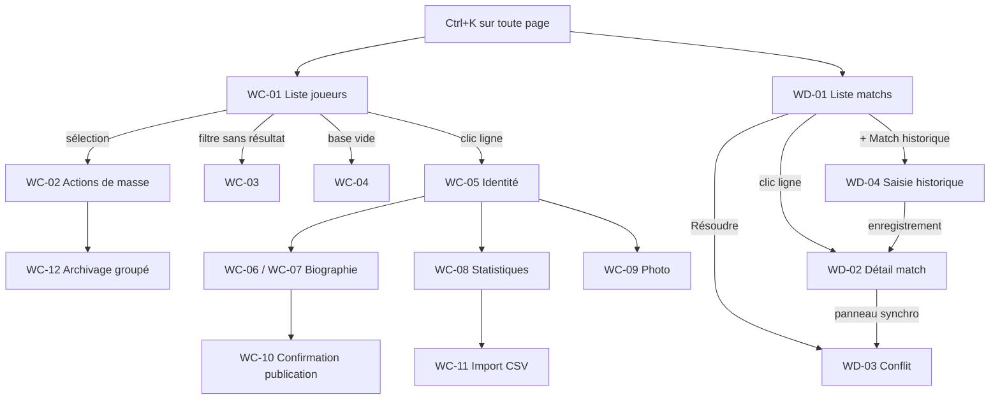

Routes React (admin) : `/joueurs`, `/joueurs/nouveau`, `/joueurs/:id?onglet=identite|biographie|statistiques|photo`, `/matchs`, `/matchs/:id`, `/matchs/:id/conflit`, `/matchs/historique/nouveau`. Toutes sous `ProtectedRoute allowedRoles=['content-manager','super-admin']` ; un modérateur est redirigé vers la page 403 (`ADM-WC-27`, `ADM-WD-13`).

## 5. Flux détaillés

### 5.1 Synchronisation en direct pendant un match (nominal)

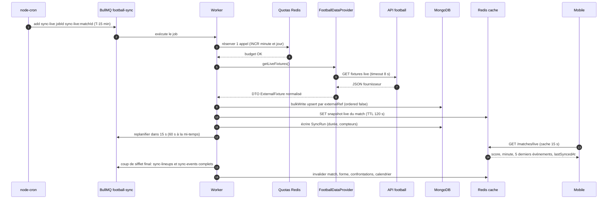

**Pas à pas.** (1) Le cron place un job `sync-live` dont l'identifiant est **déterministe** (`sync-live:{matchId}`) : s'il est déjà en file, BullMQ ne le duplique pas. (2-3) Avant tout appel, le worker consomme du budget dans les compteurs Redis (voir §8). (4-7) L'adaptateur appelle le fournisseur avec timeout de 8 s et convertit la réponse en DTO internes ; **aucun type fournisseur ne sort de l'adaptateur**. (8) L'écriture est un `bulkWrite` filtré sur `externalRef` : rejouer deux fois ne crée rien. (9) Un snapshot court alimente `GET /matches/live`. (10) Chaque exécution laisse une trace `SyncRun`. (11) Le job se replanifie selon la phase du match. (12-13) Le mobile lit le snapshot. (14-15) À la fin du match, une synchro complète fige compositions et événements, puis les caches dépendants sont invalidés.

### 5.2 Panne du fournisseur, quota et circuit breaker (cas limites)

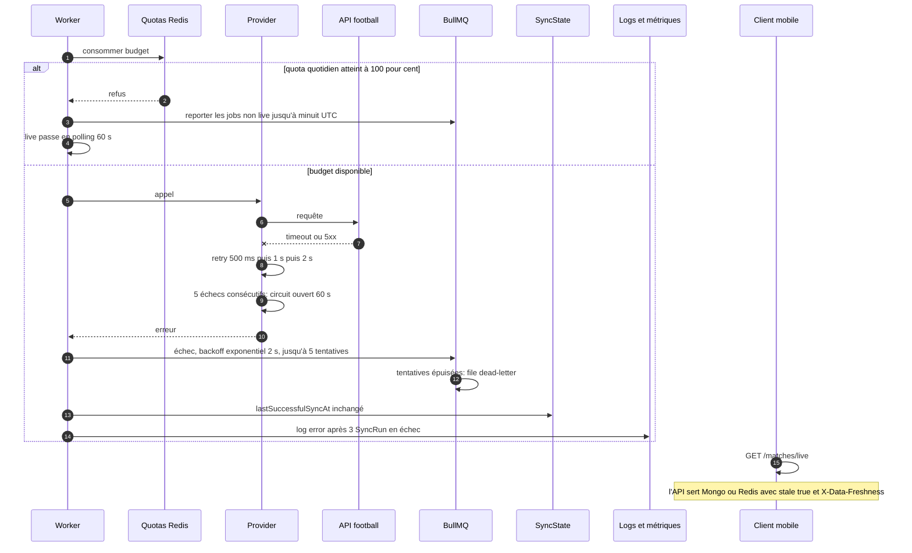

**Points d'attention.** Le circuit breaker (ouvert 60 s après 5 échecs) évite de marteler un fournisseur en panne. Après 5 tentatives (backoff 2 s exponentiel, valeurs de `defaultJobOptions` de `src/jobs/queues.ts`), le job rejoint la file `dead-letter` et reste **rejouable depuis l'admin**. Aucune donnée n'est supprimée sur échec partiel : l'upsert se fait par lots. Côté client, l'indicateur de fraîcheur remplace l'erreur (§11).

### 5.3 Correction éditoriale, conflit et résolution

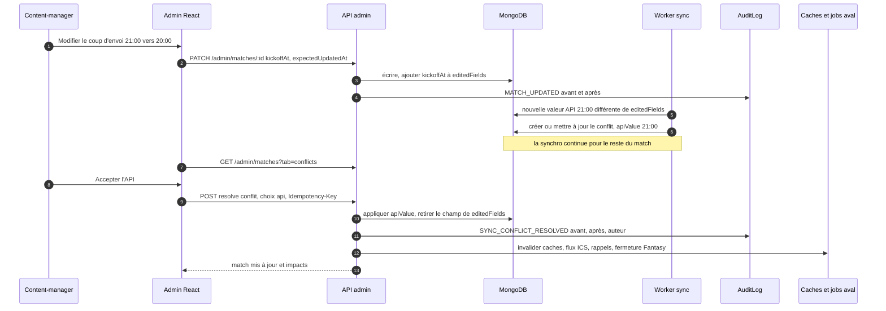

**Règles clés.** Un conflit n'existe que pour les champs `kickoffAt`, `scoreHome`, `scoreAway`, `venue`, `status`. « Éditorial » conserve la valeur et **mémorise** l'`apiValue` ignorée : pas de nouveau conflit tant que l'API redit la même chose. Si l'API revient à la valeur éditoriale, le conflit est **auto-résolu**. « Ignorer pour l'instant » ne fait aucun appel. Un changement d'horaire déclenche l'invalidation du calendrier (voir F08).

### 5.4 Publication d'une fiche joueur (nominal et refus)

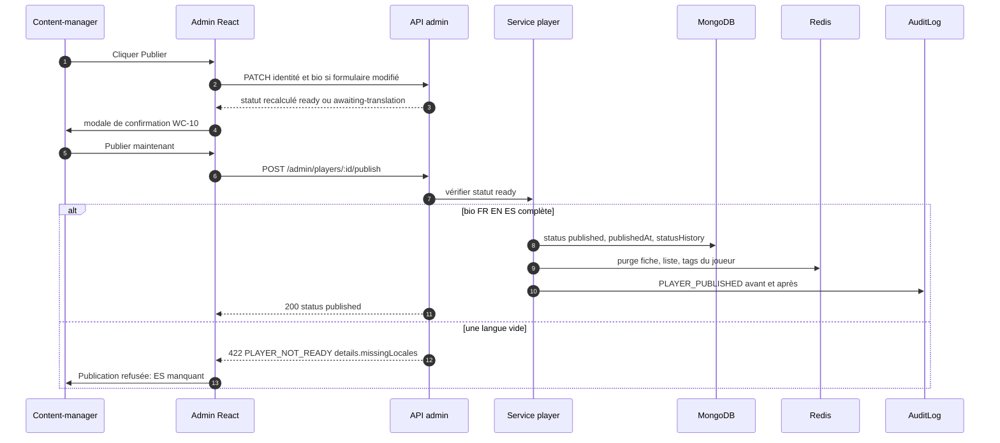

### 5.5 Cycle de vie d'une fiche joueur

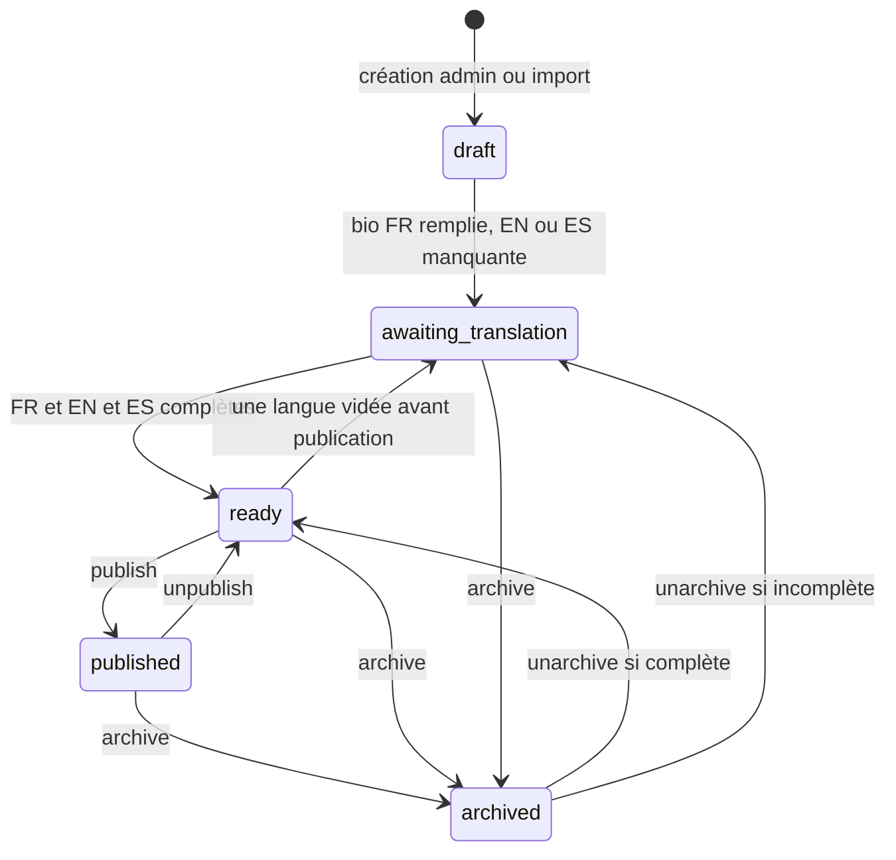

`draft` ne peut pas être archivé directement. Toute transition écrit une entrée dans `statusHistory[]` (append-only, 50 entrées maximum : `from`, `to`, `adminId`, `at`, `reason?`) et dans l'audit.

### 5.6 Cycle de vie d'un match

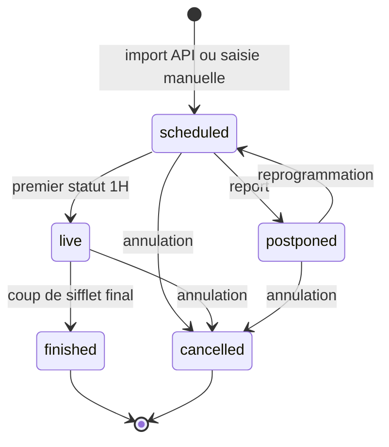

Les transitions autorisées sont uniquement `scheduled→live→finished`, `scheduled→postponed→scheduled` et `tout→cancelled` (`API-FOOT-03`). `minute` (0-130) et `period` (`1H`, `HT`, `2H`, `ET`, `PEN`) n'existent que si `status=live`. Un match `live` n'est **pas modifiable à la main** (`409`) côté API, alors que l'admin prévoit d'autoriser l'édition du score avec avertissement (voir §14).

## 6. Contrats d'API

Préfixe `/api/v1`. Enveloppe `{ success, data }` ; erreurs `{ success:false, error:{ code, message, details, traceId } }`. Pagination : curseur opaque (`nextCursor`, `limit` défaut 20, max 100) côté public ; `page`/`limit` conservés pour l'admin.

### 6.1 Lecture publique (supporters)

| Méthode | Chemin | Auth | Rate limit | Requête | Réponse | Erreurs |
|---|---|---|---|---|---|---|
| GET | `/players` | public | 120/min/user, 60/min/IP | `q, position, nationality, active, club, sort, cursor, limit` | `items[{id, fullName, shortName, shirtNumber, position, nationality, photoUrl, clubCurrent}]`, `nextCursor`, `hasMore` | 400 `INVALID_CURSOR` |
| GET | `/players/:id` | public | idem | `?lang=` | fiche + `age`, `bio`, `locale`, `localeFallback`, `bioNotice`, `stats[]`, `totals` | 400 id, 404 `PLAYER_NOT_FOUND` |
| GET | `/matches` | public | idem | `competition, from, to, status, teamId, cursor` | calendrier (voir F08) | 422 filtre |
| GET | `/matches/next` | public | idem | `?tz=` | prochain match, `localKickoff`, `countdownSeconds` ; `data:null` sans match | 200 toujours |
| GET | `/matches/live` | public | **30/min/user** | — | `items[{id, status, minute, period, scoreHome, scoreAway, events, lastSyncedAt, stale}]` | — |
| GET | `/matches/:id` | public | 120/min | `include=summary,lineups,events,context` | détail complet | 400, 404 |
| GET | `/competitions`, `/teams` | public | 120/min | `q` | référentiels (cache 24 h) | — |
| GET | `/teams/:id/form`, `/teams/:id/head-to-head` | public | 120/min | `limit`, `opponentId` | forme (5 derniers) et bilan | 404 `TEAM_NOT_FOUND` |

Exemple `GET /matches/live` :

```json
{ "success": true, "data": { "items": [ {
  "id": "6720a1f0c3...", "status": "live", "minute": 67, "period": "2H",
  "scoreHome": 2, "scoreAway": 1,
  "events": [ { "minute": 61, "type": "goal", "playerName": "Lewandowski", "scoreAfter": "2-1" } ],
  "lastSyncedAt": "2026-10-24T19:41:12.000Z", "stale": false } ] } }
```

### 6.2 Administration

Tous les chemins sont sous `/admin`, protégés par `protect` + `restrictTo('content-manager','super-admin')`, avec en-tête `Cache-Control: no-store` et limiteur de mutations **120 req/min/admin**.

| Méthode | Chemin | Rôle | Description | Erreurs notables |
|---|---|---|---|---|
| GET | `/admin/players` | CM, SA | liste + `counts{total, published, incomplete, byStatus}` ; filtres `q, position, nationality, status[], missingLocale, club, active` | — |
| POST | `/admin/players` | CM, SA | création en `draft` | 422 ; 409 numéro de maillot |
| PATCH | `/admin/players/:id` | CM, SA | identité, `bioI18n`, `photoKey` ; **le statut n'est pas modifiable directement** | 409 `EDIT_CONFLICT` |
| POST | `/admin/players/:id/publish` · `unpublish` · `archive` · `unarchive` | CM, SA | transitions du workflow | 422 `PLAYER_NOT_READY` |
| POST | `/admin/players/bulk` | CM, SA | `{action: archive\|unarchive, ids[≤100], justification}` → **207** `{succeeded[], failed[{id,code}]}` | — |
| PUT/DELETE | `/admin/players/:id/stats/:season` | CM, SA | upsert / suppression d'une saison | 422 saison invalide |
| POST | `/admin/players/:id/stats/import` | CM, SA | CSV multipart, 1 Mo, ≤ 60 lignes, `dryRun=true` | 422 `[{line, field, message}]` |
| POST/DELETE | `/admin/players/:id/photo` | CM, SA | JPEG/PNG/WebP ≤ 2 Mo, min 400×400, vignettes 128/400/800 | 413, 422 |
| GET/POST | `/admin/players/export.csv`, `/admin/players/import` | CM, SA | export (≤ 10 000 lignes, BOM, `;`) / import (≤ 500 lignes, brouillons) | formules neutralisées |
| GET | `/admin/matches` | CM, SA | `tab=upcoming\|live\|historical\|conflicts`, `competitionId, from, to, source, q` + `counts` | — |
| PATCH | `/admin/matches/:id` | CM, SA | `kickoffAt, venue, matchday, status` → `editedFields` | 409 si `live` |
| PUT | `/admin/matches/:id/result` · `/events` · `/lineups` | CM, SA | résultat, événements, compositions (11 titulaires max) | 422 |
| POST | `/admin/matches/historical` | CM, SA | match historique `source=manual`, `isHistorical=true` | 409 doublon |
| GET | `/admin/matches/conflicts` | CM, SA | liste des conflits ouverts | — |
| POST | `/admin/matches/:id/conflicts/:field/resolve` | CM, SA | `{choice: api\|editorial\|custom, customValue?}` | 404/409 |
| GET | `/admin/matches/:id/history` | CM, SA | modifications (audit `entityType=match`) | — |
| GET | `/admin/football/sync/status` | CM, SA | `lastSuccessAt` par type, quota restant, jobs en file, conflits | — |
| POST | `/admin/football/sync` | CM, SA | `{scope: fixtures\|live\|teams}` → **202** `{jobId}` ; 1 déclenchement / 2 min / admin | 429 |
| GET | `/admin/football/sync/runs` | CM, SA | 20 derniers `SyncRun`, curseur | — |
| CRUD | `/admin/competitions`, `/admin/teams` | CM, SA | `isOwnClub` réservé au super-admin ; suppression refusée si référencé (409) | 409 |
| GET | `/admin/audit-logs` | **SA** | filtres `action, entityType, adminId, from, to, cursor` ; aucune route PUT/DELETE | — |
| GET | `/admin/search` | CM, SA, Mod | `q` ≥ 2 car., 5 résultats max par catégorie, 60 req/min | — |

*CM = content-manager, SA = super-admin, Mod = modérateur. Le content-manager ne voit dans l'audit que ses propres actions (`API-FOOT-32`).*

## 7. Modèle de données

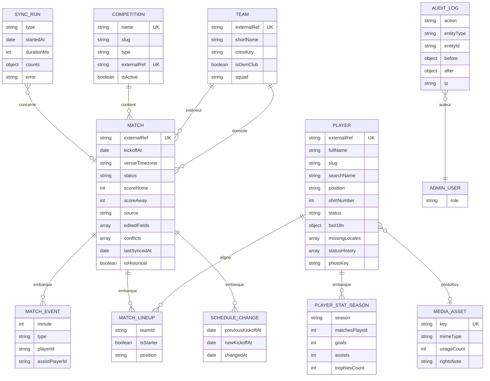

### Collections réellement présentes dans le code (`src/models/football.model.ts`)

* `players` : `externalRef` (unique sparse), `fullName` (index), `shortName`, `birthDate`, `nationality` (index), `position` (enum `GB DD DC DG MD MC MO AD AG BU`), `shirtNumber`, `previousClub`, `isActive` (index), `bioI18n {fr,en,es}`, `photoKey`, `status` (enum à 5 valeurs, index), `stats[]` (embarqué, sans `_id`), `goatVotes`. Index composé `{status, position}`.
* `teams` : `name`, `shortName`, `type` (`club`|`national`), `crestKey`.
* `competitions` : `name` (unique), `type` (`league`|`cup`|`friendly`).
* `matches` : `externalRef`, `homeTeamId`, `awayTeamId`, `competitionId`, `matchday` (string), `kickoffAt` (index), `status` (index), `scoreHome`, `scoreAway`, `venue`, `source` (`api`|`manual`), `contextI18n`, `lineups[]`, `events[]` (type `goal|card|sub`), `syncConflict {field, apiValue, editorialValue}`. Index `{competitionId, kickoffAt:-1}`.

### Champs ajoutés par le backlog (à implémenter)

* `Player` : `slug`, `searchName` (nom normalisé NFD, sans diacritiques, index texte), `missingLocales` (recalculé à chaque `save()`), `statusHistory[]`, `contractUntil`, `foot`, `trainedAt`, `publishedAt`, `archivedAt` ; unicité de `stats.season` par joueur, format strict `AAAA/AA` ; bio ≤ 4 000 caractères par langue, nettoyée par `utils/sanitize`.
* `Team` : `externalRef`, `slug`, `isOwnClub` (**index partiel unique** : un seul club propre, le FC Barcelone), `colors`, `shortName` = code 3 lettres majuscules (FCB, RMA, ATM, BAY). `crestKey` = clé de stockage ; l'URL publique est construite par l'API, **jamais l'URL du fournisseur** (droits d'image).
* `Competition` : `externalRef`, `slug` (`liga`, `ldc`, `copa-del-rey`, `friendly`), `shortName`, `order`, `isActive`.
* `Match` : `venueTimezone` (IANA), `minute`, `period`, `halfTimeHome/Away`, `stats` embarquées (possession, tirs…), `formations`, `coaches`, `standingsSnapshot[{teamId, points}]`, `editedFields`, `conflicts[]`, `lastSyncedAt`, `isHistorical`. Événements étendus : `goal, own-goal, penalty, card-yellow, card-red, sub, half-time` + `assistPlayerId`.
* `media_assets` (`API-FOOT-05`) : clé `media/AAAA/MM/<uuid>.<ext>`, `usageCount`, `rightsNote` obligatoire, badge « Nouveau » 7 jours ; types JPEG/PNG/WebP, 2 Mo, 4000 px max, pas de SVG.
* `sync_runs`, `sync_state` (`lastSuccessfulSyncAt` par type de job) et `audit_logs` (immuable, conservation illimitée, pas d'index TTL).

### Clés Redis (proposées : le backlog nomme les familles, le brief impose le préfixe `ub:`)

| Clé (proposée) | Rôle | TTL |
|---|---|---|
| `ub:cache:v1:<ressource>:<hash>` | réponses de lecture versionnées | voir §8 |
| `ub:tag:player:{id}` (ensemble) | invalidation ciblée par `SADD` | — |
| `ub:live:match:{id}` | snapshot live consommé par `/matches/live` | 120 s |
| `ub:quota:football:day:<AAAAMMJJ>` / `ub:quota:football:min:<minute>` | compteurs `INCR` + `EXPIRE` | fin de période |
| `ub:lock:<clé>` | verrou anti-stampede `SET NX` | 5 s |

Migrations : scripts idempotents dans `scripts/migrations` (création des index `searchName`, index partiel `isOwnClub`, `slug`) ; seed `npm run seed` : 71 joueurs (64 publiés, 7 incomplets), 4 compétitions, ~20 équipes, finale LDC 2011, Barça–Real Madrid du 24/10/2026, 100+ matchs historiques, 30 anecdotes, marqué « Données de démonstration » et **bloqué si `NODE_ENV=production`** (`API-FOOT-54`).

## 8. Traitements asynchrones et cache

### 8.1 File `football-sync` et cron

| Job | Déclencheur | Détail |
|---|---|---|
| `sync-fixtures` | cron `0 */6 * * *` (UTC) | calendrier des 90 jours à venir |
| `sync-teams` | cron quotidien 03:00 | équipes et écussons |
| `sync-players` | cron hebdomadaire | joueurs importés **en `draft`** |
| `sync-lineups` | T-60 min avant le coup d'envoi | compositions |
| `sync-live` | fenêtre T-15 min à T+135 min (prolongation +30) | score, minute, événements |
| `refresh-calendar-feed` | changement d'horaire détecté | voir F08 |

Paramètres du worker : **concurrence 2**, `jobId` déterministe (`sync-live:{matchId}`), `attempts: 5`, backoff exponentiel 2 s, `removeOnComplete: 1000`, `removeOnFail: 5000`, passage en `dead-letter`, arrêt propre sur `SIGTERM` (`closeQueues`). Chaque cron porte un identifiant stable (clé de répétition) pour éviter les doublons au redéploiement.

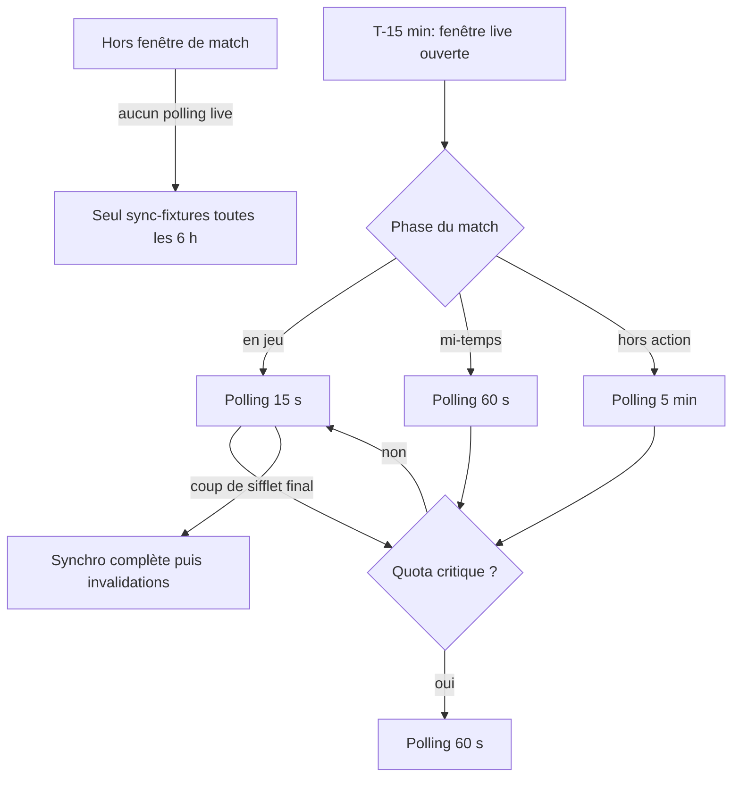

### 8.2 Quotas

`FOOTBALL_QUOTA_DAILY` (ex. 7 500) et `FOOTBALL_QUOTA_PER_MIN` (ex. 30), compteurs Redis `INCR`+`EXPIRE`. **20 % du quota quotidien est réservé au live.** À 80 % : log `warn` et métrique ; à 100 % : jobs non live reportés jusqu'à minuit UTC, live en polling 60 s. Les en-têtes de quota du fournisseur (`remaining`) priment quand ils existent. L'état est affiché dans l'admin (`WD-01`).

### 8.3 Cache Redis des lectures

| Donnée | TTL | Invalidation |
|---|---|---|
| Calendrier | 900 s (15 min, CDC §5.6) | changement d'horaire détecté |
| Prochain match | 300 s | changement d'horaire |
| Fiche joueur publiée | 3 600 s | édition admin, publication, archivage |
| Match terminé | 86 400 s | correction éditoriale |
| Live | 15 s | chaque polling |
| Anecdote du jour | 3 600 s | publication |
| Historique | 3 600 s ; « ce jour-là » 21 600 s | fin de match / édition |
| Référentiels compétitions/équipes | 86 400 s | CRUD admin |

Règles : clés **versionnées** (`v1`) ; invalidation par **ensembles de tags** ; **Redis absent = bypass silencieux** (jamais d'erreur 500) ; **anti-stampede** par verrou `SET NX` de 5 s. En-têtes HTTP : `ETag` (SHA-1 du JSON, `W/` pour les listes dynamiques, `If-None-Match` → `304`), `Cache-Control: public, max-age=60, stale-while-revalidate=300` (calendrier), `max-age=3600` (fiche joueur), `no-cache` (live), `private, no-store` (tout `/admin`), `Vary: Accept-Language`.

### 8.4 Idempotence, reprise, rejeu

* Identité d'un objet = `(source, externalRef)` ; repli de rapprochement par `(compétition, date ± 2 h, équipes)` pour rattacher un match saisi à la main.
* Un match `source=manual` n'est **jamais supprimé** par la synchro ; un joueur importé n'est **jamais publié** automatiquement.
* Les événements sont dédupliqués par `(minute, type, playerExternalRef)`.
* Reprise : retry exponentiel puis dead-letter ; **rejouable manuellement** depuis l'admin ; alerte après 3 `SyncRun` consécutifs en échec.

## 9. Règles de gestion

1. Statuts joueur : `draft`, `awaiting-translation`, `ready`, `published`, `archived` — aucun autre.
2. Une fiche est `ready` si `bioI18n.fr`, `.en` et `.es` sont non vides après `trim` (le backlog admin propose en plus un minimum de 50 caractères, « à confirmer »).
3. Publication uniquement depuis `ready`, sinon `422 PLAYER_NOT_READY`.
4. Désarchiver renvoie vers `ready` (ou `awaiting-translation` si incomplet) ; dépublier renvoie vers `ready`.
5. `shirtNumber` de 1 à 99, unique parmi les joueurs actifs publiés (`409`) ; `fullName` 2-120 caractères ; `birthDate` passée.
6. Saison de statistiques au format strict `AAAA/AA` côté API (ex. `2026/27`), entiers ≥ 0, unique par joueur.
7. Bio ≤ 4 000 caractères par langue côté API ; texte brut, HTML interdit.
8. Un seul `Team` avec `isOwnClub=true` ; `shortName` = 3 lettres majuscules.
9. `kickoffAt` en **UTC** ; `venueTimezone` IANA pour afficher « 21:00 CEST ».
10. `minute` ∈ [0, 130] et `period` ∈ {1H, HT, 2H, ET, PEN} uniquement si `live` ; 11 titulaires maximum par équipe.
11. Transitions de match limitées à celles du §5.6.
12. Champs sujets à conflit : `kickoffAt`, `scoreHome`, `scoreAway`, `venue`, `status` ; un conflit ouvert par champ ; la synchro ne s'interrompt jamais à cause d'un conflit.
13. Prochain match = premier match du club `scheduled` (ou `postponed` avec date) dont `kickoffAt ≥ now` ; sinon `200 {data:null}`.
14. Seuils de fraîcheur : `stale:true` si > 15 min (calendrier) ou > 90 s (live).
15. Fenêtre live : T-15 min à T+135 min ; intervalles 15 s / 60 s / 5 min ; quota réservé au live 20 %.
16. Provider : timeout 8 s, 3 retries (500 ms, 1 s, 2 s), circuit ouvert 60 s après 5 échecs consécutifs.
17. Pagination : `limit` défaut 20, max 100, valeur hors bornes ramenée aux bornes ; curseur signé HMAC, altération → `400 INVALID_CURSOR`.
18. Négociation de langue : `?lang=` > `Accept-Language` > locale du profil > `fr` ; langue vide → repli `fr` + `localeFallback:true`.
19. Archivage : justification optionnelle ≤ 300 caractères ; la fiche disparaît immédiatement des modules consommateurs (cache purgé).
20. Actions de masse : ≤ 100 identifiants, doublons ignorés, traitement indépendant par lot.
21. Âge calculé côté serveur à la date du jour (19 ans pour une naissance au 13/07/2007 en octobre 2026).
22. Un match historique publié ne peut pas être supprimé, seulement archivé (règle admin `ADM-WD-12`).

## 10. Sécurité, RGPD et anti-abus

* **RBAC double** : API (`protect` + `restrictTo('content-manager','super-admin')`, 2FA admin) et interface (`ProtectedRoute`) ; l'API est la référence. Export CSV et audit complet réservés au super-admin selon `API-FOOT-32`.
* **Validation** Joi avec `stripUnknown` ; assainissement NoSQL ; échappement des cellules CSV commençant par `=`, `+`, `-`, `@` (injection de formules) à l'import **et** à l'export.
* **Anti-abus** : 120 req/min/utilisateur en lecture, 60/min/IP anonyme, 30/min pour `/matches/live`, 120/min/admin en mutation, 1 synchro manuelle / 2 min / admin, 60/min pour la recherche admin.
* **Audit immuable** : champs `adminId`, `adminName`, `action`, `entityType`, `entityId`, `before`, `after` (limités aux champs modifiés), `justification`, `ip` ; secrets et jetons exclus ; aucune route de modification ; l'écriture ne fait pas échouer la requête métier sauf actions sensibles (transactionnelle). Exemples : `PLAYER_PUBLISHED`, `PLAYER_ARCHIVED`, `PLAYER_STATS_UPDATED`, `MATCH_RESULT_SET`, `SYNC_CONFLICT_RESOLVED`, `FOOTBALL_SYNC_TRIGGERED`.
* **Droits d'image** : uniquement des illustrations originales avec `rightsNote` obligatoire (« Illustration originale · aucune photographie sous droits ») ; refus des domaines de photographes connus dans un champ source ; pas d'URL de fournisseur exposée ; aucun logo officiel (application fan-made, CDC Global §10.1).
* **Minimisation RGPD** : uniquement des données de notoriété publique (pas d'adresse, pas de santé) ; clé `FOOTBALL_API_KEY` lue dans l'environnement, **masquée dans les logs** ; l'audit ne contient aucune donnée de supporter ; procédure de retrait : archivage immédiat d'une fiche sur demande.
* **Édition concurrente** : `expectedUpdatedAt` (admin) / `If-Match` (API) → `409`.

## 11. Erreurs et états dégradés

| Situation | Serveur | Client |
|---|---|---|
| Fournisseur en panne | Retries, circuit ouvert, dead-letter ; lecture depuis Mongo/Redis ; `X-Data-Freshness` + `stale:true` | Mobile : bandeau « Hors-ligne · affichage des derniers contenus » (`C-07`) ; admin : « Données potentiellement périmées » / « API football indisponible – dernières données connues du … » |
| Quota épuisé | Jobs non live reportés, live à 60 s | Admin : quota restant dans `WD-01` |
| Redis absent | Bypass silencieux, lecture directe Mongo ; enqueue ignoré avec log `warn` | Aucun message utilisateur |
| Pas de match programmé | `200 {data:null}` | Carte « Pas de match programmé » (`C-09`) |
| Joueur non publié / inconnu | `404 PLAYER_NOT_FOUND` | Fiche « introuvable » |
| Match inconnu | `404` | `F-14` « Match introuvable » (variante sans bouton Réessayer) |
| Langue vide | Repli FR + `localeFallback:true` | Mention « Langue : Français » (`F-13`) |
| Édition concurrente | `409 EDIT_CONFLICT` | Modale « Cette fiche a été modifiée par … » (voir/écraser/recharger), brouillon local conservé |
| Import CSV invalide | `422` avec erreurs par ligne ; mode `dryRun` | Rapport dans le tiroir (`WC-11`), ligne valides importables |
| Écriture d'audit en échec | Journalisée sans casser la requête (sauf actions sensibles) | — |

Côté admin : squelettes de chargement, `ErrorState` avec `traceId` copiable, aucune mise à jour optimiste pour la publication, l'archivage, les actions de masse et la résolution de conflit (impact élevé).

## 12. Connexions avec les autres fonctionnalités

| Fonctionnalité | Relation | Détail |
|---|---|---|
| F06 Accueil | alimente | `/matches/next`, `/matches/live`, `/anecdotes/today`, forme récente |
| F07 Historique et fiches | alimente | `/matches/history`, `/matches/:id`, `/players/:id`, saisie historique `WD-04` |
| F08 Calendrier | alimente / partage | `Match.scheduleChanges`, job `refresh-calendar-feed` dans la file `football-sync`, listes filtrées |
| GOAT, Quiz, Guess the Player | alimente | joueurs `published` uniquement ; une fiche archivée sort de ces modules |
| Fantasy | alimente / reçoit | fin de match → calcul des points ; changement de `kickoffAt` → fermeture des compositions ajustée |
| Notifications | alimente | rappels de match, `match-schedule-changed` |
| Assistant IA | alimente | données structurées (aucune réponse ne doit contredire la base) |
| Supervision et audit | partage | `audit_logs`, `SyncRun`, métriques |
| Médiathèque (WE) | dépend de | `media_assets`, `usageCount` |

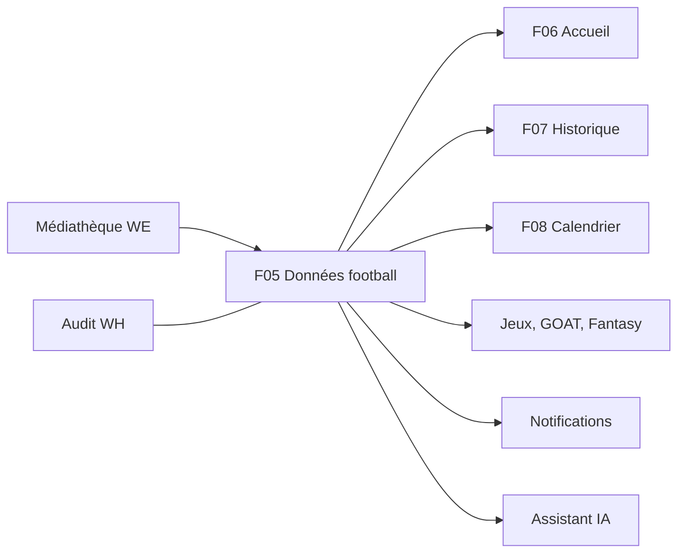

## 13. Observabilité et tests

**Métriques** (registre Prometheus préfixé `ub_` dans `src/config/metrics.ts`) : compteur `jobsFailed` par file (existant), durée et volume de `SyncRun`, consommation du quota (alerte 80 %), `lastSuccessfulSyncAt` par type, latence détection → flux (`calendar_refresh_latency_seconds`), hit/miss du cache. **Logs** Winston : jamais la clé API, jamais de PII supporter ; alerte (log `error`) après 3 `SyncRun` consécutifs en échec.

**Tests prévus** :

* `API-FOOT-50` : routes publiques (200, 404, 422, `ETag`/`304`, pagination, FR/EN/ES, **hors Redis**), jeu de test de 10 joueurs, 3 compétitions, 30 matchs, couverture ≥ 80 % des services.
* `API-FOOT-51` : matrice rôle × route, workflow `draft→published→archived`, conflits de synchro de bout en bout, import CSV valide/invalide, audit présent pour chaque mutation.
* `API-FOOT-52` : `FakeFootballProvider` scénarisé (match de 90 min) ; idempotence (2 exécutions = même état), quota atteint → report, panne → retry puis dead-letter, conflit détecté.
* Admin `ADM-WC-28` (scénarios A à E : recherche, publication, archivage groupé, import de 71 lignes dont 3 invalides, états vides) et `ADM-WD-14` (parcours liste → modification, conflit → « Accepter l'API », match historique 28/05/2011 avec publication bloquée puis débloquée), clair/sombre, vitest-axe.
* Charge k6 : lectures publiques (`npm run load:smoke`) ; toute nouvelle route met à jour Swagger (`npm run export:swagger`) **et** le scénario k6.

Cas de tests clés : rejouer deux fois la même synchro = 0 nouveau document ; champ de `editedFields` jamais écrasé ; auto-résolution quand l'API rejoint l'éditorial ; publication refusée avec `missingLocales` ; match `source=manual` jamais supprimé ; seed refusé en production.

## 14. Points ouverts et incohérences détectées

**À confirmer (backlog).**

* Fournisseur d'API football **non nommé** dans les CDC (variable `FOOTBALL_API_KEY`) ; l'identifiant `1208477` d'exemple n'implique aucun choix.
* Fuseau de référence : `GAME_TZ=Europe/Madrid` (jeux), diffusion des anecdotes à 06:00 `Europe/Paris`, cron de sécurité du calendrier à 04:00 `Europe/Madrid`, dashboard admin en `Europe/Paris` — à harmoniser (CDC : « à trancher »).
* Seuil minimal de 50 caractères par langue (proposé côté admin), « Statistiques » et « Photo » non bloquants dans la checklist, matchs ≤ 80 par saison (alerte), seuil de 30 min de fraîcheur côté admin.
* Rang « amis », éligibilité des équipes féminine/réserve (`Team.squad`), prolongation exacte de la fenêtre live.

**Incohérences entre specs admin et API (à arbitrer avant le codage).**

| Sujet | Admin (`ADM-WC` / `ADM-WD`) | API (`API-FOOT`) |
|---|---|---|
| Changement de statut joueur | `PATCH status:'published'` ; bulk `publish` | `PATCH` n'accepte pas `status` ; `POST /:id/publish` ; bulk = archive/unarchive seulement |
| Taille max de sélection | 200 | 100 |
| Bio | ≤ 800 caractères | ≤ 4 000 caractères |
| Photo | JPG/PNG, 5 Mo, min 1200×1200, pas de WebP | JPEG/PNG/WebP, 2 Mo, min 400×400 |
| Format de saison | `AAAA-AA` (`2026-27`) | `AAAA/AA` (`2026/27`) |
| Statistiques | `PUT /admin/players/:id/stats` (remplace le tableau) ; import CSV global | `PUT /:id/stats/:season` ; import par joueur |
| Compteurs | `GET /admin/players/counters` | `counts` dans la liste |
| Export joueurs | `GET /admin/exports/players` (5 000 lignes) | `GET /admin/players/export.csv` (10 000 lignes) |
| Conflit | `POST /:id/resolve-conflict {decision: accept-api\|keep-editorial\|manual}`, un seul `syncConflict` | `POST /:id/conflicts/:field/resolve {choice: api\|editorial\|custom}`, `conflicts[]` |
| Synchro manuelle | `POST /admin/matches/sync` (1/min), `GET /admin/matches/sync-status` | `POST /admin/football/sync {scope}` (1/2 min), `GET /admin/football/sync/status` |
| Onglet matchs | `history`, filtre `syncSource` | `historical`, filtre `source` |
| Création historique | `POST /admin/matches` | `POST /admin/matches/historical` |
| Publication d'un match historique | `POST /admin/matches/:id/publish` (`TRANSLATION_INCOMPLETE`), contexte ≤ 2 000 car. | non prévue (`status=finished` immédiat) |
| Édition d'un match live | autorisée avec avertissement | `409` |
| Verrou optimiste | `expectedUpdatedAt`, `409 CONFLICT` | `If-Match`, `409 EDIT_CONFLICT` |
| Noms d'audit | `MATCH_UPDATED`, `MATCH_CONFLICT_RESOLVED`, `MATCH_SYNC_TRIGGERED`, `HISTORICAL_MATCH_CREATED` | `MATCH_RESULT_SET`, `SYNC_CONFLICT_RESOLVED`, `FOOTBALL_SYNC_TRIGGERED`, `MATCH_HISTORICAL_CREATED` |
| Pagination | `page`/`limit` | curseur (`page` toléré pour l'admin) |

**Autres écarts.** `Competition.slug` (`ldc`, `copa-del-rey`) dans `API-FOOT-02` vs `Competition.code` (`champions`, `copa`) dans `API-CAL-01` ; types d'événements du modèle réel (`goal|card|sub`) plus pauvres que `API-FOOT-03` ; `publicId` (« ub-0010 »), `strongFoot`, `heightCm` demandés par l'admin mais absents du modèle ; les préfixes de clés Redis du backlog (`cache:v1:*`, `live:match:*`) ne portent pas le préfixe `ub:` ; `MOB-L` plafonne `limit` à 50 alors que `API-FOOT-06` autorise 100.

## 15. Pour aller plus loin

* **Épopées** : `API-FOOT` (`API-FOOT-01` à `API-FOOT-56`), `ADM-WC`, `ADM-WD`, `ADM-WB` (`ADM-WB-11` recherche globale, `ADM-WB-12` palette Ctrl+K), `API-CAL` (flux calendrier).
* **CDC** : Backend §3.2 (module Players & Matches), §4.2 (domaine football), §5.6 (cache), §7 (BullMQ), §10.2 (rate limiting), §11.1 (API football) ; Global §2.3, §2.6, §4.4 (sources externes), §10.1 (droits d'image) ; Admin §4.2 à §4.4, §6.4 (audit).
* **Code** : `univers_barca_api/src/models/football.model.ts`, `src/jobs/queues.ts`, `src/jobs/scheduler.ts`, `src/controllers/content.controller.ts`, `src/utils/pagination.ts`, `src/middleware/rateLimiter.ts`, `src/config/redis.ts`, `src/config/env.ts` (`FOOTBALL_API_KEY`) ; `univers_barca_admin/src/api/players.api.ts`, `src/pages/players/PlayersPage.tsx` ; `univers_barca_mobile/lib/features/players` (feature de référence).
