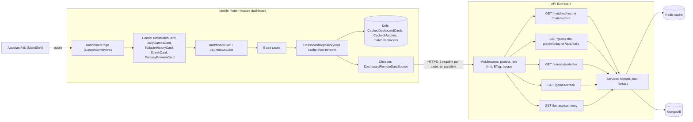
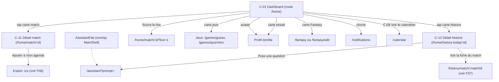
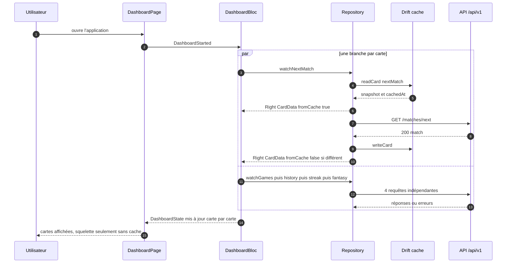
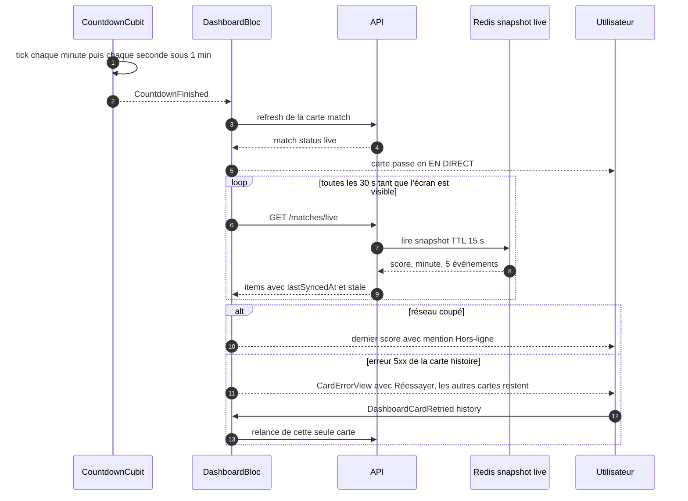
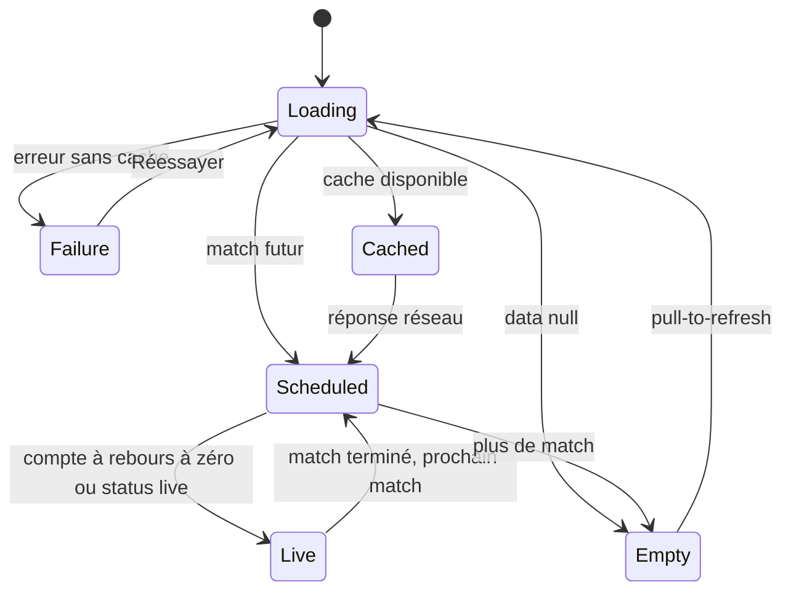
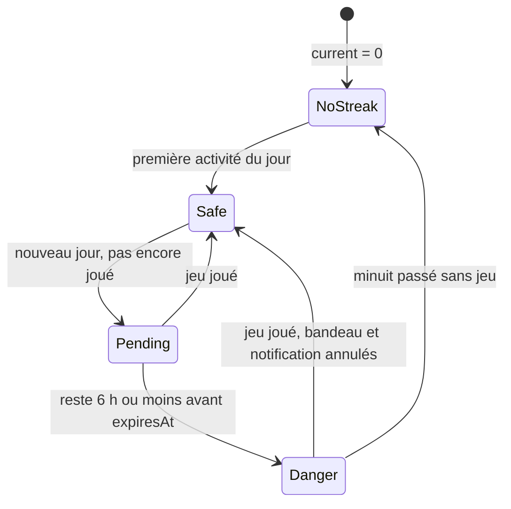
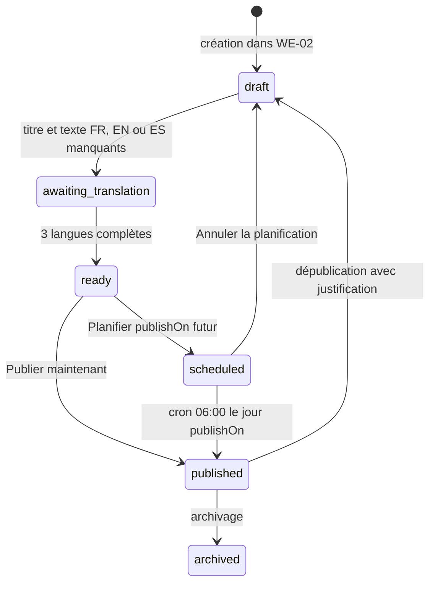
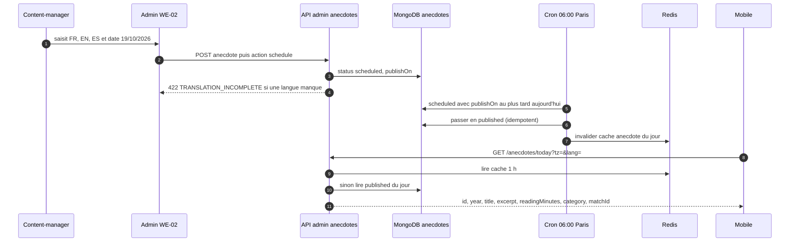
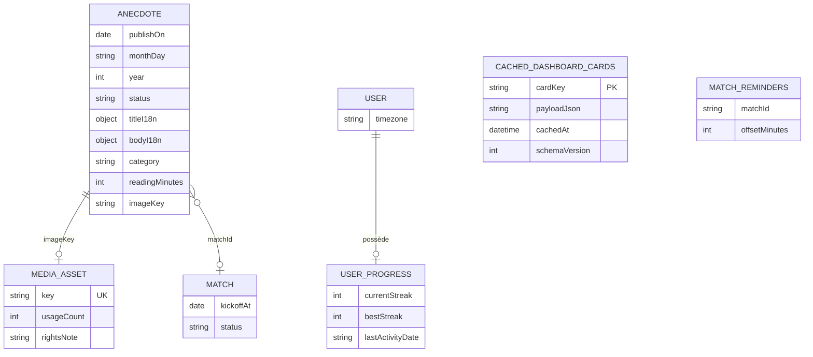
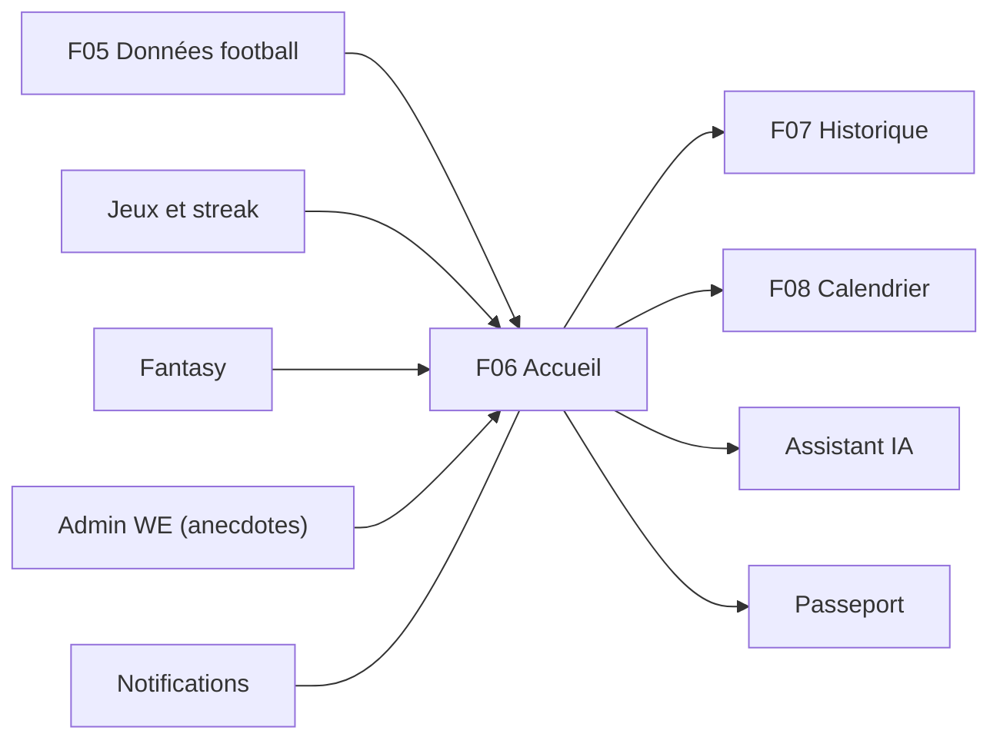

# F06 — Accueil (dashboard)

> Documentation d'architecture · Univers Barça · fonctionnalité **F06**. Ce document décrit la page d'accueil de l'application mobile : une pile de cartes indépendantes (prochain match, jeux du jour, anecdote historique, série de jours, XI Fantasy) qui s'affichent immédiatement depuis le cache, se rafraîchissent en parallèle et échouent chacune séparément. Il décrit aussi la chaîne éditoriale qui produit l'anecdote du jour (back-office) et la bulle de l'assistant IA.

## 1. Résumé et fiche

**Valeur utilisateur.** En ouvrant l'application, le supporter voit en un coup d'œil : quand joue le Barça (avec un compte à rebours dans **son** fuseau horaire), s'il a déjà fait ses jeux du jour, l'anecdote « Aujourd'hui dans l'histoire », combien de jours de suite il joue, et l'aperçu de son XI Fantasy. L'écran fonctionne **hors connexion** (dernier contenu connu) et une carte en erreur n'empêche jamais les autres de s'afficher.

**Pourquoi un tableau de bord et pas un chat.** Le CDC Global §2.3 impose une page d'accueil en cartes ; l'assistant IA reste accessible en permanence via une bulle flottante mais n'est pas la page d'accueil.

| Élément | Valeur |
|---|---|
| Phase / priorité | Phase 1 — MVP ; issues surtout P0, quelques P1 (anecdote, Fantasy, détails, pull-to-refresh) |
| Épopées backlog | `MOB-C` (28 issues) ; fournisseurs de données : `API-FOOT` (match, anecdote), `API-JEUX` (jeux, streak), `API-FANT` (Fantasy) ; chaîne éditoriale : `ADM-WE`, `ADM-WB` |
| Écrans mobile | `C-01` à `C-12` |
| Écrans admin | `WE-01` à `WE-04` (anecdotes), `WB-02` (tableau de bord content-manager) |
| Dépôts concernés | **mobile** (feature `dashboard`), **API** (endpoints existants des autres modules), **admin** (contenu éditorial) |
| Hors périmètre | bulle et conversation Barça AI (module IA), écrans complets Fantasy/Historique/Calendrier/Notifications/Passeport, jeux eux-mêmes |

### Vocabulaire

* **Carte** : widget indépendant du dashboard avec son propre état (chargement, succès, vide, échec).
* **Cache-then-network** : on affiche d'abord le cache local (Drift), puis on appelle le réseau et on remplace si la donnée a changé.
* **Streak** : série de jours consécutifs d'activité sur les jeux quotidiens.
* **`AssistantFab`** : bulle flottante d'accès à l'assistant IA, posée par le `MainShell`, pas par la page.
* **Squelette** : placeholder animé (shimmer) qui reprend les dimensions réelles d'une carte.

## 2. Acteurs et user stories

| Acteur | Besoin | Critères d'acceptation clés |
|---|---|---|
| Supporter | Voir le prochain match avec compte à rebours | Adversaire, compétition (« Liga · J11 »), date et heure dans mon fuseau (« Sam. 24 oct. · 20:00 WAT »), compte à rebours « 02 j 07 h 41 min » ; état informatif si aucun match (`C-09`) |
| Supporter | Suivre un match en direct | Score « 2 – 1 », pastille « EN DIRECT 67' », bouton « Suivre le live », mise à jour toutes les 30 s |
| Supporter | Voir si j'ai joué aujourd'hui | Chips « À jouer » / « Résolu » ; « Trouvé en 3 essais » ; « 8/10 · +120 pts aujourd'hui » |
| Supporter | Lire l'anecdote du jour | Une seule anecdote par jour, carte entièrement cliquable, détail `C-12` |
| Supporter | Garder ma série | Valeur « 12 jours de suite », record, semaine, alerte de série en danger |
| Supporter | Voir mon XI et mon rang parmi mes amis | « 4-3-3 · 70 PTS », chip « Ferme dans 1 j 4 h », « 3e sur 5 » |
| Supporter hors-ligne | Continuer à consulter | Bandeau « Hors-ligne · affichage des derniers contenus » (`C-07`), retour réseau = rafraîchissement silencieux |
| Supporter | Ne pas être bloqué par une panne partielle | Carte en erreur avec « Réessayer » ; « Le reste de l'écran fonctionne normalement » (`C-08`) |
| Content-manager | Alimenter la carte d'anecdote sans trou | Éditeur trilingue, aperçu mobile, calendrier éditorial, « 9 jours non couverts ce mois-ci » |

## 3. Architecture de la fonctionnalité



**Légende.** Il n'existe **pas** d'endpoint d'agrégation dédié au dashboard : l'« agrégation » est faite **côté mobile** par `Future.wait` sur cinq requêtes indépendantes (CDC Flutter §7.2 : « chaque carte gère son propre état »). Ce choix évite qu'une source lente ou en panne retarde ou casse l'écran, au prix de plusieurs appels simultanés au démarrage. Le trait pointillé indique que la bulle IA est posée en surcouche par le `MainShell`, pas par la page.

Les endpoints du schéma sont ceux **recommandés par les issues API** ; le backlog mobile cite parfois d'autres chemins « à aligner » (voir §14).

## 4. Écrans et navigation

| Code | Écran | Rôle |
|---|---|---|
| `C-01` | Dashboard — état normal | Salutation « Salut Boris 👋 », titre « ACCUEIL », cloche (badge 2), avatar « BT », 5 cartes |
| `C-02` | Défilement complet | Dernière carte (Fantasy) visible au-dessus de la bulle IA |
| `C-03` | Jeux terminés | Guess « Résolu · Trouvé en 3 essais », Quiz « 8/10 · +120 pts » |
| `C-04` | Match en direct | « EN DIRECT 67' », « 2 – 1 », « Camp Nou », « Suivre le live » |
| `C-05` | Série en danger | Toast sombre « Ta série de 12 jours est en danger ! Joue avant minuit. » |
| `C-06` | Squelette | Chargement fidèle aux hauteurs réelles |
| `C-07` | Hors-ligne | Bandeau sombre sous l'en-tête, cartes issues du cache |
| `C-08` | Erreur partielle | « Impossible de charger l'histoire du jour » + Réessayer |
| `C-09` | Aucun match | « Pas de match programmé », bouton « Voir le calendrier » |
| `C-10` | Pull-to-refresh | « Mise à jour… » |
| `C-11` | Détail — prochain match | Compétition, stade, fuseau, forme récente (5 derniers matchs), agenda et rappel |
| `C-12` | Détail — Aujourd'hui dans l'histoire | « 15 octobre · 2011 », texte complet, actions IA / fiche match / partage |

<p>


</p>

*`C-01` : carte « Prochain match » en dégradé grenat-bleu avec le compte à rebours, double carte des jeux, carte d'anecdote avec tuile date « oct. 15 », bulle IA dorée en bas à droite, barre à 5 onglets (Accueil, Jeux, Historique, Fantasy, Communauté). `C-04` : le « VS » devient le score et la barre de compte à rebours devient le bouton blanc « Suivre le live » + une cloche. `C-07` : bandeau « Hors-ligne » sur fond sombre, aucune interaction bloquée. `WE-02` : l'éditeur trilingue de l'anecdote et son aperçu mobile Clair/Sombre.*



Routes (`core/constants/route_constants.dart`) : `dashboard = '/home'` (réutilise l'existant `home`), `matchDetail = '/home/match/:id'`, `todayInHistory = '/home/history-today/:id'`. Le `MainShell` est une `ShellRoute` avec `NavigationBar` à 5 destinations ; chaque onglet garde sa pile. Mise en page : espacement vertical et gutters de 16 px, largeur maximale 600 dp centrée sur tablette, padding bas = hauteur de la barre + 72 px pour que la dernière carte ne soit jamais masquée par la bulle IA.

## 5. Flux détaillés

### 5.1 Démarrage à froid : cache d'abord, réseau en parallèle



**Pas à pas.** (2-3) La page lance un seul événement. (4) Le bloc démarre **cinq flux indépendants** ; chacun lit d'abord le cache (6-8) : l'utilisateur voit du contenu en moins de 800 ms visés. (9-12) Le réseau est appelé en parallèle ; la réponse est écrite dans Drift **par carte** et n'est émise que si elle diffère de l'ancienne (entités `Equatable`, pas de reconstruction inutile). (15-16) Le squelette n'apparaît que pour une carte **sans cache**. Un échec réseau n'efface jamais le cache existant.

### 5.2 Match en direct, fin du compte à rebours et erreur partielle



**À retenir.** Le compte à rebours ne dépend jamais de l'horloge brute de l'appareil : l'en-tête HTTP `Date` de la dernière réponse sert à estimer le décalage, recalé s'il dépasse 60 s ; le serveur fournit aussi `countdownSeconds`. Le polling live s'arrête en arrière-plan. Le score est animé (échelle 1,0 → 1,15 → 1,0 en 250 ms) et le point rouge clignote en 1 s (désactivés si « réduire les animations »).

### 5.3 États de la carte « Prochain match »



### 5.4 Série en danger



### 5.5 Cycle de vie de l'anecdote affichée par la carte (chaîne éditoriale)



### 5.6 Du back-office au téléphone (diffusion de l'anecdote)



## 6. Contrats d'API

Aucune route n'est propre au dashboard ; les cartes réutilisent les endpoints des autres modules. Enveloppe `{ success, data }`, erreurs `{ success:false, error:{ code, message, details, traceId } }`.

| Carte | Méthode et chemin | Auth | Rate limit | Réponse (extrait) | Erreurs et cas limites |
|---|---|---|---|---|---|
| Match | `GET /api/v1/matches/next?tz=Africa/Douala` | public | 120/min/user, 60/min/IP | `{id, home, away, competition, matchday, venue, kickoffAt (UTC), venueTimezone, localKickoff{iso,tzAbbr}, countdownSeconds}` ; `data:null` sans match | jamais 404 ; cache 5 min |
| Match direct | `GET /api/v1/matches/live` | public | **30/min/user** | `items[{id,status,minute,period,scoreHome,scoreAway,events (5),lastSyncedAt,stale}]` | `stale:true` si synchro en panne ; `Cache-Control: no-cache` |
| Jeux | `GET /api/v1/guess-the-player/today` | Bearer | lecture | `status (not_started\|in_progress\|won\|lost)`, `attemptsUsed`, `maxAttempts:6`, `attempts[]` | `Cache-Control: private, no-store` |
| Jeux | `GET /api/v1/quiz/daily` | Bearer | lecture | `status (available\|in_progress\|completed)`, `level`, `levelLabel`, `questionCount:10`, `result?{correct,total,points}` | pas de questions dans le GET |
| Jeux (agrégat proposé) | `GET /api/v1/games/hub` | Bearer | lecture | `guess`, `quiz`, `streak{current,best,atRisk}`, `levels[5]` ; sections `null` + `partial:true` en dégradation | cache Redis par utilisateur 30 s |
| Histoire | `GET /api/v1/anecdotes/today?tz=&lang=` | public | lecture | `{id, year, title, excerpt (160 car.), readingMinutes, category, matchId, publishedAt}` ; `data:null` sinon | cache 1 h ; repli sur même jour/mois d'une année passée |
| Histoire (détail) | `GET /api/v1/anecdotes/:id` | public | lecture | + `body`, `imageUrl` | 404 si non publiée |
| Streak | `GET /api/v1/games/streak` | Bearer | lecture | `{current, best, atRisk, lastActivityDate}` | recalculé à la lecture (pas de job minuit) |
| Fantasy | `GET /api/v1/fantasy/summary` | Bearer | lecture | `{gameweek{number,status,locksAt,serverTime}, hasTeam, seasonPoints, ranks{friends,world,totalWorld}, lastGameweeks[]}` | `403 MODULE_DISABLED` ; Redis absent → `ranks:null` |
| Profil | `GET /api/v1/users/me` | Bearer | lecture | prénom pour la salutation | repli « Salut 👋 » |
| Forme | `GET /api/v1/teams/:id/form` | public | lecture | 5 derniers matchs `{result, score, opponent}` | alimente `C-11` |
| Détail match | `GET /api/v1/matches/:id` | public | lecture | détail complet | 404 |

Exemple `GET /anecdotes/today` :

```json
{ "success": true, "data": {
  "id": "6711b2...", "year": 2011, "title": "Un 4-0 qui entre dans la légende",
  "excerpt": "Ce soir-là, le jeu de position atteint un sommet…",
  "readingMinutes": 1, "category": "matches", "matchId": null,
  "publishedAt": "2026-10-15T04:00:00.000Z" } }
```

**Côté client (Chopper)** : timeouts 10 s, retry exponentiel 2 essais sur 5xx/timeout via `core/network/interceptors.dart`, `Accept-Language` automatique (`LocaleInterceptor`), mapping 401 → `AuthFailure`, 429/5xx → `ServerFailure`.

**Chaîne éditoriale (admin)** : le backlog API prévoit `GET/POST/PATCH /admin/anecdotes`, `POST /admin/anecdotes/:id/schedule|publish|unschedule|archive`, `GET /admin/anecdotes/:id/preview?locale=&theme=` (même mapper que le public) et `GET /admin/anecdotes/calendar?month=AAAA-MM` ; le backlog admin appelle `GET/POST/PATCH/DELETE /admin/history-content` (voir incohérences §14). La médiathèque est `GET/POST/DELETE /admin/media` (refus `409 MEDIA_IN_USE`).

## 7. Modèle de données



* **Côté API.** `Anecdote` (à créer, `API-FOOT-04`) : `publishOn` ISO `AAAA-MM-JJ`, `monthDay` `MM-JJ` dérivé pour la récurrence annuelle, `year` (1900-2100), `matchId`, `category`, `readingMinutes` dérivé (200 mots/min, minimum 1), titre ≤ 120 et corps ≤ 600 caractères par langue, statuts `draft → awaiting-translation → ready → scheduled → published (+ archived)` ; passage à `ready` seulement si titre **et** texte sont renseignés en FR/EN/ES. Unicité d'une anecdote `published` par `publishOn` (`409 ANECDOTE_DATE_TAKEN`). `MediaAsset`, `Match`, `User.timezone` : voir F05. Le streak vit dans `user_progress` (`currentStreak`, `bestStreak`, `lastActivityDate`) ; une journée est active dès qu'un Guess est **terminé** (victoire ou défaite) ou qu'un quiz **daily** est terminé, le même jour calendaire Madrid.
* **Côté mobile (Drift).** `CachedDashboardCards(cardKey PK, payloadJson, cachedAt, schemaVersion)` — snapshot par carte, jamais de jeton ni d'e-mail ; réutilisation de `CachedMatches` pour le prochain match ; `matchReminders` pour l'état du rappel ; `DashboardCacheDao` écrit les cartes en transaction ; migration vérifiée par `drift_dev schema verify`. Durée de vie : lisible hors-ligne sans limite, marqué « périmé » après 24 h, **purgé à la déconnexion et à la suppression de compte** (RGPD).
* **Redis (clés proposées, préfixe `ub:`).** `ub:cache:v1:anecdote:today:<date>:<lang>` (3 600 s), `ub:live:match:{id}` (120 s), cache `GET /games/hub` par utilisateur (30 s), `GET /fantasy/summary` privé 30 s.
* **Migrations.** Index unique `(publishOn)` partiel sur `published`, index `monthDay`, script de création de la collection `anecdotes` ; seed : 30 anecdotes dont celle du 15 octobre 2011.

## 8. Traitements asynchrones et cache

| Mécanisme | Détail |
|---|---|
| Diffusion planifiée des anecdotes | cron quotidien **06:00 Europe/Paris** (variable `ANECDOTE_PUBLISH_TZ`) : toutes les `scheduled` dont `publishOn ≤ aujourd'hui` passent `published` ; idempotent ; invalide le cache « anecdote du jour » |
| Cache API | anecdote du jour 1 h ; prochain match 5 min ; calendrier 15 min ; live 15 s ; hub jeux 30 s (par utilisateur) ; Fantasy 30 s (privé) |
| Cache mobile | cache-then-network, écriture après chaque succès, par carte ; périmé après 24 h |
| Fraîcheur par carte (resync au retour au premier plan) | match < 15 min, jeux et streak < 5 min, histoire quotidienne, Fantasy < 15 min ; **rien avant 60 s** depuis la dernière synchro |
| Minuit local | un `Timer` jusqu'au prochain minuit local force le rechargement des cartes jeux, histoire et streak ; annulé en arrière-plan |
| Pull-to-refresh | resynchronise les 5 cartes, `isRefreshing:true` sans squelette, timeout global **10 s**, pas plus d'une resync toutes les 5 s |
| Notification locale de secours (streak) | `flutter_local_notifications`, planifiée à l'approche de l'expiration, annulée dès qu'un jeu est joué ; côté serveur un job `streak-reminder` à 20:00 (fuseau utilisateur) est prévu par `API-JEUX` |
| Rappel de match | notification locale à `kickoff − 60 min` (15 min / 1 h / 3 h), replanifiée si l'horaire change (voir F08) |

**Idempotence.** Rejouer le cron 06:00 ne republie rien ; relancer une carte n'a aucun effet de bord ; les endpoints de lecture sont sans effet.

## 9. Règles de gestion

1. Ordre fixe des cartes : prochain match, jeux du jour (double carte), « Aujourd'hui dans l'histoire », streak, « Ton XI Fantasy » ; le dashboard est un écran unique composé de widgets indépendants.
2. La bulle `AssistantFab` est un overlay du `MainShell`, jamais de la page.
3. Dates serveur en UTC ISO 8601 ; conversion au fuseau **de l'appareil** à l'affichage seulement (pas de géolocalisation : minimisation RGPD).
4. Compte à rebours : format « 02 j 07 h 41 min » ; le segment jours disparaît à 0 ; **au-delà de 99 jours, seule la date est affichée** ; cadence 1 min puis 1 s sous 1 minute ; correction d'horloge si l'écart dépasse 60 s.
5. `maxAttempts` de Guess = **6** ; quiz = 10 questions ; niveaux 1 à 5 (Supporter occasionnel, Culé, Socio, Historien du Barça, La Masia).
6. Points et niveaux viennent du moteur serveur, jamais calculés par le client.
7. Streak : valeurs serveur (`currentStreak`, `bestStreak`, `lastActivityDate`) ; jouer suffit, résoudre n'est pas requis ; une défaite conserve la série ; l'entraînement libre ne compte pas.
8. « Série en danger » : `playedToday == false` et `expiresAt − now ≤ 6 h` (constante `kStreakDangerThreshold`, à valider produit) ; bandeau « Il te reste 3 h 12 », aucune alerte si la série est à 0.
9. Aucun match programmé n'est **pas** une erreur (`C-09`) ; la carte « saison terminée » ne promet aucune date.
10. Une seule anecdote affichée par jour ; si aucune anecdote : la carte est **masquée sans trou**.
11. Polling live : 30 s côté mobile (à ajuster selon les quotas) ; l'API plafonne à 30 req/min/utilisateur.
12. Fantasy : aperçu seulement ; compositions modifiables jusqu'à la fermeture (`locksAt`) ; sans équipe, carte invitation « Compose ton XI ».
13. Une carte en échec n'affecte jamais les autres ; relance manuelle uniquement, sans boucle ; désactivation du bouton 1 s anti-spam.
14. Un échec réseau n'efface jamais le cache ; cache disponible → bandeau discret « Contenu non à jour » plutôt qu'erreur.
15. Anecdote : diffusion 06:00 Europe/Paris, `ready` seulement avec les 3 langues, titre ≤ 120 et texte ≤ 600 caractères, **HTML interdit**, une publiée par date.
16. Calendrier éditorial : « jours non couverts » = jours à venir sans anecdote `scheduled` ou `published` ; les jours passés ne comptent pas.
17. Textes UI uniquement via ARB (FR/EN/ES), pluriels ICU (`streakDaysCount`) ; contenus dynamiques reçus déjà localisés (`Accept-Language`), jamais traduits par le client.
18. Zones tactiles ≥ 48 dp ; contrastes WCAG AA ; support de `textScaleFactor` ; animations coupées si `disableAnimations`.

## 10. Sécurité, RGPD et anti-abus

* **Authentification.** Cartes jeux, streak, Fantasy : Bearer ; cartes match et anecdote : publiques. Réponses personnelles en `Cache-Control: private, no-store` (jamais de cache partagé).
* **Minimisation.** Le cache local ne contient que des données d'affichage (aucun jeton, aucun e-mail) et est purgé à la déconnexion et à la suppression de compte ; fuseau pris sur l'appareil, pas de localisation ; pas de PII dans les breadcrumbs Sentry (seul le `traceId` est ajouté).
* **Contenu éditorial.** Texte brut uniquement (jamais de `dangerouslySetInnerHTML` côté admin, jamais d'HTML interprété côté mobile) ; créations originales ou synthèses reformulées ; l'anecdote est signée « rédigée par l'équipe éditoriale » ; application « fan-made », aucun logo officiel ; le partage envoie du texte seul (pas de lien inventé).
* **Anti-abus.** `/matches/live` limité à 30 req/min/utilisateur ; anti-spam client : 60 s entre deux resynchros automatiques, 5 s entre deux pull-to-refresh.
* **Permissions.** Permission de notification demandée **en contexte** (au premier rappel), jamais au démarrage ; refus → message vers les réglages.
* **Admin.** Routes `/contenu/*` réservées à `content-manager` et `super-admin` (moderator → 403) ; audit `HISTORY_CONTENT_CREATED|UPDATED|SCHEDULED|PUBLISHED|UNPUBLISHED|RESCHEDULED`, `MEDIA_UPLOADED|DELETED` ; uploads limités aux images, protégés par jeton.

## 11. Erreurs et états dégradés

| Situation | Serveur | Client |
|---|---|---|
| Une source en panne | `/games/hub` renvoie la section en `null` + `partial:true` ; pas de 500 global | `CardErrorView` sur cette seule carte (`C-08`), titre propre à la carte (`cardErrorHistoryTitle`…), message rassurant, bouton Réessayer (anti-spam 1 s) |
| Hors-ligne | — | `OfflineBanner` (40 dp, glissement 200 ms) ; données en cache ; « Mis à jour il y a … » ; actions réseau (« Suivre le live ») désactivées avec explication ; retour réseau = toast « De retour en ligne » + refresh silencieux |
| Cache > 24 h | — | marqué « périmé » |
| Carte sans cache hors-ligne | — | « Disponible une fois connecté » |
| Aucun match | `200 {data:null}` | `NextMatchEmptyCard` + bouton « Voir le calendrier » (toast « Bientôt disponible » si la route n'existe pas encore) |
| Pas d'anecdote | `data:null` | carte masquée |
| Synchro football en retard | `stale:true` | dernier score + mention |
| Pull-to-refresh hors-ligne | — | termine immédiatement, toast « Pas de connexion », cartes conservées |
| Squelette | — | uniquement sans cache ; shimmer 1,4 s statique si animations réduites ; header de salutation toujours visible |
| Erreur API 429 | `RATE_LIMITED` | `ServerFailure`, message localisé |
| Anecdote non publiée par erreur de date | `409 ANECDOTE_DATE_TAKEN` (admin) | avertissement « Une anecdote est déjà planifiée ce jour » (non bloquant) |

## 12. Connexions avec les autres fonctionnalités

| Fonctionnalité | Relation | Détail |
|---|---|---|
| F05 Données football | dépend de | `/matches/next`, `/matches/live`, anecdotes, forme récente |
| F07 Historique et fiches | alimente | « Voir la fiche du match » depuis `C-12`, `matchId` |
| F08 Calendrier | alimente / partage | `C-09` → `/calendar` ; `C-11` → export `.ics` et rappel ; invalidation sur changement d'horaire |
| Jeux (Guess, Quiz) | dépend de | état du jour, niveau, points, streak |
| Fantasy | dépend de | `locksAt`, rang amis, avatars |
| Notifications | partage | badge de la cloche ; deep link du rappel de match `/home/match/:id` |
| Assistant IA | alimente | bulle `AssistantFab` ; `/assistant?prompt=` pré-rempli depuis `C-12` |
| Passeport / profil | alimente | avatar et carte streak → `/profile` |
| Back-office contenu (WE) | dépend de | anecdotes publiées à 06:00 |



## 13. Observabilité et tests

* **Métriques client.** `dashboard_load_ms` (trace Firebase Performance : du `DashboardStarted` au premier `success`, **objectif < 800 ms depuis le cache**) ; cible de démarrage à froid < 2 s (CDC Flutter §12) ; breadcrumb Sentry à chaque resynchro ; événement `history_empty`-like sans PII.
* **Métriques serveur.** Latence par endpoint consommé (cible `GET /fantasy/summary` p95 < 150 ms), taux de `stale`, hits/miss du cache, échec du cron 06:00.
* **Tests mobile.** Goldens par état (`C-01` à `C-12`) en clair et sombre, 360×640 et 430×932, fixtures cohérentes avec les maquettes (Boris, Liga J11, RMA, série de 12 jours, record 27) ; `FakeDashboardRepository` et horloge injectable ; test d'intégration `dashboard_flow_test.dart` (ouverture → cartes → tap match → détail → retour → pull-to-refresh → mode avion → bandeau) ; seuil de couverture 60 % sur `features/dashboard` (CI) ; test de migration Drift.
* **Cas clés.** J-2 07:41 → « 02 j 07 h 41 min » ; moins de 24 h → segment « j » masqué ; écusson indisponible → cercle avec le code court ; série à 0 → ni bandeau ni notification ; notifications désactivées → bandeau affiché mais rien de planifié ; Guess résolu en 3 essais → 3 carrés colorés.
* **Tests API/admin.** `API-FOOT-50` (anecdote du jour, `/matches/next`, `/matches/live`) ; `ADM-WE-14` (créer une anecdote FR/EN/ES → « Prêt à publier » → planifier le 19/10/2026 06:00 ; clic sur « Non couvert » → formulaire pré-rempli ; upload puis choix d'image ; filtre « ES manquante »).

## 14. Points ouverts et incohérences détectées

**À confirmer (backlog).** Fuseau de référence (minuit des jeux = `Europe/Madrid`, anecdote 06:00 `Europe/Paris`, tableau de bord admin en `Europe/Paris`) ; seuil de 6 h de la « série en danger » ; intervalle de polling live de 30 s selon quotas ; décision du produit sur le bandeau vs toast pour la série en danger ; rang « amis » (ligue ayant le plus de membres).

**Incohérences entre specs mobile et API.**

| Sujet | Mobile (`MOB-C`) | API |
|---|---|---|
| Prochain match | `GET /matches?status=scheduled&limit=1&sort=kickoffAt` avec repli `/matches/live` | `GET /matches/next` dédié (`API-FOOT-14`) |
| Anecdote du jour | `GET /matches/history?date=MM-DD&limit=1`, « contrat à confirmer » | `GET /anecdotes/today` et `GET /anecdotes/:id` (`API-FOOT-19`) |
| Streak | lecture de `user_progress` via profil ; entité avec `weekDays[7]`, `expiresAt` | `GET /games/streak` renvoie `{current, best, atRisk, lastActivityDate}` : **ni `expiresAt` ni `weekDays`** |
| Jeux | compose `/guess-the-player/today` + `/quiz/daily` | agrégat `GET /games/hub` disponible |
| Fantasy | `GET /fantasy/team` + `/fantasy/leaderboard?scope=friends` | `GET /fantasy/summary` conçu pour la carte du dashboard |
| Rappel de match | `GET /calendar/export.ics?matchId=:id` | `addToCalendar.icsUrl = /calendar/matches/:id.ics` (`API-CAL-06`) ; `MOB-L-23` : « à trancher avec l'API » |
| Série en danger | bandeau « Il te reste 3 h 12 » (spec) | maquette `C-05` : toast « Ta série de 12 jours est en danger ! Joue avant minuit. » |
| Rappel streak | seuil 6 h, notification locale de secours | job serveur `streak-reminder` à 20:00 |
| Contrat live | polling 30 s | cache serveur 15 s, limite 30/min (compatible : ~2 req/min) |
| Anecdotes (admin) | `/admin/history-content`, action dans le `PATCH {action}` | `/admin/anecdotes`, `POST /:id/schedule|publish|unschedule|archive` |
| Calendrier éditorial | `GET /admin/history-content?view=calendar` avec `uncoveredDays` | `GET /admin/anecdotes/calendar?month=` ou `?week=` |
| Médias | 5 Mo, upload `POST /admin/media` | 2 Mo, JPEG/PNG/WebP, 4000 px max |
| Dashboard admin | un endpoint par widget `GET /admin/dashboard/widgets/:widgetId` | `GET /admin/dashboard/summary` (réponse agrégée, widgets `ok|error|unavailable`) |
| Statuts d'anecdote | publication « Dépublier » avec retour Brouillon | workflow API sans transition `published → draft` explicite |

**Autres points.** Les titres et corps d'anecdote sont `titleI18n`/`bodyI18n` côté admin, mais le contrat public renvoie des champs déjà localisés (`title`, `excerpt`, `body`) ; le modèle `Anecdote` et la collection `media_assets` n'existent pas encore dans `src/models`. L'assistant IA et ses endpoints ne sont pas documentés ici (autre fonctionnalité).

## 15. Pour aller plus loin

* **Épopées** : `MOB-C` (`MOB-C-01` à `MOB-C-28`, notamment `MOB-C-06` DashboardBloc, `MOB-C-08` carte match, `MOB-C-09` compte à rebours, `MOB-C-12` jeux, `MOB-C-14`/`MOB-C-15` streak, `MOB-C-17` squelette, `MOB-C-18` hors-ligne, `MOB-C-19` erreur partielle), `API-FOOT` (`API-FOOT-14`, `-15`, `-19`, `-10`), `API-JEUX` (`API-JEUX-18` hub, `-19` streaks), `API-FANT` (`API-FANT-19` summary), `ADM-WE` (`ADM-WE-02` à `-09`), `ADM-WB-06` (tableau de bord content-manager).
* **CDC** : Global §2.3, §2.4, §2.5, §2.15 ; Flutter §5.3, §6.3, §7.2, §9.6, §12 ; Backend §3.2 à §3.5.
* **Code** : `univers_barca_mobile/lib/features/players` (modèle de référence), `lib/core/constants/route_constants.dart`, `lib/core/network/interceptors.dart`, `lib/core/widgets/app_error_view.dart`, `lib/core/widgets/app_loading.dart` ; la feature `lib/features/dashboard` est à créer selon `MOB-C-01`. API : `src/jobs/scheduler.ts` (cron), `src/utils/pagination.ts`.
