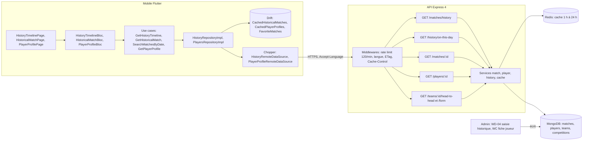
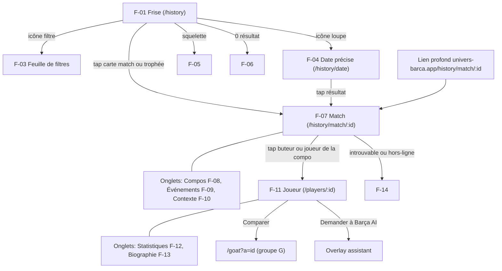
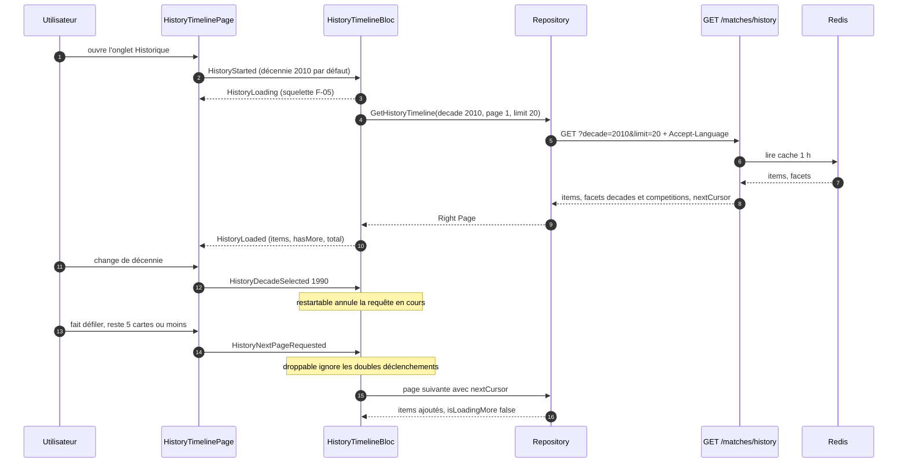
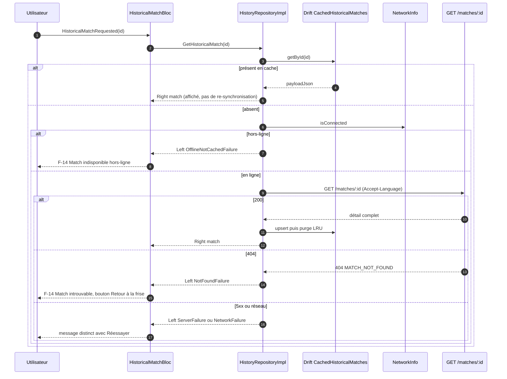
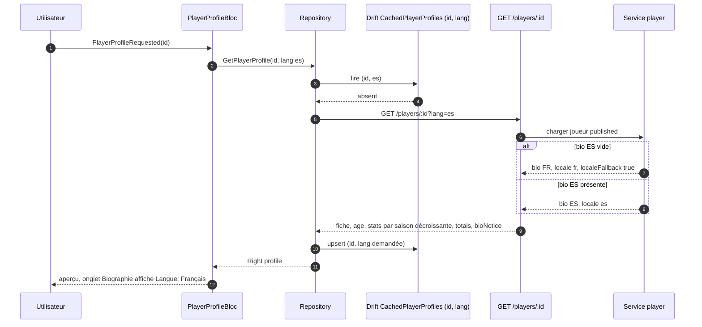
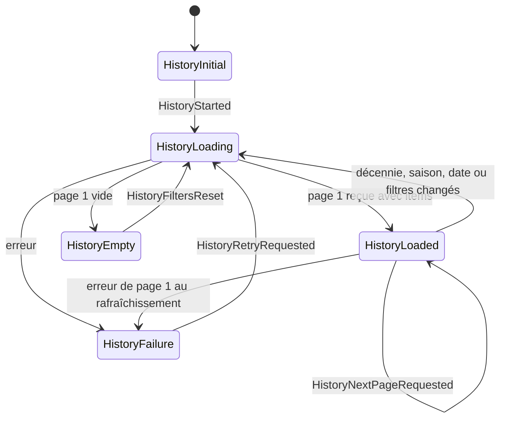
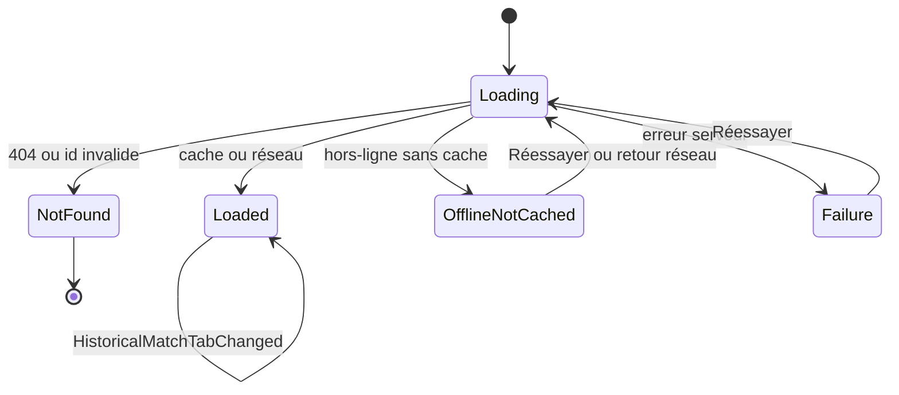
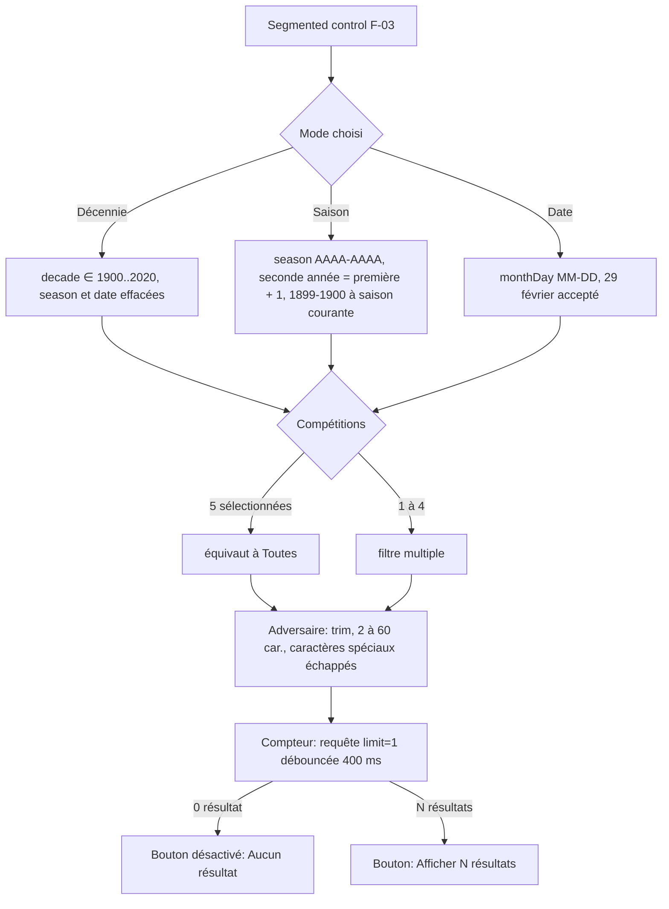
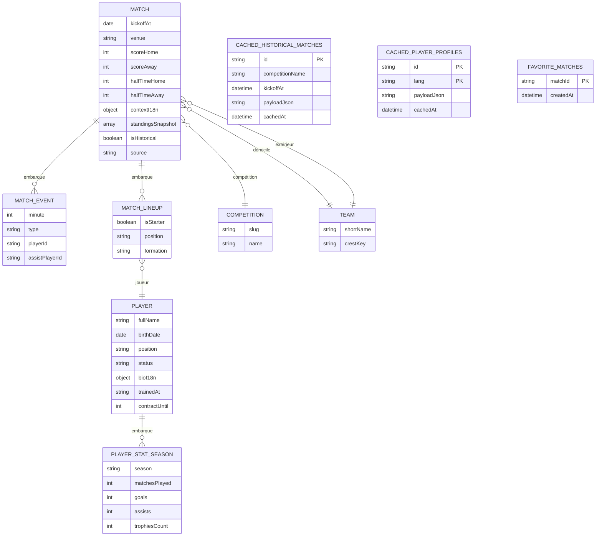
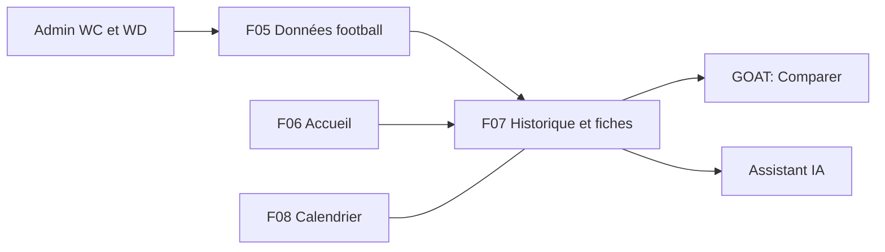

# F07 — Historique et fiches

> Documentation d'architecture · Univers Barça · fonctionnalité **F07**. Elle décrit l'onglet « Historique » de l'application mobile : une frise chronologique de 125 ans d'histoire du Barça (par décennie, saison ou date précise), la fiche détaillée d'un match historique (résumé, compositions, événements, contexte) et la fiche d'un joueur (aperçu, statistiques, biographie), avec consultation hors-ligne du contenu déjà ouvert.

## 1. Résumé et fiche

**Valeur utilisateur.** Le supporter parcourt l'histoire du club comme une frise : il choisit une décennie (« 2010 – 2019 · 42 événements »), ouvre la finale de Wembley 2011 et découvre le score, les buteurs avec leurs passeurs, les statistiques du match, les deux compositions, la chronologie minute par minute et un texte de contexte avec le classement de l'époque. Il peut aussi ouvrir la fiche d'un joueur (identité, statistiques saison par saison, biographie dans sa langue). Tout ce qu'il a déjà ouvert reste lisible sans connexion.

**Pourquoi ce n'est pas « juste de l'affichage ».** Ces écrans lisent le même référentiel que le reste de l'application (voir F05) et exigent trois choses délicates : une liste paginée volumineuse et fluide, un contenu éditorial trilingue avec repli de langue, et un cache local borné qui ne se resynchronise pas tout seul (les données historiques sont peu volatiles).

| Élément | Valeur |
|---|---|
| Phase / priorité | Phase 1 — MVP ; issues `MOB-F` majoritairement P0/P1 (favori et partage en P2) |
| Épopées backlog | `MOB-F` (27 issues), `API-FOOT` (lectures historiques : `API-FOOT-11`, `-12`, `-16` à `-21`) ; saisie du contenu : `ADM-WD` (match historique), `ADM-WC` (fiche joueur) |
| Écrans mobile | `F-01` à `F-14` |
| Écrans admin sources | `WD-04` (saisie d'un match historique), `WC-05` à `WC-08` (fiche joueur) |
| Dépôts concernés | **mobile** (nouvelle feature `history` + extension de `players`), **API** (lecture), **admin** (alimentation) |
| Hors périmètre | comparateur GOAT (groupe G), overlay Barça AI, édition éditoriale |

### Vocabulaire

* **Frise** : liste verticale d'événements avec un rail à gauche (pastille pleine dorée pour un trophée, anneau pour un match).
* **Facette** : compteur renvoyé par l'API avec la liste (ex. nombre d'événements par décennie).
* **Cache-first** : si l'élément est en cache local, on l'affiche tout de suite et on n'appelle le réseau que s'il est absent.
* **LRU** : purge « les plus anciens d'abord » quand une limite de taille est dépassée.
* **`isDemoData`** : drapeau qui déclenche le bandeau « Données de démonstration ».

## 2. Acteurs et user stories

| Acteur | Besoin | Critères d'acceptation clés |
|---|---|---|
| Supporter | Naviguer l'histoire par décennie | Chips 1950s à 2020s, décennie par défaut 2010s, compteur « N événements », tri antéchronologique |
| Supporter | Filtrer par saison, compétition, adversaire | Feuille « FILTRES », bouton « Afficher 18 résultats » mis à jour en direct, « Réinitialiser » |
| Supporter | Retrouver « le 15 octobre à travers les saisons » | Date `MM-JJ` (29 février accepté), résultats par année décroissante |
| Supporter | Lire la fiche d'un match historique | 4 onglets Résumé / Compos / Événements / Contexte ; buteurs avec passe ; mi-temps à 45' |
| Supporter | Lire la fiche d'un joueur | Âge calculé (19 ans pour 13/07/2007 en octobre 2026), stats par saison, biographie avec « Langue : Français » |
| Supporter hors-ligne | Relire un match ou un joueur déjà ouvert | Cache-first ; sinon écran `F-14` « Match indisponible hors-ligne » |
| Supporter | Partager un match, le mettre en favori | Texte « Barça 3 – 1 Man. United · Ligue des champions · 28 mai 2011 » + lien profond ; favori local sans compte |
| Content-manager | Saisir un match historique non couvert par l'API | Source `manual`, contexte FR/EN/ES, 3 lignes de classement maximum (voir F05) |
| Utilisateur avec lecteur d'écran | Parcourir sans voir | Cartes = un seul nœud sémantique, tailles tactiles ≥ 48 dp, texte jusqu'à 200 % |

## 3. Architecture de la fonctionnalité



**Légende.** Le mobile ne lit que des données **publiées** : un joueur `published`, un match `finished` ou `isHistorical`. Le contenu éditorial (contexte de match, biographie) arrive **déjà localisé** : la langue est négociée par `Accept-Language` (puis `?lang=`), jamais traduite par le client. L'admin alimente les mêmes collections ; l'API invalide les caches concernés à chaque modification.

## 4. Écrans et navigation

| Code | Écran | Rôle |
|---|---|---|
| `F-01` | Frise chronologique | Titre « HISTORIQUE », « 125 ans d'histoire », chips de décennies, cartes d'événements |
| `F-02` | Frise — défilement long | En-tête de chips épinglé, pagination infinie |
| `F-03` | Filtres de la frise | Feuille : Décennie / Saison / Date, compétitions, adversaire |
| `F-04` | Recherche par date précise | « Le 15 octobre à travers les saisons » |
| `F-05` | Frise — chargement | Squelettes shimmer |
| `F-06` | Frise — aucun résultat | « Aucun événement trouvé » + Réinitialiser |
| `F-07` | Match historique — résumé | Score, buteurs avec passe, statistiques à double barre |
| `F-08` | Match historique — compositions | XI, formation, entraîneur, remplaçants |
| `F-09` | Match historique — événements | Chronologie avec mi-temps et score cumulé |
| `F-10` | Match historique — contexte | Texte éditorial et mini-classement de l'époque |
| `F-11` | Fiche joueur — aperçu | En-tête, 4 indicateurs, profil, radar, actions Comparer / Barça AI |
| `F-12` | Fiche joueur — statistiques | Graphique et tableau par saison |
| `F-13` | Fiche joueur — biographie | Texte éditorial dans la langue de l'app |
| `F-14` | Match introuvable / indisponible | Variante hors-ligne et variante 404 |

<p>


</p>

*`F-01` : chips de décennies (2010s active), carte « 6 juin · 2015 — Berlin : le Barça s'offre un triplé historique » avec icône coupe sur fond or, puces « Ligue des champions » et « 3-1 Juventus ». `F-03` : segmented control Décennie / Saison / Date (Saison actif, « 2010-2011 »), chips de compétitions (Liga et Ligue des champions actives), champ adversaire « Real Madrid », bouton « Afficher 18 résultats ». `F-09` : événements « 27' But · Pedro — Barça 1 – 0 », séparateur « 45' Mi-temps », « 88' Remplacement — Keita remplace Xavi ». `F-11` : carte « LAMINE YAMAL », indicateurs 98 matchs, 22 buts, 24 passes D., 4 trophées, carte Profil (poste, pied, né le, formé à, contrat 2031).*



Routes (`go_router`, branche `StatefulShellRoute` de l'onglet Historique) : `/history`, `/history/date`, `/history/match/:id`, `/players/:id` (réutilisée par plusieurs modules). Chaque onglet conserve sa pile et la position de scroll. Transitions : glissement horizontal 250 ms pour les détails, fondu pour les onglets. Un identifiant invalide (pas un `ObjectId`) ouvre `F-14` « introuvable » **sans requête réseau**. Un lien profond vers un utilisateur non connecté passe par `/login` puis revient à la cible (`?from=`).

## 5. Flux détaillés

### 5.1 Parcours de la frise : décennie, filtres, pagination



**Pas à pas.** (2-4) La décennie 2010s est le défaut de la maquette. (6-10) La requête part avec `Accept-Language` ; l'API répond depuis Redis (cache 1 h) avec les `items` et des **facettes** (`decades`, `competitions`) d'où vient le compteur « 42 événements ». (12-13) Changer de décennie **annule** la requête précédente (`restartable()` de `bloc_concurrency`) et repart en page 1 ; la dernière décennie consultée est mémorisée dans les préférences locales. (14-17) La pagination se déclenche à 5 cartes de la fin et utilise `droppable()` pour éviter les doublons.

### 5.2 Ouverture d'un match : cache-first, hors-ligne, introuvable



**Cas limites.** Le cache n'est **jamais** rafraîchi automatiquement : un snapshot n'est remplacé que lors d'une réouverture en ligne explicite (« Réessayer »). La détection du retour réseau (`connectivity_plus`) peut relancer le chargement avec un debounce de 2 s. L'en-tête de l'écran et la flèche retour restent visibles dans tous les cas.

### 5.3 Fiche joueur avec repli de langue



### 5.4 États de `HistoryTimelineBloc`



Si la **page 2 ou suivante** échoue, les éléments déjà chargés restent à l'écran et un snackbar non bloquant « Impossible de charger la suite » propose « Réessayer ».

### 5.5 États de `HistoricalMatchBloc`



### 5.6 Exclusivité des modes de navigation et validation des filtres



## 6. Contrats d'API

Tous publics en lecture ; préfixe `/api/v1` ; enveloppe `{ success, data }` ; rate limit **120 req/min/utilisateur** (60/min/IP anonyme). Négociation de langue : `?lang=` > `Accept-Language` > profil > `fr` ; en-tête `Vary: Accept-Language`.

| Méthode | Chemin | Requête | Réponse | Erreurs | Cache |
|---|---|---|---|---|---|
| GET | `/matches/history` | `decade (1900..2020), season, from, to, competitionId, opponentId, result (W\|D\|L), q, cursor, limit (≤100), withTotal` | `items[{id, date, title (contextI18n.title), competition, score, year}]`, `facets{decades[{decade,count}], competitions[{id,count}]}`, `nextCursor` ; vide : `200 items:[]` + facettes | 400 `INVALID_CURSOR` | 1 h ; seuls les matchs `isHistorical` ou `finished` |
| GET | `/history/on-this-day` | `date=MM-JJ` (défaut aujourd'hui dans `?tz`), `lang` | `items[{kind (match\|anecdote), year, title, competitionShort, matchId?, anecdoteId?}]`, tri année décroissante, limite 50 | 422 `30-02` | 6 h par date+langue |
| GET | `/matches/:id` | `include=summary,lineups,events,context`, `lang` | `{id, competition, stage, home, away, score, halfTime, venue, date, stats, lineups, events, context, standings}` ; événements triés par minute, « Mi-temps » à 45', score cumulé par événement, `assistPlayerId` | 400 id, 404 | ETag fort ; match terminé `max-age=86400` |
| GET | `/players/:id` | `lang` | `{id, fullName, shirtNumber, position, nationality, age, heightCm, foot, trainedAt, contractUntil, photoUrl, bio, locale, localeFallback, bioNotice, stats[{season,matchesPlayed,goals,assists,trophiesCount}], totals}` | 400, 404 `PLAYER_NOT_FOUND` | 3 600 s |
| GET | `/teams/:id/head-to-head` | `opponentId` | `{summary{w,d,l,gf,ga}, matches[10]}` | 404 `TEAM_NOT_FOUND` | 1 h, invalidé à la fin d'un match |
| GET | `/teams`, `/competitions` | `q`, `cursor` | référentiels pour les filtres | — | 24 h |

Exemple `GET /matches/history?decade=2010` (extrait) :

```json
{ "success": true, "data": {
  "items": [ { "id": "65f0c1…", "date": "2011-05-28T18:45:00.000Z",
    "title": "Wembley : une démonstration face à Manchester United",
    "competition": { "slug": "ldc", "name": "Ligue des champions" },
    "score": "3-1", "year": 2011 } ],
  "facets": { "decades": [ { "decade": 2010, "count": 42 } ] },
  "nextCursor": "eyJrIjoiMjAxMS0wNS0yOCIsImlkIjoiNjVmMGMx…" } }
```

**Côté mobile (Chopper).** Timeout de lecture 15 s ; retry de courte durée **uniquement** sur erreurs réseau transitoires, jamais sur 4xx ; erreurs mappées par `ErrorMappingInterceptor` (404 → `NotFoundException`, réseau → `NetworkException`, 429 → `RateLimitedException`, 401 après refresh → `UnauthorizedException`) puis en `Failure` (`NotFoundFailure`, `OfflineNotCachedFailure`, `ServerFailure`, `NetworkFailure`). Un `HistoryQuery` (`decade`, `season`, `monthDay`, `competitionIds`, `opponent`, `page`, `limit`) omet les valeurs nulles. Une réponse tardive après fermeture du bloc est ignorée.

## 7. Modèle de données



* **Côté API (MongoDB).** Aucune collection nouvelle : tout est lu dans `matches`, `players`, `teams`, `competitions` (voir F05). Champs utiles ajoutés par `API-FOOT-03` : `halfTimeHome/Away`, `stats` embarquées (possession, tirs, tirs cadrés, corners), `formations`, `coaches`, `standingsSnapshot[{teamId, points}]` (3 lignes maximum), `contextI18n`, `isHistorical`. Index existant `{competitionId, kickoffAt:-1}` ; un index sur `isHistorical` et la décennie (calculée) est à prévoir (proposé).
* **Côté mobile (Drift).** `CachedHistoricalMatches(id PK, competitionName, kickoffAt, payloadJson, cachedAt)`, `CachedPlayerProfiles(id, lang, payloadJson, cachedAt)` clé **par (id, langue)** car la biographie change avec la langue, `FavoriteMatches(matchId, createdAt)`. Purge **LRU : 200 matchs et 100 fiches** maximum ; les favoris sont exclus de la purge ; aucune donnée personnelle ; « Effacer le cache » dans les paramètres vide les tables ; `schemaVersion` incrémenté avec migration testée.
* **Redis (clés proposées, préfixe `ub:`).** `ub:cache:v1:history:<hash(filtres, langue)>` (1 h), `ub:cache:v1:history:otd:<MM-JJ>:<lang>` (6 h), `ub:cache:v1:match:<id>:<lang>` (86 400 s si terminé), `ub:cache:v1:player:<id>:<lang>` (3 600 s) ; invalidation par tags `ub:tag:match:{id}`, `ub:tag:player:{id}`.
* **Migrations.** Aucune nouvelle collection ; seed `npm run seed` : finale LDC 28/05/2011 (3-1, Wembley, événements 27' 34' 54' 69'), 100+ matchs historiques, 71 joueurs ; marqué « Données de démonstration ».

## 8. Traitements asynchrones et cache

* **Aucun job dédié.** La fonctionnalité est une lecture : l'alimentation vient de la synchronisation football (F05, jobs `sync-fixtures`, fin de match) et de la saisie admin.
* **Invalidation côté API.** Fin d'un match → caches du match, de la forme, des confrontations, du calendrier et de l'historique ; édition admin d'une fiche ou d'un match → purge ciblée par tags ; publication/archivage d'un joueur → purge immédiate.
* **Cache HTTP.** `ETag` fort sur le détail d'un match ; `Cache-Control: public, max-age=3600` pour la fiche joueur publiée ; `max-age=86400` pour un match terminé ; `Vary: Accept-Language`.
* **Cache mobile.** Frise : **réseau obligatoire** (liste paginée), les pages déjà chargées restent en mémoire pendant la session ; match et fiche : cache-first (Drift) ; aucune resynchronisation automatique (CDC Flutter §5.3, « données historiques peu volatiles »). Les favoris déclenchent la conservation (hors LRU).
* **Idempotence.** Lectures sans effet de bord ; un favori est une bascule locale ; le partage ne crée aucun état.

## 9. Règles de gestion

1. Décennie par défaut : **2010s** ; 6 chips affichées (1950s, 1970s, 1990s, 2000s, 2010s, 2020s) ; les décennies antérieures restent accessibles via la feuille de filtres (décennie ∈ {1900, 1910, …, 2020}).
2. Les modes **Décennie / Saison / Date sont exclusifs** : changer de mode efface les valeurs des deux autres.
3. Saison au format `AAAA-AAAA` avec seconde année = première + 1, de 1899-1900 à la saison courante.
4. Date précise : jour + mois valides, **29 février accepté**, année non demandée ; format d'API `MM-JJ` (invalide, ex. 30-02 → 422) ; défaut : date du jour de l'appareil (horloge injectable pour les tests).
5. Adversaire : trim, 2 à 60 caractères, caractères spéciaux échappés ; 5 compétitions sélectionnées équivalent à « Toutes » ; « Toutes » est exclusive.
6. Pagination : 20 éléments par page ; déclenchement quand il reste ≤ 5 cartes ; `restartable()` pour sélection et filtres, `droppable()` pour la pagination.
7. Le compteur du bouton « Afficher N résultats » provient d'une requête `limit=1` débouncée à 400 ms ; désactivé et libellé « Aucun résultat » si 0 ; recherche d'adversaire avec suggestions dès 2 caractères et debounce 300 ms.
8. `HistoryEvent.kind ∈ {trophy, match, milestone}` détermine l'icône (coupe sur fond or, ballon sur dégradé grenat, étoile sur fond bleu) ; tap → `/history/match/:id` si `match` ou `trophy` avec `matchId`, sinon aucune navigation.
9. Tri antéchronologique dans la décennie ; dates formatées avec `intl` (« 28 mai · 2011 »).
10. Événements d'un match : types `goal`, `yellowCard`, `redCard`, `substitution`, `halfTime`, `fullTime` ; mi-temps = événement à la minute 45 sans joueur ; temps additionnel « 45+2' » ; événements simultanés triés par ordre de saisie.
11. Compositions : 11 titulaires maximum par équipe, Barça affiché en premier, remplaçants avec minute d'entrée ; joueur non publié listé **sans lien** (`playerLink:null`) ; absence de composition → « Composition non disponible pour ce match ».
12. Statistiques du match : barres proportionnelles `home/(home+away)`, gestion de 0/0, animation 600 ms (`easeOutCubic`), ligne masquée si statistique absente, carte masquée si aucune.
13. Contexte : repliable après 6 lignes (« Lire la suite »), classement masqué pour un match de coupe ou amical, mention « Texte éditorial original rédigé pour l'application ».
14. Fiche joueur : âge calculé à la date du jour ; indicateurs = totaux toutes compétitions ; valeurs absentes affichées « — » ; radar de 6 axes masqué sans données ; bandeau « Données de démonstration » si `isDemoData`.
15. Biographie : suit la langue de l'application avec repli FR et mention « Langue : Français » ; 4 000 caractères maximum par langue côté API.
16. Cache : 200 matchs et 100 fiches maximum (LRU), clé (id, langue) pour les profils, favoris exclus, pas de resynchronisation automatique.
17. Partage : texte « Barça 3 – 1 Man. United · Ligue des champions · 28 mai 2011 » + lien profond + mention « Univers Barça — application communautaire non officielle » ; favori = bascule **locale** sans compte (`FavoriteMatches`).
18. Écussons génériques (initiales FCB/MUN) et illustrations originales : **aucune photographie ni écusson protégé** ; avatars de joueurs = illustrations ou initiales.
19. Accessibilité : zones tactiles ≥ 48 dp ; titres Barlow Condensed ≥ 14 sp ; l'information trophée/match n'est jamais portée par la couleur seule ; animations coupées avec `disableAnimations`.

## 10. Sécurité, RGPD et anti-abus

* **Données publiques.** Aucune donnée personnelle dans les tables de cache (contenu public) ; la suppression à la déconnexion n'est **pas** requise mais « Effacer le cache » est proposé dans les paramètres.
* **Droits d'image et propriété intellectuelle.** Texte éditorial original ; illustrations avec `rightsNote` ; aucune photographie de presse ; écussons génériques ; mention « fan-made » (CDC Global §10.1). Les statistiques et résultats factuels respectent la licence de la source (API football).
* **Partage.** Aucune donnée personnelle dans le texte partagé ; lien profond universel configurable par flavor.
* **Liens profonds.** Validation de l'identifiant (`ObjectId`) avant tout appel réseau ; redirection login → cible ; configuration Android `intent-filter` et iOS `associated domains`.
* **Anti-abus.** Limite de lecture 120 req/min/utilisateur ; curseur signé HMAC pour empêcher l'injection de filtre ; `limit` borné ; requêtes annulées côté client à chaque changement de filtre pour éviter les rafales.
* **Entrées.** Adversaire échappé avant envoi ; côté API validation Joi et assainissement NoSQL ; `searchName` normalisé pour la recherche insensible aux accents.

## 11. Erreurs et états dégradés

| Situation | Serveur | Client |
|---|---|---|
| Aucun résultat (filtres) | `200 items:[]` + facettes (jamais 404) | `F-06` « Aucun événement trouvé » + « Réinitialiser les filtres » |
| Hors-ligne, frise | — | erreur réseau « compréhensible » avec « Réessayer », icône hors-ligne ; pages déjà chargées conservées |
| Hors-ligne, match non vu | — | `F-14` « Match indisponible hors-ligne » (texte : « Ce match n'a pas encore été consulté : connecte-toi pour le charger. Les matchs déjà ouverts restent accessibles. ») |
| Match inexistant | `404` | « Match introuvable » + « Retour à la frise », pas de Réessayer |
| Erreur serveur 5xx | `500` générique | message distinct de l'erreur réseau |
| Échec de la page 2+ | — | snackbar « Impossible de charger la suite » + Réessayer, liste visible |
| 429 | `RATE_LIMITED` | `RateLimitedException` → message localisé |
| Fiche joueur absente | `404 PLAYER_NOT_FOUND` | écran « introuvable » |
| Langue de bio absente | repli FR, `localeFallback:true` | « Langue : Français » |
| Bio absente | — | « Biographie bientôt disponible » |
| Statistiques absentes | — | « Statistiques non disponibles » |
| Composition ou événements absents | listes vides | « Composition non disponible pour ce match » / « Aucun événement détaillé pour ce match » |
| Frise en chargement | — | 4 squelettes (shimmer 1,2 s, statique si animations réduites), chips visibles immédiatement, fondu 200 ms vers le contenu |

## 12. Connexions avec les autres fonctionnalités

| Fonctionnalité | Relation | Détail |
|---|---|---|
| F05 Données football | dépend de | matchs, joueurs, contexte, statistiques ; saisie `WD-04` |
| F06 Accueil | reçoit | « Voir la fiche du match » depuis `C-12` ; `matchId` |
| F08 Calendrier | partage | détail d'un match programmé (`L-05`) vs fiche historique ; liens profonds |
| GOAT (groupe G) | alimente | boutons « Comparer » (`/goat?a=<id>`), radar réutilisé (`G-05`) |
| Assistant IA | alimente | « Demander à Barça AI » (`AssistantLauncher`, no-op tant que le module n'existe pas) |
| Back-office joueurs/matchs | dépend de | publication trilingue (`ADM-WC`, `ADM-WD`) |



## 13. Observabilité et tests

* **Mesures.** Événement analytique `history_empty` (sans donnée personnelle) ; budget de performance : aucune frame > 16 ms en profile sur 200 éléments chargés ; pas de reconstruction des cartes déjà visibles lors du chargement d'une page ; latence API des lectures historiques (cache chaud) et taux de hit Redis.
* **Tests mobile.** Goldens en 360×640 et 430×932, clair et sombre, pour les 14 écrans ; parcours d'intégration `history_flow_test.dart` : Historique → changer de décennie → ouvrir un match → changer d'onglets → ouvrir un buteur → fiche → retour ; parcours hors-ligne : match déjà ouvert accessible, match nouveau → `F-14` ; test de défilement avec 200 éléments (`traceAction`) ; tests de parité des trois fichiers ARB ; `meetsGuideline` (tap targets, contraste) ; validateur de filtres (`Either<FilterError, HistoryFilters>`) ; `AgeCalculator` avec `Clock` ; migration Drift ; couverture ≥ 60 % (CI), viser ≥ 80 % sur domain et blocs.
* **Tests API.** `API-FOOT-50` : 200/404/422, `ETag`/`304`, pagination, FR/EN/ES, hors Redis ; seed de test (10 joueurs, 3 compétitions, 30 matchs).
* **Cas clés.** Date invalide (30-02) → 422 ; 29 février accepté ; identifiant non `ObjectId` → `F-14` sans appel ; match déjà en cache ouvert en mode avion ; biographie ES absente → affichage FR avec mention ; filtre sans résultat → `F-06` ; bouton « Afficher N résultats » désactivé à 0.

## 14. Points ouverts et incohérences détectées

**À confirmer (backlog).** Radar « Profil de jeu » (6 axes Dribble, Vitesse, Vision, Passe, Finition, Défense) : origine des données non définie ; vue « pitch » (terrain en CustomPainter) seulement si la maquette tablette l'exige ; mention de langue et lien de partage universel (`univers-barca.app` par flavor) à valider ; liste exacte des décennies de la maquette (les chips affichent 1950s, 1970s, 1990s… sans 1960s ni 1980s).

**Incohérences specs mobile / API / maquettes.**

| Sujet | Mobile (`MOB-F`) | API (`API-FOOT`) |
|---|---|---|
| Recherche par date | `GET /matches/history?date=MM-DD` | endpoint séparé `GET /history/on-this-day?date=MM-JJ` ; `/matches/history` n'a pas de paramètre `date` |
| Types d'élément de frise | `kind ∈ {trophy, match, milestone}` | `/matches/history` ne renvoie pas de `kind` ; `on-this-day` renvoie `kind ∈ {match, anecdote}` |
| Total et pagination | attend `{items,total,page,totalPages,hasMore,nextCursor}` et un `limit` ≤ 50 | curseur seul ; `total` **non calculé** sauf `?withTotal=true` ; `limit` ≤ 100 ; compteur « 42 » via `facets.decades` |
| Compteur de filtres | requête `limit=1` → `total` | nécessite `withTotal=true` (à préciser) |
| Filtres | `competitionIds` (liste), `opponent` (nom saisi), `season AAAA-AAAA` | `competitionId` (singulier), `opponentId` (identifiant), format de `season` non précisé (les statistiques utilisent `AAAA/AA`) |
| Types d'événements | `goal, yellowCard, redCard, substitution, halfTime, fullTime` | `goal, own-goal, penalty, card-yellow, card-red, sub, half-time` (mapping à écrire) ; le modèle réel n'accepte que `goal, card, sub` |
| Biographie | `PlayerBiography{lang, title, body, note}` (titre « Un prodige formé à La Masia ») | `bio` est **une chaîne unique** : pas de `title` |
| Radar et attributs | `PlayerProfile` avec radar, `isDemoData` | aucun champ correspondant dans `GET /players/:id` |
| Lien profond | `https://univers-barca.app/history/match/:id` | `API-CAL-09` : `https://app.univers-barca.app/match/{id}` (voir F08) |
| Codes d'erreur | `NotFoundException` générique | `404 PLAYER_NOT_FOUND`, `TEAM_NOT_FOUND`, code de match introuvable non précisé |
| Statut d'un match visible | « historique » = `isHistorical` ou `finished` | idem côté API ; l'admin prévoit une publication trilingue du match historique non présente dans l'API (voir F05) |

**Autres points.** Le seed est marqué « Données de démonstration » et `F-12` affiche un bandeau du même nom piloté par `isDemoData`, mais ce drapeau n'est défini ni dans le modèle `Player` ni dans le contrat `GET /players/:id` : son origine (champ stocké, dérivé du seed ?) reste à spécifier. Les passeurs de la maquette `F-07` (Pedro ← Xavi, Messi ← Xavi, Villa ← Messi) doivent être reportés dans `assistPlayerId` du jeu de démonstration.

## 15. Pour aller plus loin

* **Épopées** : `MOB-F` (`MOB-F-01` à `MOB-F-27`, notamment `MOB-F-05` frise, `MOB-F-08` filtres, `MOB-F-13` match, `MOB-F-20` à `MOB-F-23` fiche joueur, `MOB-F-24` navigation), `API-FOOT` (`API-FOOT-11`, `-12`, `-16`, `-17`, `-18`, `-20`, `-21`), `ADM-WD` (`ADM-WD-11`, `-12`), `ADM-WC` (fiche joueur).
* **CDC** : Global §2.6 ; Flutter §5.3, §7.5, §9.5, §9.6 ; Backend §3.2 (endpoints `/players/:id`, `/matches/history`, `/matches/:id`).
* **Code** : `univers_barca_mobile/lib/features/players` (feature de référence), `lib/core/network/api_client.dart`, `lib/core/network/network_info.dart`, `lib/core/error/failure.dart` ; `univers_barca_api/src/models/football.model.ts`, `src/utils/pagination.ts`. Les dossiers `lib/features/history` et les extensions de `players` (profil) sont à créer.
