# F08 — Calendrier et export agenda

> Documentation d'architecture · Univers Barça · fonctionnalité **F08**. Elle décrit comment le supporter consulte le calendrier des matchs du Barça dans **son** fuseau horaire et l'intègre à son agenda personnel : abonnement dynamique `webcal://` (mise à jour automatique), fichier `.ics` ponctuel, ajout direct d'un match à l'agenda natif, rappels configurables, et gestion d'un match reporté.

## 1. Résumé et fiche

**Valeur utilisateur.** « Ne rate plus un match. » Le supporter voit la liste (ou le mois) des matchs à venir, filtre par compétition, puis choisit : **s'abonner** (son agenda Google, Apple ou Outlook se met à jour tout seul en cas de report, sous 24 h) ou **télécharger** un fichier `.ics` figé. Il peut aussi ajouter un seul match à l'agenda de l'appareil avec le rappel de son choix. Quand un horaire change, l'application affiche « Horaire modifié : le coup d'envoi passe de 18:30 à 21:00 ».

**Pourquoi deux modes.** Le CDC Global §2.9 distingue un flux **dynamique** (l'agenda interroge régulièrement notre serveur) et un export **ponctuel** (fichier jamais mis à jour : RG-CAL-04 oblige à l'expliquer). Le flux dynamique doit être accessible par des clients agenda qui ne savent pas envoyer d'en-tête d'authentification : il est donc protégé par un **jeton secret dans l'URL**.

| Élément | Valeur |
|---|---|
| Phase / priorité | Phase 1 — MVP ; majoritairement P0 (cache, rotation, k6, tests : P1 ; documentation : P2) |
| Épopées backlog | `MOB-L` (29 issues), `API-CAL` (24 issues) ; dépend de `API-FOOT` (matchs, synchronisation) et alimente `NOTIF` (changement d'horaire) |
| Écrans mobile | `L-01` à `L-15` |
| Écrans admin | aucun écran dédié : le conflit d'horaire se traite dans `WD-03` (voir F05) |
| Dépôts concernés | **mobile** (feature `calendar`), **API** (module calendar, générateur ICS), **admin** (indirect) |
| Hors périmètre | génération des notifications push (module NOTIF), synchronisation football (F05), résultats de matchs terminés (F07) |

### Vocabulaire

* **ICS / iCalendar (RFC 5545)** : format texte standard d'échange de calendriers. Un fichier `.ics` contient un `VCALENDAR` avec des `VEVENT`.
* **webcal://** : schéma d'URL qui demande à l'application agenda de **s'abonner** à un fichier `.ics` hébergé et de le recharger périodiquement (c'est du HTTPS en réalité).
* **UID** : identifiant stable d'un événement ; si l'UID ne change pas, l'agenda **déplace** l'événement au lieu d'en créer un second.
* **SEQUENCE** : numéro de révision d'un événement ; incrémenté à chaque changement pour que les clients appliquent la mise à jour.
* **VALARM** : alarme (rappel) d'un événement.
* **Jeton d'abonnement** : chaîne secrète de 43 caractères placée dans l'URL du flux.
* **DST** : changement d'heure été/hiver (25 octobre 2026 en Europe/Madrid).

## 2. Acteurs et user stories

| Acteur | Besoin | Critères d'acceptation clés |
|---|---|---|
| Supporter | Consulter les matchs à venir, filtrer par compétition | Liste groupée par mois, chips Liga / Ligue des champions / Coupe du Roi / Amicaux, vue mensuelle, heure dans mon fuseau |
| Supporter | M'abonner à un calendrier qui suit les reports | Lien `webcal://` personnel ; mise à jour **sous 24 h** (RG-CAL-03) ; ouverture vers l'agenda de l'appareil, Google ou Outlook |
| Supporter | Télécharger un `.ics` | Fichier RFC 5545 valide, `univers-barca-2026-27.ics`, message « n'est pas mis à jour automatiquement » (RG-CAL-04) |
| Supporter | Filtrer ce qui est exporté | Compétitions et équipes ; compteur « Appliquer · 24 matchs » ; au moins une compétition (RG-CAL-05) |
| Supporter | Ajouter un match à mon agenda avec un rappel | Feuille `L-14` ; rappel 0 / 15 min / 1 h / 3 h / veille 20:00 ; anti-doublon |
| Supporter qui refuse la permission | Garder une alternative | Repli vers `.ics` ou réglages (`L-13`) ; jamais de relance automatique |
| Supporter dont l'agenda n'ouvre pas `webcal` | Une issue de secours | Modale `L-11` : télécharger `.ics` ou copier le lien |
| Supporter | Être prévenu d'un report | Bannière `L-06`, notification (module NOTIF), flux mis à jour |
| Supporter soucieux de sa vie privée | Révoquer ou renouveler mon lien | `POST /calendar/subscription/rotate`, `DELETE /calendar/subscription` ; ancien lien mort immédiatement |
| Équipe technique | Garantir la conformité | Validation RFC 5545 en CI (`API-CAL-21`), seuils k6 |

## 3. Architecture de la fonctionnalité

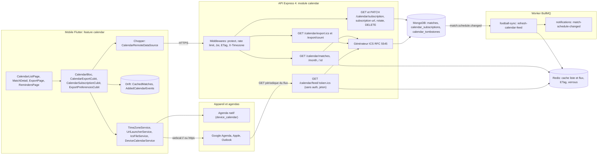

**Légende.** L'application mobile ne télécharge **jamais** le flux `webcal` elle-même : c'est l'agenda de l'utilisateur (Google, Apple, Outlook) qui appelle la route `/calendar/feed/:token.ics`. Le mobile obtient seulement l'URL (`subscription-url`) et demande à l'OS de l'ouvrir. Un changement d'horaire en base émet l'événement interne `match.schedule.changed` qui déclenche le job d'invalidation et la notification.

## 4. Écrans et navigation

| Code | Écran | Rôle |
|---|---|---|
| `L-01` | Liste des matchs à venir | Chips, groupement par mois, badge « Exporté » / « Non inclus » |
| `L-02` | Vue mensuelle | Grille lundi-dimanche, jours avec match, matchs du jour sélectionné |
| `L-03` | Liste — chargement | 5 squelettes de cartes |
| `L-04` | Liste — aucun match | « Aucun match à venir » + « Voir toutes les compétitions » |
| `L-05` | Détail d'un match programmé | Lieu, coup d'envoi « 21:00 CEST · 20:00 dans ton fuseau (WAT) », rappel, « Ajouter à mon agenda » |
| `L-06` | Match reporté | Bannière « Horaire modifié », carte Avant / Maintenant |
| `L-07` | Export — choix du mode | « S'abonner (mise à jour automatique) » (recommandé) ou « Télécharger ce calendrier » |
| `L-08` | Export — filtres par compétition | Interrupteurs, cases équipe première / féminine / Barça Atlètic, compteur |
| `L-09` | Abonnement — confirmation | Feuille : Agenda de l'appareil / Google Agenda / Outlook, lien masqué, « Ouvrir l'agenda » |
| `L-10` | Fichier `.ics` téléchargé | Modale : « Ouvrir dans l'agenda » ou « S'abonner plutôt » |
| `L-11` | Échec d'ouverture du lien webcal | « Agenda introuvable » : télécharger `.ics` ou copier le lien |
| `L-12` | Pré-permission agenda | Écran d'explication avant le dialogue système |
| `L-13` | Autorisation refusée | Repli `.ics` ou « Ouvrir les réglages » |
| `L-14` | Ajouter un match à l'agenda | Feuille : rappel, agenda cible, « Ajouter à l'agenda », « Télécharger .ics » |
| `L-15` | Rappels configurables | 5 interrupteurs et fuseau détecté |

<p>


</p>

*`L-01` : cartes avec bloc date « 24 OCT. », deux équipes, heure, puce de compétition (Liga rose, Ligue des champions bleue, Coupe du Roi jaune) et badge « Exporté » (vert) ou « — Non inclus » (gris, ici Coupe du Roi). `L-06` : bannière ambre « Horaire modifié », ligne « Avant » barrée et « Maintenant » en grenat. `L-07` : carte « S'abonner » recommandée (bordure grenat), carte « Télécharger », ligne « Compétitions incluses · Liga · Ligue des champions — Modifier ». `L-09` : feuille avec trois cibles et lien `webcal://…/calendar/feed/••••••` masqué + bouton copier.*

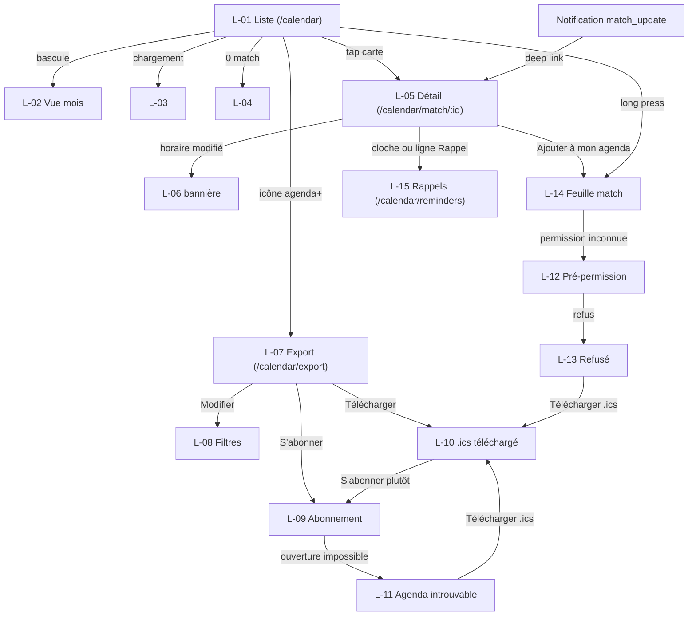

Routes : `/calendar`, `/calendar/match/:id`, `/calendar/export`, `/calendar/reminders`. Un `id` invalide affiche « Match introuvable » sans appel réseau ; le bouton retour du détail revient au **calendrier**, pas à l'accueil.

## 5. Flux détaillés

### 5.1 S'abonner au calendrier (nominal) et échec d'ouverture

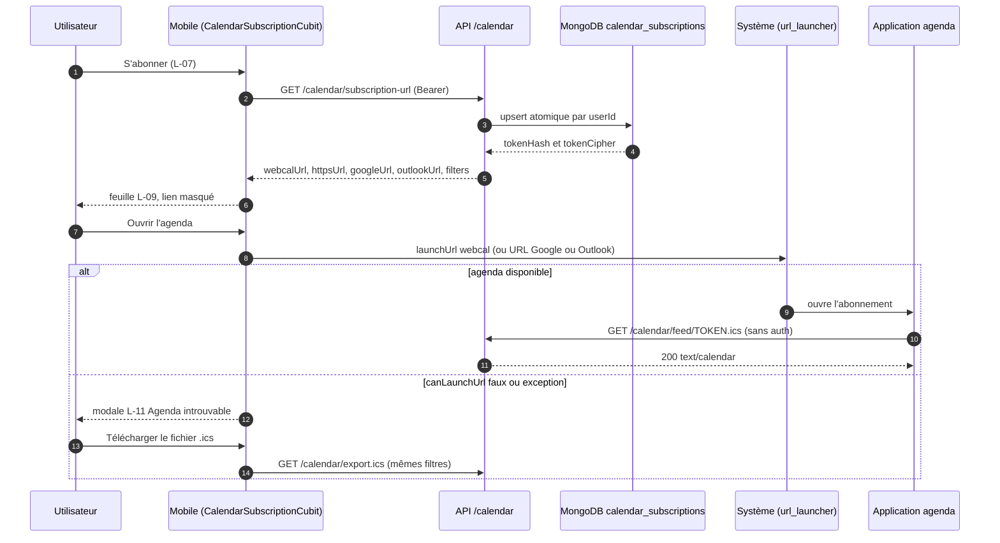

**Pas à pas.** (2-5) Le premier appel **crée** l'abonnement (un par utilisateur, index unique `userId` ; deux appels simultanés ne créent qu'un document) ; les appels suivants renvoient la **même** URL. (7-9) La cible choisie détermine l'URL ouverte : `webcal://` pour l'agenda de l'appareil ; `https://calendar.google.com/calendar/r?cid=<webcal encodé>` pour Google ; `https://outlook.live.com/calendar/0/addfromweb?url=<https encodé>` pour Outlook. (10-13) C'est l'agenda qui appelle le flux. (14-17) Si rien ne sait ouvrir le lien, la modale `L-11` propose le `.ics` ou la copie du lien. Le jeton n'est jamais journalisé et affiché masqué (`••••••`).

### 5.2 Un match est reporté : propagation jusqu'à l'agenda

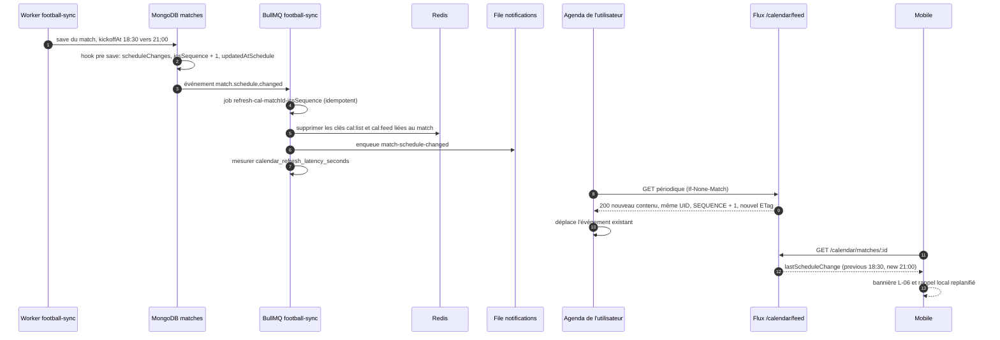

**Garanties.** Le délai détection → flux est au plus de 15 min (TTL du cache), mais l'engagement produit reste **« sous 24 h »** car les clients agenda rafraîchissent à leur rythme (Google : 8 à 24 h, il ignore `REFRESH-INTERVAL`). Un cron quotidien de sécurité (04:00 Europe/Madrid) recalcule les ETag de tous les abonnements. Le job est idempotent grâce à son identifiant déterministe ; un rejeu n'envoie pas de notification en double.

### 5.3 Ajouter un match à l'agenda natif (permission accordée, refusée)

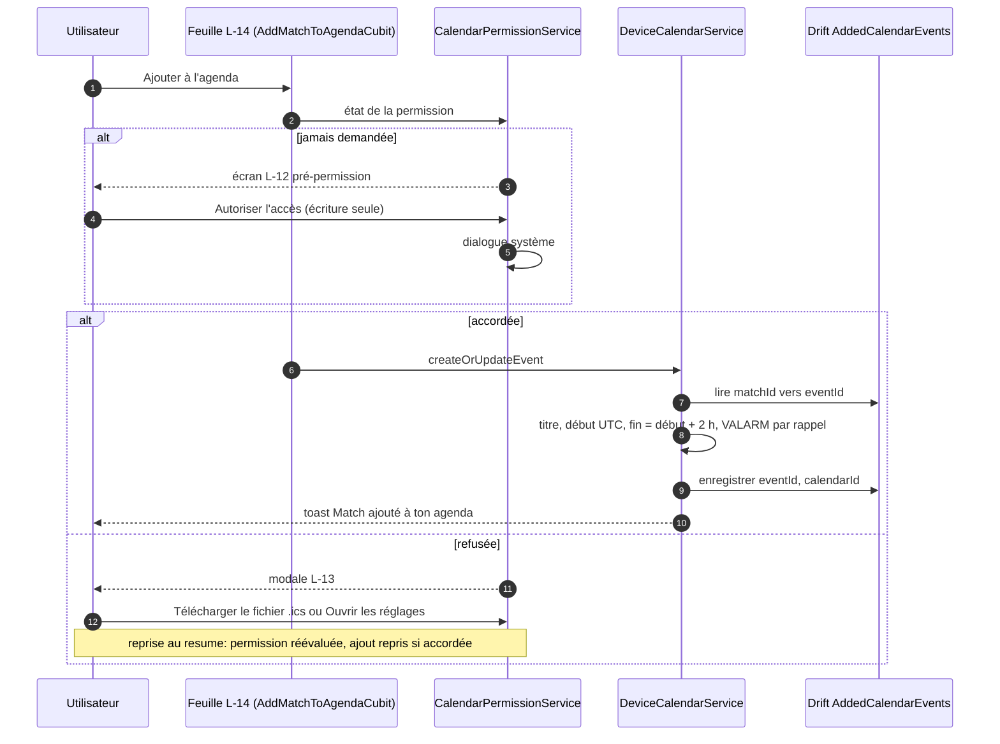

**Détails.** L'écran `L-12` n'apparaît qu'au premier ajout et tant que la permission n'est pas accordée ; le mobile demande l'**écriture seule** (iOS 17 : `requestWriteOnlyAccessToEvents`, Android : `WRITE_CALENDAR`) et ne lit jamais les événements existants, hors la liste des calendriers inscriptibles. Un second ajout du même match **met à jour** l'événement (anti-doublon `matchId → eventId`).

### 5.4 Lecture du flux par un client agenda (cache, ETag, erreurs)

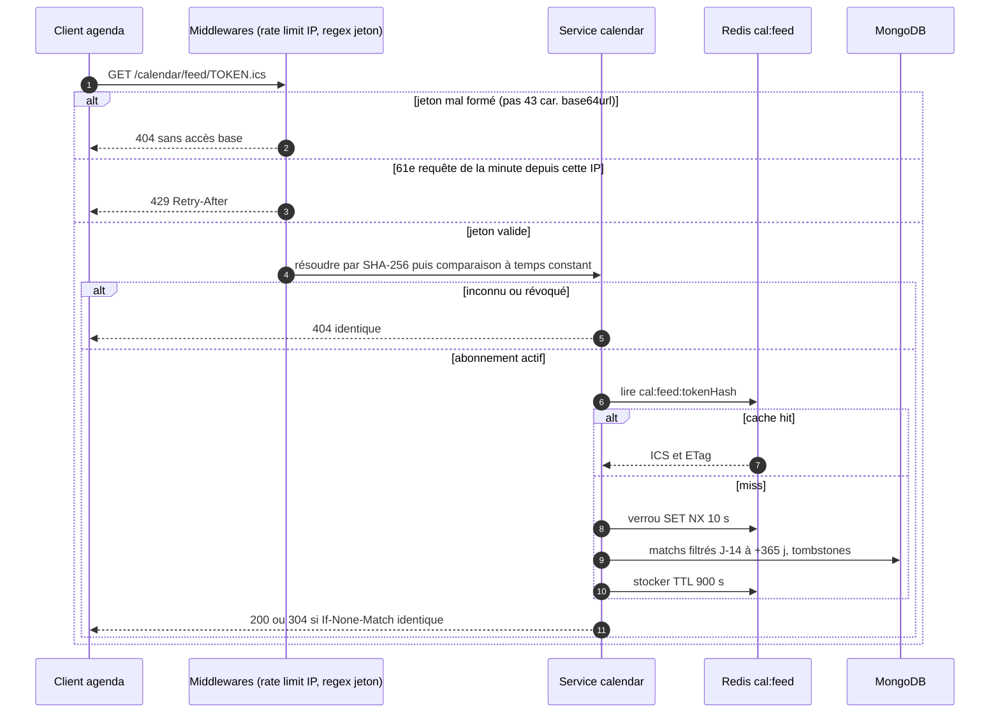

### 5.5 Cycle de vie de l'abonnement et de son jeton

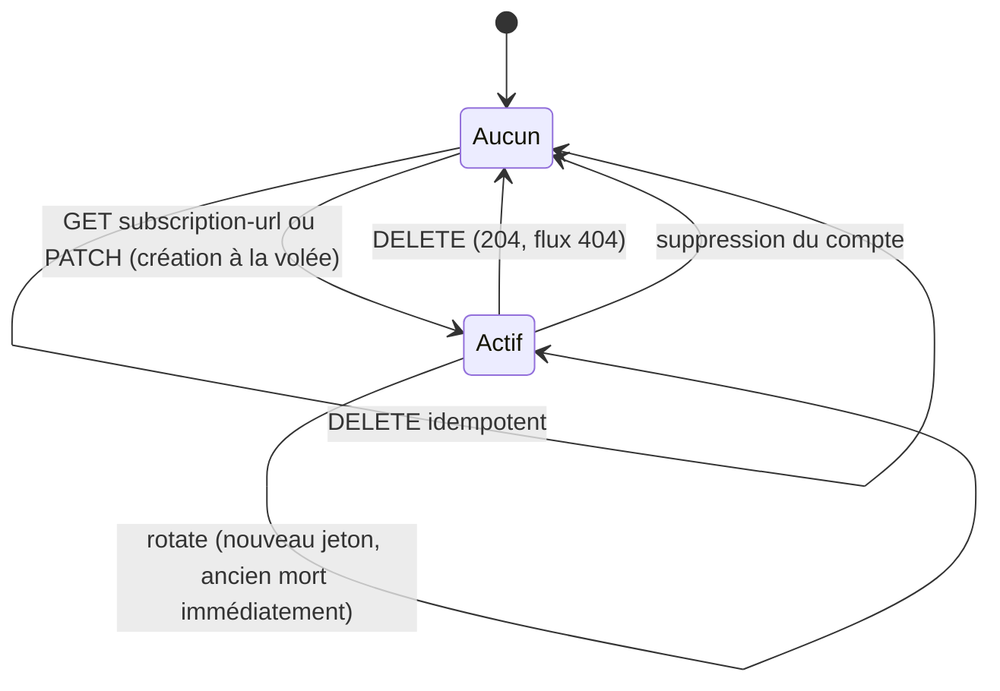

### 5.6 Statut d'un événement dans le flux ICS

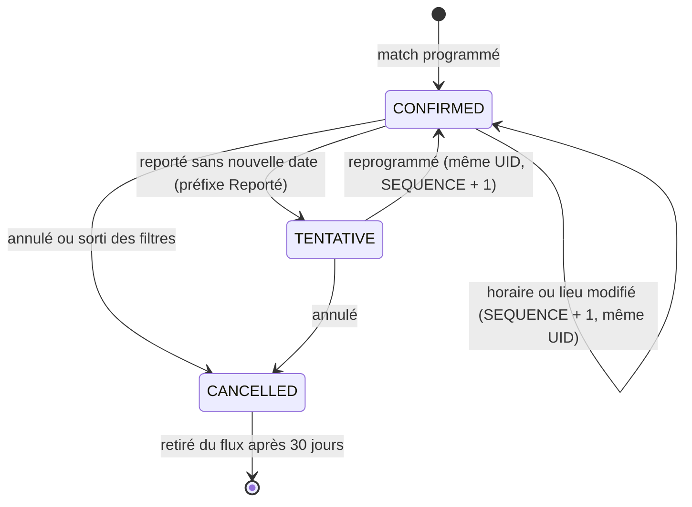

### 5.7 Du choix de rappel au VALARM

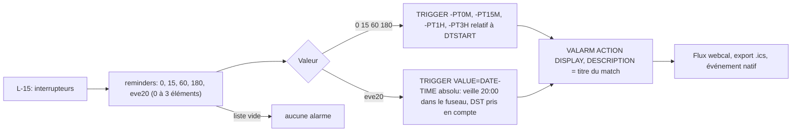

## 6. Contrats d'API

Préfixe `/api/v1`. Enveloppe `{ success, data }`. Fuseau utilisateur : en-tête `X-Timezone` (IANA, whitelist `Intl.supportedValuesOf('timeZone')`) > `User.timezone` (défaut `Europe/Madrid`) > `UTC`. Un fuseau invalide est ignoré (warning), jamais un 400 en lecture.

| Méthode | Chemin | Auth / rôle | Rate limit | Requête | Réponse | Erreurs |
|---|---|---|---|---|---|---|
| GET | `/calendar/matches` | public (`inExport` si jeton valide) | 120/min/user, 60/min/IP | `competitions` (codes, défaut all), `squads` (défaut first), `from`, `to`, `status` (défaut scheduled, postponed, live), `page`, `limit` (≤ 50) | `{items[{id, competition{code,name}, homeTeam, awayTeam, kickoffAt, kickoffLocal, timezone, timezoneAbbr, venueTimezone, status, matchday, venue, timeTbd, inExport}], total, page, totalPages, hasMore, nextCursor}` | 422 `details.competitions` ; vide = 200 `items:[]` |
| GET | `/calendar/matches/month` | public | idem | `month=AAAA-MM` (−12 à +18 mois), mêmes filtres | `{month, timezone, days[{date, matches}], matchDays[]}` ; 62 matchs max | 422 hors bornes ; mois vide = 200 |
| GET | `/calendar/matches/:id` | public | idem | — | détail + `venueKickoffLocal`, `lastScheduleChange` (si < 7 jours), `icsUid`, `reminderMinutes`, `addToCalendar{icsUrl}` | 400 id, 404 |
| GET | `/calendar/export.ics` | Bearer | **10 exports/h/user** | `competitions, squads, reminders, season` | fichier `text/calendar; charset=utf-8`, `Content-Disposition: attachment; filename="univers-barca-2026-27.ics"`, `X-Match-Count`, `Cache-Control: private, no-store` | 401, 422, 429 + `Retry-After` |
| GET | `/calendar/export/count` | Bearer | idem | mêmes filtres | `{count: 24}` | 422 |
| GET | `/calendar/subscription-url` | Bearer | lecture | — | `{webcalUrl, httpsUrl, googleUrl, outlookUrl, filters, createdAt, lastFetchedAt}` | 401 |
| GET | `/calendar/subscription` | Bearer | lecture | — | `{competitions, squads, reminders, matchCount, lastFetchedAt}` | 401 |
| PATCH | `/calendar/subscription` | Bearer | lecture | `competitions, squads, reminders, timezone` (partiel) | idem GET | 422 `CALENDAR_EMPTY_SELECTION` |
| POST | `/calendar/subscription/rotate` | Bearer | **5 rotations/jour** | — | `{webcalUrl, httpsUrl}` | 429 |
| DELETE | `/calendar/subscription` | Bearer | lecture | — | 204 (idempotent) | 401 |
| GET | `/calendar/feed/:token.ics` | **aucune** (jeton opaque) | **60/min/IP** | — | `text/calendar; charset=utf-8`, `ETag`, `Last-Modified`, `Cache-Control: private, max-age=900`, `nosniff`, `Referrer-Policy: no-referrer` | 404 uniforme, 429 |

Exemple `GET /calendar/matches/:id` (extrait) pour `X-Timezone: Africa/Douala` :

```json
{ "success": true, "data": {
  "id": "6720a1f0…", "competition": { "code": "liga", "name": "Liga" },
  "kickoffAt": "2026-10-24T19:00:00.000Z",
  "kickoffLocal": "2026-10-24T20:00:00+01:00", "timezoneAbbr": "WAT",
  "venueTimezone": "Europe/Madrid", "status": "scheduled",
  "lastScheduleChange": null, "reminderMinutes": [60],
  "addToCalendar": { "icsUrl": "/api/v1/calendar/matches/6720a1f0….ics" } } }
```

**Contenu ICS** (`API-CAL-08/09`) : `VERSION:2.0`, `PRODID:-//Univers Barca//Calendrier//FR`, `CALSCALE:GREGORIAN`, `METHOD:PUBLISH`, `X-WR-CALNAME:Univers Barça — FC Barcelone`, `X-WR-CALDESC` (mention « application communautaire non officielle » ; pour l'export ponctuel : « Export ponctuel : non mis à jour automatiquement… »), `REFRESH-INTERVAL;VALUE=DURATION:PT12H`, `X-PUBLISHED-TTL:PT12H`. Chaque `VEVENT` : `UID:match-{id}@univers-barca.app`, `DTSTAMP`/`LAST-MODIFIED` = `updatedAtSchedule`, `DTSTART` en UTC (`Z`), `DTEND` = début + 2 h (`MATCH_DURATION_MINUTES=120`), `SUMMARY` « FC Barcelone vs Real Madrid — Liga » (domicile en premier), `LOCATION` `{venue}, {city}, {country}` (omise si inconnue), `DESCRIPTION` (compétition et journée, heure dans le fuseau du stade, mention non officielle, lien), `URL`, `SEQUENCE`, `STATUS`, `CATEGORIES`, `TRANSP:TRANSPARENT`. Fins de ligne CRLF, pliage à 75 **octets** (jamais au milieu d'un caractère multi-octet), échappement `\\`, `;`, `,`, retours à la ligne. Aucune donnée personnelle. 400 événements maximum.

## 7. Modèle de données

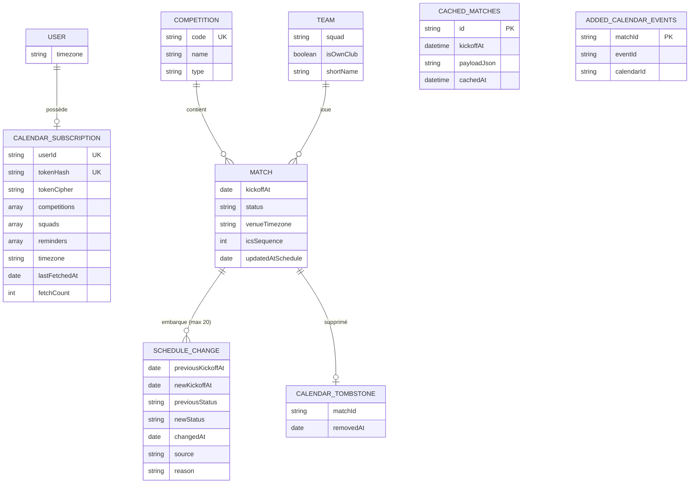

* **Existant dans le code.** `CalendarSubscription` (`src/models/platform.model.ts`) : `userId` (unique, ref `User`), `tokenHash` (unique), `competitions: [String]`, `reminderMinutes: Number` (défaut 60). `Match`, `Team`, `Competition` : voir F05.
* **À créer / faire évoluer (`API-CAL`).**
  * `Competition.code` (enum `liga`, `champions`, `copa`, `supercopa`, `friendly`, unique indexé) ; migration idempotente par nom (La Liga → `liga`, UEFA Champions League → `champions`, Copa del Rey → `copa`, Supercopa de España → `supercopa`, `friendly` → `friendly`). Une compétition inconnue n'apparaît que sous « Toutes ».
  * `Team.squad` (`first` par défaut, `women`, `atletic`) ; le filtre `squads` s'applique à celle des deux équipes qui est `isOwnClub=true`.
  * `Match.scheduleChanges[]` (plafonné à 20 entrées, changements < 1 min ignorés, `scheduled→postponed` toujours enregistré), `Match.icsSequence` (+1 à chaque changement d'horaire, de statut ou de lieu), `Match.updatedAtSchedule`.
  * `CalendarSubscription` : `tokenCipher` (AES-256-GCM, clé `CALENDAR_TOKEN_KEY`), `competitions`, `squads`, **`reminders: [String]`** (migration `60 → ['60']`), `timezone`, `lastFetchedAt`, `fetchCount` (écriture différée au plus 1 fois/heure).
  * `CalendarTombstone {matchId, removedAt}` avec **index TTL 30 jours**.
* **Jeton.** 32 octets `crypto.randomBytes` encodés base64url (43 caractères, entropie 256 bits) ; stockage `tokenHash = SHA-256(token)` (unique) ; vérification par hash puis `crypto.timingSafeEqual` ; regex stricte `^[A-Za-z0-9_-]{43}$` avant toute requête ; la même réponse `404` pour jeton inconnu, révoqué ou malformé (anti-énumération).
* **Redis (clés du backlog, préfixe `ub:` proposé).** `cal:list:{hash(filters,tz,lang)}` (TTL 900 s, partagé), `cal:feed:{tokenHash}` (TTL 900 s, par abonnement), `cal:keys:{matchId}` (ensemble d'index pour l'invalidation anticipée), verrous `SET NX` 10 s.
* **Mobile (Drift).** `CachedMatches(id, homeTeam, awayTeam, kickoffAt UTC, payloadJson, cachedAt)` (purge des matchs terminés depuis plus de 7 jours, snapshot conservant l'ancien horaire pour détecter un report), `AddedCalendarEvents(matchId, eventId, calendarId)`. Préférences d'export (compétitions, périmètre, rappels, « abonné = true », bannière `L-06` fermée par `matchId+kickoffAt`) en JSON versionné (Drift clé-valeur ou `shared_preferences`) ; l'URL d'abonnement, si persistée, **uniquement** dans `flutter_secure_storage`.
* **Migrations.** Scripts idempotents dans `scripts/migrations` : `Competition.code`, `Team.squad`, `Match.icsSequence = 0`, `CalendarSubscription.reminders`.

## 8. Traitements asynchrones et cache

| Mécanisme | Détail |
|---|---|
| Job `refresh-calendar-feed` | ajouté à la file **`football-sync`** ; données `{matchId, previousKickoffAt, newKickoffAt, changeType}` ; `jobId = refresh-cal-{matchId}-{icsSequence}` (idempotence) ; `attempts: 5`, backoff exponentiel 2 s, puis `dead-letter` |
| Étapes du job | (1) invalider les clés liées au match, (2) mettre à jour `updatedAtSchedule`/ETag, (3) enqueue `match-schedule-changed` dans `notifications`, (4) histogramme `calendar_refresh_latency_seconds` |
| Cron de sécurité | quotidien **04:00 Europe/Madrid** : recalcul des ETag de tous les abonnements (garantie « sous 24 h ») |
| Cache | liste et flux 900 s ; ETag fort (SHA-1 du contenu) ou faible `W/"{maxIcsSequence}-{count}-{filtersHash}"` sans générer le fichier ; `Last-Modified` = max des `updatedAtSchedule` ; `If-None-Match` / `If-Modified-Since` supportés → `304` |
| Anti-stampede | verrou `SET NX` 10 s pour éviter N régénérations simultanées |
| Redis indisponible | génération directe, log `warn`, jamais de 500 ; enqueue ignoré avec warning (le cron comble l'écart) |
| Fenêtre du flux | **J-14 → +365 jours** ; événements passés > 14 jours omis du flux dynamique mais présents dans l'export de la saison en cours |
| Matchs annulés / retirés | émis `STATUS:CANCELLED` pendant 30 jours (tombstones TTL) puis disparaissent ; un match sorti des filtres est traité comme annulé |
| Écriture `lastFetchedAt` | différée, au plus une fois par heure |

## 9. Règles de gestion

1. **RG-CAL-01** : flux conforme RFC 5545, validé automatiquement en CI avant chaque mise en production (`npm run test:ics` bloquant sur la branche principale).
2. **RG-CAL-02** : chaque événement contient le titre « FC Barcelone vs Real Madrid — Liga », le début en **UTC**, un lieu si connu et un lien de retour vers l'application.
3. **RG-CAL-03** : report ou changement officiel reflété dans le flux dynamique sous 24 h maximum.
4. **RG-CAL-04** : l'export ponctuel n'est pas mis à jour automatiquement ; un message l'indique et encourage l'abonnement.
5. **RG-CAL-05** : filtre par compétition avant génération ; au moins une compétition obligatoire (`422 CALENDAR_EMPTY_SELECTION` côté API, « Garde au moins une compétition » côté mobile).
6. Filtres par défaut : Liga + Ligue des champions, équipe première uniquement ; équipes féminine et Barça Atlètic « selon disponibilité des données » (cases désactivées « Bientôt disponible » si l'API ne les expose pas). Cocher « féminine » ou « Barça Atlètic » décoche « Équipe première uniquement » et inversement.
7. Un seul abonnement par utilisateur ; même URL à chaque appel ; rotation : 5 par jour, ancien jeton invalidé immédiatement, sans période de grâce.
8. Export ponctuel : 10 par heure et par utilisateur ; flux : 60 requêtes par minute et par IP.
9. Rappels autorisés : `0`, `15`, `60` (défaut), `180` minutes avant, `eve20` (veille 20:00 dans le fuseau) ; de 0 à 3 éléments côté API ; aucun ACTION `EMAIL` ni `AUDIO`.
10. Durée d'un match dans le flux : 120 minutes ; `UID` immuable ; `SEQUENCE = icsSequence` ; jamais de changement d'UID lors d'un report (sinon doublons).
11. Report sans nouvelle date : `STATUS:TENTATIVE`, `SUMMARY` préfixé « [Reporté] », description « Date à confirmer » ; reprogrammation : même UID, `DTSTART` mis à jour, `SEQUENCE + 1`, `CONFIRMED`.
12. Bannière `L-06` : affichée si `status=postponed` ou `kickoffAt ≠ previousKickoffAt` tant que le nouvel horaire est à moins de 14 jours du coup d'envoi ou non fermée ; côté API, `lastScheduleChange` n'est fourni que pour un changement de moins de 7 jours.
13. Fuseau : conversion UTC → fuseau de l'appareil (`flutter_timezone`, repli UTC) ; la ligne double « 21:00 CEST · 20:00 dans ton fuseau (WAT) » n'apparaît que si les décalages diffèrent ; jour et date calculés dans le fuseau local ; le passage à l'heure d'hiver (25 oct. 2026) ne décale aucun `kickoffAt` UTC.
14. Badge « Exporté » = « inclus dans l'export/abonnement » (compétition ∈ préférences **et** équipe conforme au périmètre), pas « déjà ajouté à l'agenda natif » ; réactif aux changements de préférences.
15. Ajout natif : événement `FC Barcelone vs Real Madrid — Liga`, fin = début + 2 h, lien `https://univers-barca.app/calendar/match/:id`, un `VALARM` par rappel, anti-doublon `matchId → eventId` (mise à jour au lieu de création) ; permission en **écriture seule**.
16. Un changement de préférences invalide l'URL d'abonnement en cache local ; les événements déjà créés ne sont pas modifiés rétroactivement par un changement de rappel.
17. Nom du fichier : `univers-barca-{saison}.ics` (ex. `univers-barca-2026-27.ics`) ; réponse vide = VCALENDAR valide sans `VEVENT`, `X-Match-Count: 0`.
18. Mois de la vue mensuelle : de −12 à +18 mois, 62 matchs maximum ; liste : `limit` ≤ 50 ; plage chargée ≥ 6 mois côté mobile.

## 10. Sécurité, RGPD et anti-abus

* **Jeton secret.** Entropie 256 bits, hash SHA-256 indexé, comparaison à temps constant, `404` uniforme, regex stricte avant accès base ; jeton **masqué** dans les logs (`/calendar/feed/••••••.ics`), absent des analytics, des rapports de crash, des messages d'erreur ; log d'accès sans le jeton ; affichage masqué dans l'app (copie complète = action explicite) ; l'URL n'est jamais stockée en clair dans `SharedPreferences` ; effacement local à la déconnexion et à la suppression de compte.
* **Compromis de conception à connaître.** Pour pouvoir réafficher l'URL à chaque ouverture de `L-09`, l'API conserve en plus du hash un **chiffrement réversible** du jeton (AES-256-GCM, clé `CALENDAR_TOKEN_KEY`, déchiffré uniquement pour son propriétaire). C'est une décision du backlog à valider (voir §14).
* **Contenu sans PII.** Le flux ne contient que des événements sportifs (CDC Backend §3.7) : aucun e-mail, pseudo ou identifiant utilisateur.
* **Headers de sécurité du flux.** `X-Content-Type-Options: nosniff`, `Referrer-Policy: no-referrer`, `Cache-Control: private, max-age=900`.
* **Anti-abus.** 60/min/IP sur le flux (avec `trust proxy` correctement configuré) ; 10 exports/h ; 5 rotations/jour ; l'app mobile ne consomme jamais le flux.
* **RGPD.** Export de données : bloc `calendarSubscription` {compétitions, squads, rappels, locale, `createdAt`, `lastFetchedAt`, `fetchCount`}, **jamais** le jeton ni son hash ; suppression du compte → abonnement et caches supprimés immédiatement, flux `404` dès la demande ; journaux d'accès sans IP en clair (hachage + sel quotidien), rétention ≤ 90 jours ; événements `calendar.token.rotated` / `.revoked` journalisés (userId, IP hachée).
* **Minimisation côté appareil.** Permission agenda en **écriture seule** ; « Nous ne lisons jamais tes autres événements » ; `READ_CALENDAR` Android justifié par le seul besoin de lister les agendas (à documenter dans la checklist des stores) ; chaînes de permission localisées (`InfoPlist.strings` FR/EN/ES).
* **Propriété intellectuelle.** Aucun logo ni marque dans les attributs ICS ; mention « application communautaire non officielle ».

## 11. Erreurs et états dégradés

| Situation | Serveur | Client |
|---|---|---|
| Aucun match pour le filtre | `200 items:[]` | `L-04` ; « Voir toutes les compétitions » relance sans filtre ; si « Toutes » déjà active : « Aucun match programmé pour le moment » sans bouton |
| Hors-ligne avec cache | — | liste du cache + bandeau « Hors-ligne · mis à jour il y a X » ; boutons export désactivés (« Connexion requise pour générer le calendrier ») |
| Hors-ligne sans cache | — | `AppErrorView` hors-ligne + Réessayer |
| Erreur serveur | `5xx` | message distinct |
| Chargement > 10 s | — | « Chargement plus long que prévu » + Réessayer |
| Redis indisponible | génération directe | sans effet visible |
| Filtre inconnu | `422` | message générique |
| Trop d'exports | `429` + `Retry-After` | « Échec du téléchargement » + Réessayer |
| Génération du lien en échec | — | snackbar « Impossible de générer ton lien » + Réessayer |
| Lien webcal non ouvrable | — | `L-11` : `.ics` ou copie du lien |
| `.ics` invalide ou stockage en échec | — | validation minimale (commence par `BEGIN:VCALENDAR`) ; snackbar « Échec du téléchargement » |
| Permission refusée | — | `L-13` ; refus définitif → réglages seulement ; **aucune relance automatique** |
| Match reporté sans date | `timeTbd:true`, `kickoffLocal:null` | « Nouvelle date à confirmer », sans ligne « Maintenant » |
| Jeton révoqué / inconnu | `404` uniforme | l'app ne peut pas le savoir : l'écran d'abonnement permet de réobtenir l'URL |
| Match terminé ou en direct | retourné en lecture seule, `addToCalendar` absent | boutons masqués, statut affiché |
| Changement de fuseau de l'appareil en session | — | affichage recalculé au `resume` |

## 12. Connexions avec les autres fonctionnalités

| Fonctionnalité | Relation | Détail |
|---|---|---|
| F05 Données football | dépend de | matchs, synchronisation, `scheduleChanges`, conflit `WD-03` (impact « Flux calendrier : mise à jour sous 24 h ») |
| F06 Accueil | partage | `C-09` → `/calendar` ; `C-11` → export `.ics` d'un match et rappel local |
| F07 Historique | partage | liens profonds de match ; résultats après le match |
| Notifications (NOTIF) | alimente | `match-schedule-changed` ; deep link `/calendar/match/:id` (payload `{type:'match_update', matchId}`) ; les rappels de `L-15` n'activent pas le push |
| Fantasy | reçoit | `kickoffAt` modifié → fermeture des compositions ajustée (via WD-03) |
| Profil / RGPD | partage | export de données, suppression de compte |
| Modules de configuration | dépend de | `User.timezone` |

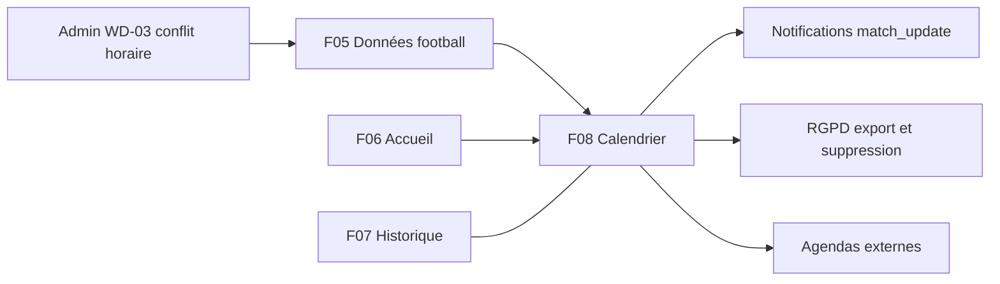

## 13. Observabilité et tests

* **Métriques.** `calendar_refresh_latency_seconds` (détection → flux), hit/miss Redis liste et flux, volume de requêtes sur le flux et part de `304`, `fetchCount`, échecs de génération, taux de `429`. Logs : jamais le jeton ; événements `calendar.token.rotated` / `calendar.token.revoked`.
* **Tests API.** `API-CAL-21` : validation RFC 5545 avec `ical.js` (CRLF, lignes ≤ 75 octets, `UID`/`DTSTAMP`/`DTSTART` obligatoires, UID uniques, `DTEND > DTSTART`, `VALARM` complet) sur jeux : 24 matchs, report, annulation, accents (Barça, Séville), lieu absent, 400 événements, liste vide ; étape CI `npm run test:ics`. `API-CAL-22` : scénario « supporter » (liste → détail → export de 24 matchs → abonnement → flux → rotation), scénario « report » (18:30 → 21:00 → `lastScheduleChange` → flux `SEQUENCE + 1` → job), négatifs 401/404/422/429, couverture ≥ 85 % ; horloge figée pour les fenêtres J-14 / +365 j.
* **Charge k6** (`API-CAL-23`) : liste 100 VU 5 min p95 < 300 ms, erreurs < 0,5 % ; flux 200 VU sur 500 jetons, 70 % de requêtes conditionnelles, p95 < 200 ms, génération froide < 800 ms ; pic « report » : invalidation + 1 000 requêtes en 10 s avec **une seule** régénération par abonnement ; seuils bloquants sur le job CI nocturne, pas sur la PR.
* **Tests mobile.** Goldens des 15 écrans (360×640 et 430×932, clair/sombre) ; fakes `DeviceCalendarService`, `UrlLauncherService`, `IcsFileService`, `TimeZoneService` (fixe `Africa/Douala`) ; parcours liste → filtres → abonnement (succès et échec webcal), liste → `.ics`, détail → ajout agenda (permission accordée / refusée), rappels ; scénario report cache 18:30 / réseau 21:00 → `L-06` ; test de l'heure d'hiver du 25 octobre 2026 ; masquage du jeton dans les logs (non-régression) ; couverture ≥ 80 % sur domaine et blocs.
* **Cas clés.** Match à 23:30 UTC changeant de jour en WAT ; reprogrammation = un seul événement final ; annulation > 30 jours absente ; `X-Match-Count: 0` pour une sélection vide ; jeton de mauvaise longueur → 404 sans accès base ; création concurrente d'abonnement → un seul document.

## 14. Points ouverts et incohérences détectées

**À confirmer (backlog).** Conservation d'un jeton **réversible** (AES-256-GCM) pour réafficher l'URL (vs hash seul) ; génération de l'`.ics` d'un seul match (endpoint serveur ou client, « à trancher avec l'API » dans `MOB-L-23`) ; disponibilité des équipes féminine et Barça Atlètic ; seuil de 14 jours de la bannière `L-06` ; justification de `READ_CALENDAR` pour les stores.

**Incohérences specs mobile / API / CDC.**

| Sujet | Mobile (`MOB-L`, `MOB-C`) | API (`API-CAL`, `API-FOOT`) |
|---|---|---|
| Endpoint de liste | `getUpcomingMatches(CalendarQuery)` : `competition` CSV, `team`, `from` ; chemin non fixé | deux candidats : `GET /matches` (`API-FOOT-13`, slugs `competition`, curseur) et `GET /calendar/matches` (`API-CAL-04`, codes `competitions`, `page`/`limit` ≤ 50) |
| Identifiant de compétition | `CompetitionFilter {liga, championsLeague, copaDelRey, supercopa, friendly}` | `Competition.code {liga, champions, copa, supercopa, friendly}` (`API-CAL-01`) vs `slug {liga, ldc, copa-del-rey, friendly}` (`API-FOOT-02`) |
| Rappels | 5 valeurs (`atKickoff, min15, hour1, hour3, eveAt2000`), tous cochables ; défaut {1 h, veille 20:00} | `reminders` de **0 à 3** éléments (`0, 15, 60, 180, eve20`), défaut `['60']` ; `CalendarSubscription.reminderMinutes` actuel = nombre |
| Nom de saison du fichier | « saison calculée août → juillet » | « saison déduite du premier match (juillet → juin) » |
| Fichier `.ics` d'un match | `GET /calendar/export.ics?matchId=:id` (`MOB-C-22`) ou génération locale | `addToCalendar.icsUrl = /calendar/matches/:id.ics` (`API-CAL-06`) ; `export.ics` n'a pas de paramètre `matchId` |
| URL du flux | `webcal://api.univers-barca.app/calendar/feed/••••••.ics` | `webcal://host/api/v1/calendar/feed/{token}.ics` |
| Lien de retour | `https://univers-barca.app/calendar/match/:id` | `URL:https://app.univers-barca.app/match/{id}` (`API-CAL-09`) ; `MOB-F-19` : `https://univers-barca.app/history/match/:id` |
| Export ponctuel | téléchargement de 24 matchs filtré par compétition ; boutons rapides (par match) | limite **10 exports/heure** : un usage intensif de « Télécharger .ics » par match peut la saturer |
| Fuseau | calcul local à partir de l'UTC (`TimeZoneService`) | `X-Timezone` > `User.timezone` > `UTC` ; `kickoffLocal`, `timezoneAbbr` fournis par l'API ; le mobile n'envoie pas explicitement `X-Timezone` dans ses specs |
| Fuseau du flux sans en-tête | — | le flux n'a pas d'en-tête de fuseau : `eve20` repose sur `CalendarSubscription.timezone` (`PATCH`) ; sa valeur par défaut n'est pas précisée pour un abonnement créé par `GET subscription-url` |
| Nom du job | — | CDC : file `refresh-calendar-feed` ; backlog : job `refresh-calendar-feed` **dans** la file `football-sync` |
| Fuseaux des tâches planifiées | CDC : fuseau de référence « à trancher » | cron de sécurité du flux à 04:00 `Europe/Madrid`, diffusion des anecdotes à 06:00 `Europe/Paris`, crons de synchronisation en UTC (voir F05/F06) |
| Stack | CDC : NestJS/Prisma | réel : Express + Mongoose, `CalendarSubscription` déjà présent dans `platform.model.ts` (sans `tokenCipher`, `squads`, `reminders`) |

## 15. Pour aller plus loin

* **Épopées** : `MOB-L` (`MOB-L-05` CalendarBloc, `MOB-L-11` fuseaux, `MOB-L-15` export, `MOB-L-17` abonnement webcal, `MOB-L-19` `.ics`, `MOB-L-20`/`-21`/`-22` permissions et agenda natif, `MOB-L-24` rappels, `MOB-L-25` configuration native, `MOB-L-26` sécurité du jeton) ; `API-CAL` (`API-CAL-01` à `API-CAL-24`, notamment `-08` générateur ICS, `-11` UID/SEQUENCE, `-13` à `-15` jeton, `-17` flux, `-18` cache/ETag, `-19` job, `-21` validation CI) ; `API-FOOT-13`, `-14` (liste et prochain match) ; `NOTIF` (changement d'horaire).
* **CDC** : Global §2.9, §2.16.1 (RG-CAL-01 à 05) ; Flutter §6.4 (permissions), §7.8, §7.8.1 ; Backend §3.7 (module Calendar), §5.6 (cache), §7 (`refresh-calendar-feed`), §10.2 (rate limiting).
* **Code** : `univers_barca_api/src/models/platform.model.ts` (`CalendarSubscription`), `src/models/football.model.ts`, `src/jobs/queues.ts`, `src/jobs/scheduler.ts`, `src/middleware/rateLimiter.ts` ; mobile : `lib/core/network/interceptors.dart` (masquage du jeton à ajouter), `lib/core/constants/route_constants.dart` (routes calendrier à ajouter) ; la feature `lib/features/calendar` est à créer. Documentation prévue : `docs/CALENDAR.md` (`API-CAL-24`).
