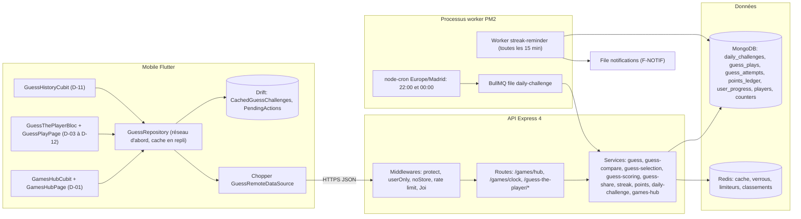
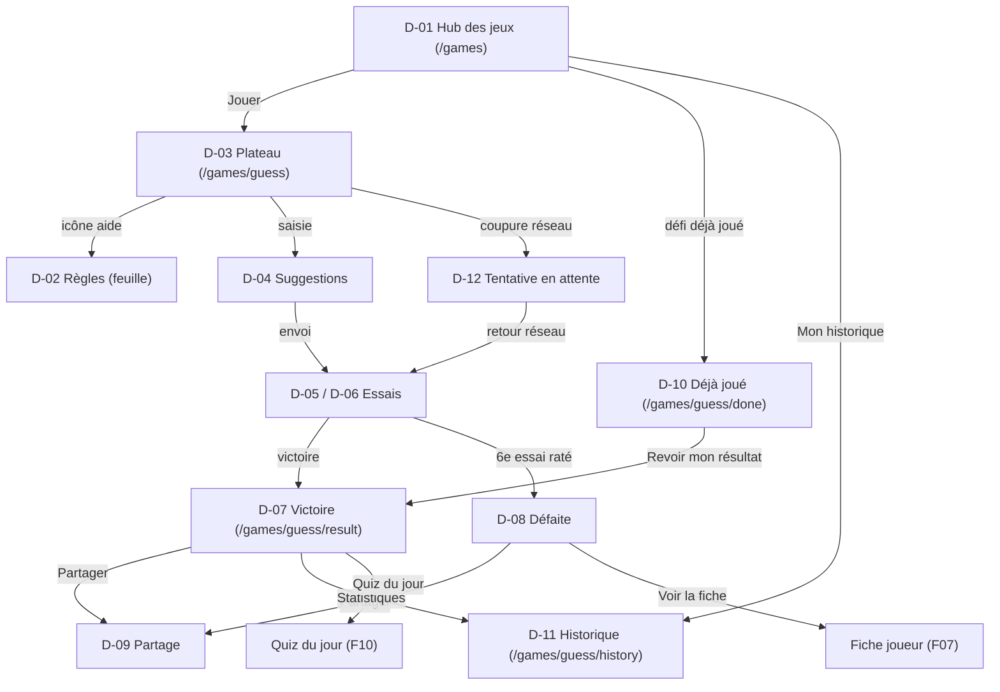
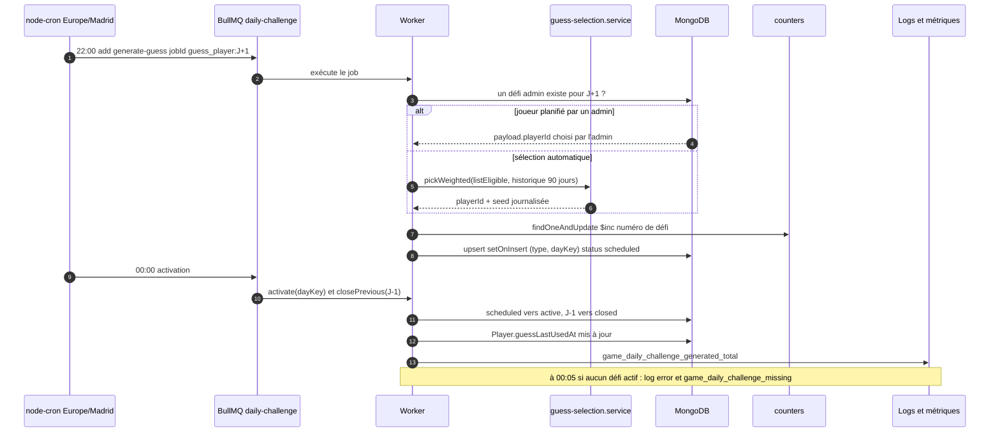
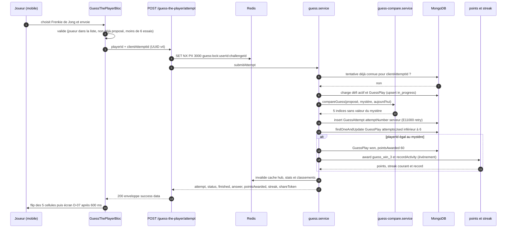
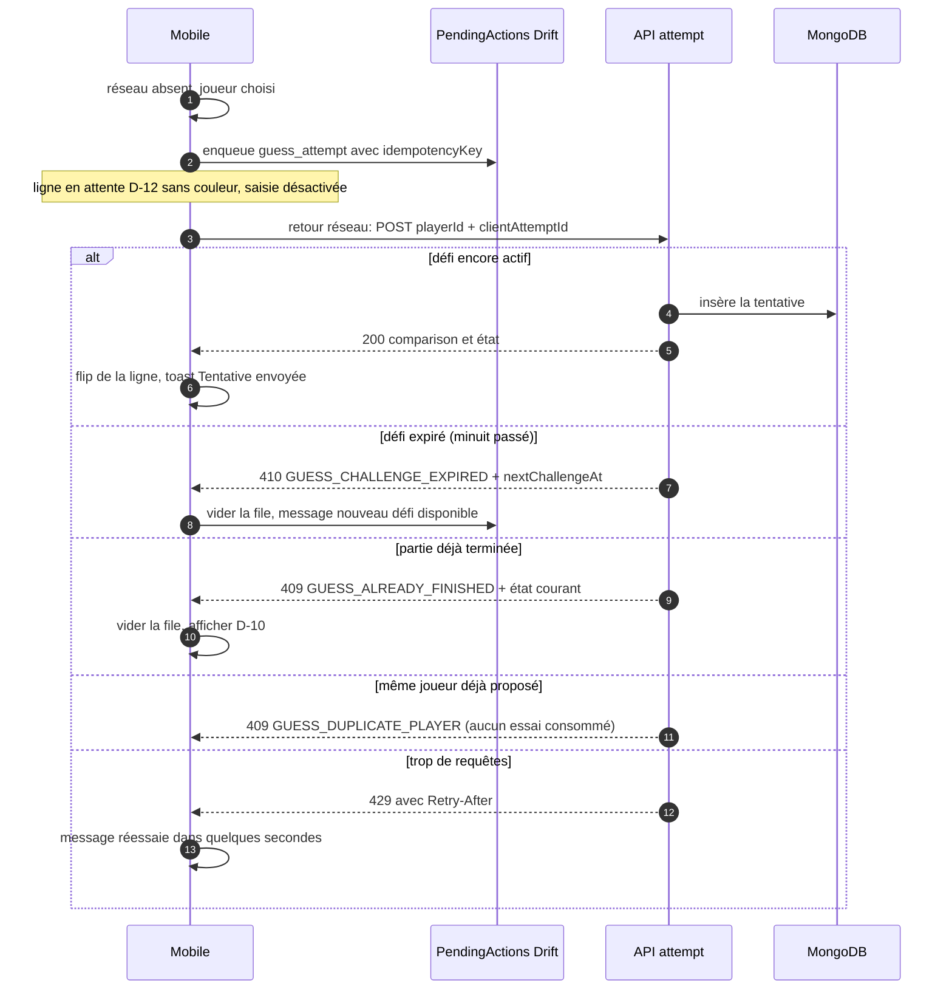
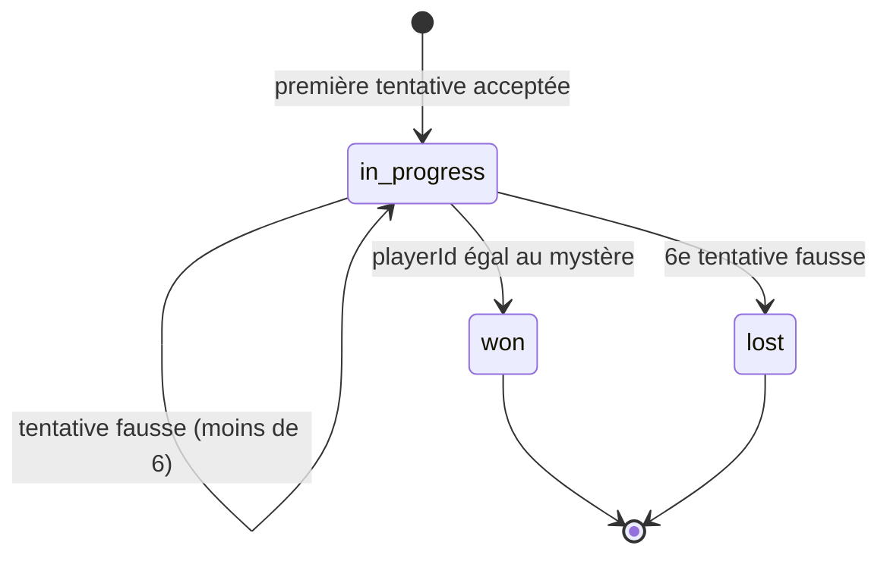
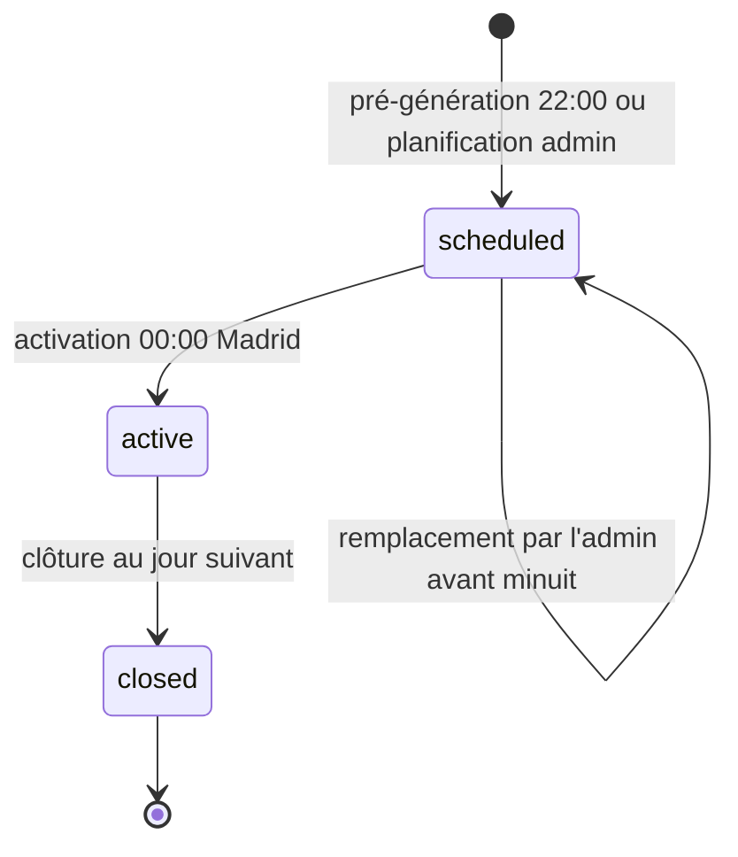
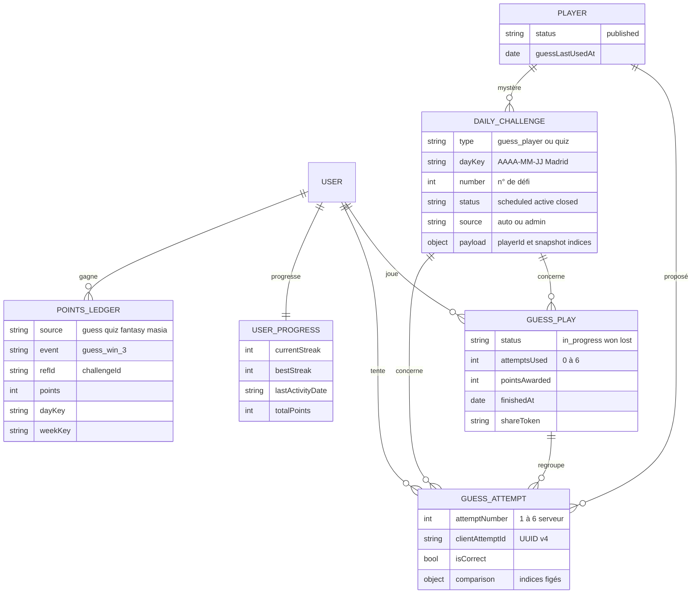
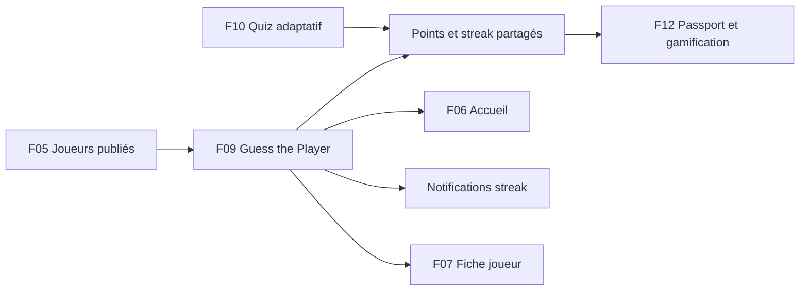

# F09 — Guess the Player (défi quotidien)

> Documentation d'architecture · Univers Barça · fonctionnalité **F09**. Ce document explique le jeu quotidien « Guess the Player » : comment un joueur mystère identique pour tous est choisi chaque nuit, comment le serveur compare chaque essai sans jamais révéler la solution, comment points, séries (streaks) et grille d'emojis sont produits, comment le jeu survit à une coupure réseau, et comment on empêche la triche.

## 1. Résumé et fiche

**Valeur utilisateur.** Chaque jour, tous les supporters affrontent **le même joueur mystère**. Ils ont **6 essais** ; à chaque essai, ils choisissent un joueur dans une liste et reçoivent cinq indices colorés (nation, poste, âge, numéro, club) qui les rapprochent de la solution. À la fin, ils gagnent des points, maintiennent leur série de jours consécutifs et partagent une grille d'emojis **sans spoiler** (le principe de Wordle appliqué au Barça). Le jeu crée un rituel quotidien, de la conversation entre amis et de la rétention.

**Pourquoi c'est délicat.** Le jeu repose sur **un secret quotidien identique pour tous** : il suffit qu'un seul utilisateur le découvre et le diffuse pour que le jeu perde son intérêt. Toute la logique (comparaison des indices, décision de victoire, points) est donc **côté serveur**, et le mobile ne reçoit jamais la solution avant la fin de la partie.

| Élément | Valeur |
|---|---|
| Phase / priorité | Phase 1 — MVP, étape 1.4 « Jeux quotidiens » du plan de réalisation (`API-JEUX` du 08/03 au 07/04/2027, `MOB-D` du 27/05 au 14/06/2027) ; majoritairement P0 (modèles, cron, sélection, indices, `today`, `attempt`, anti-triche, scoring, streak, points), P1 pour l'historique, la planification admin, les index/caches, le RGPD, le seed et la charge |
| Épopées backlog | `MOB-D` (30 issues, `MOB-D-01` à `MOB-D-30`), `API-JEUX` (issues 1 à 10 pour Guess, 18 à 20 pour le hub, les streaks et les points, 31 à 37 transverses) ; consommateurs : `MOB-C` (carte « Jeu du jour » de l'accueil), `MOB-P` (Passport) |
| Écrans mobile | `D-01` (hub), `D-02` (règles), `D-03` à `D-06` (plateau), `D-07` (victoire), `D-08` (défaite), `D-09` (partage), `D-10` (déjà joué), `D-11` (historique), `D-12` (hors-ligne) |
| Écrans admin | Aucun écran dédié dans `ADM-WF` (qui ne traite que les questions de quiz) : la planification du joueur mystère (`API-JEUX-31`, mentionnant `WF-01`) n'a **pas de page admin spécifiée** (voir §14) |
| Dépôts concernés | **API** (modèles, cron, services de jeu, endpoints), **mobile** (BLoC, cache Drift, partage), **admin** (planification, via API uniquement) |
| Documents voisins | F05 (joueurs publiés), F10 (Quiz adaptatif, mêmes points et streak), F12 (Passport et gamification), F04 (états hors-ligne) |

### Vocabulaire

* **Joueur mystère** : le joueur à deviner pour une date donnée (champ `payload.playerId` du défi).
* **Défi** (`DailyChallenge`) : document unique par `(type, dayKey)` ; `type='guess_player'` pour ce jeu.
* **dayKey** : jour calendaire `AAAA-MM-JJ` **en fuseau Europe/Madrid** (constante `GAME_TZ`), identique pour tous les utilisateurs.
* **Partie** (`GuessPlay`) : synthèse de la partie d'un utilisateur pour un défi (`in_progress`, `won`, `lost`).
* **Tentative** (`GuessAttempt`) : un essai, avec le résultat figé de la comparaison.
* **Indice** (clue/hint) : l'un des cinq critères comparés ; statut `correct` (vert), `close` (jaune), `wrong` (rouge), éventuellement une direction `up`/`down` (flèche ▲ ▼).
* **Streak** : série de jours consécutifs où l'utilisateur a **terminé** un jeu (voir §9).
* **shareToken** : jeton signé permettant de générer le texte et l'image de partage d'une partie terminée, sans révéler de donnée personnelle.
* **Idempotence** : rejouer la même requête (ici : une tentative envoyée deux fois) ne produit pas d'effet supplémentaire.

### Écart avec les CDC et état du code

Les CDC parlent d'un job « generate-daily-challenge » à minuit avec un fuseau « à définir » (CDC Backend §3.3, §7) et citent NestJS/Prisma. **Stack réelle : Express 4 + TypeScript + Mongoose + Redis + BullMQ + node-cron + PM2.** Le backlog tranche le fuseau : **Europe/Madrid** (fuseau du club), et ajoute une file BullMQ dédiée `daily-challenge`.

> État du code à la date de rédaction : `src/models/gamification.model.ts` contient `DailyChallenge` (champ `date`, `payload` `Mixed`), `GuessAttempt` (index unique `{userId, challengeId, attemptNumber}`), `UserProgress`, `Badge`, `ScoringRule`. **Aucune route de jeu, aucun service, aucune file `daily-challenge` n'existe** (`QUEUE_NAMES` = `email`, `notifications`, `football-sync`, `ai-generation`, `rgpd`). Côté mobile, seule la feature `players` existe. Tout ce qui suit décrit donc la **cible** du backlog.

## 2. Acteurs et user stories

| Acteur | Besoin | Critères d'acceptation clés |
|---|---|---|
| Supporter | Jouer le défi du jour | `GET /guess-the-player/today` retourne le même `number` à tous ; 6 essais maximum ; aucune fuite de la solution avant la fin |
| Supporter | Taper quelques lettres et choisir un joueur | 2 caractères minimum, 8 suggestions, insensible aux accents (« cubarsi » trouve « Cubarsí »), joueurs déjà proposés grisés |
| Supporter | Comprendre mes indices | Vert = correct, jaune = proche, rouge = faux, ▲▼ = « plus / moins » ; lecture possible sans couleur (icônes, lecteur d'écran) |
| Supporter | Ne pas perdre un essai à cause d'une coupure | Tentative idempotente (`clientAttemptId`) ; hors-ligne : affichée « en attente », rejouée au retour du réseau (`D-12`) |
| Supporter | Garder ma série même si je perds | Une défaite compte comme activité : « Ta série de 12 jours est conservée » (`D-08`) |
| Supporter | Partager sans gâcher | Texte + image avec grille d'emojis, **aucun nom ni valeur d'indice** (`D-09`) |
| Supporter | Suivre mes progrès | Historique paginé, taux de réussite (81 %), répartition des essais (`D-11`) |
| Content-manager | Choisir un joueur pour une date (anniversaire, grand match) | Planification possible jusqu'à la veille ; joueur éligible et non utilisé dans les 90 derniers défis ; secret préservé |
| Système | Générer le défi de demain chaque nuit, une seule fois | Job rejouable sans doublon ; alerte si aucun défi actif à 00:05 |

## 3. Architecture de la fonctionnalité



**Légende.** Le mobile ne calcule rien : il affiche ce que le serveur renvoie. Le cache Drift ne contient jamais la solution tant que la partie n'est pas terminée. Le worker génère le défi ; les services `points` et `streak` sont **partagés avec le Quiz** (F10) et alimentent le Passport (F12). Les noms de services sont ceux du backlog (`API-JEUX`).

**Pourquoi ce découpage.** (1) Secret côté serveur : aucune logique de comparaison sur le client. (2) Même défi pour tous : un seul document par `(type, dayKey)` protégé par un index unique. (3) Charge en soirée de match : hub et état du jour sont servis par des requêtes indexées et un cache Redis court (§8).

## 4. Écrans et navigation

| Code | Écran | Rôle |
|---|---|---|
| `D-01` | Hub des jeux | Racine de l'onglet « Jeux » (`/games`) : carte « Défi du jour » avec compte à rebours « Nouveau dans 06:41:12 », carte Quiz adaptatif (« Niveau 2 · Culé »), liste « Plus de jeux » (Entraînement libre, Classements, Mon historique : « 48 parties · 81 % de réussite ») |
| `D-02` | Règles du jeu | Bottom sheet « Comment jouer ? » : 4 étapes et légende des couleurs ; ouverte automatiquement une seule fois (drapeau local `guess_rules_seen`) |
| `D-03` | Début de partie | « Défi n°214 · 0/6 essais », grille 6 lignes × 5 colonnes, champ « Nom du joueur… » |
| `D-04` | Recherche avec suggestions | Liste d'autocomplétion (Pedri, Pau Cubarsí, Carles Puyol…) |
| `D-05` | Trois essais joués | Lignes colorées, trois points de progression pleins |
| `D-06` | Dernier essai | Mention « Dernier essai ! », dernier point qui pulse |
| `D-07` | Victoire | « BRAVO ! », joueur révélé, Série / Réussite / Points (+60), « Ta grille » |
| `D-08` | Défaite avec révélation | « Pas cette fois », « C'était … », série conservée |
| `D-09` | Partage | Feuille avec aperçu de la carte et 4 destinations (WhatsApp, Instagram, Copier, Image) |
| `D-10` | Déjà joué | « Reviens demain ! », compte à rebours, « Revoir mon résultat » |
| `D-11` | Historique et statistiques | 4 indicateurs, histogramme des essais, dernières parties |
| `D-12` | Hors-ligne, tentative bloquée | Ligne « Connexion perdue · tentative en attente », bandeau hors-ligne |

<p>


</p>

*`D-05` : en-têtes Joueur / Nation / Poste / Âge / N° / Club ; la ligne YAMAL (ES, AD, 19 ▲, 10 ▲, La Masia) est entièrement rouge (les flèches ▲ indiquent que la cible est plus âgée et porte un numéro plus haut) ; PEDRI a le poste en vert (MC) ; OLMO a trois cellules jaunes « proches » ; trois lignes « ? » restent vides ; le bouton d'envoi rose est atténué tant qu'aucun joueur n'est choisi. `D-07` : avatar avec coche verte, nom en Barlow Condensed, trois rangées de carrés (une par essai, la dernière toute verte), boutons « Partager mon résultat » et « Quiz du jour ».*



Les écrans de jeu en plein écran (plateau, résultats) masquent la barre de navigation, utilisent `parentNavigatorKey: rootNavigatorKey` et une croix de fermeture ; la partie est sauvegardée côté serveur, donc fermer ne perd rien (`MOB-D-01`, `MOB-D-10`). Routes : `RouteConstants.games = '/games'`, `guess = '/games/guess'`, `guessResult`, `guessHistory`, `guessAlreadyPlayed`. Le lien profond `univers-barca://games/guess` (utilisé par la notification de série en danger) atteint `/games/guess` après authentification. Le résultat est passé par un objet typé `GuessResultArgs` avec repli sur un rechargement de `/today` si `extra` est nul.

## 5. Flux détaillés

### 5.1 Génération quotidienne du défi (nominal)



**Pas à pas.** (1) À **22:00 Madrid**, un répétable cron place un job dont l'identifiant est **déterministe** (`guess_player:2026-10-16`) : BullMQ ne le duplique pas. (3-5) Si l'admin a planifié un joueur (`API-JEUX-31`), il prime ; sinon la sélection pondérée tire un joueur (voir §9). (6) Le **numéro** du défi (« Défi n°214 ») est attribué par un compteur atomique (collection `counters`, `findOneAndUpdate $inc`), jamais par un `count()`. (7) L'`upsert` avec `$setOnInsert` sur l'index unique `(type, dayKey)` rend la création idempotente. (8-9) À **00:00**, le défi passe `scheduled → active` et celui de la veille `→ closed`. (10) `Player.guessLastUsedAt` évite de réagréger l'historique à chaque tirage. (12) Filet de sécurité : un défi manquant à 00:05 déclenche une alerte ; en outre, si `/today` est appelé sans défi du jour, il est **généré paresseusement**, protégé par le même index unique.

### 5.2 Soumission d'une tentative (nominal : victoire en 3 essais)



**Pas à pas.** (3) Un **verrou Redis** de 3 s (`SET NX PX 3000`) évite les doubles envois simultanés ; le filet ultime est l'index unique Mongo (E11000). (5-6) **Idempotence** : si `clientAttemptId` est déjà enregistré pour ce `(userId, challengeId)`, la réponse stockée est renvoyée telle quelle, sans consommer d'essai. (9) La comparaison est une **fonction pure** (voir §9, indices). (10) `attemptNumber` est **toujours attribué par le serveur** ; le client ne le fournit jamais (voir l'écart §14). (11) La mise à jour de `GuessPlay` est conditionnée par `attemptsUsed < 6`. (12-15) La victoire est décidée **uniquement** si `playerId` proposé = `playerId` mystère (pas sur l'égalité des indices) ; points et streak sont attribués « hors transaction bloquante » via événement. (17) Le flip séquentiel (350 ms par cellule, décalage 150 ms, ≈ 1,1 s) se joue sur la dernière tentative seulement.

### 5.3 Cas limites et erreurs



**Points d'attention.** Une tentative hors-ligne n'est **jamais évaluée localement** (le client ne connaît pas la solution) ; une seule tentative en attente à la fois ; elle ne compte pas dans « n/6 » et peut être annulée. Au retour du réseau, `SyncPendingGuessAttempts` rejoue la file dans l'ordre de création avec la même clé d'idempotence ; en cas de conflit, le statut serveur remplace le local. Retry automatique **une fois** (backoff 1 s) sur timeout (8 s) avec la même clé ; ensuite le bouton « Réessayer » (backoff de resynchronisation 5 / 15 / 60 s, `MOB-D-22`).

### 5.4 Cycle de vie d'une partie (`GuessPlay`)



Côté mobile, le `GuessThePlayerBloc` expose les états `loading`, `ready` (moins de 6 essais), `submitting`, `queuedOffline`, `won`, `lost`, `alreadyPlayed`, `failure`. Un statut serveur `won`/`lost` à l'ouverture mène directement à `alreadyPlayed` (`D-10`) : **le serveur est la source de vérité**, jamais un drapeau local.

### 5.5 Cycle de vie d'un défi (`DailyChallenge`)



Un défi `active` ou `closed` n'est **jamais modifié** par le job (règle de non-destruction). Le changement d'heure (DST) rend certains jours longs de 23 h ou 25 h : countdown et cron sont testés sur 2026-03-29 et 2026-10-25.

## 6. Contrats d'API

Préfixe `/api/v1`. Enveloppe `{ success, data }` ; erreurs `{ success:false, error:{ code, message, details, traceId } }`. Toutes les routes de jeu portent `Cache-Control: private, no-store` (hors partage image) et exigent `protect` + `userOnly`, sauf indication.

| Méthode | Chemin | Auth / rôle | Rate limit | Requête | Réponse | Erreurs |
|---|---|---|---|---|---|---|
| GET | `/games/clock` | public | standard | — | `{dayKey, nextChallengeAt, serverTime}` (non cachée) | — |
| GET | `/games/hub` | utilisateur | 60/min | — | `guess`, `quiz`, `levels[5]`, `streak`, `stats` ; `partial:true` si une section échoue | 401 |
| GET | `/guess-the-player/today` | utilisateur | 60/min/utilisateur | `Accept-Language` | `challenge{number,dayKey}`, `status`, `attemptsUsed`, `maxAttempts:6`, `attempts[]`, `nextChallengeAt`, `secondsToNext` ; `answer`, `pointsAwarded`, `streak`, `shareToken` si terminé | 401 |
| GET | `/guess-the-player/players/search` | utilisateur | 120/min/utilisateur | `q` (2 à 40 car.) | `[{id, name, position, nationality, photoUrl, alreadyGuessed}]` (8 max) | 400 `VALIDATION_ERROR` |
| POST | `/guess-the-player/attempt` | utilisateur | 30/min/utilisateur, 200/h/IP | `{playerId, clientAttemptId}` (+ `Idempotency-Key`) | `attempt{n,comparison}`, `status`, `attemptsUsed`, `finished`, `answer?`, `pointsAwarded?`, `streak?`, `shareToken?` | 404, 409 `GUESS_MAX_ATTEMPTS` / `GUESS_ALREADY_FINISHED` / `GUESS_DUPLICATE_PLAYER`, 410 `GUESS_CHALLENGE_EXPIRED`, 422, 429 |
| GET | `/guess-the-player/history` | utilisateur | 60/min | `limit` (20, max 50), `cursor` | `stats{played,wins,successRate,currentStreak,bestStreak,distribution}`, `items[]`, `nextCursor` | 401 |
| GET | `/guess-the-player/share/:shareToken` | public (jeton signé) | 30/min/IP | — | `{text, grid[]}` | 404 jeton invalide ou expiré |
| GET | `/guess-the-player/share/:shareToken/image.png` | public (jeton signé) | 30/min/IP | — | `image/png` 1080×1350, `Cache-Control: public` 24 h | 404 |
| GET | `/games/streak` | utilisateur | 60/min | — | `{current, best, atRisk, lastActivityDate}` | 401 |
| GET | `/games/points/summary` | utilisateur | 60/min | — | `{total, today, week}` | 401 |
| GET | `/admin/games/schedule` | content-manager, super-admin | 120/min/admin | `from`, `to` | 30 prochains jours : `{dayKey, number?, source, playerId, nom, status}` | 403 |
| PUT | `/admin/games/schedule/guess/:dayKey` | content-manager, super-admin | idem | `{playerId, force?}` | `{dayKey, source:'admin', status:'scheduled'}` | 409 `GUESS_DAY_LOCKED`, 409 joueur utilisé récemment, 403 |
| DELETE | `/admin/games/schedule/guess/:dayKey` | content-manager, super-admin | idem | — | retour à la sélection auto | 409 `GUESS_DAY_LOCKED` |

Exemple de réponse `GET /guess-the-player/today` (partie en cours, 3 essais) :

```json
{ "success": true, "data": {
  "challenge": { "number": 214, "dayKey": "2026-10-15" },
  "status": "in_progress", "attemptsUsed": 3, "maxAttempts": 6,
  "attempts": [ { "n": 1, "player": { "id": "665f...", "name": "Yamal" },
    "comparison": {
      "nationality": { "value": "ES", "status": "correct" },
      "age": { "value": 19, "status": "wrong", "direction": "up" } } } ],
  "nextChallengeAt": "2026-10-15T22:00:00.000Z", "secondsToNext": 24072 } }
```

Exemple de fin de partie (`POST /attempt`) : `{"attempt":{"n":3,"comparison":{...}},"status":"won","attemptsUsed":3,"finished":true,"answer":{"id":"...","name":"Frenkie de Jong"},"pointsAwarded":60,"streak":{"current":12,"best":15},"shareToken":"..."}`.

Pour `nextChallengeAt`, l'exemple « 2026-10-15T22:00:00.000Z » correspond à minuit Madrid en heure d'été (UTC+2) ; le mobile ne fait jamais de calcul sur son propre fuseau.

## 7. Modèle de données



**Collections et index** (cible `API-JEUX-01`, `API-JEUX-20`, `API-JEUX-32`).

* `daily_challenges` : `type`, `dayKey` (l'ancien champ `date` est migré vers `dayKey`), `number`, `status`, `source`, `scheduledBy` (admin), `payload` typé par sous-schémas discriminés (guess : `{playerId, hints snapshot}`). Unicité `(type, dayKey)` ; index `{type:1, dayKey:-1}`. Le `toJSON` **masque `payload.playerId` tant que `status='active'`**.
* `guess_attempts` : `userId`, `challengeId`, `attemptNumber` (1..6, validateur Mongoose), `guessedPlayerId`, `isCorrect`, `clientAttemptId`, `comparison` (résultat figé), `createdAt`. Index uniques `{userId, challengeId, attemptNumber}` (existant) et `{userId, challengeId, clientAttemptId}` ; index `{userId:1, createdAt:-1}`.
* `guess_plays` (nouvelle) : `{userId, challengeId, dayKey, status, attemptsUsed, pointsAwarded, finishedAt, shareToken}` ; unique `(userId, challengeId)` ; index `{userId:1, dayKey:-1}` pour l'historique.
* `points_ledger` (nouvelle, partagée) : unique `{userId, source, refId}` ; index `{weekKey:1, userId:1}`, `{userId:1, createdAt:-1}`.
* `user_progress` : `currentStreak`, `bestStreak`, `lastActivityDate` (chaîne `AAAA-MM-JJ`), `totalPoints`, `badges[]`.
* `players` : champ ajouté `guessLastUsedAt`.
* `counters` : compteur atomique du numéro de défi.
* `scoring_rules` : barème `guess_win_1` à `guess_win_6`.

**Clés Redis** (le backlog nomme les familles ; préfixe `ub:` imposé par le brief, valeurs proposées) :

| Clé | Rôle | TTL |
|---|---|---|
| `ub:guess:search:{locale}:{q}` | suggestions pour `q` normalisé | 300 s |
| `ub:guess:lock:{userId}:{challengeId}` | verrou anti double envoi (`SET NX PX 3000`) | 3 s |
| `ub:game:hub:{userId}` | agrégat du hub (par utilisateur, jamais partagé) | 30 s |
| `ub:game:guess:stats:{userId}` | statistiques d'historique | 60 s |
| défi courant (id, number, dayKey) | sans `playerId` | 60 s |

**Côté mobile (Drift).** Table `CachedGuessChallenges` (`challengeNumber` PK, `payloadJson`, `status`, `nextChallengeAt`, `cachedAt`) : au plus le défi courant, purge au-delà de J-1 ; table `PendingActions` étendue (`type='guess_attempt'`, `idempotencyKey`, `retryCount`, `lastError`) ; `CachedGuessHistory` (1re page) et `CachedPlayerSearch` (200 derniers résultats, TTL 24 h).

**Migration.** `scripts/migrations/2026-guess-daychallenge.js`, idempotente : backfill `dayKey = date`, numérotation chronologique, reconstruction de `GuessPlay` depuis `GuessAttempt`.

## 8. Traitements asynchrones et cache

| Traitement | Déclencheur | Détail |
|---|---|---|
| `generate-guess` / `generate-quiz` | cron `0 22 * * *` (Europe/Madrid) | pré-génération de J+1, `jobId = {type}:{dayKey}`, file `daily-challenge` |
| Activation | cron `0 0 * * *` (Europe/Madrid) | `scheduled → active`, clôture de J-1 |
| `streak-reminder` | répétable toutes les 15 min | cible les fuseaux où il est 20:00 ; file `notifications`, gabarit `streak_at_risk` ; max 1 rappel par jour et par utilisateur |
| Réconciliation des points | cron 03:30 Madrid (`points-reconcile`) | compare `totalPoints` à la somme du ledger |
| Événements internes | fin de partie | `game.activity` (streak), `points.awarded` (classements Redis) |

La file `daily-challenge` suit les défauts de `src/jobs/queues.ts` : `attempts: 5`, backoff exponentiel 2 s, `removeOnComplete: 1000`, `removeOnFail: 5000`, puis `dead-letter`. **Idempotence** : `jobId` déterministe + `upsert $setOnInsert` + index unique. Un job rejoué après plantage crée le défi **une seule fois**.

**Cache.** Le défi courant est mis en mémoire et en Redis 60 s (sans solution). La recherche est cachée 300 s par `q` normalisé. Le hub est caché 30 s **par utilisateur** (invalidation à chaque action). **Jamais en cache partagé** : l'état de partie d'un utilisateur, la solution, `correctOption` du quiz. En-têtes HTTP : `private, no-store`, ETag désactivé pour `/today`, `Vary: Authorization`. Si Redis est absent : bypass silencieux du cache, mais le verrou de tentative n'est plus disponible et seul l'index unique protège (comportement correct, un peu plus de retries).

## 9. Règles de gestion

### Défi, fuseau et sélection

1. **Fuseau de référence** : `GAME_TZ=Europe/Madrid`. Tout calcul de jour (défi, streak, classement hebdomadaire) passe par `src/utils/gameClock.ts` (`todayKey`, `nextMidnightMadrid`, `secondsToNextChallenge`).
2. Un seul défi `guess_player` par `dayKey`, **identique pour tous**. Le défi de demain est pré-généré à 22:00 (`GAME_PREGEN_HOUR`).
3. **Éligibilité du mystère** : `Player.status='published'` avec `nationality`, `position`, `birthDate`, `shirtNumber` et `previousClub` renseignés ; actifs et légendes autorisés.
4. **Anti-répétition** : exclusion stricte des 90 derniers défis (`GUESS_NO_REPEAT_DAYS=90`), puis poids = `min(1, joursDepuisDernierUsage / 365)` (poids 1 si jamais utilisé), multiplié par **1,5** pour l'effectif actuel (`GUESS_ACTIVE_BOOST`).
5. Tirage aléatoire pondéré cryptographique (`crypto.randomInt`) ; seed journalisée ; si moins de **30** joueurs éligibles : alerte et repli sur tous les publiés ; pool vide : `GUESS_POOL_EMPTY` (500) et alerte.
6. Un joueur planifié par l'admin prime ; planification interdite pour aujourd'hui et le passé (`409 GUESS_DAY_LOCKED`) ; un joueur utilisé dans les 90 derniers défis n'est accepté qu'avec `force=true` par un **super-admin**.

### Indices (fonction pure `compareGuess`)

7. **Nation** : correct si identique ; proche si même confédération (UEFA, CONMEBOL…) ; faux sinon.
8. **Poste** (enum `GB DD DC DG MD MC MO AD AG BU`) : correct si identique ; proche si même ligne (gardien, défense, milieu, attaque).
9. **Âge** (calculé à la date du jour Madrid) : correct si égal ; proche si écart ≤ **2 ans** (`GUESS_CLOSE_AGE`) ; flèche ▲ si le mystère est plus âgé que l'essai, ▼ s'il est plus jeune.
10. **Numéro** : correct si égal ; proche si écart ≤ **3** (`GUESS_CLOSE_NUMBER`) ; flèches comme pour l'âge.
11. **Club précédent** : correct si identique (normalisé sans accents ni casse) ; proche si clubs du même pays ; « La Masia » est un club à part entière ; club inconnu : `wrong` sans erreur.
12. Le résultat contient `{value, status, direction?}` pour chaque indice et **jamais la valeur du mystère**. Exemple : mystère né en 2002 et essai né en 2007 (19 ans) : âge `{status:'wrong', direction:'up'}`.
13. **Victoire** uniquement si `playerId` proposé = `playerId` mystère, jamais sur l'égalité des indices.

### Essais, points, grille

14. **6 essais maximum** ; la 7e est refusée (`409 GUESS_MAX_ATTEMPTS`) ; un joueur déjà proposé est refusé sans consommer d'essai (`409 GUESS_DUPLICATE_PLAYER`).
15. **Barème** (`ScoringRule` `guess_win_1` à `guess_win_6`) : **100, 80, 60, 40, 25, 10** points pour une victoire en 1 à 6 essais ; défaite = 0 ; modifiable sans redéploiement (cache mémoire 60 s). Aucune victoire créditée hors défi actif.
16. **Grille d'emojis** : une ligne par essai, 5 cases (nation, poste, âge, numéro, club) : 🟩 correct, 🟨 proche, 🟥 faux ; ligne gagnante = 5 🟩 ; aucun nom ni valeur d'indice. Texte : `Guess the Player · n°214 · 3/6` + grille + `Série de 12 jours` + lien de l'app ; défaite : `X/6`.
17. **Image de partage** : PNG 1080×1350 rendu côté serveur (`@napi-rs/canvas`, police Barlow Condensed), cache 24 h par `shareToken`, mention « application communautaire non officielle ».
18. `shareToken` signé HMAC, durée de vie **7 jours**, valable uniquement pour une partie terminée.

### Streak

19. Une journée est « active » dès qu'une partie Guess est **terminée (gagnée ou perdue)** ou qu'un quiz **daily** est terminé ; l'entraînement libre ne compte pas.
20. `currentStreak` +1 si `lastActivityDate` = veille ; inchangé si = aujourd'hui ; remis à **1** si écart ≥ 2 jours ; `bestStreak = max(best, current)`.
21. Une défaite conserve la série. Le streak est **recalculé à la lecture** (si `lastActivityDate` < veille, `current` vaut 0 sans écriture), sans dépendre d'un job de minuit.
22. `atRisk=true` si `streak > 0` et aucune activité aujourd'hui (jour Madrid). Rappel à **20:00** heure de l'utilisateur (`User.timezone`, défaut Europe/Madrid), 1 par jour maximum, selon les préférences de notification.
23. Badges de série à **7 / 30 / 100 jours** (`streak_7`, `streak_30`, `streak_100`), attribution idempotente.

### Historique

24. `successRate = wins / played` arrondi à l'entier (80,5 donne 81) ; `null` sans partie ; seules les parties terminées sont listées, tri `dayKey` décroissant ; pagination par curseur (20 par page, max 50).

## 10. Sécurité, RGPD et anti-abus

**Anti-fuite de la solution (`API-JEUX-08`).**

* Aucune réponse (`today`, `search`, `attempt`, `history`, endpoints admin non privilégiés) ne contient l'identifiant ou le nom du mystère tant que `GuessPlay` n'est pas terminé pour l'appelant ; `answer` n'est ajouté qu'à l'état terminal.
* `payload.playerId` : `select:false` pour les lectures non admin ; seul le rôle `content-manager`/`super-admin` le lit via la planification (lecture tracée) ; le **logger masque** `payload.playerId` et `answer` (`[REDACTED]`).
* Test automatisé « **leak scanner** » : parcourt récursivement le JSON de 5 endpoints et échoue si l'identifiant ou le nom du mystère apparaît avant la fin de partie.
* `/metrics` et `/health/deep` n'exposent aucune donnée du défi.
* Le endpoint `search` ne renvoie **aucun indice** (ni âge, ni numéro, ni club) pour empêcher l'énumération.

**Anti-automatisation.** 30 tentatives/min/utilisateur et 200 req/h/IP sur `attempt` (429 avec `Retry-After`), 120/min/utilisateur sur la recherche (debounce mobile 300 ms). Événement de sécurité `guess.suspicious` (log + métrique `game_guess_suspicious_total`) si plus de 20 recherches sans tentative, ou si plus de 3 comptes d'une même IP gagnent en 1 essai le même jour. Un compte qui a utilisé ses 6 essais ne peut plus rien soumettre.

**Côté mobile (`MOB-D-25`).** Aucune solution dans le cache Drift avant la fin ; l'intercepteur de logs masque `solution` et `Idempotency-Key` ; le PNG de partage ne contient aucun nom de joueur ni métadonnée personnelle ; test de contrat qui échoue si `solution` apparaît dans une réponse `in_progress`. La capture d'écran du plateau n'est volontairement pas bloquée.

**RGPD (`API-JEUX-33`).** L'export `/users/me/export` ajoute `guess_plays`, `guess_attempts`, `points_ledger`, la série ; la suppression de compte (file `rgpd`) supprime définitivement tentatives, parties, ledger et progression, et retire l'utilisateur des classements Redis. Les agrégats anonymes sont conservés. Les logs de jeu n'enregistrent que des `userId` opaques. Les analytics mobiles (`guess_started`, `guess_completed`…) ne sont émis qu'avec le consentement « statistiques d'usage » et ne contiennent jamais de nom de joueur.

**Partage public.** Les endpoints de partage sont publics mais n'acceptent que des jetons signés valides ; ils ne révèlent aucun pseudo ni donnée personnelle.

## 11. Erreurs et états dégradés

| Situation | Serveur | Client |
|---|---|---|
| Hors-ligne, défi en cache | — | Défi restitué à l'identique depuis Drift ; `fromCache:true` |
| Hors-ligne sans cache | — | `OfflineNoCacheFailure` : écran d'erreur avec « Réessayer » |
| Tentative hors-ligne | — | Ligne en attente (`D-12`), file Drift, rejeu à la reconnexion |
| Défi expiré pendant la partie (minuit) | `410 GUESS_CHALLENGE_EXPIRED` + `nextChallengeAt` | Dialogue « Un nouveau défi est disponible », rechargement de `/today`, aucun essai décompté |
| Partie déjà terminée (autre appareil) | `409 GUESS_ALREADY_FINISHED` + état | Bascule vers `D-10` |
| Timeout 8 s | — | 1 retry avec la même clé d'idempotence, puis « Réessayer » |
| 429 | `Retry-After` | « Trop de tentatives, réessaie dans quelques secondes » |
| Sous-requête du hub en échec | `200` avec section `null` et `partial:true` | Section en erreur discrète, reste du hub utilisable |
| Aucun défi à l'instant T | génération paresseuse | Transparente |
| Pool de joueurs vide | `GUESS_POOL_EMPTY`, alerte | Écran d'erreur générique |
| Redis indisponible | bypass du cache et des verrous | Aucun message |
| Capture d'image de partage en échec | — | Toast d'erreur, l'app reste stable |
| WhatsApp/Instagram absents | — | Bouton masqué ou repli sur la feuille de partage système |

États vides : historique sans partie (« Aucune partie jouée pour l'instant », bouton « Jouer »), `successRate=null`, `items=[]`.

## 12. Connexions avec les autres fonctionnalités

| Fonctionnalité | Relation | Détail |
|---|---|---|
| F05 Données football | dépend de | joueurs `published` avec champs complets ; une fiche archivée sort du pool ; recherche sur `searchName` |
| F10 Quiz adaptatif | partage | mêmes `daily_challenges` (`type='quiz'`), même file `daily-challenge`, mêmes services `points`, `streak`, hub `/games/hub` |
| F12 Passport et gamification | alimente | `points_ledger`, `user_progress`, streak, badges `streak_*`, statistiques Guess (parties, taux de réussite) ; événements `guess.played`, `guess.won` côté moteur de badges |
| F06 Accueil | alimente | carte « Jeu du jour » (`MOB-C`) via `/games/hub` |
| F07 Historique et fiches | renvoie | `D-08` « Voir la fiche du joueur » ouvre `players/:id` |
| Notifications | alimente | rappel `streak_at_risk` (file `notifications`) |
| RGPD (F03) | partage | export et suppression des données de jeu |
| Résilience (F04) | partage | bandeaux hors-ligne, file `PendingActions` |



## 13. Observabilité et tests

**Métriques Prometheus** (préfixe `ub_` proposé pour l'enregistrement, noms du backlog) : `game_daily_challenge_generated_total{type}`, `game_daily_challenge_missing`, `game_guess_suspicious_total`, `game_hub_duration_seconds` (histogramme), `game_cache_hit_total{key}`, `jobsFailed` par file. **Logs** : `{dayKey, playerId, candidates, weight}` à la génération, `playerId` masqué ; `userId` opaque uniquement.

**Tests API prévus (`API-JEUX-35`, `-36`, `-37`).**

* Unitaires : `compareGuess` (25 combinaisons nation/poste/âge/numéro/club, âge à la veille d'anniversaire, normalisation « Atlético Madrid »), `computeWeights`, `pickWeighted` avec RNG injecté (±3 % sur 10 000 tirages), `pointsFor` (6 cas + défaite), `todayKey` à 23:59:59 et 00:00:00, `secondsToNextChallenge` pendant les deux changements d'heure 2026.
* Intégration (mongodb-memory-server) : 10 `ensureChallenge` concurrents = 1 document ; compteur de numéros atomique sous 20 créations ; idempotence (5 rejeux) ; concurrence de 10 requêtes ; victoire en 3, défaite en 6, doublon de joueur, défi expiré 410 ; migration rejouée sans effet de bord.
* Sécurité : leak scanner, 429 au-delà de 30 tentatives/min, en-têtes `no-store`, rôles admin (moderator = 403).
* Charge k6 « soir de match » : 0 à 3 000 utilisateurs virtuels en 2 min, palier 10 min, spike ×2 pendant 1 min ; mix 35 % hub, 25 % `today`, 15 % recherche + 6 tentatives, 15 % quiz, 10 % classement ; seuils : `http_req_failed` < 1 %, p95 < 300 ms (lecture) et < 400 ms (`attempt`), p99 < 800 ms ; soak 30 min à 500 utilisateurs virtuels ; régression > 20 % signalée par comparaison à `tests/load/baseline.json`.
* Mobile (`MOB-D-30`) : couverture ≥ 80 % sur domaine et BLoC, tests `bloc_test` (victoire en 3, défaite, doublon, double tap ignoré par `droppable()`, hors-ligne puis resynchronisation), golden tests sur 2 tailles d'écran × 2 thèmes pour `D-01`, `D-03`, `D-05`, `D-07`, `D-08`, `D-10`, `D-11`, test d'intégration `integration_test/guess_flow_test.dart`.

## 14. Points ouverts et incohérences détectées

**À confirmer (backlog).**

* **Fuseau de référence du défi** : l'API tranche `Europe/Madrid` ; le mobile (`MOB-D-21`) le considère encore « à confirmer avec l'API » et prévoit un ADR. À harmoniser avec les autres fuseaux du projet (voir F05 §14).
* Poids de pondération (`GUESS_ACTIVE_BOOST` = 1,5), seuils « proche » (2 ans, 3 numéros), 90 jours sans répétition : valeurs du backlog, paramétrables.
* Tables de correspondance pays → confédération et club → pays (`confederations.json`, `club-countries.json`) à constituer.

**Incohérences entre specs mobile `MOB-D` et API `API-JEUX` (à arbitrer avant le codage).**

| Sujet | Mobile | API |
|---|---|---|
| Corps de `POST /attempt` | `{playerId, attemptNumber}` + `Idempotency-Key` | `{playerId, clientAttemptId}` ; `attemptNumber` interdit côté client |
| Recherche de joueurs | `GET /players?search=&limit=8` (endpoint existant) | `GET /guess-the-player/players/search?q=` dédié (8 résultats, sans indices, cache) |
| Forme de `today` | `challengeNumber`, `attempts[].clues[{field,value,status,direction}]`, `solution` | `challenge{number,dayKey}`, `attempts[].comparison{...}`, `answer` |
| Direction des flèches | `higher` / `lower` | `up` / `down` |
| Codes d'erreur | `GUESS_ALREADY_PLAYED`, `GUESS_ALREADY_GUESSED`, `GUESS_PLAYER_NOT_FOUND` | `GUESS_ALREADY_FINISHED`, `GUESS_DUPLICATE_PLAYER`, 404 générique |
| Défi expiré | `409 GUESS_CHALLENGE_EXPIRED` | `410 GUESS_CHALLENGE_EXPIRED` |
| Historique | `winRate` (0,81), `recent[]`, distribution avec clé `fail` | `successRate` (81), `items[]`, distribution avec clé `lost` |
| Streak dans la réponse | entier `streak` + `bestStreak` | objet `streak{current,best}` |
| Image de partage | générée **sur l'appareil** (`RepaintBoundary` + `share_plus`) | générée **côté serveur** (`/share/:token/image.png`) |
| Texte de partage | `Guess the Player #214 3/6` + emojis + lien | `Guess the Player · n°214 · 3/6` + grille + série |
| Pagination historique | `limit` 20 | `limit` 20, max 50 |

**Autres écarts.** Les `PUT/DELETE /admin/games/schedule/*` ne disposent d'aucune page admin décrite dans `ADM-WF` ; `API-JEUX-31` référence `WF-01` mais cet écran est la liste des questions de quiz. La notification de rappel de streak relève du groupe NOTIF (mobile `MOB-O`) : seul l'événement est produit ici. Les points sont décrits comme un registre `points_ledger` côté `API-JEUX-20` alors que l'épopée `API-PASS` décrit aussi le système de points et de streak (voir F12 pour la source de vérité retenue).

## 15. Pour aller plus loin

* **Épopées** : `API-JEUX` (`API-JEUX-01` à `API-JEUX-10`, `API-JEUX-18` à `API-JEUX-20`, `API-JEUX-31` à `API-JEUX-37`), `MOB-D` (`MOB-D-01` à `MOB-D-30`), `MOB-C` (carte jeu du jour), `API-PASS`, `API-NOTIF`.
* **CDC** : Backend §3.3 (Guess the Player), §3.12 (points et streaks), §4.3 (modèle jeux), §5.6 (cache), §7 (BullMQ), §8 (sécurité) ; Global §2.4 (défi quotidien), §2.11 (système unique de points), §2.15 ; Flutter §5.1, §5.3 (hors-ligne), §7.3 (`GuessThePlayerBloc`), §9.5, §9.6.
* **Code existant** : `univers_barca_api/src/models/gamification.model.ts`, `src/jobs/queues.ts`, `src/jobs/scheduler.ts`, `src/models/football.model.ts` ; `univers_barca_mobile/lib/features/players` (feature de référence pour le gabarit `games` et `guess_the_player`).
* **Documents voisins** : F05, F10, F12.
