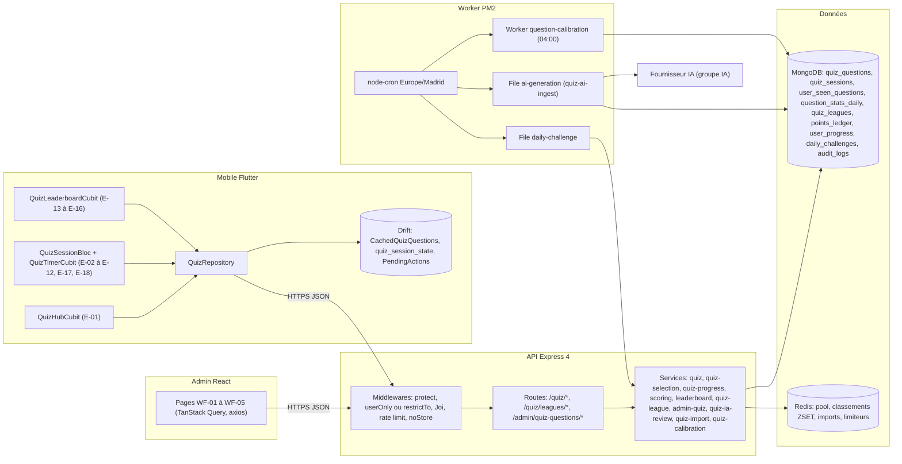
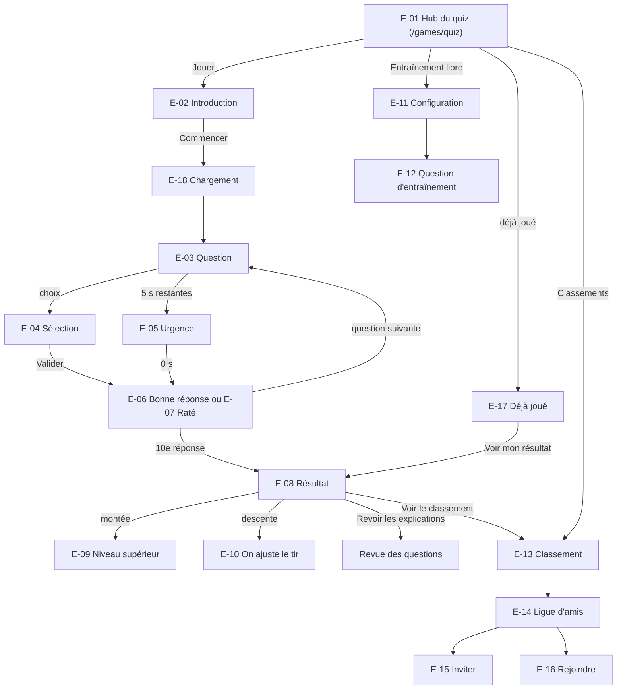
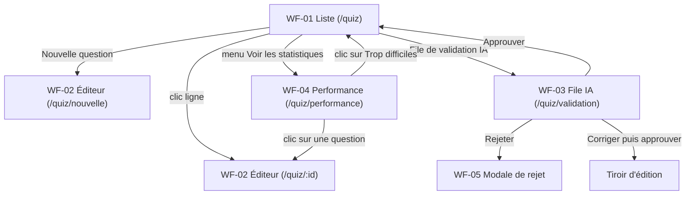
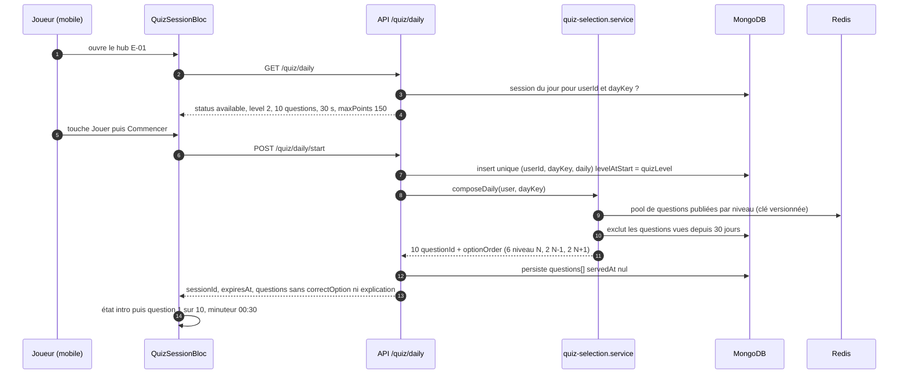
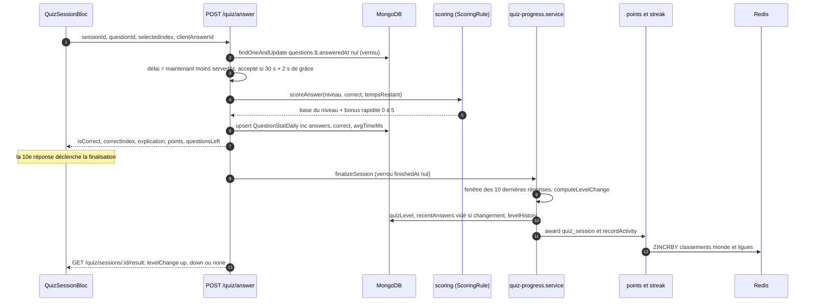
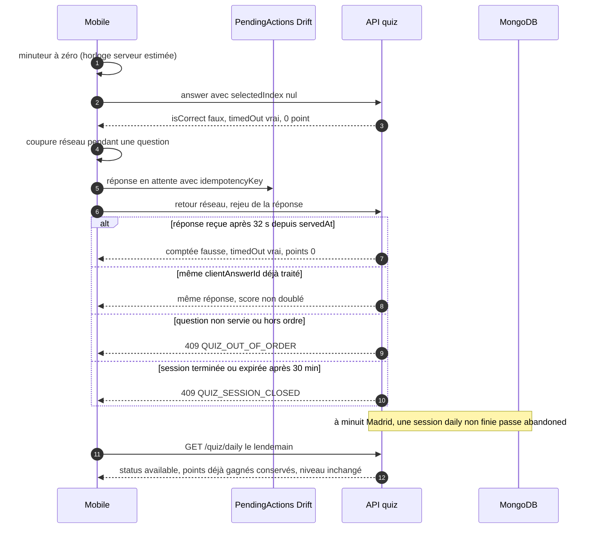
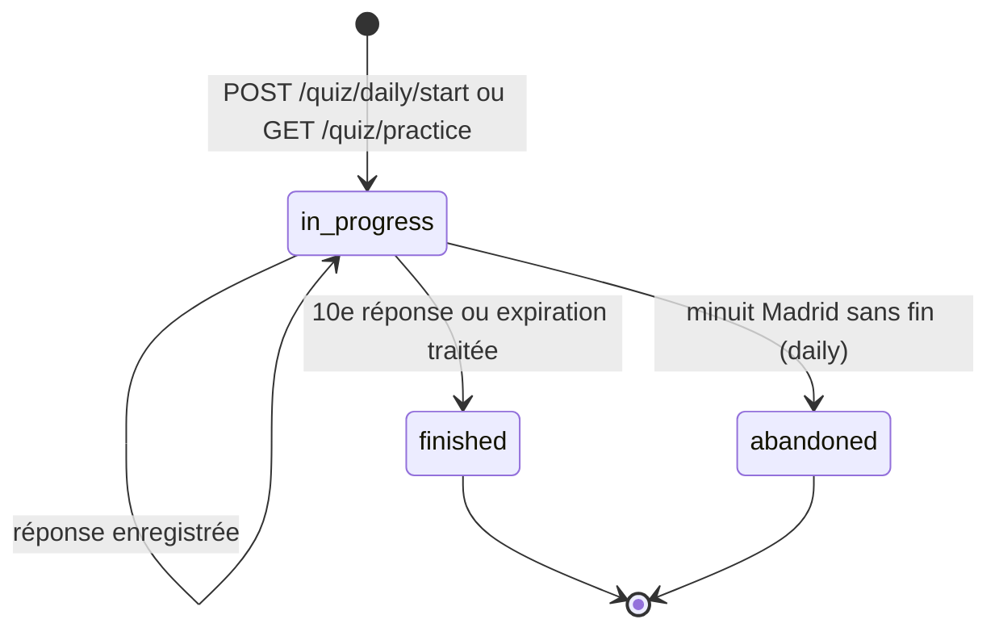
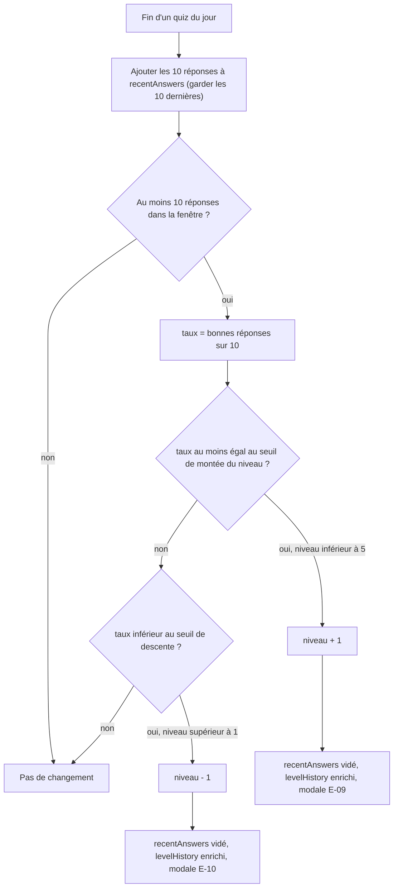
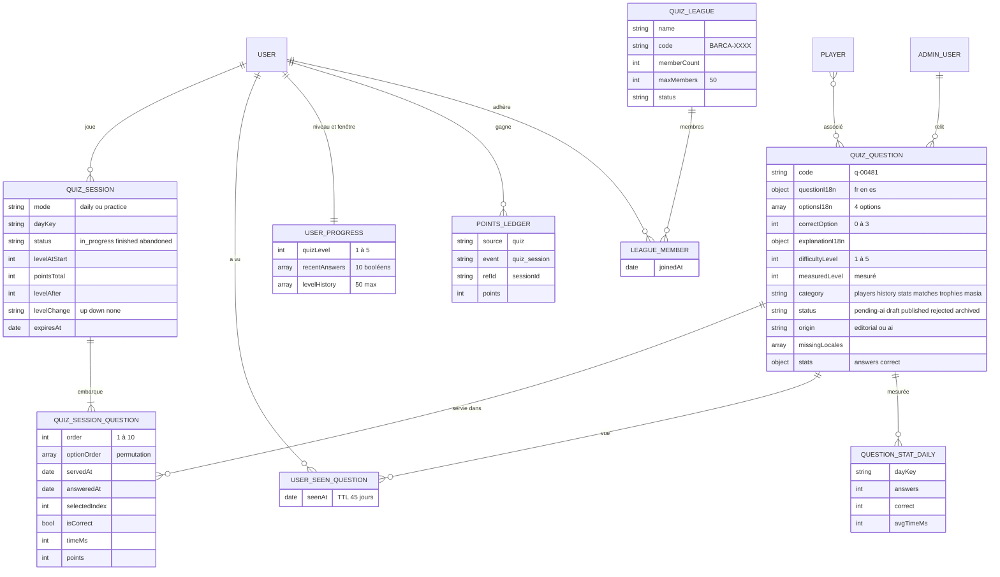
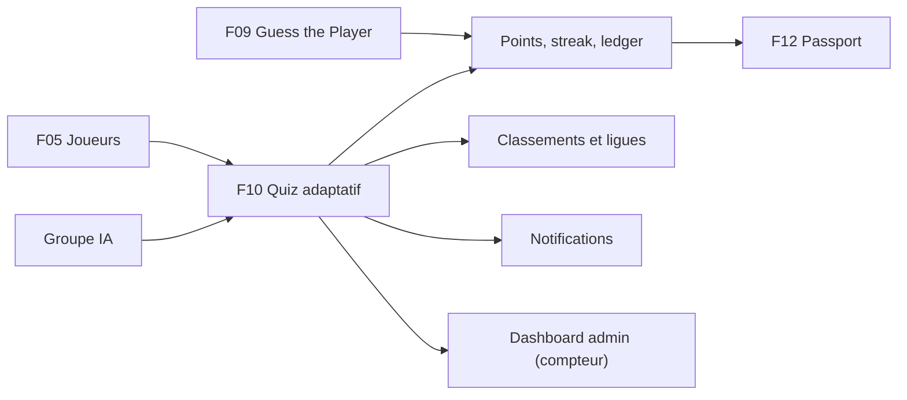

# F10 — Quiz adaptatif

> Documentation d'architecture · Univers Barça · fonctionnalité **F10**. Ce document explique le quiz quotidien de culture Barça : la banque de questions (éditoriale et assistée par IA), les 5 niveaux de difficulté, l'algorithme qui adapte le niveau à chaque joueur, le déroulé d'une session de 10 questions chronométrées côté serveur, le scoring, les classements et ligues d'amis, et le back-office qui construit et calibre la banque (relecture IA, import CSV, performance).

## 1. Résumé et fiche

**Valeur utilisateur.** Chaque jour, le supporter répond à **10 questions** calibrées sur son niveau (de « Supporter occasionnel » à « La Masia »), avec **30 secondes par question** et une explication après chaque réponse. Un bon score fait monter de niveau (questions plus corsées, plus de points) ; un mauvais score fait redescendre doucement (« On ajuste le tir »). Un mode **entraînement libre** illimité permet de réviser sans enjeu, et des **classements** (monde, amis, ligues privées par code `BARCA-XXXX`) créent de l'émulation.

**Valeur éditoriale.** L'équipe de contenu construit la banque de questions en français, anglais et espagnol, relit **obligatoirement** les questions générées par IA (aucune n'est publiée sans relecture humaine), et repère les questions mal calibrées grâce aux statistiques de réussite réelles.

| Élément | Valeur |
|---|---|
| Phase / priorité | Phase 1 — MVP, étape 1.4 « Jeux quotidiens » (`API-JEUX` du 08/03 au 07/04/2027, `ADM-WF` du 21/04 au 14/05/2027, `MOB-E` du 15/06 au 05/07/2027) ; P0 pour modèles, adaptation, sélection, quiz du jour, réponse, résultat, points, classement et CRUD/file IA admin ; P1 pour entraînement, ligues, import CSV, calibrage, performance, caches, RGPD, charge |
| Épopées backlog | `API-JEUX` (`API-JEUX-11` à `API-JEUX-17`, `API-JEUX-20` à `API-JEUX-30`, `API-JEUX-32` à `API-JEUX-37`), `MOB-E` (34 issues, `MOB-E-01` à `MOB-E-34`), `ADM-WF` (23 issues, `ADM-WF-01` à `ADM-WF-23`) |
| Écrans mobile | `E-01` à `E-18` |
| Écrans admin | `WF-01` à `WF-05` |
| Dépôts concernés | **API** (modèles, sessions, adaptation, workers IA et calibrage), **mobile** (BLoC, minuteur, cache Drift), **admin** (React : liste, éditeur, file IA, performance) |
| Documents voisins | F09 (Guess the Player : même hub, mêmes points et streaks), F12 (Passport et gamification), F05 (joueurs liés aux questions) |

### Vocabulaire

* **Palier / niveau** : l'un des 5 niveaux du joueur (1 Supporter occasionnel, 2 Culé, 3 Socio, 4 Historien du Barça, 5 La Masia).
* **Niveau éditorial** (`difficultyLevel`) : niveau choisi par l'éditeur pour une question ; **niveau mesuré** (`measuredLevel`) : niveau déduit des réponses réelles.
* **Fenêtre glissante** : les 10 dernières réponses des quiz du jour du joueur (`UserProgress.recentAnswers`).
* **Session** (`QuizSession`) : un quiz en cours ou terminé, `daily` (1 par jour) ou `practice` (illimité, sans impact).
* **optionOrder** : permutation des 4 options propre à une session, pour que l'ordre ne soit jamais mémorisable.
* **pending-ai** : statut d'une question générée par IA, en attente de relecture humaine.
* **Ligue** : classement privé hebdomadaire entre amis, identifié par un code `BARCA-XXXX`.

### Écart avec les CDC et état du code

Les CDC citent NestJS/Prisma (CDC Backend §3.4, §3.12.1). **Stack réelle : Express 4 + TypeScript + Mongoose + Redis + BullMQ + node-cron + PM2.** Les réponses d'une session sont **embarquées** dans `QuizSession.questions[]` (pas de table de jointure). L'algorithme d'adaptation du CDC (« score glissant sur les 10 dernières réponses ») est précisé par le backlog en seuils explicites.

> État du code à la date de rédaction : `src/models/gamification.model.ts` contient `QuizQuestion` (4 options `optionsI18n[]`, `difficultyLevel` 1 à 5, `status` `pending-ai|draft|published|rejected|archived`, `origin`, `stats {answers, correct}`), `QuizSession` (`mode`, `answers[]`) et `UserProgress` (`quizLevel`, `recentAnswers`). **Aucune route de quiz, aucun service, aucun worker de génération IA n'est encore implémenté** ; côté admin, seule une entrée de navigation placeholder existe (`src/lib/navigation.ts`) ; côté mobile seule la feature `players` existe. Tout ce qui suit décrit la **cible** du backlog.

## 2. Acteurs et user stories

| Acteur | Besoin | Critères d'acceptation clés |
|---|---|---|
| Supporter | Faire le quiz du jour (10 questions, 30 s) | 1 quiz par jour et par utilisateur ; `409 QUIZ_DAILY_ALREADY_PLAYED` au second essai ; aucune bonne réponse avant validation |
| Supporter | Voir pourquoi j'ai bon ou faux | Après chaque réponse : `isCorrect`, `correctIndex`, explication dans ma langue, points |
| Supporter | Progresser de façon transparente | Montée/descente expliquées (`E-09`, `E-10`) ; barre « Passe au niveau Socio à 75 % » |
| Supporter | M'entraîner sans pression | Entraînement : catégories, difficulté, 5/10/20 questions, chrono optionnel ; aucun impact sur niveau, points, streak, classement |
| Supporter | Reprendre après un appel ou un kill de l'app | Reprise de session (`MOB-E-30`), temps restant recalculé à partir de l'horodatage serveur |
| Supporter | Me comparer à mes amis | Classements monde/amis/semaine/mois ; ligue privée avec code et lien d'invitation |
| Content-manager | Constituer et corriger la banque | Liste filtrée de 1 248 questions, éditeur trilingue, publication bloquée si une langue manque |
| Content-manager | Valider les questions générées par IA | File `pending-ai`, approuver / corriger puis approuver / rejeter avec motif, lot de questions |
| Content-manager | Importer des questions en masse | CSV en deux temps (prévisualisation puis confirmation), erreurs ligne par ligne |
| Content-manager | Repérer les questions mal calibrées | Indicateurs 30 jours, histogramme, liste « À corriger en priorité » |
| Super-admin | Déclencher la génération IA | `POST /admin/quiz-questions/generate`, plafond de questions en attente |
| Système | Recalibrer les questions chaque nuit | Job de calibrage 04:00 Madrid, idempotent |

## 3. Architecture de la fonctionnalité

**Légende.** Le mobile ne connaît jamais la bonne réponse avant d'avoir répondu : l'API valide, chronomètre, note, puis révèle `correctIndex` et l'explication. Le worker IA ne fait **qu'insérer** des questions `pending-ai` ; seule une action humaine admin les publie. Le fournisseur IA lui-même est hors périmètre (groupe IA, F-IA). Les points et le streak transitent par les services partagés avec Guess the Player (F09).

**Pourquoi ce découpage.** (1) Intégrité du score : un classement mondial ne doit pas être falsifiable depuis le client. (2) Équité : le temps est jugé par le serveur. (3) Qualité : l'IA accélère la production mais l'humain reste décisionnaire. (4) Adaptation : le niveau n'est calculé qu'à la fin d'un quiz du jour, jamais question par question.

## 4. Écrans et navigation

### 4.1 Mobile (`E-01` à `E-18`)

| Code | Écran | Rôle |
|---|---|---|
| `E-01` | Hub du quiz | « Ton niveau — Culé », barre « 70 % de réussite sur les 10 dernières réponses · Passe au niveau Socio à 75 % », carte « Quiz du jour » (10 questions, +150 pts max, 1 fois par jour), Entraînement libre, Classements, liste « Les 5 paliers » |
| `E-02` | Introduction du quiz du jour | 3 cartes (10 questions, 30 secondes, jusqu'à +150 points) et « Commencer » |
| `E-03` | Question | « QUIZ DU JOUR », puce « Niveau 2 · Culé », minuteur « 00:18 », 10 segments « 4/10 », catégorie « HISTOIRE · QUESTION 4 », 4 options A à D, « Valider » |
| `E-04` | Réponse sélectionnée | Option en surbrillance, « Valider » actif |
| `E-05` | Temps presque écoulé | Minuteur rouge à 00:04, pulsation |
| `E-06` | Bonne réponse et explication | Option verte, « Bonne réponse ! +15 pts », explication |
| `E-07` | Mauvaise réponse / temps écoulé | Option choisie rouge, bonne option verte, « Raté ! 0 pt » |
| `E-08` | Résultat de la session | Anneau « 8/10 », « +120 », « 01:48 », « 80 % », « Progression vers Socio » |
| `E-09` | Montée de niveau | Modale « Niveau supérieur ! Socio » |
| `E-10` | Retour au palier inférieur | Modale « On ajuste le tir… tu repasses au niveau Culé » |
| `E-11` | Entraînement libre — configuration | Catégories, difficulté (Mon niveau / Facile / Difficile), nombre de questions, chronomètre |
| `E-12` | Entraînement — question | Même écran que `E-03`, bandeau « ENTRAÎNEMENT » |
| `E-13` | Classement mondial | Onglets Amis / Monde, périodes, podium, ligne « Toi » |
| `E-14` | Classement entre amis | Ligue « Les Culés du bureau », code, membres |
| `E-15` | Inviter des amis | Création de ligue, code, lien, partage |
| `E-16` | Rejoindre avec un code | Saisie `BARCA-`, aperçu, « Rejoindre la ligue » |
| `E-17` | Quiz déjà joué | « Tu as fait 8/10 aujourd'hui », « Voir mon résultat » |
| `E-18` | Chargement des questions | « Préparation de ton quiz » (affiché si le chargement dépasse 300 ms) |

*`E-03` : la barre à 10 segments (4 pleins en grenat), la puce « Niveau 2 · Culé » et le minuteur 00:18 ; le bouton « Valider » est actif dès qu'une option est cochée. `E-08` : l'anneau vert 8/10, les trois statistiques et la barre de progression vers le palier « Socio ». `E-13` : classement mondial hebdomadaire avec podium.*

Routes mobile : `/games/quiz`, `/games/quiz/intro`, `/games/quiz/play`, `/games/quiz/result`, `/games/quiz/practice`, `/games/quiz/practice/play`, `/games/leaderboard`, `/games/leaderboard/invite`, `/games/leaderboard/join?code=`. Les écrans de session sont **plein écran** (sans barre de navigation) avec une croix de sortie confirmée (« Quitter le quiz ? La progression est conservée »). Lien d'invitation : `univers-barca://league/join?code=BARCA-4X7Q` et lien universel `https://univers-barca.app/invite/{code}` (domaine configurable `LEAGUE_INVITE_BASE_URL`).

### 4.2 Admin (`WF-01` à `WF-05`)

| Code | Écran | Rôle | Route |
|---|---|---|---|
| `WF-01` | Liste des questions | « 1 248 questions actives · 12 en attente de validation IA », filtres Niveau / Catégorie / Statut / Réussite, table Question / Catégorie / Niveau / Langues / Statut / Réussite | `/quiz` |
| `WF-02` | Éditeur de question trilingue | Énoncé, 4 réponses, explication en FR/EN/ES, Paramètres, Performance observée | `/quiz/:id`, `/quiz/nouvelle` |
| `WF-03` | File de validation IA | Cartes « Généré par IA » avec Approuver / Corriger puis approuver / Rejeter, « Approuver la sélection » | `/quiz/validation` |
| `WF-04` | Performance des questions | 4 indicateurs, histogramme, « À corriger en priorité », Exporter | `/quiz/performance` |
| `WF-05` | Rejet d'une question IA | Modale « Rejeter cette question ? » avec motif et commentaire | modale de `/quiz/validation` |

*`WF-03` : bandeau bleu « les questions générées passent par le statut en attente de validation », cartes avec étiquettes rose « Généré par IA », bleu « Niv. 2 », ancienneté (« il y a 12 min »), réponse suggérée en vert avec coche ; la première carte propose « Aucun » comme bonne réponse, exemple volontaire d'une question douteuse que la relecture doit attraper. `WF-04` : indicateurs « Réussite moyenne 63 % », « Trop faciles (> 95 %) », « Trop difficiles (< 15 %) », « Réponses (30 j) 184 k », histogramme à 10 tranches.*

Toutes les routes sont sous `ProtectedRoute allowedRoles=['content-manager','super-admin']` ; un modérateur est redirigé vers la page 403 et l'entrée « Questions de quiz » est absente de sa barre latérale (`ADM-WF-22`).

## 5. Flux détaillés

### 5.1 Démarrage du quiz du jour (nominal)

**Pas à pas.** (3) L'état est lu sans créer de session ; il ne contient **aucune question**. (7) L'unicité `(userId, dayKey, mode='daily')` est un **index unique partiel** : si deux appels simultanés arrivent, le second reçoit E11000 et **reprend** la session existante. (8-10) La sélection est déterministe pour un utilisateur et un jour (graine = `DailyChallenge.payload.seed` + `userId` + niveau, PRNG mulberry32) : relancer redonne **les mêmes 10 questions**. (11) `optionOrder` permute les options par session ; `correctOption` n'est jamais envoyé. (12) `servedAt` reste nul : il est posé à la première livraison de chaque question, c'est lui qui démarre le chronomètre serveur. Si l'utilisateur revient, `POST /quiz/daily/start` renvoie la **même** session avec les questions restantes et le temps restant de la question courante.

### 5.2 Réponse, chrono serveur, finalisation et adaptation (nominal)

**Pas à pas.** (2) Le verrou `answeredAt: null` garantit qu'une question ne reçoit **qu'une seule réponse** par session, même sous double envoi. (3) Le serveur est **seul juge du temps** : `timeMs` envoyé par le mobile est informatif. (4-5) Points : **base du niveau de la question** (8 / 10 / 12 / 14 / 16 pour les niveaux 1 à 5) + **bonus de rapidité** `round(5 × tempsRestant / 30)` seulement si la réponse est juste. Niveau 2 : jusqu'à 15 par bonne réponse, soit **150** pour 10/10 (`E-02` « Jusqu'à +150 points »). (6) `QuestionStatDaily` nourrit le calibrage et l'écran de performance. (7) `correctIndex` n'est révélé **qu'après** la réponse. (9-14) La finalisation est **idempotente** : un seul calcul de niveau, une seule écriture du registre de points, un seul incrément de streak, même si deux appels arrivent en même temps. (13) Les points d'une session daily sont écrits au registre `points_ledger` (une écriture par session) ; les classements Redis sont mis à jour par l'événement `points.awarded`.

### 5.3 Cas limites : timeout, rejeu, coupure, session expirée

**Points d'attention.** Une réponse hors-ligne est **mise en file** : elle n'est corrigée qu'à la synchronisation (le client ne connaît pas la solution). Si le délai de 30 s + 2 s est dépassé pendant la coupure, la réponse compte **zéro**. Le mobile attribue une `Idempotency-Key` par couple (session, question) ; le serveur déduplique par `clientAnswerId`. Une session de plus de 24 h n'est plus reprenable côté mobile ; côté API l'expiration est de **30 minutes** après `startedAt` (écart à arbitrer, voir §14).

### 5.4 Cycle de vie d'une session

Statuts de session (cible `API-JEUX-11`) : `in_progress`, `finished`, `abandoned`. Une session `finished` en mode `daily` applique l'adaptation, le registre de points et le streak ; en mode `practice`, `levelChange='none'` et aucun effet de progression (`countsForProgress=false`).

### 5.5 Algorithme d'adaptation du niveau

Le niveau ne dépend que des **10 dernières réponses des quiz du jour** (entraînement exclu), évaluées **à la fin d'un quiz du jour seulement**.

| Niveau actuel | Monte si taux sur 10 ≥ | Descend si taux sur 10 < |
|---|---|---|
| 1 Supporter occasionnel | 80 % (vers 2) | plancher (reste à 1) |
| 2 Culé | 75 % (vers 3) | 40 % (vers 1) |
| 3 Socio | 70 % (vers 4) | 35 % (vers 2) |
| 4 Historien du Barça | 65 % (vers 5) | 30 % (vers 3) |
| 5 La Masia | plafond (reste à 5) | 25 % (vers 4) |

Exemples du backlog : niveau 2 avec 8/10 (80 %) monte à 3 ; avec 7/10 (70 %) reste à 2 ; niveau 3 avec 3/10 (30 % < 35 %) descend à 2 ; niveau 1 avec 1/10 reste à 1. Après un changement, la fenêtre est **vidée** pour éviter les allers-retours, et le nouveau niveau s'applique dès le quiz suivant. Les seuils vivent dans `src/config/quiz-levels.ts` (modifiables sans toucher à la logique pure `computeLevelChange`). Le client reçoit `progress {level, successRate, window, nextLevel, nextThreshold, downgradeThreshold}`.

## 6. Contrats d'API

Préfixe `/api/v1`. Enveloppe `{ success, data }` ; erreurs `{ success:false, error:{ code, message, details, traceId } }`. Routes de jeu : `Cache-Control: private, no-store`.

### 6.1 Joueur

| Méthode | Chemin | Auth | Rate limit | Requête | Réponse | Erreurs |
|---|---|---|---|---|---|---|
| GET | `/quiz/daily` | utilisateur | 120/min | — | `{status:'available'\|'in_progress'\|'completed', level, levelLabel, questionCount:10, secondsPerQuestion:30, maxPoints, sessionId?, result?}` (aucune question) | 401 |
| POST | `/quiz/daily/start` | utilisateur | 10 démarrages/h | — | `{sessionId, expiresAt, questions:[{id, order, category, level, text, options:[{index,label}]}]}` | 409 `QUIZ_DAILY_ALREADY_PLAYED` (avec résumé) |
| GET | `/quiz/practice` | utilisateur | 20 sessions/h | `categories, difficulty (mine\|easy\|hard), count (5\|10\|20), timer` | `{sessionId, mode:'practice', secondsPerQuestion, questions, shortage}` | 422 |
| POST | `/quiz/answer` | utilisateur | 60/min | `{sessionId, questionId, selectedIndex (0-3 ou null), clientAnswerId}` | `{isCorrect, correctIndex, explanation, points, timeMs, timedOut, questionsLeft, nextQuestion?}` | 404, 409 `QUIZ_OUT_OF_ORDER` / `QUIZ_SESSION_CLOSED`, 422 |
| GET | `/quiz/sessions/:id/result` | utilisateur (propriétaire) | 120/min | — | `{correct, total, successRate, pointsTotal, durationMs, levelBefore, levelAfter, levelChange, progress{...}}` | 404 si session d'autrui |
| GET | `/quiz/sessions/:id/review` | utilisateur (propriétaire) | 120/min | — | `items[{questionId, text, options, correctIndex, selectedIndex, explanation}]` | 409 si non terminée |
| GET | `/quiz/leaderboard` | utilisateur | 120/min | `scope=world\|league, leagueId, period=week\|month\|all, limit` (50, max 100) | `{period, top[{rank,displayName,avatarUrl?,points,isMe}], me{rank,points}, neighbors}` ; `Cache-Control: private, max-age=30` | 403 si ligue non membre |
| POST | `/quiz/leagues` | utilisateur | standard | `{name}` (3 à 40 car.) | 201 `{id, name, code, inviteUrl}` | 409 `LEAGUE_LIMIT` (3 créées max) |
| GET | `/quiz/leagues/preview/:code` | utilisateur | 20/min | — | `{name, ownerName, memberCount}` | 404 |
| POST | `/quiz/leagues/join` | utilisateur | standard | `{code}` | `{id, memberCount}` (idempotent) | 404, 409 `LEAGUE_ALREADY_MEMBER` / `LEAGUE_FULL` |
| GET | `/quiz/leagues/mine` | utilisateur | standard | — | `[{id, name, memberCount, myRank}]` | — |
| DELETE | `/quiz/leagues/:id/members/me` | utilisateur | standard | — | quitter la ligue | 409 propriétaire |
| GET | `/games/hub` | utilisateur | 60/min | — | agrégat avec section `quiz` (voir F09) | 401 |

Exemple de réponse `POST /quiz/answer` : `{"success":true,"data":{"isCorrect":true,"correctIndex":2,"explanation":"Rakitić ouvre le score dès la 4e minute…","points":15,"timeMs":12000,"timedOut":false,"questionsLeft":6}}`.

### 6.2 Administration (`/admin/quiz-questions`)

Toutes protégées par `protect` + `restrictTo('content-manager','super-admin')` ; un modérateur reçoit `403`. Toute écriture est **auditée** (avant/après).

| Méthode | Chemin | Description | Erreurs notables |
|---|---|---|---|
| GET | `/admin/quiz-questions` | Liste : `level, category, status, locales=incomplete, successMin, successMax, q, page, limit (25, max 100), sort` ; en-tête `{activeCount, pendingAiCount}` | — |
| GET | `/admin/quiz-questions/summary` | `{active, pendingAi, draft, incompleteLocales}` | — |
| POST | `/admin/quiz-questions` | Création en `draft` | 422 |
| GET / PATCH | `/admin/quiz-questions/:id` | Détail (avec `correctOption`) / modification (publier exige 3 langues et 4 options) | 422 `QUIZ_INCOMPLETE_LOCALES` |
| DELETE | `/admin/quiz-questions/:id` | Archive (`archived`) ; jamais de suppression physique si des réponses existent | — |
| GET | `/admin/quiz-questions/pending-ai` | File `pending-ai` (tri récent d'abord), `ageSeconds`, `ambiguityScore?` | — |
| POST | `/admin/quiz-questions/:id/approve` | `{confirmCorrect:true}` obligatoire : `published` si 3 langues, sinon `draft` + `missingLocales` | 409 statut incompatible |
| POST | `/admin/quiz-questions/:id/reject` | `{reason}` (5 à 300 car.) | 422 |
| POST | `/admin/quiz-questions/approve-batch` | `{ids[≤50]}` → résultat par id, traitement partiel | — |
| POST | `/admin/quiz-questions/generate` | super-admin : `{category, level, count≤20}` enfile le job IA | 409 si plafond de 50 en attente |
| POST | `/admin/quiz-questions/import?dryRun=true` | CSV multipart (2 Mo, 2 000 lignes) → `{importId, valid, invalid[{line,errors[]}]}` | 413, 422 |
| POST | `/admin/quiz-questions/import` | Confirme avec `importId` : crée des `draft` | 404 importId expiré |
| GET | `/admin/quiz-questions/import/:importId` | Statut d'un import asynchrone (> 500 lignes) | — |
| GET | `/admin/quiz-questions/export.csv` | Export filtré (10 000 lignes max, cellules neutralisées) | — |
| GET | `/admin/quiz-questions/performance` | `days (7\|30\|90), level, category` → KPI, `distribution`, `priority[]` ; cache 15 min | — |
| GET | `/admin/quiz-questions/performance/export.csv` | Export des statistiques | — |

## 7. Modèle de données

**Index et TTL** (cible `API-JEUX-11`, `-23`, `-32`).

* `quiz_questions` : `{status:1, difficultyLevel:1, category:1}`, `{status:1, measuredLevel:1}`, texte sur `questionI18n.fr`, `{flags.tooEasy:1}`, `{flags.tooHard:1}` ; `code` `q-00481` attribué par compteur séquentiel (`counters`) ; `optionsI18n` = exactement 4 options `{fr,en,es}` ; énoncé 10 à 300 caractères, option 1 à 120 (admin : 1 à 80), explication ≤ 500 ; `correctOption` en `select:false` hors services dédiés.
* `quiz_sessions` : `{userId:1, dayKey:1, mode:1}` **unique partiel** (`mode='daily'`), `{userId:1, startedAt:-1}` ; sous-documents `questions[]` ; `expiresAt = startedAt + 30 min`.
* `question_stats_daily` : unique `(questionId, dayKey)`, `{questionId:1, dayKey:-1}` ; **TTL 400 jours** ; alimenté par `$inc` à chaque réponse.
* `user_seen_questions` : `{userId, questionId, seenAt}`, index `{userId:1, seenAt:-1}`, **TTL 45 jours**.
* `quiz_leagues` : `code` unique, `{'members.userId':1}` ; `maxMembers` 50 ; code `BARCA-` + 4 caractères parmi `[A-HJ-NP-Z2-9]` (sans 0, O, 1, I).
* `user_progress` : `quizLevel`, `recentAnswers`, `levelHistory` (50 entrées `{at, from, to, rate}`).
* `points_ledger` : unique `{userId, source, refId}` (voir F09 §7).
* Champs de calibrage ajoutés à `quiz_questions` : `measuredLevel`, `measuredAt`, `successRate30d`, `flags {tooEasy, tooHard, mismatch}`, `pinnedLevel`, `revision`, `reviewedBy`, `reviewedAt`, `rejectionReason`, `rejectionComment` (admin), `ambiguityScore`.

**Clés Redis** (le backlog nomme les familles ; préfixe `ub:` et valeurs « proposé » là où non précisé).

| Clé | Rôle | TTL |
|---|---|---|
| `ub:quiz:pool:v{n}` (proposé) | pool de questions publiées par niveau ; `INCR quiz:pool:version` à chaque publication ou archivage | 10 min |
| `ub:lb:world:week:{weekKey}`, `ub:lb:world:month:{monthKey}`, `ub:lb:world:all`, `ub:lb:league:{leagueId}:week:{weekKey}` (backlog : préfixe `lb:`) | classements ZSET (membre = `userId`, score composite) | hebdo : 14 j après la fin de semaine ; mensuel : 62 j |
| `ub:quiz:import:{importId}` (backlog : `quiz:import:{importId}`) | résultat de prévisualisation d'import | 30 min |
| `ub:admin:quiz:perf:{days}:{filters}` (backlog : `admin:quiz:perf:...`) | agrégats de performance | 15 min |
| limiteurs `practiceLimiter` (20/h), `leaguePreviewLimiter` (20/min) | anti-abus | fenêtre |

**Migrations.** `scripts/migrations/2026-quiz-models.js` (idempotente) : backfill de `code`, `missingLocales`, conversion des anciennes sessions `answers[]` vers `questions[]`. Seed (`API-JEUX-34`) : 120 questions trilingues (5 niveaux × 6 catégories, au moins 4 par couple), 12 `pending-ai` pour `WF-03`, 3 `rejected`, barèmes `quiz_base_l1..l5` = 8 / 10 / 12 / 14 / 16 et `quiz_speed_bonus_max` = 5.

## 8. Traitements asynchrones et cache

| Traitement | Déclencheur | Détail |
|---|---|---|
| `generate-quiz` | cron 22:00 Europe/Madrid, file `daily-challenge` | crée le `DailyChallenge` quiz de J+1 avec `payload {seed, questionCount:10}` (seed = hash(dayKey + secret)) ; thème dominant optionnel (≥ 4 questions sur 10) planifié par l'admin |
| `generate-quiz-questions` | cron hebdomadaire dimanche 03:00 Madrid ou déclenchement manuel super-admin | file `ai-generation`, `{category, level, count≤20}`, arrêt si ≥ 50 questions en attente, plafond `QUIZ_AI_DAILY_CAP` = 200 questions par jour |
| `quiz-import` | import > 500 lignes | tâche BullMQ (file `ai-generation` réutilisée ou file `content-import`, à trancher) avec statut consultable |
| `question-calibration` | cron `0 4 * * *` Madrid | recalcul `measuredLevel` par lots de 500 questions sur 30 jours |
| Finalisation de session | 10e réponse | adaptation, registre de points, streak, ZINCRBY classements |
| `points-reconcile` | cron 03:30 Madrid | contrôle `totalPoints` contre le registre (voir F09/F12) |
| `leaderboard-verify` | quotidien | compare 100 utilisateurs échantillonnés ; reconstruction par `npm run games:rebuild-leaderboards -- --period=week` |

**Idempotence et reprises.** Files BullMQ : `attempts: 5`, backoff exponentiel 2 s, puis `dead-letter` (défauts de `src/jobs/queues.ts`). `jobId` déterministes. La garde `publish()` **refuse** toute question `origin='ai'` sans `reviewedBy`.

**Calibrage.** Seuil minimal de 30 réponses sur 30 jours (sinon `measuredLevel = null`). Réussite observée `r` : `r ≥ 85 %` niveau 1 ; 70-84 % niveau 2 ; 55-69 % niveau 3 ; 40-54 % niveau 4 ; `< 40 %` niveau 5. Drapeaux : `tooEasy` (r > 95 % avec ≥ 100 réponses), `tooHard` (r < 15 % avec ≥ 100 réponses), `mismatch` (écart ≥ 2 niveaux avec le niveau éditorial). La sélection utilise `measuredLevel` en priorité dès 30 réponses, sauf si `pinnedLevel=true`. Les sessions `practice` sont exclues du calcul ; les timeouts comptent comme faux.

**Cache.** Pool de questions publiées par niveau 10 min, clé **versionnée** invalidée à chaque publication ; hub utilisateur 30 s ; classements en ZSET Redis (**repli sur agrégation Mongo limitée à 100 lignes** si Redis est absent, log `warn`, métrique `game_leaderboard_fallback_total`). Jamais en cache partagé : sessions, `correctOption`, explications avant réponse.

## 9. Règles de gestion

### Banque de questions

1. 4 options exactement ; `correctOption` ∈ 0..3 ; niveau 1..5 ; catégorie parmi `players, history, stats, matches, trophies, masia` (voir l'écart admin §14).
2. Statuts : `pending-ai`, `draft`, `published`, `rejected`, `archived`. Transitions admin : `draft → published` (3 langues complètes et bonne réponse), `published → archived`, `archived → draft`, `pending-ai → published | rejected`, `rejected → draft` ; autre transition : `422 INVALID_TRANSITION`.
3. **Publication bloquée** si énoncé, 4 options ou explication manque dans l'une des 3 langues (`422 QUIZ_INCOMPLETE_LOCALES`, API ; `TRANSLATION_INCOMPLETE`, admin).
4. Aucune question `pending-ai` n'est servie en jeu (filtre sur `status='published'`).
5. Une question publiée modifiée de façon substantielle (énoncé ou options) voit ses statistiques réinitialisées (`revision` +1).
6. Suppression physique interdite si `stats.answers > 0` : archivage.
7. Réussite observée = `correct / answers`, `null` sous **30** réponses.

### Session et sélection

8. **10 questions** par quiz du jour, **30 s** par question, `maxPoints` = 150 au niveau 2.
9. Répartition pour un niveau N : **6** de niveau N, **2** de N-1, **2** de N+1 (bornés 1..5, surplus reporté sur N) ; niveau retenu = `measuredLevel` si ≥ 30 réponses, sinon `difficultyLevel`.
10. Anti-répétition : une question vue dans les **30** derniers jours est exclue ; si le pool filtré < 10, relâcher la fenêtre (30 puis 7 jours) puis le niveau voisin. Maximum **3** questions par catégorie, au moins **3** catégories distinctes.
11. Quiz du jour : un seul par utilisateur et par jour Madrid (index unique partiel) ; déterministe (graine) ; session non finie à minuit : `abandoned`, points conservés, niveau inchangé.
12. Entraînement : catégories (défaut toutes), difficulté `mine|easy|hard` (niveau, N-1, N+1), `count ∈ {5,10,20}` (côté mobile le curseur propose 5 à 30, à aligner), chrono 30 s optionnel, **20 sessions/h** ; en pénurie, `shortage:true` plutôt qu'une erreur ; points 0, pas de streak, pas de classement, pas de mémoire de répétition.

### Réponse et points

13. Réponse acceptée si `maintenant - servedAt ≤ 30 s + 2 s` de grâce réseau ; sinon fausse (`timedOut:true`, 0 point). `selectedIndex null` = abandon ou timeout.
14. Une réponse par question et par session ; répondre hors ordre ou à une question non servie : `409 QUIZ_OUT_OF_ORDER` ; session terminée ou de plus de 30 min : `409 QUIZ_SESSION_CLOSED`.
15. **Points** = base du niveau de la question (8 / 10 / 12 / 14 / 16) + bonus `round(5 × tempsRestant / 30)` (0 à 5) si correct. Ex. niveau 2, 18 s restantes : `10 + round(5×18/30) = 13`. Valeurs dans `ScoringRule` (`quiz_base_l1..l5`, `quiz_speed_bonus_max`), cache 60 s.
16. Drapeau `suspiciousFast` si `timeMs < 800` sur 3 réponses consécutives.
17. Message d'encouragement mobile : ≥ 9/10 « Parfait ! », ≥ 7/10 « Excellent travail ! », ≥ 5/10 « Bien joué ! », sinon « Continue de t'entraîner ! ».

### Niveaux

18. Seuils de montée/descente et fenêtre de 10 réponses : voir §5.5. Évaluation en fin de quiz du jour seulement, fenêtre vidée après changement, niveau 1 plancher et niveau 5 plafond.
19. Libellés i18n : 1 Supporter occasionnel, 2 Culé, 3 Socio, 4 Historien du Barça, 5 La Masia.

### Classements et ligues

20. Source : somme du registre de points sur la période (`weekKey`, `monthKey`) pour les sources quiz et guess ; égalité départagée par ancienneté de l'atteinte du score puis `userId` (score composite `points × 1e10 + (1e10 - lastAtEpoch)`). **Semaine ISO du lundi 00:00 au dimanche 23:59:59 Europe/Madrid**.
21. Noms abrégés « Prénom N. » ; utilisateurs supprimés ou bannis exclus ; paramètre `leaderboardVisible` (défaut vrai) : si faux, l'utilisateur voit son rang sans apparaître publiquement.
22. Ligue : nom 3 à 40 caractères, 50 membres max, 5 ligues rejointes et 3 créées par utilisateur ; le propriétaire ne peut quitter qu'après transfert ou suppression ; suppression d'un utilisateur : propriété transférée au plus ancien membre (ligue supprimée si vide) ; code à 4 caractères sans ambiguïté, 5 tentatives de génération en cas de collision.

### Calibrage et IA

23. Plafond de **50** questions `pending-ai` ; sortie IA validée par schéma strict (4 options, 1 bonne réponse, explication, 3 langues) ; déduplication sur énoncé normalisé ; rejet motivé obligatoire (≥ 5 caractères, ≤ 300).
24. Motifs de rejet normalisés (admin) : `ambiguous`, `factually-incorrect`, `difficulty`, `duplicate` + commentaire facultatif ≤ 300 caractères.

## 10. Sécurité, RGPD et anti-abus

* **Intégrité du score.** `correctOption` et `explanation` ne quittent le serveur qu'**après** la réponse ; points et niveau sont calculés **uniquement côté serveur** ; chrono serveur ; idempotence par `clientAnswerId` ; `suspiciousFast`. Côté mobile : test de contrat « aucune solution dans `/quiz/daily` », masquage de `correctOption` et `explanation` dans les logs, 300 ms minimum entre deux validations, aucune solution dans le cache Drift avant réponse (`MOB-E-31`).
* **RBAC.** Administration réservée à `content-manager` et `super-admin` (`restrictTo`), permissions admin `quiz:read|write|review|export` ; la génération IA est réservée au super-admin ; le blocage par rôle est doublé côté React (`ProtectedRoute`).
* **Contenu non fiable.** Les textes générés par IA sont affichés en **texte brut** (aucun HTML, `react/no-danger`) pour éviter un XSS stocké ; assainissement à la saisie (`utils/sanitize`).
* **Import CSV.** 2 Mo et 2 000 lignes max, mimetype `text/csv`, validation Joi ligne à ligne, doublons ignorés avec avertissement, **neutralisation des formules** (`=`, `+`, `-`, `@`) à l'import et à l'export, import toujours en `draft`.
* **Anti-abus.** Limiteurs listés §6 ; aperçu de ligue limité à 20/min pour empêcher l'énumération de codes ; ligues bornées (50 membres, 5/3 par utilisateur).
* **Audit admin.** `QUIZ_QUESTION_CREATED|UPDATED|PUBLISHED|ARCHIVED|DELETED`, `QUIZ_AI_APPROVED|REJECTED|BATCH_APPROVED`, `EXPORT_QUIZ_STATS` ; le motif de rejet est conservé sans donnée personnelle (avertissement dans le champ libre).
* **RGPD.** Export `/users/me/export` : sessions (questions et réponses), registre de points, appartenance aux ligues ; suppression de compte : sessions, `user_seen_questions`, registre, `user_progress` supprimés, retrait des ZSET, transfert ou suppression des ligues ; `question_stats_daily` agrégé et conservé. Classements : prénom + initiale, aucune localisation, aucun e-mail.

## 11. Erreurs et états dégradés

| Situation | Serveur | Client |
|---|---|---|
| Hors-ligne au démarrage | — | « Connexion nécessaire pour démarrer le quiz du jour » (`E-18`) ; questions du cache lisibles si session en cours |
| Perte réseau pendant une question | chrono toujours côté serveur | Bandeau « Connexion perdue », réponse « en attente », correction à la synchronisation |
| Délai dépassé pendant la coupure | `timedOut:true`, 0 point (ou `QUIZ_TIME_EXCEEDED` côté contrat mobile) | Feedback « Temps écoulé ! 0 pt » |
| Quiz déjà joué | `409 QUIZ_DAILY_ALREADY_PLAYED` + résumé | `E-17` « Tu as fait 8/10 aujourd'hui » |
| Session expirée | `409 QUIZ_SESSION_CLOSED` (mobile attend `410 QUIZ_SESSION_EXPIRED`) | Message non technique, retour au hub |
| Pool insuffisant | relâchement progressif de la fenêtre puis du niveau, sans erreur ; en entraînement `shortage:true` | Message dédié si la combinaison est trop restrictive |
| Redis absent | classements : repli Mongo (100 lignes) ; pool lu en base | Aucun message ; classement légèrement plus lent |
| Hors-ligne sur les classements | — | Dernier classement en cache + bandeau |
| Chargement lent | — | Après 10 s « Réessayer » et « Retour », après 20 s erreur serveur non technique |
| Fournisseur IA indisponible | retry exponentiel puis `dead-letter` | File IA inchangée (aucun effet sur le jeu) |
| Plafond de 50 en attente atteint | le job IA s'arrête sans appeler le fournisseur | Bannière jaune « 50+ questions en attente » (admin) |
| Conflit admin (`ALREADY_PROCESSED`) | `409` | Carte retirée avec « Déjà traitée par … » |
| Rôle insuffisant | `403` | Page « Accès non autorisé » |

## 12. Connexions avec les autres fonctionnalités

| Fonctionnalité | Relation | Détail |
|---|---|---|
| F09 Guess the Player | partage | `daily_challenges`, file `daily-challenge`, `points_ledger`, `user_progress`, streak, hub `/games/hub` |
| F12 Passport et gamification | alimente | points (`quiz_session`), niveau quiz, streak, événements `quiz.answer_correct`, `quiz.session_finished`, `quiz.session_perfect`, `quiz.level_changed` pour le moteur de badges ; statistiques Passport (onglet Quiz) |
| F05 Données football | dépend de | `playerId` optionnel des questions ; une fiche joueur peut inspirer des questions IA |
| Groupe IA (F-IA) | dépend de | `QuizGenerationProvider` (interface fournie par le module IA) |
| Notifications | alimente | `quiz.level_changed` (félicitation), `league.member_joined` (propriétaire de ligue) |
| Modération | dépend de | filtre de mots interdits sur le nom de ligue, exclusion des comptes bannis des classements |
| RGPD (F03) | partage | export et suppression des données de jeu |
| Admin tableau de bord (WB) | alimente | compteur `pendingAi` (`useQuizBadge`), indicateur de charge |

## 13. Observabilité et tests

**Métriques** (noms du backlog, préfixe `ub_` à l'enregistrement) : `game_quiz_sessions_total{mode}`, `game_hub_duration_seconds`, `game_cache_hit_total{key}`, `game_leaderboard_rebuild_seconds`, `game_leaderboard_fallback_total`, `quiz_ia_generated_total`, `quiz_ia_invalid_total`, `quiz_ia_reviews_total{decision}`, `quiz_calibration_flagged_total{flag}`, `jobsFailed` par file. **Logs** : `{userId opaque, level, picked, relaxed}` à la sélection ; coût des appels IA ; aucune donnée de réponse dans les rapports d'erreur mobiles.

**Tests API.**

* Unitaires : `computeLevelChange` (5 niveaux × bornes seuil-1 / seuil / seuil+1, plancher et plafond, fenêtre < 10), `scoreAnswer` (5 niveaux × bonus 0 / milieu / max), répartition 6/2/2, PRNG seedé, plafond de 3 par catégorie, `computeMeasured` aux bornes, générateur de code de ligue (10 000 codes sans caractère ambigu), abréviation de nom (accents, noms composés).
* Intégration : cycle `available → in_progress → completed`, reprise de session, idempotence `clientAnswerId`, timeout avec 2 s de grâce, ordre imposé, finalisation concurrente (2 appels = 1 seul calcul), `practice` laisse `UserProgress` inchangé, `QuestionStatDaily` sous 20 `$inc` concurrents, relâchement progressif de la sélection, tri et égalité de classement, repli Mongo, import CSV (100 lignes dont 3 invalides), job IA avec `FakeProvider`, plafond de 50 en attente.
* Sécurité : pas de `correctIndex` avant réponse, accès à la session d'autrui (`404`), `moderator` = `403`, injection de formule CSV.
* Charge k6 « soir de match » : voir F09 §13 (mix incluant 15 % de quiz du jour : démarrage + 10 réponses, 10 % de classements).

**Tests admin (`ADM-WF-23`).** Scénarios Playwright : A (filtre niveau 4-5 puis ouverture), B (ES manquant : « Publiée » désactivée puis publication), C (file IA : `J`, `A`, badge 12 vers 11, « Corriger puis approuver », rejet « Ambiguë »), D (page Performance, clic « Trop difficiles » donne `maxRate=14`, export CSV) ; thèmes clair et sombre, viewport tablette, axe sans violation `serious|critical`.

**Tests mobile (`MOB-E-34`).** Couverture ≥ 80 % domaine et BLoC, golden 2 tailles × 2 thèmes (`E-01`, `E-02`, `E-03`, `E-06`, `E-07`, `E-08`, `E-09`, `E-11`, `E-13`, `E-14`), `fake_async` pour le minuteur (12 s écoulées = 00:18, retour d'arrière-plan après 40 s = `QuizTimeExpired`), scénarios complet, timeout, déjà joué, montée/descente, entraînement, rejoindre une ligue.

## 14. Points ouverts et incohérences détectées

**À confirmer (backlog).**

* Mécanisme de sélection pour « Approuver la sélection » (case par carte, lot de 20), seuil d'alerte « 50+ en attente » (`VITE_QUIZ_QUEUE_WARN`), annulation d'une approbation (`POST /:id/revert`, à créer), règle « dépublier une question du quiz du jour » (`409 IN_DAILY_QUIZ`).
* Chronomètre étendu à 60 s avec lecteur d'écran (`MOB-E-32`, « à confirmer avec l'API »).
* Fournisseur IA et file de l'import asynchrone (`ai-generation` réutilisée ou `content-import`).

**Incohérences entre specs mobile `MOB-E`, API `API-JEUX` et admin `ADM-WF` (à arbitrer avant le codage).**

| Sujet | Mobile / admin | API |
|---|---|---|
| Démarrage du quiz du jour | `GET /quiz/daily` renvoie directement la session et les 10 questions | `GET /quiz/daily` = état sans question ; `POST /quiz/daily/start` crée ou reprend la session |
| Corps de `POST /quiz/answer` | `{sessionId, questionId, option:'C', timeSpentMs}`, option par lettre, `mode` ajouté en entraînement | `{sessionId, questionId, selectedIndex 0-3 ou null, clientAnswerId}` ; mode déduit de la session |
| Réponse de `/answer` | `correctOption:'C'`, `pointsAwarded`, `timeSpentMs` | `correctIndex`, `points`, `timeMs`, `timedOut` |
| Codes d'erreur | `QUIZ_ALREADY_PLAYED`, `QUIZ_SESSION_EXPIRED` (410), `QUIZ_ANSWER_ALREADY_SUBMITTED`, `QUIZ_TIME_EXCEEDED` (422) | `QUIZ_DAILY_ALREADY_PLAYED`, `QUIZ_SESSION_CLOSED` (409), `QUIZ_OUT_OF_ORDER` ; un dépassement est accepté mais compté faux (`timedOut`) |
| Taille d'entraînement | curseur de 5 à 30, défaut 15 | `count ∈ {5,10,20}`, défaut 10 (422 sinon) |
| Résultat de session | `GetSessionSummary` (champ `summary` dans `/answer`), `successRate` 0,8, `progressToNext`, `rolling10Rate` | `GET /quiz/sessions/:id/result` (`successRate` 80, `progress{...}`) et `/review` |
| Classement | `scope=world\|friends`, `leagueCode` | `scope=world\|league`, `leagueId` ; réponse `top/me/neighbors` vs `entries/me` |
| Ligues | `POST /quiz/leagues/join`, `GET /quiz/leagues/:code` (aperçu), limite « à confirmer » | `GET /quiz/leagues/preview/:code`, `GET /mine`, `DELETE /:id/members/me` ; limites 3 créées / 5 rejointes |
| Nom de ligue | 3 à 30 caractères | 3 à 40 caractères |
| Expiration de session | refus au-delà de 24 h | `expiresAt` = 30 min |
| Catégories | API/mobile : 6 (`players, history, stats, matches, trophies, masia`) | l'admin ne liste que 4 (`players|history|trophies|matches`) |
| Liste admin | `?minRate&maxRate`, `limit=50`, filtre de statut dérivé « Traduction » | `successMin/successMax`, `limit` 25 par défaut (max 100) |
| Endpoints de statistiques admin | `GET /stats/summary`, `/stats/distribution`, `/stats/to-fix`, `GET /counters` | `GET /performance` unique (KPI + distribution + priority), `GET /summary` |
| Rejet | `{reason: ambiguous\|factually-incorrect\|difficulty\|duplicate, comment?, duplicateOfId?}` | `{reason}` texte libre 5 à 300 caractères |
| Approbation | `POST /:id/approve {corrections?}` (une seule requête atomique) | `POST /:id/approve {confirmCorrect:true}` ; correction par `PATCH` préalable |
| Lot | 20 questions max, réponse `{published, drafted, skipped}` | 50 ids max, réponse `results[{id, ok}]` |
| Code d'erreur de publication | `TRANSLATION_INCOMPLETE`, `details.missing[{field,locale}]` | `QUIZ_INCOMPLETE_LOCALES` |
| Identifiant public | `publicId` « q-00481 » « champ à ajouter » | champ `code` « q-00481 » |
| Édition d'une publiée | « non versionnées : modifications visibles immédiatement » | `revision` +1 et réinitialisation des statistiques |
| Seuil « trop facile / trop difficile » | admin : ≥ 30 réponses | API : ≥ 100 réponses pour les drapeaux |
| Génération IA | admin : « hors périmètre », file `ai-generation` | `API-JEUX-28` détaille le worker `quiz-ai-ingest` |

**Autres écarts.** L'exemple de réponse `GET /quiz/sessions/:id/result` de `API-JEUX-17` (80 %, niveau 2 vers 2, `levelChange:'none'`) contredit la règle de montée (≥ 75 % pour passer de 2 à 3) ; la maquette `E-08` (80 % et « Progression vers Socio — 75 % ») suggère que la fenêtre de 10 réponses n'est pas « un seul quiz » dans cet exemple ; à clarifier (une fenêtre alimentée par plusieurs quiz du jour, ou seuil appliqué sur la fenêtre complète). L'import CSV (`API-JEUX-26`) et la planification du quiz (`API-JEUX-31`) référencent `WF-01` mais **aucune issue `ADM-WF` ne décrit d'écran d'import CSV ni de planification** ; seul l'export de performance est prévu côté admin. La modale `E-09` prévoit un partage d'image « Niveau Socio » sans que l'API n'expose d'image dédiée (génération locale). `ADM-WF` ne mentionne pas la file `content-import`.

## 15. Pour aller plus loin

* **Épopées** : `API-JEUX` (`API-JEUX-11` à `API-JEUX-17`, `API-JEUX-20` à `API-JEUX-30`, `API-JEUX-32` à `API-JEUX-37`), `MOB-E` (`MOB-E-01` à `MOB-E-34`), `ADM-WF` (`ADM-WF-01` à `ADM-WF-23`), `API-IA`, `API-NOTIF`.
* **CDC** : Backend §3.4 (Quiz), §3.12.1 (niveaux et points), §4.3 (modèle jeux), §5.6 (cache), §7 (BullMQ, `ai-generation`), §8 ; Global §2.5 (quiz adaptatif) ; Admin §4.5, §4.5.1 (validation IA), §4.10 (filtres), §4.12 (routes), §6.4 (audit) ; Flutter §5.3, §7.4 (`QuizSessionBloc`, `QuizLeaderboardCubit`), §9.6.
* **Code existant** : `univers_barca_api/src/models/gamification.model.ts`, `src/jobs/queues.ts` (`ai-generation`), `src/jobs/scheduler.ts` ; `univers_barca_admin/src/lib/navigation.ts` (entrée `/quiz`) ; `univers_barca_mobile/lib/features/players` (feature de référence).
* **Documents voisins** : F09, F12, F05.
