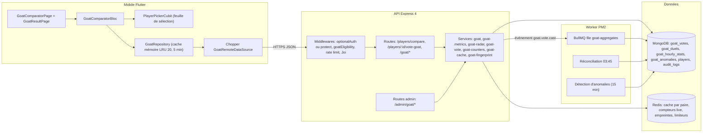
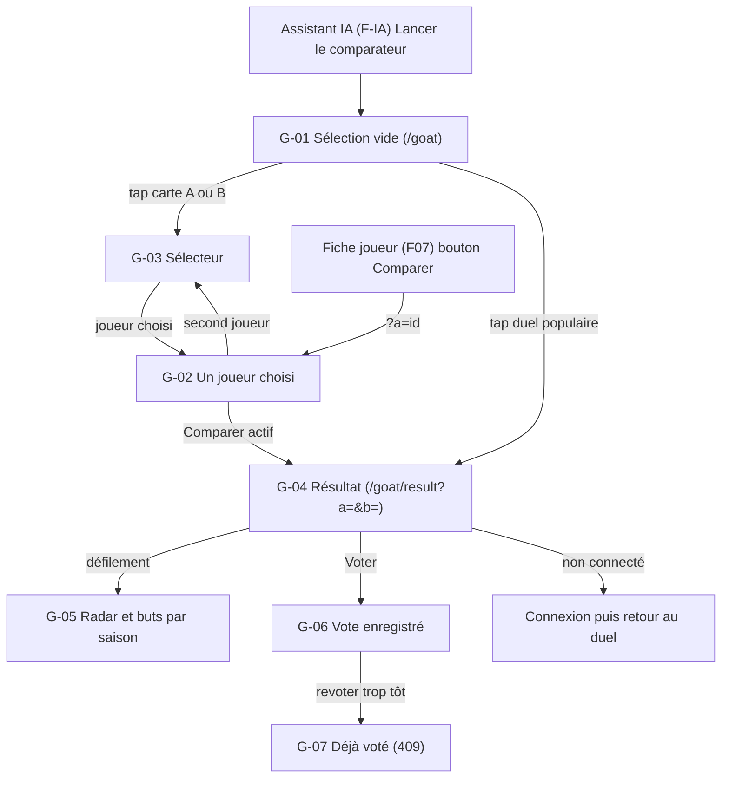
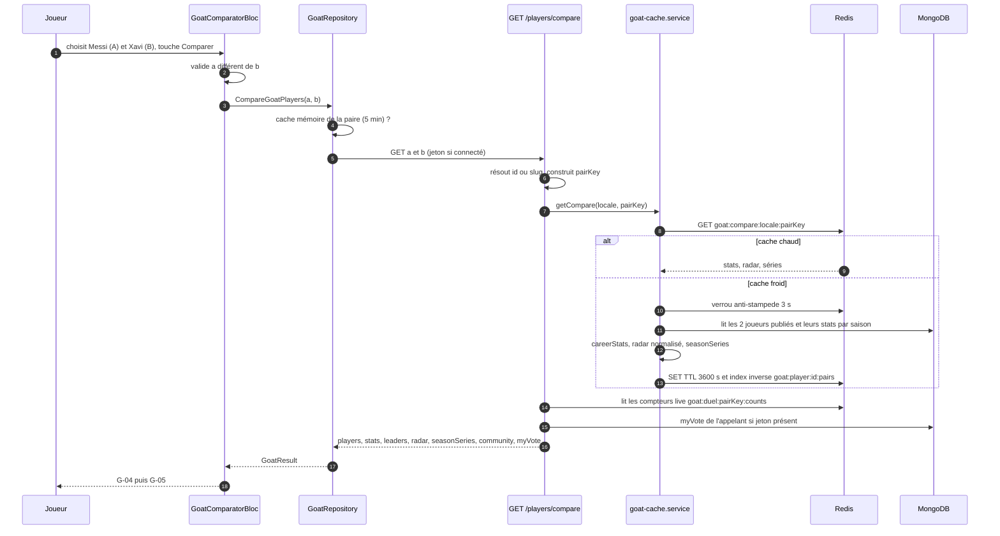
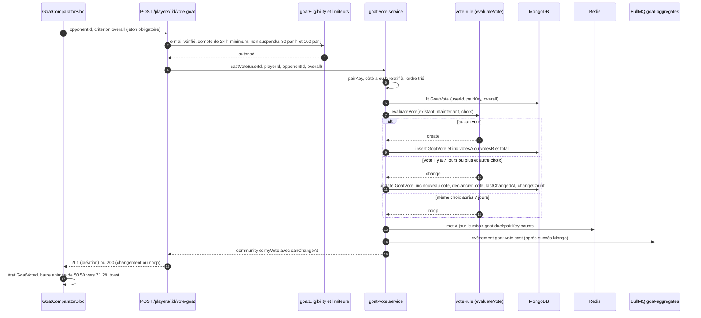
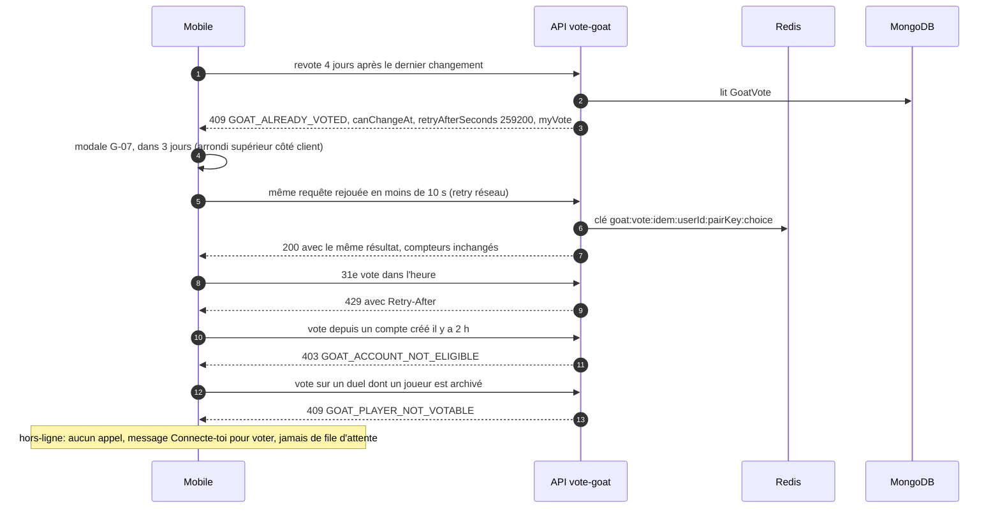
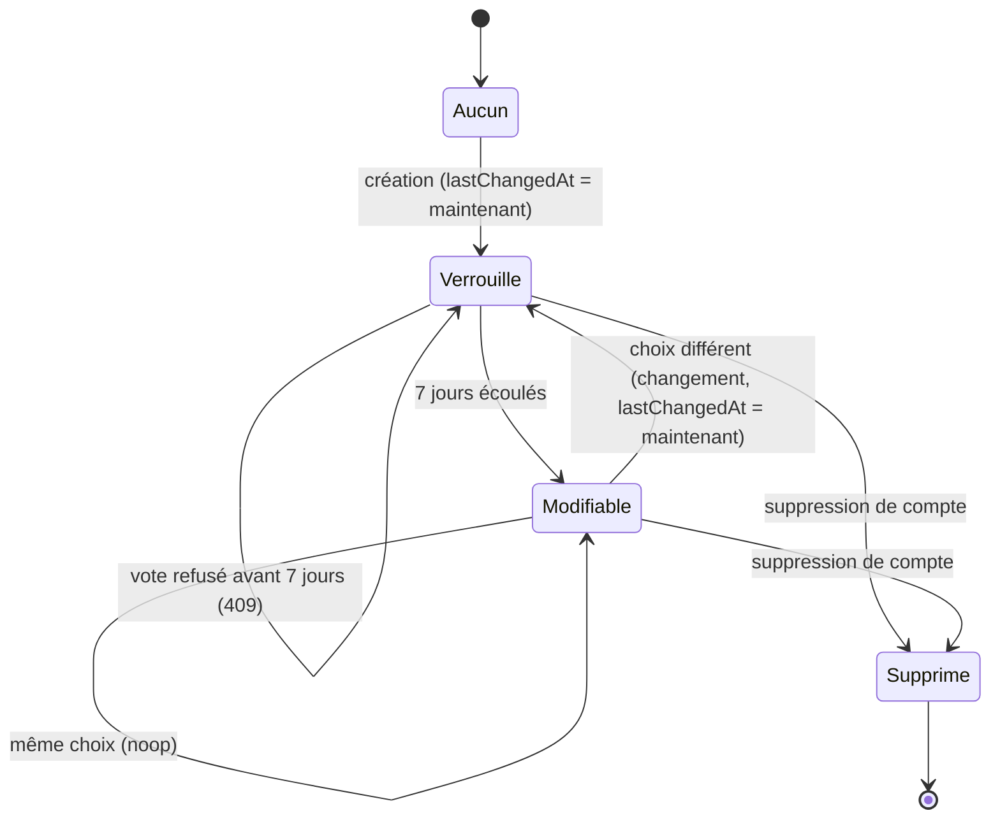
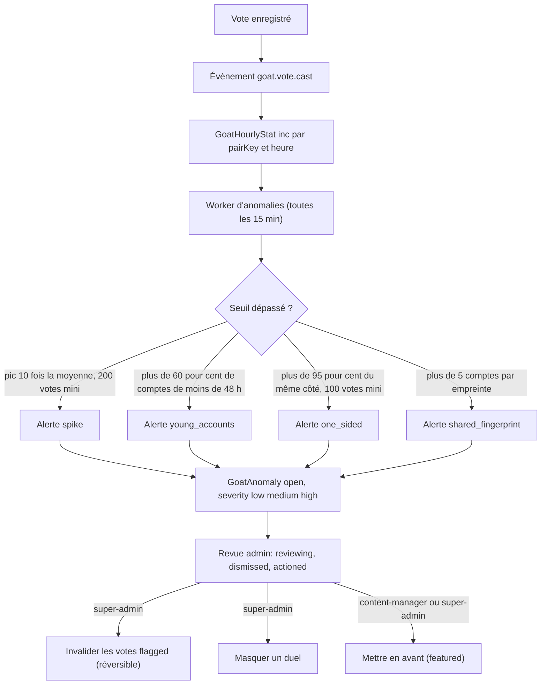
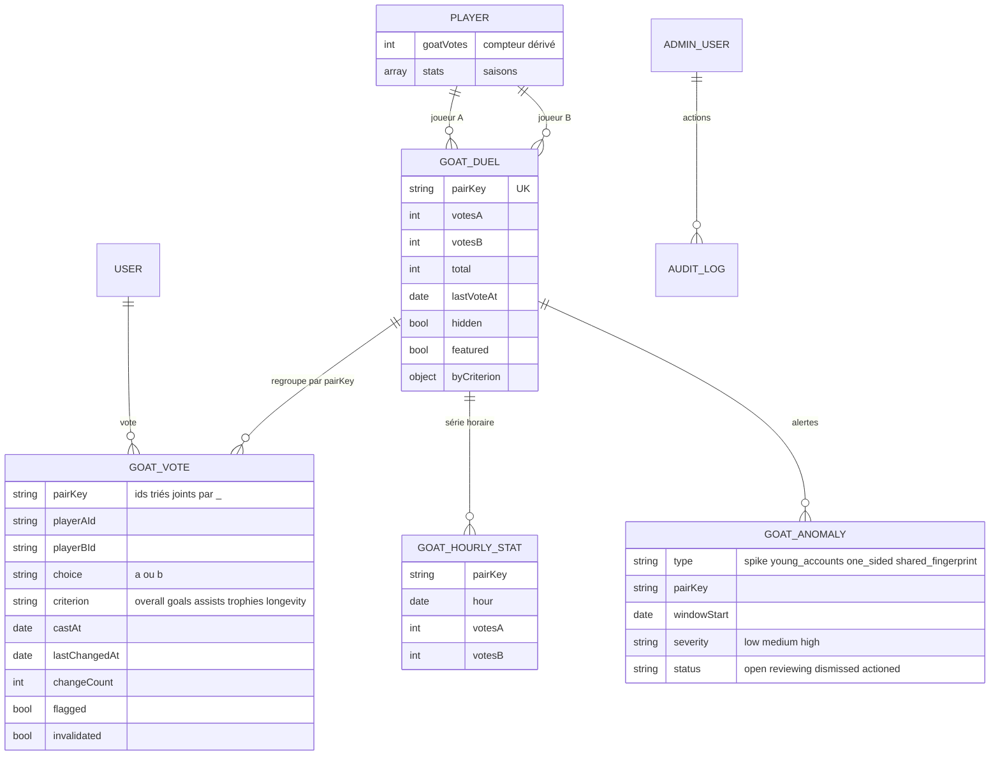
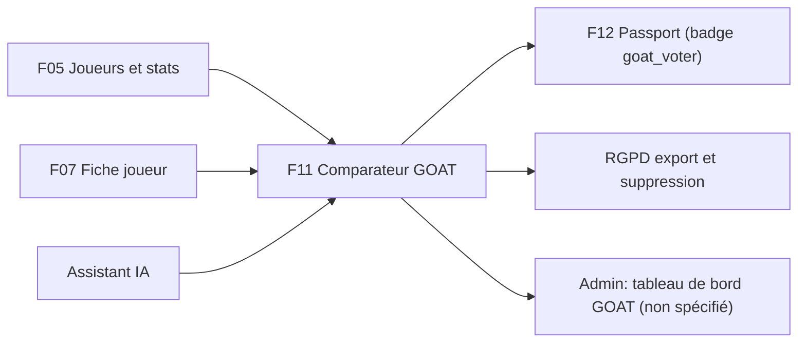

# F11 — Comparateur GOAT

> Documentation d'architecture · Univers Barça · fonctionnalité **F11**. Ce document explique le comparateur « GOAT » (Greatest Of All Time) : comment l'application met face à face deux joueurs de l'histoire du club avec des statistiques croisées, un profil radar et une courbe de buts, comment la communauté vote (un changement de vote par semaine), comment les pourcentages sont agrégés sous forte charge, et comment on se protège des votes truqués. **L'application n'impose jamais de verdict** : seule l'opinion de la communauté est affichée.

## 1. Résumé et fiche

**Valeur utilisateur.** Le supporter choisit deux joueurs (Messi et Xavi, Ronaldinho et Iniesta, Cruyff et Puyol…), lit leurs statistiques côte à côte, regarde un radar de profil de jeu et l'évolution de leurs buts saison par saison, puis répond à « Qui est le GOAT à tes yeux ? ». Après son vote, il découvre le **pourcentage de la communauté** (71 % / 29 %, « 12 481 votes ») et peut partager le duel pour inviter ses amis à voter. C'est une fonctionnalité de débat et de conversation, au cœur de la culture football.

**Principe éditorial.** Le CDC Global §2.6 interdit à l'application de désigner un « meilleur joueur » : l'API ne renvoie donc **aucune clé `winner` globale**, seulement des « leaders » statistique par statistique et des pourcentages d'opinion.

| Élément | Valeur |
|---|---|
| Phase / priorité | Phase 2 — Communautaire & compétitif, étape 2.2 « Comparateur GOAT » du plan (`API-GOAT` du 12/07 au 27/07/2027, `MOB-G` du 17/08 au 27/08/2027) ; majoritairement P0 pour comparaison, vote, règle hebdomadaire, anti-abus, cache ; P1 radar, duels populaires, agrégats, RGPD, i18n ; P2 tableau de bord admin, charge, critères secondaires, partage |
| Épopées backlog | `API-GOAT` (26 issues, `API-GOAT-01` à `API-GOAT-26`), `MOB-G` (17 issues, `MOB-G-01` à `MOB-G-17`) ; consommateurs : `MOB-F` (fiche joueur : bouton « Comparer », radar réutilisé), `MOB-N` (action « Lancer le comparateur GOAT » de l'assistant IA), `API-PASS` (badge `goat_voter`) |
| Écrans mobile | `G-01` à `G-07` |
| Écrans admin | aucun écran spécifié ; endpoints back-office `/admin/goat/*` seulement (`API-GOAT-15`, `API-GOAT-16`), tableau de bord GOAT prévu « phase 2 » (CDC Admin §7) |
| Dépôts concernés | **API** (modèles, calculs, vote, agrégats, anti-abus), **mobile** (`GoatComparatorBloc`) ; **admin** non spécifié |
| Documents voisins | F05 (joueurs et statistiques), F07 (fiche joueur, radar), F12 (badge `goat_voter`), F03 (RGPD) |

### Vocabulaire

* **Duel** : une paire de joueurs `{a, b}` ; le duel Messi/Xavi est le même que Xavi/Messi.
* **pairKey** : clé canonique d'un duel = les deux identifiants triés et joints par `_`.
* **Vote** : choix d'un utilisateur dans un duel pour un critère (`overall` = vote principal).
* **Critère** : dimension du vote ; `overall` (obligatoire) puis optionnels `goals`, `assists`, `trophies`, `longevity`.
* **Fenêtre de modification** : 7 jours glissants à partir du dernier changement avant de pouvoir changer de vote.
* **Plus grand reste** : méthode d'arrondi qui garantit que `pctA + pctB = 100`.
* **Empreinte éphémère** : hash HMAC d'IP et d'appareil conservé 24 h dans Redis, jamais en base.
* **flagged** : vote suspect, **conservé et compté** mais isolé pour revue.

### Écart avec les CDC et état du code

Le CDC Backend §3.2 cite `GET /players/compare` (NestJS/Prisma). **Stack réelle : Express 4 + TypeScript + Mongoose + Redis + BullMQ + node-cron + PM2.** Les statistiques par saison sont embarquées dans `Player.stats[]` (voir F05), et le backlog ajoute une file BullMQ `goat-aggregates`.

> État du code à la date de rédaction : seul le champ `Player.goatVotes` (compteur, défaut 0) existe dans `src/models/football.model.ts`. **Aucune route GOAT, aucun modèle de vote, aucune file `goat-aggregates` n'est implémenté** ; côté mobile seule la feature `players` existe. Ce document décrit la cible du backlog.

## 2. Acteurs et user stories

| Acteur | Besoin | Critères d'acceptation clés |
|---|---|---|
| Supporter (anonyme ou connecté) | Comparer deux joueurs | Statistiques croisées, radar, courbe ; `a ≠ b` sinon `400 GOAT_SAME_PLAYER` ; joueurs `published` seulement |
| Supporter | Choisir vite via des duels populaires | 3 duels (Messi · Xavi 12 480 votes, Ronaldinho · Iniesta 8 210, Cruyff · Puyol 3 960) pré-remplissent les deux emplacements |
| Supporter connecté | Voter pour un joueur | `201` au premier vote ; résultat communautaire immédiat ; toast « Ton vote a bien été pris en compte » |
| Supporter connecté | Changer d'avis | Possible une fois par semaine ; sinon `409 GOAT_ALREADY_VOTED` avec « Tu pourras modifier ton vote dans 3 jours » |
| Supporter | Ne pas voter hors-ligne | Jamais de file d'attente : « Connecte-toi pour voter » |
| Supporter | Partager un duel | Texte et lien sans pourcentage ni vote personnel |
| Content-manager | Mettre un duel en avant | `featured` ; seul changement autorisé au content-manager |
| Super-admin | Traiter une anomalie | Invalider les votes `flagged` (réversible), masquer un duel, avec note ≥ 10 caractères et audit |
| Système | Garantir des compteurs justes | Compteurs atomiques, réconciliation quotidienne, détection d'anomalies toutes les 15 min |

## 3. Architecture de la fonctionnalité



**Légende.** Le mobile appelle `GET /players/compare` pour tout l'écran de résultat et `POST /players/:id/vote-goat` pour voter. La partie **publique** de la comparaison (stats, radar, séries) est cachée 1 h par paire ; la partie **communautaire** est lue séparément sur des compteurs live pour rester exacte ; le vote de l'utilisateur (`myVote`) n'est **jamais** dans un cache partagé. Un vote émet un évènement traité en arrière-plan (statistiques horaires, métriques, décision de cache), sans ralentir la requête HTTP.

**Pourquoi ce découpage.** Un duel viral (Messi · Xavi partagé sur les réseaux) peut déclencher des milliers de lectures et de votes par minute : lecture = cache par paire, écriture = incrément atomique, agrégats = réconciliés par un job nocturne.

## 4. Écrans et navigation

| Code | Écran | Rôle |
|---|---|---|
| `G-01` | Sélection, aucun joueur | « Comparateur GOAT », deux cartes pointillées « Choisir le joueur A » (grenat) et « Choisir le joueur B » (bleu) séparées par « VS », liste « Duels populaires », bouton « Comparer » désactivé |
| `G-02` | Sélection, un joueur choisi | Carte A remplie (« Messi », « Attaquant », « Joueur A »), B encore vide |
| `G-03` | Sélecteur de joueur | Feuille « Choisir le joueur A/B » : recherche, chips Tous / Légendes / Effectif actuel, lignes « Xavi Hernández · Milieu · Espagne » |
| `G-04` | Résultat, statistiques croisées | « MESSI VS XAVI », 6 lignes (Matchs 778/767, Buts 672/85, Passes décisives 269/185, Trophées 35/25, Saisons 17/17, Buts par match 0,86/0,11), bloc de vote |
| `G-05` | Résultat, profil radar | « Profil de jeu » (radar à 6 axes) et « Évolution des buts par saison » |
| `G-06` | Vote enregistré | Carte « RÉSULTAT DE LA COMMUNAUTÉ » (71 % / 29 %, « 12 481 votes · tu as voté pour Messi ») et toast |
| `G-07` | Vote déjà effectué (409) | Modale « Déjà voté cette semaine » |

<p>


</p>

*`G-06` : avatars Messi (grenat) et Xavi (bleu) séparés par « VS », carte de communauté avec barre bicolore 71 % / 29 % et coche près du joueur voté, lignes statistiques avec barres doubles (la valeur la plus haute en grenat, égalité en teinte neutre : Saisons 17/17), toast sombre en bas. `G-05` : radar à 6 axes (Dribble, Vitesse, Vision, Passe, Finition, Défense) superposant les deux polygones, courbe en aire pour les buts par saison.*



Routes mobile : `/goat` (sélection) et `/goat/result?a=<id>&b=<id>` (résultat, lien de partage et lien profond). Les ids invalides d'un lien profond sont ignorés sans plantage. L'accès depuis l'application (onglet, en-tête de l'Historique ou fiche joueur) est « à valider avec la maquette » dans `MOB-G-05` ; le hub des jeux `D-01` (F09) ne le propose pas (voir §14).

## 5. Flux détaillés

### 5.1 Comparaison de deux joueurs (nominal, cache par paire)



**Pas à pas.** (4) Le cache **mémoire** du mobile (LRU de 20 entrées, 5 min, clé normalisée par ordre alphabétique des ids) évite un appel inutile ; il est invalidé après un vote réussi. (6-7) `a` et `b` acceptent un ObjectId ou un slug (`^[a-z0-9-]{2,60}$`). (9-13) Le cache serveur de **1 h** contient uniquement ce qui ne dépend ni des votes ni de l'utilisateur ; un **verrou de 3 s** (anti-stampede) évite que 200 requêtes simultanées à froid recalculent 200 fois. L'index inverse `goat:player:{id}:pairs` permet d'invalider toutes les paires d'un joueur quand ses statistiques changent (F05). (14) La partie communauté est lue sur des compteurs Redis (repli Mongo), cohérence maximale de 5 s. (15) `myVote` n'est ajouté que si un jeton est présent, avec `Cache-Control: private, no-store` ; anonyme : `public, max-age=60`.

### 5.2 Vote (nominal et changement après 7 jours)



**Pas à pas.** (2-3) Les contrôles d'éligibilité sont **avant** toute écriture ; un compte non éligible reçoit `403 GOAT_ACCOUNT_NOT_ELIGIBLE` avec la raison. (5) Le choix est stocké **relativement à l'ordre trié** des ids (le client peut envoyer Messi comme `:id` ou comme `opponentId`, le résultat est le même duel). (8-10) L'index unique `{userId, pairKey, criterion}` interdit un second document ; la création et le `$inc` du compteur se font dans la même opération logique (transaction en replica set, sinon séquence avec compensation). (11-12) Un **changement** décrémente l'ancien côté et incrémente le nouveau en une seule mise à jour : le `total` ne bouge pas. (15) L'évènement est publié **après** succès de l'écriture ; la requête HTTP n'attend pas ses consommateurs.

### 5.3 Cas limites : trop tôt, rejeu, abus, hors-ligne



**Points d'attention.** Le vote est la **seule** action du projet qui n'est jamais mise en file hors-ligne (CDC Flutter §5.3) : une file d'attente permettrait de contourner les limites et la fenêtre hebdomadaire. Un vote `flagged` (plus de 5 comptes depuis la même empreinte en 24 h) reste compté et **l'utilisateur n'en est pas informé** (pas de signal exploitable par un tricheur).

### 5.4 Cycle de vie d'un vote (par utilisateur, duel et critère)



`canChangeAt = lastChangedAt + 7 jours` ; fenêtre **glissante** à partir du dernier changement effectif. Un vote identique après 7 jours ne compte pas comme changement (`lastChangedAt` inchangé). La règle est **par duel et par critère** : voter dans un autre duel est libre. `changeCount` est plafonné à 52 par an (garde-fou).

### 5.5 Détection d'anomalies et actions admin



**Aucun blocage automatique** : la détection crée des alertes, la décision reste humaine. Toute action admin exige une note d'au moins 10 caractères et écrit une entrée d'audit immuable `{adminId, action, pairKey, avant, après}` ; invalider = marquer `invalidated=true` (les votes restent en base, les compteurs sont recalculés), réversible via `/restore`. Après une action, le cache de la paire et la liste des duels populaires sont purgés.

## 6. Contrats d'API

Préfixe `/api/v1`. Enveloppe `{ success, data }` ; erreurs `{ success:false, error:{ code, message, details, traceId } }` avec message localisé (fr, en, es) et code stable non traduit.

### 6.1 Lecture et vote

| Méthode | Chemin | Auth | Rate limit | Requête | Réponse | Erreurs |
|---|---|---|---|---|---|---|
| GET | `/goat/players` | public | 120/min | `filter=all\|legends\|current`, `q` (2 à 40 car.), `exclude`, `limit` (20, max 50), `cursor` | `items[{id, name, position, nationality, photoUrl, isActive}]`, `nextCursor`, `hasMore` ; cache 10 min, `ETag`, `max-age=300` | 422 |
| GET | `/goat/duels/popular` | public | 120/min | `limit` (3, max 10) | `[{pairKey, playerA{id,name}, playerB{id,name}, votes}]` ; `featured` d'abord puis `total` sur 90 jours, repli all-time | 422 |
| GET | `/goat/criteria` | public | 120/min | — | critères activés avec libellés localisés | — |
| GET | `/players/compare` | optionnelle | 120/min | `a`, `b` (id ou slug) | `players[2]`, `stats`, `leaders`, `radar`, `seasonSeries`, `community{votesA,votesB,total,pctA,pctB,byCriterion?}`, `myVote?` | 400 `GOAT_SAME_PLAYER`, 404 `GOAT_PLAYER_NOT_FOUND`, 422 |
| GET | `/players/compare/votes` | optionnelle | 120/min | `a`, `b` | `community`, `myVote{choice,castAt,canChangeAt,retryAfterSeconds}?` ; anonyme : `public, max-age=30` | 404 `GOAT_DUEL_HIDDEN` |
| POST | `/players/:id/vote-goat` | obligatoire (e-mail vérifié, 24 h) | 30/h et 100/j par utilisateur, 60/h/IP | `{opponentId, criterion='overall'}` | `201` création ou `200` : `community`, `myVote{choice,castAt,canChangeAt}` | 400, 401, 403 `GOAT_ACCOUNT_NOT_ELIGIBLE`, 404, 409 `GOAT_ALREADY_VOTED` / `GOAT_PLAYER_NOT_VOTABLE` / `GOAT_OVERALL_REQUIRED`, 422 `GOAT_CRITERION_DISABLED`, 429 |
| GET | `/goat/votes/mine` | utilisateur | standard | `limit` (20, max 50), `cursor`, `a`, `b` | `items[{pairKey, playerA, playerB, choice, criterion, castAt, lastChangedAt, canChangeAt, canChangeNow}]` ; `private, no-store` | 401, 422 si `userId` fourni |

Exemple d'erreur de vote trop précoce :

```json
{ "success": false, "error": { "code": "GOAT_ALREADY_VOTED",
  "message": "Déjà voté cette semaine",
  "details": { "canChangeAt": "2026-10-18T14:02:11.000Z", "retryAfterSeconds": 259200 },
  "traceId": "..." } }
```

Exemple de `community` : `{"votesA":8861,"votesB":3620,"total":12481,"pctA":71,"pctB":29}`. Sans vote : `pctA = pctB = 0` et le client affiche « Sois le premier à voter ».

### 6.2 Administration

Rôles : `content-manager` (lecture + `featured`) et `super-admin` (tout) ; modérateur : `403`. Aucune donnée individuelle (`userId`, pseudo) n'est renvoyée.

| Méthode | Chemin | Description |
|---|---|---|
| GET | `/admin/goat/overview?days=7\|30\|90` | `totalVotes`, `newVotes`, `votesPerDay[]`, `activeVoters`, `duelsCount`, `flaggedVotes`, `openAnomalies`, `topDuels[10]` ; cache 60 s |
| GET | `/admin/goat/duels` | liste filtrable : `q`, `hidden`, `featured`, `sort=total\|lastVoteAt`, `page`, `limit` |
| GET | `/admin/goat/duels/:pairKey` | compteurs, évolution horaire sur 7 jours, répartition par critère, votes `flagged` |
| GET | `/admin/goat/anomalies` | filtres `status`, `severity` |
| POST | `/admin/goat/anomalies/:id/status` | `{status: reviewing\|dismissed\|actioned, note}` |
| POST | `/admin/goat/duels/:pairKey/invalidate-flagged` et `/restore` | invalidation réversible des votes suspects (super-admin) |
| PATCH | `/admin/goat/duels/:pairKey` | `{hidden?, featured?}` avec note ≥ 10 caractères |

## 7. Modèle de données



**Collections et index** (cible `API-GOAT-01`, `-11`, `-14`, `-26`).

* `goat_votes` : unique `{userId, pairKey, criterion}` ; index `{pairKey:1, criterion:1}`, `{userId:1, lastChangedAt:-1}`, `{castAt:1}`, `{flagged:1, castAt:-1}`. **Aucune IP ni empreinte** n'y est persistée.
* `goat_duels` : `pairKey` unique, `{total:-1}`, `{featured:1, total:-1}`, `{hidden:1, featured:-1, total:-1}`. `total = votesA + votesB` maintenu à l'écriture. Aucun identifiant utilisateur.
* `goat_hourly_stats` : unique `{pairKey, hour}`, **TTL 90 jours**.
* `goat_anomalies` : unique `{type, pairKey, windowStart}` (pas de doublon), index `{status:1, severity:1, createdAt:-1}`.
* `players` : `goatVotes` (somme des votes reçus, recalculée par la réconciliation), index `{status:1, isActive:1, searchName:1}`.
* Critères : constante `src/config/goat-criteria.ts` (ou collection `goat_criteria`) ; seul `overall` est activé au lancement (variable `GOAT_CRITERIA_ENABLED`).

**Clés Redis** (le backlog nomme les familles sans préfixe ; préfixe `ub:` proposé).

| Clé | Rôle | TTL |
|---|---|---|
| `goat:compare:{locale}:{pairKey}` | partie publique (stats, radar, séries) | 3 600 s, stale-while-revalidate 60 s |
| `goat:duel:{pairKey}:counts` | HASH miroir des compteurs live | reconstruit à la lecture si absent |
| `goat:player:{id}:pairs` | index inverse (SET) pour l'invalidation | — |
| `goat:players:{locale}:{filter}:{q}` | sélecteur | 10 min |
| `goat:duels:popular:{limit}` | duels populaires | 5 min |
| `goat:radar:refs` | maxima de référence du radar | 24 h |
| `goat:fp:{fp}` | empreinte éphémère (SET de `userId`) | 24 h |
| `goat:vote:idem:{userId}:{pairKey}:{choice}` | idempotence courte | 10 s |
| `admin:goat:overview:{days}` | tableau de bord admin | 60 s |

**Migration.** `scripts/migrations/2026-goat-models.js` (idempotente) : création des index et backfill de `GoatDuel.total` depuis `Player.goatVotes`. Seed (`API-GOAT-22`) : 12 joueurs publiés avec statistiques par saison, trois duels de démonstration (Messi · Xavi 12 481 votes 71/29, Ronaldinho · Iniesta 8 210, Cruyff · Puyol 3 960), 50 utilisateurs fictifs éligibles, **refusé si `NODE_ENV=production`**.

## 8. Traitements asynchrones et cache

| Traitement | Déclencheur | Détail |
|---|---|---|
| File `goat-aggregates` (à ajouter à `QUEUE_NAMES`) | évènement `goat.vote.cast` | consommateurs idempotents : `GoatHourlyStat` (`$inc` upsert), décision « vote significatif », métriques, compteur de votes par utilisateur ; `jobId = pairKey:userId:castAt` ; `attempts: 5`, backoff exponentiel 2 s, puis `dead-letter` |
| Réconciliation | cron 03:45 Europe/Madrid | recompte `GoatVote` par `pairKey` et critère, corrige `votesA/votesB` et `Player.goatVotes`, log `warn` si écart > 0,5 % ou > 5 votes, métrique `goat_reconcile_drift_total` |
| Détection d'anomalies | toutes les 15 min | 4 détecteurs (voir §5.5) |
| Maxima de référence du radar | cron 04:15 | recalcule `goat:radar:refs` |
| Reconstruction du miroir Redis | lecture sans clé | verrou `SET NX PX 5000` |

**« Vote significatif » (invalidation du snapshot de pourcentage).** Variation de `pctA` arrondi d'au moins 1 point, ou 25 votes cumulés depuis le dernier snapshot, ou premier vote du duel. Un vote non significatif ne purge pas le cache ; la communauté reste lue en direct. **Autres invalidations** : mise à jour des statistiques ou du statut d'un des deux joueurs (hook du module football, F05) : `DEL` de toutes les paires du joueur via l'index inverse.

**Dégradations.** Redis indisponible : le vote réussit et l'évènement est journalisé puis rejoué par la réconciliation ; la lecture retombe sur Mongo.

## 9. Règles de gestion

### Duel et statistiques

1. `pairKey` = ids triés joints par `_` ; `a ≠ b` obligatoire (`400 GOAT_SAME_PLAYER`) ; seuls les joueurs `status='published'` sont comparables ; un joueur archivé conserve ses votes mais n'est plus votable (`GOAT_PLAYER_NOT_VOTABLE`).
2. **Périmètre des statistiques** : lignes `stats[]` du FC Barcelone uniquement (saisons au Barça) ; `matches`, `goals`, `assists`, `trophies` sont sommés ; `seasons` = saisons distinctes ; `longevity` = `seasons` + première et dernière saison (ex. 2004/05 à 2020/21 = 17).
3. `goalsPerMatch = goals / matches` arrondi à 2 décimales (0,86), `0` si `matches = 0` ; sans aucune statistique : valeurs à 0 et `incomplete:true` (le client affiche « — »).
4. **Radar (API)** : 5 axes normalisés 0-100 (Buts/match, Passes/match, Palmarès, Longévité, Présence) = valeur ÷ maximum de référence × 100, plafonné à 100 ; maxima = maximum observé parmi les joueurs publiés, recalculé toutes les 24 h ; un `altText` fr/en/es décrit les trois plus grands écarts (voir l'écart mobile §14).
5. `seasonSeries` : union chronologique des saisons des deux joueurs `[{season, a, b}]`, `null` si le joueur n'a pas joué (courbe interrompue, aucun zéro fictif).
6. Pourcentages `pctA + pctB = 100` par la **méthode du plus grand reste** ; `total = 0` : `0/0`.
7. **Aucun verdict** : seulement des `leaders` par statistique (`a`, `b`, `tie`) et l'opinion de la communauté.

### Vote

8. Authentification obligatoire avec e-mail vérifié et compte de **24 h** minimum (`GOAT_MIN_ACCOUNT_AGE_HOURS`), non suspendu.
9. **Un vote par duel et par critère** ; changement possible après **7 × 24 h** (`GOAT_CHANGE_WINDOW_DAYS=7`) à partir de `lastChangedAt` ; horodatage **serveur uniquement**, tolérance 0 ; vote identique après 7 jours : `noop`.
10. Rejeu identique en moins de **10 s** : `200` sans double compte (clé d'idempotence Redis).
11. Limites : **30 votes/h et 100/j par utilisateur**, **60 votes/h par IP** ; les votes par critère comptent comme des votes à part entière.
12. Critères secondaires (`goals`, `assists`, `trophies`, `longevity`, optionnels, désactivés au lancement) : exigent un vote `overall` préalable (`409 GOAT_OVERALL_REQUIRED`), même règle hebdomadaire par critère, pourcentages indépendants, aucun score cumulé.
13. Un duel `hidden` n'apparaît plus dans les duels populaires et sa partie communautaire répond `404 GOAT_DUEL_HIDDEN` (les statistiques restent consultables).
14. Duels populaires : `limit` 3 (1 à 10), `featured` d'abord puis `total` sur 90 jours glissants, repli all-time si moins de 3 duels récents.

### Anomalies

15. Seuils : `spike` > 10 × la moyenne horaire des 7 derniers jours (minimum 200 votes dans l'heure) ; `young_accounts` > 60 % de comptes de moins de 48 h ; `one_sided` > 95 % du même côté avec ≥ 100 votes ; `shared_fingerprint` > 5 comptes par empreinte ; sévérité `low|medium|high` ; configurables dans `src/config/goat.ts`.

## 10. Sécurité, RGPD et anti-abus

* **Éligibilité et limites** : voir règles 8 à 11. Le middleware `goatEligibility` vérifie e-mail vérifié, ancienneté et statut avant tout traitement.
* **Empreintes éphémères** : `fp = HMAC(secret quotidien, IP + user-agent)`, secret dérivé de `GOAT_FP_SECRET` et de la date Madrid (sel rotatif), conservé **24 h dans Redis**, jamais en base, jamais exporté ; plus de 5 comptes distincts sur une empreinte en 24 h : vote `flagged` (compté mais isolé).
* **Pas de signal exploitable** : un vote `flagged` ne déclenche aucune information pour l'utilisateur ; les endpoints de lecture ne renvoient que `myVote` de l'appelant (impossible de sonder les votes d'autrui) ; `?userId=` est refusé sur `/goat/votes/mine`.
* **Validation** : Joi sur toutes les entrées ; ObjectId 24 hex ou slug `^[a-z0-9-]{2,60}$` ; protection contre le **mass assignment** (`flagged`, `invalidated` dans le corps sont ignorés).
* **Audit** : toutes les actions admin sont auditées (`adminId`, `action`, `pairKey`, avant/après, note ≥ 10 caractères) ; la lecture du tableau de bord n'est pas auditée.
* **RGPD (`API-GOAT-17`)** : export `/users/me/export` avec la section `goatVotes` (paires, joueurs, choix, critère, dates) ; **suppression de compte** : suppression des `GoatVote` de l'utilisateur, recalcul atomique des duels concernés et de `Player.goatVotes` ; les agrégats (`GoatDuel`, `GoatHourlyStat`) ne contiennent **aucun identifiant utilisateur** ; aucun vote individuel n'est visible d'un autre utilisateur ni du back-office. Le vote est une fonctionnalité de service (pas un traitement optionnel), mentionnée dans la politique de confidentialité.
* **Droits et image** : application fan-made ; le partage ne contient ni pourcentage ni vote personnel ni identifiant utilisateur dans l'URL.
* **Logs** : aucune IP brute ni `userId` en clair dans les logs d'évènements.

## 11. Erreurs et états dégradés

| Situation | Serveur | Client |
|---|---|---|
| Hors-ligne | — | Comparaison en cache visible avec bandeau « Hors-ligne — le vote est indisponible », boutons de vote désactivés ; « Comparer » : « Connexion requise » |
| Hors-ligne au vote | — | « Connecte-toi pour voter », aucun appel, aucune file |
| Non authentifié | `401` | Invitation à se connecter (retour au duel) ; résultats consultables |
| Compte non éligible | `403 GOAT_ACCOUNT_NOT_ELIGIBLE` + raison | Message localisé (cas non détaillé dans `MOB-G`, voir §14) |
| Trop tôt pour revoter | `409 GOAT_ALREADY_VOTED` | Modale `G-07`, « dans 3 jours » / « dans 5 heures » / « dans moins d'une heure » |
| Trop de votes | `429` + `Retry-After` | Message de limitation |
| Même joueur deux fois | `400 GOAT_SAME_PLAYER` (le client l'évite) | « Choisis deux joueurs différents », joueur déjà pris grisé |
| Joueur introuvable | `404 GOAT_PLAYER_NOT_FOUND` | Retour à la sélection avec message |
| Duel masqué | `404 GOAT_DUEL_HIDDEN` (partie communauté) | Statistiques visibles, pas de communauté |
| Statistiques absentes | `incomplete:true`, valeurs 0 | « — » pour le ratio ; radar masqué ; « Évolution non disponible » |
| Redis absent | lecture Mongo, évènement journalisé | transparent |
| Peu de votes | `total < 10` | mention « Peu de votes pour l'instant » |
| Chargement | — | squelettes (en-tête, 6 lignes, 2 graphiques) |

## 12. Connexions avec les autres fonctionnalités

| Fonctionnalité | Relation | Détail |
|---|---|---|
| F05 Données football | dépend de | `Player.stats[]`, statut `published`/`archived`, `searchName`, `isActive` ; un changement de statistiques invalide les paires du joueur |
| F07 Historique et fiches | partage | bouton « Comparer » (`/goat?a=<id>`) ; le widget radar est réutilisé (une seule série) |
| F12 Passport et gamification | alimente | badge `goat_voter` (« premier duel GOAT ») via l'évènement de vote ; les votes GOAT ne créditent pas de points dans le backlog |
| Assistant IA (F-IA) | alimente | action « Lancer le comparateur GOAT » |
| F03 RGPD | partage | export et suppression des votes |
| Modération (F-MODER) | partage | les votes ne sont pas du contenu modérable ; anomalies traitées par l'admin GOAT |
| F09 / F10 Jeux | partage | rate limiters, helper `getOrSet` anti-stampede, règles de cache |



## 13. Observabilité et tests

**Métriques Prometheus** (noms du backlog ; préfixe `ub_` à l'enregistrement) : `goat_votes_total{outcome=created|changed|noop|conflict}`, `goat_compare_total`, `goat_compare_duration_seconds`, `goat_cache_hit_total{layer}`, `goat_anomalies_open`, `goat_reconcile_drift_total`, `goat_events_processed_total`, `goat_events_failed_total`. Tableau Grafana `docs/grafana/goat.json` (votes/minute, erreurs, hit ratio). **Logs** : `goat.vote.flagged` (sans IP), `userId` pseudonymisé.

**Tests API (`API-GOAT-19`, `-20`, `-21`).**

* Unitaires : `buildPairKey` (Xavi/Messi = Messi/Xavi, `a = b` refusé), `evaluateVote` (J+0 create, J+3 conflict, J+7 change, même choix après 8 jours noop), `goat-metrics` (778 matchs et 672 buts = 0,86 ; 0 match sans division par zéro ; 2004/05 à 2020/21 = 17 saisons), radar (maximum de référence 0,95 but/match et 0,86 = axe 91 ; plafond à 100), plus grand reste (8 861 / 3 620 = 71 / 29).
* Intégration (supertest, mongodb-memory-server, ioredis-mock) : sélection, comparaison, vote, 409 à J+3 et 200 à J+7, duels populaires, concurrence (**200 votes en parallèle = total 200**, 20 votes parallèles d'un même utilisateur = 1 effet), réconciliation avec dérive provoquée, rejeu de job idempotent ; couverture `src/domain/goat` ≥ 90 %.
* Sécurité : e-mail non vérifié, compte < 24 h, 31e vote/h = `429`, matrice RBAC `/admin/goat/*`, mass assignment, `pairKey` forgé, `scanForUserIds` (aucun `userId` dans les réponses publiques).
* Charge k6 (duel viral) : 2 000 utilisateurs virtuels en 2 min, palier 5 min, 80 % du trafic sur 3 paires ; mix 60 % `compare`, 20 % `compare/votes`, 10 % sélecteur et duels populaires, 10 % votes ; seuils : `http_req_failed` < 1 %, p95 `compare` < 150 ms (cache chaud), p95 vote < 400 ms, p99 < 800 ms, hit ratio > 90 %, cohérence finale « somme des votes = total du duel ».

**Tests mobile (`MOB-G-17`).** Couverture ≥ 80 % sur domaine et BLoC, golden 7 écrans en 360×640 et 430×932 clair/sombre, parcours complet (Messi en A, Xavi en B, comparer, voter Messi, 71 %, revoter donne la modale 409), scénarios 201, 409, 429, hors-ligne.

## 14. Points ouverts et incohérences détectées

**À confirmer (backlog).**

* **Point d'entrée** dans l'application (onglet, en-tête de l'Historique, fiche joueur).
* Activation des critères secondaires (`goals`, `assists`, `trophies`, `longevity`) : désactivés au lancement.
* Écrans admin du tableau de bord GOAT (CDC Admin §7, phase 2) : non conçus.
* Affichage du pourcentage **avant** le vote : le mobile le masque « pour éviter le biais » alors que l'API le renvoie à tous (y compris anonymes).

**Incohérences entre specs mobile `MOB-G` et API `API-GOAT` (à arbitrer avant le codage).**

| Sujet | Mobile | API |
|---|---|---|
| Axes du radar | **6 axes** : Dribble, Vitesse, Vision, Passe, Finition, Défense (conforme à la maquette `G-05`) | **5 axes** : Buts, Passes, Palmarès, Longévité, Présence (calculés depuis les statistiques de saison) |
| Forme de la réponse `compare` | `a{...}`, `b{...}`, `goalsBySeason[{season, goals}]`, `community{totalVotes, aPercent, bPercent, myVote:'a'\|'b', nextEditableAt}` | `players[2]`, `stats` en tableau, `leaders`, `seasonSeries[{season, a, b}]`, `community{votesA, votesB, total, pctA, pctB}`, `myVote{choice, castAt, canChangeAt}` |
| Réponse du vote | `{totalVotes, aPercent, bPercent, myVote, nextEditableAt}` | `{community, myVote{choice, castAt, canChangeAt}}` |
| Code d'erreur du 409 | `ALREADY_VOTED`, `details.nextEditableAt` | `GOAT_ALREADY_VOTED`, `details.canChangeAt` et `retryAfterSeconds` |
| Duels populaires | `GET /players/goat/popular-duels` (proposé, repli statique) | `GET /goat/duels/popular` |
| Sélecteur de joueurs | `GET /players?search=&category=legend\|current` (existant à étendre) | `GET /goat/players?filter=all\|legends\|current` dédié |
| Autres statuts à gérer | `429` seulement | `403 GOAT_ACCOUNT_NOT_ELIGIBLE`, `409 GOAT_PLAYER_NOT_VOTABLE`, `404 GOAT_DUEL_HIDDEN` |
| Idempotence du vote | en-tête `Idempotency-Key` (UUID) | clé Redis `goat:vote:idem:{userId}:{pairKey}:{choice}` de 10 s |
| Catégorie de joueur | `legend` / `current` | `isActive=false` / `isActive=true` |
| Pourcentage avant le vote | masqué côté client | toujours renvoyé |
| Cache | client 5 min, serveur 1 h | serveur 1 h par paire, communauté en direct |
| Rate limit vote | 120 req/min général | 30/h et 100/j par utilisateur |

**Autres écarts.** `MOB-G-02` propose un cache serveur « 1 h invalidé à chaque vote significatif » : l'API distingue la partie statistique (1 h) et la partie communauté (direct). `MOB-G-09` annonce la valeur la plus haute « en grenat/gras » et l'égalité neutre alors que l'API fournit `leaders` (`a|b|tie`). La spec mobile propose un accès depuis l'Historique tandis que l'API n'a pas d'équivalent. Le modèle actuel `Player.goatVotes` est un simple compteur : le backlog le conserve comme total dérivé.

## 15. Pour aller plus loin

* **Épopées** : `API-GOAT` (`API-GOAT-01` à `API-GOAT-26`), `MOB-G` (`MOB-G-01` à `MOB-G-17`), `API-FOOT`, `MOB-F`, `API-PASS`.
* **CDC** : Backend §3.2 (`GET /players/compare`, vote GOAT), §5.6 (cache comparateur 1 h), §11.1 ; Global §2.6 (comparateur, pas de verdict) ; Flutter §5.3 (vote jamais en file d'attente), §7.5 (`GoatComparatorBloc`) ; Admin §7 (tableau de bord GOAT, phase 2).
* **Code existant** : `univers_barca_api/src/models/football.model.ts` (`Player.goatVotes`, `stats[]`), `src/jobs/queues.ts` ; `univers_barca_mobile/lib/features/players` (feature de référence).
* **Documents voisins** : F05, F07, F12, F03.
