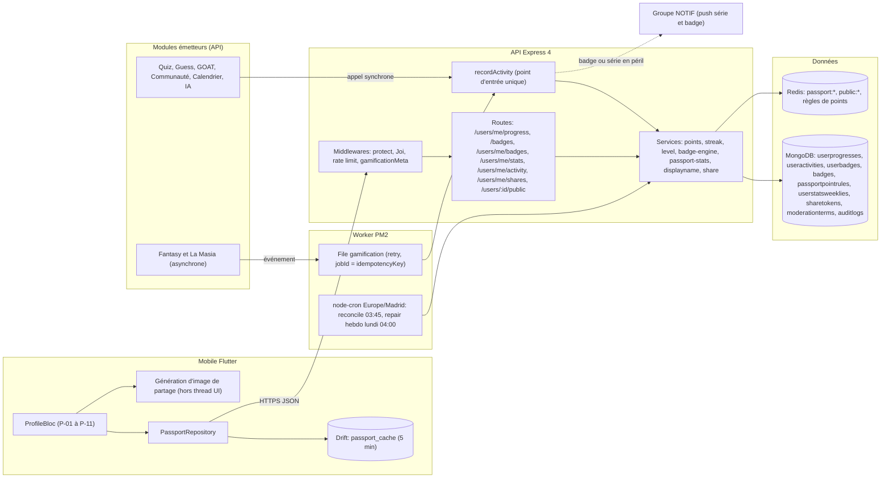
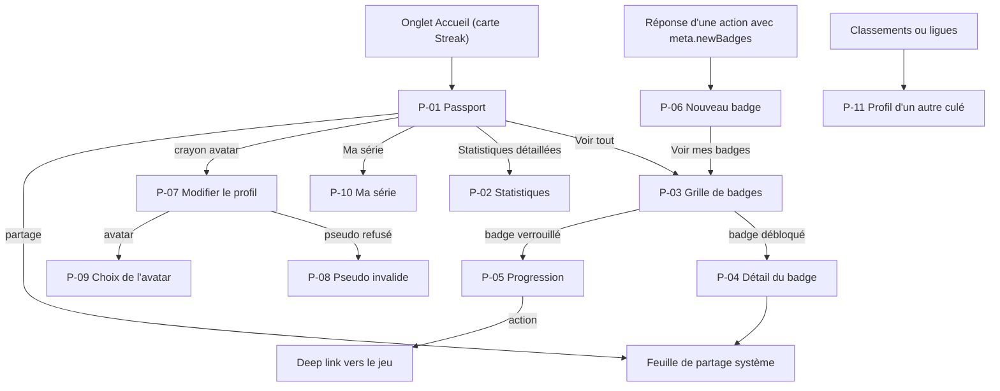
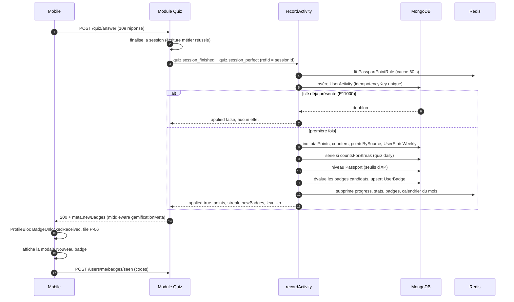
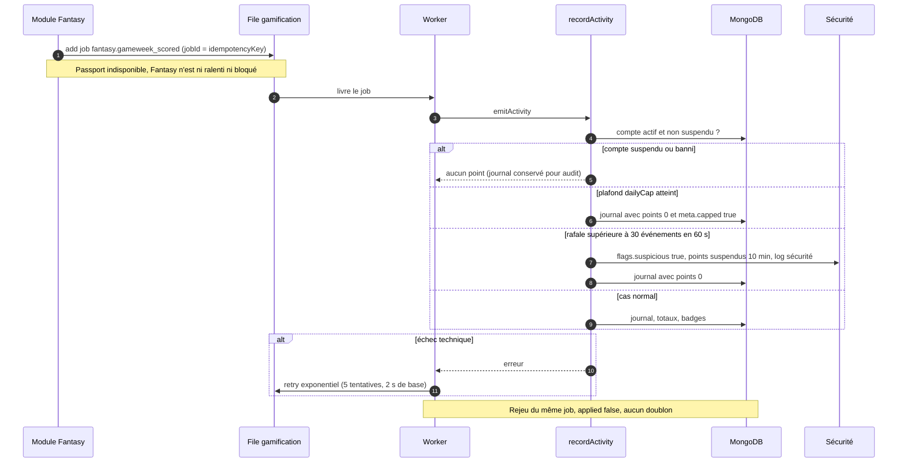
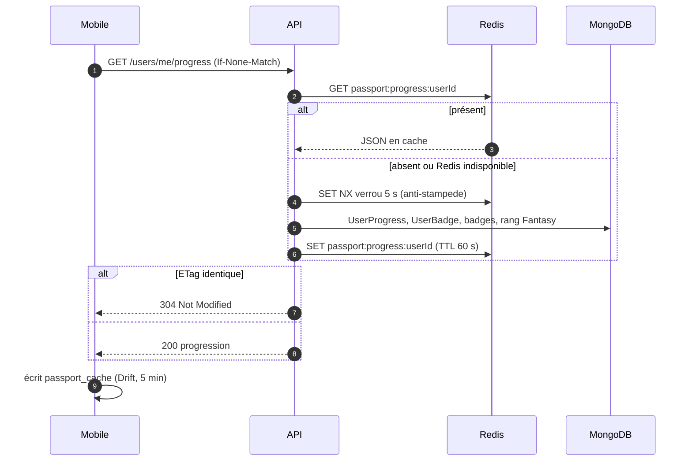
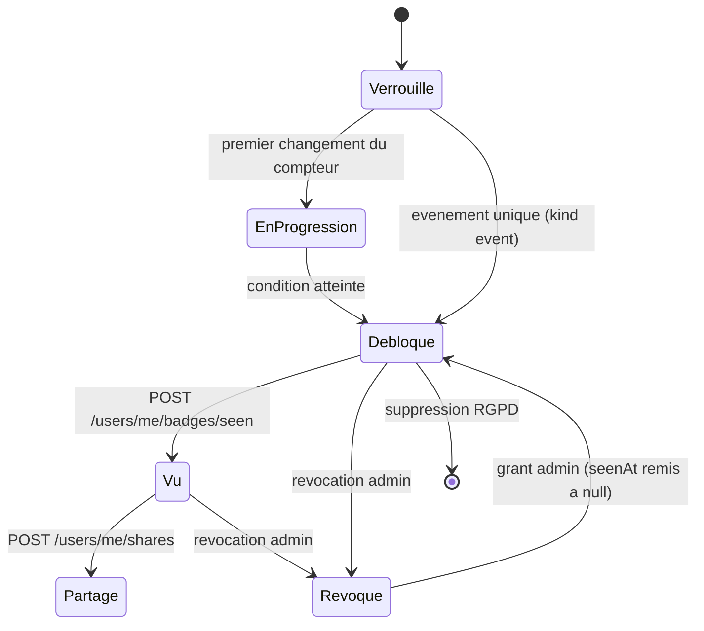
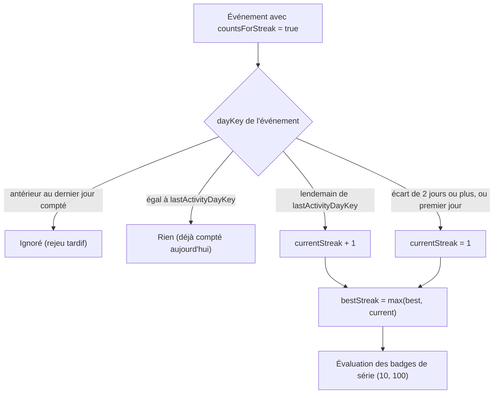
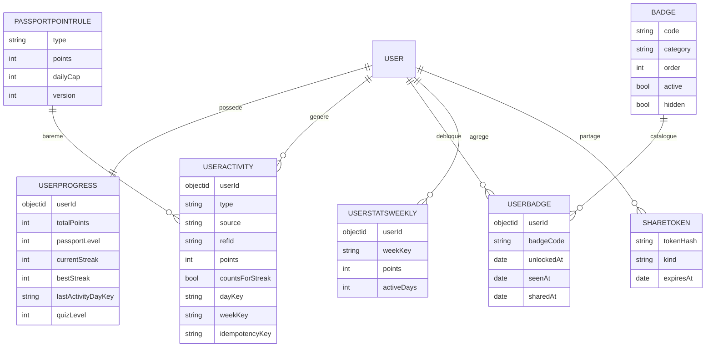
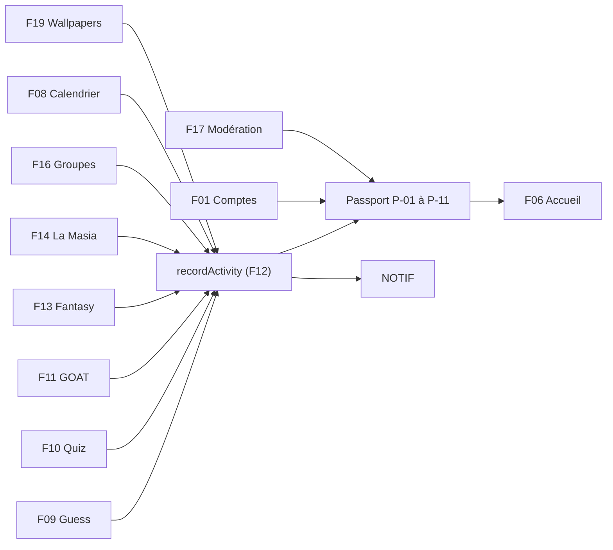

# F12 — Culé Passport et gamification

> Documentation d'architecture · Univers Barça · fonctionnalité **F12**. Ce document explique le système **unique** de points, de séries (streaks), de niveaux et de badges partagé par tous les modules (Quiz, Guess the Player, GOAT, Fantasy, La Masia, Communauté, Calendrier, IA) et sa vitrine pour le supporter, le **Culé Passport** : carte de profil, statistiques, grille de badges, calendrier d'activité, édition du profil, profil public et partage.

## 1. Résumé et fiche

**Valeur utilisateur.** Le Culé Passport est la « carte d'identité » du supporter dans l'application. Il y retrouve ses **points** (2 340 sur la maquette), sa **série** de jours consécutifs (12 jours, record 27), ses **badges** (9 sur 24), son rang Fantasy et son niveau (« Culé »). Chaque jeu alimente ce même compteur : jouer au quiz, deviner le joueur du jour, voter au duel GOAT, composer un XI Fantasy ou faire grandir sa pépite à La Masia rapporte des points et rapproche d'un badge. L'utilisateur voit donc **une seule** progression, pas six scores séparés.

**Valeur produit.** C'est le moteur de rétention de l'application : la série et le rappel « série en péril » ramènent le supporter chaque jour, les badges donnent des objectifs à long terme, le profil public crée de l'émulation entre culés. Techniquement, c'est le **ciment** du produit : un seul service d'attribution (`recordActivity`), un seul journal d'événements, un seul catalogue de badges, au lieu de règles dupliquées dans chaque module.

| Élément | Valeur |
|---|---|
| Phase / priorité | Phase 2 — Communautaire & compétitif (CDC Global : Culé Passport en Phase 2, priorité P1) ; au backlog, P0 pour le journal, `recordActivity`, le barème, la série, le catalogue et le moteur de badges, la progression, les badges, le pseudo, `PATCH /users/me`, l'anti-fraude, le contrat d'événements, le RGPD et les tests unitaires ; P1 pour niveaux, stats, agrégats, calendrier, avatars, profil public, réconciliation, cache, index ; P2 pour historique, partage, ajustements admin, OpenAPI |
| Épopées backlog | `API-PASS` (33 issues, `API-PASS-01` à `API-PASS-33`), `MOB-P` (21 issues, `MOB-P-01` à `MOB-P-21`) ; épopées émettrices : `API-JEUX` (`API-JEUX-19`, `API-JEUX-20`, `API-JEUX-18`), `API-FANT` (`API-FANT-33`), `MOB-I` (écran `I-12`), `MOB-C` (carte Streak de l'accueil) |
| Écrans mobile | `P-01` à `P-11` (aucun écran admin dédié : seuls des endpoints `/admin/passport/*` sont prévus, voir §6.3) |
| Dépôts concernés | **API** (modèles, `recordActivity`, moteur de badges, endpoints, jobs), **mobile** (`ProfileBloc`, cache Drift, génération d'image de partage) ; **admin** uniquement via API (ajustements, file de comptes suspects) |
| Documents voisins | F09 (Guess the Player), F10 (Quiz adaptatif), F13 (Fantasy), F14 (La Masia), F11 (GOAT), F01 (comptes), F03 (RGPD), F17 (modération), F24 (jobs, cache) |

### Vocabulaire

* **Point (XP)** : unité unique de progression. `totalPoints` sert à la fois de score et d'expérience : il n'y a **pas de seconde monnaie** (`API-PASS-05`).
* **Activité** (`UserActivity`) : une ligne du journal, par événement (ex. `quiz.answer_correct`). C'est la **source de vérité** des points et de l'historique.
* **Événement d'activité** : message `{userId, source, type, refId, ...}` émis par un module après le succès de son écriture métier.
* **`recordActivity`** : service serveur qui transforme un événement en points, série, niveau et badges.
* **Série (streak)** : nombre de jours consécutifs avec au moins un jeu quotidien terminé. **Record** = `bestStreak`.
* **`dayKey` / `weekKey`** : jour civil `AAAA-MM-JJ` dans le fuseau de l'utilisateur et semaine ISO `AAAA-Www`.
* **Niveau Passport** : niveau 1 à 5 déduit des points (proposition à confirmer), **monotone** (ne redescend jamais). À distinguer du **niveau de quiz** (`quizLevel`) qui monte **et descend** selon le taux de réussite (F10).
* **Badge** : récompense à conditions déclaratives (compteur, événement, niveau, valeurs distinctes), avec palier suivant éventuel.
* **Badge d'exception** : badge rare mis en avant (ex. « Niveau La Masia »).
* **Badge caché** (`hidden`) : badge secret, non listé tant qu'il n'est pas débloqué.
* **Déblocage non vu** : `UserBadge` dont `seenAt` est nul ; permet de rejouer la modale « Nouveau badge ! ».

### Écart avec les CDC et état du code

Les CDC décrivent PostgreSQL (`user_progress`, `badges`, `user_badges`, CDC Backend §4.3) et un module NestJS « moteur de scoring partagé » (§3.12). **Stack réelle : Express 4 + TypeScript + Mongoose/MongoDB + Redis + BullMQ + node-cron + PM2.** Le CDC ne définit **que** les 5 niveaux de quiz (§3.12.1) : le niveau « Culé » du Passport et les seuils d'XP sont une **proposition du backlog** (`API-PASS-05`, à confirmer).

> État du code à la date de rédaction : `src/models/gamification.model.ts` contient `UserProgress` (`userId` unique, `currentStreak`, `bestStreak`, `lastActivityDate`, `totalPoints`, `quizLevel` 1 à 5, `recentAnswers`, `badges[{badgeCode, unlockedAt}]`), `Badge` (`code` unique, `labelI18n`, `descriptionI18n`, `icon`, `threshold`) et `ScoringRule` (`event` unique, `points`, `positions[]`). **Aucune route de progression, aucun service de gamification, aucune collection `UserActivity`/`UserBadge`, aucune file `gamification` n'existent** (`QUEUE_NAMES` = `email`, `notifications`, `football-sync`, `ai-generation`, `rgpd`). Le mobile ne contient que `lib/features/players` ; l'admin n'a aucune page Passport. Tout ce qui suit décrit la **cible** du backlog.

## 2. Acteurs et user stories

| Acteur | Besoin | Critères d'acceptation clés |
|---|---|---|
| Supporter | Voir d'un coup d'œil ma progression | `GET /users/me/progress` : points, série, niveau, badges 9/24, 3 derniers et 2 prochains badges, rang Fantasy ou `null` ; cache privé 60 s |
| Supporter | Garder ma série | Un jeu quotidien terminé = +1 jour ; rupture à la lecture si plus d'un jour d'écart ; `atRisk` et `hoursLeft` fournis |
| Supporter | Débloquer des badges | Attribution idempotente, jamais retirée automatiquement ; modale « Nouveau badge ! » au premier affichage (`meta.newBadges`) |
| Supporter | Comprendre ce qui me manque | Badge verrouillé : progression `12/100`, palier suivant, bouton d'action (deep link) |
| Supporter | Consulter mes statistiques | Onglets Global, Quiz, Guess ; histogramme de 8 semaines ; répartition par jeu à 100 % |
| Supporter | Modifier mon profil | Pseudo 3 à 20, unicité insensible à la casse, charte ; erreurs `422 DISPLAYNAME_FORBIDDEN`, `409 DISPLAYNAME_TAKEN` |
| Supporter | Choisir un avatar | Catalogue Joueurs / Initiales / Couleurs ; jamais de photo réelle ; `422 AVATAR_UNKNOWN` |
| Supporter | Voir le profil d'un autre culé | Projection publique en liste blanche ; `404 PROFILE_NOT_FOUND` si bloqué, suspendu ou supprimé |
| Supporter | Partager mon Passport ou un badge | Image 1080x1350 générée sur le mobile, sans ville exacte ni e-mail ; lien de partage révocable |
| Module émetteur (Quiz, Guess, GOAT, Fantasy...) | Créditer des points sans réécrire les règles | Appel `recordActivity` après l'écriture métier ; événement idempotent ; types fermés |
| Super-admin | Corriger une erreur | Ajustement compensatoire (-1000 à +1000, motif 10 à 300 caractères), grant/revoke de badge, `AuditLog` immuable |
| Modérateur | Traiter les comptes suspects | `GET /admin/passport/suspicious` ; recalcul ciblé autorisé |
| Système | Garantir la cohérence | Réconciliation nocturne à 03:45 Europe/Madrid : `totalPoints` = somme du journal |

## 3. Architecture de la fonctionnalité



**Légende.** Trait plein = appel direct ; trait pointillé = événement vers un autre module. Les modules de jeu **ne touchent jamais** à `userprogresses` : ils appellent `recordActivity`. Les actions utilisateur (quiz, Guess, vote GOAT) l'appellent en mode **synchrone** pour que la réponse HTTP contienne `meta.newBadges` ; Fantasy et La Masia passent par la file `gamification` pour ne jamais être ralentis ni bloqués par une panne du Passport.

**Pourquoi ce découpage.**

1. **Un seul calcul des points** : sans point d'entrée unique, chaque module aurait sa série, son total et ses badges, et les chiffres divergeraient (c'est exactement le risque du CDC Backend §3.12).
2. **Journal en premier** : le journal append-only est la vérité ; `totalPoints`, séries et badges sont des **vues dérivées** que la réconciliation peut reconstruire.
3. **Calcul exclusivement serveur** : aucune route publique n'accepte `points` ou `type` du client (anti-triche).
4. **Cache partout où c'est sûr** : la progression est lue très souvent (accueil, profil), jamais calculée à la volée.

## 4. Écrans et navigation

### 4.1 Mobile (`P-01` à `P-11`)

| Code | Écran | Rôle |
|---|---|---|
| `P-01` | Passport, vue d'ensemble | Carte grenat « BORIS_CULÉ » (avatar « BT », Yaoundé, « Culé depuis 2018 », puces « Niveau Culé » et « 12 j »), quatre statistiques (2 340 Points, 12 Série, 9 Badges, 18 432e Fantasy), « Prochains badges » (Série de 100 jours 12/100, Quiz parfait 8/10), « Mes derniers badges » 9 / 24, liens Statistiques détaillées, Ma série, Paramètres ; boutons partage et réglages, crayon sur l'avatar |
| `P-02` | Statistiques détaillées | Onglets Global, Quiz, Guess ; histogramme de 8 semaines ; répartition par jeu ; « Membre depuis » |
| `P-03` | Grille de badges | « 9 débloqués sur 24 », filtres Tous / Débloqués / À débloquer / Jeux, grille de 3 colonnes (2 sous 360 dp) |
| `P-04` | Badge débloqué, détail | Date de déblocage, description, prochain palier avec barre (12/100), partage |
| `P-05` | Badge verrouillé, progression | Barre `2/5`, libellé « badge d'exception », bouton d'action (« Jouer au quiz ») |
| `P-06` | Déblocage d'un badge | Modale « Nouveau badge ! » avec animation d'éclat 1,2 s, « Voir mes badges » |
| `P-07` | Modifier le profil | Pseudo, pays, ville, joueur préféré, année de supporter, avatar ; mention « visible par les autres culés » |
| `P-08` | Pseudo invalide | Bordure rouge et message sous le champ (charte ou pseudo pris) |
| `P-09` | Choix de l'avatar | Trois onglets Joueurs, Initiales, Couleurs ; anneau de sélection |
| `P-10` | Ma série, calendrier d'activité | Carte « 12 jours de suite, Record : 27 jours », calendrier mensuel à 4 teintes, semaines commençant le lundi |
| `P-11` | Profil d'un autre culé | Pseudo, avatar, ville, pays, points, série max, badges ; actions Défier au quiz et Signaler |

<p>


</p>

*`P-01` : en-tête dégradé grenat, médaillon d'avatar avec crayon d'édition, puces « Niveau Culé » (grenat) et « 12 j » (jaune), quatre colonnes de chiffres, deux barres de progression grenat, trois badges hexagonaux (grenat, jaune, bleu). `P-03` : grille hexagonale, badges verrouillés en gris. `P-06` : modale de déblocage au-dessus du contenu. `P-10` : carte flamme « 12 jours de suite » et calendrier d'octobre 2026 dont les jours futurs sont en gris très clair ; légende « Moins / Plus » sur 4 teintes.*

### 4.2 Navigation



## 5. Flux détaillés

### 5.1 Un module crédite des points (nominal, synchrone)

Exemple : le supporter termine un quiz du jour parfait (10/10) et débloque « Quiz parfait ».



**Pas à pas.** (1-2) L'écriture métier du quiz passe **d'abord** : on ne crédite jamais avant. (3) Le module appelle le service unique avec des événements aux types fermés. (4) Le barème est lu depuis un cache mémoire de 60 s doublé par Redis. (5-7) L'insertion dans le journal est le verrou d'idempotence : un second appel avec la même clé `{source}:{type}:{userId}:{refId}` ne change rien. (8-10) Les incréments, la série, le niveau et les badges ne sont exécutés que si l'insertion a réussi. (11) Le cache est invalidé. (12-13) Le middleware `gamificationMeta` (basé sur `AsyncLocalStorage`) ajoute `meta.newBadges` à la réponse HTTP **de l'action en cours**, d'où le mode synchrone. (14-16) Le mobile ajoute les badges à sa file d'affichage et acquitte via `/seen` une fois la modale vue.

### 5.2 Fantasy, La Masia et cas limites (asynchrone, panne, rejeu, fraude)



**Pas à pas.** (1-2) Fantasy publie et continue, quoi qu'il arrive au Passport (`API-FANT-33`). (3-5) Le worker consomme et rappelle le même service. (6-8) Les garde-fous (`API-PASS-24`) : compte suspendu ou banni sans points, plafond quotidien par type d'événement (journalisé à 0 point avec `meta.capped`), rafale de plus de 30 événements créditeurs en 60 s : drapeau `suspicious`, points suspendus 10 minutes, **aucun blocage automatique de compte**. (9-10) Cas normal. (11-13) Retry exponentiel (valeurs par défaut des files du dépôt : 5 tentatives, délai de base 2 s). (14) Un job rejoué est sans effet grâce à l'idempotence.

### 5.3 Lecture de la progression (cache, panne Redis)



**Pas à pas.** (1) Le mobile envoie l'ETag faible. (2-4) Lecture du cache ; en cas d'absence ou d'indisponibilité de Redis (`getRedis()` renvoie `null`), l'API répond **depuis MongoDB sans erreur**. (5-8) Un verrou court (`SET NX`, 5 s) évite que mille requêtes recalculent en même temps ; la valeur périmée est servie 30 s pendant le recalcul. (9-12) `304` ou `200`. (13) Le mobile met à jour son cache Drift, qui sert d'état hors-ligne.

### 5.4 Cycle de vie d'un badge



Un badge n'est **jamais retiré automatiquement** : si la série retombe à 0, `streak_10` reste débloqué. Seul un administrateur peut révoquer (audité). Les lignes `UserBadge` en progression ne sont créées qu'au premier mouvement du compteur, pas pour les 24 badges d'office.

### 5.5 Règle de la série



Rupture **paresseuse** : à la lecture, si `lastActivityDayKey` est antérieur à hier, la série est **présentée** à 0 sans écriture (persistée au prochain événement). `atRisk` vaut vrai si la dernière activité date d'hier et qu'il n'y a rien aujourd'hui ; `hoursLeft` indique le temps restant jusqu'à minuit local. Aucune « protection de série » n'existe au CDC : il ne faut pas en inventer.

### 5.6 Niveaux Passport (proposition à confirmer)

| Niveau | Clé | Seuil d'XP (= `totalPoints`) |
|---|---|---|
| 1 | Supporter occasionnel | 0 |
| 2 | Culé | 500 |
| 3 | Socio | 3 000 |
| 4 | Historien du Barça | 8 000 |
| 5 | La Masia | 20 000 |

2 340 points donnent le niveau 2 « Culé », cohérent avec `P-01` ; la progression vers « Socio » vaut (2 340 - 500) / (3 000 - 500) = 73,6 % (arrondi à 74 %). La réponse porte `level {value, key, label, xp, xpFloor, xpNext, progressPercent}` ; au niveau 5, `xpNext` est `null` et `progressPercent` vaut 100. Les seuils sont en configuration pour être ajustés sans redéploiement. Une montée de niveau journalise `passport.level_up` (notification optionnelle via NOTIF).

## 6. Contrats d'API

Préfixe `/api/v1`. Enveloppe `{ success, data }` ; erreurs `{ success:false, error:{ code, message, details, traceId } }` ; pages `{ items, hasMore, nextCursor }`. Authentification par jeton d'accès (`protect`) sauf mention contraire. Les limites de débit non précisées par le backlog suivent le défaut global (« à confirmer »).

### 6.1 Progression, badges, statistiques

| Méthode | Chemin | Auth | Rate limit | Requête | Réponse | Erreurs |
|---|---|---|---|---|---|---|
| GET | `/users/me/progress` | utilisateur | défaut | — | `totalPoints, currentStreak, bestStreak, atRisk, level{...}, quizLevel, badges{unlocked,total,latest[3],next[2]}, fantasyRank, memberSince, supporterSince` | 401 |
| GET | `/badges` | public | public 60/min/IP (CDC) | `?lang=fr&category=` | catalogue localisé ; `Cache-Control: public, max-age=3600` + ETag | — |
| GET | `/users/me/badges` | utilisateur | défaut | `?state=all\|unlocked\|locked` | `items[], unlockedCount, total` | 401 |
| GET | `/users/me/badges/:code` | utilisateur | défaut | — | état, `progress`, `nextTier`, `action`, `shareable` | 404 `BADGE_NOT_FOUND` |
| GET | `/users/me/badges/unseen` | utilisateur | défaut | — | `items[{code, unlockedAt}]` (du plus ancien au plus récent) | 401 |
| POST | `/users/me/badges/seen` | utilisateur | défaut | `{codes:[...]}` (max 24) | `{updated}` ; idempotent | 422 |
| GET | `/users/me/stats` | utilisateur | défaut | `?tab=global\|quiz\|guess` | bloc par onglet ; cache privé 5 min | 422 |
| GET | `/users/me/activity/calendar` | utilisateur | défaut | `?month=2026-10` | `month, currentStreak, bestStreak, days[{date,count,level}], firstDayOfWeek` | 422 `MONTH_IN_FUTURE` |
| GET | `/users/me/activity` | utilisateur | défaut | `?cursor&limit=20&source&from&to` | `items[{id,type,source,label,points,occurredAt,dayKey,badge?}]` | 422 |

Exemple de progression (valeurs des maquettes) :

```json
{
  "success": true,
  "data": {
    "totalPoints": 2340, "currentStreak": 12, "bestStreak": 27, "atRisk": false,
    "level": { "value": 2, "key": "cule", "label": "Culé", "xp": 2340, "xpFloor": 500, "xpNext": 3000, "progressPercent": 74 },
    "badges": { "unlocked": 9, "total": 24,
      "next": [{ "code": "streak_100", "progress": { "current": 12, "target": 100 } }] },
    "fantasyRank": { "rank": 18432, "total": 41200 }
  }
}
```

Exemple de `meta.newBadges` sur une réponse d'action (extension d'enveloppe) :

```json
{ "success": true, "data": { "voteId": "..." },
  "meta": { "newBadges": [{ "code": "goat_voter", "label": "GOAT voter", "description": "Tu as participé à ton premier duel du comparateur GOAT.", "icon": "scales" }] } }
```

### 6.2 Profil, pseudo, avatars, profil public, partage

| Méthode | Chemin | Auth | Rate limit | Requête | Réponse | Erreurs |
|---|---|---|---|---|---|---|
| PATCH | `/users/me` | utilisateur | défaut | partiel : `displayName, countryCode, city, favoritePlayerId, supporterSince, avatarKey` (`Joi.object().min(1)`) | profil complet | 422 `DISPLAYNAME_FORBIDDEN`, `AVATAR_UNKNOWN`, `PLAYER_NOT_FOUND` ; 409 `DISPLAYNAME_TAKEN` |
| GET | `/users/displayname-available` | utilisateur | 20/min/utilisateur | `?name=` | `{available, reason?: taken\|invalid}` | 429 |
| GET | `/avatars` | utilisateur | défaut | — | `groups[{type, items[{key,label,assetUrl}]}]` ; cache 24 h | — |
| GET | `/users/:id/public` | utilisateur | 60/min/utilisateur | — | projection publique | 404 `PROFILE_NOT_FOUND` |
| POST | `/users/me/shares` | utilisateur | 10/h/utilisateur | `{kind:'passport'\|'badge', badgeCode?}` | `{token, url, text, expiresAt}` | 403 (badge non détenu) |
| DELETE | `/users/me/shares/:token` | utilisateur | défaut | — | révocation | 404 |
| GET | `/share/:token` | **public** | 60/min/IP (CDC) | — | `{title, description, imageKey?, deepLink}` | 404 |

`GET /users/me` existe déjà (profil) et sert pseudo, avatar et ville ; `/progress` ne duplique pas ces champs. Mass assignment interdit sur `PATCH /users/me` : `email`, `status`, `role`, `totalPoints`.

### 6.3 Administration

| Méthode | Chemin | Rôle | Requête | Réponse |
|---|---|---|---|---|
| POST | `/admin/users/:id/passport/adjust` | super-admin | `{points -1000..1000, reason 10..300, idempotencyKey}` | `{totalPoints}` |
| POST | `/admin/users/:id/passport/badges/:code/grant` | super-admin | `{reason}` | badge attribué, `seenAt` nul |
| POST | `/admin/users/:id/passport/badges/:code/revoke` | super-admin | `{reason}` | `unlockedAt` nul, `revokedAt` |
| POST | `/admin/users/:id/passport/recompute` | modérateur | — | réconciliation ciblée (journal, totaux, badges) |
| GET | `/admin/passport/suspicious` | modérateur | — | comptes avec `flags.suspicious` |

Toutes les actions écrivent un `AuditLog {adminId, action, userId, avant/après, reason}` **immuable**. Le barème (`PassportPointRule`) est modifiable par le super-admin uniquement (chaque version journalisée) ; la route exacte d'édition n'est pas détaillée au backlog (proposé : `PUT /admin/passport/point-rules/:type`).

## 7. Modèle de données



### 7.1 Collections et champs

* **`userprogresses`** (existante, à durcir, `API-PASS-01`) : ajouts `passportLevel` (1..5), `counters {quizSessions, quizAnswers, quizCorrect, quizPerfect, guessGames, guessWon, goatVotes, fantasyGameweeks, academyWeeks}`, `pointsBySource {quiz, guess, goat, fantasy, academy, other}`, `lastActivityDayKey`, `streakStartedOn`, `bestStreakEndedOn`, `flags {suspicious}`. Invariants : `totalPoints` = somme du journal ; `currentStreak <= bestStreak` ; `bestStreak` ne diminue jamais. `badges[]` est une **copie dénormalisée** (source de vérité : `userbadges`). Le champ existant `lastActivityDate` est remplacé par `lastActivityDayKey` (migration nécessaire).
* **`useractivities`** (nouvelle, `API-PASS-02`) : journal **append-only**, `idempotencyKey = {source}:{type}:{userId}:{refId}` unique, `meta` limité à 2 Ko sans donnée personnelle ; corrections par ligne compensatoire (source `admin`). Rétention : 24 mois de détail puis agrégation hebdomadaire ; la purge n'altère pas `totalPoints`.
* **`passportpointrules`** (`API-PASS-04`) : `{type, source, points 0..1000, dailyCap, active, version}` ; modification versionnée, jamais rétroactive.
* **`badges`** (existante, enrichie, `API-PASS-07`) : `category` (`history|streak|community|precision|ai`), `condition {kind: counter|event|level|distinct, metric, threshold, event, where}`, `nextBadgeCode`, `order`, `isExceptional`, `action {kind:'deeplink', target}`, `active`, `hidden`, `version`. `code` en snake_case, **jamais modifié**.
* **`userbadges`** (nouvelle, `API-PASS-10`) : `{userId, badgeCode, unlockedAt, progress{current,target}, seenAt, sharedAt, source: event|reconcile|admin, revokedAt, reason}`.
* **`userstatsweeklies`** (`API-PASS-16`) : `{userId, weekKey, points, pointsBySource, activeDays, events}`, un document par semaine active.
* **`sharetokens`** (`API-PASS-23`) : token de 16 caractères base64url, stocké **haché**, 90 jours (à confirmer), révocable.
* **`moderationterms`** (`API-PASS-19`) : `{term, severity, locale, active}` ; **`users.displayNameKey`** : pseudo normalisé (minuscules, sans diacritiques ni séparateurs) avec index unique partiel sur les comptes actifs.
* **Barème existant `scoringrules`** : voir §14 sur le recouvrement avec `passportpointrules`.

### 7.2 Index

`userprogresses {userId:1}` unique, `{totalPoints:-1}`, `{lastActivityDayKey:1}` ; `useractivities {userId:1, occurredAt:-1}`, `{userId:1, dayKey:1}`, `{userId:1, weekKey:1}`, `{idempotencyKey:1}` unique ; `userbadges {userId:1, badgeCode:1}` unique, `{userId:1, unlockedAt:-1}`, `{userId:1, seenAt:1}` ; `userstatsweeklies {userId:1, weekKey:1}` unique ; `badges {code:1}` unique, `{active:1, order:1}` ; `sharetokens {tokenHash:1}` unique + **TTL** sur `expiresAt`. Aucune requête listée ne doit faire de `COLLSCAN` (assertion `explain` dans les tests).

### 7.3 Clés Redis (préfixe `ub:`)

| Clé | TTL | Contenu |
|---|---|---|
| `ub:passport:progress:{userId}` | 60 s | progression |
| `ub:passport:stats:{userId}:{tab}` | 5 min | statistiques d'un onglet |
| `ub:passport:badges:{userId}` | 60 s | badges avec état |
| `ub:passport:cal:{userId}:{month}` | 24 h (mois passé) ou 60 s (mois courant) | calendrier |
| `ub:public:{userId}` | 5 min | profil public |
| `ub:passport:catalog` | 1 h | catalogue de badges |
| `ub:passport:avatars` | 24 h | catalogue d'avatars |
| `ub:passport:rules` | 60 s | barème |

Les noms exacts des clés sont donnés au backlog sans préfixe ; le préfixe `ub:` est celui de la convention du dépôt. Aucune donnée d'un utilisateur ne figure dans une clé partagée.

### 7.4 Migrations

(1) Ajout des champs de `userprogresses` et rétro-calcul de `lastActivityDayKey` depuis `lastActivityDate` (proposé). (2) Création de `useractivities`, `userbadges`, `userstatsweeklies`, `passportpointrules`, `sharetokens`, `moderationterms` et de leurs index. (3) **Seed idempotent** des 24 badges (upsert par `code`, n'écrase pas les libellés édités, option `--force`). (4) Backfill de `userstatsweeklies` depuis le journal. (5) Calcul de `displayNameKey` pour les comptes existants (résolution des collisions à définir, proposé). Toutes les migrations sont idempotentes (`scripts/migrations`).

## 8. Traitements asynchrones et cache

| Traitement | Déclencheur | Détail |
|---|---|---|
| File `gamification` (à ajouter à `QUEUE_NAMES`) | événements Fantasy et La Masia | `jobId = idempotencyKey` ; retry exponentiel (5 tentatives, 2 s) ; jamais bloquant pour l'émetteur |
| `passport-reconcile` | cron 03:45 Europe/Madrid | lots de 1 000 utilisateurs (curseur), concurrence 2 ; vérifie `totalPoints` = somme du journal, `bestStreak >= currentStreak`, série recalculée depuis les `dayKey`, `badges[]` = `userbadges` débloqués ; corrections journalisées (diff) ; écart supérieur à 1 % sur un lot : alerte ; idempotent ; `--dry-run` en script |
| Réévaluation des badges (`evaluateAll`) | réconciliation | uniquement pour les utilisateurs actifs sur 30 jours ou si la `version` du catalogue a changé |
| `passport-weekly-repair` | cron lundi 04:00 Europe/Madrid | recalcule la semaine écoulée de `userstatsweeklies` depuis le journal, calcule `activeDays` |
| `streak-reminder` | 20:00 dans le fuseau de l'utilisateur (`API-JEUX-19`) | pour les séries >= 1 sans activité du jour ; file `notifications` ; 1 rappel par jour maximum ; respecte les préférences NOTIF |
| Purge du journal | planifiée (proposé) | au-delà de 24 mois : agrégation dans `userstatsweeklies`, sans effet sur `totalPoints` |

**Idempotence.** Trois niveaux : (1) index unique `idempotencyKey` sur le journal, (2) `jobId` BullMQ identique à la clé, (3) `$setOnInsert` sur `userbadges`. **Atomicité** : transaction Mongo si le replica set le permet ; sinon ordre « journal d'abord » : si le journal existe, les incréments sont rejouables par la réconciliation. **Invalidation du cache** : `recordActivity` supprime `progress`, `stats`, `badges` et le calendrier du mois courant ; `PATCH /users/me` supprime `public` ; un changement de catalogue supprime la clé catalogue et incrémente la version d'ETag. **HTTP** : ETag faible sur progression, badges et statistiques ; `Cache-Control: private` pour `/me`, `public` pour `/badges` et `/avatars`.

## 9. Règles de gestion

### Points et barème

1. Les points sont calculés **uniquement côté serveur** à partir de `PassportPointRule` ; aucun point n'est accepté du client. Un événement sans règle vaut 0 point.
2. Barème proposé (à confirmer, `API-PASS-04`) : `quiz.answer_correct` +10, `quiz.session_perfect` +50 (bonus 10/10), `guess.won` +30, `goat.vote` +5, `group.joined` +10, `calendar.subscription_created` +10, `ai.wallpaper_generated` +5, `academy.player_created` +10, `academy.promotion` +50 ; Fantasy : points de la journée x ratio 1 (configurable), **plancher à 0**.
3. `dailyCap` par type et par jour (ex. `quiz.answer_correct` <= 200 par jour, à confirmer) ; au-delà, journal à 0 point avec `meta.capped`.
4. Valeurs entières de 0 à 1 000 ; versionnement ; **jamais rétroactif**. Lecture par cache mémoire 60 s + Redis.
5. `totalPoints` est toujours égal à la somme du journal. Aucun point pour un compte suspendu ou banni (points conservés pour audit, exclusion des classements).

### Série

6. Un jour compte si un **jeu quotidien terminé** (Guess the Player, victoire ou défaite, ou quiz du jour) est enregistré ; l'entraînement libre, Fantasy, La Masia et GOAT **ne comptent pas** par défaut (à confirmer). Seuls `guess.played` et `quiz.session_finished` en mode `daily` portent `countsForStreak=true`.
7. Jour = jour civil dans `User.timezone` (défaut `Europe/Madrid`) ; le `dayKey` écrit n'est jamais recalculé, même si le fuseau change.
8. Règle : même jour = rien ; lendemain = +1 ; sinon 1 ; `bestStreak = max`. Un événement tardif ne modifie pas la série.
9. Rupture paresseuse à la lecture ; `atRisk` et `hoursLeft` ; **aucune protection de série**.

### Niveaux

10. Niveau Passport = fonction de `totalPoints` (seuils 0, 500, 3 000, 8 000, 20 000 : proposition), **monotone** même après un ajustement négatif.
11. Le niveau de quiz (`quizLevel`, promotion à 80/75/70/65 % et rétrogradation sous 40/35/30/25 % sur les 10 dernières réponses) reste calculé par le module Quiz (F10) et exposé séparément.

### Badges

12. Catalogue de **24 badges** (12 vus sur les maquettes, 12 proposés) ; total exposé par la base, jamais par le client. Libellés et descriptions fr/en/es **obligatoires** avant activation, repli français.
13. Déblocage idempotent, jamais retiré automatiquement, plusieurs badges possibles par événement (renvoyés dans l'ordre `order`). Chaque déblocage écrit `badge.unlocked` au journal.
14. `progress.current` plafonné à `target` ; désactiver un badge ne retire pas les déblocages existants ; badge caché non débloqué : `404`.
15. `badges.next` = 2 badges non débloqués au meilleur ratio (hors cachés) ; `badges.latest` = 3 derniers.
16. Une modale « Nouveau badge ! » à la fois, **3 maximum d'affilée** (le reste est résumé) ; un badge déjà vu n'est jamais renvoyé.

Catalogue seed :

| Catégorie (couleur) | Badges (code) |
|---|---|
| Historique (grenat) | `first_match_followed`, `quiz_level_5` (exception), `anniversary_one_year` (proposé), `quiz_level_3` (proposé) |
| Série (jaune) | `streak_10`, `streak_100`, `streak_30` (proposé), `on_time` |
| Communauté (bleu) | `goat_voter`, `group_member`, `goat_10_votes`, `group_first_post`, `first_share` (proposés pour les trois derniers) |
| Précision (vert) | `perfect_quiz`, `fantasy_top_10`, `first_guess_won`, `first_fantasy_team`, `fantasy_league_joined` (proposés pour les trois derniers) |
| IA / outils (violet) | `ai_artist`, `calendar_synced`, `polyglot`, `profile_complete`, `academy_created`, `academy_promoted` |

La répartition par catégorie est **indicative** (proposé) : le backlog ne fixe que les couleurs et la liste des codes. Paliers : `streak_10` vers `streak_100`, `goat_voter` vers `goat_10_votes`, `quiz_level_3` vers `quiz_level_5`.

### Profil

17. Pseudo : 3 à 20 caractères (lettres avec accents, chiffres, `_` et `.`), pas de séparateur en début ou fin ni de `..` ni `__`, NFC ; unicité insensible à la casse et aux accents ; charte avec normalisation anti-contournement (leet, séparateurs) et correspondance par sous-chaîne pour les termes graves ; le terme refusé n'est **jamais** révélé.
18. Changement de pseudo limité à 1 fois par 7 jours et ancien pseudo libéré après 30 jours (à confirmer).
19. Ville : 2 à 80 caractères, seule précision géographique ; `supporterSince` de 1899 à l'année courante ; avatar par défaut `initials_garnet` ; `profile.completed` journalisé une fois quand pays, ville, joueur préféré et `supporterSince` sont renseignés.
20. Profil public en liste blanche : `id, displayName, avatarKey, countryCode?, city?, supporterSince, points, bestStreak, badgeCount, level`.

### Calendrier et statistiques

21. Calendrier : `level` 0, 1, 2, 3+ selon le nombre d'événements `countsForStreak` du jour ; mois futur `422` ; fenêtre de 24 mois ; jours futurs non renvoyés.
22. Statistiques : histogramme de 8 semaines (semaines vides à 0), répartition par source à 100 % (pourcentages entiers, plus grand reste), taux de réussite Guess en entier.

## 10. Sécurité, RGPD et anti-abus

* **Anti-triche** : aucun endpoint public n'accepte `points` ou `type` ; `refId` validé (appartient à l'utilisateur) ; plafonds quotidiens ; détection de rafale (> 30 événements créditeurs en 60 s) ; drapeau `suspicious` sans blocage automatique ; file de revue modérateur.
* **Autorisations** : routes `/me` limitées au propriétaire ; badge partageable **uniquement** par son détenteur (`403`) ; tests IDOR sur les partages ; ajustements réservés au super-admin avec `AuditLog` immuable et ligne générique « Ajustement » côté utilisateur.
* **Minimisation** : le journal ne stocke ni texte libre ni IP ; `meta` <= 2 Ko de valeurs techniques ; profil public en liste blanche ; jamais d'e-mail, locale, coordonnées, date de naissance, statut, progression par source ni historique.
* **Visibilité** : pays et ville suivent `mapVisibility` (F01) ; comptes `suspended`, `banned`, `deleted` ou ayant **bloqué** le demandeur : `404 PROFILE_NOT_FOUND` (message « Profil indisponible »). Anti-scraping : 60 requêtes par minute ; anti-énumération des pseudos : 20 par minute.
* **Partage** : jeton aléatoire stocké haché ; l'aperçu public ne contient ni e-mail, ni ville exacte, ni identifiant ; aucune image stockée côté serveur ; création limitée à 10 par heure.
* **RGPD** : export `GET /users/me/export` (clés `passport.*` : progression, badges, journal 24 mois, agrégats, partages) ; suppression de compte : `UserProgress`, `UserActivity`, `UserStatsWeekly`, `UserBadge`, `ShareToken` supprimés au délai de 30 jours, profil public en `404` dès la demande, partages révoqués immédiatement ; registre des traitements (finalité : gamification ; base légale : exécution du contrat). Les mineurs relèvent de la politique d'âge de l'inscription (F01).
* **Charte de pseudos** : liste modifiable par les modérateurs, jamais embarquée dans le client ; termes d'usurpation (`admin`, `barca_officiel`, `fcbarcelona`) refusés. Aucune image de joueur réel ni logo officiel dans les avatars et icônes (droits).

## 11. Erreurs et états dégradés

| Situation | Côté serveur | Côté client |
|---|---|---|
| Redis indisponible | lecture directe MongoDB, pas d'erreur ; cache optionnel | aucun impact visible |
| Module Fantasy désactivé | `fantasyRank` = `null` | la colonne « Fantasy » n'affiche pas de rang |
| Service Passport en panne | Fantasy et Academy : file `gamification` avec retry, rien de perdu | aucun blocage de l'action de jeu |
| Hors-ligne | — | dernier état du cache Drift (péremption 5 min) avec indicateur ; purge à la déconnexion |
| Premier chargement | squelette | squelette sur `P-01`, `P-02`, `P-10` ; pull-to-refresh |
| Erreur de chargement | `5xx` avec `traceId` | écran d'erreur avec réessai ; rafraîchissement silencieux au retour sur l'onglet |
| Pseudo refusé ou pris | `422` ou `409` avec `error.details[]` | `P-08` : bordure rouge, message sous le champ ; validation locale 3-20 et contrôle différé de 400 ms |
| Erreur réseau à l'enregistrement | — | champs conservés ; mise à jour optimiste annulée (`UpdateFailed`) |
| Quota de partage (429) | `429` | message générique, réessai plus tard |
| Génération d'image impossible | — | message et réessai ; « Échec : toast d'erreur » pour le Passport |
| Badge inconnu côté client (icône) | catalogue serveur | hexagone générique ; nouveau badge affiché sans mise à jour de l'app |
| Filtre de badges vide | — | message adapté ; mois sans activité : cases neutres |
| Action critique en cours | — | modale `P-06` mise en attente (formulaire non interrompu) |
| Profil bloqué ou supprimé | `404` | « Profil indisponible » ; « Profil introuvable » pour un `404` générique |
| Fenêtre réconciliation en cours | totaux éventuellement corrigés la nuit | l'écran se met à jour au prochain rafraîchissement |
| Reduce-motion actif | — | animation d'éclat de `P-06` désactivée |

## 12. Connexions avec les autres fonctionnalités

| Fonctionnalité | Relation | Détail |
|---|---|---|
| F09 Guess the Player | alimente | `guess.played` (série), `guess.won` ; stats Guess (parties, réussite, essais moyens) ; points 100 à 10 selon le nombre d'essais côté `API-JEUX-09` |
| F10 Quiz adaptatif | alimente | `quiz.answer_correct`, `quiz.session_finished`, `quiz.session_perfect`, `quiz.level_changed` ; `quizLevel` exposé par `/progress` |
| F11 Comparateur GOAT | alimente | `goat.vote` (badges `goat_voter`, `goat_10_votes`) |
| F13 Fantasy | alimente, dépend de | `fantasy.team_saved`, `fantasy.gameweek_scored`, `fantasy.league_joined`, `fantasy.top10_percent` ; lecture de `fantasyRank` (`FantasyStanding`/Redis) |
| F14 La Masia | alimente | `academy.player_created`, `academy.decision_submitted`, `academy.promotion`, `academy.week_reported` ; modale `I-12` |
| F16 Groupes locaux | alimente | `group.joined`, `group.first_post` |
| F08 Calendrier | alimente | `calendar.subscription_created` (badge `calendar_synced`) |
| F19 Wallpapers IA | alimente | `ai.wallpaper_generated` (badge `ai_artist`) |
| F06 Accueil | partage | carte Streak, rappels ; `GET /games/hub` expose aussi `streak {current,best,atRisk}` |
| F01 Comptes | dépend de | `User` (pseudo, fuseau, `mapVisibility`, statut) ; avatar upload hors périmètre |
| F03 RGPD | partage | export `passport.*`, suppression à 30 jours |
| F17 Modération | dépend de | termes interdits, signalement d'un utilisateur, masquage et blocage |
| Groupe NOTIF | alimente | rappel de série en péril, `passport.level_up`, push de badge (n'efface pas `seenAt`) |
| F24 Jobs, cache, flags | dépend de | files BullMQ, scheduler, cache Redis, flags |



## 13. Observabilité et tests

**Métriques** (proposées, préfixe `ub_` à l'enregistrement ; le backlog ne nomme pas de métrique Passport) : `passport_activity_total{source,type,applied}`, `passport_points_awarded_total{source}`, `passport_capped_total{type}`, `passport_suspicious_total`, `passport_badge_unlocked_total{code}`, `passport_level_up_total{level}`, `passport_record_activity_seconds`, `passport_reconcile_drift_ratio`, `passport_cache_hit_total{key}`, profondeur de la file `gamification` (alerte au-delà de 1 000 en attente, seuil du backlog pour les files de jeu). **Logs** : `userId` opaque, `type`, `applied`, `capped`, jamais de `meta` complet ; log de sécurité sur la rafale ; diff de chaque correction de la réconciliation.

**Budgets de performance (p95).** `GET /progress` < 100 ms, `GET /badges` < 120 ms, `GET /calendar` < 150 ms, `GET /stats` < 150 ms, `recordActivity` synchrone < 80 ms. Charge cible : 500 `recordActivity`/s soutenus, 1 000 lectures `/progress`/s. Volumétrie : 40 événements par utilisateur et par mois, soit environ 48 M de lignes par an à 100 000 utilisateurs, d'où le plan d'archivage à 24 mois.

**Tests API.**

* Unitaires (couverture >= 90 % sur `src/services/gamification`) : série (0 vers 1, 11 vers 12, rupture, changement d'heure, fuseaux Yaoundé UTC+1, Madrid, Mexico, rejeu tardif) ; niveaux aux bornes 499/500, 2 999/3 000, 7 999/8 000, 19 999/20 000 ; badges (chaque `kind`, plafond, idempotence, révocation, caché) ; points (plafonds, règles versionnées, comptes bannis). Valeurs des maquettes : 2 340 points, 12 jours, record 27, 9/24, 12/100, 2/5.
* Intégration et e2e : inscription, jeux simulés, série, badge débloqué (`meta.newBadges`), `/unseen`, profil modifié, profil public vu par un tiers ; contrats `jest-openapi` ; erreurs 401, 404, 422, 409, 429 ; IDOR sur partages, liste blanche publique, mass assignment ; deux passes avec et sans Redis ; durée < 3 min. Utilisateurs de test : `Boris_Culé` (2 340 points, série 12) et `Aïcha_N` (1 420 points).
* Charge k6 : les scénarios de F09 §13 (« soir de match ») incluent déjà `recordActivity` via les actions de jeu ; scénario dédié proposé pour les lectures `/progress`.

**Tests mobile (`MOB-P-21`).** Couverture >= 60 %, goldens clair/sombre de `P-01` à `P-11`, intégration (modifier le pseudo en `422` puis succès, débloquer un badge), fixtures, serveur simulé. Accessibilité (`MOB-P-20`) : `Semantics` sur le calendrier, badges verrouillés non indiqués par la couleur seule, police à 200 %, clés `passport*` dans les trois ARB.

## 14. Points ouverts et incohérences détectées

**À confirmer (backlog).**

* Seuils d'XP et noms des niveaux Passport (0, 500, 3 000, 8 000, 20 000), et son existence même vis-à-vis du CDC.
* Barème de points et plafonds quotidiens ; ratio Fantasy ; Fantasy/Academy/GOAT hors série ; définition de `on_time` (« Pile à l'heure ») et de `first_match_followed` (événement `match.followed`) ; les 12 badges non maquettés.
* Limite de changement de pseudo (1 fois par 7 jours) et libération à 30 jours ; durée du lien de partage (90 jours) ; image de partage côté serveur ; politique pour les mineurs.

**Incohérences entre CDC, specs et code (à arbitrer avant le codage).**

| Sujet | Source A | Source B |
|---|---|---|
| Journal des points | `API-JEUX-20` : `PointsLedger {userId, source, event, refId, points, dayKey, weekKey, monthKey}`, unique `{userId, source, refId}` | `API-PASS-02` : `UserActivity` avec `idempotencyKey` ; **deux journaux concurrents** : il faut en retenir un seul (proposé : `UserActivity`, `PointsLedger` devenant une vue ou supprimé) |
| Barème | `ScoringRule` existant (`event`, `points`, `positions`) ; `API-JEUX-09`, `API-JEUX-16` : `guess_win_1..6` = 100/80/60/40/25/10, base quiz par niveau 8 à 16 + bonus rapidité 0 à 5 | `API-PASS-04` : `PassportPointRule` avec `quiz.answer_correct` +10, `quiz.session_perfect` +50, `guess.won` +30 ; **valeurs et noms différents**, deux tables de barème ; à fusionner |
| Service de série | `API-JEUX-19` : `recordActivity(userId, dayKey, source)`, champ `lastActivityDate`, fuseau Madrid pour `atRisk` | `API-PASS-06` : `lastActivityDayKey`, fuseau utilisateur ; le même nom `recordActivity` est utilisé avec des signatures différentes |
| Badges de série | `API-JEUX-19` : seuils configurables 7 / 30 / 100 jours via `Badge.threshold` | `API-PASS-08` : `streak_10`, `streak_100` (et `streak_30` proposé) ; 7 jours absent |
| Niveau affiché | `MOB-P-06` : niveau = `quizLevel`, « ne pas inventer de niveaux autres que les 5 niveaux quiz » | `API-PASS-05` : niveau Passport monotone distinct ; la maquette `P-01` « Niveau Culé » avec 2 340 points ne permet pas de trancher |
| Endpoints | `MOB-P-02` marque `/progress`, `/badges`, `/users/:id/public` comme « proposés » | `API-PASS-11`, `-12`, `-22` les définissent ; schémas de réponse proches mais le mobile attend `badges[{badgeCode, unlockedAt}]` |
| Badge « Quiz parfait » | `P-01` : jauge 8/10 (« meilleur score ») | `API-PASS-08` : « perfect_quiz = 10/10 » ; métrique `quizBestScore` absente des compteurs de `userprogresses` |
| Rappel de série | `API-JEUX-19` : 20:00 fuseau utilisateur | CDC Global §2.12 : « quelques heures avant la réinitialisation » ; heure exacte non figée |
| Mapping événements | `API-PASS-28` : `guess.played`, `quiz.session_*` | `API-FANT-33` : clé `{module}:{userId}:{event}:{refId}` ; format de clé différent de `{source}:{type}:{userId}:{refId}` |
| Pseudo | `GET /users/me` existant : `displayName` 3 à 20 | `API-PASS-19` : charte, `displayNameKey`, index unique : **non présents dans le modèle `User` actuel** |
| Réconciliation | `API-JEUX-20` : job nocturne ledger | `API-PASS-26` : job à 03:45 ; à unifier |
| Total de badges | CDC : « etc. », pas de liste | 24 au backlog dont 12 seulement visibles sur les maquettes |
| Maquette admin | — | aucune épopée `ADM-*` pour le barème, le catalogue ou les ajustements : endpoints `/admin/passport/*` **sans écran** |

## 15. Pour aller plus loin

* **Épopées** : `API-PASS` (`API-PASS-01` à `API-PASS-33`), `MOB-P` (`MOB-P-01` à `MOB-P-21`), `API-JEUX` (`API-JEUX-18`, `API-JEUX-19`, `API-JEUX-20`), `API-FANT` (`API-FANT-33`), `MOB-I`, `MOB-C`, `API-NOTIF`, `API-AUTH`, `API-MODER`.
* **CDC** : Global §2.11 (Culé Passport), §2.12 (rappel de série), §2.8 (confidentialité des positions), §2.13 ; Backend §3.12 (moteur de scores partagé), §3.12.1 (niveaux de quiz), §4.3 (modèle jeux : `user_progress`, `badges`, `user_badges`), §7 (BullMQ) ; Flutter §7.12 (Passport), §291 (progression source de vérité serveur).
* **Code existant** : `univers_barca_api/src/models/gamification.model.ts` (`UserProgress`, `Badge`, `ScoringRule`), `src/jobs/queues.ts` (`QUEUE_NAMES`), `src/jobs/scheduler.ts`, `src/models/user.model.ts` (`displayName`, `timezone`) ; `univers_barca_mobile/lib/features/players` (feature de référence pour `lib/features/passport`).
* **Documents voisins** : F09, F10, F11, F13, F14, F03, F24.
