# F13 — Fantasy Barça

> Documentation d'architecture · Univers Barça · fonctionnalité **F13**. Ce document explique comment un supporter compose chaque semaine un XI de joueurs réels du FC Barcelone, comment ce XI est verrouillé au coup d'envoi, comment les points sont calculés à partir des événements réels des matchs, et comment les classements (amis, monde, journée) et les ligues sont construits et servis. La partie « La Masia Academy », qui partage le même moteur de points, est décrite dans F14.

## 1. Résumé et fiche

**Valeur utilisateur.** Le supporter choisit 11 joueurs avant le coup d'envoi du premier match de la journée, désigne un capitaine dont les points sont doublés, puis regarde ses points évoluer en direct pendant les matchs. Il se compare à ses amis (ligue privée avec un code `BARCA-XXXXXX`) et au monde entier. C'est le jeu « de saison » de l'application : il ramène le supporter chaque semaine, nourrit le Culé Passport (points, badges) et donne un sens aux données de match synchronisées par F05.

**Pourquoi c'est structurant techniquement.** Trois contraintes dominent : (1) **l'équité** : seule l'horloge serveur fait foi pour le verrouillage, jamais celle du téléphone ; (2) **la reproductibilité** : le calcul des points est une fonction pure alimentée par un **barème versionné** et des statistiques normalisées, rejouable sans doubler les points ; (3) **la charge** : le pic de verrouillage (tout le monde modifie son XI en même temps) et les classements mondiaux imposent des classements matérialisés (MongoDB + sorted sets Redis).

| Élément | Valeur |
|---|---|
| Phase / priorité | Phase 2 — Communautaire & compétitif (CDC Global §7 : « GOAT, Fantasy, Carte communautaire, Culé Passport »). Majorité des issues en P0 (cœur du jeu) ; ligues, summary, modules et perf en P1 ; ligues publiques en P2 |
| Épopées backlog | `MOB-H` (35 issues, de `MOB-H-01` à `MOB-H-35`) et `API-FANT` (34 issues ; **les issues `API-FANT-01` à `API-FANT-24` concernent le Fantasy**, `API-FANT-25` à `API-FANT-34` la Masia, voir F14) ; voisins : `API-FOOT`, `API-PASS`, `API-NOTIF`, `ADM-WJ` |
| Écrans mobile | `H-01` à `H-17` ; écran admin du barème `WJ-03` (hors de ce document, seuls les endpoints sont décrits) |
| Dépôts concernés | **API** (modèles, routes, worker, cron), **mobile** (module Fantasy), **admin** (barème `WJ-03`, rejeu d'une journée) |
| Documents voisins | F05 (données de match), F14 (La Masia), F03 (RGPD), F04 (états système) |

### Vocabulaire

* **Gameweek (journée)** : regroupement des matchs de l'équipe première du FC Barcelone sur une fenêtre de temps (« Journée 11 »). C'est l'unité de jeu : un XI par utilisateur et par journée.
* **XI** : les 11 joueurs alignés (1 gardien + 10 joueurs de champ) selon une **formation** (4-3-3, 4-4-2, 3-5-2, 4-2-3-1).
* **Slot / roleSlot** : un emplacement du terrain (`GB`, `DG`, `DC1`, `MC2`, `AD`, `BU`…).
* **locksAt** : instant de verrouillage = coup d'envoi du **premier** match de la journée.
* **Barème (ScoringRuleSet)** : table versionnée « événement → points » ; `rulesVersion` est figé à l'ouverture de la journée.
* **Provisoire / final** : points calculés en direct pendant les matchs (`provisional:true`) puis points définitifs quand tous les matchs sont terminés.
* **Ligue** : groupe d'amis rejoignable par un code `BARCA-XXXXXX`, avec son propre classement.
* **Classement matérialisé** : classement pré-calculé et stocké (collection `FantasyStanding` + ZSET Redis) plutôt que recalculé à chaque requête.

### Écart avec les CDC et état du code

Les CDC décrivent les tables `fantasy_teams`, `fantasy_selections`, `fantasy_gameweek_scores`, `scoring_rules` (PostgreSQL/Prisma, UUID). **La stack réelle est Express 4 + Mongoose/MongoDB + Redis + BullMQ + node-cron + PM2** : les sélections sont **embarquées** dans `FantasyTeam`, les identifiants sont des `ObjectId` (alors que les contrats mobile citent encore des « uuid »).

> État du code à la date de rédaction : `src/models/fantasy.model.ts` ne contient que `FantasyTeam` (formation limitée à `4-3-3 | 4-2-3-1 | 3-5-2` — **4-4-2 manque**, `selections[{playerId, roleSlot}]`, `points`, `lockedAt`, `computedAt`, index unique `{userId, gameweek}`), `FantasyLeague` (`name, ownerId, inviteCode` unique, `memberIds[]`) et `AcademyPlayer`. Le modèle `FeatureFlag {key, enabled, rolloutPercent, description}` existe dans `platform.model.ts`. **Aucune route `/fantasy/*`, aucun worker et aucune file `fantasy` n'existent** (`QUEUE_NAMES` = `email`, `notifications`, `football-sync`, `ai-generation`, `rgpd`). Côté mobile, seul `lib/features/players` existe (modèle de référence). Tout le reste est la cible du backlog.

## 2. Acteurs et user stories

| Acteur | User story | Critères d'acceptation clés |
|---|---|---|
| Supporter | Composer mon XI avant la fermeture | 11/11 joueurs, capitaine choisi, formation parmi 4 ; bouton « Confirmer » désactivé sinon (`MOB-H-06`) ; `PUT /fantasy/team` 201 puis 200 (idempotent) |
| Supporter | Savoir exactement quand ça ferme | Compte à rebours basé sur `serverTime` + offset ; `409 FANTASY_LOCKED` si je tente après `locksAt` (`API-FANT-06`, `API-FANT-07`) |
| Supporter | Composer hors-ligne | Brouillon Drift ; envoi rejoué à la reconnexion si `locksAt` pas atteint (`MOB-H-29`) |
| Supporter | Voir mes points par joueur | Détail `breakdown[]`, capitaine x2, négatif en rouge (Raphinha −1) (`API-FANT-13`) |
| Supporter | Me comparer à mes amis et au monde | `GET /fantasy/leaderboard?scope=friends|world|gameweek`, ma ligne toujours renvoyée (`me`) |
| Supporter | Créer / rejoindre une ligue | Code `BARCA-XXXXXX`, 10 jointures/h, 50 membres max (proposé) |
| Super-admin | Ajuster le barème sans redéploiement | Nouvelle version active à partir de la **prochaine** journée, jamais de recalcul rétroactif ; audit (`API-FANT-08`, écran `WJ-03`) |
| Super-admin | Rejouer le calcul d'une journée | `POST /admin/fantasy/gameweeks/:number/recompute` avec motif, journalisé (`API-FANT-12`) |
| Système | Verrouiller à l'heure, calculer, classer | Job différé + cron filet ; calcul idempotent ; reconstruction de classement depuis Mongo |
| Système | Couper le module | `403 MODULE_DISABLED` + écran `H-17` « Me prévenir » (`API-FANT-20`) |

## 3. Architecture de la fonctionnalité

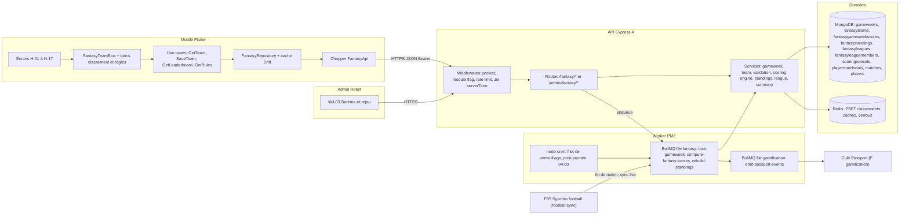

**Légende.** Le mobile ne calcule **aucun point** : il affiche ce que le serveur renvoie. Les collections `gameweeks`, `fantasygameweekscores`, `fantasystandings`, `fantasyleaguemembers`, `scoringrulesets`, `playermatchstats` sont des **nouvelles collections proposées par le backlog**. La file `fantasy` doit être **ajoutée** à `QUEUE_NAMES` (`src/jobs/queues.ts`) ; le backlog évoque aussi une file `gamification` pour les événements Passport (non existante). Le moteur de scoring est un module pur `src/services/scoring/engine.ts`, **partagé** avec La Masia (F14) pour éviter toute divergence de règles (CDC Backend §3.12).

Pourquoi ce découpage : le calcul des points est lourd (milliers d'équipes) et doit survivre aux pannes ; il est donc asynchrone, par lots, idempotent. Les lectures (équipe, classement, résumé) sont servies depuis MongoDB et Redis, jamais depuis un calcul à la volée.

## 4. Écrans et navigation

| Code | Écran | Rôle |
|---|---|---|
| `H-01` | Accueil Fantasy | Carte héro « Compose ton XI », compte à rebours, « Ma saison » (774 pts, 3e amis, 18 432e monde), histogramme des 5 dernières journées |
| `H-02` | Composition — terrain complet | Terrain interactif 4-3-3, 11/11, capitaine (badge C), ligne Formation |
| `H-03` | Postes à compléter | Compteur 7/11 « 4 postes à compléter » |
| `H-04` | Choix de la formation | Bottom sheet : 4-3-3, 4-4-2, 3-5-2, 4-2-3-1 |
| `H-05` | Sélection d'un joueur par poste | Feuille « Choisir un milieu (MC) », recherche, filtres Milieux/Tous/Forme, « Confirmer Pedri » |
| `H-06` | Choix du capitaine | Feuille radio sur les 11 joueurs, « Points doublés » |
| `H-07` | Confirmation | Modale récap (formation, capitaine, 11/11, rappel de l'heure de fermeture) |
| `H-08` | Composition enregistrée | Toast vert 3 s |
| `H-09` | Composition verrouillée (409) | Bandeau « Match en cours · points en direct », pastille « En direct », « Voir le détail » |
| `H-10` | Résultat de la journée | Points par joueur (Yamal 14, Raphinha −1) |
| `H-11` | Détail des points d'un joueur | Feuille : But milieu +6, Passe +3, Titularisation +2, capitaine x2 |
| `H-12` | Classement entre amis | Ligne « Toi » surlignée, « Inviter des amis », « Créer une ligue » |
| `H-13` | Classement mondial | Sélecteur Amis / Monde / Cette journée, rang épinglé 18 432e |
| `H-14` | Barème des points | Carte « Barème de référence » + pastille « Configurable » |
| `H-15` | Créer ou rejoindre une ligue | Feuille avec champ « Code » préfixé `BARCA-` |
| `H-16` | Pas encore d'équipe | « Compose ton premier XI » |
| `H-17` | Module désactivé | « Bientôt disponible » + « Me prévenir » |

<p>


</p>

*`H-02` : en-tête « FANTASY · Journée 11 », contrôle segmenté « Mon équipe / Classement / Règles », bandeau bleu « Fermeture des compositions dans 1 J 04 H 12 MIN » avec badge `J11`, terrain en bandes vertes, joueurs en pastilles avec étiquette de nom sombre et poste dessous, badge jaune « C » sur Yamal (AD). `H-10` : bandeau vert « Journée 10 terminée », points sous chaque joueur (Cubarsí 6, Koundé 8, Yamal 14, Raphinha −1).*

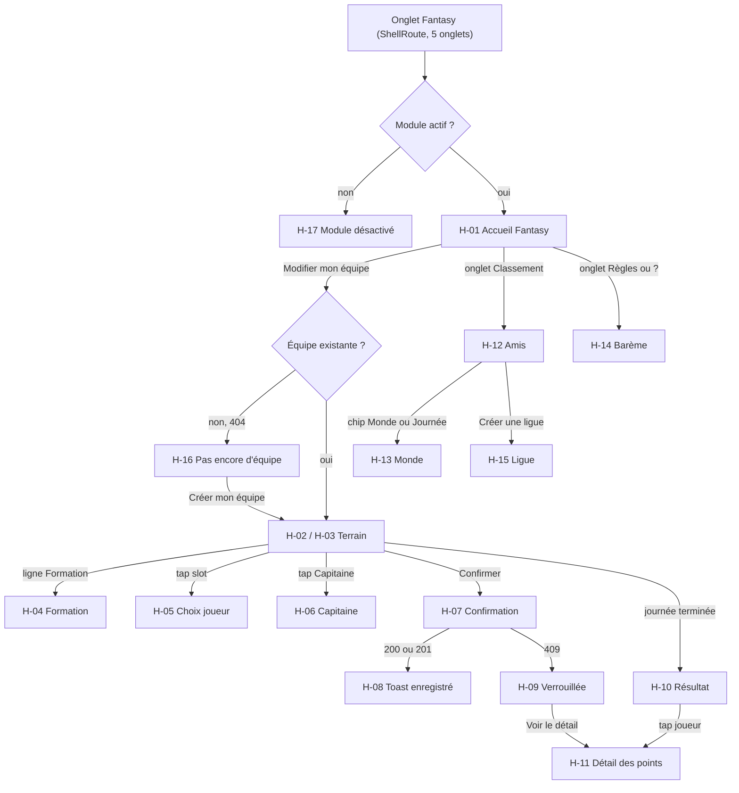

Routes go_router : `/fantasy` (accueil), `/fantasy/team`, `/fantasy/leaderboard`, `/fantasy/rules` (`MOB-H-07`). Chaque onglet garde son scroll (`StatefulShellRoute`/`IndexedStack`). Deep links `univers://fantasy` et `univers://fantasy/leaderboard`. La carte `FantasyPreviewCard` du dashboard (F06, `MOB-H-30`) renvoie vers `/fantasy/team` (ou `/fantasy` si aucune équipe) et se masque si le module est désactivé.

## 5. Flux détaillés

### 5.1 Composer et enregistrer son XI (nominal)

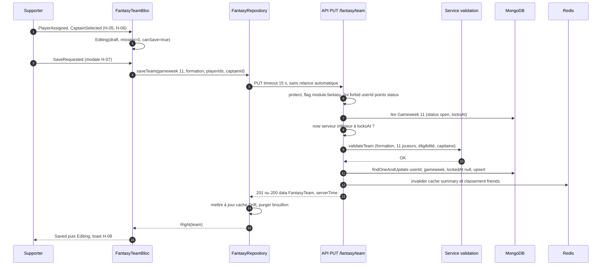

**Pas à pas.** (1-2) L'utilisateur place 11 joueurs ; l'état `canSave` n'est vrai qu'à 11/11 **et** capitaine. (3-5) Le mobile n'envoie qu'une requête, avec timeout de 15 s et **sans relance automatique** (l'idempotence est portée par le serveur et le brouillon). (6) Le middleware refuse tout champ interdit (`userId`, `points`, `status`, `lockedAt` : *mass assignment*). (7-9) La journée doit exister et être `open` (ou `upcoming` avec `locksAt` futur) et l'horloge **serveur** doit précéder `locksAt`, sans tolérance. (10-11) `validateTeam` est l'**ultime validateur** (le client en fait une pré-validation locale). (12) L'écriture est une mise à jour conditionnelle `{userId, gameweek, lockedAt: null}` en `upsert` : si le job de verrouillage passe entre-temps, l'écriture échoue plutôt que de modifier une équipe figée. (13-17) Le résultat serveur remplace le cache ; le brouillon local est purgé.

### 5.2 Verrouillage au coup d'envoi, 409 et reprise hors-ligne (cas limites)

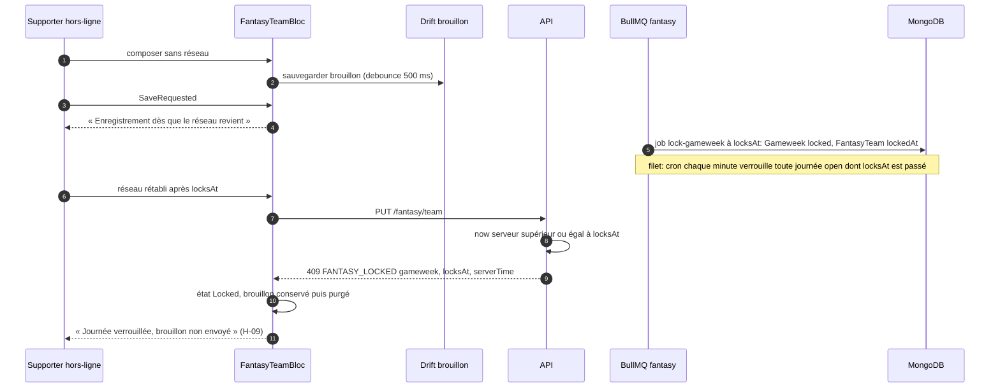

**Points d'attention.** Le job `lock-gameweek` est planifié avec un délai `locksAt − now` et un `jobId` déterministe `lock:{season}:{number}` ; si `locksAt` change (report du premier match, voir F05), l'ancien job est supprimé et un nouveau créé. Le verrouillage est idempotent (rejeu sans effet) : `Gameweek.status='locked'`, `FantasyTeam.updateMany({gameweek, lockedAt:null}, {lockedAt:now, status:'locked'})`. Le **filet cron chaque minute** couvre un redémarrage Redis ou un job perdu. Un utilisateur sans équipe au verrouillage n'a **pas de score** pour la journée (aucun XI automatique, la reconduction n'est pas définie au CDC) ; l'écran `H-16` affiche alors « Tu as manqué la journée 11 » sans bouton de création.

### 5.3 Calcul des points : provisoire en direct, final après le dernier match

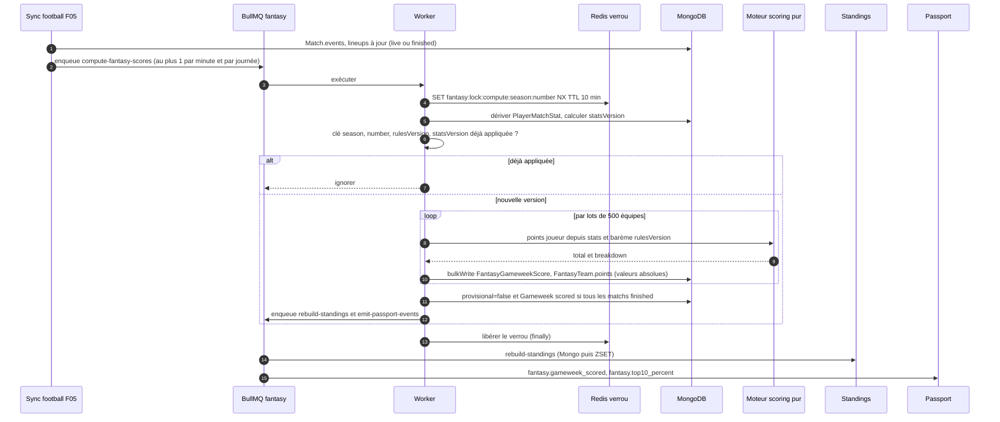

**Pas à pas.** (1-2) Chaque synchronisation live ou fin de match déclenche un calcul ; la limite d'un job par minute et par journée évite l'emballement. (4) Le verrou Redis empêche deux calculs simultanés d'une même journée. (5-6) La **clé d'idempotence** est `(season, number, rulesVersion, statsVersion)` où `statsVersion` est le hash des `sourceHash` des `PlayerMatchStat` : sans changement de statistiques, rien n'est recalculé. (8-10) Traitement par curseur sur `_id`, lots de 500, concurrence worker 2. Les écritures sont des **upserts de valeurs absolues**, jamais des incréments : rejouer ne double jamais les points. (12) La journée passe à `scored` **seulement** quand tous ses matchs sont `finished`. (13) Le classement et le Passport sont alimentés ensuite, de façon asynchrone.

Un cron post-journée à **04:00 Europe/Madrid** re-vérifie les journées dont tous les matchs sont terminés mais non `scored`. Pendant 72 h après `scoredAt`, un changement de `statsVersion` (statistique corrigée par la source) relance le calcul avec le **même** `rulesVersion` ; au-delà, seule la route admin `recompute` (avec motif, audit) est possible.

### 5.4 Rejoindre une ligue (cas d'erreurs)

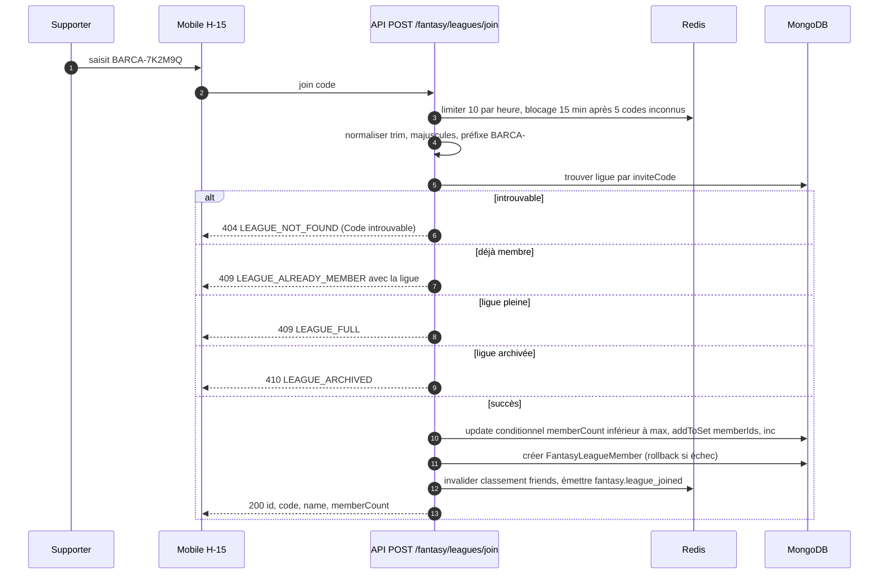

### 5.5 Cycle de vie d'une journée

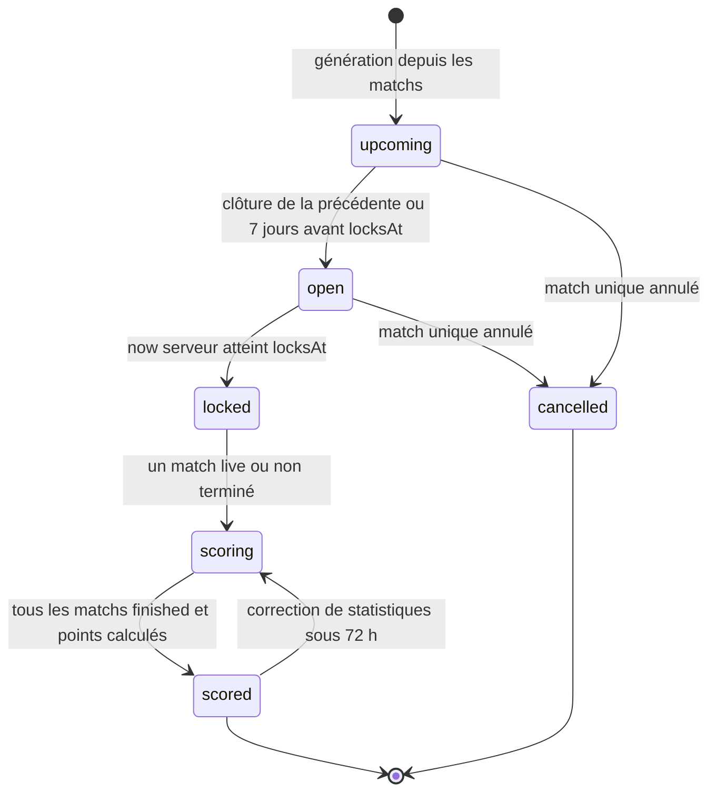

Le premier match reporté recalcule `locksAt` sur le nouveau premier match restant. Une trêve ne crée aucune journée. `rulesVersion` est figé à l'ouverture (`FANTASY_OPEN_DAYS_BEFORE=7`, configurable).

### 5.6 États du `FantasyTeamBloc`

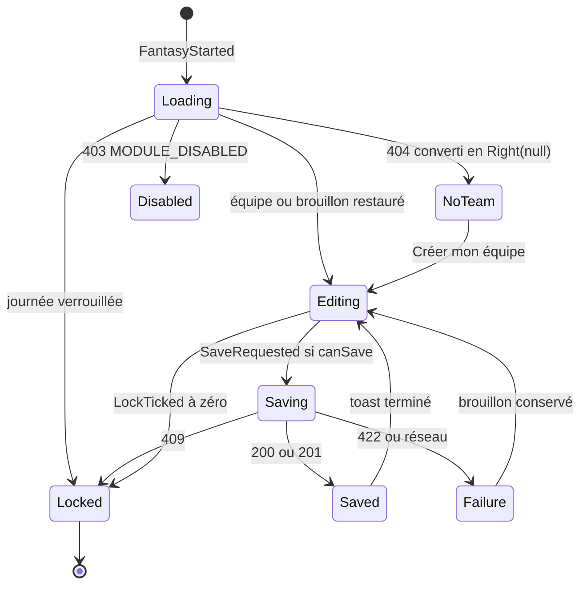

`SaveRequested` est ignoré s'il y a déjà un `Saving` (transformer *droppable*). Le tick du compte à rebours à 0 bascule en `Locked` **même en cours d'édition**, avec un message explicatif.

## 6. Contrats d'API

Préfixe `/api/v1`. Enveloppe `{ success, data }` ; erreurs `{ success:false, error:{ code, message, details, traceId } }`. Toutes les routes `/fantasy/*` sont **authentifiées** (CDC Backend §3.13) et passent par le garde de module (`403 MODULE_DISABLED` si `module.fantasy` est coupé). Toutes les réponses portent `serverTime` et l'en-tête `Date` pour calculer le décalage d'horloge.

| Méthode | Chemin | Auth / rôle | Rate limit | Requête | Réponse | Erreurs |
|---|---|---|---|---|---|---|
| GET | `/fantasy/gameweeks/current` | utilisateur | défaut | — | `{id, number, season, status, locksAt, serverTime, matches[]}` | — |
| GET | `/fantasy/gameweeks` · `/:number` | utilisateur | défaut | `?season=&status=` | liste / détail | 404 |
| GET | `/fantasy/formations` | utilisateur | défaut (cache 24 h) | — | `[{key, slots[{slot, group, label}]}]` | — |
| GET | `/fantasy/players` | utilisateur | défaut | `group, q, sort=form\|points\|name, limit ≤ 50, cursor` | `items[{id, fullName, position, form, totalPoints, selectedByPercent?}]` | 400 |
| GET | `/fantasy/team` | utilisateur | défaut | `?gameweek=` | équipe + `status`, `locksAt`, `serverTime`, `points` | **404 `FANTASY_TEAM_NOT_FOUND`** (`details.gameweek`, `details.locksAt`) |
| PUT | `/fantasy/team` | utilisateur | **30/min** | `{gameweek, formation, playerIds[11], captainId, selections?}` | 201 création / 200 mise à jour | **409 `FANTASY_LOCKED`**, **422 `INVALID_FANTASY_TEAM`**, 404 `GAMEWEEK_NOT_FOUND`, 429 |
| GET | `/fantasy/team/points` | propriétaire | défaut | `?gameweek=` | `{status, provisional, total, computedAt, players[{playerId, points, isCaptain, breakdown[]}]}` | `status:'pending'` si non calculé |
| GET | `/fantasy/team/history` | propriétaire | défaut | `?limit=5` | `items[{gameweek, points, rank?}]` | — |
| GET | `/fantasy/scoring-rules` | utilisateur | défaut | — | `{version, updatedAt, rules[], captainMultiplier}` ; `Cache-Control: public, max-age=3600`, `ETag` | — |
| GET | `/fantasy/leaderboard` | utilisateur | **60/min** | `scope=friends\|world\|gameweek, gameweek, leagueCode, cursor, limit ≤ 100` | `items[{rank, userId, displayName, avatarKey, points, gameweekDelta, isMe}]`, `me{rank, points, total}`, `nextCursor` | 400 |
| GET | `/fantasy/summary` | utilisateur | défaut | — | agrégat accueil (voir ci-dessous) | 403 `MODULE_DISABLED` |
| POST | `/fantasy/leagues` | utilisateur | **5/jour** | `{name?, visibility?}` | 201 `{id, code, name, memberCount, visibility}` | 409 `LEAGUE_LIMIT_REACHED` |
| POST | `/fantasy/leagues/join` | utilisateur | **10/h** | `{code}` | `{id, code, name, memberCount}` | 404, 409 (membre, pleine), 410, 429 |
| GET/PATCH/DELETE… | `/fantasy/leagues`, `/:id`, `/:id/members/me`, `/:id/members/:userId`, `/:id/code/regenerate`, `/:id/transfer`, `/:id/archive`, `/:id/invitations`, `/leagues/public` | membre / propriétaire | défaut | voir `API-FANT-18` (P2) | mes ligues avec `myRank` ; lien et deep link d'invitation | 403 `LEAGUE_FORBIDDEN`, 409 `OWNER_MUST_TRANSFER` |
| GET | `/config/modules` | utilisateur | défaut (cache 60 s) | — | `{fantasy:bool, academy:bool}` | — |
| POST | `/modules/:key/notify-me` | utilisateur | défaut | — | `{key, registered:true}` (idempotent) | 404 clé |
| POST | `/admin/fantasy/scoring-rules` | **super-admin** | 120/min | `{rules[], activeFromGameweek, comment}` | `ScoringRuleSet` | 422 |
| POST | `/admin/fantasy/scoring-rules/simulate` | super-admin | idem | `{rules[], gameweek}` | `{currentTotal, newTotal}` | — |
| POST | `/admin/fantasy/gameweeks/:number/recompute` | super-admin | idem | `{reason}` | `{jobId}` | 404 |

*Statuts 409/422 : le mobile les convertit en `FantasyLockedFailure` / `FantasyInvalidTeamFailure` (avec `details`) ; 403 en `FantasyDisabledFailure` ; 5xx/timeout en `NetworkFailure`. Le `traceId` est conservé pour Sentry (`MOB-H-02`).*

Exemple `PUT /fantasy/team` :

```json
{ "gameweek": 11, "formation": "4-3-3",
  "playerIds": ["6720a1...01", "6720a1...02", "…11 identifiants…"],
  "captainId": "6720a1...09" }
```

Réponse `409` (composition verrouillée) :

```json
{ "success": false, "error": { "code": "FANTASY_LOCKED", "message": "Journée verrouillée",
  "details": { "gameweek": 11, "locksAt": "2026-10-24T19:00:00.000Z", "serverTime": "2026-10-24T19:00:03.412Z" },
  "traceId": "9f1c…" } }
```

Réponse `GET /fantasy/summary` (`API-FANT-19`) : `{gameweek:{number, status, locksAt, serverTime}, hasTeam, teamStatus, seasonPoints:774, ranks:{friends:3, world:18432, totalWorld:41200}, lastGameweeks:[{gameweek:10, points:78}], leagueCount, moduleEnabled}` ; cache privé 30 s ; si Redis est indisponible, `ranks:null` mais le reste est renvoyé.

## 7. Modèle de données

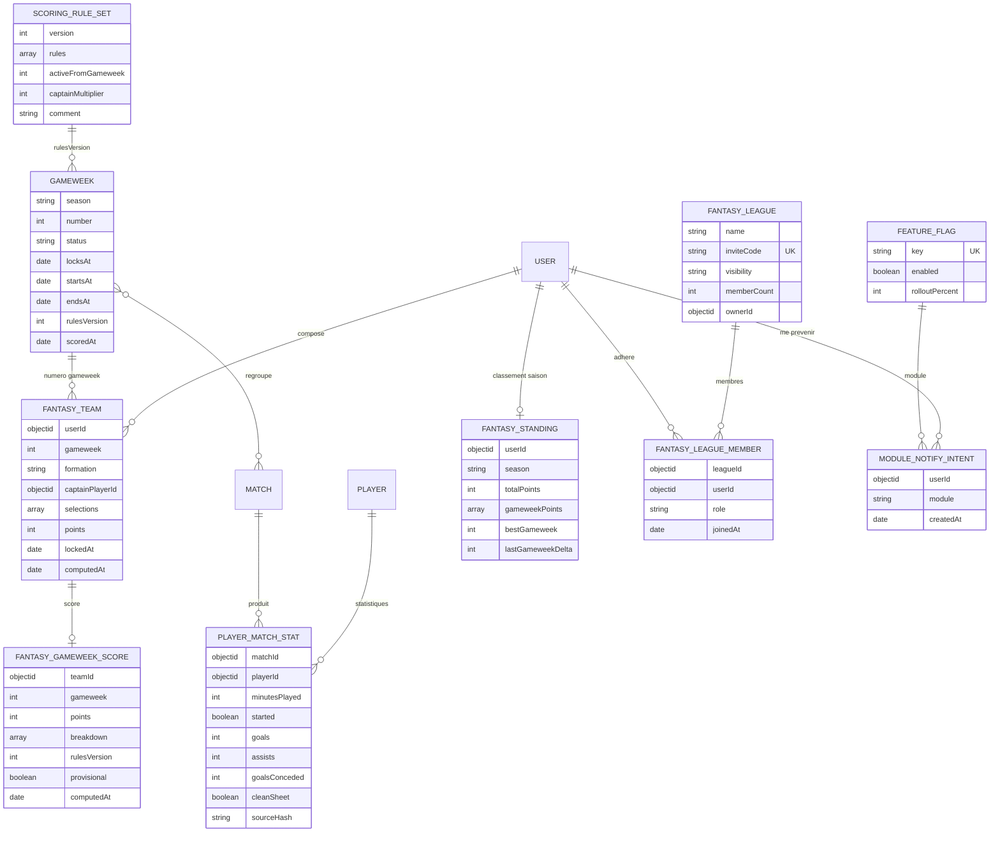

**Ce qui existe** (`src/models/fantasy.model.ts`, `platform.model.ts`) : `FantasyTeam`, `FantasyLeague`, `FeatureFlag`, et `ScoringRule` (événement unique, points, positions — non versionné). **Ce que le backlog ajoute** : `gameweeks` (`API-FANT-01`), `fantasygameweekscores` (`API-FANT-02`), `scoringrulesets` (`API-FANT-08`), `playermatchstats` et événements enrichis `goal | assist | yellow_card | red_card | sub_in | sub_out` dans `Match.events` (`API-FANT-09`), `fantasystandings` (`API-FANT-14`), `fantasyleaguemembers` (`API-FANT-16`), `modulenotifyintents` (`API-FANT-20`). `FantasyTeam.points` reste une **copie dénormalisée** du total pour ne pas gonfler le document ; le détail vit dans `FantasyGameweekScore`.

**Index** (`API-FANT-23`) : `fantasyteams {userId:1, gameweek:1}` unique et `{gameweek:1, points:-1}` ; `fantasygameweekscores {teamId:1, gameweek:1}` unique et `{userId:1, gameweek:-1}` ; `fantasystandings {season:1, totalPoints:-1}` et unique `{userId, season}` ; `fantasyleagues {inviteCode:1}` unique et `{visibility:1, memberCount:-1}` ; `fantasyleaguemembers {leagueId:1, userId:1}` unique et `{userId:1}` ; `playermatchstats {matchId:1, playerId:1}` unique et `{playerId:1, createdAt:-1}` ; `gameweeks {season:1, number:1}` unique. Objectif : aucun `COLLSCAN` (vérifié par `explain()`).

### Clés Redis

Le backlog écrit `fantasy:*` ; conformément au brief (préfixe `ub:`), le préfixe est **proposé** ci-dessous.

| Clé (proposée) | Rôle | TTL |
|---|---|---|
| `ub:fantasy:lb:{season}:world` (ZSET) | rang mondial par `totalPoints` (`ZREVRANK`, `ZREVRANGE`) | reconstruit |
| `ub:fantasy:lb:{season}:gw:{n}` (ZSET) | points de la journée | reconstruit |
| `ub:fantasy:lb:league:{leagueId}` (ZSET) | classement de ligue | reconstruit |
| `ub:fantasy:lock:compute:{season}:{number}` | verrou de calcul | 10 min |
| `ub:fantasy:cache:rules` | barème actif | 1 h |
| `ub:fantasy:cache:players:{hash}` | joueurs filtrés | 60 s |
| `ub:fantasy:cache:lb:{scope}:{…}` | classement world/gameweek | 120 s |
| `ub:fantasy:cache:summary:{userId}` | agrégat accueil | 30 s |
| `ub:fantasy:cache:formations` | formations | 24 h |

**Cache mobile Drift** (`MOB-H-03`) : `fantasy_teams_cache (gameweek PK, json, fetched_at)`, `fantasy_leaderboard_cache (scope, gameweek, json, fetched_at)`, `fantasy_rules_cache` ; péremption 5 min (journée ouverte) / 1 h (verrouillée) pour l'équipe, 2 min pour le classement, 24 h pour le barème ; brouillon de composition persisté (debounce 500 ms). Le cache n'est **jamais** source de vérité et est purgé à la déconnexion / suppression de compte.

**Migrations (proposé)** : création des index ci-dessus, seed du `ScoringRuleSet` v1 (barème CDC), génération des `gameweeks` de la saison depuis `matches`, ajout de `4-4-2` à l'enum de formation, ajout du flag `module.fantasy` ; scripts idempotents dans `scripts/migrations`, reconstruction des classements via `npm run fantasy:rebuild-standings`.

## 8. Traitements asynchrones et cache

| Job / cron | Déclencheur | Rôle | Idempotence et reprise |
|---|---|---|---|
| `lock-gameweek` (file `fantasy`) | job différé `locksAt − now`, `jobId = lock:{season}:{number}` | verrouille journée et équipes | rejeu sans effet ; ancien job supprimé si `locksAt` change |
| cron filet verrouillage | chaque minute | verrouille toute journée `open` dont `locksAt` est passé | idem |
| `compute-fantasy-scores` | fin de match, sync live (≤ 1/min/journée), cron 04:00 Europe/Madrid | calcul des points | clé `(season, number, rulesVersion, statsVersion)`, upserts absolus, verrou Redis 10 min |
| `rebuild-standings` | fin du calcul | reconstruit `FantasyStanding` puis ZSET | sommes absolues recalculées depuis `FantasyGameweekScore` |
| `emit-passport-events` (file `gamification`, proposée) | fin du calcul | `fantasy.team_saved`, `fantasy.gameweek_scored`, `fantasy.league_joined`, `fantasy.top10_percent` | clé `{module}:{userId}:{event}:{refId}` |
| notification d'ouverture du module | flag activé | notifie les `ModuleNotifyIntent` puis les supprime | respect des préférences |

Paramètres : 5 tentatives, backoff exponentiel 2 s (`defaultJobOptions`), puis file `dead-letter` ; métrique `jobsFailed` ; concurrence 2 ; dimensionnement cible **2 workers fantasy**, mémoire < 512 Mo. Lots de 500 équipes par curseur `_id`.

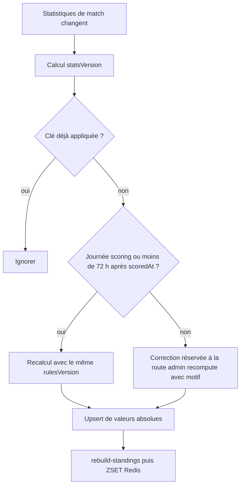

**Cache et classement.** MongoDB est la source de vérité ; Redis accélère les rangs. Si Redis est vidé, `npm run fantasy:rebuild-standings` reconstruit tout depuis `FantasyGameweekScore`. Cache HTTP : barème `public, max-age=3600` + `ETag` ; summary `private, max-age=30` ; classement `world`/`gameweek` 120 s (le mobile ajoute 2 min) ; `friends` et `league` non mis en cache partagé (dépendent de l'utilisateur). Invalidation à la fin du calcul, au `PUT /fantasy/team` et à la création / jonction de ligue.

## 9. Règles de gestion

1. **Formations** : `4-3-3` (défaut), `4-4-2`, `3-5-2`, `4-2-3-1` ; exactement 11 sélections, `playerId` uniques.
2. **Slots** (`API-FANT-03`) : 4-3-3 = GB, DG, DC1, DC2, DD, MC1-3, AG, BU, AD ; 4-4-2 = GB, DG, DC1, DC2, DD, MC1, MC2, AG, AD, BU1, BU2 ; 3-5-2 = GB, DC1-3, AG, MC1-3, AD, BU1, BU2 ; 4-2-3-1 = GB, DG, DC1, DC2, DD, MD1, MD2, AG, MO, AD, BU (à confirmer, seul le 4-3-3 est maquetté).
3. **Compatibilité poste → groupe** : GB→GB ; DD/DC/DG→DEF ; MD/MC/MO→MID ; AD/AG/BU→ATT. Seule l'appartenance au groupe est contrôlée, pas le côté exact (à confirmer).
4. **Éligibilité** : `Player.status='published'`, `isActive=true`, effectif de l'équipe première ; les joueurs virtuels de la Masia ne sont jamais éligibles.
5. **Capitaine** : un seul, parmi les 11 ; pas de vice-capitaine (non défini au CDC).
6. **Pas de budget, de valeur de joueur, de mercato ni de limite de transferts** : volontairement exclus (absents du CDC).
7. **Verrouillage** : `now_serveur >= locksAt`, sans tolérance ; `locksAt` = coup d'envoi du premier match de la journée.
8. **Unicité** : un XI par `{userId, gameweek}` ; `PUT` idempotent (201 puis 200).
9. **Barème v1 (CDC §3.12.2)** : but attaquant +5, milieu +6, défenseur +8, gardien +8 ; passe +3 ; clean sheet +4 (défenseur/gardien) ; titularisation (≥ 60 min) +2 ; entrée en jeu (< 60 min) +1 (exclusifs) ; jaune −1 ; rouge −3 ; −1 par tranche de 2 buts encaissés (`floor(buts/2)`, défenseur/gardien) ; capitaine x2.
10. **Bornes** : points d'un événement entiers signés dans [−20, +20] ; `captain_multiplier` entier 1 à 3 (défaut 2).
11. **Version de barème** : `rulesVersion` figé à l'ouverture de la journée ; une nouvelle version s'applique à partir de la journée suivante ; **jamais** de recalcul rétroactif.
12. **Position utilisée** : celle de `PlayerMatchStat` (poste au moment du match).
13. **Minutes** : titulaire = minute de sortie sinon durée du match, plafonnée à 90 (prolongations non comptées, à confirmer) ; remplaçant = durée − minute d'entrée.
14. **Clean sheet** : adversaire à 0 but **et** joueur présent ≥ 60 min (à confirmer).
15. **Deux jaunes** : jaune −1 puis rouge −3, cumul −4 (à confirmer).
16. **Provisoire** tant qu'au moins un match n'est pas terminé ; `scored` quand tous les matchs sont `finished`.
17. **Classement** : `totalPoints` = somme des points **scorés** (finaux) ; rang de compétition (1, 2, 2, 4) ; ex æquo départagés par `totalPoints`, puis `bestGameweek`, puis `userId` croissant ; seuls les utilisateurs `active` sont classés.
18. **Profondeur** : `limit` 50 par défaut, 100 max ; au-delà du rang 1000 seul `me` est renvoyé (configurable).
19. **Ligues** : code `BARCA-` + 6 caractères de l'alphabet `23456789ABCDEFGHJKMNPQRSTUVWXYZ` (`crypto.randomInt`, 5 tentatives de collision) ; 50 membres max (`FANTASY_LEAGUE_MAX_MEMBERS`, à confirmer) ; 10 ligues max par utilisateur (à confirmer) ; nom 3 à 30 caractères, nettoyé et modéré ; propriétaire membre d'office.
20. **Rang « amis » du résumé** : rang dans la ligue qui compte le plus de membres, `null` sans ligue (à confirmer).
21. **Modules** : flags `module.fantasy` / `module.academy`, `rolloutPercent` déterministe (`hash(userId) % 100 < rolloutPercent`).
22. **Compte à rebours mobile** : format `N J HH H MM MIN` au-delà de 24 h, `HH H MM MIN` sous 24 h, `MM MIN SS S` sous 1 h ; rafraîchi toutes les 60 s (1 s sous 1 h) ; offset = `serverTime − deviceTime`.

## 10. Sécurité, RGPD et anti-abus

* **Horloge serveur seule autorité** : les en-têtes de date du client sont ignorés (`API-FANT-21`).
* **Confidentialité des équipes** : l'équipe d'un autre utilisateur n'est exposée **qu'après `locksAt`** de la journée, jamais avant (empêche la copie de compositions) ; `GET /fantasy/team` ne renvoie que la sienne.
* **Mass assignment** : `userId`, `points`, `status`, `lockedAt` interdits en entrée (Joi `stripUnknown`/`forbid`). Pas d'IDOR : les routes utilisent le `userId` du jeton, jamais un identifiant de la requête.
* **Rate limits** : `PUT /fantasy/team` 30/min ; classement 60/min ; join de ligue 10/h ; création 5/jour ; blocage 15 min après 5 codes inconnus (l'espace de 6 caractères reste énumérable à grande échelle) ; réponses 429 avec `Retry-After`.
* **Anti-comptes multiples** : alerte log si plus de 3 comptes créés depuis la même IP dans une même ligue (revue modération, pas de blocage automatique).
* **Pseudonymisation** : classements et ligues n'exposent que `displayName` et `avatarKey` (jamais e-mail, ville, position) ; identifiants internes opaques ; signalement des ligues publiques via le flux de modération (`ModerationReport` cible `fantasy_league`).
* **RBAC** : barème en écriture réservé au **super-admin**, chaque version journalisée dans `AuditLog` ; le rejeu d'une journée aussi.
* **RGPD** (`API-FANT-22`) : export (`GET /users/me/export`, clés `fantasy` et `academy`) ; suppression de compte → purge de `FantasyTeam`, `FantasyGameweekScore`, `FantasyStanding`, `FantasyLeagueMember`, `ModuleNotifyIntent` après 30 jours, retrait **immédiat** des ZSET Redis à la demande ; ligue du propriétaire transférée au membre le plus ancien, ou archivée puis purgée s'il est seul ; points agrégés anonymes conservables. Aucune donnée supplémentaire collectée (ni localisation, ni identifiant d'appareil). Côté mobile, purge des tables `fantasy_*` à la déconnexion.
* **Droits d'image** : avatars de joueurs illustrés et originaux, jamais de photo sous droits (`MOB-H-10`).

## 11. Erreurs et états dégradés

| Situation | Serveur | Client |
|---|---|---|
| Composition verrouillée | `409 FANTASY_LOCKED` | état `Locked`, toast « La journée est verrouillée, ta composition n'a pas été modifiée », CTA masqué (`H-09`) |
| Équipe invalide | `422 INVALID_FANTASY_TEAM` avec `details[{code, slot?, playerId?}]` (`FORMATION_UNKNOWN`, `TEAM_SIZE`, `DUPLICATE_PLAYER`, `POSITION_MISMATCH`, `CAPTAIN_NOT_IN_TEAM`, `PLAYER_NOT_ELIGIBLE`, `SLOT_COUNT_MISMATCH`) | message de champ ; pré-validation locale sans appel réseau |
| Aucune équipe pour la journée | `404 FANTASY_TEAM_NOT_FOUND` avec `locksAt` | converti en `Right(null)` → `H-16`, pas d'erreur affichée |
| Module désactivé | `403 MODULE_DISABLED` | `H-17`, aucun appel Fantasy tant que le flag est off |
| Hors-ligne | — | cache Drift + bandeau, brouillon local, envoi différé |
| Réseau KO sans cache | — | `NetworkFailure` → écran d'erreur avec « Réessayer » |
| Redis indisponible | bypass : `ranks:null` dans le résumé ; classement servi depuis Mongo (dégradé) ; jobs non enqueués avec log `warn` (le filet cron verrouille) | aucun message |
| Calcul pas encore fait | `status:'pending'` | bandeau « En attente du calcul » sans points (`MOB-H-20`) |
| Fournisseur de données en panne | statistiques non mises à jour : points provisoires inchangés, jamais de suppression | indicateur « en direct » ancien ; voir F04 / F05 |
| Rate limit | `429` + `Retry-After` | message générique, pas de relance auto des `PUT` |

Côté mobile : `409` et `422` ne sont jamais des exceptions remontées à la présentation (`Either<Failure, T>`) ; un échec de sauvegarde conserve le brouillon (`Failure(previous)`).

## 12. Connexions avec les autres fonctionnalités

| Fonctionnalité | Relation | Détail |
|---|---|---|
| F05 Données football | dépend de | `Match.events`, `lineups`, `status`, `kickoffAt`, fiches `Player` publiées ; changement de `kickoffAt` → recalcul de `locksAt` |
| F14 La Masia | partage | moteur de scoring pur `src/services/scoring/engine.ts`, file `fantasy`, flags de module, endpoints `config/modules` et `notify-me` |
| Culé Passport | alimente | événements `fantasy.*` (points, badge « Fantasy top 10 % ») ; Fantasy ne compte pas pour le streak par défaut (à confirmer) |
| F06 Accueil | alimente | carte `FantasyPreviewCard` et `GET /fantasy/summary` |
| Notifications | alimente / reçoit | rappel d'ouverture du module ; rappels de fermeture éventuels |
| F03 RGPD | partage | export et purge des données Fantasy |
| Admin `ADM-WJ` | alimente | barème versionné, simulation, rejeu |

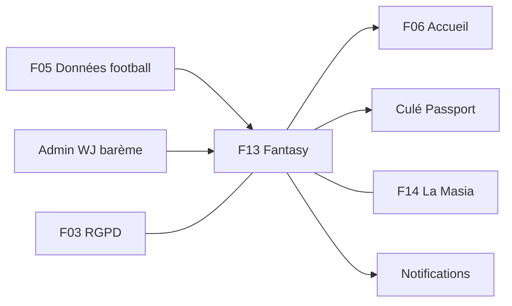

## 13. Observabilité et tests

**Métriques** (registre `ub_`, `src/config/metrics.ts`) : `jobsFailed` par file (existant), durée et volume des calculs, latence verrouillage (écart `locksAt` → `lockedAt`), taille des lots, hits/miss de cache, taux d'erreur `PUT /fantasy/team`. **Logs** Winston : `gameweek`, `rulesVersion`, `statsVersion`, `traceId` ; aucune donnée personnelle. Budgets p95 (`API-FANT-23`) : `GET team` < 80 ms, `PUT team` < 300 ms, `GET leaderboard` < 200 ms (1000 req/s tenus), `GET summary` < 150 ms ; **pic de verrouillage 5 000 PUT/min avec < 0,5 % d'erreurs**. Scénarios k6 : lecture classement, `PUT team` en rafale autour de `locksAt`.

**Tests** :
* `API-FANT-24` : fixtures (5 utilisateurs, effectif de 20 joueurs, 3 journées, barème v1), `jest.useFakeTimers` pour l'horloge, parcours créer → verrouiller → live provisoire → final → classement → ligue, codes 401/403/404/409/422/429, `mongodb-memory-server` + Redis de test, < 3 min en CI.
* Unitaires du moteur : barème v1 (but milieu +6 et passe +3 et titularisation +2 = 11 ; capitaine x2), négatifs, absence d'événements.
* Idempotence : deux calculs identiques → mêmes documents ; barème modifié → aucun recalcul.
* Mobile (`MOB-H-34`, `MOB-H-35`) : goldens `H-01`, `H-02` (4 formations), `H-03`, `H-10`, `H-12`, `H-14` en clair et sombre ; intégration « composer → confirmer → toast », « 409 → verrouillage », « hors-ligne → reprise » sur Android et iOS ; couverture module ≥ 60 % (cible 80 %). Accessibilité : zones ≥ 48 dp, contraste ≥ 4,5:1, `Semantics` par slot, alternative non gestuelle au glisser-déposer (« Échanger avec… »).

## 14. Points ouverts, décisions à confirmer et incohérences

**À confirmer avec le propriétaire (backlog).**
* Définition de la journée : fenêtre `[startsAt, endsAt]` et numérotation continue sur toutes compétitions (le CDC dit seulement « XI hebdomadaire »).
* Ouverture 7 jours avant `locksAt`, plafond de 50 membres / 10 ligues, ligues publiques et lien d'invitation (extensions au-delà du CDC), rang « amis » du résumé.
* Slots exacts du 4-2-3-1, contrôle strict par côté (DG/DD), prolongations, clean sheet (seuil 60 min), cumul de deux jaunes.
* Reconduction automatique d'un XI absent : non (aucune équipe créée).

**Incohérences détectées.**

| Sujet | Source A | Source B |
|---|---|---|
| Total de la journée 10 | Maquette `H-10` : 6 + 8 + 2 + 6 + 5 + 7 + 9 + 3 + 14 + 11 − 1 = **70** ; `H-12` affiche « J11 : +70 » | `API-FANT-13` et `API-FANT-24` : exemple et assertion de **total 78** |
| Formation `4-4-2` | CDC, DTO et mobile : autorisée | modèle `FantasyTeam` actuel : absente de l'enum (à corriger, `API-FANT-02`) |
| Identifiants | contrats mobile : « 11 uuid » | MongoDB : `ObjectId` |
| Endpoints de ligue | `MOB-H-25` : « proposé », absents du CDC Backend §3.5 | `API-FANT-16` à `API-FANT-18` : détaillés mais « à confirmer » |
| Préfixe Redis | backlog : `fantasy:*` | convention du projet : `ub:` |
| Files BullMQ | backlog : file `fantasy` (et `gamification`) | `QUEUE_NAMES` actuel ne les contient pas |
| Libellé d'en-tête | `H-10` : en-tête « Journée 11 » + bandeau « Journée 10 terminée » | cohérent seulement si l'écran montre le résultat de la journée précédente (sélecteur de journée, `MOB-H-20`) |
| Mécanique mobile vs serveur | `MOB-H-04` : refus local si verrouillé d'après l'horloge corrigée | `API-FANT-07` : aucune tolérance serveur, mobile gère la latence |
| Barème « CDC » | `H-14` affiche « But attaquant / milieu +5 / +6 » en une ligne | `API-FANT-08` : événements séparés `goal_forward`, `goal_midfielder` |

## 15. Pour aller plus loin

* **Épopées** : `MOB-H` (`MOB-H-01` à `MOB-H-35`), `API-FANT` (`API-FANT-01` à `API-FANT-24` pour le Fantasy), `API-FOOT` (données de match), `API-PASS`, `API-NOTIF`, `ADM-WJ`.
* **CDC** : Backend §3.5 (module Fantasy & La Masia), §3.12.2 (barème), §4.4 (domaine), §7 (BullMQ, `compute-fantasy-scores`), §6 (409 Conflict), §8 (tests) ; Global §2.3 (carte « Ton XI Fantasy »), §2.7, §6 ; Flutter §7.6, §7.13.
* **Code** : `univers_barca_api/src/models/fantasy.model.ts`, `src/models/platform.model.ts` (`FeatureFlag`), `src/jobs/queues.ts`, `src/jobs/scheduler.ts`, `src/config/metrics.ts` ; mobile : `univers_barca_mobile/lib/features/players` (modèle de référence pour la future `lib/features/fantasy`).
