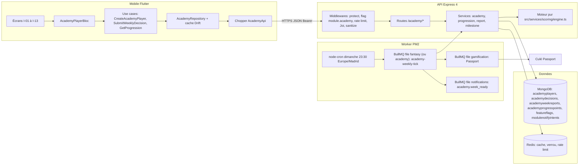
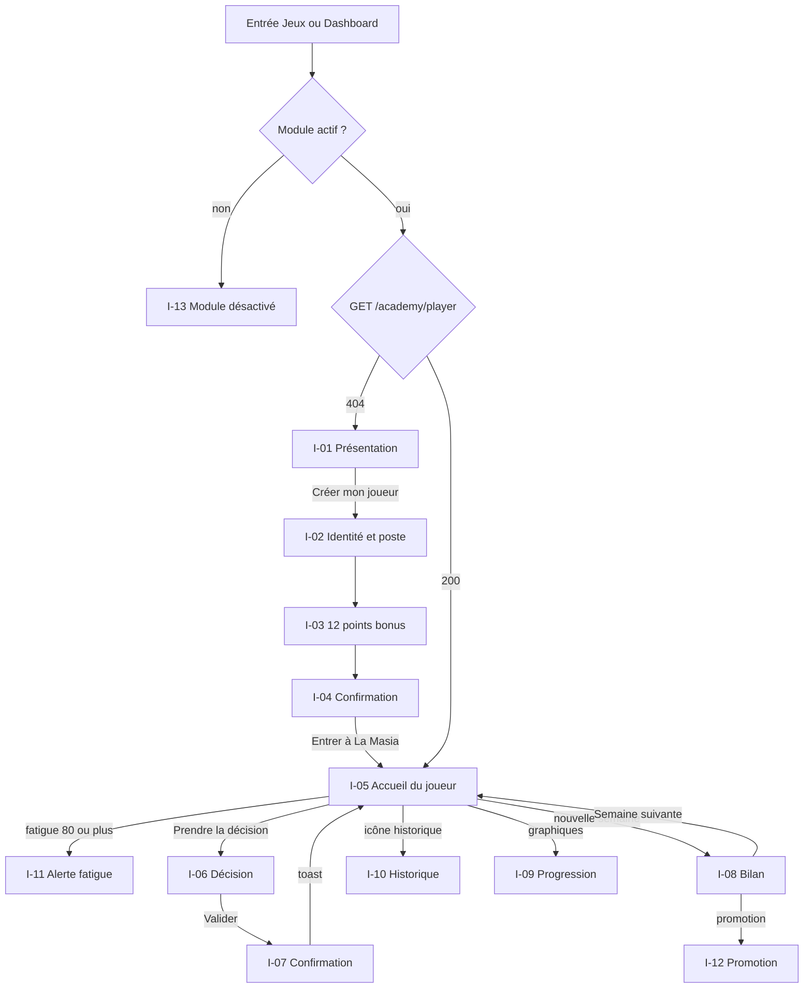
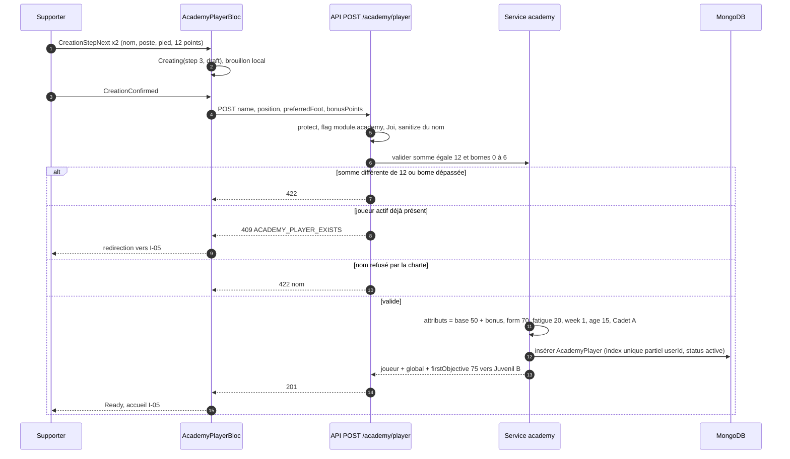
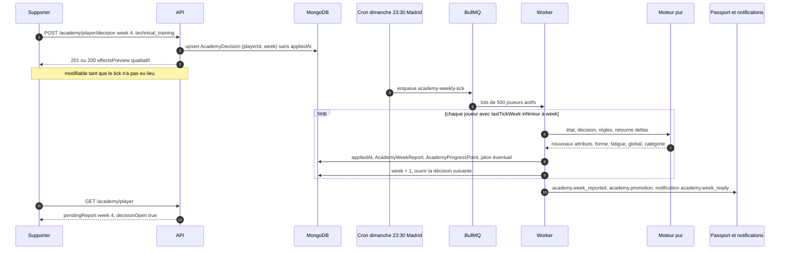
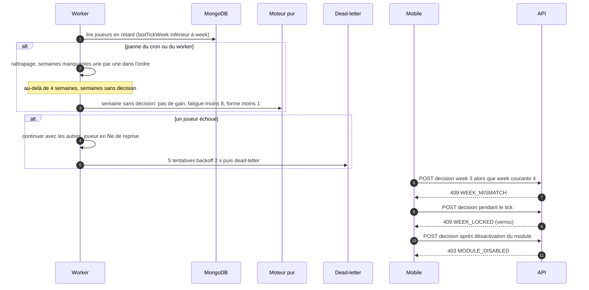
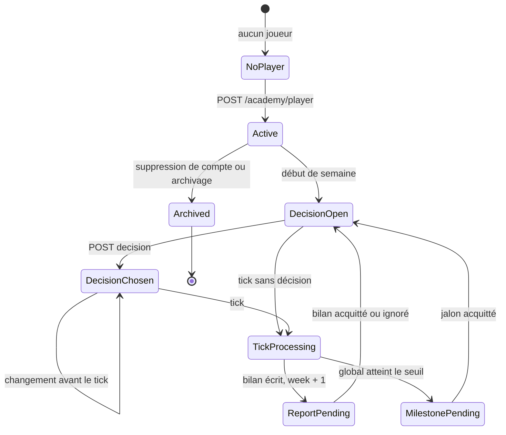
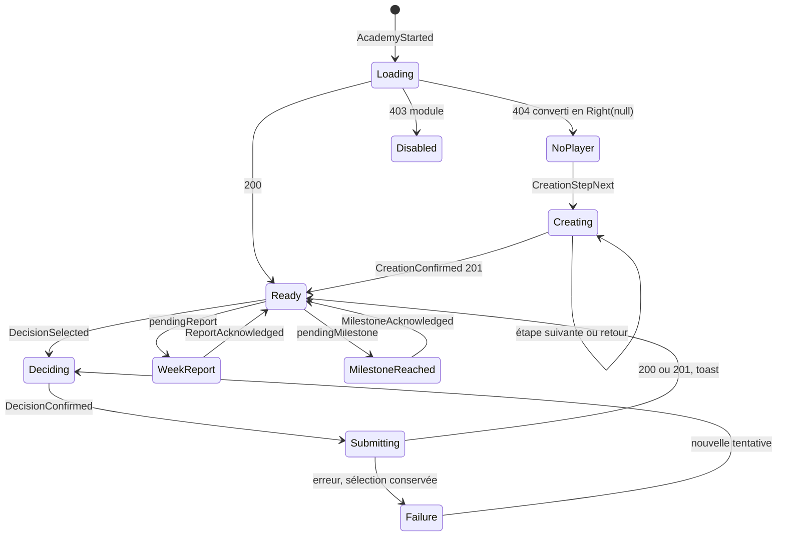
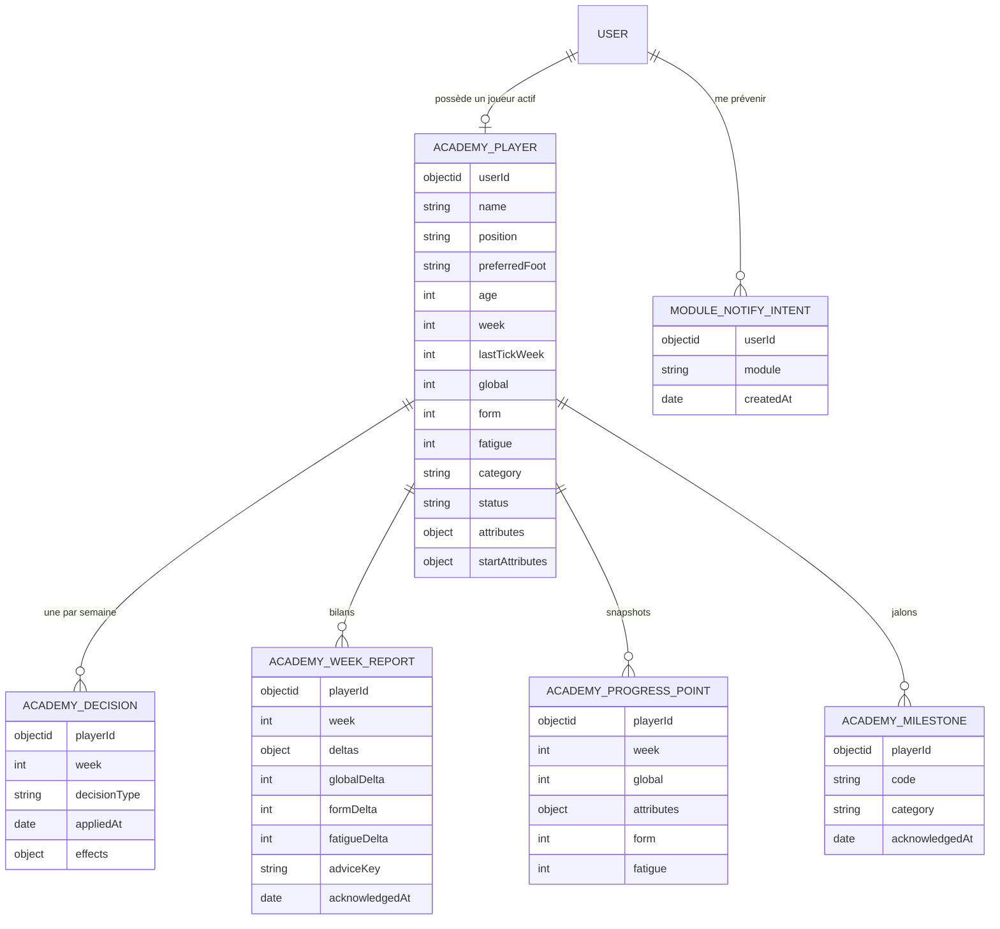
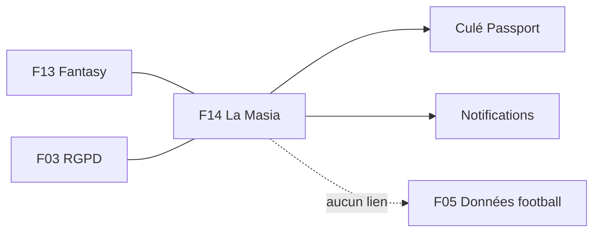

# F14 — La Masia Academy

> Documentation d'architecture · Univers Barça · fonctionnalité **F14**. Ce document explique le mini-jeu de simulation « La Masia Academy » : le supporter crée **un** jeune joueur virtuel, prend chaque semaine une décision (entraînement, repos, nutrition…) et regarde ses attributs évoluer jusqu'à une promotion de catégorie. Il décrit le parcours mobile, le moteur de progression déterministe, le job hebdomadaire, les données, les règles chiffrées et ce qui reste à confirmer. Il complète F13 (Fantasy), avec lequel La Masia partage son moteur de scoring, sa file de jobs et ses flags de module.

## 1. Résumé et fiche

**Valeur utilisateur.** Le supporter « forme sa pépite » : il invente un joueur (nom fictif, poste, pied fort), répartit 12 points bonus, puis décide chaque semaine quoi travailler. Le choix compte : trop d'entraînement physique fatigue le joueur et réduit ses gains, le repos le remet en forme. À 75 de note globale, le joueur est promu de « Cadet A » à « Juvenil B » et le supporter reçoit un badge dans son Culé Passport. C'est un jeu **lent et sans pression** : une décision par semaine, un bilan, une courbe de progression.

**Pourquoi c'est un module à part.** La Masia est un jeu à état persistant (un joueur qui vit sur des semaines), contrairement aux jeux quotidiens (quiz, Guess the Player). Son enjeu technique est la **fiabilité du temps** : une semaine ne doit jamais être appliquée deux fois ni sautée, même si le job hebdomadaire échoue ou si le serveur redémarre. Son enjeu produit est la **lisibilité** : l'application montre des tendances qualitatives (« Technique + », « Fatigue ++ »), jamais des formules.

| Élément | Valeur |
|---|---|
| Phase / priorité | Phase 3 — Fonctionnalités avancées (CDC : La Masia en phase 3 ; module coupé tant que le flag est off). Priorités P0/P1 côté mobile pour le cœur, P1 côté API, P2 pour `MOB-I-19` et `MOB-I-20` |
| Épopées backlog | `MOB-I` (22 issues, `MOB-I-01` à `MOB-I-22`) et `API-FANT` (issues **`API-FANT-25` à `API-FANT-34`** pour la Masia ; `API-FANT-20` modules, `API-FANT-22` RGPD, `API-FANT-33` Passport) |
| Écrans mobile | `I-01` à `I-13` |
| Dépôts concernés | **API** (modèles, moteur, routes, job), **mobile** (module Academy) ; pas d'écran admin dédié identifié (barème d'impact configurable sans UI admin spécifiée) |
| Documents voisins | F13 (Fantasy, moteur partagé), F03 (RGPD), F04 (états système), Passport |

### Vocabulaire

* **Joueur d'académie** : personnage **virtuel** créé par l'utilisateur ; ce n'est jamais un joueur réel de F05.
* **Attributs** : six notes entières 0 à 99 (Technique, Physique, Intelligence, Vitesse, Mental, Finition).
* **Global (note globale)** : note agrégée du joueur, calculée par une moyenne pondérée selon le poste.
* **Forme / Fatigue** : deux jauges 0 à 100 ; la fatigue réduit les gains, la forme est une tendance d'état.
* **Décision hebdomadaire** : un choix parmi cinq types, appliqué à la **fin** de la semaine.
* **Tick** : traitement hebdomadaire qui applique la décision, écrit le bilan et fait avancer la semaine.
* **Bilan** : synthèse d'une semaine écoulée (deltas, conseil), à acquitter.
* **Jalon (milestone)** : événement unique par palier (promotion de catégorie).
* **Moteur partagé** : module pur `src/services/scoring/` utilisé aussi par Fantasy (CDC Backend §3.12).

### Écart avec les CDC et état du code

Les CDC décrivent `academy_players (attributes JSONB)` et `academy_decisions (week, decision_type, decision_value, applied_at)` en PostgreSQL. **La stack réelle est MongoDB/Mongoose** : on a des collections `academyplayers` et, selon le backlog, des collections additionnelles pour décisions, bilans et points de progression.

> État du code : `src/models/fantasy.model.ts` contient déjà `AcademyPlayer` avec `userId` (indexé, **non unique**), `name`, `position`, `age`, `foot` (`left|right|both`), `attributes{technique, physique, intelligence, vitesse, mental, finition}`, `form` (défaut 70), `fatigue` (défaut 20), `week` (défaut 1), `category` (défaut `'Cadet A'`) et `decisions[]` embarquées (`week`, `type` ∈ `technical|physical|tactical|rest|nutrition`, `appliedAt`). **Aucune route `/academy/*`, aucun moteur, aucun job** ; côté mobile, aucun module `academy`. Le backlog durcit ce modèle (`API-FANT-25`) et le fait évoluer vers des collections séparées.

## 2. Acteurs et user stories

| Acteur | User story | Critères d'acceptation clés |
|---|---|---|
| Supporter | Créer mon joueur en 3 étapes | Nom 2-30 (mobile) ou 2-40 (API), poste, pied, **exactement 12 points bonus**, `409 ACADEMY_PLAYER_EXISTS` si déjà créé (`API-FANT-27`) |
| Supporter | Voir l'état de mon joueur | Global, Forme, Fatigue, attributs, « Semaine 4 · décision à prendre » (`API-FANT-28`) |
| Supporter | Choisir la décision de la semaine | 5 cartes exclusives ; effets qualitatifs ; modifiable avant le tick ; appliquée en fin de semaine (`API-FANT-29`) |
| Supporter | Lire le bilan | « Semaine réussie » si `globalDelta ≥ 1`, conseil, acquittement idempotent (`API-FANT-32`) |
| Supporter | Suivre la progression | Courbe sur 8 semaines, radar Actuel vs Départ, historique paginé |
| Supporter | Être alerté de la fatigue | Alerte `HIGH_FATIGUE` à ≥ 80 (maquette : 82 %), `LOW_FORM` sous 50 |
| Supporter | Fêter la promotion | Modale `I-12` **une seule fois** par palier, badge Passport |
| Système | Faire avancer toutes les semaines | Cron dimanche 23:30 Europe/Madrid (à confirmer), idempotent, rattrapage jusqu'à 4 semaines |
| Super-admin / produit | Ajuster les règles sans redéploiement | Table d'impact et seuils en configuration (valeurs proposées à confirmer) |

## 3. Architecture de la fonctionnalité



**Légende.** Le mobile ne calcule rien : les puces d'effet de `I-06` sont des **tendances** fournies par `GET /academy/rules`, les valeurs réelles restent côté serveur. Le **moteur est pur** (entrées → sorties, aucun accès base, aucun `Math.random`), ce qui rend le calcul testable et idempotent. La file du job hebdomadaire est « `fantasy` ou une file `academy` dédiée à créer » (`API-FANT-31`) ; aucune de ces files n'existe dans `QUEUE_NAMES` aujourd'hui.

## 4. Écrans et navigation

| Code | Écran | Rôle |
|---|---|---|
| `I-01` | Présentation de l'académie | Badge « Simulation », « Forme ta pépite », 3 arguments, CTA « Créer mon joueur » |
| `I-02` | Création 1/3 — identité et poste | Nom, poste (5 chips), pied fort (3 chips) |
| `I-03` | Création 2/3 — profil de départ | 12 points bonus sur Technique, Physique, Intelligence, Vitesse |
| `I-04` | Création 3/3 — confirmation | Récap « Cadet A · Samuel Mbarga · Milieu offensif · Pied gauche · 15 ans », premier objectif |
| `I-05` | Accueil du joueur | Carte héro, Forme 78 %, Fatigue 34 %, « Semaine 4 · décision à prendre », 6 attributs |
| `I-06` | Décision hebdomadaire | 5 cartes avec puces d'effet, « Valider la décision » |
| `I-07` | Confirmation de la décision | Modale : « La décision sera appliquée à la fin de la semaine » |
| `I-08` | Bilan de la semaine | « Semaine réussie », évolution des attributs, conseil de l'assistant |
| `I-09` | Progression et graphiques | Courbe Global/Attributs/Forme, radar Actuel vs Départ, « +12 en 8 semaines » |
| `I-10` | Historique des décisions | Liste chronologique (« +3 global », « Fatigue −24 ») |
| `I-11` | Alerte fatigue élevée | Forme 41 %, Fatigue 82 %, bandeau « Risque de blessure » |
| `I-12` | Jalon — promotion | Modale « Promotion ! Juvenil B » + badge |
| `I-13` | Module désactivé | « La Masia Academy arrive très bientôt » + « Me prévenir » |

<p>


</p>

*`I-05` : carte dégradée grenat « Cadet A · 15 ans », « SAMUEL MBARGA », note **62 Global**, barres Forme 78 % (verte) et Fatigue 34 % (jaune), bloc encadré « Semaine 4 · décision à prendre » avec l'anneau `S4`, puis six barres d'attributs (Technique 64, Physique 58 en bleu, Intelligence 61, Vitesse 66, Mental 59, Finition 52). `I-06` : cinq cartes radio, puces vertes (gain), jaunes (neutre ou modéré), rouges (coût élevé), la carte choisie est bordée de grenat.*



Routes go_router (proposées, `MOB-I-06`) : `/academy`, `/academy/create/identity`, puis les étapes suivantes ; le tunnel de création conserve un brouillon local 24 h (`MOB-I-10`) et demande confirmation avant de quitter.

## 5. Flux détaillés

### 5.1 Création du joueur (nominal et erreurs)



**Explications.** L'unicité d'un joueur actif par utilisateur est garantie **en base** par un index unique partiel `{userId:1}` sur `status:'active'` (pas seulement par un test applicatif, qui serait vulnérable à un double tap). Le nom est un texte libre : il est nettoyé (`sanitize`) et filtré par la charte (comme un pseudo) ; l'interface rappelle de **ne pas saisir le nom d'une personne réelle**. Une erreur réseau à l'étape 3 conserve le brouillon (`MOB-I-09`).

### 5.2 Une semaine de jeu : décision puis tick hebdomadaire



**Explications.** (1-3) La décision n'a **aucun effet immédiat** : elle est stockée puis appliquée au tick. Une seconde soumission pour la même semaine **remplace** la première (upsert, `200`). (4-7) Le tick traite les joueurs par lots ; le test `lastTickWeek < week` rend le traitement **idempotent**. (8) Les trois écritures d'une avancée (rapport, point de progression, jalon) sont uniques par `{playerId, week}`. (9) Les événements Passport sont publiés par file avec une clé d'idempotence ; une panne du Passport ne bloque jamais le jeu. (10-11) Le mobile détecte un bilan en attente via `pendingReport`.

### 5.3 Semaine manquée, rattrapage et erreurs de décision



### 5.4 Cycle de vie du joueur d'académie



`TickProcessing` n'est pas visible de l'utilisateur ; il correspond au verrou qui produit `409 WEEK_LOCKED`. Le bilan n'empêche **pas** de prendre la décision suivante (il s'affiche d'abord, `MOB-I-14`).

### 5.5 États du `AcademyPlayerBloc`



## 6. Contrats d'API

Préfixe `/api/v1`. Enveloppe `{ success, data }` ; erreurs `{ success:false, error:{ code, message, details, traceId } }`. Toutes les routes sont **authentifiées** (CDC Backend §3.13) et protégées par le flag `module.academy` (`403 MODULE_DISABLED`). Les quatre premières lignes sont les endpoints du CDC (§3.5) ; les autres sont des **extensions du backlog à confirmer** (`API-FANT-26`, `API-FANT-32`).

| Méthode | Chemin | Auth / rôle | Rate limit | Requête | Réponse | Erreurs |
|---|---|---|---|---|---|---|
| POST | `/academy/player` | utilisateur | défaut | `{name, position, preferredFoot, bonusPoints{technique, physical, intelligence, speed}}` | **201** joueur complet + `global` + `firstObjective{targetGlobal:75, nextCategory}` | 409 `ACADEMY_PLAYER_EXISTS`, 422, 403 |
| GET | `/academy/player` | utilisateur | défaut ; cache privé 30 s | — | `{id, name, position, positionLabel, age, category, nextCategory, week, global, form, fatigue, attributes, pendingDecision, decisionOpen, nextMatchAt?, alerts[], pendingReport, pendingMilestone}` | **404 `ACADEMY_PLAYER_NOT_FOUND`** |
| POST | `/academy/player/decision` | utilisateur | **20/min** | `{week, decisionType}` | 201 puis 200 : `{week, decisionType, appliedAt:null, effectsPreview}` | 409 `WEEK_MISMATCH`, 409 `WEEK_LOCKED`, 422 |
| GET | `/academy/rules` | utilisateur | défaut | — | `{fatigueAlertThreshold:80, decisions[{type, trends}]}` | — |
| GET | `/academy/player/reports/:week` | propriétaire | défaut | — | `{week, label, globalDelta, deltas, adviceKey, advice, acknowledgedAt}` | 404 |
| POST | `/academy/player/reports/:week/ack` | propriétaire | défaut | — | `{acknowledgedAt}` (idempotent) | 404 |
| GET | `/academy/player/progress` | propriétaire | défaut | `?weeks=8` (défaut 8, max 52) | `{series[{week, global, form, fatigue, attributes}], start, current, globalGain}` | — |
| GET | `/academy/player/decisions` | propriétaire | défaut | `?limit=20&cursor=` (max 50) | `items[{week, decisionType, summary, effects}]`, `nextCursor` | — |
| POST | `/academy/player/milestones/:id/ack` | propriétaire | défaut | — | `{acknowledgedAt}` | 404 |
| GET | `/config/modules` | utilisateur | cache 60 s | — | `{fantasy, academy}` | — |
| POST | `/modules/:key/notify-me` | utilisateur | défaut | — | `{key, registered:true}` | 404 |

Types de décision : `technical_training`, `physical_training`, `tactical_work`, `rest_recovery`, `nutrition_tracking`. Postes acceptés à la création (libellés mobile) : gardien, défenseur, milieu, ailier, attaquant ; le libellé affiché (« Milieu offensif ») est dérivé (`positionLabel`). Le mobile envoie `position:'midfielder'` dans l'exemple, ce qui impose une table de correspondance (voir §14).

Exemple de création :

```json
{ "name": "Samuel Mbarga", "position": "midfielder", "preferredFoot": "left",
  "bonusPoints": { "technique": 4, "physical": 3, "intelligence": 3, "speed": 2 } }
```

Exemple de réponse `GET /academy/player` (extrait) :

```json
{ "success": true, "data": { "name": "Samuel Mbarga", "age": 15, "category": "Cadet A", "week": 4,
  "global": 62, "form": 78, "fatigue": 34,
  "attributes": { "technique": 64, "physique": 58, "intelligence": 61, "vitesse": 66, "mental": 59, "finition": 52 },
  "decisionOpen": true, "alerts": [], "pendingReport": null, "pendingMilestone": null } }
```

## 7. Modèle de données



**Réel dans le code** : `academyplayers` (champs listés en §1). **Ajouts du backlog** (`API-FANT-25`) :
* index unique **partiel** `{userId:1}` sur `status:'active'` ;
* `global` stocké, `startAttributes` (pour le radar « Départ »), `nextCategory`, `preferredFoot` (`left|right|both`), `position`, `age` (15 au départ), `status` (`active|archived`), `lastTickWeek` (`API-FANT-31`) ;
* `academydecisions {playerId, week, decisionType, appliedAt, effects}` unique `{playerId, week}` (remplace le tableau embarqué `decisions[]` ; **l'enum actuel** `technical|physical|tactical|rest|nutrition` devient `technical_training|physical_training|tactical_work|rest_recovery|nutrition_tracking`) ;
* `academyweekreports {playerId, week, deltas, globalDelta, formDelta, fatigueDelta, adviceKey, acknowledgedAt}` unique `{playerId, week}` ;
* `academyprogresspoints {playerId, week, global, attributes, form, fatigue}` (graphiques `I-09`) ;
* jalons `{id, code, category, acknowledgedAt}` (collection ou sous-document : non tranché) ;
* `modulenotifyintents` (partagé avec F13).

**Bornes** : attributs entiers 0 à 99 ; `form` et `fatigue` entiers 0 à 100.

**Cache serveur** : `GET /academy/player` en cache privé 30 s, invalidé à chaque décision et à chaque tick (clé proposée `ub:academy:cache:player:{userId}`) ; `GET /config/modules` 60 s. **Cache mobile Drift** : `academy_player_cache`, péremption 10 min, purge à la déconnexion (`MOB-I-02`). **Migrations (proposé)** : créer l'index partiel, copier les `decisions[]` embarquées vers `academydecisions`, renseigner `global`, `startAttributes`, `status`, ajouter le flag `module.academy` ; scripts idempotents dans `scripts/migrations`.

## 8. Traitements asynchrones et cache

| Job | Déclencheur | Rôle | Reprise |
|---|---|---|---|
| `academy-weekly-tick` | cron **dimanche 23:30 Europe/Madrid** (à confirmer), file `fantasy` ou `academy` | applique la semaine de chaque joueur actif, par lots de 500 | idempotent (`lastTickWeek < week`), 5 tentatives, backoff exponentiel 2 s, puis dead-letter ; rattrapage de 4 semaines max |
| Notification `academy.week_ready` | fin du tick | « Bilan de la semaine disponible » (file `notifications`) | respect des préférences (NOTIF) |
| Événements Passport | fin d'avancée | `academy.player_created`, `academy.decision_submitted`, `academy.week_reported`, `academy.promotion` | clé `{module}:{userId}:{event}:{refId}` |
| Notification d'ouverture du module | flag activé | prévenir les `ModuleNotifyIntent`, puis supprimer l'intention | une intention par utilisateur et module |

**Idempotence** : un joueur n'avance que si `lastTickWeek < week` ; `AcademyWeekReport` et `AcademyDecision` sont uniques par `{playerId, week}` ; un jalon n'est créé qu'**une fois par palier**. **Reprise** : l'échec d'un joueur n'arrête pas le lot ; si le job n'a pas tourné, les semaines manquantes sont appliquées dans l'ordre, et au-delà de 4 semaines elles sont traitées comme « sans décision ».

### Exemple chiffré du moteur (valeurs **proposées**, à confirmer)

Joueur de `I-05` : Technique 64, Forme 78, Fatigue 34, décision `technical_training`.
1. Malus de fatigue : fatigue 34 < 50, donc aucun.
2. Technique : 64 + 3 = **67** ; fatigue : 34 + 12 = **46**.
3. Forme : cible = 100 − 46 × 0,5 = **77** ; forme actuelle 78 se rapproche de 77 par pas de ±5 maximum, donc **77**.
4. Bilan : `globalDelta` calculé par la pondération du poste ; « Semaine réussie » si ≥ 1.

Cas `I-11` (fatigue 82, forme 41) avec `physical_training` : malus = (82 − 50) / 100 = 32 %, gains réduits d'autant ; fatigue 82 + 20 = 102, **bornée à 100** ; indicateur `blessureRisk` actif. Le conseil `needs_rest` apparaît dès fatigue ≥ 70.

## 9. Règles de gestion

Toutes les valeurs ci-dessous viennent des specs `API-FANT-25` à `API-FANT-32` ; celles marquées « proposé » ne figurent pas dans le CDC et doivent être confirmées.

1. **Un seul joueur actif par utilisateur** (`409 ACADEMY_PLAYER_EXISTS`).
2. **Création** : nom 2-40 caractères côté API (2-30 côté mobile), lettres, espaces, apostrophes, traits d'union ; poste ∈ {gardien, défenseur, milieu, ailier, attaquant} ; pied ∈ {left, right, both} ; âge de départ **15 ans**, catégorie **Cadet A**, semaine 1.
3. **12 points bonus** répartis exactement sur Technique, Physique, Intelligence, Vitesse ; **0 à 6** par attribut (proposé) ; Mental et Finition restent à la valeur de base.
4. **Valeur de base** d'un attribut : **50** (proposé) ; Forme initiale 70, Fatigue initiale 20.
5. **Aucun hasard** : le résultat est une fonction déterministe de (état, décision, règles).
6. **Cinq décisions** exclusives, une par semaine ; changement possible avant le tick ; la décision « mental » citée par le CDC Global n'est **pas** exposée (écart maquette).
7. **Table d'impact hebdomadaire** (proposé) : `technical_training` → Technique +3, Fatigue +12 ; `physical_training` → Physique +2, Vitesse +1, Fatigue +20 ; `tactical_work` → Intelligence +2, Fatigue +6 ; `rest_recovery` → Fatigue −24, Forme +4 (deux repos consécutifs : Forme −2, « légère perte de forme si répété ») ; `nutrition_tracking` → pas de gain d'attribut, Fatigue −4, malus de fatigue x0,5 pendant la semaine.
8. **Malus de fatigue** : dès fatigue ≥ 50, gains réduits de `(fatigue − 50) / 100` (jusqu'à −50 % à 100) ; la nutrition divise ce malus par 2.
9. **Alerte** : `HIGH_FATIGUE` à fatigue ≥ 80 ; `LOW_FORM` si forme < 50 ; pas de simulation de blessure (indicateur seulement, proposé).
10. **Forme** : tend vers `100 − fatigue × 0,5` de ±5 par semaine ; bornée [0, 100].
11. **Note globale** : moyenne pondérée des six attributs selon le poste (ex. milieu offensif : Technique 0,25, Intelligence 0,20, Vitesse 0,15, Physique 0,15, Finition 0,15, Mental 0,10), arrondie (poids proposés).
12. **Semaine sans décision** : aucun gain, Fatigue −8, Forme −1 (proposé).
13. **Bilan** : `deltas` par attribut, `globalDelta`, `formDelta`, `fatigueDelta`, `adviceKey` ; label « Semaine réussie » si `globalDelta ≥ 1` ; conseil `needs_rest` si fatigue ≥ 70.
14. **Promotion** : quand `global ≥ seuil` de la catégorie (**75** pour Cadet A → Juvenil B) ; échelle suivante proposée Juvenil B → Juvenil A → Barça Atlètic → Équipe première, seuils 80 / 85 / 90 configurables ; un jalon par palier, modale vue **une seule fois**.
15. **Âge** : +1 an après 52 semaines de jeu (proposé).
16. **Bornes** : attributs 0-99 ; forme et fatigue 0-100.
17. **Progression** : `weeks` défaut 8, max 52 ; historique `limit` max 50.
18. **Rate limit** décision : 20/min/utilisateur.
19. **Accès** : un joueur d'académie n'est **jamais** éligible au Fantasy (F13).

## 10. Sécurité, RGPD et anti-abus

* **IDOR** : toutes les routes lisent le `userId` du jeton ; un utilisateur ne peut ni lire ni modifier le joueur d'un autre (test de sécurité prévu, `API-FANT-34`).
* **Mass assignment** : `attributes`, `global`, `form`, `fatigue`, `week`, `category` ne sont **jamais** acceptés en entrée (seuls les `bonusPoints` à la création) ; Joi `stripUnknown`/`forbid`.
* **Nom du joueur** : nettoyé (`sanitize`), filtré par la charte ; avertissement de ne pas utiliser un nom de personne réelle ; aucune donnée personnelle réelle attendue.
* **Anti-abus** : 20 décisions/min ; décisions idempotentes ; avancement uniquement par le job serveur (impossible d'« accélérer le temps » côté client).
* **RGPD** (`API-FANT-22`) : export `academy` (attributs, décisions, bilans) dans `GET /users/me/export` ; suppression de compte → purge de `AcademyPlayer`, décisions, bilans, points de progression et `ModuleNotifyIntent` après le délai de 30 jours ; aucune donnée collectée en plus (ni localisation, ni appareil). Mobile : purge des tables Drift et du brouillon de création à la déconnexion.
* **Droits d'image** : avatar de joueur illustré, original (`MOB-I-06`) ; aucune photo de joueur réel.
* **Flag de module** : accès conditionné par `module.academy` (déploiement progressif `rolloutPercent`).

## 11. Erreurs et états dégradés

| Situation | Serveur | Client |
|---|---|---|
| Aucun joueur | `404 ACADEMY_PLAYER_NOT_FOUND` | converti en `Right(null)` → `I-01` |
| Joueur déjà créé | `409 ACADEMY_PLAYER_EXISTS` | redirection vers `I-05` |
| Mauvaise semaine | `409 WEEK_MISMATCH` | rechargement de l'état |
| Tick en cours | `409 WEEK_LOCKED` | message « réessaie dans un instant », sélection conservée |
| Module désactivé | `403 MODULE_DISABLED` | `I-13`, aucun appel `/academy` tant que le flag est off |
| Hors-ligne | — | dernier état en cache Drift (10 min), écritures jamais cachées ; brouillon de création conservé |
| Données insuffisantes | `series` réduite | `I-09` : « Pas encore assez de données » (moins de 2 semaines) |
| Historique vide | `items:[]` | « Aucune décision pour l'instant » |
| Panne Redis | cache ignoré, lecture Mongo ; jobs non enqueués avec log `warn` | aucun message |
| Panne Passport | événements mis en file, retry | aucun impact visible |
| Job hebdomadaire raté | rattrapage à la reprise (4 semaines max) | l'utilisateur voit son bilan en retard, sans perte |

## 12. Connexions avec les autres fonctionnalités

| Fonctionnalité | Relation | Détail |
|---|---|---|
| F13 Fantasy | partage | moteur `src/services/scoring/engine.ts`, flags de module, `config/modules`, `notify-me`, file `fantasy` |
| Culé Passport | alimente | `academy.promotion` → badge (`I-12`, écran `P-06`) ; événements idempotents ; ne compte pas pour la série d'activité par défaut (à confirmer) |
| Notifications | alimente | `academy.week_ready`, ouverture du module |
| F03 RGPD | partage | export et purge |
| F04 États système | dépend de | bannières hors-ligne, gestion des erreurs |
| F05 Données football | indépendant | aucun lien de données (joueur virtuel) ; le « prochain match de l'académie » n'est pas un match réel |



## 13. Observabilité et tests

**Métriques** (préfixe `ub_`) : `jobsFailed` par file (existant), durée du tick, nombre de joueurs avancés par exécution, joueurs en retard (`lastTickWeek < week`), semaines rattrapées, promotions, hit/miss du cache. **Logs** Winston : `playerId` (identifiant opaque), `week`, `traceId` ; jamais le nom saisi en clair dans les logs d'erreur (proposé).

**Tests** :
* `API-FANT-34` : fixtures reprenant les maquettes (Samuel Mbarga, Cadet A, 15 ans, attributs de `I-05`, fatigue 82 de `I-11`, global 75 de `I-12`) ; parcours créer → décider → tick → bilan → ack → promotion → badge ; horloge simulée ; couverture ≥ 85 % sur `src/services/academy` ; sécurité IDOR et mass assignment ; < 2 min en CI.
* Moteur : déterminisme (même entrée, même sortie), bornes 0-99 / 0-100, malus de fatigue, deux repos consécutifs, semaine sans décision, promotion unique.
* Tick : rejouer deux fois = même état ; rattrapage de 4 semaines ; échec d'un joueur isolé.
* Mobile (`MOB-I-22`) : goldens clair/sombre `I-02` à `I-12`, intégration créer → décider → bilan → promotion avec serveur simulé, couverture ≥ 60 %. Accessibilité (`MOB-I-21`) : jauges lues avec valeur et pourcentage, alternative tableau aux graphiques, police à 200 %, clés ARB préfixées `academy*` en FR/EN/ES.

## 14. Points ouverts, décisions à confirmer et incohérences

**À confirmer (backlog).**
* Tout le tableau d'impact chiffré (§9, règles 7 à 12), la valeur de base 50, la borne 0-6, l'échelle des catégories et l'âge +1 an / 52 semaines : **aucune valeur chiffrée au CDC** (§3.12.3 ne donne que des tendances).
* Pondération de la note globale : `I-05` affiche **62**, alors que la moyenne simple des six attributs vaut 60 (64+58+61+66+59+52 = 360 / 6) : la pondération doit être validée avec le propriétaire.
* « Prochain match de l'académie samedi » : le CDC ne définit **aucun** match d'académie (jour de tick proposé : dimanche 23:30, donc incohérent avec « samedi »).
* Décision « mental » citée par le CDC Global §2.7 mais absente des cinq cartes de `I-06`.
* Fatigue ≥ 80 : simple indicateur, pas de blessure simulée ; Fantasy/Academy ne comptent pas pour le streak.
* Nom de la file (`fantasy` ou `academy`) et stockage des jalons.

**Incohérences détectées.**

| Sujet | Mobile (`MOB-I`) | API (`API-FANT`) / code |
|---|---|---|
| Longueur du nom | 2 à 30 caractères (`MOB-I-03`, `MOB-I-07`) | 2 à 40 (`API-FANT-27`) |
| Seconde décision dans la semaine | `409` « décision déjà prise » (`MOB-I-02`, `MOB-I-13`) | upsert `200`, modifiable avant le tick ; `409` seulement pour `WEEK_MISMATCH` / `WEEK_LOCKED` ; le bouton « Changer » du mobile ne fait que fermer la modale |
| Types de décision | `technical_training`… | modèle actuel : `technical`, `physical`, `tactical`, `rest`, `nutrition` |
| Valeur de `position` | exemple `'midfielder'` | spec API : gardien, défenseur, milieu, ailier, attaquant (labels) ; modèle : chaîne libre |
| Péremption du cache | 10 min (Drift) | cache privé 30 s (serveur), invalidé à chaque action |
| Alerte forme | `MOB-I-17` : forme en orange sous 50 % | API : `LOW_FORM` < 50 (cohérent) mais exemple `I-11` à 41 % |
| Unicité du joueur | « un seul » (CDC et mobile) | modèle actuel : `userId` simplement indexé, **non unique** |
| Moteur « partagé avec Fantasy » | `MOB-I-05` : moteur de points Fantasy | `API-FANT-30` : module pur partagé ; mais les règles d'impact sont une **table distincte** du barème Fantasy |
| Préfixe Redis | — | backlog sans préfixe ; proposé `ub:academy:*` |
| Évolution de l'âge | « 15 ans » figé | « +1 an après 52 semaines » (proposé) |

## 15. Pour aller plus loin

* **Épopées** : `MOB-I` (`MOB-I-01` à `MOB-I-22`), `API-FANT` (`API-FANT-25` à `API-FANT-34`, plus `API-FANT-20`, `API-FANT-22`, `API-FANT-33`), `API-PASS`, `API-NOTIF`.
* **CDC** : Backend §3.5 (module Fantasy & La Masia), §3.12.3 (impact des décisions), §4.4 (tables `academy_players`, `academy_decisions`), §7 (BullMQ) ; Global §2.7, §2.11 (Passport) ; Flutter §7.6, §7.13.
* **Code** : `univers_barca_api/src/models/fantasy.model.ts` (`AcademyPlayer`), `src/models/platform.model.ts` (`FeatureFlag`), `src/jobs/queues.ts` ; futur moteur `src/services/scoring/engine.ts` ; mobile : `univers_barca_mobile/lib/features/players` (modèle de référence).
