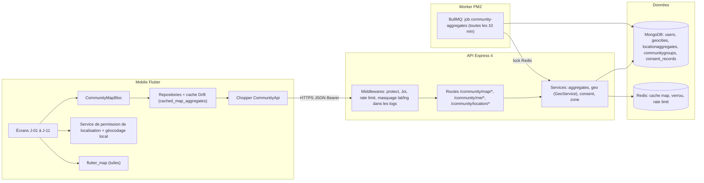
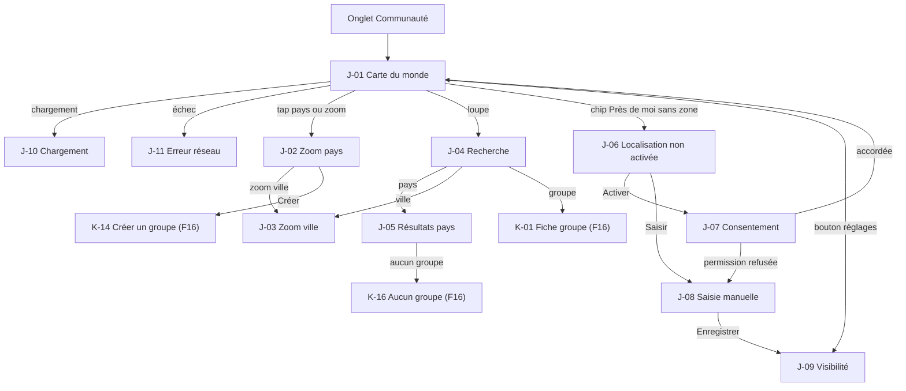
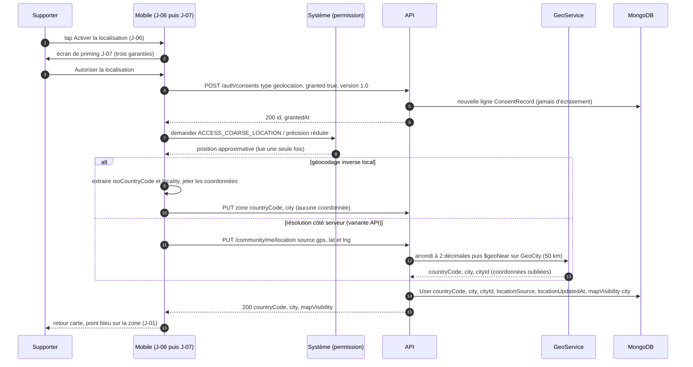
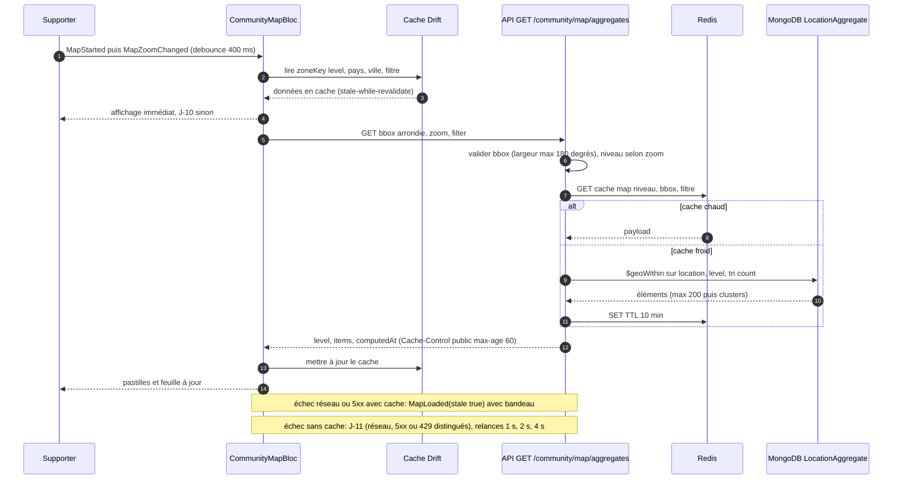
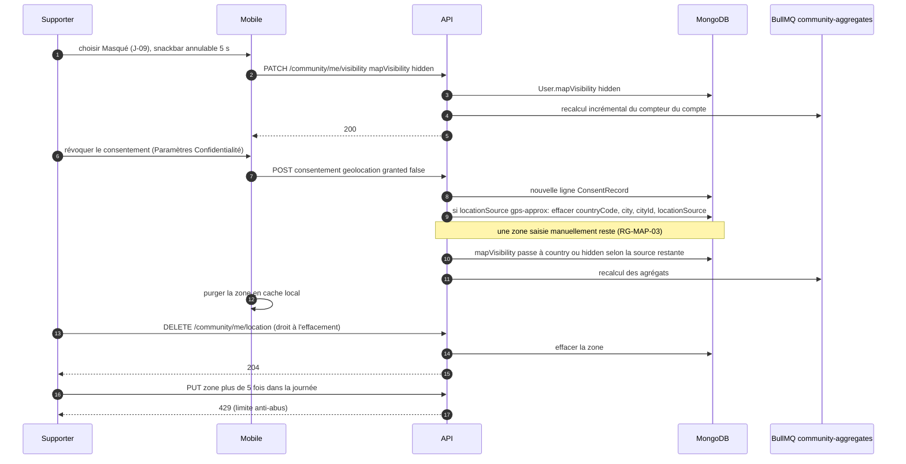
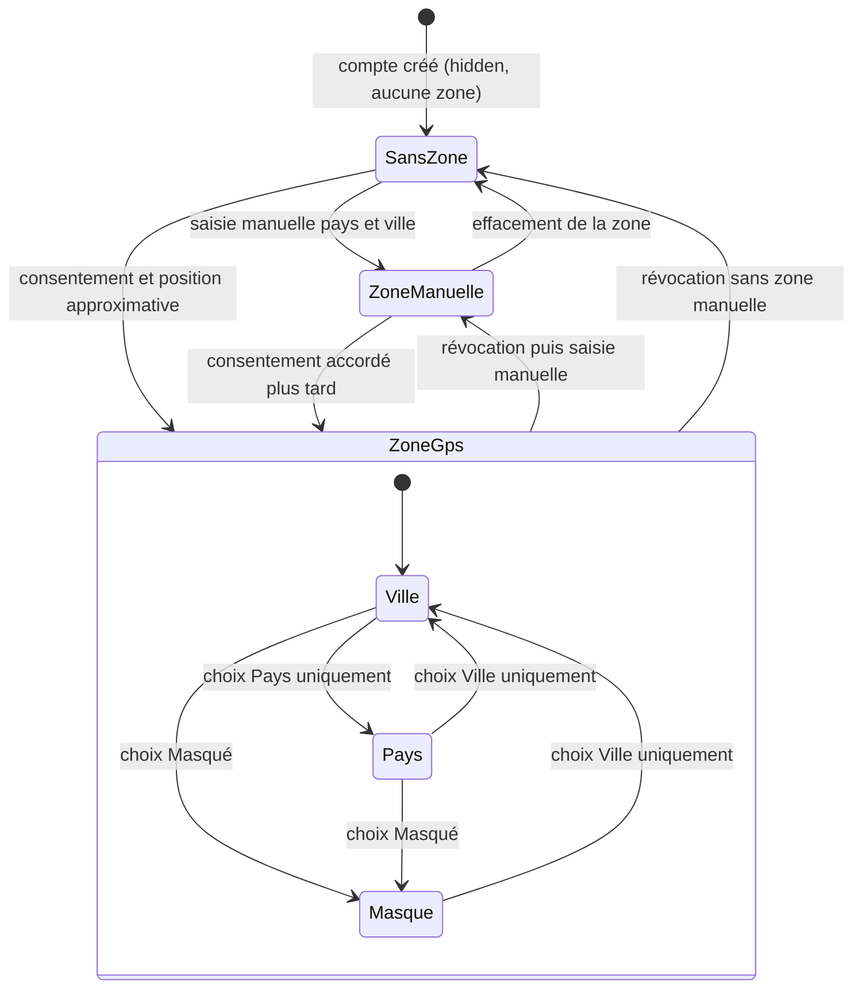
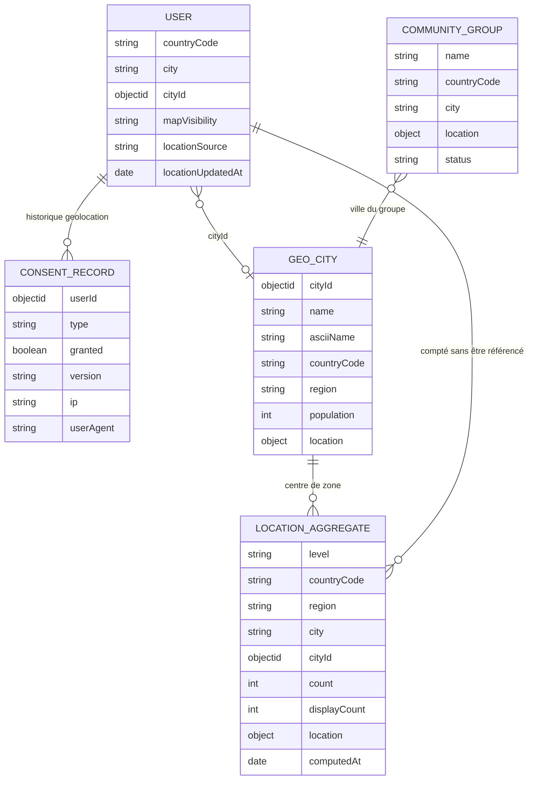
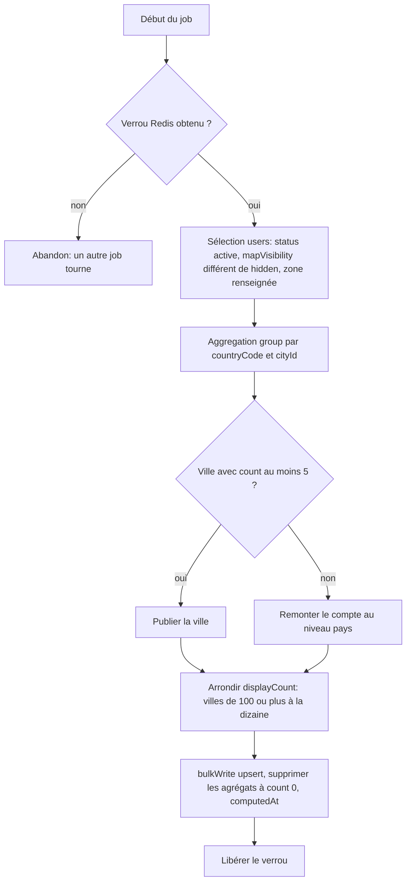
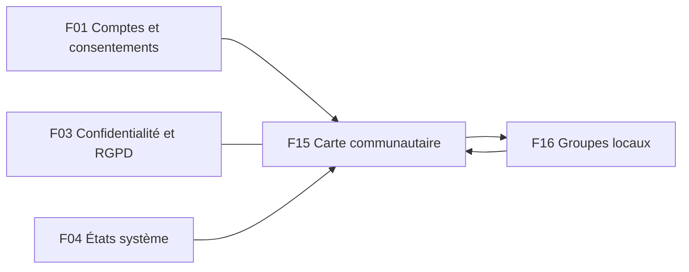

# F15 — Carte communautaire

> Documentation d'architecture · Univers Barça · fonctionnalité **F15**. Ce document explique comment l'application montre aux supporters **combien de culés vivent dans chaque pays et ville** sans jamais révéler la position de qui que ce soit : consentement explicite, déclaration manuelle possible, visibilité réglable, agrégats précalculés avec seuil de confidentialité, index géospatial. Les groupes locaux eux-mêmes (création, adhésion, fil, événements) sont décrits dans F16.

## 1. Résumé et fiche

**Valeur utilisateur.** Le supporter ouvre l'onglet « Communauté » et voit une carte du monde avec des pastilles de densité (« 12 480 culés dans 96 pays », « Espagne 5 210 », « Cameroun 1 240 »). Il zoome sur un pays, puis sur une ville (« Yaoundé · ≈ 720 culés »), découvre les **groupes locaux** proches de lui et peut les rejoindre. Pour que l'application lui propose des groupes « près de moi », il choisit **s'il partage sa zone** : par géolocalisation approximative (avec consentement) ou en saisissant simplement son pays et sa ville, et il règle la précision de son apparition (ville, pays ou masqué).

**Pourquoi c'est sensible.** La localisation est l'une des données les plus délicates d'une application grand public. Le produit repose donc sur une promesse simple, vérifiée par des tests de sécurité dédiés (`API-COMM-31`) : **aucune position précise n'est jamais stockée, journalisée, exposée ou transmise à un autre utilisateur** (règle RG-MAP-01). La carte ne montre que des **compteurs par zone** (jamais un marqueur par personne) et des **groupes publics**.

| Élément | Valeur |
|---|---|
| Phase / priorité | Phase 2 — Communautaire & compétitif ; majorité des issues en P0 (modèle de localisation, consentement, agrégats, carte), recherche et « près de moi » en P1, analytics en P2 |
| Épopées backlog | `MOB-J` (27 issues, `MOB-J-01` à `MOB-J-27`) et `API-COMM` (33 issues ; **`API-COMM-01` à `API-COMM-13`, `API-COMM-29` à `API-COMM-31`** concernent la carte et la localisation, les autres les groupes locaux, voir F16) ; voisins : `API-AUTH` (consentements), `API-MODER`, `ADM-WG` |
| Écrans mobile | `J-01` à `J-11` ; écrans K liés : `K-01`, `K-14`, `K-16` |
| Dépôts concernés | **API** (modèles, GeoService, job d'agrégation, routes), **mobile** (onglet Communauté, flutter_map, permission), **admin** (hors périmètre direct : la validation de groupes est en F16) |
| Documents voisins | F16 (groupes locaux), F03 (paramètres, confidentialité et RGPD), F01 (comptes et consentements), F04 (états système) |

### Vocabulaire

* **Agrégat (`LocationAggregate`)** : compteur précalculé pour une zone (pays, région ou ville). Ce n'est **jamais** un utilisateur.
* **Zone** : couple pays (ISO 3166-1 alpha-2) + ville (référencée dans `GeoCity`) déclaré ou déduit.
* **GeoCity** : référentiel de villes en lecture seule, avec le **centre** de chaque ville (jamais la position d'un utilisateur).
* **Visibilité (`mapVisibility`)** : `city` (compté dans sa ville), `country` (compté dans son pays), `hidden` (non compté).
* **Seuil de confidentialité** : une ville n'est publiée que si elle compte au moins N comptes (défaut 5), pour empêcher d'identifier quelqu'un dans une petite ville.
* **2dsphere** : type d'index géospatial MongoDB pour requêtes `$geoNear` / `$geoWithin` sur des points GeoJSON.
* **Cluster** : regroupement visuel de zones proches renvoyé par l'API quand il y en a trop pour la fenêtre (plus de 200).
* **Priming** : écran pédagogique affiché **avant** la demande de permission système.

### Écart avec les CDC et état du code

Le CDC Backend §3.6 prévoit **PostGIS** pour les agrégations ; la stack réelle est **MongoDB (replica set)** avec index `2dsphere` et agrégations `$geoNear`/`$group`. Le CDC cite aussi l'entité `UserLocationConsent`, qui devient dans le code le type `geolocation` de la collection `consent_records` (déjà présent dans l'enum : `terms`, `privacy`, `geolocation`, `notifications`, `analytics`).

> État du code à la date de rédaction : `src/models/community.model.ts` contient `LocationAggregate` **sans index** avec `level` (`country|region|city`), `countryCode`, `city`, `lat`, `lng`, `count`, `computedAt` (coordonnées en nombres simples, pas en GeoJSON) ; `CommunityGroup` porte déjà un `location` GeoJSON avec index `2dsphere` sparse. `User` possède `countryCode` (2 lettres) et `city` mais **ni `mapVisibility`, ni `locationSource`, ni `cityId`**. **Aucune route `/community/*`, aucun job d'agrégation, aucune collection `geocities`.** Côté mobile, rien n'existe pour la communauté (seul `lib/features/players` est présent).

## 2. Acteurs et user stories

| Acteur | User story | Critères d'acceptation clés |
|---|---|---|
| Supporter | Voir la communauté dans le monde | Carte avec compteurs, liste de pays triée, chargement et erreur gérés (`J-01`, `J-10`, `J-11`) ; compteurs issus de l'API uniquement |
| Supporter | Zoomer pays puis ville | Niveau dérivé du zoom (< 4 pays, 4 à 7 région, ≥ 8 ville) ; ville « ≈ 720 » + encart « Aucune position exacte n'est affichée » (`J-03`) |
| Supporter | Chercher un pays, une ville ou un groupe | Dès 2 caractères, debounce 300 ms, insensible aux accents, 20 résultats max (`J-04`) |
| Supporter | Trouver des groupes près de moi | Rayon 25/50/100/250 km ; sans zone : `409 LOCATION_REQUIRED` → écran `J-06` |
| Supporter | Consentir à la géolocalisation | Consentement distinct de celui de l'inscription, jamais précoché, révocable, historisé (RG-MAP-02) |
| Supporter | Déclarer manuellement ma ville | Sans consentement GPS, pays + ville suffisent (RG-MAP-03) |
| Supporter | Choisir ma visibilité | Ville / pays / masqué ; « masqué » = non compté (`J-09`) |
| Supporter | Effacer ma zone | `DELETE /community/me/location` ; effacement du compte = zone supprimée |
| Système | Garder les compteurs à jour | Recalcul toutes les 10 minutes, idempotent, verrou Redis |
| Équipe sécurité | Garantir qu'aucune position précise ne fuit | Test de schéma sur toutes les routes `/community/*` + test des logs (`API-COMM-31`) |

## 3. Architecture de la fonctionnalité



**Légende.** Le mobile **ne calcule aucun compteur et aucun cluster** (CDC Flutter §7.7.1) : à chaque changement de zoom il redemande des agrégats à l'API. Les tuiles de la carte sont affichées par `flutter_map`, qui n'a aucune connaissance des utilisateurs. `GeoService` convertit une position approximative en ville puis l'**oublie** ; `GeoCity` contient uniquement des centres de villes (source : GeoNames `cities15000`, licence CC-BY, attribution dans `docs/ARCHITECTURE.md`). Le job d'agrégation est dans une file BullMQ **à créer** (nom proposé `community` ; non présente dans `QUEUE_NAMES` aujourd'hui).

Pourquoi des agrégats précalculés plutôt qu'un comptage à la volée : la carte du monde est la page la plus consultée du module ; compter des milliers d'utilisateurs à chaque pan/zoom serait coûteux, et un comptage à la volée rendrait plus facile des attaques par différence (comparer deux fenêtres très proches pour isoler un individu). Les compteurs sont donc figés par tranche de 10 minutes, arrondis et soumis à un seuil.

## 4. Écrans et navigation

| Code | Écran | Rôle |
|---|---|---|
| `J-01` | Carte du monde | En-tête « COMMUNAUTÉ · 12 480 culés dans 96 pays », recherche, chips Tous / Groupes / Watch parties / Près de moi, pastilles, feuille « Dans le monde » |
| `J-02` | Zoom pays — Cameroun | Feuille « Cameroun · 1 240 culés », section « Groupes locaux » (Créer), liste Culés Cameroun / Douala / Bafoussam |
| `J-03` | Zoom ville — Yaoundé | « ≈ 720 culés », badge « Zone approximative », encart bouclier, groupes de la ville |
| `J-04` | Recherche | Saisie « Cam », résultats typés Pays / Ville / Groupe |
| `J-05` | Résultats pour un pays | « 1 240 culés · 6 groupes locaux · 2 watch parties » |
| `J-06` | Localisation non activée | Carte d'invitation : « Activer la localisation » ou « Saisir mon pays / ma ville » |
| `J-07` | Consentement géolocalisation | Priming : trois garanties, « Autoriser la localisation », « Saisir ma ville manuellement » |
| `J-08` | Saisie manuelle pays et ville | Sélecteur de pays + autocomplétion de ville |
| `J-09` | Visibilité sur la carte | Trois options : Ville uniquement, Pays uniquement, Masqué |
| `J-10` | Chargement | Feuille « Chargement de la zone… », carte manipulable |
| `J-11` | Erreur réseau | « Carte indisponible » + « Réessayer » |

<p>


</p>

*`J-03` : en-tête « COMMUNAUTÉ » avec loupe et cloche (badge 2), barre « Rechercher un pays ou une ville », chips (« Tous » actif), pastilles bordeaux avec nombre (42, 28, 17), pastilles jaunes avec icône de groupe, **point bleu avec halo = la zone de l'utilisateur, jamais sa position** ; feuille « YAOUNDÉ · ≈ 720 CULÉS », titre « AUTOUR DE TOI », badge vert « Zone approximative », encart « Aucune position exacte n'est affichée : seuls des compteurs par zone et les groupes publics apparaissent ».*



Routes go_router proposées (`MOB-J-24`) : `/community`, `/community/search`, `/community/country/:code`, `/community/city/:code/:city`, `/community/location/consent`, `/community/location/manual`, `/community/location/visibility`. Lien profond `univers-barca://community/country/CM` (utilisateur authentifié ; code pays invalide → `/community`). L'onglet garde sa propre pile (ShellRoute).

## 5. Flux détaillés

### 5.1 Consentement et définition de la zone (nominal)



**Pas à pas.** (1-3) Le **priming** explique avant toute demande système. (4-6) Le consentement est enregistré **avant** la permission : chaque octroi ou révocation ajoute une ligne `ConsentRecord` (type `geolocation`, `granted`, `version`, `ip`, `userAgent`). (7-9) La position est lue **une seule fois**, avec précision basse (Android : `COARSE` uniquement ; iOS : précision réduite acceptée), sans suivi continu ni service d'arrière-plan. (10-14) Deux variantes coexistent dans les specs (voir §14) : le mobile spécifie un **géocodage inverse local** qui n'envoie que pays et ville ; l'API spécifie un `GeoService` qui accepte lat/lng arrondis à 2 décimales (≈ 1 km), les convertit en ville avec `$geoNear` (`maxDistance` 50 000 m, sinon `422 LOCATION_UNRESOLVED`) et ne les conserve nulle part. (15-16) Seuls pays, ville et références sont stockés ; la visibilité passe de `hidden` à `city` après confirmation.

### 5.2 Afficher la carte : zoom, cache et erreurs



**Explications.** Le niveau est dérivé du zoom : API `0-3 pays`, `4-7 région`, `≥ 8 ville` ; le mobile ajoute une **hystérésis de 0,3 niveau** pour éviter les va-et-vient, arrondit la `bbox` à 0,5° (plus de hits de cache **et** moins de précision exploitable), annule la requête précédente (`restartable()`), et plafonne l'affichage à 200 agrégats. Au-delà de 200 éléments, l'API fusionne les plus petits en `{type:'cluster', count}`. Un timeout visuel de 10 s bascule vers `J-11`. Hors-ligne sans cache : `J-11`.

### 5.3 Révocation, masquage et effacement (cas limites)



### 5.4 Cycle de vie de la zone et de la visibilité d'un utilisateur



Dans tous les cas, `Masque` signifie « non compté dans les agrégats » ; l'utilisateur **reste visible comme membre de ses groupes** (F16). Défaut `hidden` tant qu'aucun consentement ni zone n'a été donné (opt-in, RG-MAP-02).

## 6. Contrats d'API

Préfixe `/api/v1`. Enveloppe `{ success, data }` ; erreurs `{ success:false, error:{ code, message, details, traceId } }`. Toutes les routes sont **authentifiées** (le CDC place la communauté sous accès authentifié) ; les routes de lecture de carte sont mises en cache.

| Méthode | Chemin | Auth / rôle | Rate limit | Requête | Réponse | Erreurs |
|---|---|---|---|---|---|---|
| GET | `/community/map/aggregates` | utilisateur | défaut ; `Cache-Control: public, max-age=60` | `bbox=minLng,minLat,maxLng,maxLat` (**obligatoire**), `zoom` 0-18, `filter=all\|groups\|watch-parties` | `{level, items[{level, countryCode, city?, center{lng,lat}, count, groupsCount, watchPartiesCount}], computedAt}` ; max 200 éléments puis `cluster` | 422 bbox invalide ou plus de 180° |
| GET | `/community/map/summary` | utilisateur | défaut (cache 10 min) | `?limit=` ≤ 50 | `{totalMembers, countriesCount, top[{countryCode, name, count}]}` ; noms localisés (`Intl.DisplayNames`) | — |
| GET | `/community/map/zones/:countryCode(/:cityId)` | utilisateur | défaut | — | pays : `{count, groupsCount, watchPartiesCount, groups[3]}` ; ville : + `approximate:true`, `notice:'map.approxZone'`, `count` arrondi | pas de 404 : `count:0` et `groups:[]` |
| GET | `/community/map/search` | utilisateur | **60/min** | `q` 2-50, `limit` ≤ 20 | `[{type: country\|city\|group, name, count, …}]` | 422 |
| GET | `/community/groups/nearby` | utilisateur | défaut | `radius` ∈ {25, 50, 100, 250} (défaut 50), `page`, `limit` ≤ 50 | groupes + `distanceKm` **arrondie à 5 km** | **409 `LOCATION_REQUIRED`** (`details.actions`) |
| GET | `/community/geo/cities` | utilisateur | défaut | `countryCode`, `q` | `[{cityId, name, region}]` | — |
| PUT | `/community/me/location` | utilisateur | **5 changements/jour** | `{source:'manual', countryCode, cityId}` ou `{source:'gps', lat, lng}` + `visibility?` | `{countryCode, city, mapVisibility}` | **403 `CONSENT_REQUIRED`** (gps sans consentement), 422 `LOCATION_UNRESOLVED`, 429 |
| DELETE | `/community/me/location` | utilisateur | défaut | — | 204 | — |
| PATCH | `/community/me/visibility` | utilisateur | défaut | `{mapVisibility: city\|country\|hidden}` | `{mapVisibility}` | 422 (`city` exige une ville, `country` un pays) |
| POST | `/community/location/consent` | utilisateur | défaut | `{granted, policyVersion}` | `{granted, mapVisibility, location\|null}` | 422 |
| POST | `/auth/consents` | utilisateur | défaut | `{type:'geolocation', granted, version}` | `{id, type, granted, grantedAt}` | 422 |

Exemple `GET /community/map/aggregates?bbox=-20,-40,60,40&zoom=3&filter=all` :

```json
{ "success": true, "data": { "level": "country", "computedAt": "2026-10-15T10:00:00Z",
  "items": [ { "level": "country", "countryCode": "ES", "count": 5210,
               "center": { "lng": -3.7, "lat": 40.4 }, "groupsCount": 38 } ] } }
```

> Seul `center` apparaît, et il désigne le **centre d'une zone** (pays, région ou ville de `GeoCity`), jamais un utilisateur. Le test `API-COMM-31` vérifie qu'aucune clé `lat`, `lng`, `latitude`, `longitude`, `coordinates` n'existe ailleurs dans les réponses `/community/*`.

## 7. Modèle de données



**Ce qui existe** : `LocationAggregate` (voir état du code), `CommunityGroup.location` (2dsphere sparse), `User.countryCode`/`city` (index `{countryCode:1, city:1}`), `ConsentRecord` (enum `geolocation`). **Ajouts du backlog** :
* `User.mapVisibility ∈ {city, country, hidden}` (défaut `hidden`), `User.locationSource ∈ {gps-approx, manual, null}`, `User.locationUpdatedAt`, `User.cityId` (`API-COMM-01`) ;
* collection `geocities {cityId, name, asciiName, countryCode, region, population, location: GeoJSON Point}` avec index `2dsphere` et index unique `{countryCode, asciiName, region}` ; coordonnées **arrondies à 2 décimales** (≈ 1 km) à l'import, import idempotent par `upsert`, jeu de test minimal : Yaoundé, Douala, Bafoussam, Paris, Lyon, Barcelone, Dakar, Canberra (`API-COMM-02`) ;
* `LocationAggregate` migré vers GeoJSON : `location` (Point), `level`, `countryCode`, `region`, `city`, `cityId`, `count ≥ 0`, `displayCount`, `computedAt` ; index `{location:'2dsphere'}`, unique `{level, countryCode, region, cityId}`, `{level:1, count:-1}` ; les anciens `lat`/`lng` sont conservés en lecture une version puis supprimés par migration (`API-COMM-07`) ;
* index `CommunityGroup` : `{status:1, countryCode:1, city:1, membersCount:-1}`, `{location:'2dsphere'}`, texte sur `name` (voir F16).

### Clés Redis

Le backlog écrit `map:{level}:{bbox arrondie à 1 décimale}:{filter}` et `lock:community:aggregates` ; avec le préfixe `ub:` du projet, les clés **proposées** sont :

| Clé (proposée) | Rôle | TTL |
|---|---|---|
| `ub:cache:v1:community:map:{level}:{bbox}:{filter}` | réponse de carte | 10 min |
| `ub:cache:v1:community:summary` | totaux mondiaux | 10 min |
| `ub:lock:community:aggregates` | verrou du job d'agrégation | 9 min |
| `ub:rl:community:location:{userId}` | limiteur de changements de zone | 24 h |

**Cache mobile Drift** : `cached_map_aggregates (zoneKey = level|countryCode|city|filter, payloadJson, fetchedAt)` ; TTL 10 min en navigation active, conservé 7 jours en repli hors-ligne ; **aucune donnée personnelle** (compteurs et groupes publics) ; purgé à la déconnexion et à la suppression de compte.

**Migrations (proposé)** : création de `geocities` et import GeoNames, ajout des champs `User`, conversion de `LocationAggregate` en GeoJSON avec index, rattachement `cityId` aux utilisateurs ayant déjà `countryCode` et `city` ; scripts idempotents dans `scripts/migrations`.

## 8. Traitements asynchrones et cache

| Job | Déclencheur | Rôle | Idempotence et reprise |
|---|---|---|---|
| `community-aggregates` | répétition toutes les **10 minutes** (CDC Backend §5.6) | recalcule `LocationAggregate` | `bulkWrite` en `upsert`, verrou Redis (TTL 9 min), 5 tentatives, backoff exponentiel 2 s, puis dead-letter |
| Recalcul incrémental | changement de visibilité, révocation, effacement | met à jour le compteur du compte concerné | mêmes garanties |
| Import `GeoCity` | script `seed` hors runtime | référentiel des villes | upsert sur `{countryCode, asciiName, region}` |



Règles de calcul : `mapVisibility='country'` compte au niveau pays/région uniquement ; `'city'` compte à tous les niveaux ; `hidden` n'est jamais compté. `displayCount` : villes ≥ 100 arrondies à la dizaine (720), sinon valeur exacte ; pays exacts. Le **seuil de confidentialité** `COMMUNITY_MIN_CITY_COUNT` (défaut **5**, à valider) évite qu'un compteur de 1 ou 2 révèle l'identité d'un utilisateur. Fraîcheur maximale : 10 min de calcul + 10 min de cache + 60 s de cache HTTP.

## 9. Règles de gestion

1. **RG-MAP-01** : la géolocalisation précise n'est jamais transmise à un autre utilisateur ni stockée ; seules des agrégations par zone sont publiques. Aucune coordonnée en base, en log (Winston : masquer `lat`, `lng`, `latitude`, `longitude` dans `requestLogger`), en trace OpenTelemetry, en rapport de crash.
2. **RG-MAP-02** : consentement explicite, distinct de celui d'inscription, jamais précoché, révocable à tout moment depuis Paramètres › Confidentialité ; historisé par lignes successives.
3. **RG-MAP-03** : sans consentement, l'utilisateur peut déclarer manuellement pays et ville (donnée moins précise, optionnelle).
4. **Visibilité par défaut** : `hidden` tant qu'aucune zone ni consentement ; `city` après confirmation du premier renseignement.
5. **Précision** : lat/lng arrondis à 2 décimales (≈ 1 km) dès la validation côté serveur ; coordonnées de `GeoCity` arrondies à 2 décimales à l'import.
6. **Résolution GPS → ville** : `$geoNear`, `maxDistance` 50 000 m ; sinon `422 LOCATION_UNRESOLVED`.
7. **Comptage** : seuls les comptes `status='active'`, `mapVisibility ≠ 'hidden'`, avec zone, sont comptés.
8. **Seuil de confidentialité ville** : 5 comptes minimum (`COMMUNITY_MIN_CITY_COUNT`, à valider), sinon remontée au niveau pays.
9. **Arrondi d'affichage** : villes ≥ 100 → dizaine (« ≈ 720 ») ; le mobile préfixe toujours le compteur de ville par « ≈ ».
10. **Niveau selon le zoom** : 0-3 pays, 4-7 région, ≥ 8 ville ; 200 éléments max par réponse avant clustering ; `bbox` jamais plus large que 180°.
11. **Fraîcheur** : recalcul toutes les 10 minutes ; cache serveur 10 min ; cache HTTP 60 s ; cache mobile 10 min (7 jours hors-ligne).
12. **Groupes proches** : le point de recherche est le **centre de la ville** de l'utilisateur ; distances arrondies à 5 km ; rayon ∈ {25, 50, 100, 250} km.
13. **Changements de zone** : 5 par jour maximum.
14. **Recherche** : `q` 2 à 50 caractères, collation française `strength 1` (insensible casse et accents), préfixe prioritaire, villes sous seuil exclues, 60 requêtes/min.
15. **Classement des pays** : `top` 10 par défaut (≤ 50), noms localisés FR/EN/ES.
16. **Utilisateur masqué** : visible comme membre de ses groupes mais non compté.
17. **Effacement** : la suppression de compte efface ville, pays et cityId (F03).
18. **Carte mobile** : `flutter_map` plein écran, centre initial lat 20 / lng 10, zoom 2, zoom 2 à 14, rotation désactivée ; marqueurs : diamètre 36 à 64 dp proportionnel à `log10(count)`, nombres ≥ 1000 abrégés (1,2 k).
19. **Permission** : jamais au lancement de l'application ; uniquement après `J-07` ; Android `ACCESS_COARSE_LOCATION` seulement ; statut `deniedForever` → réglages système.

## 10. Sécurité, RGPD et anti-abus

* **Minimisation** : stockage de `countryCode`, `city`, `cityId` uniquement ; position lue une fois, jamais persistée. Le consentement géolocalisation est **distinct** et révocable ; la révocation efface la zone issue du GPS (`gps-approx`) mais conserve une zone manuelle.
* **Anti-réidentification** : seuil de 5, arrondi des grands compteurs, `bbox` arrondie côté mobile (0,5°) et côté cache (1 décimale), distances de groupes arrondies à 5 km, cache 10 min qui interdit la comparaison « avant/après » d'une inscription.
* **Pas de marqueur individuel** : même la zone de l'utilisateur est dessinée au centroïde de la ville agrégée.
* **Logs et traces** : masquage systématique des champs de coordonnées ; aucun texte de recherche en clair dans les analytics (`MOB-J-25`, seulement la longueur) ; aucun envoi analytics sans consentement `analytics`.
* **Anti-abus** : 5 changements de zone/jour ; 60 recherches/min ; rate limits par `userId` (pas seulement par IP) ; `429` avec `Retry-After`.
* **IDOR et autorisation** : la zone et la visibilité sont toujours celles du jeton ; aucune route ne prend un `userId` en paramètre.
* **RGPD** (`API-COMM-29`) : export (`GET /users/me/export`) = zone déclarée, `mapVisibility`, historique de consentement géolocalisation ; effacement du compte = zone effacée et compteurs recalculés (job `rgpd` idempotent). Voir F03.
* **Données ouvertes** : `GeoCity` provient de GeoNames (CC-BY) ; l'attribution est obligatoire.
* **Droits d'image** : tuiles de carte sous licence (OpenStreetMap ou fournisseur de tuiles, **à confirmer**) ; aucun logo officiel (application fan-made).

## 11. Erreurs et états dégradés

| Situation | Serveur | Client |
|---|---|---|
| Aucun agrégat (zone vide) | `count:0`, `items:[]` (pas de 404) | « Aucun culé dans cette zone pour l'instant » + CTA « Créer un groupe » |
| Hors-ligne avec cache | — | affichage du cache avec mention d'ancienneté, `stale:true` |
| Hors-ligne sans cache | — | `J-11` « Carte indisponible » |
| 5xx | `{success:false, error}` | « Service temporairement indisponible » ; relances 1 s, 2 s, 4 s (3 max) |
| 429 | `Retry-After` | « Trop de requêtes, réessaie dans un instant » (`RateLimitFailure`) |
| Timeout | — | 10 s, puis bascule vers `J-11` |
| Pas de zone pour « Près de moi » | `409 LOCATION_REQUIRED` + `details.actions` | `J-06` avec deux alternatives, carte reste utilisable |
| Permission refusée | — | repli sur `J-08` (saisie manuelle), consentement annulé (`granted:false`) |
| Services de localisation désactivés | — | message dédié et lien vers les réglages |
| Géocodage impossible (hors-ligne ou 422 `LOCATION_UNRESOLVED`) | `422` | « Aucune ville trouvée, saisis ta ville manuellement » |
| Consentement non enregistrable | `5xx` / réseau | toast « Impossible d'enregistrer ton choix », consentement non considéré comme accordé |
| Redis absent | cache ignoré, lecture directe MongoDB | aucun message |
| Job d'agrégation en échec | agrégats précédents conservés (`computedAt` ancien) | compteurs légèrement périmés, jamais vides |

## 12. Connexions avec les autres fonctionnalités

| Fonctionnalité | Relation | Détail |
|---|---|---|
| F16 Groupes locaux | partage / alimente | `groupsCount`, `watchPartiesCount`, groupes proches ; création de groupe depuis la carte (`J-02` → `K-14`) |
| F01 Comptes | dépend de | `User` (zone, visibilité), `ConsentRecord`, statut actif |
| F03 Paramètres et RGPD | partage | Paramètres › Confidentialité (révocation), export, effacement |
| F04 États système | dépend de | bandeaux hors-ligne, erreurs réseau |
| Notifications | alimente | lien profond vers une zone |
| Assistant (ailleurs) | — | aucun lien |



## 13. Observabilité et tests

**Métriques** (préfixe `ub_`) : durée et nombre d'agrégats du job, `jobsFailed` (file `community`), âge du dernier `computedAt`, hit/miss du cache de carte, taux de `LOCATION_UNRESOLVED`, nombre de zones modifiées par jour, comptes `hidden` vs `city` vs `country` (sans identifiant). **Logs** : jamais de coordonnées ; `traceId` conservé. **Objectifs p95** (`API-COMM-30`) : `aggregates` < 300 ms (cache), `groups/search` < 200 ms.

**Tests** :
* `API-COMM-31` (sécurité, **P0**) : parcours de toutes les routes `/community/*` avec vérification par schéma qu'aucune clé de coordonnées n'apparaît hors `center`, capture des logs, IDOR, `hidden` jamais compté, la révocation purge la zone GPS.
* `API-COMM-32` : parcours 1 « inscription → consentement → ville → agrégats → carte → recherche → groupes proches », parcours 3 « sans consentement, saisie manuelle, visibilité pays » ; horloge simulée pour le job, fixtures `GeoCity` isolées.
* Job : deux exécutions = même état ; seuil de 5 (ville de 4 comptes remontée au pays) ; arrondi 723 → 720.
* Mobile (`MOB-J-26`) : serveur simulé (`shelf`) avec fixtures Cameroun, un golden clair et sombre par écran `J-01` à `J-11`, couverture ≥ 80 % de `features/community/map` ; scénarios nouveau pays, refus de permission, révocation, hors-ligne avec cache, erreur 500 puis succès. Accessibilité (`MOB-J-23`) : carte `ExcludeSemantics`, la feuille est la représentation accessible, zones ≥ 48 dp, annonce « Zone : Cameroun, 1 240 culés ».
* Charge k6 : `GET /community/map/aggregates` (scénario obligatoire pour toute nouvelle route) ; Swagger exporté (`API-COMM-33`).

## 14. Points ouverts, décisions à confirmer et incohérences

**À confirmer (backlog).**
* Seuil `COMMUNITY_MIN_CITY_COUNT` (défaut 5) et règle d'arrondi.
* Route exacte de mise à jour de la zone (« chemin à confirmer », `MOB-J-19`).
* Fournisseur de tuiles de carte et licence d'attribution.
* Valeur de `displayCount` pour les petits pays et la liste de pays « top » (10 par défaut).

**Incohérences détectées entre mobile (`MOB-J`) et API (`API-COMM`).**

| Sujet | Mobile | API |
|---|---|---|
| Géocodage | **local sur l'appareil** (package `geocoding`), seuls pays et ville sont envoyés (`MOB-J-14`) ; « coordonnées jamais envoyées à l'API » | `PUT /community/me/location {source:'gps', lat, lng}` : l'API reçoit et arrondit lat/lng puis les oublie (`API-COMM-03`, `API-COMM-05`) |
| Route de zone | `PUT /community/location {countryCode, city, visibility}` | `PUT /community/me/location {source, countryCode, cityId}` + `PATCH /community/me/visibility` |
| Route de consentement | `POST /auth/consents {type:'geolocation', granted, version}` | `POST /community/location/consent {granted, policyVersion}` (en plus de `/auth/consents`) |
| Ville | texte libre 2-80 caractères avec autocomplétion, « saisie libre autorisée » | `cityId` obligatoire appartenant au pays (`GeoCity`) |
| Paramètres de carte | `level`, `countryCode`, `city`, `bbox` optionnel, `filter=watch_parties`, `q` | `bbox` **obligatoire**, `zoom`, `filter=watch-parties` ; recherche déportée sur `/community/map/search` |
| Forme de réponse | `{totalSupporters, totalCountries, aggregates[{lat, lng}], groups[]}` en un appel | `{level, items[{center{lng,lat}}]}` ; totaux dans `/map/summary` ; détail dans `/map/zones/…` |
| Paramètres de recherche de groupes | `country`, `city` | `countryCode`, `city` |
| Arrondi de `bbox` | 0,5° côté client | 1 décimale côté cache serveur |
| Seuils de zoom | `zoom < 4`, `4 ≤ zoom < 8`, `≥ 8` avec hystérésis 0,3 | 0-3, 4-7, ≥ 8 (cohérents, sans hystérésis) |
| Modèle d'agrégat | `lat`/`lng` du centroïde dans l'entité | modèle actuel `lat`/`lng` à migrer vers GeoJSON `location` |
| Retrait de la zone | n'existe pas dans le mobile (pas d'écran de suppression) | `DELETE /community/me/location` |
| Visibilité à l'enregistrement | « Ville uniquement » par défaut après saisie | `hidden` tant que non confirmé, puis `city` après confirmation |

**Autres.** Les CDC citent PostGIS (non applicable). Le CDC Backend §3.6 place `UpdateLocationConsent` comme cas d'usage unique tandis que le backlog le scinde en trois endpoints (consentement, zone, visibilité). Le mobile `MOB-J-06` mentionne un « bouton assistant flottant » (`AssistantOverlay`) hors périmètre.

## 15. Pour aller plus loin

* **Épopées** : `MOB-J` (`MOB-J-01` à `MOB-J-27`), `API-COMM` (`API-COMM-01` à `API-COMM-13`, `API-COMM-29` à `API-COMM-33`), `API-AUTH` (consentements), `MOB-K`.
* **CDC** : Global §10.2 (données de localisation), RG-MAP-01 à RG-MAP-05 ; Backend §3.6 (module Community), §4.5 (domaine communautaire), §5.6 (cache et agrégats toutes les 10 min) ; Flutter §6.4 (permissions), §7.7.1 (carte, pas de clusters locaux).
* **Code** : `univers_barca_api/src/models/community.model.ts`, `src/models/user.model.ts` (`countryCode`, `city`), `src/models/consent-record.model.ts`, `src/jobs/queues.ts` ; mobile : `univers_barca_mobile/lib/features/players` (modèle de référence pour la future `lib/features/community`).
