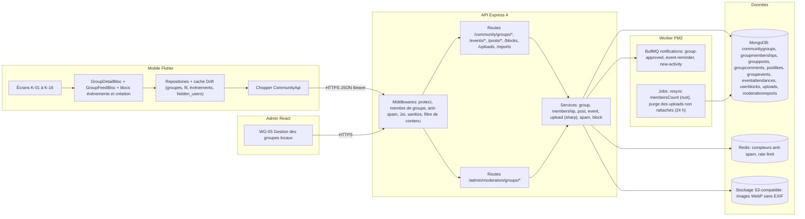
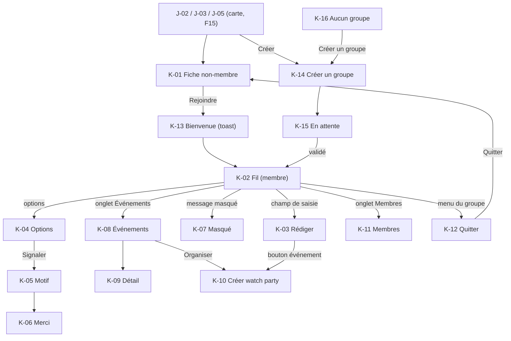
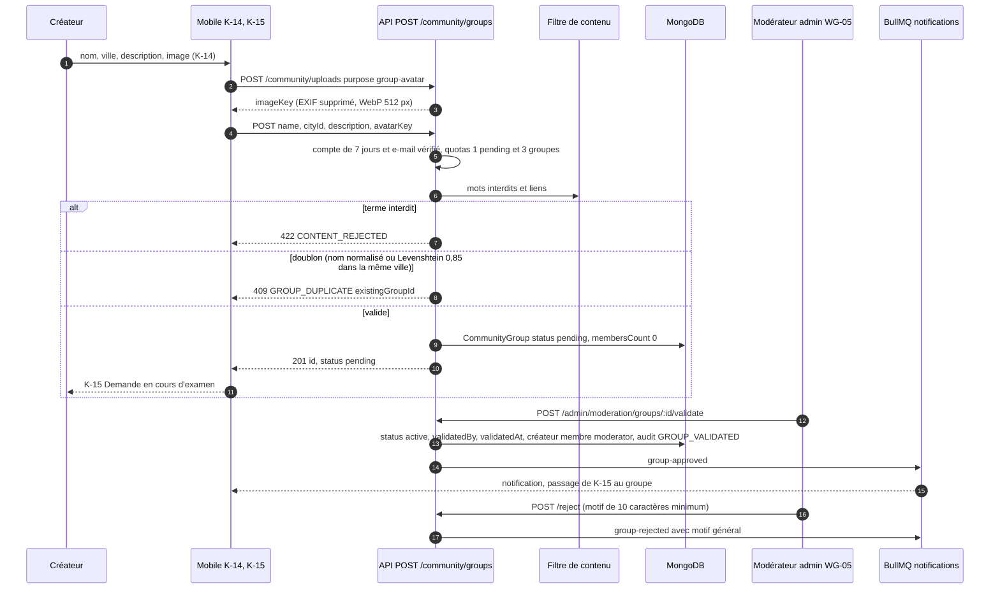
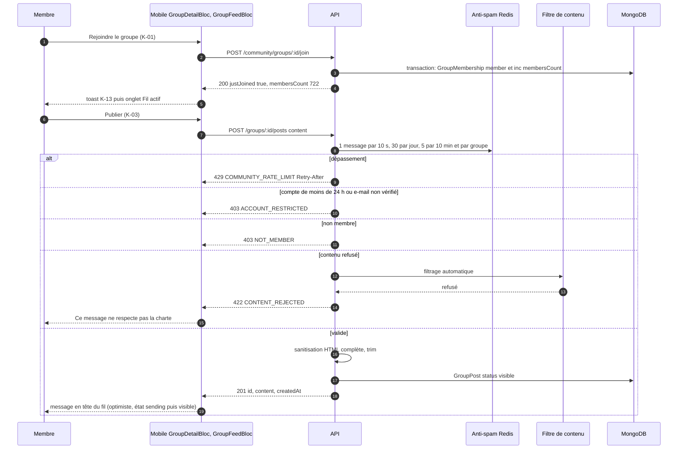
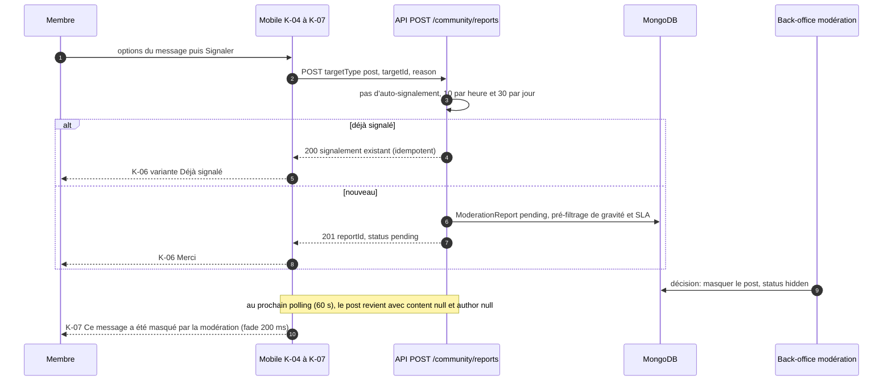
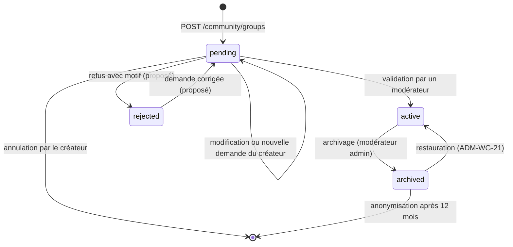
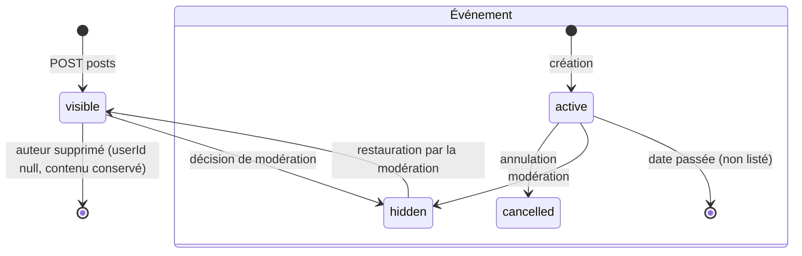
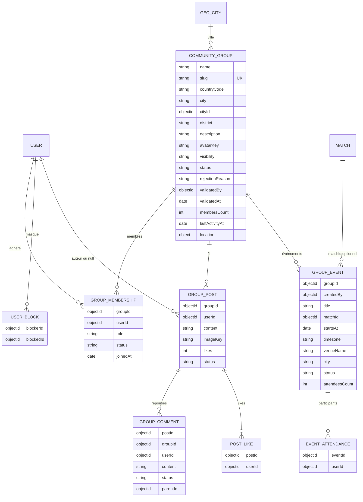
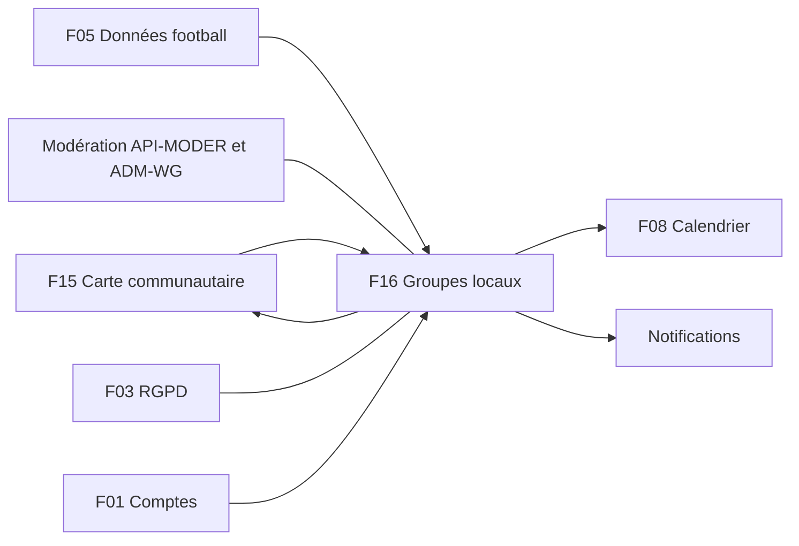

# F16 — Groupes locaux

> Documentation d'architecture · Univers Barça · fonctionnalité **F16**. Ce document explique la couche sociale de la communauté : les **groupes locaux** de supporters (par pays et ville), leur création soumise à validation, l'adhésion, les rôles, le fil de discussion, les **watch parties** (événements pour regarder un match ensemble), la modération (signalement, masquage) et les garde-fous anti-spam. La carte qui permet de les découvrir est décrite dans F15.

## 1. Résumé et fiche

**Valeur utilisateur.** Un supporter de Yaoundé trouve « Culés Cameroun » (721 membres) depuis la carte, rejoint le groupe en un tap, lit le fil, écrit « Qui est chaud pour le Clásico samedi ? », et s'inscrit à la watch party « Clásico au Relais » (« 37 y vont »). S'il n'y a pas encore de groupe dans sa ville, il en **demande la création** ; un modérateur la valide généralement en 24 h. Il peut signaler un message, masquer un utilisateur et quitter un groupe à tout moment.

**Pourquoi c'est structurant.** Un espace de discussion public est un risque : spam, harcèlement, fuite de données personnelles (adresse, téléphone, EXIF des photos), prolifération de groupes doublons. L'architecture met donc la **prudence au centre** : validation des créations (RG-MAP-04), filtrage automatique avant insertion, quotas multiples, lieux **publics** uniquement pour les événements, anonymisation (et non suppression) des contenus à l'effacement d'un compte, tout contrôle d'accès **côté serveur**.

| Élément | Valeur |
|---|---|
| Phase / priorité | Phase 2 — Communautaire & compétitif ; cœur (fiche, adhésion, fil, anti-spam, RGPD) en P0, événements / membres / notifications / création côté mobile en P1, commentaires et likes en P2 |
| Épopées backlog | `MOB-K` (31 issues, `MOB-K-01` à `MOB-K-31`) et `API-COMM` (**`API-COMM-14` à `API-COMM-28`** pour les groupes, plus `API-COMM-29` à `API-COMM-33` transverses) ; voisins : `API-MODER` (`API-MODER-05` signalement, `API-MODER-16` validation des groupes), `ADM-WG` (`ADM-WG-18` à `ADM-WG-21`), `API-NOTIF` |
| Écrans mobile | `K-01` à `K-16` ; écrans carte liés `J-02`, `J-03`, `J-05` ; écran admin `WG-05` (gestion des groupes locaux) |
| Dépôts concernés | **API** (modèles, routes, anti-spam, uploads, notifications), **mobile** (module groupes), **admin** (validation / archivage) |
| Documents voisins | F15 (carte), F03 (RGPD), F08 (calendrier, « Ajouter à mon agenda »), F04 (états système) |

### Vocabulaire

* **Groupe local** : groupe public lié à une ville (`CommunityGroup`), avec un quartier optionnel (`district`, ex. Bastos).
* **Statut du groupe** : `pending` (en attente de validation), `active`, `archived`.
* **Rôle de groupe** : `member` ou `moderator` (**distinct** du rôle admin du back-office).
* **Post** : message du fil (`GroupPost`, 1 à 500 caractères, image optionnelle).
* **Watch party / événement** : rendez-vous public pour regarder un match (`GroupEvent`).
* **RSVP / participation** : « Je participe » (`EventAttendance`).
* **Masquage par la modération** : `status:'hidden'` ; le contenu n'est **jamais** renvoyé.
* **Masquer un utilisateur** : filtre personnel (sans sanction) pour ne plus voir un auteur.
* **EXIF** : métadonnées d'une photo (peut contenir un GPS) supprimées à l'upload.

### Écart avec les CDC et état du code

Le CDC Backend §3.6 liste six endpoints (`/community/groups/search`, `/groups/:id`, `/join`, `/posts`, `/reports`) ; le backlog en ajoute beaucoup (leave, membres, événements, blocs, uploads, création). Les tables PostgreSQL deviennent des collections MongoDB.

> État du code : `src/models/community.model.ts` contient `CommunityGroup` (`name`, `countryCode`, `city`, `description`, `location` GeoJSON avec `2dsphere` sparse, `createdBy`, `status` `pending|active|archived`, `membersCount`, **`events[]` embarqués** avec `attendeeIds[]`), `GroupMembership` (`groupId`, `userId`, `role` `member|moderator`, `joinedAt`, unique `{groupId,userId}`) et `GroupPost` (`groupId`, `userId`, `content` max 500, `imageKey`, `likes`, `status` `visible|hidden`, index `{groupId:1, createdAt:-1}`). **Aucune route `/community/*`** et rien côté mobile.

## 2. Acteurs et user stories

| Acteur | User story | Critères d'acceptation clés |
|---|---|---|
| Supporter (non-membre) | Découvrir un groupe | Fiche `K-01` : nom, ville, membres, badge Public, description, prochain événement ; fil / membres masqués (`403 NOT_MEMBER`) |
| Supporter | Rejoindre / quitter | `POST /join` idempotent ; `justJoined:true` → toast `K-13` ; 20 groupes max, 10 adhésions/h ; dernier modérateur ne peut pas partir (`409 LAST_MODERATOR`) |
| Membre | Écrire dans le fil | 1 à 500 caractères, filtre automatique, `422 CONTENT_REJECTED`, 1 message / 10 s |
| Membre | Organiser une watch party | Titre 3-80, lieu **public** 2-80, date future, match optionnel ; 3 événements / semaine |
| Membre | Participer à un événement | « Je participe » réversible, compteur transactionnel |
| Membre | Signaler / masquer | Signalement anonyme ; masquage d'utilisateur sans notification |
| Modérateur de groupe | Gérer les membres | Promouvoir (5 modérateurs max), retirer un membre (pas un autre modérateur), supprimer un commentaire |
| Créateur | Demander un groupe | Anti-doublon, quotas (1 pending, 3 total), compte ≥ 7 jours et e-mail vérifié ; modifier ou annuler tant que `pending` |
| Modérateur (admin) | Valider / refuser / archiver | Validation avec règles affichées, refus avec motif ≥ 10 caractères, audit `GROUP_VALIDATED`/`GROUP_REJECTED`/`GROUP_ARCHIVED` |
| Système | Limiter le spam, notifier, anonymiser | Quotas, `429` + `Retry-After`, notifications respectant les préférences, anonymisation RGPD |

## 3. Architecture de la fonctionnalité



**Légende.** Le serveur est l'unique autorité d'accès : le client ne fait que refléter (`MOB-K-27`). Les messages masqués ne quittent jamais le serveur avec leur contenu. Les images passent par `POST /community/uploads` (vérification des magic bytes, ré-encodage WebP via `sharp`, suppression EXIF/GPS) et ne sont référencées que par une `imageKey` opaque. Les notifications utilisent la file existante `notifications`.

## 4. Écrans et navigation

| Code | Écran | Rôle |
|---|---|---|
| `K-01` | Fiche groupe — non-membre | Bannière, nom, ville, membres, badge Public, « Rejoindre le groupe », prochain événement |
| `K-02` | Fil de discussion (membre) | Messages avec badge « Modérateur », « il y a 12 min », champ « Écrire dans le groupe… » |
| `K-03` | Rédiger un message | Feuille « Nouveau message », compteur 52 / 500, boutons image et événement |
| `K-04` | Options d'un message | Copier, Enregistrer, Signaler, Masquer cet utilisateur |
| `K-05` | Motif de signalement | 5 motifs, signalement anonyme |
| `K-06` | Signalement envoyé | « Merci ! » + « Masquer cet utilisateur » |
| `K-07` | Message masqué par la modération | « Ce message a été masqué par la modération. » |
| `K-08` | Événements du groupe | Liste par mois, « Organiser une watch party » |
| `K-09` | Détail d'un événement | Lieu, organisateur, 37 participants, match, « Je participe » |
| `K-10` | Créer une watch party | Titre, match, date, heure, lieu public, ville |
| `K-11` | Liste des membres | Recherche, rôles, badge « Modo » |
| `K-12` | Quitter le groupe | Modale de confirmation |
| `K-13` | Bienvenue dans le groupe | Toast « Bienvenue dans Culés Cameroun ! » |
| `K-14` | Créer un groupe — demande | Image, nom, ville, description, « Envoyer pour validation » |
| `K-15` | En attente de validation | « Demande en cours d'examen », Modifier / Annuler |
| `K-16` | Aucun groupe ici | État vide, « Créer un groupe », « Élargir la recherche » |
| `WG-05` (admin) | Gestion des groupes locaux | Onglets en attente / actifs / archivés, valider, refuser, archiver |

<p>


</p>

*`K-02` : bannière dégradée grenat, logo carré, « CULÉS CAMEROUN », puces « Yaoundé », « 721 membres », « Public », bouton « Membre » avec cloche et menu, onglets Fil / Événements / Membres ; premier message de Mamadou Diallo (badge « Modérateur ») avec **compteurs de likes (24) et de commentaires (8) et un drapeau de signalement** — des éléments que les issues `MOB-K` ne spécifient pas (voir §14). `K-09` : carte « CLÁSICO AU RELAIS », « Sam. 24 oct. · 19:30 WAT », lieu public, organisateur, « 37 participants dont 12 de tes connaissances », match Barça vs Real Madrid (Liga), « Je participe » et ajout agenda. `K-15` : horloge, « DEMANDE EN COURS D'EXAMEN », « Modifier ma demande », « Annuler la demande ».*



Routes : `/community/groups/:id` (avec onglets Fil, Événements, Membres), toutes sous la pile de l'onglet Communauté ; deep link de notification `/community/groups/:id` (mobile) ou `univers-barca://groups/{id}` (API, voir §14).

## 5. Flux détaillés

### 5.1 Créer un groupe : demande, validation, notification



**Explications.** Le pays est **dérivé de la ville** (`GeoCity`), non modifiable par l'utilisateur ; le centre du groupe est le **centre de la ville**, jamais un lieu précis. Avant validation `membersCount=0` ; le créateur devient `moderator` à la validation. Tant que le groupe est `pending`, seul le créateur (et les admins) peut le voir, modifier (`PATCH`) ou annuler (`DELETE`, suppression physique sans membre). La règle de validation affichée au modérateur (`ADM-WG-20`) : nom unique par ville, ville valide du référentiel, description 20-500 caractères, filtre de termes OK ; le seuil de volume (RG-MAP-04) est configurable.

### 5.2 Rejoindre, publier et erreurs de modération



**Explications.** L'adhésion est **idempotente** (`200` si déjà membre ; le mobile traite aussi un `409` « déjà membre » comme un succès). Le compteur `membersCount` est incrémenté **dans la même transaction** que la création du lien d'appartenance, puis resynchronisé chaque nuit par un job. Les limites d'adhésion (20 groupes, 10/h) et de publication sont comptées **par `userId`**, pas seulement par IP. Côté mobile, la publication est **optimiste** ; en cas d'échec, l'état `failed` conserve le texte avec « Réessayer ». Un verrou de 1,5 s et un en-tête `Idempotency-Key` (uuid) évitent les doubles envois.

### 5.3 Watch party : création et participation

```mermaid
sequenceDiagram
  autonumber
  participant U as Membre
  participant M as Mobile K-10, K-09
  participant A as API
  participant DB as MongoDB
  participant Q as BullMQ notifications
  U->>M: Titre, match, date, heure, lieu public
  M->>M: validations locales, avertissement lieu public, détection numéro de rue ou téléphone
  M->>A: POST /community/groups/:id/events
  A->>A: membre ? startsAt dans le futur (1 h à 180 jours) ? matchId existant ? lieu sans adresse ni téléphone ?
  A->>A: quota 3 événements par groupe, semaine et utilisateur
  A->>DB: GroupEvent status active, attendeesCount 1 (créateur)
  A-->>M: 201 id
  A->>Q: group-event-created aux membres abonnés
  Note over Q: rappels group-event-reminder à J-1 18:00 locale et 1 h avant
  U->>M: Je participe (K-09)
  M->>A: POST /community/events/:id/attend
  A->>DB: EventAttendance unique eventId, userId puis inc attendeesCount
  A-->>M: 200 attendeesCount
  Note over M,A: événement annulé ou passé: 409 ; non-membre: 403 ; DELETE pour se désinscrire
```

### 5.4 Signalement et masquage par la modération



**Points d'attention.** Le signalement est **anonyme** pour l'auteur (jamais l'identité du rapporteur) ; le message signalé n'est **pas masqué automatiquement** : seul un modérateur décide. Un post `hidden` est renvoyé avec `{id, status:'hidden', content:null, author:null, createdAt}` pour que le mobile affiche `K-07`, sans options ni copie. L'auteur est aussi notifié.

### 5.5 Cycle de vie d'un groupe



Le modèle actuel n'a que `pending|active|archived` ; `rejected` apparaît dans `GET /community/groups/mine` (avec `rejectionReason`) et doit donc être ajouté à l'enum ou déduit (voir §14). Un groupe `archived` renvoie `410 GROUP_ARCHIVED` et disparaît de la carte et des recherches ; son historique est conservé 12 mois puis anonymisé (`API-MODER-16`).

### 5.6 Cycle de vie d'un message et d'un événement



## 6. Contrats d'API

Préfixe `/api/v1`. Enveloppe `{ success, data }` ; erreurs `{ success:false, error:{ code, message, details, traceId } }`. Toutes les routes sont **authentifiées**. Pages : `{items, total, page, totalPages, hasMore, nextCursor}` ou curseur (`createdAt` + `_id`).

| Méthode | Chemin | Auth / rôle | Rate limit | Requête | Réponse | Erreurs |
|---|---|---|---|---|---|---|
| GET | `/community/groups/search` | utilisateur | défaut | `countryCode, city, q (2-50), hasWatchParty, sort=members\|recent\|name, page, limit ≤ 50` | `items[{id, name, city, countryCode, district, membersCount, avatarUrl, nextEvent, isMember}]` (aucune donnée de membre) | — |
| GET | `/community/groups/:id` | utilisateur | défaut | — | `{id, name, city, district, description, visibility, membersCount, avatarUrl, myRole, nextEvent, canPost, canCreateEvent}` | 404, **410 `GROUP_ARCHIVED`** (pending : visible du créateur et des admins) |
| POST | `/community/groups` | utilisateur | **5/h** | `{name 3-60, cityId, description ≤ 500, avatarKey?}` | 201 `{id, status:'pending'}` | **409 `GROUP_DUPLICATE`**, 409 `GROUP_QUOTA`, 422 `CONTENT_REJECTED`, 403 `ACCOUNT_RESTRICTED` |
| GET | `/community/groups/mine` | utilisateur | défaut | `?status=` | mes groupes créés avec statut et `rejectionReason` | — |
| PATCH / DELETE | `/community/groups/:id` | créateur (si `pending`) | défaut | nom, description, avatar | modifié / `{cancelled:true}` | 403, 409 |
| POST | `/community/groups/:id/join` | utilisateur | **10/h** | — | `{justJoined, membersCount}` | 404, 409 `GROUP_QUOTA` (20 groupes), 403 banni du groupe |
| DELETE | `/community/groups/:id/membership` | membre | défaut | — | `{left:true}` | **409 `LAST_MODERATOR`** |
| GET | `/community/groups/:id/members` | membre | défaut | `q, page, limit` | `items[{userId, displayName, avatarUrl, role, city}]` (ville si `mapVisibility='city'`) | 403 `NOT_MEMBER` |
| PATCH | `/community/groups/:id/members/:userId/role` | modérateur de groupe | défaut | `{role: member\|moderator}` | — | 409 (5 modérateurs max) |
| DELETE | `/community/groups/:id/members/:userId` | modérateur de groupe | défaut | justification ≤ 200 | — | 403 (autre modérateur) |
| GET | `/community/groups/:id/posts` | membre | défaut | `limit ≤ 50 (20), cursor` | `items[{id, author{id, displayName, avatarUrl, groupRole}, content, createdAt, status}]`, `nextCursor`, `hasMore` | 403 `NOT_MEMBER` |
| POST | `/community/groups/:id/posts` | membre | **1 / 10 s, 30 / jour, 5 / 10 min / groupe** | `{content 1-500, imageKey?}` | 201 `{id, content, createdAt}` | 422 `CONTENT_REJECTED`, **429 `COMMUNITY_RATE_LIMIT`**, 403 `ACCOUNT_RESTRICTED` |
| GET/POST | `/community/posts/:postId/comments` | membre | 1 / 5 s, 100 / jour | `{content 1-300, parentId?}` | commentaire (P2) | idem |
| POST/DELETE | `/community/posts/:postId/like` | membre | défaut | — | idempotent (P2) | — |
| GET/POST | `/community/groups/:id/events` | membre | 3 / semaine / groupe / utilisateur | `{title 3-80, matchId?, startsAt, timezone, venueName 2-80, city}` | liste groupée par mois / `{id, attendeesCount}` | 422 |
| POST/DELETE | `/community/events/:id/attend` | membre | défaut | — | `{attendeesCount}` | 409 (annulé ou passé) |
| GET | `/community/events/:id/attendees` | membre | défaut | curseur | noms d'affichage et avatars | 403 |
| POST/DELETE/GET | `/community/blocks`, `/community/blocks/:userId` | utilisateur | défaut | `{userId}` | liste (max 500) | 422 (auto-blocage) |
| POST | `/community/uploads` | utilisateur | **20/jour** | multipart `file`, `purpose=group-avatar\|post-image` | `{imageKey}` | 413, 415, 422 |
| POST | `/community/reports` | utilisateur | **10/h, 30/jour** | `{targetType, targetId, reason, details ≤ 500}` | 201 `{reportId, status:'pending'}` | 422 `CANNOT_REPORT_SELF`, 429 `REPORT_RATE_LIMIT` |
| GET | `/admin/moderation/groups` | admin modération | 120/min | `?status=pending\|active\|archived&q=` | groupes avec ville, pays, créateur, membres | — |
| POST | `/admin/moderation/groups/:id/validate` · `reject` · `archive` | admin modération | 120/min | motif ≥ 10 caractères pour `reject` | `{status}` | 404, 409 |

Exemple de post masqué par la modération :

```json
{ "id": "6720c1...", "status": "hidden", "content": null, "author": null,
  "createdAt": "2026-10-24T16:12:00.000Z" }
```

Exemple de refus de doublon :

```json
{ "success": false, "error": { "code": "GROUP_DUPLICATE", "message": "Un groupe existe déjà dans cette ville",
  "details": { "existingGroupId": "6720b9..." }, "traceId": "e3a1…" } }
```

Codes d'erreur métier (`API-COMM-33`) : `LOCATION_REQUIRED`, `LOCATION_UNRESOLVED`, `CONSENT_REQUIRED`, `GROUP_DUPLICATE`, `GROUP_QUOTA`, `NOT_MEMBER`, `LAST_MODERATOR`, `COMMUNITY_RATE_LIMIT`, `ACCOUNT_RESTRICTED`, `CONTENT_REJECTED`.

## 7. Modèle de données



**Ce qui existe** : voir §1 (état du code). **Ajouts du backlog** (`API-COMM-15`, `API-COMM-23`, `API-COMM-25`, `API-COMM-26`) :
* `CommunityGroup` : `district`, `avatarKey`, `visibility='public'` (seule valeur en phase 2), `cityId`, `rejectionReason`, `validatedBy`, `validatedAt`, `lastActivityAt`, `slug` unique ; `name` 3 à 60, `description` 0 à 500 ; `location` = centre de la **ville** ;
* `GroupMembership.status ∈ {active, banned-from-group}` ;
* **les événements sortent du tableau embarqué** vers `groupevents` (pagination, index `{groupId:1, startsAt:1}`), avec `eventattendances` unique `{eventId, userId}` (le tableau `attendeeIds[]` actuel disparaît) ;
* `groupcomments` (un seul niveau de réponse), `postlikes` unique `{postId, userId}`, `userblocks` unique `{blockerId, blockedId}` (max 500), `uploads` (clé opaque, rattachement) ;
* index : `{status:1, countryCode:1, city:1, membersCount:-1}`, `{location:'2dsphere'}`, `{createdBy:1, status:1}`, texte sur `name`, `groupposts {groupId:1, createdAt:-1}`, `groupmemberships {userId:1, createdAt:1}`, `groupevents {groupId:1, startsAt:1}`.

**Redis (proposé)** : compteurs anti-spam `ub:rl:community:post:{userId}`, `ub:rl:community:post:{groupId}:{userId}`, `ub:rl:community:join:{userId}`, `ub:rl:community:event:{groupId}:{userId}` (fenêtres glissantes). **Cache mobile Drift** : fiche groupe et événements (TTL 15 min, lecture seule), fil (20 derniers messages, bandeau « Hors-ligne »), 5 groupes maximum, `hidden_users`, brouillons de message (24 h par groupe) ; les messages `hidden` ne sont jamais persistés.

**Migrations (proposé)** : copier `events[]` embarqués vers `groupevents` + `eventattendances`, ajouter `cityId`/`slug`/`avatarKey`, créer les index, backfill de `membersCount` ; scripts idempotents dans `scripts/migrations`.

## 8. Traitements asynchrones et cache

| Traitement | Déclencheur | Rôle | Idempotence |
|---|---|---|---|
| Resynchronisation de `membersCount` | job nocturne | recompte depuis `groupmemberships` | recalcule des valeurs absolues |
| Purge des uploads non rattachés | job périodique | supprime une image non liée à un contenu sous 24 h | idempotent |
| `group-approved` / `group-rejected` | décision de modération | notifie le créateur | une notification par décision |
| `group-event-created` | création d'événement | notifie les membres abonnés | — |
| `group-event-reminder` | J-1 à 18:00 (heure locale) et 1 h avant | rappel | dédupliqué par événement et utilisateur |
| `group-new-activity` | activité du groupe | digest **max 1 par groupe et par 6 h** | fenêtre de regroupement |
| Effacement RGPD (`rgpd`) | suppression de compte | anonymise et supprime (§10) | idempotent |

Les notifications respectent `NotificationPreference` (catégorie `community`, **opt-in, désactivée par défaut**) et les heures calmes ; un membre qui a masqué un utilisateur ne reçoit pas ses notifications ; quitter un groupe désabonne immédiatement. Payload FCM avec deep link, titre et corps localisés FR/EN/ES selon `user.locale`, ligne `NotificationLog` pour chaque envoi. Polling mobile du fil : 60 s au premier plan, arrêté en arrière-plan.

## 9. Règles de gestion

1. **Validation de création (RG-MAP-04)** : toute création de groupe passe en `pending` ; le créateur devient `moderator` à la validation ; `membersCount=0` avant validation.
2. **Anti-doublon** : nom normalisé (sans accents, minuscules) identique ou similarité de Levenshtein ≥ 0,85 dans la même ville, pour un groupe `active` ou `pending` → `409 GROUP_DUPLICATE`.
3. **Quotas de création** : 5 requêtes/h, **1 demande `pending`** et **3 groupes créés** par utilisateur (configurable) ; compte d'au moins **7 jours** et e-mail vérifié.
4. **Champs** : nom 3-60, description 0-500 (API) ; pays dérivé de la ville ; centre = centre de ville ; visibilité `public` uniquement en phase 2.
5. **Adhésion** : idempotente ; groupe `active` ; utilisateur non banni du groupe ; **20 groupes** maximum par utilisateur ; **10 adhésions/h**.
6. **Départ** : le **dernier modérateur** ne peut pas quitter tant qu'un autre membre n'est pas promu (`409 LAST_MODERATOR`) ; les messages publiés restent (anonymisation seulement à la suppression du compte).
7. **Rôles** : `member` / `moderator` (**5 modérateurs max**) ; seul un modérateur promeut, retire un membre (pas un autre modérateur) ou supprime un commentaire ; justification ≤ 200 caractères.
8. **Accès** : un non-membre voit la fiche et le prochain événement, **jamais** fil, membres ni participants (`403 NOT_MEMBER`) ; un groupe `pending` n'est visible que du créateur et des admins ; `archived` → `410`.
9. **Messages** : 1 à 500 caractères après `trim`, 1 image optionnelle, HTML entièrement nettoyé, filtre automatique avant insertion.
10. **Anti-spam messages** : 1 message / 10 s, 30 / jour / utilisateur, 5 / 10 min / groupe ; commentaires 1 / 5 s et 100 / jour (valeurs par défaut à valider) ; comptes de moins de 24 h ou e-mail non vérifié : publication refusée (`403 ACCOUNT_RESTRICTED`) ; 5 dépassements en 1 h = signal `flood` envoyé au filtrage.
11. **Commentaires** : 1 à 300 caractères, un seul niveau de réponse ; **likes** idempotents.
12. **Événements** : titre 3-80, lieu 2-80 (**lieu public**, ni adresse personnelle ni téléphone, aucune coordonnée GPS acceptée) ; `startsAt` dans le futur (≥ 1 h, ≤ 180 jours) ; `matchId` existant ; **3 événements par groupe, semaine et utilisateur**.
13. **Participation** : membres seulement, unique par `{eventId, userId}`, événement annulé ou passé → `409` ; `friendsAttending=0` par défaut (le graphe d'amis n'est pas défini au CDC).
14. **Images** : JPEG/PNG/WebP, ≤ 5 Mo, ≤ 4096×4096, type vérifié par magic bytes, EXIF supprimé, ré-encodage WebP ≤ 1600 px (avatar 512 px), 20 uploads/jour, purge à 24 h si non rattaché.
15. **Signalement** : motifs `harassment, hate, threats, sexual, spam, misinformation, illegal, other` (API) ; détails ≤ 500 ; pas d'auto-signalement ; **10 / h et 30 / jour** ; anonyme ; idempotent par couple rapporteur/cible.
16. **Masquage d'utilisateur** : 500 max, sans notification à l'autre, filtre appliqué aux posts et commentaires.
17. **Pagination** : toute liste bornée (max 50) ; aucune collection non bornée.
18. **Modération admin** : refus avec motif ≥ 10 caractères ; archivage retire le groupe de la carte et des recherches ; historique conservé 12 mois puis anonymisé.

## 10. Sécurité, RGPD et anti-abus

* **Contrôle d'accès serveur** : appartenance vérifiée à chaque lecture de fil, membres, événements, participants ; test d'IDOR (groupes `pending`, fil d'un non-membre) dans `API-COMM-31`.
* **Contenus utilisateur** : sanitisation HTML complète, filtrage de termes et de liens, rejet `422`, liens non `http/https` non cliquables côté mobile ; messages jamais journalisés ni envoyés à Crashlytics.
* **Données personnelles dans les événements** : lieu public obligatoire, détection de numéros de rue ou de téléphone, aucune coordonnée.
* **Images** : suppression systématique de l'EXIF/GPS, ré-encodage, nom de fichier d'origine jamais conservé, `imageKey` opaque ; images signalées ou masquées non servies.
* **Pseudonymisation** : un auteur est exposé par `displayName`, avatar et rôle ; la ville d'un membre n'apparaît que si sa visibilité est `city` ; les membres suspendus ou bannis disparaissent des listes.
* **RGPD** (`API-COMM-29`) : à la suppression du compte, `GroupMembership` supprimées (`membersCount` décrémenté), `GroupPost`/`GroupComment` **conservés avec `userId` à `null`** (affichés « Utilisateur supprimé »), `EventAttendance` et `UserBlock` supprimés, ville et pays effacés ; si l'utilisateur était le **dernier modérateur**, promotion du membre le plus ancien ou archivage du groupe s'il est vide ; export (`GET /users/me/export`) : groupes, messages publiés, événements, blocs ; opération idempotente dans le job `rgpd`.
* **Sanctions** : un utilisateur suspendu ou banni voit ses droits restreints côté serveur ; le mobile mappe les codes (`USER_SUSPENDED`, `USER_BANNED`, `CONTENT_REJECTED`) sans jamais faire confiance au client.
* **Anti-abus** : quotas multiples (§9), `429` avec `Retry-After`, compteurs par `userId`, signal `flood`.
* **Charte** : la mention « Les messages sont soumis à la charte de la communauté » renvoie à la charte (CDC Global §10.3) ; RG-MAP-05 soumet tout contenu aux règles de modération (§11 du CDC Global).

## 11. Erreurs et états dégradés

| Situation | Serveur | Client |
|---|---|---|
| Hors-ligne | — | fiche et événements en cache (lecture seule), fil en cache avec bandeau « Hors-ligne », **publication, signalement, adhésion et départ désactivés avec explication** ; aucune file d'envoi silencieuse |
| Groupe indisponible | `404` / `410 GROUP_ARCHIVED` | « Ce groupe n'est plus disponible », retour à la carte |
| Non membre | `403 NOT_MEMBER` | onglets verrouillés + « Rejoins le groupe pour participer » |
| Rejet du contenu | `422 CONTENT_REJECTED` | « Ce message ne respecte pas la charte de la communauté » |
| Trop de messages | `429` + `Retry-After` | « Doucement, réessaie dans quelques secondes » |
| Compte restreint | `403 ACCOUNT_RESTRICTED` / `USER_SUSPENDED` | composer désactivé « Ton compte est suspendu jusqu'au … » |
| Doublon de groupe | `409 GROUP_DUPLICATE` | « Un groupe existe déjà à {ville} » avec lien |
| Dernier modérateur | `409 LAST_MODERATOR` | « Désigne un autre modérateur avant de partir » |
| Échec d'envoi d'un message | `5xx` / réseau | état `failed`, texte conservé, « Réessayer » |
| Fil vide | `items:[]` | « Sois le premier à écrire dans ce groupe » |
| Aucun groupe dans la ville | `200 items:[]` + `canCreate:true` | `K-16` |
| Message masqué | `status:'hidden'`, contenu `null` | `K-07` sans actions |
| Redis absent | limiteur dégradé (mémoire locale ou refus prudent, proposé) | aucun message |

## 12. Connexions avec les autres fonctionnalités

| Fonctionnalité | Relation | Détail |
|---|---|---|
| F15 Carte communautaire | partage | `groupsCount`, `watchPartiesCount`, groupes proches (`GeoCity`), création depuis `J-02` / `K-16` |
| F05 Données football | dépend de | `matchId` d'un événement, carte du match `K-09` |
| F08 Calendrier | alimente | « Ajouter à mon agenda » (`.ics` / `device_calendar`) pour une watch party |
| Modération (`API-MODER`, `ADM-WG`) | dépend de | signalements, validation des groupes, sanctions |
| Notifications (`API-NOTIF`) | alimente | catégorie `community` |
| F03 RGPD | partage | export, anonymisation |
| F01 Comptes | dépend de | ancienneté du compte, e-mail vérifié, statut |



## 13. Observabilité et tests

**Métriques** (préfixe `ub_`) : groupes par statut, délai moyen de validation (objectif annoncé « 24 h »), messages/jour, `429` par type, rejets `CONTENT_REJECTED`, signalements par motif, `jobsFailed` (file `notifications`), uploads refusés. **Logs** : jamais le contenu des messages ni les noms de lieu en clair dans les erreurs (proposé), `traceId` conservé. **Objectifs p95** (`API-COMM-30`) : `groups/search` < 200 ms, `posts` < 150 ms sur 1 M de posts.

**Tests** :
* `API-COMM-32` : parcours 2 « création de groupe (`pending`) → validation admin → adhésion → message → événement → RSVP → départ ».
* `API-COMM-31` : IDOR sur groupes `pending`, fil, membres, événements pour non-membre.
* Anti-spam : 11e adhésion en une heure refusée, 2e message en 10 s refusé, compte de 12 h refusé, `Retry-After` présent.
* Anonymisation : suppression de compte → `userId` à `null`, contenu conservé, dernier modérateur remplacé.
* Mobile (`MOB-K-31`) : serveur simulé (fixtures Culés Cameroun : 721 membres, 3 messages, 3 événements), un golden clair et sombre par écran `K-01` à `K-16`, scénarios « non-membre → rejoindre → toast → publier → signaler → masquer → quitter », « création → `pending` → annulation », « création d'une watch party », couverture ≥ 80 % de `features/community` (groupes). Accessibilité (`MOB-K-30`) : `Semantics` fusionnés par message, `CustomSemanticsAction` (signaler, copier, masquer), focus géré dans les modales, texte à 200 %.
* Admin : `ADM-WG` (validation, refus avec motif, archivage, règle de validation).
* Charge k6 : `groups/search` et `posts` ; Swagger (tag « Communauté », `docs/COMMUNITY.md`).

## 14. Points ouverts, décisions à confirmer et incohérences

**À confirmer (backlog).**
* Règle exacte de RG-MAP-04 (« validation manuelle en dessous d'un volume d'utilisateurs » : le texte de `K-14` dit « validé par un modérateur lorsqu'il compte peu de membres » alors que l'API valide toujours).
* Valeurs des quotas (`API-COMM-27` : « valeurs par défaut à valider »), plafonds 20 groupes / 5 modérateurs / 3 groupes créés.
* Qui peut créer un événement (« membres » ou modérateurs, `canCreateEvent`), graphe d'amis (« dont 12 de tes connaissances »).
* Action « Masquer ce message » pour un modérateur de groupe (`MOB-K-12` : « à confirmer avec l'API » ; aucune route côté API).

**Incohérences détectées entre mobile (`MOB-K`), API (`API-COMM`, `API-MODER`) et mockups.**

| Sujet | Mobile / maquette | API |
|---|---|---|
| Masquer un utilisateur | **filtre local** Drift (`hidden_users`), effet immédiat (`MOB-K-15`) | `UserBlock` **serveur** (`POST /community/blocks`, `API-COMM-26`) |
| Motifs de signalement | `hate, harassment, spam, inappropriate, other` (5) | `harassment, hate, threats, sexual, spam, misinformation, illegal, other` (8) ; `inappropriate` n'existe pas |
| Statut d'un signalement | `status:'open'` | `status:'pending'` |
| Routes de participation | `POST/DELETE /groups/:id/events/:eventId/attendance` | `POST/DELETE /community/events/:id/attend` |
| Fenêtre de date d'un événement | futur, **≤ 12 mois**, avant le coup d'envoi + 3 h | **≥ 1 h et ≤ 180 jours** |
| Lieu et champs | titre 3-80, lieu 3-80 | titre 3-80, lieu **2-80**, `timezone` IANA |
| Nom de l'image de groupe | `imageKey` | `avatarKey` |
| Description d'un groupe | 10-500 | 0-500 (`API-COMM-15`), 20-500 (`API-MODER-16`, admin) |
| Paramètres de recherche | `country`, `city` | `countryCode`, `city` |
| Adhésion déjà membre | traite un `409` comme succès | `200` idempotent |
| Débit des messages | 5 / min / groupe (client) | 1 / 10 s, 30 / jour, 5 / 10 min / groupe |
| `Idempotency-Key` des posts | envoyé par le mobile (`MOB-K-11`) | non prévu sur les posts (seulement les signalements) |
| Codes de sanction | `USER_SUSPENDED`, `USER_BANNED` | `ACCOUNT_RESTRICTED` |
| Deep link de notification | `/community/groups/:id` | `univers-barca://groups/{id}` |
| Likes et commentaires | `K-02` montre 24 j'aime, 8 commentaires et un drapeau ; **aucune issue `MOB-K`** | `API-COMM-23` en **P2** |
| Statut `rejected` | affiché (`K-15`, motif) | modèle `pending\|active\|archived` seulement |
| Événements embarqués | datasource `/events` à créer | tableau `events[]` embarqué dans le modèle actuel |
| Message masqué | avatar générique « Utilisateur » | `author:null` (cohérent) ; le mobile ajoute `hiddenReason:'moderation'` absent de l'API |

## 15. Pour aller plus loin

* **Épopées** : `MOB-K` (`MOB-K-01` à `MOB-K-31`), `API-COMM` (`API-COMM-14` à `API-COMM-33`), `API-MODER` (`API-MODER-05`, `API-MODER-16`), `ADM-WG` (`ADM-WG-18` à `ADM-WG-21`), `API-NOTIF`.
* **CDC** : Global §10.3 (charte), RG-MAP-04 et RG-MAP-05 ; Backend §3.6 (module Community, `ReportContent`), §4.5 et §4.7 (anonymisation), §5.3 (rate limiting), §11.2 (filtrage) ; Flutter §5.3 (hors-ligne explicite), §6.4 (permissions) ; Admin (`GroupsManagementPage`).
* **Code** : `univers_barca_api/src/models/community.model.ts` (`CommunityGroup`, `GroupMembership`, `GroupPost`), `src/models/moderation.model.ts`, `src/models/platform.model.ts` (préférences de notification), `src/jobs/queues.ts` ; mobile : `univers_barca_mobile/lib/features/players` (modèle de référence pour la future `lib/features/community`).
