# F17 — Modération et sécurité communautaire

> Document de fonctionnalité de l'architecture Univers Barça. Il explique **comment la communauté se protège elle-même** : un supporter signale un contenu abusif, le système lui attribue une gravité indicative, une équipe de modérateurs traite une file priorisée, applique une sanction justifiée et tracée de façon immuable, et l'utilisateur sanctionné est informé, peut contester et voit son compte changer d'état (suspendu, banni). Le document part du besoin, descend jusqu'aux collections MongoDB, aux files BullMQ et aux clés Redis, et signale les écarts entre le code existant, les issues du backlog et les cahiers des charges (CDC).
>
> Convention de lecture : **(existant)** = présent dans le dépôt aujourd'hui ; **(backlog)** = décrit dans les issues mais pas encore codé ; **(proposé)** = non spécifié dans les CDC/issues, suggestion de ce document.

---

## 1. Résumé et fiche

### 1.1 Valeur utilisateur

Les groupes locaux, les watch parties, les pseudonymes et les wallpapers générés par IA sont des espaces d'expression : sans règles ni outils, ils deviennent vite hostiles. Chaque supporter peut donc **signaler en deux touchers** un message, un pseudo ou un groupe (« Ton signalement est anonyme »), sans jamais être exposé à l'auteur. Côté équipe, un modérateur ouvre une **file triée par gravité automatique** (Urgent, À vérifier, Faible), lit le contenu dans son contexte, consulte l'historique de l'auteur, puis choisit : ignorer, masquer, avertir, suspendre ou bannir. Toute décision humaine est **motivée** (obligatoire pour suspendre/bannir), **notifiée** à l'utilisateur avec un motif général (jamais l'identité du rapporteur) et **journalisée dans un journal d'audit immuable** consultable en cas de contestation.

Pourquoi c'est structurant : la modération est une obligation du CDC (Global §10.3 et §11) et la condition pour ouvrir la carte communautaire (F15), les groupes (F16) et les Wallpapers IA (F19). Un principe traverse tout le document : **la machine propose, l'humain décide** — la gravité auto, le barème et les filtres sont indicatifs, aucune sanction n'est jamais automatique.

### 1.2 Fiche

| Champ | Valeur |
|---|---|
| Phase | Phase 2 — Communautaire et compétitif (modération des wallpapers `API-MODER-25` : phase 3) |
| Priorité | P0 : modèles, signalement, filtre de mots, gravité auto, file, détail, actions, historique, états de compte, notifications, RBAC, rétention, tests ; P1 : levée de sanction, groupes locaux, contestation, SLA, configuration, métriques ; P2 : recherche globale, wallpapers a posteriori |
| Épopées backlog | `API-MODER` (32 issues), `ADM-WG` (27 issues), `MOB-K` (signalement : `MOB-K-05`, `MOB-K-12` à `MOB-K-16`, `MOB-K-27`), `MOB-A` (états de restriction : `MOB-A-13` à `MOB-A-15`), `MOB-J` (carte : uniquement la modération des zones/visibilité, voir §12) |
| Écrans mobile | `K-04` (options d'un message), `K-05` (choix du motif), `K-06` (signalement envoyé), `K-07` (message masqué), `K-03` (composition, rejet de contenu), `A-09` (compte suspendu), `A-10` (compte banni) |
| Écrans admin | `WG-01` (file), `WG-02` (détail), `WG-03` (bannir avec justification), `WG-04` (historique d'un utilisateur), `WG-05` (groupes locaux), `WG-06` (barème), `WG-07` (file vide) ; en lien : `WJ-01`/`WJ-02` (fiche utilisateur), `WJ-06` (wallpapers) |
| Dépôts concernés | `univers_barca_api` (Express/Mongoose/Redis/BullMQ), `univers_barca_mobile` (Flutter), `univers_barca_admin` (React/Vite) |
| Référence CDC | CDC Backend §3.11, §5.7, §11 ; CDC Global §2.14, §10.3, §11 ; CDC Admin §3.1, §4.6 (§4.6.1 à §4.6.4), §4.8.2, §6.2, §6.4, §7.5, §9.4, §9.7 |

### 1.3 État d'avancement du code (à la date du document)

| Brique | État |
|---|---|
| API : modèles `ModerationReport` (`targetType`, `reason`, `autoSeverity`, `status`, `snapshot`), `ModerationAction`, `AuditLog` dans `src/models/moderation.model.ts` | **(existant)** mais **non immuables** (aucun hook d'interdiction), sans `reasonCode`, SLA, `assignedTo`, chaînage de hash |
| API : `User.status` (`active/suspended/banned/deleted`) et `suspendedUntil` ; `CommunityGroup.status` (`pending/active/archived`) ; `GroupPost.status` (`visible/hidden`) | **(existant)** |
| API : routes `/community/reports`, `/admin/moderation/*`, `/moderation/me`, `/moderation/appeals`, middleware d'état de compte, filtres, jobs `moderation-*` | **(backlog)** : aucune route de modération n'est exposée dans `src/routes/index.ts` |
| API : files BullMQ `notifications` et `rgpd` déclarées dans `src/jobs/queues.ts` ; planificateur `node-cron` (`scheduler.ts`) | **(existant)** ; les jobs de modération n'existent pas encore |
| Mobile : écrans `K-*`, `A-09`, `A-10`, `lib/features/community` | **(backlog)** ; `lib/routes` ne contient que des pages provisoires |
| Admin : page `/moderation` | **(existant)** : `ModulePage` vide ; tout `ADM-WG` est **(backlog)** |

---

## 2. Acteurs et user stories

| Acteur | Description |
|---|---|
| Membre | Utilisateur `active` qui lit et publie dans un groupe, et peut signaler |
| Auteur signalé | Utilisateur dont un contenu est signalé ; ne voit jamais l'identité du rapporteur |
| Utilisateur sanctionné | Compte `suspended` (1 à 30 jours) ou `banned` (définitif) |
| Modérateur de groupe | Membre avec `role='moderator'` dans `GroupMembership` : peut masquer un message dans son groupe (si l'API le permet, `MOB-K-12`, `MOB-K-27`) |
| Modérateur (admin) | `adminusers.role='moderator'` : traite la file, avertit, suspend, bannit (2FA récent exigé pour bannir) |
| Super-admin | Tout ce que fait le modérateur + débannir, barème, configuration, vérification d'intégrité, export d'audit |
| Système | Filtre de contenu, service de gravité, jobs BullMQ/cron (SLA, levée de sanctions, rétention) |

| # | User story | Critères d'acceptation clés |
|---|---|---|
| US1 | En tant que membre, je signale un message en choisissant un motif afin d'alerter l'équipe. | `K-04` → `K-05` → `K-06` ; anonyme ; un seul signalement par cible et par rapporteur (409 → écran « Déjà signalé ») ; quotas 10/h et 30/jour (`API-MODER-05`, `MOB-K-13`) |
| US2 | En tant que membre, je ne vois plus le contenu masqué par la modération. | `K-07` « Ce message a été masqué par la modération. », ni auteur ni texte dans le payload, position conservée (`API-MODER-17`, `MOB-K-16`) |
| US3 | En tant que modérateur, je traite d'abord ce qui est urgent. | File triée par poids de gravité (3/2/1) puis ancienneté ; compteurs 18 en attente, 6 urgents ; mention « Auto-évaluation indicative · décision finale humaine » (`API-MODER-09`, `ADM-WG-04`) |
| US4 | En tant que modérateur, j'examine le contenu dans son contexte sans exposer le rapporteur. | Snapshot + 3 messages de contexte ; contenu sensible masqué par défaut, révélation journalisée ; panneau « Rapporteur » = « Identité masquée » (`API-MODER-10`, `ADM-WG-09/10`) |
| US5 | En tant que modérateur, j'applique une sanction proportionnée. | Barème indicatif, rang de récidive, justification 10–1000 car. pour suspendre/bannir, atomicité transactionnelle (`API-MODER-11/12`, `ADM-WG-12/13/14`) |
| US6 | En tant qu'utilisateur sanctionné, je comprends la sanction et je peux la contester. | `A-09` : fin de suspension, motif public ≤ 280 car. ; contestation 1 fois dans les 14 jours (`API-MODER-18/19`, `MOB-A-13/14/15`) |
| US7 | En tant que modérateur, je consulte l'historique d'un utilisateur pour juger une récidive. | `WG-04` : 4 indicateurs + chronologie paginée par 20 (`API-MODER-14`, `ADM-WG-16/17`) |
| US8 | En tant que super-admin, je prouve ce qui a été décidé, par qui et pourquoi. | Journal immuable chaîné SHA-256, endpoint de vérification, export signé (`API-MODER-02/22`) |
| US9 | En tant que modérateur, je valide ou refuse la création d'un groupe local. | `WG-05` ; refus avec motif ≥ 10 car. ; règle RG-MAP-04 (seuil 20 membres) (`API-MODER-16`, `ADM-WG-18/19/20`) |
| US10 | En tant que super-admin, j'ajuste dictionnaires, seuils et SLA sans redéploiement. | CRUD termes (import CSV ≤ 5 000 lignes), audit `CONFIG_UPDATED` (`API-MODER-26`) |

---

## 3. Architecture de la fonctionnalité

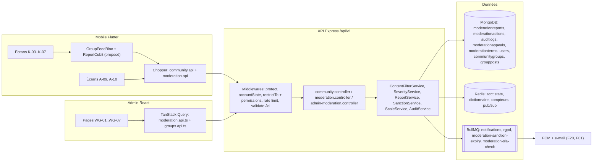

**Légende.** Rectangles = composants applicatifs, cylindres = stockages, double rectangle = files BullMQ. Points à retenir :

* **Deux interfaces, un seul cœur.** Le mobile alimente la file (signalement) et affiche les conséquences (contenu masqué, compte restreint) ; le back-office consomme la file et décide. Tout passe par la **même API** et les mêmes services : le contrôle d'accès réel est côté API (le cloisonnement par rôle de l'admin n'est qu'une commodité d'interface, `ADM-WG-26`).
* **Middleware d'état de compte** (`API-MODER-04`) : après `protect`, il lit l'état du compte dans Redis (`acct:state:<userId>`, TTL 60 s) puis Mongo. Les sanctions invalident ce cache : l'effet est immédiat, pas dans 60 s.
* **Filtre de contenu** (`API-MODER-06`) : il s'exécute **avant publication** (messages, commentaires, pseudos, prompts de wallpapers) et à la création d'un signalement. Il tourne en mémoire (dictionnaire rechargé toutes les 60 s) pour tenir un p95 < 20 ms.
* **Immuabilité** : `ModerationAction` et `AuditLog` n'acceptent que l'insertion (hooks Mongoose + utilisateur MongoDB de production sans droit `update`/`delete`).
* **Transactions** : la décision de modération (statut du signalement, action, audit, état du compte, notification) est atomique grâce au **replica set** MongoDB, d'où l'exigence de la stack réelle (Mongoose + replica set) là où le CDC parle de Prisma/PostgreSQL.

---

## 4. Écrans et navigation

### 4.1 Tableau des écrans

| Code | Nom | Rôle dans la fonctionnalité |
|---|---|---|
| `K-03` | Rédaction d'un message | Filtrage préventif côté client ; affiche le rejet `CONTENT_REJECTED` et le blocage `ACCOUNT_SUSPENDED` (`MOB-K-11`, `MOB-K-27`) |
| `K-04` | Options d'un message | Feuille ⋯ : Copier, Enregistrer, **Signaler ce message**, **Masquer cet utilisateur** |
| `K-05` | Choix du motif de signalement | 5 motifs, « Ton signalement est anonyme. Il sera examiné par un modérateur. » |
| `K-06` | Signalement envoyé (« Merci ! ») | Confirmation + « Masquer cet utilisateur » ; variante « Déjà signalé » |
| `K-07` | Message masqué par la modération | Placeholder « Utilisateur … Ce message a été masqué par la modération. » |
| `A-09` | Compte suspendu | Date de fin, motif, « Lire la charte », « Contester la décision » |
| `A-10` | Compte banni (« Accès retiré ») | « Contacter le support », « Se déconnecter » |
| `WG-01` | File de signalements | Onglets En attente/En cours/Traités/Ignorés, filtres, table triée par gravité |
| `WG-02` | Détail d'un signalement | Contexte, contenu masqué par défaut, 5 actions, panneaux Auteur et Rapporteur |
| `WG-03` | Action Bannir avec justification | Modale : gravité retenue, encadré de barème, justification obligatoire |
| `WG-04` | Historique de modération d'un utilisateur | Indicateurs (reçus, fondés, avertissements, suspensions, statut, rang) + chronologie |
| `WG-05` | Groupes locaux | Validation/refus/archivage ; règle RG-MAP-04 |
| `WG-06` | Barème de sanctions | Tableau Gravité / Exemple / 1re occurrence / Récidive ; cartes Traçabilité et Notification |
| `WG-07` | File de modération vide | « File vide, bravo ! », bouton « Voir l'historique des décisions » |

### 4.2 Captures

<p>


</p>

*De gauche à droite : `K-05` (feuille « SIGNALER CE MESSAGE » avec 5 motifs en boutons radio et bouton « Envoyer le signalement »), `K-07` (message remplacé par un texte atténué), `A-09` (pictogramme pause, « Ton compte est suspendu jusqu'au 22 octobre 2026 », carte MOTIF, « Fin de la suspension — dans 7 jours »), `A-10` (« Accès retiré »).*

<p>


</p>
<p>


</p>

*Back-office : `WG-01` (sous-titre « 18 en attente · 6 urgents · tri par gravité automatique », badges rouge/jaune/gris, lignes urgentes à fond rosé), `WG-02` (« SIGNALEMENT #R-20418 », contexte en bulles, message urgent masqué avec « Afficher le contenu », boutons Ignorer / Masquer le contenu / Avertir / Suspendre / Bannir, panneau « Auteur du contenu » avec rang de récidive « 2e » et panneau « Rapporteur — Identité masquée »), `WG-03` (modale de bannissement), `WG-04` (chronologie).*

### 4.3 Navigation mobile : signalement et états de compte

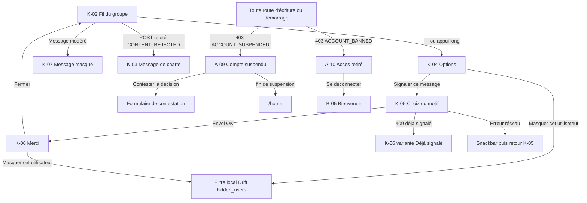

### 4.4 Navigation back-office

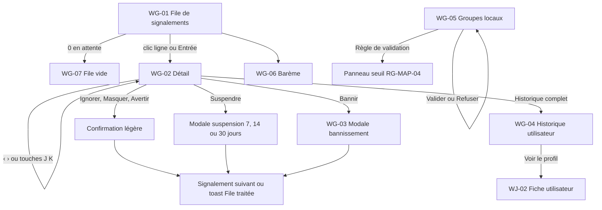

---

## 5. Flux détaillés

### 5.1 Du signalement à la décision (nominal)

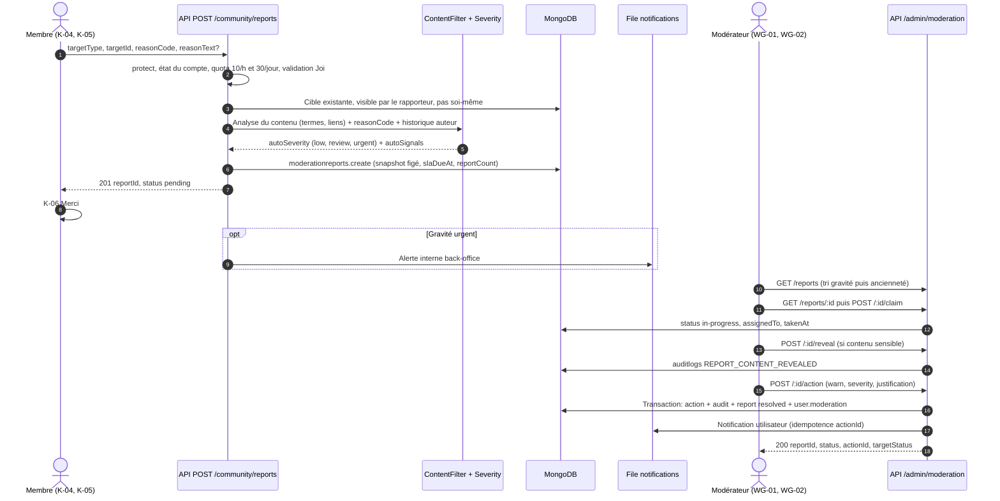

**Pas à pas.**

1. **(1)** Le mobile envoie un motif structuré. Côté API le champ s'appelle `reasonCode` (enum `harassment, hate, threats, sexual, spam, misinformation, illegal, other`) ; le mobile en propose 5 (`hate, harassment, spam, inappropriate, other`) : l'écart de nomenclature est traité en §14.
2. **(3)** La cible doit exister **et** être visible par le rapporteur (un membre d'un groupe privé seulement). Se signaler soi-même renvoie `422 CANNOT_REPORT_SELF`.
3. **(4)–(5)** Le service de gravité combine le résultat du filtre, le motif (`threats`, `illegal`, `hate` → au moins *review*), le nombre de rapporteurs distincts (≥ 3 → +1 niveau) et la récidive de l'auteur. Il écrit des `autoSignals[]` lisibles (« terme de catégorie menace », « 3 signalements distincts ») affichés dans `WG-02` mais **jamais** à l'auteur ni aux tiers.
4. **(6)** Le **snapshot** (texte, 3 messages de contexte précédents, auteur, groupe) est figé à la création : si l'auteur supprime son message, la preuve reste (`contentDeleted:true`).
5. **(11)–(13)** La **prise en charge** (`claim`) verrouille le signalement ; un second modérateur reçoit `409 REPORT_ALREADY_CLAIMED`. Le verrou est libéré après 30 min d'inactivité (côté admin le spec propose 15 min : §14).
6. **(15)** L'action est **atomique** : si l'écriture de l'audit échoue, tout est annulé.

### 5.2 Sanction lourde, états de compte et cas limites

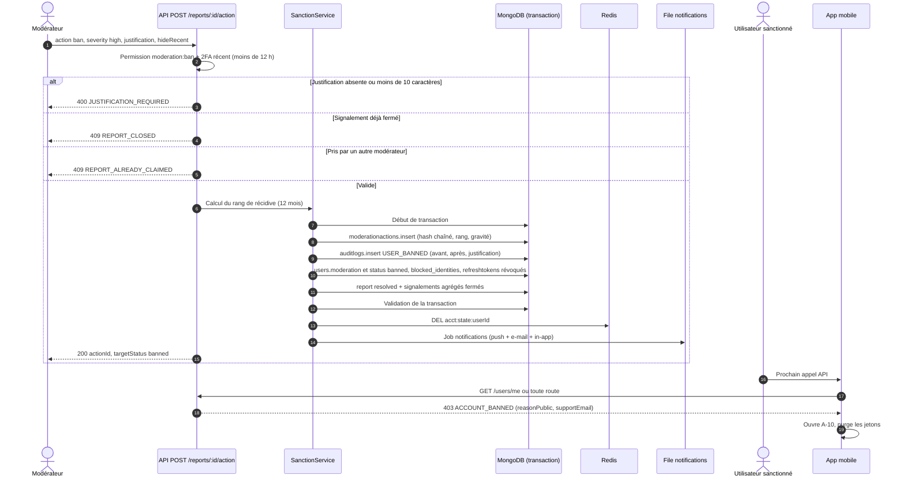

**Cas limites expliqués.**

* **Écart au barème** : le barème est indicatif. Un écart plus sévère ou plus clément de plus d'un niveau est autorisé **avec justification** ; le client le signale (avertissement jaune dans `WG-03`) sans bloquer, et l'audit enregistre `deviatedFromScale` (`ADM-WG-26`).
* **Double sanction** : suspendre un utilisateur déjà suspendu renvoie `409 ALREADY_SUSPENDED` (le client propose de prolonger, `ADM-WG-14`).
* **Réinscription d'un banni** : l'e-mail est conservé sous forme de hash salé dans `blocked_identities` (24 mois, §10) ; l'inscription avec le même e-mail est refusée.
* **Compte banni qui se reconnecte** : le mot de passe est vérifié **avant** de répondre `403 ACCOUNT_BANNED`, pour ne pas révéler l'existence du compte (cohérent avec F01 §5.2).
* **Ban + groupes** : retrait des groupes et masquage des contenus récents si `hideRecent:true`.

### 5.3 Contestation d'une sanction (appel)

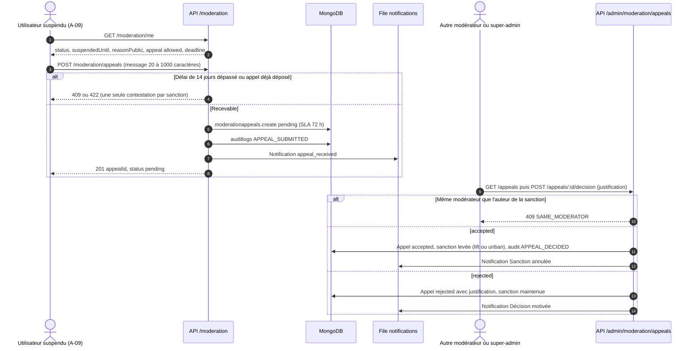

La contestation repose sur le **principe des quatre yeux** : la personne qui a sanctionné ne peut pas juger l'appel. Le mobile (`MOB-A-14`) prévoit de son côté un lien « Contester la décision » qui ouvre un **e-mail pré-rempli** vers le support : c'est un écart avec l'API (`POST /moderation/appeals`), à trancher (§14).

### 5.4 Filtrage préventif d'un message

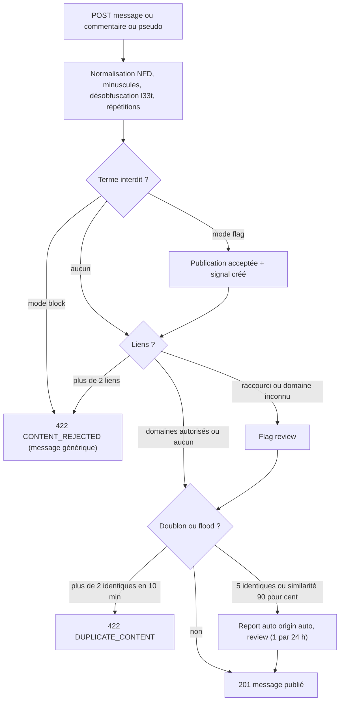

Le refus ne **révèle jamais le terme** déclencheur (empêche le contournement par tâtonnement). Les dictionnaires vivent dans `moderation_terms` (par langue `fr/en/es`, catégorie `hate|threat|sexual|spam|insult`, sévérité `low|review|urgent`, mode `block|flag`).

### 5.5 Machines à états

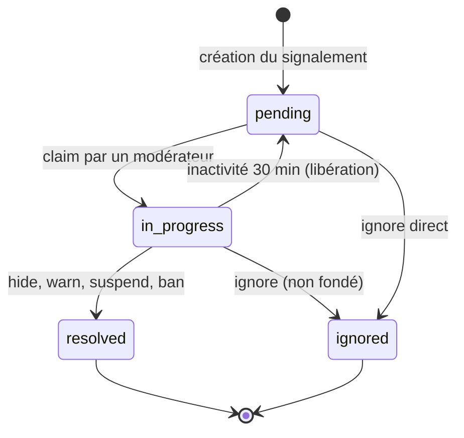

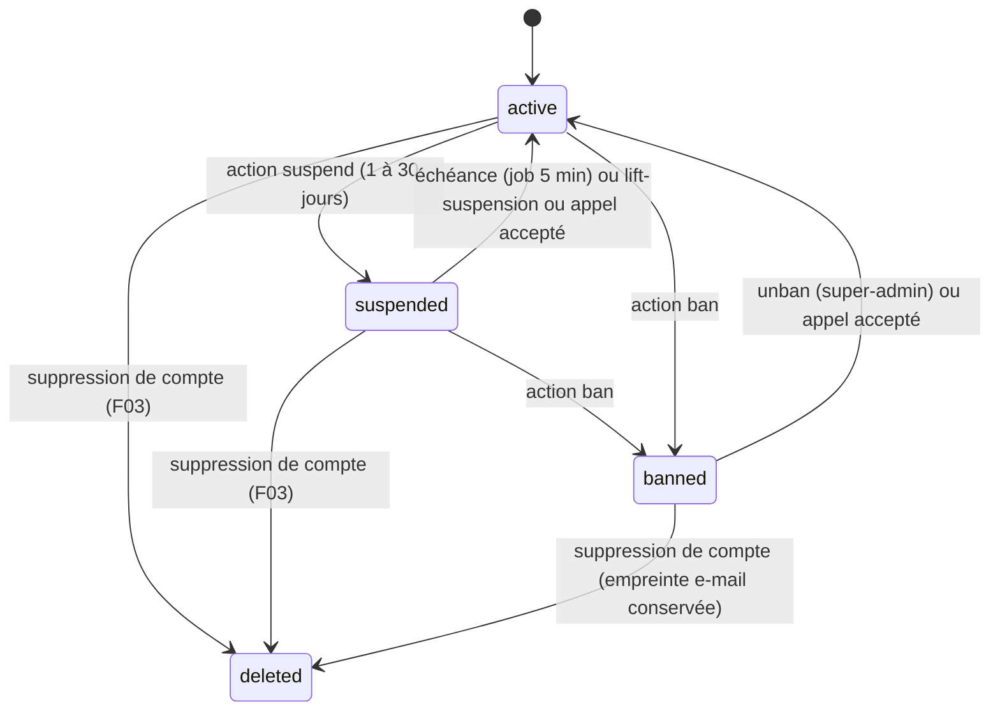

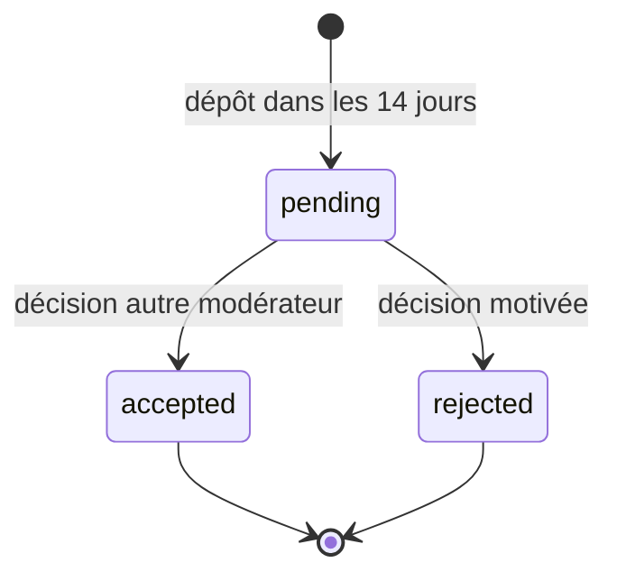

> Précision sur `suspended` : le compte reste authentifiable mais en **lecture seule limitée** (`GET /users/me`, `/moderation/me`, `/legal/charter`) ; toutes les écritures communautaires renvoient `403 ACCOUNT_SUSPENDED` (`API-MODER-04`). L'application ne montre alors que `A-09`.

---

## 6. Contrats d'API

Toutes les routes sont préfixées `/api/v1` ; succès `{ success:true, data }` ; erreur `{ success:false, error:{ code, message, details?, traceId } }`. **Aucune de ces routes n'existe encore (backlog).** Les limites de débit côté admin : 120 req/min/admin (`API-MODER-23`) ; CSRF double-submit sur les mutations admin.

### 6.1 Utilisateurs finaux

| Méthode | Chemin | Auth | Rate limit | Requête | Réponse | Erreurs |
|---|---|---|---|---|---|---|
| POST | `/community/reports` | Bearer, compte `active` | 10/h et 30/jour/utilisateur | `{targetType, targetId, reasonCode, reasonText?}` + `Idempotency-Key?` | `201 {reportId, status:'pending'}` ; doublon → `200` du signalement existant | `422 CANNOT_REPORT_SELF`, `409 REPORT_ALREADY_SUBMITTED`, `429 REPORT_RATE_LIMIT` (+ `Retry-After`), `404` cible invisible |
| GET | `/moderation/me` | Bearer (suspendu ou banni autorisés) | 60/min | — | `{status, suspendedUntil, remainingSeconds, reasonPublic, severity?, bannedAt?, appeal:{allowed,status,deadline}, charterUrl, supportEmail}` | `401` |
| POST | `/moderation/appeals` | Bearer (suspendu ou banni) | 3/jour | `{message}` (20–1000 car.) | `201 {appealId, status:'pending'}` | `409` déjà contesté, `422` hors délai (14 j) |
| GET | `/legal/charter` | public | 60/min | `?lang=fr\|en\|es` | `{version, url}` | — |
| POST | `/community/groups/:id/posts` | Bearer, `active` | limiteurs COMM | `{content}` | `201 post` | `422 CONTENT_REJECTED`, `422 DUPLICATE_CONTENT`, `403 ACCOUNT_SUSPENDED`, `403 ACCOUNT_BANNED` |

Exemple de refus de suspendu :

```json
{ "success": false,
  "error": { "code": "ACCOUNT_SUSPENDED", "message": "Compte suspendu",
    "details": { "suspendedUntil": "2026-10-22T00:00:00Z", "reasonPublic": "Propos inappropriés dans le groupe « Culés Paris »",
                 "appealAllowed": true, "charterUrl": "https://…/charte" },
    "traceId": "…" } }
```

### 6.2 Back-office (`moderator` et `super-admin`)

| Méthode | Chemin | Permission | Requête | Réponse | Erreurs |
|---|---|---|---|---|---|
| GET | `/admin/moderation/reports` | `moderation:read` | `status, targetType, severity, period, q, assignedTo=me, sort, cursor, limit (25, max 100)` | `{items:[{id,displayId:'R-20418',targetType,autoSeverity,origin,excerpt,authorHandle,reasonCode,ageSeconds,slaDueAt,slaBreached}], nextCursor, hasMore}` + `meta.counts {pending,inProgress,resolved,ignored,urgent}` | `403` |
| GET | `/admin/moderation/reports/:id` | `moderation:read` | — | `{report, snapshot, author, reporters, history, contentMasked}` | `404` |
| POST | `/admin/moderation/reports/:id/claim` | `moderation:act` | — | `{status:'in-progress', assignedTo}` | `409 REPORT_ALREADY_CLAIMED` |
| POST | `/admin/moderation/reports/:id/reveal` | `moderation:act` | — | `{content}` | journalise `REPORT_CONTENT_REVEALED` |
| POST | `/admin/moderation/reports/:id/action` | `moderation:act` (+ `moderation:ban` pour ban) | `{action: ignore\|hide\|warn\|suspend\|ban, severity: low\|medium\|high, justification, durationDays?, hideRecent?}` + `Idempotency-Key` | `{reportId, status, actionId, targetStatus}` | `400 JUSTIFICATION_REQUIRED`, `409 REPORT_CLOSED`, `409 ALREADY_SUSPENDED`, `403` |
| GET | `/admin/moderation/scale` | `moderation:read` | — | `{version, rows:[{severity, example, first, repeat}]}` | — |
| PUT | `/admin/moderation/scale` | `moderation:scale:write` (super-admin) | lignes | version incrémentée | `422` |
| GET | `/admin/moderation/users/:id/history` | `moderation:read` | `cursor` | `{summary:{reportsReceived,reportsUpheld,warnings,suspensions,bans,status,recidivismRank,accountCreatedAt}, items:[{type,at,label,severity,moderator,justification,reportId}], nextCursor}` | `404` |
| POST | `/admin/moderation/users/:id/lift-suspension` | `moderation:act` | `{justification}` | `{status:'active'}` | `422` |
| POST | `/admin/moderation/users/:id/unban` | `moderation:unban` (super-admin) | `{justification}` (≥ 10 car.) | `{status:'active'}` | `403` |
| GET | `/admin/moderation/appeals` / POST `…/appeals/:id/decision` | `moderation:act` | `{decision, justification}` | `{status}` | `409 SAME_MODERATOR` |
| GET/POST | `/admin/moderation/groups`, `…/:id/validate|reject|archive` | `moderation:act` | `reject` : `{reason}` ≥ 10 car. | `{status}` | `409` |
| GET | `/admin/users`, `/admin/users/:id` | `users:read` (e-mail complet : `users:pii`) | filtres, curseur | liste + `meta{total,suspended,banned}` | — |
| POST | `/admin/users/:id/sanction` | `moderation:act` | mêmes règles que `action`, sans `reportId` | `{actionId}` | `400 JUSTIFICATION_REQUIRED` |
| GET | `/admin/audit-logs` | `audit:read` (`?mine=true` pour un modérateur) | `action, adminId, entityType, entityId, from, to, q` | `{items, nextCursor}` (50/page) | — |
| GET | `/admin/audit-logs/verify` | super-admin | — | `{ok, brokenAt?}` | — |
| GET/PUT | `/admin/moderation/settings` ; CRUD `/admin/moderation/terms` | super-admin (lecture modérateur) | SLA, seuils flood, `allowedDomains`, `suspensionMaxDays`, `appealWindowDays` | config | `422` bornes |
| GET | `/admin/moderation/stats?period=7d\|30d` | `moderation:read` | — | volume, taux de fondé, temps médian, répartition | — |
| GET/POST | `/admin/moderation/wallpapers`, `…/:id/remove` | `moderation:act` | `filter=to-review\|reported\|removed` | liste / `{moderationStatus:'removed'}` | — |

> **Écart de contrat admin/API.** `ADM-WG-02` appelle `GET /admin/moderation/reports/counters`, `/admin/community-groups` et `/admin/community-groups/:id/validate` ; l'API (`API-MODER-09`, `API-MODER-16`) place les compteurs dans `meta.counts` et les groupes sous `/admin/moderation/groups`. De même la pagination admin est numérotée (`page`, 50) alors que l'API est **par curseur uniquement** (limit max 100). À harmoniser (§14).

---

## 7. Modèle de données

### 7.1 Collections et champs utiles

| Collection (modèle) | Champs principaux | Index / contraintes |
|---|---|---|
| `moderationreports` (`ModerationReport`) | **(existant)** `targetType`, `targetId`, `reporterId`, `reason`, `autoSeverity`, `status`, `snapshot`. **(backlog)** `reasonCode`, `reasonText` (≤ 500), `targetOwnerId`, `reportCount`, `assignedTo`, `takenAt`, `resolvedAt`, `resolution`, `slaDueAt`, `slaBreached`, `origin` (`user`/`auto`), `autoSignals[]`, numéro lisible `R-20418` | unique partiel `{reporterId,targetType,targetId}` ; `{status,autoSeverity,slaDueAt}` ; `{targetOwnerId,createdAt:-1}` ; `reporterId` et `snapshot` non modifiables |
| `moderationactions` (`ModerationAction`) | **(existant)** `reportId`, `adminId`, `targetUserId`, `actionType`, `severity`, `recidivismRank`, `justification`, `suspendedUntil`. **(backlog)** `adminRole`, `contentRef`, `notificationId`, `prevHash`, `hash`, types `restore` | insertion seule ; hooks `IMMUTABLE_DOCUMENT` |
| `auditlogs` (`AuditLog`) | `adminId`, `adminName`, `action` (MAJUSCULES_SNAKE), `entityType`, `entityId`, `before`, `after`, `justification`, `ip`, **(backlog)** `prevHash`, `hash` | `{createdAt:-1}`, `action`, `adminId` ; jamais purgé |
| `moderationappeals` (**backlog**) | `userId`, `actionId`, `message`, `status`, `decidedBy`, `decisionJustification`, `decidedAt` | unique `{actionId}` (un appel par sanction) |
| `moderation_terms` (**backlog**) | `term`, `lang`, `category`, `severity`, `mode` | index `{lang,category}` |
| `moderation_scale` (**backlog**) | `version`, `rows[]` | versionné |
| `blocked_identities` (**backlog**) | `emailHash` (hash salé), `bannedAt`, `expiresAt` (24 mois) | TTL sur `expiresAt` |
| `users` | `status`, `suspendedUntil` **(existant)** ; **(backlog)** `moderation:{warningsCount,lastWarningAt,activeSanctionId,suspensionReasonPublic (≤280),bannedAt,banReasonPublic}` | `status` indexé |
| `groupposts` | `status: visible\|hidden` **(existant)** ; **(backlog)** `moderation:{hidden,hiddenAt,reasonPublic}` | — |
| `communitygroups` | `status: pending\|active\|archived` **(existant)** ; **(backlog)** `archivedReason`, motif de refus | `status` indexé |

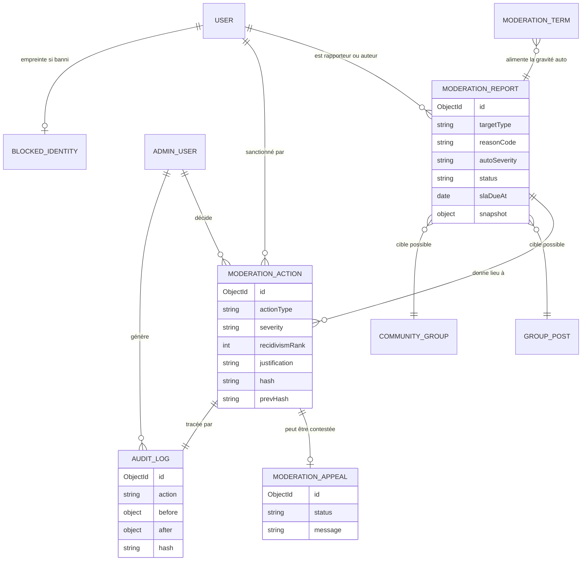

**Chaînage de hash.** `hash = SHA-256(prevHash + JSON canonique du contenu)`. Si quelqu'un modifie une ligne ancienne, tous les hash suivants deviennent invalides : `GET /admin/audit-logs/verify` le détecte et renvoie le premier maillon rompu. C'est une preuve d'intégrité **en plus** de l'interdiction technique de modifier (pas de droit `update`/`delete` pour l'utilisateur MongoDB applicatif de production, à documenter dans `docs/OPS`).

### 7.2 Clés Redis

| Clé | Usage | TTL |
|---|---|---|
| `acct:state:<userId>` | État du compte lu par le middleware (`status`, `suspendedUntil`, motif public) | 60 s, supprimée à chaque sanction |
| Dictionnaire de termes (cache mémoire du process) | Rechargé toutes les 60 s ; invalidé par pub/sub Redis lors d'une modification | 60 s |
| Compteurs de signalements (`report:quota:<userId>:h/d`) **(proposé)** | Quotas 10/h, 30/jour | 1 h / 24 h |
| Compteurs de la file (`mod:counters`) **(proposé)** | Cache 10 s des compteurs (`API-MODER-29`), 30 s pour le dashboard | 10–30 s |
| Verrou de prise en charge **(proposé)** | Alternative au champ `takenAt` pour l'expiration à 30 min | 30 min |

Le préfixe global `ub:` demandé par la convention de documentation n'est pas encore appliqué dans le code ; les clés ci-dessus sont citées telles que dans les issues.

### 7.3 Migrations

* `scripts/migrations/2026xxxx-report-fields.ts` (`API-MODER-01`) : valeurs par défaut sur les signalements existants (`reasonCode:'other'`, `origin:'user'`, `reportCount:1`).
* Création des index uniques partiels et de l'index `{status,autoSeverity,slaDueAt}`.
* Initialisation de `moderation_scale` (version 1, 3 lignes), de `moderation_terms` (graine fr/en/es) et de la configuration (`suspensionMaxDays:30`, `appealWindowDays:14`).
* Les migrations sont idempotentes (convention du dépôt API).

---

## 8. Traitements asynchrones et cache

| Traitement | Déclencheur | Détail |
|---|---|---|
| `moderation-sanction-expiry` | Répétable toutes les 5 min (**backlog**) | `suspended → active` si `suspendedUntil <= now` ; `AuditLog SUSPENSION_EXPIRED` (acteur système) ; notification « suspension terminée ». Doublé d'une vérification à la volée dans le middleware d'état |
| `moderation-sla-check` | Répétable toutes les 5 min | Marque `slaBreached`, loggue un `warn`, e-mail aux super-admins pour un urgent non pris en charge depuis 30 min ; libère un `in-progress` inactif depuis 30 min |
| File `notifications` (existante) | Après toute action touchant un utilisateur | Événements `warned, suspended, banned, suspension_expired, unbanned, hidden_content, appeal_received, appeal_decided` ; **5 tentatives**, backoff exponentiel (2 s de base, comme `defaultJobOptions`), puis file d'échec ; **idempotence par `actionId`** (`jobId`) |
| File `rgpd` + job `moderation-retention` | Quotidien | Purge des snapshots (12 mois après résolution, 3 mois pour les ignorés), des empreintes d'e-mail (24 mois), des wallpapers retirés (90 jours) ; rapport de purge journalisé |
| Fan-out flood | Événement `communityLimiters` | Création d'un report `origin:'auto'` au plus 1 par utilisateur et par 24 h |
| Cache dictionnaire | Pub/sub Redis | Invalidation sur modification des termes |

**Pourquoi des crons répétables BullMQ plutôt que `node-cron` seul ?** `node-cron` (utilisé pour les purges RGPD actuelles) s'exécute dans chaque processus PM2 : avec plusieurs instances, la tâche tournerait en double. Un job répétable BullMQ n'est pris que par un seul worker (proposé ; le backlog parle de « job BullMQ »).

---

## 9. Règles de gestion

1. **Motifs** : `harassment, hate, threats, sexual, spam, misinformation, illegal, other` ; commentaire facultatif ≤ 500 caractères, obligatoire si `other` côté mobile.
2. **Cibles** : `group_post, chat_message, comment, user, group, wallpaper, nickname_avatar`.
3. **Unicité** : un rapporteur ne signale une cible qu'une fois ; les signalements d'autres utilisateurs incrémentent `reportCount` du signalement ouvert.
4. **Quotas** : 10 signalements/h et 30/jour/utilisateur.
5. **Gravité auto** : *urgent* = signal fort (menace, violence), *review* = termes ou liens douteux ou motif `threats/illegal/hate`, *low* = sinon ; ≥ 3 rapporteurs distincts → +1 niveau ; la gravité **ne fait qu'augmenter**.
6. **SLA** : urgent 1 h, à vérifier 24 h, faible 72 h, contestation 72 h (configurables) ; alerte si urgent non pris en charge depuis 30 min.
7. **Tri de la file** : poids urgent 3 / review 2 / low 1 décroissant, puis `createdAt` croissant (le plus ancien d'abord) ; **le mobile n'a aucune influence sur la gravité**.
8. **Prise en charge** : verrou 30 min d'inactivité ; une action exige la prise en charge (ou le rôle super-admin).
9. **Justification** : obligatoire (10–1000 car.) pour `suspend` et `ban` ; facultative pour `ignore/hide/warn`.
10. **Suspension** : 1 à 30 jours (`suspensionMaxDays`, borne configurable 1–90) ; le barème suggère 7 jours ou 7–30 jours ; l'interface propose 7, 14, 30 jours.
11. **Rang de récidive** = 1 + nombre de sanctions fondées (`warn`, `suspend`, `ban`) des **12 derniers mois**, les `ignore` exclus (`API-MODER-11`). Le spec admin y ajoute `hide` (`ADM-WG-15`) : à valider (§14).
12. **Barème indicatif** : faible → rang 1 avertissement, rang ≥ 2 suspension 7 jours ; moyenne → suspension 7–30 jours puis bannissement ; élevée → bannissement immédiat. Informatif : un écart de plus d'un niveau exige une justification.
13. **Bannissement** : définitif, révocation de **tous** les refresh tokens, retrait des groupes, e-mail dans `blocked_identities` ; seul un super-admin débannit (justification ≥ 10 car.).
14. **Contestation** : 14 jours après la sanction, une seule fois par sanction, message 20–1000 car., 3 dépôts/jour max, traitée par un modérateur ≠ auteur de la sanction ou un super-admin, SLA 72 h.
15. **Confidentialité du rapporteur** : jamais exposé à l'auteur, aux tiers, dans les notifications, l'export RGPD ou la chronologie ; visible uniquement du back-office.
16. **Notifications de sanction** : push + in-app + e-mail (e-mail obligatoire pour suspension/ban) ; **non désactivables** (obligation d'information) ; jamais l'identité du rapporteur ni du modérateur ; localisées FR/EN/ES.
17. **Contenu masqué** : `body:null`, `author:null` pour les tiers ; l'auteur voit sa raison générale ; exclu de la recherche et des notifications ; compteurs non retournés.
18. **Groupes locaux** : règle de validation (nom unique par ville, ville valide, description 20–500 car., filtre de termes OK) ; seuil RG-MAP-04 de 20 membres (modifiable 1–200 par un super-admin) ; archivage d'un groupe ≥ 100 membres avec saisie du nom ; historique conservé 12 mois puis anonymisé.
19. **Aucune sanction automatique** : seuls le filtrage (rejet de la publication) et la création de signalements automatiques sont autonomes.
20. **Accès à l'historique** : consultation journalisée si > 20 consultations/h/modérateur.

---

## 10. Sécurité, RGPD et anti-abus

* **RBAC strict** (`API-MODER-23`) : permissions `moderation:read|act|ban|unban|scale:write`, `audit:read`, `users:read|pii` ; `content-manager` n'a rien ; `ban` exige un 2FA de moins de 12 h ; tout refus 403 est journalisé et **10 refus en 5 min** déclenchent une alerte. Un jeton utilisateur est refusé sur `/admin/*` et inversement (F01).
* **Pseudonymisation du rapporteur** : `reporterId` jamais renvoyé par une route publique ; les tests de sécurité (`API-MODER-31`) vérifient l'absence de fuite dans les réponses, notifications et exports.
* **Contenu hostile** : tout texte rendu en admin est échappé (XSS), `Content-Type` JSON strict, le contenu sensible (`urgent`, `threats`, `sexual`) est masqué par défaut ; l'image d'un wallpaper signalé est floutée (CSS `blur`) ; la révélation est **journalisée** (`REPORT_CONTENT_REVEALED`) et se remasque après 60 s d'inactivité.
* **IDOR** : un utilisateur ne lit que son propre `/moderation/me` ; un modérateur ne peut pas agir sur un signalement fermé.
* **Rétention vs droit à l'effacement** (`API-MODER-28`) : conservation longue du journal (valeur d'audit, CDC Backend §5.7) mais **pseudonymisation** à la suppression du compte (`targetUserId` remplacé par un identifiant opaque, pseudo effacé) ; base légale : intérêt légitime (sécurité), à inscrire au registre des traitements. Empreinte e-mail des bannis : 24 mois, à mentionner dans la politique de confidentialité (F03).
* **Export RGPD** (`GET /users/me/export`) : inclut les sanctions reçues et motifs publics, **ni** le rapporteur **ni** les notes internes.
* **Anti-abus du signalement** : quotas, impossibilité de se signaler soi-même, déduplication ; un rapporteur qui abuse peut être identifié par l'équipe (taux de signalements non fondés, métrique proposée).
* **Journal immuable** : insert-only, hash chaîné, export signé limité à 90 jours par export et journalisé `AUDIT_EXPORTED`, IP tronquée (/24) pour les modérateurs, champs sensibles `before/after` rédigés.
* **Brute force admin** : rate limiting + CSRF `SameSite=Strict` (F01 §5.6).

---

## 11. Erreurs et états dégradés

| Situation | Serveur | Client |
|---|---|---|
| Envoi du signalement impossible (réseau) | — | Snackbar « Impossible d'envoyer ton signalement », retour à la liste des motifs ; **aucune file d'envoi différé** (`MOB-K-28`) |
| Doublon de signalement | `409 REPORT_ALREADY_SUBMITTED` ou `200` existant | `K-06` variante « Déjà signalé » (traité comme un succès) |
| Quota dépassé | `429 REPORT_RATE_LIMIT` + `Retry-After` | Message temporisé |
| Message rejeté | `422 CONTENT_REJECTED` (générique) | `K-03` : rappel de la charte ; le texte saisi est conservé |
| Compte suspendu | `403 ACCOUNT_SUSPENDED` | Composer désactivé (« Ton compte est suspendu jusqu'au {date} ») ; `A-09` ; recalcul au démarrage et chaque minute |
| Compte banni | `403 ACCOUNT_BANNED` | `A-10`, déconnexion best effort, purge des jetons et du cache |
| Contenu masqué pendant que l'écran est ouvert | champ `moderation.hidden` au prochain polling (60 s) | Remplacement avec fondu 200 ms (`MOB-K-16`) |
| Hors-ligne | — | Fil en cache (20 derniers messages, **messages `hidden` jamais persistés**), signalement désactivé |
| Panne du worker de notifications | Retries (5, backoff) puis file d'échec ; la décision reste valide | L'utilisateur voit tout de même l'état à l'appel suivant (403 explicite) |
| Panne Redis | Middleware d'état : lecture directe Mongo (dégradé) | Transparent |
| Conflit de verrou | `409 REPORT_ALREADY_CLAIMED` | Avertissement « En cours · Karim B. » (`ADM-WG-06`) |
| Polling admin en échec | — | Après 3 échecs : intervalle 5 min + bandeau « Actualisation interrompue · Réessayer » (`ADM-WG-25`) |
| File vide | `meta.counts.pending = 0` | `WG-07` « File vide, bravo ! » |
| Transaction échouée | Rollback complet | Toast d'erreur ; **aucune mise à jour optimiste** pour suspend/ban/hide/warn (seule `ignore` est optimiste avec rollback, `ADM-WG-03`) |

---

## 12. Connexions avec les autres fonctionnalités

| Fonctionnalité | Relation | Détail |
|---|---|---|
| F01 Authentification et comptes | dépend de / alimente | Réutilise `protect`, JWT, révocation des refresh ; états `suspended/banned` ; erreurs `ACCOUNT_SUSPENDED/BANNED` (code `ACCOUNT_DISABLED` historique, F01 §14) ; écrans `A-09/A-10` |
| F03 Paramètres et RGPD | partage | Export avec sanctions reçues, liste « Utilisateurs masqués » (Drift `hidden_users`), pseudonymisation à la suppression, charte et consentements |
| F15 Carte communautaire (`MOB-J`) | partage | Zone approximative et visibilité sur la carte ; aucun signalement direct sur la carte, mais un utilisateur sanctionné disparaît des agrégats |
| F16 Groupes locaux et fil | dépend de | Cibles principales (`group_post`, `chat_message`, `group`), `GroupPost.status`, validation des groupes (`WG-05`), rôle modérateur de groupe |
| F18 Assistant IA | partage | Modération du texte généré et des entrées (voir F18) ; ne passe pas par la file de signalement sauf retour utilisateur |
| F19 Wallpapers IA | alimente | Filtrage des prompts (`ContentFilterService`), `moderationStatus`, retrait a posteriori `WJ-06` |
| F20 Notifications | alimente | Notifications de sanction non désactivables, file `notifications` ; catégorie `community` |
| F21/F22 Back-office (fiche utilisateur, tableau de bord) | alimente | Compteur « signalements en attente », `WJ-01/02` sanctions directes |
| F24 Plateforme jobs, cache, flags | dépend de | BullMQ, planificateur, configuration, feature flags |

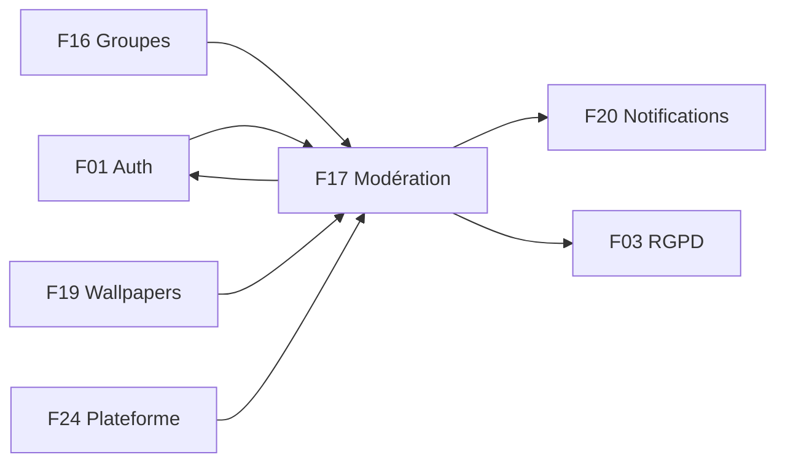

---

## 13. Observabilité et tests

### 13.1 Métriques et logs

* **Prometheus** (`/metrics`, `API-MODER-27`) : `moderation_reports_pending{severity}`, `moderation_report_resolution_seconds` (histogramme), `moderation_actions_total{action,severity}`, `moderation_sla_breached_total`, `moderation_appeals_total{status}` ; **aucune donnée personnelle dans les labels**.
* **Statistiques** `GET /admin/moderation/stats` : volume, taux de fondé, temps médian, répartition par modérateur et gravité (audit de cohérence du barème).
* **Logs structurés** (Winston, `traceId`) : refus 403, révélations de contenu, SLA dépassé (`warn`), purge RGPD.
* **Alertes** : 10 refus 403 en 5 min ; SLA urgent dépassé.
* **Performance cibles** avec 500 000 signalements : file p95 < 150 ms, historique < 200 ms, détail < 120 ms ; aucun `COLLSCAN` (vérifié avec `explain()`).

### 13.2 Tests

| # | Cas | Résultat attendu |
|---|---|---|
| T1 | Membre signale (`K-05`) → urgent en file → modérateur avertit | report `resolved`, utilisateur notifié, audit `USER_WARNED` |
| T2 | Ban avec justification | tokens révoqués, `GET /moderation/me` → `A-10` |
| T3 | Suspension 7 jours, appel accepté par un autre modérateur | retour `active`, notification |
| T4 | `content-manager`, ban sans justification, double décision | `403`, `400 JUSTIFICATION_REQUIRED`, `409 REPORT_CLOSED` |
| T5 | Tentative de modifier/supprimer une `ModerationAction` | `IMMUTABLE_DOCUMENT` |
| T6 | Vérification de chaîne après altération manuelle | `verify` signale le maillon rompu |
| T7 | Réponse publique : recherche de `reporterId` et `autoSignals` | absents partout |
| T8 | `<script>` dans un message signalé | rendu échappé |
| T9 | Même signalement deux fois | `409`/`200` selon `Idempotency-Key` |
| T10 | Jeton utilisateur sur `/admin/*` | refusé |
| T11 | Flood : 6 messages identiques en 10 min | report auto `review`, 3e doublon `422 DUPLICATE_CONTENT` |
| T12 | Mobile : golden `K-04..K-07`, `A-09`, `A-10` en clair/sombre | conformes (`MOB-K-31`, `MOB-A-19`) |
| T13 | Admin Playwright : scénario CDC §7.5 (connexion modérateur → avertir → disparition de la file → `USER_WARNED` dans l'audit) et « file vide » | verts (`ADM-WG-27`) |

**k6** : scénario `tests/load` pour `POST /community/reports` (quotas) et `GET /admin/moderation/reports` ; toute nouvelle route met aussi à jour Swagger (`npm run export:swagger`, tag *Moderation* et *Admin Moderation*, `API-MODER-32`).

---

## 14. Points ouverts et décisions à confirmer

1. **Nomenclature des motifs et des cibles** : mobile (`hate, harassment, spam, inappropriate, other` ; cibles `post/user/group/event`, `MOB-K-05`) vs API (`reasonCode` à 8 valeurs ; cibles `group_post/chat_message/comment/user/group/wallpaper/nickname_avatar`). Prévoir une table de correspondance (`inappropriate → other` ou `sexual`).
2. **Statut renvoyé à la création** : mobile attend `status:'open'`, l'API `status:'pending'`.
3. **Parcours d'envoi** : `MOB-K-13` demande un envoi immédiat au toucher d'un motif, la maquette `K-05` montre un bouton « Envoyer le signalement » : à arbitrer avec le design.
4. **Codes d'erreur** : mobile `USER_SUSPENDED` / `USER_BANNED` (`MOB-K-27`) vs API `ACCOUNT_SUSPENDED` / `ACCOUNT_BANNED` vs historique `ACCOUNT_DISABLED` (F01 §14) ; payload `restriction.reason` (`MOB-A-13`) vs `reasonPublic` (`API-MODER-18`).
5. **Contestation** : e-mail pré-rempli vers le support (`MOB-A-14`, adresse « à confirmer ») vs flux applicatif `POST /moderation/appeals` (`API-MODER-19`). Proposition : bouton ouvrant un formulaire in-app, e-mail en repli.
6. **Verrou de prise en charge** : 30 min (`API-MODER-10`, `API-MODER-21`) vs 15 min « proposé, à confirmer » (`ADM-WG-06`) ; l'API pose le verrou au **claim** explicite, l'admin « quand un modérateur ouvre le détail » (3 s).
7. **Définition du rang de récidive** : sanctions `warn/suspend/ban` sur 12 mois (API) vs ajout de `hide` (admin) ; le CDC ne précise rien.
8. **Routes de groupes** : `/admin/moderation/groups` (API) vs `/admin/community-groups` (admin) ; compteurs `meta.counts` vs `/reports/counters` ; pagination curseur vs numérotée (50) ; durée d'un identifiant `R-xxxxx` (compteur séquentiel Mongo à prévoir).
9. **Règle RG-MAP-04** : seuil 20 membres affiché par `WG-05` mais « à affiner en conception détaillée » (CDC Global) ; configuration `PATCH /admin/config/community-groups` à créer.
10. **Service ML de détection** (CDC Global §11.2 « service de modération de contenu ») : hors périmètre phase 2, seuls des dictionnaires sont prévus (`API-MODER` hors périmètre).
11. **Suspension max** : 30 jours (`API-MODER-03/12`) mais borne configurable jusqu'à 90 (`API-MODER-26`).
12. **Stack CDC** : le CDC Backend §3.11 parle de cas d'usage `SubmitReport`, `ReviewReport`, `ApplyModerationAction` dans une architecture NestJS/Prisma ; la réalisation est en services Express + Mongoose avec transactions du replica set.
13. **Rétention des refresh tokens bannis** et durée des empreintes d'e-mail (24 mois) : à valider juridiquement.
14. **Modération des pseudonymes/avatars** (CDC Global §11.1) : ciblée par `nickname_avatar` mais aucun écran mobile de signalement de profil n'est spécifié dans `MOB-K`.

---

## 15. Pour aller plus loin

**Épopées** : `API-MODER`, `ADM-WG`, `MOB-K`, `MOB-A`, `MOB-J`, `API-COMM`, `API-NOTIF` (voir F20), `ADM-WJ` (fiche utilisateur, wallpapers).

**Issues repères** : `API-MODER-01` (modèle de signalement), `API-MODER-02` (immutabilité), `API-MODER-04` (middleware d'état), `API-MODER-05` (création), `API-MODER-06` (filtre), `API-MODER-08` (gravité auto), `API-MODER-09/10` (file, détail), `API-MODER-11/12` (barème, actions), `API-MODER-13` (levée), `API-MODER-19` (contestation), `API-MODER-21` (SLA), `API-MODER-22` (audit), `API-MODER-23` (RBAC), `API-MODER-28` (RGPD), `MOB-K-05` (datasource), `MOB-K-13` (motif), `MOB-K-15` (masquage local), `MOB-K-16` (message masqué), `MOB-K-27` (sanctions client), `MOB-A-13` à `MOB-A-15`, `ADM-WG-04` (file), `ADM-WG-08/09/10` (détail), `ADM-WG-13/14` (bannir, suspendre), `ADM-WG-15` (récidive), `ADM-WG-26` (RBAC et audit), `ADM-WG-27` (E2E).

**CDC** : CDC Global §2.14, §10.3 (charte, sanctions), §11 (modération) ; CDC Backend §3.11, §5.7 (rétention), §11 ; CDC Admin §4.6 (modération), §4.8.2 (gravité auto), §6.2 et §6.4 (sécurité, audit), §7.5 (parcours E2E), §9.4 (états vides), §9.7 (raccourcis).

**Fichiers de code**

* API : `src/models/moderation.model.ts`, `src/models/community.model.ts`, `src/models/user.model.ts`, `src/jobs/queues.ts`, `src/jobs/scheduler.ts`, `src/routes/index.ts` ; à créer : `src/services/content-filter.service.ts`, `moderation.service.ts`, `src/utils/report-snapshot.ts`, `src/config/permissions.ts`, `src/types/moderation.ts`, `docs/MODERATION.md`.
* Mobile : `lib/features/community` (à créer, suivre `lib/features/players`), tables Drift `hidden_users` ; écrans `K-03..K-07`, `A-09`, `A-10`.
* Admin : `src/api/moderation.api.ts`, `src/api/groups.api.ts`, `src/lib/sanctionScale.ts` (source unique du barème), pages `/moderation`, `/moderation/:reportId`, `/moderation/utilisateurs/:userId/historique`, `/moderation/bareme`, `/groupes`.
