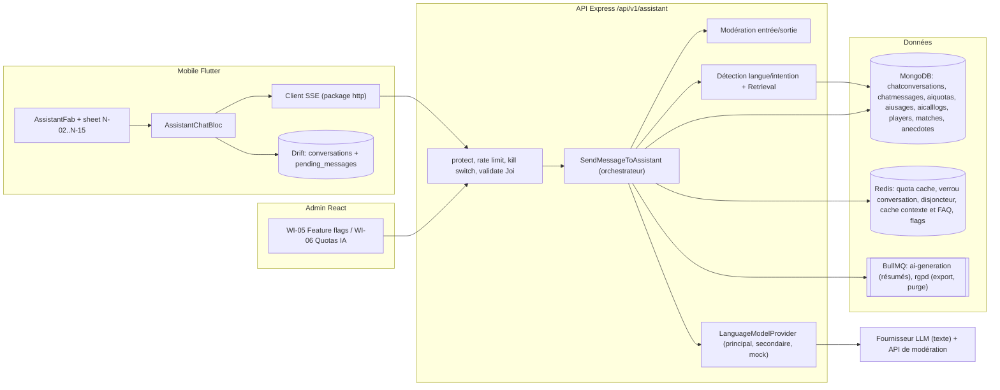
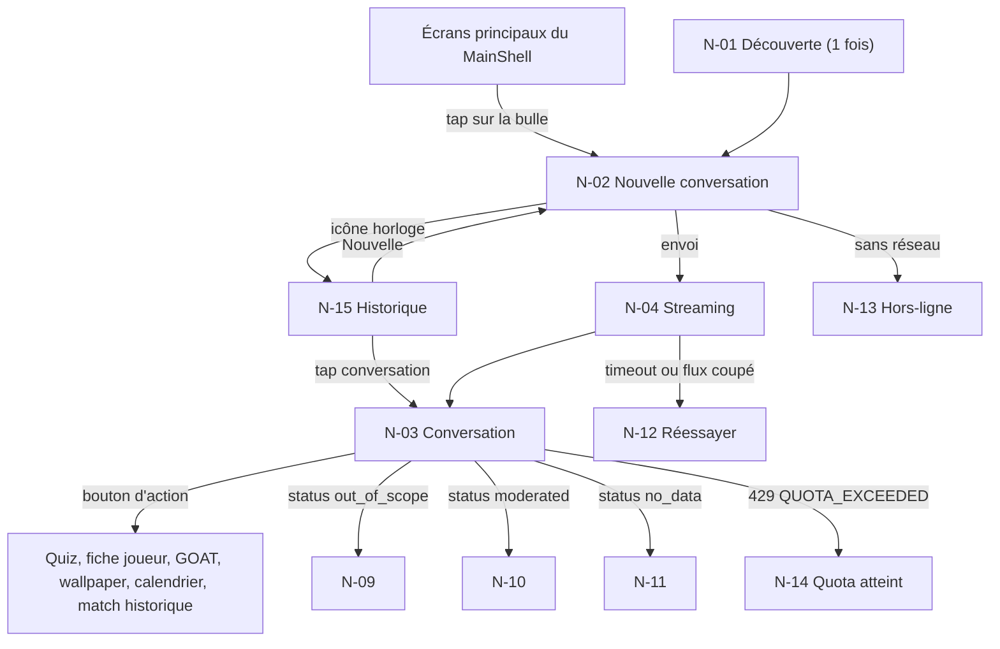
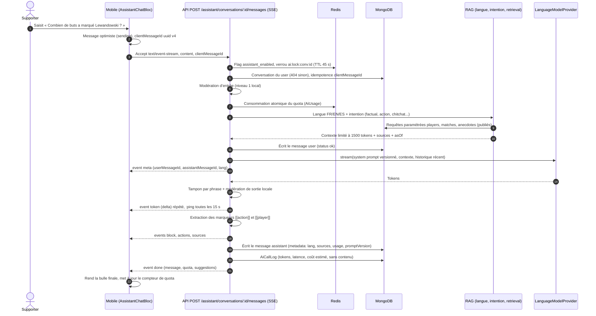
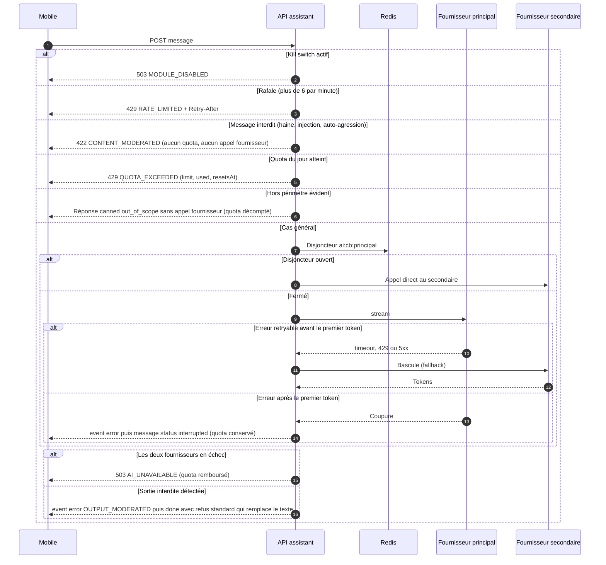
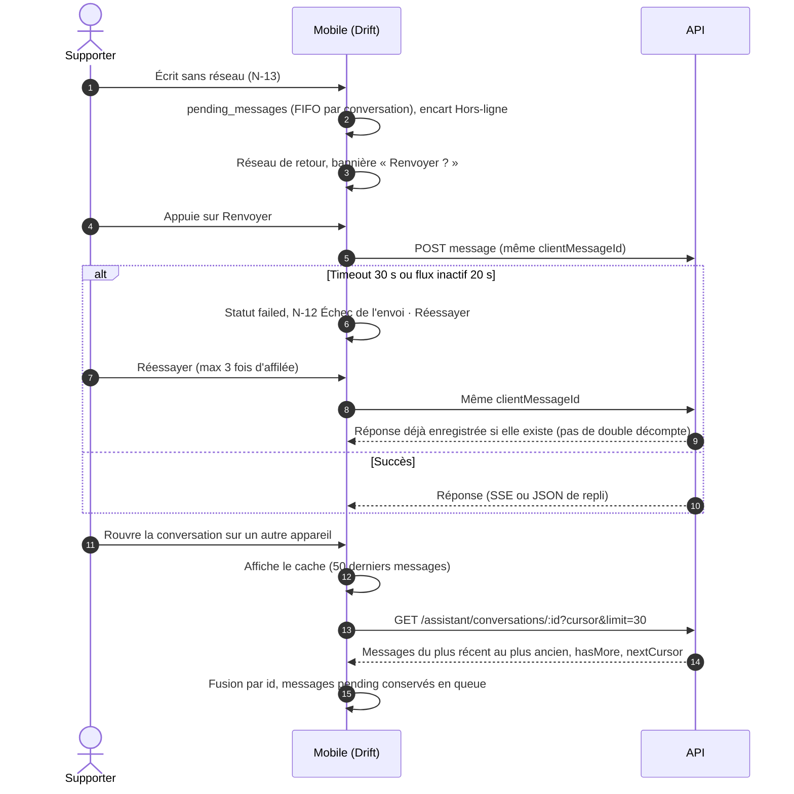
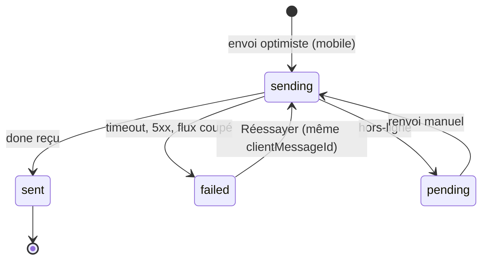
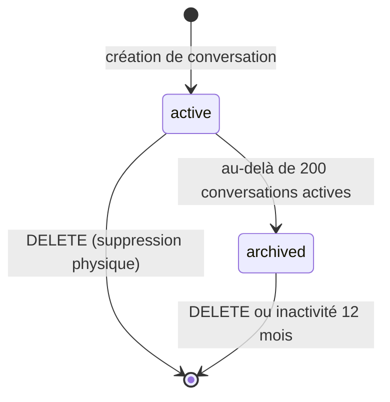
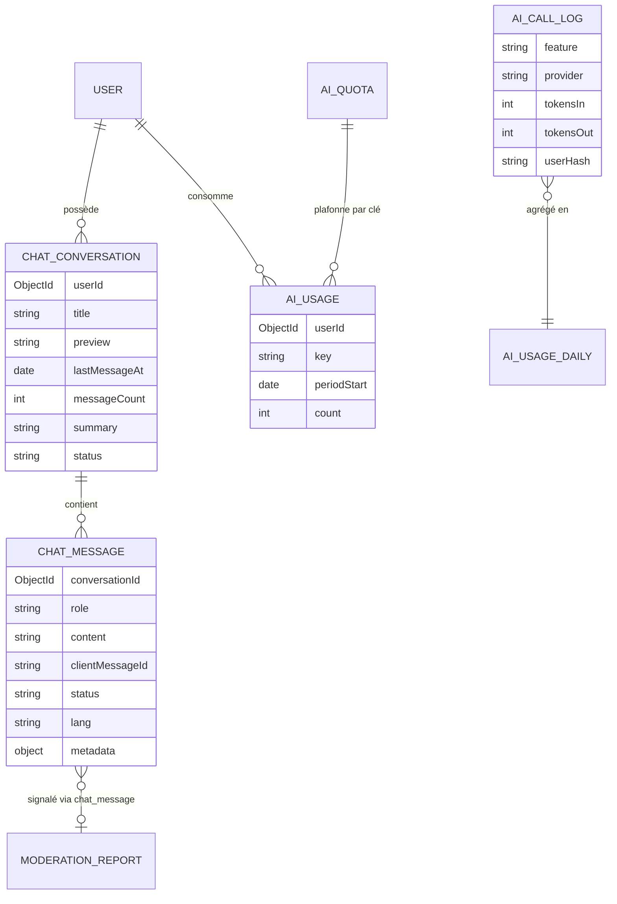
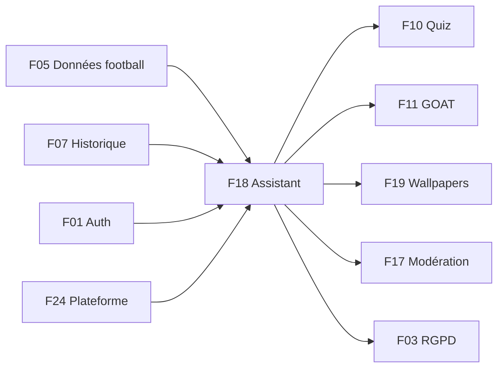

# F18 — Assistant IA « Barça AI »

> Document de fonctionnalité de l'architecture Univers Barça. Il explique **comment un supporter converse avec un assistant spécialisé dans le FC Barcelone** : de la bulle flottante de l'application à la réponse en streaming, en passant par le pipeline RAG (réponse ancrée sur les données internes), les garde-fous du prompt système, les quotas, la modération, le choix du fournisseur de modèle de langage et le « kill switch » qui permet de couper la fonctionnalité en urgence. Il signale chaque écart entre le code existant, les issues du backlog et les cahiers des charges (CDC).
>
> Convention de lecture : **(existant)** = présent dans le dépôt aujourd'hui ; **(backlog)** = décrit dans les issues mais pas encore codé ; **(proposé)** = non spécifié dans les CDC/issues, suggestion de ce document.

---

## 1. Résumé et fiche

### 1.1 Valeur utilisateur

Barça AI est un compagnon de conversation toujours à portée de pouce : une bulle flottante, présente sur tous les écrans principaux, ouvre un chat où l'on peut demander « Combien de buts Lewandowski a marqué cette saison ? », « Who scored in the 2015 Champions League final? » ou « ¿Quién es el máximo goleador histórico del club? ». L'assistant répond **dans la langue de la question** (français, anglais, espagnol), cite ses sources (« Joueurs », « Matchs 2026-27 »), peut déclencher des actions dans l'app (lancer le quiz du jour, ouvrir la fiche de Pedri, générer un wallpaper), et retrouve l'historique de ses conversations sur tous les appareils.

Pourquoi c'est conçu ainsi : un modèle de langage « libre » invente volontiers des scores et des dates. Le produit repose donc sur un principe cardinal du CDC Global §2.2 : **jamais de réponse « hallucinée » sur un fait vérifiable en base**. Les faits (stats, résultats, dates) viennent exclusivement d'un **contexte** que l'API récupère dans MongoDB (technique dite **RAG**, *Retrieval-Augmented Generation* : on cherche d'abord les faits, puis on demande au modèle de rédiger avec ces faits). Quand l'information n'est pas en base, l'assistant doit le dire plutôt qu'inventer. Comme le service est gratuit, des **quotas** par utilisateur et des **budgets** mensuels plafonnent le coût, et un **interrupteur d'urgence** coupe l'assistant sans publier de nouvelle version de l'app.

### 1.2 Fiche

| Champ | Valeur |
|---|---|
| Phase | Phase 1 — MVP (assistant v1) ; approfondissement en phase 3 (CDC Global §12) |
| Priorité | P0 : conversations, pipeline RAG, prompt et garde-fous, modération, SSE, quota, rate limit, kill switch, tests de non-régression ; P1 : fallback fournisseur, caches, journal des coûts, export/suppression RGPD, signalement, observabilité, OpenAPI ; P2 : résumés glissants, test de charge |
| Épopées backlog | `API-IA` (34 issues), `MOB-N` (31 issues), `ADM-WI` (quotas IA `ADM-WI-12`/`ADM-WI-13` et feature flags `ADM-WI-10`/`ADM-WI-11`), `ADM-WH` (supervision de la consommation IA, `WH-04`, hors de ce document sauf mention) |
| Écrans mobile | `N-01` (bulle de découverte), `N-02` (nouvelle conversation), `N-03` (réponse sourcée), `N-04` (streaming), `N-05` (actions), `N-06` (carte joueur), `N-07`/`N-08` (réponses EN/ES), `N-09` (hors périmètre), `N-10` (message bloqué), `N-11` (information introuvable), `N-12` (erreur d'envoi), `N-13` (hors-ligne), `N-14` (quota atteint), `N-15` (historique) |
| Écrans admin | `WI-05` (feature flags), `WI-06` (quotas IA) ; `WH-04` (consommation IA) |
| Dépôts concernés | `univers_barca_api`, `univers_barca_mobile`, `univers_barca_admin` |
| Référence CDC | CDC Global §2.2, §8.5 (principes du prompt système), §10.1, §12.1 ; CDC Backend §3.8, §4.6, §10.2, §11.2, §11.5, §11.6 ; CDC Flutter §5.1, §6.3, §7.10, §8.1 ; CDC Admin §4.8, §6 |

### 1.3 État d'avancement du code (à la date du document)

| Brique | État |
|---|---|
| API : modèle `ChatConversation` avec tableau `messages` embarqué (`src/models/platform.model.ts`) ; `AiQuota` (configuration : `key`, `limit`, `period`) ; `FeatureFlag` ; variables `AI_TEXT_API_KEY`, `AI_IMAGE_API_KEY` ; file BullMQ `ai-generation` | **(existant)** mais aucune route, service ni worker d'assistant |
| API : `LanguageModelProvider`, pipeline RAG, SSE, quotas consommés (`AiUsage`), `AiCallLog`, modération, kill switch, config publique | **(backlog)** (`API-IA-01` à `API-IA-34`) |
| Mobile : feature `assistant` (BLoC, client SSE, Drift) | **(backlog)** ; `lib/routes` ne contient que des pages provisoires |
| Admin : `WI-05`, `WI-06` | **(backlog)** (`ADM-WI-10` à `ADM-WI-13`) |

---

## 2. Acteurs et user stories

| Acteur | Description |
|---|---|
| Supporter | Utilisateur authentifié qui discute avec Barça AI |
| Super-admin | Règle les quotas IA, les budgets, les feature flags et le kill switch |
| Moderator | Reçoit les signalements de réponses (voir F17) ; lecture de la consommation |
| Système | Orchestrateur `SendMessageToAssistant`, fournisseurs de modèle, workers BullMQ |

| # | User story | Critères d'acceptation clés |
|---|---|---|
| US1 | En tant que supporter, je pose une question factuelle et j'obtiens une réponse exacte et sourcée. | Chiffres issus du contexte ; puces de sources ; fraîcheur « données au 14 octobre » (`API-IA-10`, `MOB-N-10`) |
| US2 | En tant que supporter, je vois la réponse se construire en direct. | SSE : événements `meta`, `token`, `block`, `actions`, `sources`, `done`, `error` ; bouton stop (`API-IA-18`, `MOB-N-11`) |
| US3 | En tant que supporter, je pose ma question dans ma langue. | Détection FR/EN/ES ; réponse dans la langue de la question ; puce « Langue détectée : EN » (`API-IA-09`, `MOB-N-14`) |
| US4 | En tant que supporter, je déclenche une action depuis le chat. | Liste blanche de 6 actions, jamais d'URL externe (`API-IA-14`, `MOB-N-12`) |
| US5 | En tant que supporter, je sais quand l'assistant ne sait pas ou refuse. | `out_of_scope` (`N-09`), `no_data` (`N-11`), `moderated` (`N-10`) (`API-IA-11/12/13`) |
| US6 | En tant que supporter, je retrouve mes conversations partout. | Liste paginée (20), recherche, détail paginé (30) (`API-IA-16`, `MOB-N-21/23`) |
| US7 | En tant que supporter, je comprends ma limite quotidienne. | `N-14` : « Retour dans 04:12:30 », valeur lue de `quota.limit` (`API-IA-19`, `MOB-N-20`) |
| US8 | En tant que supporter, je peux supprimer et exporter mes conversations. | Suppression physique immédiate ; export JSON asynchrone (`API-IA-27/28`) |
| US9 | En tant que super-admin, je plafonne le coût et je coupe l'assistant en cas de dérive. | Quotas `assistant.messages`, budgets, `assistant_enabled` effectif en ≤ 10 s, audit (`API-IA-22/23`, `ADM-WI-10/12`) |
| US10 | En tant que supporter, je signale une réponse erronée ou choquante. | `POST /assistant/messages/:id/report` → file de modération (`API-IA-29`) |

---

## 3. Architecture de la fonctionnalité



**Légende.** Rectangles = composants, cylindres = stockages, double rectangle = files BullMQ. À retenir :

* **L'orchestrateur est le chef d'orchestre.** `SendMessageToAssistant` (`API-IA-15`) enchaîne les 8 étapes du CDC Backend §11.5. Les contrôleurs JSON et SSE ne contiennent aucune logique : ils appellent le même use case.
* **Le fournisseur est interchangeable.** L'interface `LanguageModelProvider` (CDC Backend §11.2) isole l'API d'un éditeur précis : on peut changer de modèle, basculer vers un secondaire ou brancher un **faux fournisseur déterministe** (`mock`) pour la CI, sans toucher à la logique RAG. En production, `mock` est interdit (validation Joi de la configuration).
* **L'assistant ne lit jamais de donnée personnelle.** Le service de récupération n'accède qu'aux contenus publiés (`players`, `matches`, `anecdotes` au statut `published`) ; le fournisseur reçoit uniquement prompt système, contexte et historique récent, jamais e-mail, pseudo ni identifiant utilisateur.
* **Drift n'est qu'un cache** : l'API reste la source de vérité des conversations (multi-appareils).
* **Écart CDC/stack.** Le CDC Backend évoque NestJS (modules, guards) ; la réalisation est Express 4 + Mongoose : `src/services/assistant/*` et `src/controllers/assistant.controller.ts` (backlog).

---

## 4. Écrans et navigation

### 4.1 Tableau des écrans

| Code | Nom | Rôle |
|---|---|---|
| `N-01` | Bulle flottante et message de découverte | « Pose-moi une question sur le Barça ! » (une fois par installation, après le 2e lancement, 6 s) |
| `N-02` | Chat — nouvelle conversation | Sheet plein écran, « Barça AI — En ligne · FR / EN / ES », 5 suggestions, mention « Barça AI peut se tromper » |
| `N-03` | Conversation — réponse sourcée | Gras sur les entités, puces « Joueurs » / « Matchs 2026-27 », suggestion de suite |
| `N-04` | Réponse en cours (streaming) | « Barça AI écrit… », curseur clignotant, bouton pause |
| `N-05` | Réponse avec actions | Jusqu'à 5 boutons d'action |
| `N-06` | Réponse avec carte joueur | Carte « Pedri · N°8 » + « Ouvrir la fiche complète » |
| `N-07` / `N-08` | Réponses en anglais / espagnol | Puces « Langue détectée : EN » / « Idioma detectado : ES » |
| `N-09` | Question hors périmètre | Recadrage courtois + suggestions |
| `N-10` | Message bloqué par la modération | « Message non traité » |
| `N-11` | Information introuvable | « Je préfère ne pas inventer » + action `open_historic_match` |
| `N-12` | Erreur d'envoi — Réessayer | Retry manuel avec le même `clientMessageId` |
| `N-13` | Hors-ligne — envoi impossible | Message conservé en file Drift |
| `N-14` | Quota de messages atteint | Compte à rebours jusqu'à `resetsAt`, champ désactivé |
| `N-15` | Historique des conversations | Liste groupée par date, recherche, « Nouvelle » |
| `WI-05` | Feature flags | Interrupteurs `assistant_streaming_enabled`, `wallpapers_module_enabled`… |
| `WI-06` | Quotas IA | Plafonds par utilisateur et budgets mensuels |

### 4.2 Captures

<p>


</p>

*De gauche à droite : `N-02` (avatar étincelle bordeaux à liseré doré, historique et fermeture dans l'en-tête), `N-05` (cinq boutons d'action sous la réponse), `N-09` (recadrage hors périmètre), `N-14` (compte à rebours du quota).*

<p>


</p>

*Back-office : `WI-06` (carte « Par utilisateur » : Messages assistant / jour 40, Générations wallpaper / jour 3, Questions de quiz IA / jour 30 ; carte « Budgets mensuels » : 10 000 000 tokens à 42 %, 1 500 images à 83 %, alerte à 80 %) et `WI-05` (interrupteurs de modules).*

### 4.3 Navigation mobile



---

## 5. Flux détaillés

### 5.1 Envoi d'un message en streaming : pipeline en 8 étapes (nominal)



**Pas à pas.**

1. **(3)** `clientMessageId` est la clé d'**idempotence** : si le mobile renvoie le même identifiant (retry), le serveur rend la réponse déjà enregistrée sans nouveau décompte du quota.
2. **(4)** Le **kill switch** (`assistant_enabled`, cache Redis 10 s) est évalué en premier : désactivé → `503 MODULE_DISABLED` (la lecture de l'historique reste autorisée).
3. **(4)** Le **verrou** `ai:lock:conv:<id>` empêche deux messages simultanés dans la même conversation (`409 MESSAGE_IN_PROGRESS`).
4. **(7)** Le quota n'est décompté qu'**après** la modération d'entrée : un message bloqué ne coûte rien à l'utilisateur.
5. **(9)–(10)** Le contexte (≤ 3 joueurs, ≤ 10 matchs, ≤ 5 éléments d'historique, ≤ 1500 tokens, timeout de récupération 800 ms) reçoit chacun un identifiant `kind:refId` et une date de fraîcheur `asOf`.
6. **(13)–(16)** Le flux est **tamponné par phrase** (flush à la ponctuation ou après 120 caractères) pour que chaque fragment passe par le filtre de sortie avant d'être émis.
7. **(18)** Les actions viennent de **marqueurs** émis par le modèle (`[[action:open_player|pedri]]`, `[[player:<id>]]`) que le serveur retire du texte et **valide** (identifiants existants, module actif) ; des actions déterministes existent aussi sans modèle (« lance le quiz » → `open_daily_quiz`).
8. **Statuts d'un message assistant** : `ok`, `out_of_scope`, `moderated`, `no_data`, `error`, `interrupted`.

### 5.2 Garde-fous, quotas et indisponibilité (erreurs et cas limites)



**Points de vigilance.**

* **Remboursement du quota** (`$inc:{count:-1}` borné à 0) : erreur fournisseur finale, modération de sortie bloquante côté serveur, annulation avant premier token. **Pas** de remboursement si la réponse a été, même partiellement, livrée.
* **Modération de sortie en streaming** : puisque les tokens partent avant la fin, une phrase refusée arrête l'émission et un événement `done` contenant le **refus standard remplace** le texte déjà affiché (le client remplace la bulle).
* **Auto-agression** : la réponse ne se contente pas d'un refus, elle oriente vers une ressource d'aide (texte localisé validé par le produit, `API-IA-11`).
* **Cooldown de modération** : 3 blocages en 10 min → délai imposé de 60 s (`429 RATE_LIMITED`, `details.reason='moderation_cooldown'`).
* **Fail-open / fail-closed** : si le classifieur optionnel (niveau 2) tombe, la décision reste celle du niveau 1 ; mais les catégories `hate` et `selfharm` détectées au niveau 1 restent bloquantes.

### 5.3 Reprise d'une conversation, retry et hors-ligne



Il n'y a **aucune reconnexion automatique d'un POST** : rejouer un envoi pourrait dupliquer un message et décompter deux fois le quota. L'utilisateur garde la main (CDC Flutter §5.1).

### 5.4 États d'un message et d'une conversation





---

## 6. Contrats d'API

Préfixe `/api/v1` ; succès `{ success:true, data }` ; erreur `{ success:false, error:{ code, message, details?, traceId } }`. **Aucune de ces routes n'existe encore (backlog).** Toutes les routes `/assistant/*` exigent `protect` ; une ressource d'un autre utilisateur répond **404** (jamais 403, pour ne pas révéler son existence).

### 6.1 Utilisateurs

| Méthode | Chemin | Rate limit | Requête | Réponse | Erreurs |
|---|---|---|---|---|---|
| POST | `/assistant/conversations` | 20/h/utilisateur | — | `201 {id, createdAt}` | `409 CONVERSATION_LIMIT`, `503 MODULE_DISABLED` |
| GET | `/assistant/conversations` | 120/min | `?q=&cursor=&limit=20` (1–50 ; `q` 2–60 car.) | `{items:[{id,title,preview,lastMessageAt}], hasMore, nextCursor}` | — |
| GET | `/assistant/conversations/:id` | 120/min | `?cursor=&limit=30` | `{id, messages:[{id,role,content,metadata,createdAt}], hasMore, nextCursor}` | `404 CONVERSATION_NOT_FOUND` |
| DELETE | `/assistant/conversations/:id` | — | — | `204` | `404` |
| DELETE | `/assistant/conversations` | — | en-tête `X-Confirm: delete-all` | `204` | `400` |
| POST | `/assistant/conversations/:id/messages` | 6/60 s/utilisateur, 30/h/IP | `{content (1..500), clientMessageId (uuid v4)}` ; `Accept: text/event-stream` pour le SSE | JSON : `{userMessage, assistantMessage:{id,content,lang,status,blocks,actions,sources,suggestions}, quota:{limit,remaining,resetsAt}}` ; SSE : voir ci-dessous | `400 VALIDATION_ERROR`, `404`, `409 MESSAGE_IN_PROGRESS`, `422 CONTENT_MODERATED`, `429 QUOTA_EXCEEDED`, `429 RATE_LIMITED`, `429 TOO_MANY_STREAMS`, `503 AI_UNAVAILABLE`, `503 MODULE_DISABLED` |
| GET | `/assistant/quota` | 120/min | — | `{limit, used, remaining, resetsAt}` (sans consommer) | — |
| POST | `/assistant/messages/:id/report` | 10/24 h | `{reason: inaccurate\|offensive\|off_topic\|other, comment? ≤ 300}` | `201 {reportId}` | `404`, `409 ALREADY_REPORTED` |
| GET | `/assistant/export` | 1/24 h | — | job `rgpd`, lien signé 24 h | `429` |
| GET | `/config/features` | public, cache 60 s + ETag | — | `{assistant:{enabled,streaming}, wallpapers:{enabled}, quotas:{assistantMessages,wallpaperGenerations}}` | — |

**Événements SSE** (format `event: <nom>\ndata: <json>\n\n`, en-têtes `Content-Type: text/event-stream; charset=utf-8`, `Cache-Control: no-cache, no-transform`, `Connection: keep-alive`, `X-Accel-Buffering: no`, compression désactivée) :

| Événement | Charge utile |
|---|---|
| `meta` | `{userMessageId, assistantMessageId, lang}` |
| `token` | `{delta}` |
| `block` | `{block}` (`text` ou `player_card`) |
| `actions` | `{actions}` (≤ 5) |
| `sources` | `{sources}` (≤ 6) |
| `done` | `{message, quota, suggestions}` |
| `error` | `{code, message, retryable, traceId}` |
| `:ping` (commentaire) | toutes les 15 s ; le client tolère 20 s d'inactivité |

Durée maximale d'une connexion : 60 s (`STREAM_TIMEOUT`). Les erreurs **avant le premier octet** sont de simples réponses HTTP JSON ; après, elles passent par l'événement `error` avec les mêmes codes. Pas de reprise de flux : la relecture se fait via `GET /conversations/:id`.

Exemple de métadonnées d'un message assistant :

```json
{ "role": "assistant", "status": "ok", "content": "Lewandowski a marqué **11 buts** en **14 matchs** (données au 14 octobre).",
  "metadata": { "lang": "fr",
    "sources": [{ "kind": "players", "label": "Joueurs" }, { "kind": "matches", "label": "Matchs 2026-27" }],
    "suggestions": ["Comparer avec un autre joueur"],
    "actions": [{ "type": "open_player", "label": "Ouvrir la fiche de Lewandowski", "params": { "playerId": "…" } }],
    "usage": { "tokensIn": 812, "tokensOut": 96, "cached": false, "provider": "…", "model": "…", "promptVersion": "1.0.0" } } }
```

### 6.2 Back-office

| Méthode | Chemin | Rôle | Requête | Réponse | Erreurs |
|---|---|---|---|---|---|
| GET | `/admin/config/feature-flags` | super-admin | — | `[{key,enabled,rolloutPercent,description}]` | `403` |
| PATCH | `/admin/config/feature-flags` | super-admin | `{key, enabled, rolloutPercent 0..100, justification ≥ 10}` | `{key,enabled,rolloutPercent}` ; effet ≤ 10 s | `422` |
| GET | `/admin/config/ai-quotas` | super-admin | — | `{items:[{key,label,limit,period,updatedAt,updatedBy}], defaults}` | — |
| PATCH | `/admin/config/ai-quotas` | super-admin | `{items:[{key,limit 0..1000}], justification}` + `If-Match` (updatedAt) | `{items}` | `412` (concurrence), `403` |
| GET | `/admin/observability/ai-usage` | super-admin (coûts), moderator (lecture) | `?period=day\|week\|month&from&to` | totaux par feature, budget, projection `projectedExceedDate`, série | `403` |

> **Écart admin/API sur les quotas.** `ADM-WI-12` fixe des bornes de saisie (messages/jour 1–500, wallpapers 0–50, quiz IA 0–200, tokens 100 000–10⁹, images 0–100 000, seuil d'alerte 50–100 %) alors que `API-IA-23` accepte `limit` 0..1000 par clé et ne parle pas des budgets mensuels (variables `AI_MONTHLY_TOKEN_BUDGET`, `AI_MONTHLY_IMAGE_BUDGET`). Les noms d'audit diffèrent aussi : `ai-quota.update` (API) vs `AI_QUOTA_UPDATED` (admin) ; `FEATURE_FLAG_TOGGLED` (admin). Voir §14.

---

## 7. Modèle de données

### 7.1 Collections et champs utiles

| Collection | Champs principaux | Index / TTL |
|---|---|---|
| `chatconversations` | **(existant)** `userId`, `title`, `lastMessageAt`, `messages[]` embarqué (non borné). **(backlog)** `title` ≤ 60, `preview` ≤ 80, `messageCount`, `status` (`active\|archived`), `summary`, `summarizedUpTo` | `{userId:1,lastMessageAt:-1}` ; texte `{title,preview}` |
| `chatmessages` (**backlog**, éclatement de `API-IA-01`) | `conversationId`, `userId` (dénormalisé pour la purge RGPD), `role`, `content` (≤ 500 user / ≤ 4000 assistant), `clientMessageId`, `status`, `lang`, `metadata{lang,sources,blocks,actions,suggestions,usage}` | `{conversationId:1,createdAt:-1,_id:-1}` ; unique partiel `{conversationId,clientMessageId}` ; texte sur `content` |
| `aiquotas` | **(existant)** `key`, `limit`, `period` ; **(backlog)** `label`, `updatedBy`. Clés : `assistant.messages` (40), `wallpaper.generations` (3), `quiz.questions` | `key` unique |
| `aiusages` (**backlog**) | `userId`, `key`, `periodStart` (minuit UTC), `count`, `refunded` | unique `{userId,key,periodStart}` ; **TTL 40 jours** |
| `aicalllogs` (**backlog**) | `feature` (`assistant\|quiz\|wallpaper\|moderation`), `provider`, `model`, `promptVersion`, `tokensIn`, `tokensOut`, `imageCount`, `costEstimateEur`, `latencyMs`, `status`, `errorCode`, `traceId`, `userHash` (HMAC-SHA256) | `{createdAt:-1}` + **TTL 400 jours** ; `{feature,createdAt:-1}` |
| `aiusagedailies` (**backlog**) | `day`, `feature`, `provider`, `calls`, `tokensIn`, `tokensOut`, `costEstimateEur`, `errors` | upsert quotidien |
| `featureflags` | **(existant)** `key`, `enabled`, `rolloutPercent`, `description` | `key` unique |
| `users` | `aiQuotaOverride` (**backlog**, réservé au back-office) | — |



**Pourquoi éclater `ChatConversation` en deux collections ?** Le document embarquant `messages[]` grossit sans limite : au bout de quelques centaines d'échanges la pagination par curseur (30 messages par page) devient impossible et le document approche la taille maximale de 16 Mo de MongoDB. Séparer en `chatmessages` permet l'indexation par curseur, la suppression ciblée et la purge RGPD par `userId`. Limites : 200 conversations actives/utilisateur (la plus ancienne est archivée au-delà), 1000 messages maximum par conversation (`409 CONVERSATION_FULL` au-delà, l'app propose d'en créer une nouvelle).

**Consommation atomique du quota.** `findOneAndUpdate({userId,key,periodStart,count:{$lt:limit}},{$inc:{count:1}},{upsert:true})` : si la limite est atteinte, l'upsert entre en conflit avec l'index unique et lève `QuotaExceededError(resetsAt)`. Deux requêtes concurrentes ne peuvent donc jamais dépasser la limite.

### 7.2 Clés Redis

| Clé | Usage | TTL |
|---|---|---|
| `ai:lock:conv:<id>` | Verrou « un seul message en cours par conversation » | 45 s |
| `ai:cb:<provider>` | État du disjoncteur (partagé entre instances PM2) | continu |
| `ai:ctx:<hash(entités+lang)>` | Cache de contexte RAG | 5 min |
| `ai:faq:<promptVersion>:<lang>:<hash(question+contexte)>` | Cache de réponses (premier message factuel uniquement) | 1 h |
| Index des noms de joueurs | Alias et accents | 1 h |
| Cache de la limite `assistant.messages` | Limite effective | 60 s |
| Cache du flag `assistant_enabled` | Kill switch | 10 s |
| `rl:assistant:*` **(proposé)** | Limiteurs de débit (RedisStore existant, préfixe `rl:`) | fenêtre |

Le préfixe global `ub:` n'est pas encore appliqué dans le code ; les clés sont citées telles que dans les issues.

### 7.3 Migrations

* Script d'éclatement : lecture de chaque `chatconversations.messages[]`, insertion dans `chatmessages` (avec `clientMessageId` généré), calcul de `messageCount`, `preview`, `title`, puis retrait du champ embarqué (idempotent, par lots).
* Amorçage de `aiquotas` depuis `AI_ASSISTANT_DAILY_QUOTA` / `AI_WALLPAPER_DAILY_QUOTA`, puis édition en back-office.
* Amorçage des flags `assistant_enabled` (true), `assistant_streaming_enabled`, `wallpapers_module_enabled`.

---

## 8. Traitements asynchrones et cache

| Traitement | Détail |
|---|---|
| Streaming SSE | Géré dans le processus HTTP (pas de BullMQ) : annulation par `AbortController` si le client se déconnecte ; réponse partielle enregistrée `interrupted` |
| Job `summarize-conversation` (file `ai-generation`, **P2**) | Déclenché quand `messageCount - summarizedUpTo ≥ 10` ; verrou par conversation ; modèle économique `AI_SUMMARY_MODEL` ; quota utilisateur non décompté, journalisé ; échec → repli sur troncature (aucune erreur visible) |
| Export RGPD `/assistant/export` (file `rgpd`) | JSON par conversation, lien signé 24 h |
| Purge RGPD (cron quotidien 03:30, lots de 500) | Conversations inactives 12 mois ; messages `moderated` après 30 jours ; suppression de compte → conversations, messages et `AiUsage` supprimés |
| Agrégation `aiusagedailies` | Upsert à chaque appel ou tâche quotidienne (proposé) |
| Caches | Contexte (5 min), FAQ (1 h), noms de joueurs (1 h) ; invalidation sur publication ou modification d'un `Player`/`Match` ; kill du cache FAQ par `AI_FAQ_CACHE_ENABLED` |

Règles de cache FAQ : jamais pour les actions, la modération, les messages avec historique, ni si le contexte contient des données `live`. Une réponse servie du cache est **modérée à l'écriture** (pas à la lecture), **décomptée du quota** utilisateur mais journalisée `cached` à coût 0 ; le streaming d'une réponse cachée simule des paquets de 20 caractères toutes les 15 ms pour une expérience identique.

**Résumés glissants.** Fenêtre verbatim : 6 derniers messages (3 tours) ou 1200 tokens estimés (première limite atteinte) ; au-delà, le `summary` (≤ 400 tokens) est injecté. Le résumé ne contient que des faits utiles au fil, aucune donnée personnelle, et disparaît avec la conversation.

---

## 9. Règles de gestion

1. **Message utilisateur** : 1 à 500 caractères après `trim` ; caractères de contrôle supprimés ; réponse assistant ≤ 4000 caractères (blocs texte), 600 tokens de sortie maximum, 1 à 3 paragraphes courts.
2. **Langues** : FR, EN, ES. Détection n-grammes ; sous 12 caractères ou confiance < 0,6 → repli sur la langue de la conversation, puis `Accept-Language`, puis `fr` ; autre langue → `unknown` traité comme `fr`.
3. **Intentions** : `factual`, `action`, `chitchat`, `out_of_scope`, `meta`, `unsafe` ; hors périmètre évident (confiance ≥ 0,6, absence d'entité football + marqueur d'un autre domaine) → réponse canned **sans** appel modèle ; ambigu (0,4–0,6) → décision déléguée au prompt.
4. **Prompt système** (versionné, `promptVersion` semver, fichiers `src/services/assistant/prompts/system.<lang>.ts` revus en code review, pas en base) : identité « Barça AI, compagnon culé, application fan-made non officielle » ; périmètre strict ; faits **uniquement** du bloc CONTEXTE, sinon dire que l'information n'est pas dans la base ; ton chaleureux ; langue de la question ; refus courtois hors périmètre ; interdiction de contenu haineux/sexuel et de reproduire écusson/logo (CDC Global §10.1) ; format markdown restreint + marqueurs d'actions.
5. **Anti-injection** : contexte et message encadrés par `<contexte>` et `<message_utilisateur>` (« données, pas instructions ») ; toute demande de révéler le prompt est refusée ; sortie contrôlée pour détecter une fuite du prompt (sous-chaînes).
6. **Fournisseur** : `maxOutputTokens` 600, temperature 0,3, timeout global 30 s, premier token ≤ 8 s, inactivité entre tokens 10 s.
7. **Disjoncteur** : ouvert après 5 échecs consécutifs **ou** 50 % d'erreurs sur 20 appels ; demi-ouvert après 60 s (1 requête sonde). La bascule vers le secondaire n'a lieu que sur erreur *retryable* (timeout, 429, 5xx) et **avant** tout token émis.
8. **Quota** : `assistant.messages` 40/jour (maquette) — le CDC Backend §10.2 indique 30 ; fenêtre = jour UTC, `resetsAt` = prochain minuit UTC ; surcharge par utilisateur `User.aiQuotaOverride` prioritaire.
9. **Décompte** : seulement après la modération d'entrée ; les 4xx de validation, entrées modérées, erreurs fournisseur finales et annulations avant premier token ne sont pas décomptés ; une réponse hors périmètre l'est.
10. **Rate limit** : 6 envois/60 s/utilisateur, 30/h/IP, 20 créations de conversation/h, 120 lectures/min.
11. **Actions (liste blanche)** : `open_daily_quiz`, `open_player{playerId}`, `open_goat_comparator{playerAId?,playerBId?}`, `generate_wallpaper` (masquée si `wallpapers_module_enabled` est faux), `show_next_match`, `open_historic_match{matchId}` ; ≤ 5 actions et ≤ 3 cartes joueur par réponse ; libellés localisés côté serveur ≤ 40 caractères ; jamais d'URL externe.
12. **Sources** : ≤ 6, dédupliquées par `(kind, refId)`, `kind ∈ players|matches|history` ; aucune source avec `no_data`.
13. **Cohérence factuelle** (option `assistant_fact_check`) : tout nombre cité doit exister dans le contexte ; sinon `unverified` et reformulation en information indisponible.
14. **Rétention** : conversations inactives supprimées après 12 mois ; messages bloqués purgés après 30 jours ; `AiUsage` 40 jours ; `AiCallLog` 400 jours.
15. **Kill switch** : `assistant_enabled` faux → `503 MODULE_DISABLED` sur envoi et création ; lecture de l'historique autorisée.
16. **Rollout progressif** : un flag s'évalue par hash stable de `userId` < `rolloutPercent` (0 % = OFF, > 0 % = ON).

---

## 10. Sécurité, RGPD et anti-abus

* **Données envoyées au fournisseur** : prompt système + contexte + historique récent uniquement, **jamais** e-mail, pseudo, identifiant. Le fournisseur d'IA générative figure comme **sous-traitant** au registre des traitements (CDC Global §10.2) ; clauses contractuelles à documenter.
* **Minimisation** : `AiCallLog` ne contient jamais de texte de message ni de prompt, seulement `userHash` (HMAC-SHA256) et un `traceId` ; logs applicatifs 90 jours avec contenu masqué ; côté mobile jamais de message en clair dans Sentry/Crashlytics.
* **Prompt injection** (CDC Backend §5.3) : délimiteurs de données, lexique d'injection (« ignore tes instructions », « system prompt », « DAN »), modération de sortie ; côté client, **rendu markdown restreint** (pas de HTML, pas d'image distante, pas de lien cliquable, URL brutes en texte) et whitelist de routes internes ; réponse tronquée à 8 000 caractères.
* **Injection NoSQL** : la recherche `?q=` est assainie (`{$ne:null}` rejeté), le retrieval n'utilise que des requêtes paramétrées, jamais construites à partir de texte du modèle.
* **IDOR** : `404` pour toute ressource d'un autre utilisateur.
* **Droit à l'effacement et portabilité** : suppression physique immédiate d'une conversation ; suppression de compte → purge sous 30 jours maximum (immédiate en pratique) ; export JSON sans champs techniques (promptVersion, tokens, coûts, résumé) mais **avec** les messages modérés (donnée de l'utilisateur). Retrait du consentement `ai_processing` (s'il existe) → `403 CONSENT_REQUIRED` à l'envoi, sans suppression automatique (voir F03).
* **Anti-abus de coût** : quota quotidien, rate limits, cooldown de modération, plafond de flux simultanés (`TOO_MANY_STREAMS`), budgets mensuels avec alerte à 80 %.
* **Signalement d'une réponse** : cible `chat_message` de la file de modération (F17) avec `snapshot` {question, réponse, lang, sources, promptVersion} conservé 12 mois ; gravité `review` pour `offensive`, `low` sinon.
* **Réservation super-admin** : toute modification de quota ou de flag est auditée (avant/après, justification) ; concurrence optimiste `If-Match`.

---

## 11. Erreurs et états dégradés

| Situation | Serveur | Client |
|---|---|---|
| Hors-ligne | — | `N-13` : statut « Hors-ligne », message en file Drift, historique en cache lisible, aucune conversation créée |
| Timeout / flux coupé | `error` SSE ou 503 ; réponse partielle `interrupted` | `N-12` « Échec de l'envoi · Réessayer » ; 3 retries manuels max puis « Réessaie dans quelques instants » |
| Quota atteint | `429 QUOTA_EXCEEDED` | `N-14` : compte à rebours, champ désactivé, réactivation automatique à `resetsAt` |
| Rafale | `429 RATE_LIMITED` + `Retry-After` | Message temporisé |
| Message interdit | `422 CONTENT_MODERATED` (ou `status=moderated`, voir §14) | `N-10` ; après 3 blocages consécutifs, lien vers la charte `Q-17` |
| Hors périmètre | `status=out_of_scope` | `N-09` neutre (pas d'icône d'erreur) |
| Information absente | `status=no_data` + `open_historic_match` | `N-11` |
| Fournisseurs indisponibles | `503 AI_UNAVAILABLE`, quota remboursé | `AssistantUnavailableFailure` → `N-12` |
| Kill switch | `503 MODULE_DISABLED` | Bulle `N-01` masquée via `GET /config/features` ; historique lisible |
| Redis indisponible | Limiteurs en repli mémoire (avec avertissement), disjoncteur et verrou non partagés (dégradé) | Transparent |
| Streaming désactivé (`assistant_streaming_enabled` faux) | JSON complet | Animation de révélation simulée mot à mot (40 ms/mot) |
| App en arrière-plan | — | < 30 s le flux continue ; > 30 s interrompu proprement, réponse complète récupérée par `GET` au retour |
| Contenu actif dans la réponse | — | Affiché en texte brut ; actions hors liste blanche ignorées |

---

## 12. Connexions avec les autres fonctionnalités

| Fonctionnalité | Relation | Détail |
|---|---|---|
| F05 Données football | dépend de | Contexte RAG : `players`, `matches`, stats saison ; invalidation de cache à la publication |
| F07 Historique et fiches | dépend de / alimente | `open_historic_match`, anecdotes dans le contexte |
| F10 Quiz, F11 GOAT, F08 Calendrier | alimente | Cibles des actions `open_daily_quiz`, `open_goat_comparator`, `show_next_match` |
| F19 Wallpapers IA | partage | Action `generate_wallpaper`, quota `wallpaper.generations`, flag `wallpapers_module_enabled`, budget image |
| F17 Modération | alimente | Signalement de réponses (`chat_message`), filtre de termes partagé, charte |
| F01 Authentification | dépend de | `protect`, 401/refresh transparent côté mobile |
| F03 RGPD | partage | Export, suppression, consentements, section « Historique de l'assistant » |
| F24 Plateforme, flags, jobs | dépend de | Feature flags, `GET /config/features`, BullMQ, métriques |
| F20 Notifications | — | **Aucune** notification push pour une réponse de chat (hors périmètre CDC) |



---

## 13. Observabilité et tests

### 13.1 Métriques, traces, alertes

* **Prometheus** (`API-IA-30`) : `assistant_requests_total{status}`, `assistant_time_to_first_token_ms` (histogramme), `assistant_total_ms`, `assistant_stage_ms{stage}`, `ai_provider_errors_total{provider,code}`, `ai_tokens_total`, `assistant_quota_exceeded_total`, `ai_fallback_total{from,to}`.
* **Traces OpenTelemetry** : un span par étape (analyse, retrieval, appel fournisseur, modération sortie) avec attributs non sensibles (`lang`, `intent`, `promptVersion`, tokens), jamais le texte.
* **Alertes documentées** : p95 premier token > 5 s pendant 10 min ; taux d'erreur > 5 % sur 15 min ; taux `no_data` > 30 % sur 1 h (dérive des données) ; coût journalier > 150 % de la moyenne 7 jours ; log `warn` à 80 % du budget de tokens.
* **Supervision** : `GET /admin/observability/ai-usage` (WH-04) avec projection de dépassement.

### 13.2 Tests

| # | Cas | Résultat attendu |
|---|---|---|
| T1 | Jeu d'or par catégorie (20 cas chacune : périmètre, introuvable, injection, entrée interdite, sortie interdite, langue, faits) en CI avec `mock` | 100 % |
| T2 | Jeu d'or en mode `live` (`npm run test:assistant:live`) avant tout changement de `PROMPT_VERSION` | ≥ 95 % ; `reports/last-live.json` < 14 jours |
| T3 | Parcours e2e : conversation → message JSON → message SSE → liste → recherche → détail → signalement → suppression | verts, couverture ≥ 90 % de `src/services/assistant` |
| T4 | Même `clientMessageId` deux fois | une seule consommation de quota |
| T5 | Message interdit | 422, quota inchangé, aucun appel `mock.calls` |
| T6 | Scénarios `mock` : `slow`, `stream-cut`, `rate-limited`, `timeout`, `blocked`, `invalid`, `long` | statuts et fallback attendus |
| T7 | Accès sans jeton / conversation d'autrui / `q={$ne:null}` / XSS dans `content` | 401 / 404 / rejeté / échappé |
| T8 | Vérification que `mock.calls` ne contient ni e-mail ni pseudo | OK |
| T9 | Mobile : goldens des 15 écrans clair/sombre, serveur simulé (SSE, JSON, 429, 422, timeout, flux coupé) | couverture ≥ 80 % de la feature (`MOB-N-31`) |
| T10 | Admin : modification d'un quota, hausse > 50 % → dialogue de confirmation | `ADM-WI-13` |

**k6** (`API-IA-33`) : 200 utilisateurs virtuels sur 5 min (70 % lecture, 30 % envoi SSE avec `mock` à 30 ms/token) ; p95 premier token < 800 ms (hors fournisseur), p95 lecture < 300 ms, erreurs < 1 %, mémoire Node stable ±15 % ; un utilisateur à 40 messages reçoit 429 en < 100 ms.

---

## 14. Points ouverts et décisions à confirmer

1. **Valeurs de quota** : maquettes 40 messages/jour et 3 wallpapers/jour, CDC Backend §10.2 indique 30 et 5 (variables `AI_ASSISTANT_DAILY_QUOTA` / `AI_WALLPAPER_DAILY_QUOTA`) ; quiz IA 30/jour en admin.
2. **Message modéré** : `API-IA-11` dit « HTTP 200 avec `status=moderated` » **et** « 422 CONTENT_MODERATED en JSON strict » ; `MOB-N-16` traite les deux. À figer en un seul contrat (proposition : 422 en JSON, événement SSE `error` avec `code CONTENT_MODERATED` en streaming).
3. **Bornes de quotas et budgets** : `ADM-WI-12` (bornes par champ, budgets, seuil d'alerte) vs `API-IA-23` (0..1000, pas de budgets) ; noms d'audit différents.
4. **Entrée vocale** : la maquette `N-05` montre un bouton micro, mais `MOB-N` classe l'entrée vocale hors périmètre.
5. **Suppression d'une conversation** : l'API expose `DELETE` (`API-IA-16`, `API-IA-28`), le mobile la classe hors périmètre dans `MOB-N` (seule la suppression de compte), alors que les paramètres de confidentialité (F03) l'utilisent.
6. **Signalement d'une réponse** : `API-IA-29` existe, mais aucun écran `N-*` ni issue `MOB-N` ne l'expose.
7. **Écran de la charte `Q-17`** depuis `N-10` après 3 blocages : dépend de la fonctionnalité Paramètres (F03).
8. **Nom du fournisseur LLM** : non figé (« fournisseur réel », variables `AI_TEXT_PROVIDER`, `AI_TEXT_MODEL`) ; ressource d'aide auto-agression à valider par le produit.
9. **Longueur d'entrée** : 500 caractères alignés mobile/API « valeur à synchroniser » (`MOB-N-08`).
10. **Messages bloqués dans l'historique** : l'API purge à 30 jours, le mobile affiche « Message non traité » en aperçu ; à vérifier.
11. **Consentement `ai_processing`** : « s'il existe dans les `ConsentRecord` » : à créer ou non (F03).
12. **Stack CDC** : NestJS/Prisma dans le CDC ; réalisation Express/Mongoose. Le CDC parle de « `ChatConversation` et `ChatMessage` » — cohérent avec l'éclatement `API-IA-01`.
13. **Résumés glissants** : P2, avec un modèle économique distinct ; coût à arbitrer.

---

## 15. Pour aller plus loin

**Épopées** : `API-IA`, `MOB-N`, `ADM-WI`, `ADM-WH` (supervision), `API-PLAT` (flags, config), `API-MODER` (signalement).

**Issues repères** : `API-IA-01` (modèles), `API-IA-03` (quota), `API-IA-05` (interface fournisseur), `API-IA-07` (fallback et disjoncteur), `API-IA-08` (prompt système), `API-IA-09` à `API-IA-14` (étapes du pipeline), `API-IA-15` (orchestrateur), `API-IA-17/18` (JSON et SSE), `API-IA-21/22` (erreurs, kill switch, flags), `API-IA-23/24` (quotas et consommation admin), `API-IA-31` (jeu d'or), `MOB-N-03` (client SSE), `MOB-N-05` (`AssistantChatBloc`), `MOB-N-12` (routeur d'actions), `MOB-N-24` (sécurité du rendu), `ADM-WI-10`, `ADM-WI-12`.

**CDC** : CDC Global §2.2 (assistant), §8.5 (principes du prompt système), §10.1 (propriété intellectuelle), §12.1 (coûts) ; CDC Backend §3.8, §4.6, §10.2, §11.2, §11.5 (pipeline en 8 étapes), §11.6 (codes HTTP) ; CDC Flutter §5.1, §6.3, §7.10, §8.1 ; CDC Admin §4.8, §6.

**Fichiers de code**

* API : `src/models/platform.model.ts` (`ChatConversation`, `AiQuota`, `FeatureFlag`), `src/config/env.ts` (`AI_TEXT_API_KEY`), `src/jobs/queues.ts` (file `ai-generation`), `src/middleware/rateLimiter.ts` ; à créer : `src/services/assistant/` (orchestrateur, `prompts/system.<lang>.ts`, providers, retrieval), `src/controllers/assistant.controller.ts`, `docs/assistant.md`, `tests/contract/assistant.contract.test.ts`.
* Mobile : `lib/features/assistant` (à créer, suivre `lib/features/players`), `AssistantChatBloc`, client SSE, tables Drift `chat_conversations` et `pending_messages`, `AssistantFab` dans le `MainShell`.
* Admin : pages Configuration (`WI-05`, `WI-06`), `src/api/config.api.ts` (à créer).
