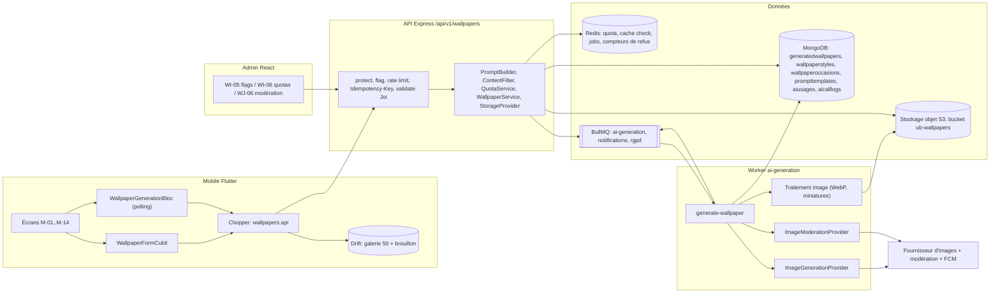
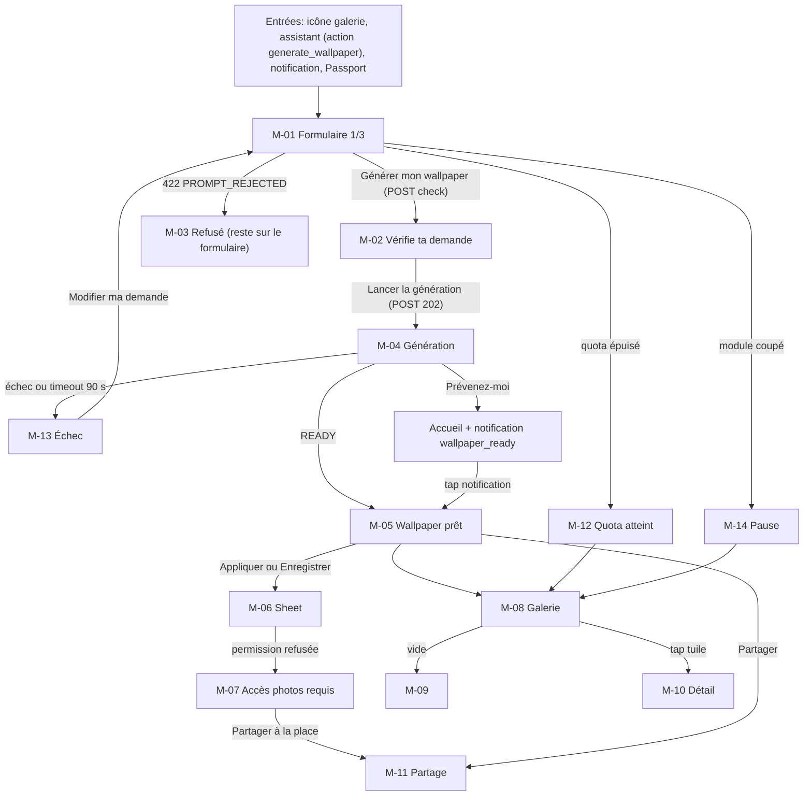
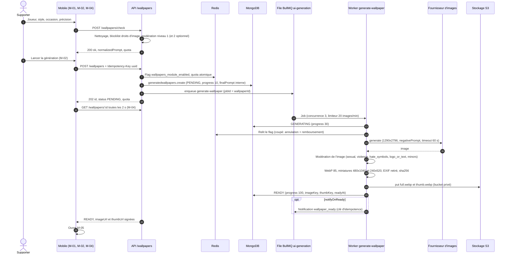
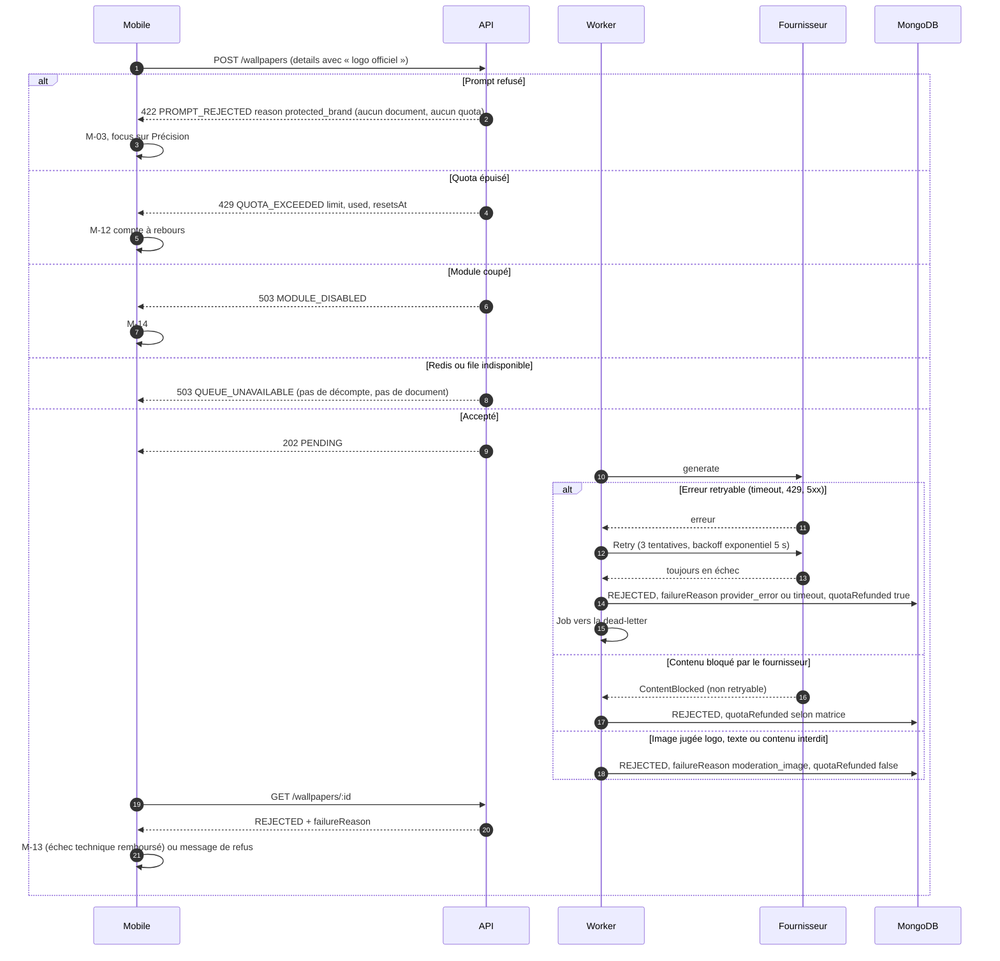
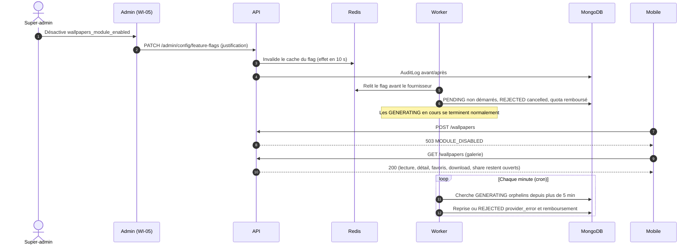
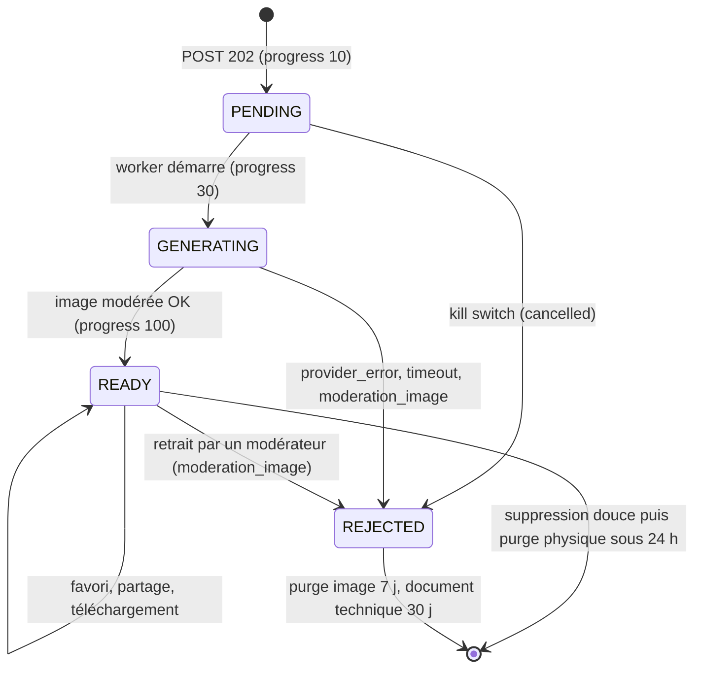
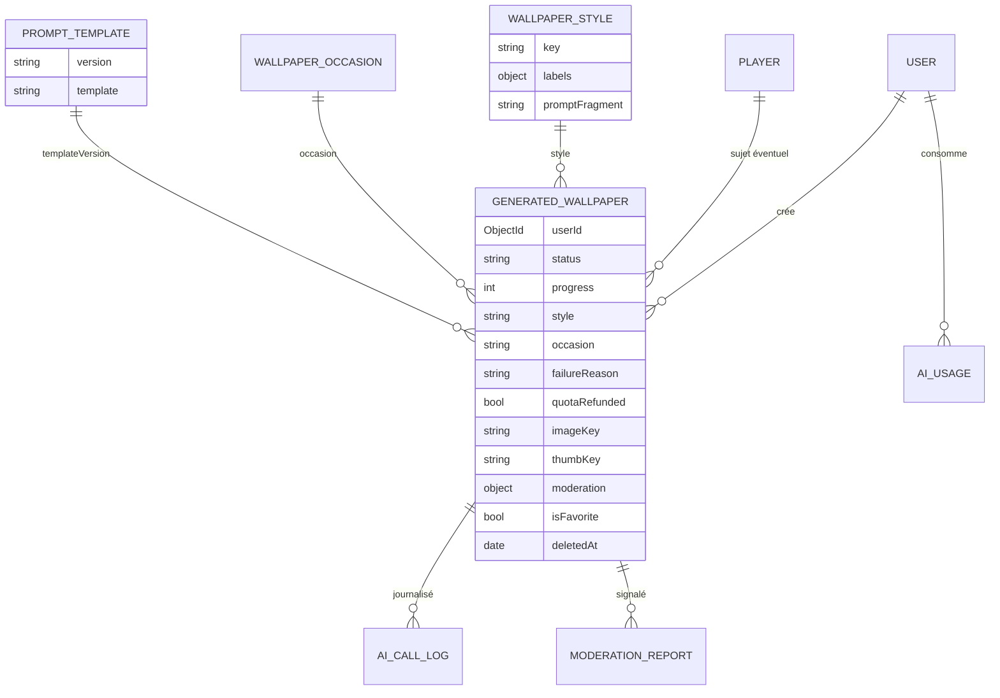
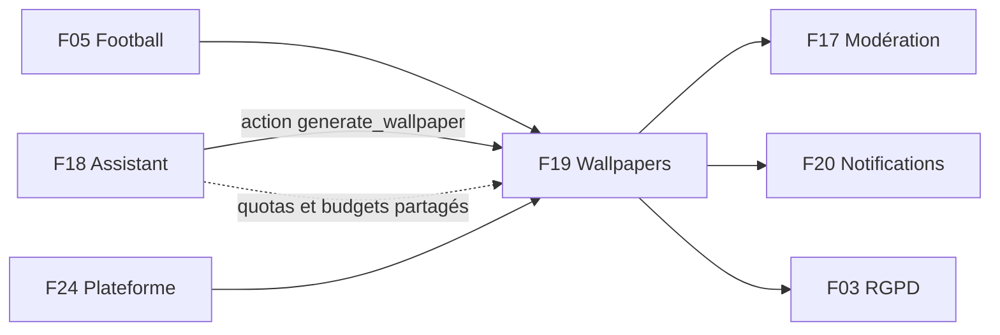

# F19 — Wallpapers IA

> Document de fonctionnalité de l'architecture Univers Barça. Il explique **comment un supporter fabrique un fond d'écran aux couleurs du Barça** avec un formulaire guidé (joueur, style, occasion), comment l'image est générée de façon asynchrone par un worker, modérée avant d'être montrée, stockée de façon privée, partagée, et comment le module respecte les droits d'image du club (aucun logo, écusson ni marque). Il descend jusqu'aux collections MongoDB, à la file BullMQ `ai-generation`, au stockage objet et aux clés Redis, et signale chaque écart entre le code existant, les issues du backlog et les cahiers des charges (CDC).
>
> Convention de lecture : **(existant)** = présent dans le dépôt aujourd'hui ; **(backlog)** = décrit dans les issues mais pas encore codé ; **(proposé)** = non spécifié dans les CDC/issues, suggestion de ce document.

---

## 1. Résumé et fiche

### 1.1 Valeur utilisateur

Un supporter choisit un joueur (Yamal, Pedri, Raphinha, Lewandowski ou « Autre »), un style (Illustration, Néon, Aquarelle, Rétro, Minimal) et une occasion (Jour de match, Anniversaire, Trophée, Libre), ajoute éventuellement une précision de 140 caractères, vérifie le récapitulatif, puis lance la génération. En une quinzaine de secondes, un fond d'écran portrait prêt pour son téléphone apparaît ; il peut l'appliquer (Android), l'enregistrer dans la pellicule, le partager (WhatsApp, Instagram, Facebook, lien, image) ou le retrouver dans sa galerie personnelle. L'utilisateur peut quitter l'écran pendant la génération et être prévenu par notification.

Pourquoi c'est conçu ainsi :

* **Génération toujours asynchrone** : une image prend jusqu'à 15 s (CDC Backend §3.9) ; la requête HTTP ne l'attend jamais, un *worker* BullMQ la fabrique et le mobile interroge le statut.
* **Formulaire guidé plutôt que prompt libre** : le serveur assemble lui-même le prompt à partir de choix fermés ; seul un champ « Précision » de 140 caractères reste libre, nettoyé et modéré. Cela réduit les abus et maîtrise la qualité.
* **Droits d'image** : l'application est « fan-made » ; le CDC Global §10.1 interdit de reproduire le logo, les écussons, les maillots officiels ou une marque déposée. Le module bloque donc ces demandes **avant** génération (blocklist) et détecte logos/textes **après** génération (classifieur d'image).
* **Coût maîtrisé** : quota quotidien par utilisateur, budget mensuel d'images, interrupteur d'urgence.

### 1.2 Fiche

| Champ | Valeur |
|---|---|
| Phase | Phase 3 — Fonctionnalités avancées (CDC Global §12 ; `API-WALL` indiquée phase 3) |
| Priorité | P0 : modèle, catalogue, prompt, droits d'image, modération du prompt et de l'image, `check`, quota, création 202, fournisseur d'images, worker, stockage, URL signées, statut, galerie, kill switch, tests ; P1 : détail/favori/suppression, téléchargement, notification, purge, RGPD, coûts, doc ; P2 : signalement, modération a posteriori admin, performance CDN |
| Épopées backlog | `API-WALL` (31 issues), `MOB-M` (31 issues) ; `ADM-WI-12` (quotas IA) et `WH-04` (budget images) ; modération a posteriori : `API-MODER-25` / `WJ-06` |
| Écrans mobile | `M-01` à `M-14` |
| Écrans admin | `WI-06` (quotas), `WI-05` (flag `wallpapers_module_enabled`), `WH-04` (consommation), `WJ-06` (bibliothèque de modération, phase 3) |
| Dépôts concernés | `univers_barca_api`, `univers_barca_mobile`, `univers_barca_admin` |
| Référence CDC | CDC Global §2.10, §10.1, §10.2, §11.1, §12.1 ; CDC Backend §3.9, §4.6, §10.2, §11.3 ; CDC Flutter §5.1, §6.1, §6.3, §6.4, §7.9, §9.4 ; CDC Admin §6 |

### 1.3 État d'avancement du code (à la date du document)

| Brique | État |
|---|---|
| API : modèle `GeneratedWallpaper` minimal (`userId`, `prompt`, `style`, `occasion`, `status` `PENDING/GENERATING/READY/REJECTED`, `imageKey`, `moderationStatus`, `isFavorite`) dans `src/models/platform.model.ts` ; file BullMQ `ai-generation` déclarée (`src/jobs/queues.ts`) ; `AiQuota` ; `AI_IMAGE_API_KEY` | **(existant)**, mais aucune route, aucun worker, aucun stockage |
| API : catalogue de styles, prompt builder, modération, worker, S3, URL signées, routes `/wallpapers/*` | **(backlog)** (`API-WALL-01` à `API-WALL-31`) |
| Mobile : feature `wallpapers` | **(backlog)** : le dossier `lib/features/wallpapers` n'existe pas encore |
| Admin : `WI-06`, `WJ-06` | **(backlog)** |

---

## 2. Acteurs et user stories

| Acteur | Description |
|---|---|
| Supporter | Utilisateur `active` qui génère et gère ses wallpapers |
| Worker `ai-generation` | Processus BullMQ qui génère, modère, stocke |
| Modérateur | Traite les images en zone de revue et les signalements (`API-WALL-25`, F17) |
| Super-admin | Règle quota et flag `wallpapers_module_enabled`, surveille le budget image |

| # | User story | Critères d'acceptation clés |
|---|---|---|
| US1 | En tant que supporter, je crée un wallpaper via un formulaire guidé. | Joueur ou thème, style, occasion obligatoires ; précision ≤ 140 caractères ; listes fournies par `GET /wallpapers/options` (`API-WALL-03`, `MOB-M-04/05`) |
| US2 | En tant que supporter, je vérifie ma demande avant de consommer un crédit. | `POST /wallpapers/check` sans quota ni job ; récapitulatif `M-02` (`API-WALL-07`, `MOB-M-07`) |
| US3 | En tant que supporter, je comprends pourquoi ma demande est refusée. | 422 `PROMPT_REJECTED` avec `details.reason` ; `M-03` « reproduction de marque protégée » ; quota intact (`API-WALL-05/06`, `MOB-M-08`) |
| US4 | En tant que supporter, je suis la génération et je peux quitter l'écran. | Polling 2 s (backoff ×1,5, plafond 8 s, arrêt 90 s), progression 64 %, notification « prêt » (`API-WALL-16/21`, `MOB-M-09/10/11`) |
| US5 | En tant que supporter, je récupère mon image. | Appliquer (Android), enregistrer (iOS/Android), partager (`MOB-M-13/14/15/21`) |
| US6 | En tant que supporter, je retrouve et gère ma galerie. | Tous/Favoris, 20 par page, détail `M-10`, favori optimiste (`API-WALL-18/19`, `MOB-M-17/18/20`) |
| US7 | En tant que supporter, je ne perds pas mon crédit en cas de panne. | Échec technique → `quotaRefunded:true` ; `M-13` « n'est pas décomptée » (`API-WALL-17`, `MOB-M-24`) |
| US8 | En tant que supporter, je sais quand j'ai atteint ma limite. | `M-12` compte à rebours jusqu'à `resetsAt` (`API-WALL-08`, `MOB-M-22/23`) |
| US9 | En tant que super-admin, je coupe le module si le budget dérape. | `wallpapers_module_enabled` faux → 503 `MODULE_DISABLED`, `M-14`, galerie toujours accessible (`API-WALL-22`, `MOB-M-25`) |
| US10 | En tant que modérateur, je retire une image inappropriée. | File « à contrôler / signalés », `approve` ou `remove` avec justification (`API-WALL-25`, `API-MODER-25`) |

---

## 3. Architecture de la fonctionnalité



**Légende.** Rectangles = composants, cylindres = stockages, double rectangle = files BullMQ.

* **La requête HTTP ne génère rien.** `POST /wallpapers` valide, modère le prompt, décompte le quota, crée un document `PENDING` et enfile le job `generate-wallpaper` avec `jobId = wallpaperId` (idempotence). Le worker fait le travail lourd.
* **Deux modérations** encadrent le fournisseur : celle du **prompt** (avant, synchrone, rapide) et celle de l'**image** (après, dans le worker). L'image n'est jamais publiée sans contrôle (fail-closed).
* **Stockage privé** : bucket unique `ub-wallpapers`, jamais d'URL publique permanente ; l'API délivre des **URL signées** à durée de vie courte.
* **Fournisseurs derrière des interfaces** (`ImageGenerationProvider`, `ImageModerationProvider`, `StorageProvider`) avec implémentations `mock` / `fs` pour la CI et le développement ; `mock` est interdit en production.
* **Réutilisation du socle IA** : quotas `AiQuota`/`AiUsage`, `AiCallLog`, flags et lexiques de modération sont partagés avec F18 (assistant).

---

## 4. Écrans et navigation

### 4.1 Tableau des écrans

| Code | Nom | Rôle |
|---|---|---|
| `M-01` | Générateur — formulaire guidé | « WALLPAPERS IA », stepper 1/3, quota « 3 générations gratuites par jour · 2 restantes », 4 joueurs + « Autre », 5 styles, 4 occasions, précision « 39 / 140 » |
| `M-02` | Aperçu du prompt — « Vérifie ta demande » | Récapitulatif, « Les logos et visuels officiels protégés ne sont pas reproduits », « Lancer la génération » |
| `M-03` | Prompt refusé par la modération | Carte d'erreur « Demande refusée… reproduction de marque protégée » |
| `M-04` | Génération en cours | « Création… », « En file d'attente · 64 % », « Prévenez-moi quand c'est prêt » |
| `M-05` | Wallpaper prêt | Image plein cadre, pastille « Généré », Appliquer / Enregistrer / Partager |
| `M-06` | Enregistrer ou appliquer | Sheet : écran d'accueil (Android), verrouillé, pellicule, partager ; note iOS |
| `M-07` | Autorisation photos refusée | Modale « Accès aux photos requis » |
| `M-08` | Ma galerie | Grille 2 ou 3 colonnes, onglets Tous/Favoris, « 12 wallpapers » |
| `M-09` | Galerie vide | « Aucun wallpaper pour l'instant » |
| `M-10` | Détail d'un wallpaper | « Demande : Lewandowski · Néon · Trophée », « Créé le 12 oct. 2026 », « Modération OK » |
| `M-11` | Partage | WhatsApp, Instagram, Facebook, Lien, Image |
| `M-12` | Quota quotidien atteint | Compte à rebours `11:24:08` |
| `M-13` | Échec de la génération | « Ta tentative n'est pas décomptée », Réessayer / Modifier ma demande |
| `M-14` | Module désactivé | « Wallpapers IA en pause », « Voir ma galerie » |

### 4.2 Captures

<p>


</p>

*De gauche à droite : `M-01` (cartes joueurs, chips de style et d'occasion, compteur de précision), `M-03` (refus pour marque protégée), `M-04` (état « En file d'attente · 64 % »), `M-08` (grille de miniatures avec onglets Tous / Favoris).*

### 4.3 Navigation mobile



---

## 5. Flux détaillés

### 5.1 Génération d'un wallpaper (nominal)



**Pas à pas.**

1. **(2)–(4)** `check` est une **pré-vérification gratuite** : elle ne crée rien, ne décompte rien, ne contacte jamais le fournisseur, et met son résultat en cache 2 min (hash du corps + utilisateur) pour éviter de remodérer au `POST` suivant. Limite : 20 appels/10 min/utilisateur.
2. **(6)–(9)** Ordre strict de `POST /wallpapers` : flag → validation Joi → idempotence (même `Idempotency-Key` sous 24 h = même `id`, sans nouveau décompte) → modération du prompt → limite de 2 générations simultanées (`409 GENERATION_IN_PROGRESS`) → quota → création → enfilement.
3. **(8)** Le **prompt final** (`finalPrompt`) reste interne : jamais renvoyé au client. Le client reçoit seulement `normalizedPrompt` (lisible, FR) et `title`.
4. **(12)** Le job est **idempotent** : si le wallpaper est déjà `READY` ou `REJECTED`, il se termine sans appeler le fournisseur ; le verrou BullMQ de 120 s est renouvelé.
5. **(14)** La progression `30 → 90` est simulée par un ticker toutes les 1,5 s et **plafonnée à 90 %** tant que le fournisseur n'a pas répondu (jamais de 100 % avant `READY`).
6. **(17)** WebP qualité 85 (≤ 6 Mo), miniature qualité 70 (≤ 200 Ko), limite d'entrée 40 Mpx, timeout de traitement 10 s.

### 5.2 Refus, échecs et remboursement (erreurs et cas limites)



**Matrice de remboursement** (`API-WALL-17`) :

| `failureReason` | Statut exposé | `quotaRefunded` | Raison |
|---|---|---|---|
| `provider_error` | `REJECTED` | `true` | Panne du fournisseur après épuisement des tentatives |
| `timeout` | `REJECTED` | `true` | Dépassement (60 s par tentative) |
| `cancelled` | `REJECTED` | `true` | Kill switch pendant l'attente |
| `moderation_image` | `REJECTED` | **`false`** | Règle produit : l'image a été produite et coûté ; l'utilisateur peut régénérer avec un autre prompt |
| classifieur d'image indisponible | `REJECTED` (`provider_error`) | `true` | **Fail-closed** : jamais de publication sans contrôle |

Le remboursement est une opération **atomique conditionnelle** (`quotaRefunded:false → true`), dans la même transaction logique que le changement de statut : impossible de rembourser deux fois.

### 5.3 Reprise, kill switch et balayage des orphelins



À la réactivation, **aucune demande annulée n'est relancée automatiquement** : l'utilisateur voit l'échec remboursé et relance lui-même.

### 5.4 Cycle de vie d'un wallpaper



> Aucun statut supplémentaire n'est créé (les 4 statuts sont figés par le CDC Backend §3.9) : un échec technique est exposé en `REJECTED` avec `failureReason` ≠ `moderation_image`, et le mobile l'affiche en `M-13`.

---

## 6. Contrats d'API

Préfixe `/api/v1` ; succès `{ success:true, data }` ; erreur `{ success:false, error:{ code, message, details?, traceId } }`. **Seul `POST /wallpapers`, `GET /wallpapers/:id` et `GET /wallpapers` sont prévus par le CDC Backend §3.9 ; toutes les autres routes sont des compléments du backlog et n'existent pas encore.** Toutes exigent `protect` ; une ressource d'un autre utilisateur répond **404**.

### 6.1 Utilisateurs

| Méthode | Chemin | Rate limit | Requête | Réponse | Erreurs |
|---|---|---|---|---|---|
| GET | `/wallpapers/options` | 120/min | — (`Accept-Language`) | `{players:[{id,name,number}], styles, occasions:[{key,label,requiresPlayer}], detailsMaxLength:140, quota, moduleEnabled}` ; cache privé 300 s, quota toujours frais | — (si flag coupé : `200 moduleEnabled:false`) |
| POST | `/wallpapers/check` | 20/10 min | `{playerId?, theme?, style, occasion, details?}` | `200 {ok:true, normalizedPrompt, quota}` | `422 PROMPT_REJECTED`, `429 QUOTA_EXCEEDED`, `503 MODULE_DISABLED` |
| POST | `/wallpapers` | 5/10 min | même corps + en-tête `Idempotency-Key` (uuid v4, obligatoire) | `202 {id, status:'PENDING', progress:10, quota}` + `Location` | `400`, `409 GENERATION_IN_PROGRESS`, `422 PROMPT_REJECTED`, `429 QUOTA_EXCEEDED`/`RATE_LIMITED`, `503 MODULE_DISABLED`/`QUEUE_UNAVAILABLE` |
| GET | `/wallpapers/:id` | 60/min | — | `{id, status, progress, imageUrl, thumbUrl, moderationStatus (ok\|rejected\|pending), failureReason, quotaRefunded, queuePosition, estimatedSeconds, title, style, occasion, createdAt, readyAt}` ; `Cache-Control: no-store`, ETag (304 si inchangé) | `404` |
| GET | `/wallpapers` | 120/min | `?filter=all\|favorites&cursor=&limit=20&includePending=false` | `{items:[{id,title,thumbUrl,style,occasion,isFavorite,createdAt,status}], total, hasMore, nextCursor}` | — |
| PATCH | `/wallpapers/:id` | — | `{isFavorite?, notifyOnReady?}` (au moins un) | `{id,isFavorite,notifyOnReady}` | `400`, `409` si `notifyOnReady` hors PENDING/GENERATING |
| DELETE | `/wallpapers/:id` | — | — | `204` (idempotent) | — |
| POST | `/wallpapers/:id/retry` | max 3 par wallpaper | — | `202 {id, status:'PENDING', quota}` | `409` si le source n'est pas un échec technique |
| GET | `/wallpapers/quota` | 120/min | — | `{limit, used, remaining, resetsAt}` | — |
| GET | `/wallpapers/:id/download` | 60/h | `?format=webp\|jpeg` | `302` vers URL signée (TTL 5 min, `Content-Disposition: attachment`) | `409 NOT_READY`, `404` |
| POST | `/wallpapers/:id/share` | 20/jour | — | `{url, expiresAt}` (7 jours, révocable) | `409`, `404` |
| POST | `/wallpapers/:id/share/revoke` | — | — | `204` | — |
| POST | `/wallpapers/:id/report` | 10/24 h | `{reason: inappropriate\|protected_brand\|other, comment? ≤ 300}` | `201 {reportId}` | `409` déjà signalé, `404` |

Exemple de réponse `202` :

```json
{ "success": true, "data": { "id": "6650f…", "status": "PENDING", "progress": 10,
  "quota": { "limit": 3, "used": 1, "remaining": 2, "resetsAt": "2026-10-16T00:00:00Z" } } }
```

Exemple de refus de modération :

```json
{ "success": false, "error": { "code": "PROMPT_REJECTED", "message": "Cette demande ne peut pas être traitée : reproduction de marque protégée",
  "details": { "reason": "protected_brand", "field": "details" }, "traceId": "…" } }
```

### 6.2 Back-office

| Méthode | Chemin | Rôle | Requête | Réponse |
|---|---|---|---|---|
| GET | `/admin/wallpapers/moderation` | moderator, super-admin | `?status=review\|reported\|rejected&from&to&cursor&limit=25` | `{items:[{id,thumbUrl (URL signée 10 min),style,occasion,title,scores,reportsCount,createdAt,userHash}], hasMore, nextCursor}` ; `details` tronqué à 140 car., identité jamais retournée |
| POST | `/admin/wallpapers/:id/decision` | moderator, super-admin | `{decision: approve\|remove, justification ≥ 10}` | `{id, status}` ; audit `{before, after, justification}` ; idempotent |
| GET | `/admin/wallpapers/moderation/stats` | moderator, super-admin | — | `{reviewPending, reportedPending, removed7d, rejectedByModeration7d}` |
| GET | `/admin/moderation/wallpapers` (variante `API-MODER-25`) | moderator | `?filter=to-review\|reported\|removed` | liste ; `POST …/:id/remove` |
| GET/PATCH | `/admin/config/ai-quotas`, `/admin/config/feature-flags` | super-admin | voir F18 | clés `wallpaper.generations`, `wallpapers_module_enabled` |

> **Doublon de routes.** La bibliothèque de modération des wallpapers est décrite deux fois : `API-WALL-25` (`/admin/wallpapers/moderation`, `/admin/wallpapers/:id/decision`) et `API-MODER-25` (`/admin/moderation/wallpapers`, `/remove`). À unifier (§14).

---

## 7. Modèle de données

### 7.1 Collections et champs utiles

| Collection | Champs principaux | Index / TTL |
|---|---|---|
| `generatedwallpapers` | **(existant)** `userId`, `prompt`, `style`, `occasion`, `status`, `imageKey`, `moderationStatus` (`pending/approved/rejected`), `isFavorite`. **(backlog)** `playerId`, `theme` (≤ 60), `details` (≤ 140), `lang`, `userPromptNormalized`, `finalPrompt` (interne), `negativePrompt`, `templateVersion`, `title`, `progress` (0..100), `failureReason` (`none/provider_error/timeout/moderation_image/cancelled`), `quotaRefunded`, `thumbKey`, `width`, `height`, `bytes`, `mimeType` (`image/webp`), `checksum` (sha256), `moderation{prompt{status,categories,at}, image{status,categories,score,at}}`, `notifyOnReady`, `idempotencyKey`, `shareSuspended`, `readyAt`, `deletedAt` | `{userId:1,createdAt:-1}` ; unique `{userId,idempotencyKey}` (fenêtre 24 h) ; `status` |
| `wallpaperstyles` / `wallpaperoccasions` (**backlog**) | `key`, `labels{fr,en,es}`, `promptFragment` (anglais), `negativeFragment`, `enabled`, `order`, `requiresPlayer` | `key` unique |
| `prompttemplates` (**backlog**) | `version` (semver), `template` avec variables `{{subject}}`, `{{style}}`, `{{occasion}}`, `{{details}}`, `{{aspect}}` ; format portrait 9:19,5 (1290×2796) | un template actif unique |
| `aiquotas` / `aiusages` | clé `wallpaper.generations` (3 par défaut maquette) | voir F18 (TTL 40 j) |
| `aicalllogs` | `feature: 'wallpaper'` (+ `wallpaper-moderation`), `imageCount`, `costEstimateEur`, `latencyMs`, `status` | TTL 400 j |
| `moderationreports` | `targetType:'wallpaper'`, `snapshot{style,occasion,title,thumbKey,moderation}` | voir F17 |
| `players` | `featuredForWallpaper` (4 mis en avant, paramétrable) | — |



**Objets du bucket S3 `ub-wallpapers`** : `wallpapers/<userId>/<wallpaperId>/full.webp`, `thumb.webp`, `thumb-s.webp`, `download/<id>.jpg` (cache 24 h). Chiffrement au repos ; `Cache-Control: private, max-age=31536000, immutable` (objets immuables par id) ; image ≤ 6 Mo, miniature ≤ 200 Ko. Variables : `S3_ENDPOINT`, `S3_REGION`, `S3_BUCKET_WALLPAPERS`, `S3_ACCESS_KEY`, `S3_SECRET_KEY`, `STORAGE_DRIVER` (`s3` ou `fs` en dev/tests).

**Sécurité du catalogue** : aucun fragment de prompt ne doit contenir « logo », « crest », « badge officiel », « official kit » ; un test de lint du seed le vérifie.

### 7.2 Clés Redis

| Clé | Usage | TTL |
|---|---|---|
| Cache `check` (hash du corps + userId) | Évite de remodérer au `POST` | 2 min |
| Cache de la limite `wallpaper.generations` | Limite effective | 60 s |
| Compteur de refus de modération (par utilisateur) | 5 refus/h → cooldown 15 min | 1 h |
| Cache du flag `wallpapers_module_enabled` | Kill switch | 10 s |
| `queuePosition` (cache `getWaitingCount`) | Position dans la file | 2 s |
| Idempotence `Idempotency-Key` | Même clé = même id | 24 h |
| Limiteurs `rl:wallpapers:*` **(proposé)** | Rate limits | fenêtre |

Le préfixe `ub:` n'est pas encore appliqué dans le code ; les clés sont citées comme dans les issues.

### 7.3 Migrations

* Migration du modèle `GeneratedWallpaper` : valeurs par défaut (`progress` 0/100 selon statut, `failureReason:'none'`, `quotaRefunded:false`, `moderation` reconstruit depuis `moderationStatus`), index `{userId,createdAt:-1}`.
* Seed idempotent des styles (5), occasions (4), template v1, joueurs « mis en avant » (Yamal, Pedri, Raphinha, Lewandowski), clé `AiQuota wallpaper.generations`.

---

## 8. Traitements asynchrones et cache

| Traitement | Détail |
|---|---|
| File `ai-generation`, job `generate-wallpaper` | `jobId = wallpaperId` ; concurrence 3 par instance (`WALLPAPER_WORKER_CONCURRENCY`) ; limiteur global **20 images/min** ; 3 tentatives, backoff exponentiel 5 s ; erreurs non retryables sans retry ; épuisement → dead-letter ; arrêt propre sur SIGTERM (fin des jobs en cours, timeout 70 s) |
| Balayage des orphelins (cron 1 min) | `GENERATING` depuis plus de 5 min repris ; `PENDING/GENERATING` de plus de 30 min → `REJECTED provider_error` remboursé |
| Notification « prêt » (file `notifications`) | `wallpaper_ready:<id>` (envoi unique), non envoyée si supprimé/rejeté ou si READY consulté depuis moins de 10 s (voir F20) |
| Purge (cron quotidien 03:15, file `rgpd`) | Suppression physique des `deletedAt` > 24 h ; images `REJECTED moderation_image` supprimées 7 jours après la décision (sauf signalement ouvert) ; documents `REJECTED` techniques sans image 30 jours ; **orphelins S3** : parcours mensuel, max 1000 suppressions/run, `dry-run` au premier déploiement ; rapport `{deletedDocs, deletedObjects, bytesFreed, errors}` |
| Minimisation | `details` supprimé du document 90 jours après création, sauf favori |
| Cache HTTP | Objets immuables ; listes `ETag` + `max-age=30` ; détail `must-revalidate` ; CDN optionnel (Cloudflare/Bunny) avec URL signées ; mobile : cache disque 200 Mo, TTL 30 j, clé par `wallpaperId` + variante (pas l'URL complète) |
| Estimation de durée | Moyenne glissante (EMA) des 50 dernières générations → `estimatedSeconds` (15 par défaut) |

**Pourquoi la progression est-elle « simulée » ?** La plupart des fournisseurs d'images n'exposent pas de pourcentage. Le worker fait croître `progress` par paliers (10 modération, 20 file, 30 démarrage, 30–90 génération, 95 miniature, 100 prêt) pour donner un retour visuel honnête mais plafonné à 90 % tant que l'image n'est pas reçue.

---

## 9. Règles de gestion

1. **Entrée** : `playerId` ou `theme` (obligatoire si `playerId` nul, ≤ 60 car.), `style ∈ {illustration, neon, watercolor, retro, minimal}`, `occasion ∈ {matchday, birthday, trophy, free}`, `details` ≤ 140 graphèmes, `lang`.
2. **Nettoyage de `details`** : trim, retours à la ligne et caractères de contrôle supprimés, délimiteurs de template échappés, URL et mentions `@` refusées.
3. **Prompt final** : template actif + fragment de style + fragment d'occasion + sujet + précision, ordre fixe, ≤ 600 caractères ; fragments **en anglais** ; jamais renvoyé au client.
4. **Joueurs réels** : illustration stylisée évoquant l'athlète (couleurs bleu-grenat génériques) ; *negative prompt* : logos, écussons, textes lisibles, sponsors, marques, maillots officiels, visages photoréalistes de personnes réelles.
5. **Droits d'image** : blocklist FR/EN/ES versionnée (logo, écusson, escudo, crest, badge, emblème, « maillot officiel », « official kit », sponsors, noms de marques, « FC Barcelona » + logo ; variantes leet) ; refus `422 PROMPT_REJECTED {reason:'protected_brand'}` ; la mention du club comme thème général (« Camp Nou », « ambiance Barça ») et les couleurs ne sont **pas** bloquées.
6. **Catégories de modération du prompt** : `protected_brand`, `hate`, `sexual`, `violence`, `selfharm`, `real_person_defamation`, `minors_sensitive`, `injection` ; niveau 1 local (lexiques partagés avec l'assistant) puis niveau 2 optionnel (timeout 1,5 s, fail-open sauf catégories graves).
7. **Anti-abus du refus** : 5 refus en 1 h → cooldown 15 min (`429 RATE_LIMITED`, `reason:'moderation_cooldown'`) ; 10 refus/24 h → signalement automatique de gravité *review* (F17). Le prompt refusé n'est pas persisté en clair.
8. **Quota** : défaut 3/jour (maquettes) — le CDC Backend §10.2 indique 5 ; jour UTC ; décompté après modération du prompt et avant l'enfilement ; remboursé selon la matrice du §5.2.
9. **Limite de concurrence** : 2 générations `PENDING/GENERATING` maximum par utilisateur.
10. **Modération d'image** : catégories `sexual`, `violence`, `hate_symbols`, `logo_or_text`, `minors` ; rejet ≥ 0,6 ; **revue entre 0,4 et 0,6** (statut `READY` avec `moderation.image.status='review'` et signalement automatique) ; délai cible < 3 s ; classifieur indisponible → 2 retries puis fail-closed.
11. **Image** : portrait 1290×2796 (9:19,5), recadrage `cover`, WebP q85 ≤ 6 Mo, EXIF supprimé ; miniatures 480×1040 (q70, ≤ 200 Ko) et 240×520 ; JPEG q90 à la demande ; hash perceptuel dHash informatif.
12. **URL signées** : miniature TTL 24 h, image pleine TTL 1 h, téléchargement TTL 5 min, partage TTL 7 jours (révocable par nonce) ; jamais loguées en clair.
13. **Galerie** : seuls les `READY` ; plafond 100 wallpapers par utilisateur (suppression du plus ancien non favori avec avertissement) ; `REJECTED` jamais listés.
14. **Polling mobile** : 2 s, ×1,5, plafond 8 s, arrêt à 90 s (traité comme échec).
15. **Kill switch** : `wallpapers_module_enabled` faux → 503 sur `POST`, `check`, `retry`, `options` (`moduleEnabled:false`) ; lecture, favoris, téléchargement, partage restent ouverts.
16. **Retry** : 3 réessais maximum par wallpaper, seulement après échec technique.
17. **Droit à l'effacement** : suppression de compte → documents et objets (`deletePrefix wallpapers/<userId>/`) sous 24 h.

---

## 10. Sécurité, RGPD et anti-abus

* **Propriété intellectuelle** : double barrière (blocklist avant, classifieur `logo_or_text` après) ; revue mensuelle documentée des refus pour affiner la liste ; mention « fan-made ».
* **Contrôle d'accès** : seul le propriétaire obtient des URL ; un autre utilisateur reçoit **404** ; les `REJECTED` n'ont ni `imageUrl` ni `thumbUrl`.
* **URL non devinables et courtes** ; query `X-Signature` expurgée par `requestLogger` ; en-tête `Content-Disposition` contrôlé.
* **Données personnelles** : `details` (texte libre) et images sont des données de l'utilisateur ; export (fiche « Wallpapers générés » de `Q-11`) avec métadonnées et URL signées 24 h, **sans** prompt final ni scores de modération ; le fournisseur d'IA générative est un sous-traitant du registre (CDC Global §10.2).
* **Minimisation** : `details` purgé à 90 jours (sauf favori) ; `AiCallLog` sans prompt ; analytics mobiles sans texte libre ni identifiant en clair, uniquement avec consentement `analytics`.
* **Anti-abus** : rate limits (`POST` 5/10 min, `check` 20/10 min, statut 60/min, galerie 120/min, download 60/h, share 20/jour), quota, cooldown de modération, limite de concurrence.
* **Traitement d'image sûr** : limite de pixels (40 Mpx), timeout 10 s, WebP recompressé, EXIF supprimé (aucune fuite de métadonnées).
* **Partage** : liens signés révocables ; liens suspendus (`shareSuspended`) pendant l'examen d'un signalement.
* **Secrets** : `S3_*`, `AI_IMAGE_API_KEY` en variables d'environnement validées par Joi, jamais loggés.

---

## 11. Erreurs et états dégradés

| Situation | Serveur | Client |
|---|---|---|
| Prompt refusé | `422 PROMPT_REJECTED` (`details.reason`) | `M-03` : libellé selon `reason` (`protected_brand`, `hate`, `sexual`, `violence`, `other`), quota inchangé, Précision surlignée |
| Quota atteint | `429 QUOTA_EXCEEDED` | `M-12` + compte à rebours HH:MM:SS (police tabulaire) ; « Voir ma galerie » |
| Rafale | `429 RATE_LIMITED` + `Retry-After` | Message temporisé (distinct de `M-12`) |
| Échec technique | `REJECTED`, `quotaRefunded:true` | `M-13`, quota rechargé pour prouver le remboursement ; après 3 échecs : traceId copiable |
| Image rejetée par la modération | `REJECTED moderation_image`, pas de remboursement | Message de refus, possibilité de modifier la demande |
| Module coupé | `503 MODULE_DISABLED` | `M-14` ; flag lu dans la config distante (cache 5 min) ; « Nouveau wallpaper » remplacé |
| Redis ou file indisponible | `503 QUEUE_UNAVAILABLE` (aucun décompte) | Snackbar d'erreur, réessai manuel |
| Hors-ligne | — | Galerie en cache Drift (50 derniers) avec miniatures ; génération désactivée ; favori refusé avec message (pas de file d'attente) |
| App en arrière-plan | Génération continue | Polling interrompu proprement, vérification au `resumed` ; `pending_id` persistant après kill de l'app |
| URL signée expirée | `403` sur l'objet | Redemande `GET /wallpapers/:id` |
| Permission photos refusée | — | `M-07` : « Ouvrir les réglages » ou « Partager à la place » ; réessai auto au retour |
| iOS | — | Pas d'application directe ; seules « Enregistrer » et « Partager » |

---

## 12. Connexions avec les autres fonctionnalités

| Fonctionnalité | Relation | Détail |
|---|---|---|
| F18 Assistant IA | partage / alimente | Action `generate_wallpaper` (deep link `univers-barca://wallpapers/new`, masquée si le flag est coupé) ; quotas, `AiCallLog`, flags et lexiques de modération partagés |
| F17 Modération | alimente | Cible `wallpaper`, signalement utilisateur, file « à contrôler », décision `approve/remove` ; signalement auto à 10 refus/24 h |
| F20 Notifications | alimente | Catégorie `wallpapers`, push `wallpaper_ready`, deep link `univers-barca://wallpapers/<id>` ; l'intention `notifyOnReady` prime sur la préférence |
| F05 Données football | dépend de | Liste des joueurs publiés, `featuredForWallpaper` |
| F03 Paramètres et RGPD | partage | Export `Q-11`, suppression de compte, consentement `analytics` |
| F24 Plateforme | dépend de | BullMQ (`ai-generation`), flags, config distante, scheduler, S3 |
| F01 Authentification | dépend de | `protect`, refresh |
| F12 Passport | (proposé) | Aucune règle de points/badges décrite pour les wallpapers dans le backlog |



---

## 13. Observabilité et tests

### 13.1 Métriques et logs

* **Prometheus** : `wallpaper_generation_seconds` (histogramme), `wallpaper_generations_total{status}`, `wallpaper_cost_eur_total`, `wallpaper_failures_total{reason}`, `wallpaper_purge_total{type}` ; taille des files BullMQ (CDC Backend §6.2 : taux d'échec de génération).
* **`AiCallLog`** par tentative (provider, model, `imageCount`, coût estimé, latence, statut, `wallpaperId` technique, `traceId`), grille de prix configurable (`€/image`, paramètre `chargeOnFailure`).
* **Budget** : `AI_MONTHLY_IMAGE_BUDGET` (ex. 1 500 images, 83 % consommé dans `WI-06`), alerte à 80 %, projection de dépassement dans `WH-04` ; log critique si dépassement (la coupure reste manuelle, décidée par le super-admin).
* **Logs** : jamais de prompt ni d'URL signée en clair.

### 13.2 Tests

| # | Cas | Résultat attendu |
|---|---|---|
| T1 | Parcours : options → check → POST 202 → polling jusqu'à READY (mock 1 s) → galerie → favori → download → share → suppression | verts, couverture ≥ 90 % de `src/services/wallpaper` |
| T2 | Prompt avec « logo officiel » | `422 PROMPT_REJECTED protected_brand`, quota intact, aucun document |
| T3 | Même `Idempotency-Key` deux fois | même `id`, un seul décompte |
| T4 | Scénarios mock : `ok`, `slow` (20 s), `timeout`, `blocked`, `flaky` (échoue 2 fois puis réussit), `logo` | statuts et remboursements conformes à la matrice |
| T5 | 3 générations quotidiennes puis une 4e | `429 QUOTA_EXCEEDED` en < 100 ms |
| T6 | Flag coupé avec jobs en file | `PENDING` → `REJECTED cancelled` remboursés ; `GENERATING` terminés |
| T7 | Accès d'un autre utilisateur à `/wallpapers/:id` | 404 |
| T8 | Redaction de `X-Signature` dans les logs | présente |
| T9 | Lint du seed : aucun fragment « logo/crest/badge officiel/official kit » | OK |
| T10 | Mobile : goldens `M-01`..`M-14` clair/sombre, parcours `patrol` formulaire → génération → enregistrement, refus de permission → `M-07` | couverture ≥ 80 % de `features/wallpapers` (`MOB-M-30`) |
| T11 | Purge : `deletedAt` > 24 h, `REJECTED` > 7 j, orphelins S3 | rapport de purge cohérent |

**k6** : scénarios `POST /wallpapers` (avec mock rapide), `GET /wallpapers/:id` (polling) et galerie (< 600 ms pour 20 miniatures en 4G simulée, < 2,5 Mo cumulés) ; Swagger (`docs/wallpapers.md`, diagramme d'états, aucun détail du prompt final ni nom de fournisseur).

---

## 14. Points ouverts et décisions à confirmer

1. **Quota par défaut** : 3/jour (maquettes, `API-WALL-08`, `MOB-M-22`) vs 5/jour (CDC Backend §10.2, variable `WALLPAPER_DAILY_QUOTA` côté mobile vs `AI_WALLPAPER_DAILY_QUOTA` côté API).
2. **Réessai** : `MOB-M-24` « Réessayer » relance `POST /wallpapers` avec une nouvelle `Idempotency-Key` ; l'API prévoit `POST /wallpapers/:id/retry` (nouvelle demande serveur, 3 réessais max, 409 si pas un échec technique). À aligner.
3. **Suppression d'un wallpaper** : `API-WALL-19` expose `DELETE /wallpapers/:id`, mais `MOB-M` la classe hors périmètre (« absente des CDC et maquettes »).
4. **Partage par lien** : `MOB-M-21` copie `imageUrl` (URL signée « dont la durée de vie est fixée par l'API ») alors que l'API prévoit `POST /:id/share` (7 jours, révocable, 20/jour).
5. **Téléchargement** : mobile télécharge `imageUrl` dans le cache applicatif (`MOB-M-14`), l'API prévoit `GET /:id/download` (302, JPEG à la demande) : choisir un seul chemin.
6. **Statuts d'échec côté mobile** : `Rejected` (image) vs `Failed` (technique) dans le BLoC, mais l'API n'expose qu'un seul statut `REJECTED` + `failureReason` ; `M-13` couvre le technique, aucun écran spécifique n'existe pour `moderation_image` (`M-03` est le refus du *prompt*).
7. **Progression initiale** : `progress:10` à la création (API) vs barre indéterminée si absent (mobile) ; « En file d'attente · 64 % » : la progression de la maquette est-elle compatible avec `PENDING` (0–20 %) ?
8. **Non-remboursement d'une image rejetée** : règle produit à valider (l'utilisateur perd un crédit sur un refus automatique).
9. **Phase** : `API-WALL` indique phase 3, alors que la bulle de l'assistant et les quotas existent dès la phase 1 ; le flag `wallpapers_module_enabled` doit donc exister avant le module.
10. **Doublon `API-WALL-25` / `API-MODER-25`** pour la modération a posteriori (routes différentes).
11. **Notifications** : « push/WebSocket » dans le CDC Backend §3.9, push seul dans le backlog ; aucun WebSocket prévu.
12. **Stockage** : fournisseur S3 compatible non choisi ; CDN optionnel ; durée de rétention des `REJECTED` (7 j) vs « 90 jours » de `API-MODER-25` pour les contenus retirés.
13. **Stack CDC** : le CDC Backend mentionne Prisma/NestJS ; la réalisation est Mongoose/Express et BullMQ.

---

## 15. Pour aller plus loin

**Épopées** : `API-WALL`, `MOB-M`, `API-IA` (quotas, flags, journal des coûts), `API-MODER` (modération a posteriori), `API-NOTIF` (push), `ADM-WI` (quotas et flags), `ADM-WH` (budget).

**Issues repères** : `API-WALL-01` (modèle), `API-WALL-02/04` (catalogue, prompt), `API-WALL-05/06` (droits d'image, modération du prompt), `API-WALL-07` (`check`), `API-WALL-08` (quota), `API-WALL-09` (création 202), `API-WALL-10/11` (fournisseur, worker), `API-WALL-12/13/14` (stockage, URL signées, traitement d'image), `API-WALL-15` (modération d'image), `API-WALL-17` (échecs), `API-WALL-22` (kill switch), `API-WALL-27/28` (purge, RGPD), `MOB-M-04` (`WallpaperFormCubit`), `MOB-M-09` (`WallpaperGenerationBloc`), `MOB-M-13/14/15` (appliquer, enregistrer), `MOB-M-22` (quota), `ADM-WI-12`.

**CDC** : CDC Global §2.10, §10.1 (droits d'image), §10.2, §11.1, §12.1 ; CDC Backend §3.9, §4.6, §10.2, §11.3 ; CDC Flutter §5.1, §6.1, §6.3, §6.4, §7.9, §9.4 ; CDC Admin §6.

**Fichiers de code**

* API : `src/models/platform.model.ts` (`GeneratedWallpaper`, `AiQuota`), `src/jobs/queues.ts` (file `ai-generation`), `src/jobs/scheduler.ts`, `src/config/env.ts` (`AI_IMAGE_API_KEY`) ; à créer : `src/services/wallpaper/` (prompt builder, quota, génération), `src/workers/ai-generation.worker.ts`, `src/services/storage/` (S3 et `fs`), `docs/wallpapers.md`, fixtures `tests/fixtures/contracts/wallpapers/*.json`.
* Mobile : `lib/features/wallpapers` (à créer, suivre `lib/features/players`), `WallpaperFormCubit`, `WallpaperGenerationBloc`, tables Drift `wallpaper_draft` et galerie, routes `/wallpapers/*`.
* Admin : écrans `WI-05`, `WI-06`, `WJ-06` ; `src/api/config.api.ts`.
