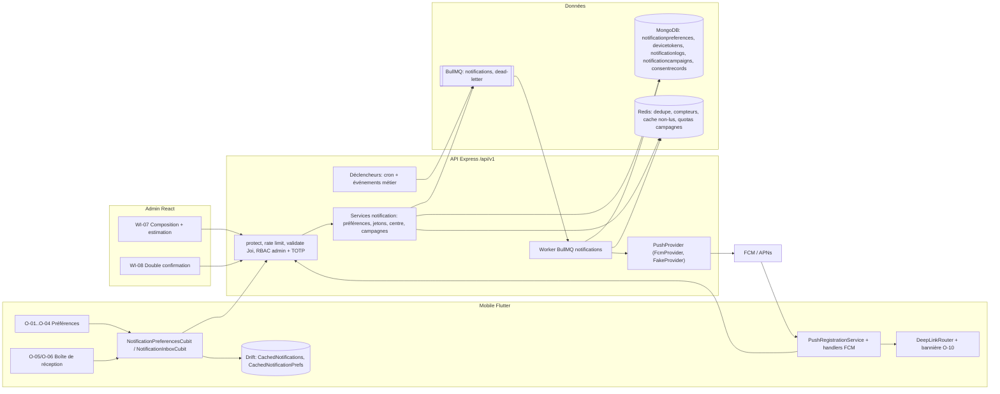
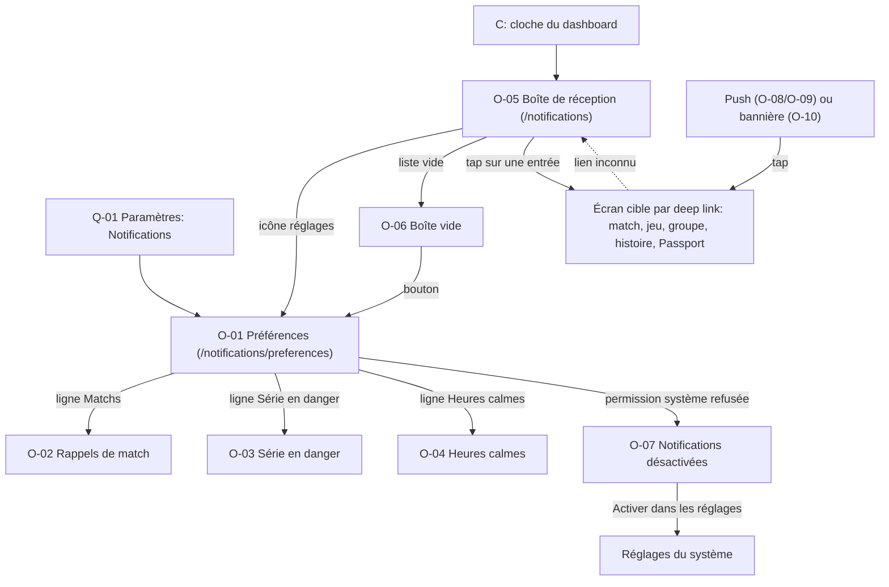
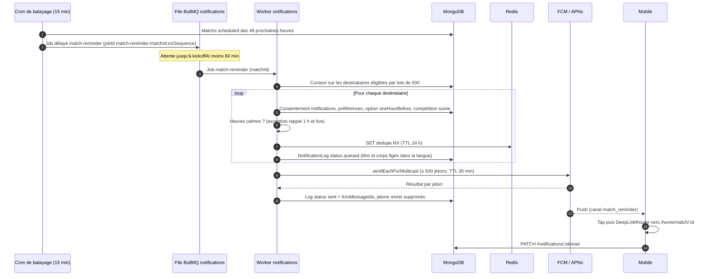
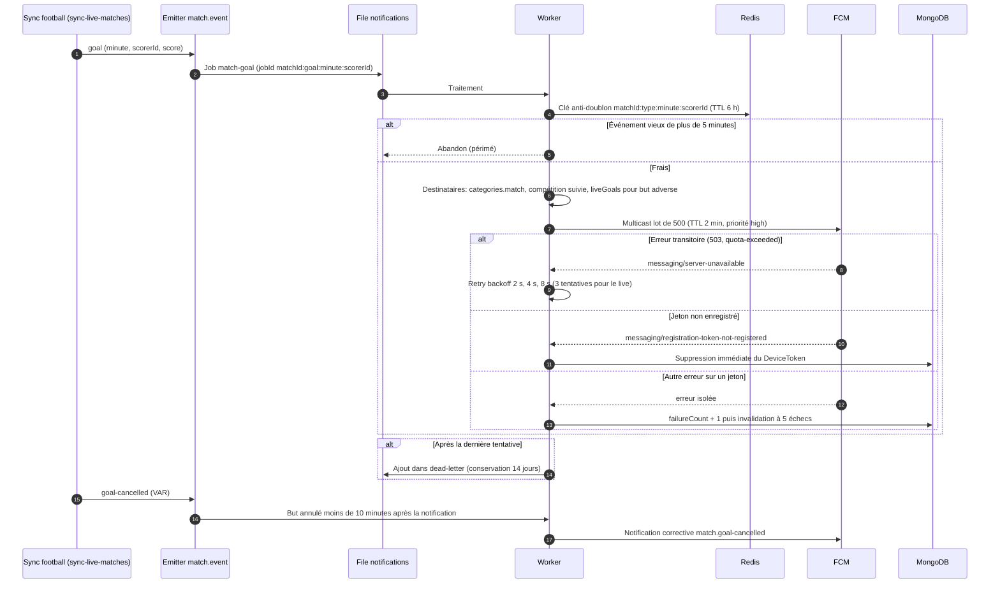
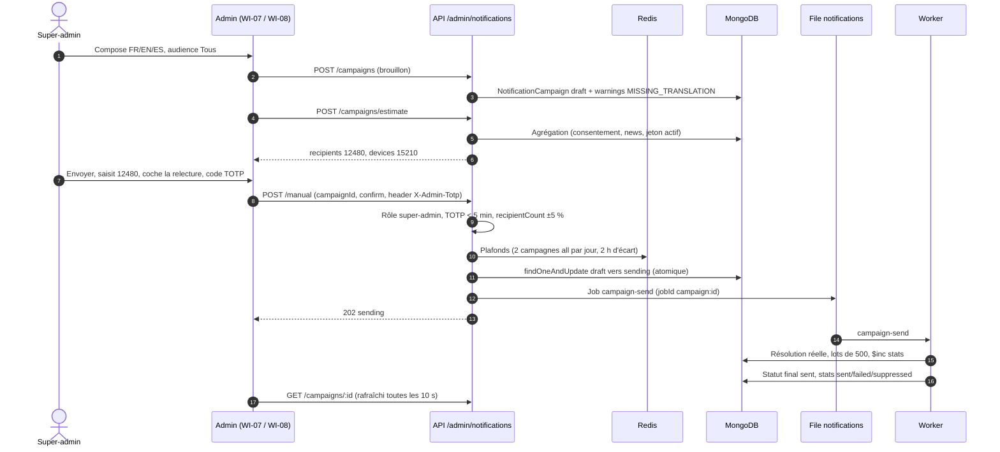
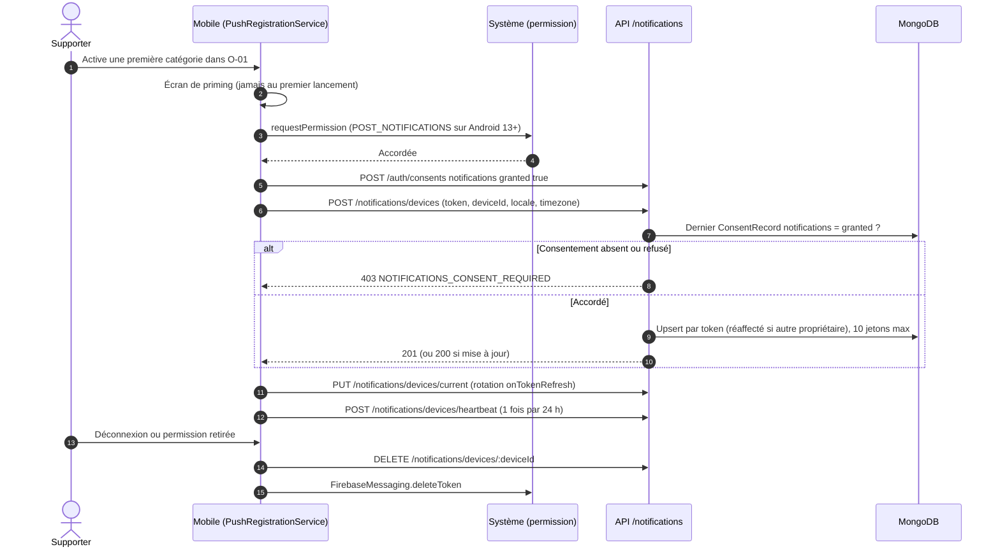
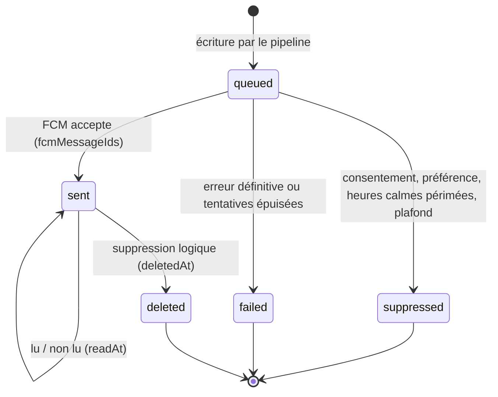
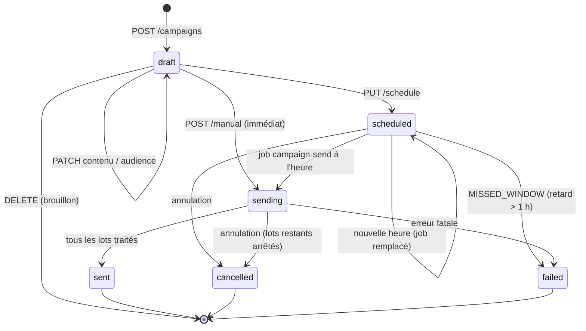
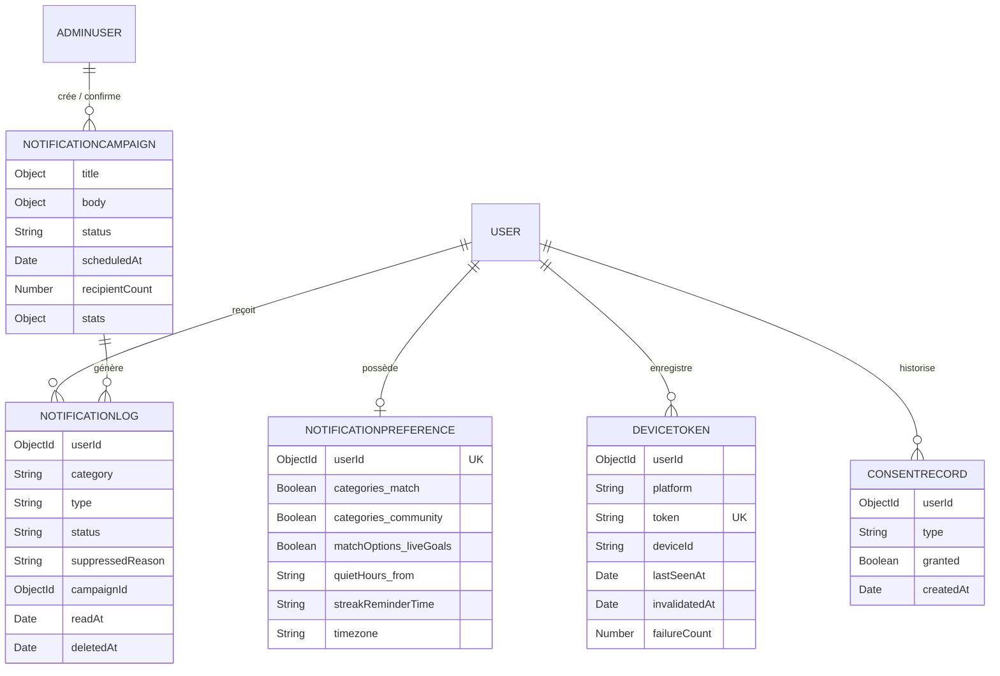

# F20 — Notifications (push, in-app, campagnes)

> Document de fonctionnalité de l'architecture Univers Barça. Il explique **comment un supporter est prévenu au bon moment** (rappel de match, but, mi-temps, résultat final, série en danger, anniversaire, activité d'un groupe, sanction de modération) et **comment il garde le contrôle** (préférences par catégorie, heures calmes, consentement, centre de notifications dans l'application), ainsi que **comment l'équipe peut envoyer une annonce ponctuelle** depuis le back-office avec des garde-fous contre l'envoi de masse accidentel. Il décrit la chaîne complète : déclencheurs métier, file BullMQ `notifications`, service FCM, jetons d'appareil, journal d'envoi, réception Flutter et deep links. Il signale chaque écart entre le code existant, les issues du backlog et les cahiers des charges (CDC).
>
> Convention de lecture : **(existant)** = présent dans le dépôt aujourd'hui ; **(backlog)** = décrit dans les issues mais pas encore codé ; **(proposé)** = non spécifié dans les CDC/issues, suggestion de ce document.
>
> Vocabulaire : **push** = notification affichée par le système d'exploitation même quand l'app est fermée ; **FCM** (*Firebase Cloud Messaging*) = service Google qui relaie les push vers Android et, via **APNs** (*Apple Push Notification service*), vers iOS ; **jeton d'appareil** (*device token*) = identifiant opaque délivré par FCM à une installation de l'app, nécessaire pour lui adresser un push ; **deep link** = lien interne (`univers-barca://match/123`) qui ouvre directement le bon écran ; **heures calmes** = plage horaire où l'utilisateur ne veut pas être dérangé ; **fan-out** = envoi d'un même événement à un grand nombre de destinataires.

---

## 1. Résumé et fiche

### 1.1 Valeur utilisateur

Un supporter ne veut ni rater le coup d'envoi ni être spammé. Univers Barça lui envoie donc **peu de notifications, mais utiles** : « Match dans 1 h ⚽ » avec l'adversaire, la compétition et l'heure **dans son fuseau** ; « But du Barça ! 2 – 1 » en direct si l'option est activée ; « Résultat final » avec un lien vers le résumé ; « Ta série est en danger 🔥 » à l'heure qu'il a choisie s'il n'a pas encore joué ; « Anniversaire de Pedri 🎂 » à 09:00 ; un message de son groupe local. Chaque catégorie s'active ou se coupe séparément, une fenêtre de **heures calmes** protège la nuit, et une **boîte de réception** dans l'app garde la trace de tout ce qui a été envoyé (même si le push a été retenu ou si la permission du téléphone est refusée).

Pourquoi c'est conçu ainsi :

* **Opt-in strict et RGPD.** Les notifications push sont un consentement distinct (`ConsentRecord` de type `notifications`, valeur par défaut `granted:false`). Pas de consentement, pas de jeton enregistré, pas d'envoi (sauf la catégorie système `moderation`, transactionnelle).
* **Respect de l'utilisateur d'abord.** Les catégories « bruyantes » (communauté, nouveautés) sont désactivées par défaut ; les rappels sont dédoublonnés ; la série ne rappelle qu'une fois par jour local ; les campagnes manuelles sont plafonnées (3 par 7 jours glissants par utilisateur).
* **Fiabilité en soirée de match.** Un but doit arriver en moins de 30 s : l'envoi passe par une file **BullMQ** avec lots de 500 jetons, limitation de débit, retries à backoff exponentiel et dead-letter, au lieu d'un envoi synchrone dans la requête.
* **Sécurité des annonces de masse.** Une notification « à tous » ne part qu'après saisie du nombre exact de destinataires, relecture des trois langues cochée, rôle `super-admin` et code TOTP récent.

### 1.2 Fiche

| Champ | Valeur |
|---|---|
| Phase | Phase 1 — MVP (rappels, préférences, centre de notifications) ; campagnes manuelles et déclencheurs secondaires en P1 (CDC Global §2.12 et §2.13) |
| Priorité | P0 : modèles, enregistrement et rotation des jetons, préférences, heures calmes, consentement, service FCM, worker, lots, retry/DLQ, purge des jetons morts, modèles i18n, rappels de match, live, série, centre in-app, brouillon/segments/envoi de campagne ; P1 : défi du jour, badge/histoire, groupes, modération, planification, historique, quotas, journaux/métriques, tests ; P2 : documentation OpenAPI |
| Épopées backlog | `API-NOTIF` (31 issues), `MOB-O` (28 issues), `ADM-WI` (notifications manuelles : `ADM-WI-14` à `ADM-WI-17`, couche API `ADM-WI-01`, E2E `ADM-WI-21`) ; épopées sources de déclencheurs : `API-CAL`, `API-FOOT`, `API-JEUX`, `API-PASS`, `API-COMM`, `API-MODER`, `API-WALL`, `API-PLAT` |
| Écrans mobile | `O-01` (centre de préférences), `O-02` (rappels de match), `O-03` (série en danger), `O-04` (heures calmes), `O-05` (boîte de réception), `O-06` (boîte vide), `O-07` (notifications désactivées), `O-08` (écran verrouillé : rappel de match), `O-09` (écran verrouillé : autres notifications), `O-10` (notification dans l'application) |
| Écrans admin | `WI-07` (notification manuelle : composition), `WI-08` (double confirmation « Envoyer à TOUS ») ; supervision de la file : `WH-06` (hors de ce document) |
| Dépôts concernés | `univers_barca_api`, `univers_barca_mobile`, `univers_barca_admin` |
| Référence CDC | CDC Global §2.12, §2.13, §10.2 ; CDC Backend §3.10, §7 (job `send-notifications`), §11.4 ; CDC Flutter §6.1, §6.3, §6.4, §7.11 ; CDC Admin §4.6.3, §4.11, §4.12 |

### 1.3 État d'avancement du code (à la date du document)

| Brique | État |
|---|---|
| API : modèles `NotificationPreference` (catégories, `matchOptions`, `quietHours`, `streakReminderTime`), `DeviceToken` (`userId`, `platform`, `token` unique), `NotificationLog` (`userId`, `category`, `title`, `body`, `deepLink`, `readAt`, `sentAt`) dans `src/models/platform.model.ts` ; `ConsentRecord` avec type `notifications` ; file `notifications` dans `src/jobs/queues.ts` (5 tentatives, backoff exponentiel 2 s, file `dead-letter`) ; variable `FCM_SERVICE_ACCOUNT_BASE64` dans `src/config/env.ts` | **(existant)** mais aucune route, service, worker ni déclencheur de notification |
| API : extension des modèles, `NotificationCampaign`, routes `/notifications/*` et `/admin/notifications/*`, `PushProvider`, worker, déclencheurs, métriques | **(backlog)** (`API-NOTIF-01` à `API-NOTIF-31`) |
| Mobile : `lib/core/services/notification_service.dart` (squelette : `requestPermission` immédiat, écoute du premier plan, `// À faire`) ; `firebase_messaging` et `flutter_local_notifications` déclarés | **(existant)** à remplacer par `PushRegistrationService`, `DeepLinkRouter`, `NotificationPreferencesCubit`, `NotificationInboxCubit` (`MOB-O-*`) |
| Admin : pages `WI-07`/`WI-08` | **(backlog)** (`ADM-WI-14` à `ADM-WI-17`) |

> Attention : le squelette mobile actuel appelle `requestPermission` à l'initialisation. Le backlog l'interdit (`MOB-O-13`, `MOB-FND-33`, CDC Flutter §6.4) : la permission n'est jamais demandée au premier lancement, seulement après un écran de priming.

---

## 2. Acteurs et user stories

| Acteur | Description |
|---|---|
| Supporter | Utilisateur authentifié qui reçoit, règle et consulte ses notifications |
| Content-manager | Compose, prévisualise et envoie des campagnes vers un segment (pays, groupe) |
| Super-admin | Seul à pouvoir envoyer à « Tous » ; confirme avec un code TOTP ; supervise la file |
| Moderator | Lecture seule de l'historique des campagnes ; ses décisions déclenchent des notifications de sanction |
| Système | Déclencheurs (sync football, jeux, modération…), worker `notifications`, FCM/APNs |

| # | User story | Critères d'acceptation clés |
|---|---|---|
| US1 | En tant que supporter, je reçois un rappel une heure avant chaque match que je suis. | Job délayé à `kickoffAt − 60 min` ; compétition ∈ `matchOptions.competitions` ; un seul rappel par match même avec plusieurs appareils (`API-NOTIF-13`, `MOB-O-20`) |
| US2 | En tant que supporter, je suis prévenu des buts, de la mi-temps et du score final. | But du Barça par défaut, but adverse si `liveGoals` ; latence < 30 s ; messages > 2 min abandonnés (`API-NOTIF-14`) |
| US3 | En tant que supporter, je règle mes notifications catégorie par catégorie. | 6 interrupteurs, défauts alignés API/maquette, PATCH partiel avec debounce 500 ms et rollback (`API-NOTIF-04`, `MOB-O-06`, `MOB-O-07`) |
| US4 | En tant que supporter, je choisis l'heure de mon rappel de série. | `streakReminderTime` entre 17:00 et 23:00 (API), aperçu en direct, un seul rappel par jour local, uniquement si le jeu du jour n'est pas joué (`API-NOTIF-16`, `MOB-O-09`) |
| US5 | En tant que supporter, je définis des heures calmes sans rater les matchs. | Plage 23:00–07:00 traversant minuit, jours L→D, exception live et rappel 1 h avant ; autres catégories reportées (`API-NOTIF-05`, `MOB-O-10`) |
| US6 | En tant que supporter, je retrouve toutes mes notifications dans l'app. | Liste paginée (20), filtres Toutes/Matchs/Communauté, non lu en gras avec pastille, « Tout lire », état vide (`API-NOTIF-20/21`, `MOB-O-15/16/17`) |
| US7 | En tant que supporter, je comprends pourquoi je ne reçois rien si j'ai refusé la permission. | Carte « Notifications désactivées » + bouton vers les réglages système ; préférences conservées (`MOB-O-14`) |
| US8 | En tant que supporter, je retire mon consentement quand je veux. | Suppression immédiate des jetons, annulation des jobs différés, centre in-app conservé (`API-NOTIF-06`, `MOB-O-24`) |
| US9 | En tant que content-manager, j'envoie une annonce à un segment en voyant le nombre de destinataires. | Estimation en direct (debounce 300 ms), segment < 20 utilisateurs réservé au super-admin, brouillon, programmation de 5 min à 90 jours (`API-NOTIF-22/23/25`, `ADM-WI-14/15/16`) |
| US10 | En tant que super-admin, j'envoie à tous sans risque d'erreur. | Saisie du nombre exact + case « relu dans les 3 langues » + TOTP < 5 min ; audit `NOTIFICATION_BROADCAST_SENT` (`API-NOTIF-24`, `ADM-WI-17`) |
| US11 | En tant que supporter sanctionné, je suis informé clairement et sans pouvoir être court-circuité. | Catégorie `moderation` non désactivable, ignore les heures calmes, jamais l'identité du rapporteur (`API-NOTIF-19`, `API-MODER-20`) |

---

## 3. Architecture de la fonctionnalité



**Légende.** Rectangles = composants, cylindres = stockages, double rectangle = files BullMQ. À retenir :

* **Un seul entonnoir d'envoi.** Quel que soit le déclencheur (rappel de match, but, série, campagne, sanction), il enfile un job dans la file `notifications` ; le worker applique **toujours le même pipeline par destinataire** (consentement → préférence → heures calmes → déduplication → journal → envoi → statut). C'est ce qui garantit que les règles de respect de l'utilisateur ne sont jamais contournées par un déclencheur oublieux.
* **Le fournisseur est interchangeable.** L'interface `PushProvider { sendMulticast(tokens, payload) }` (`API-NOTIF-07`) isole `firebase-admin` ; `FakeProvider` sert aux tests (aucun appel réseau en CI) et le mode `noop` est utilisé quand `FCM_SERVICE_ACCOUNT_BASE64` est vide (développement).
* **Le journal est aussi la boîte de réception.** `NotificationLog` sert à la fois de trace d'envoi (statut, raison de suppression, identifiants FCM) et de contenu du centre de notifications ; une entrée existe même si aucun jeton n'est valide.
* **Drift n'est qu'un cache** côté mobile : conservation des 100 dernières notifications ou 30 jours (le plus court), préférences en attente rejouées au retour réseau (`MOB-O-04`).
* **Écart CDC/stack.** Le CDC Backend §7 parle d'un job NestJS `send-notifications` ; la réalisation est une file BullMQ `notifications` (Express 4 + Mongoose) avec `registerWorker` existant dans `src/jobs/queues.ts`. Les services visés sont `src/services/notification*.ts`, les déclencheurs `src/jobs/triggers/*` et les workers `src/jobs/workers/*` (convention de couverture de `API-NOTIF-29`).

---

## 4. Écrans et navigation

### 4.1 Tableau des écrans

| Code | Nom | Rôle |
|---|---|---|
| `O-01` | Centre de préférences | 6 catégories avec interrupteur (Matchs, Série en danger, Anniversaires & histoire, Communauté, Fantasy, Nouveautés) + ligne « Heures calmes 23:00 – 07:00 » |
| `O-02` | Détail — rappels de match | Options 1 h avant, coup d'envoi, mi-temps, résultat final, buts en direct ; compétitions suivies (Liga, Ligue des champions, Coupe du Roi, Amicaux) |
| `O-03` | Détail — série en danger | Interrupteur, sélecteur d'heure (défaut 20:30), aperçu de la notification avec la série (12 jours dans la maquette) |
| `O-04` | Heures calmes | Plage de/à, jours L M M J V S D, encart « les alertes de match en direct ne sont jamais silencieuses » |
| `O-05` | Boîte de réception | Filtres Toutes / Matchs / Communauté, « Tout lire », pastille grenat sur non lu, icônes par catégorie, réglages en haut à droite |
| `O-06` | Boîte de réception vide | `BarcaEmptyState`, message adapté au filtre, bouton vers `O-01` |
| `O-07` | Notifications désactivées | Carte de permission refusée et bouton « Activer dans les réglages » |
| `O-08` | Écran verrouillé — rappel de match | Rendu système : « Match dans 1 h ⚽ » + « Barça – Real Madrid · Liga · 20:00 WAT » |
| `O-09` | Écran verrouillé — autres notifications | Série, anniversaire, communauté, résultat final |
| `O-10` | Notification dans l'application | Bannière in-app 5 s, glissement pour fermer, tap = deep link |
| `WI-07` | Notification manuelle — composition | Audience, contenu FR/EN/ES, programmation, aperçu temps réel, estimation de destinataires |
| `WI-08` | Double confirmation « Envoyer à TOUS » | Modale : saisir le nombre exact (12480) + case de relecture des 3 langues |

### 4.2 Captures

<p>


</p>

*De gauche à droite : `O-01` (six lignes à icône teintée par catégorie, Communauté et Nouveautés éteintes par défaut, carte « Heures calmes » en bas), `O-05` (deux notifications non lues en gras avec pastille grenat, puis lues : message de groupe, anniversaire de Pedri, badge « Série de 10 jours »), `O-08` (rendu écran verrouillé), `O-10` (bannière au premier plan).*

<p>


</p>

*Back-office : `WI-07` (composition trilingue avec aperçu) et `WI-08` (modale rouge « Envoyer à TOUS les utilisateurs ? » : « Cette action est irréversible et réservée au super-admin. 12 480 appareils recevront la notification », rappel du titre « Maintenance ce soir à 23h » en envoi immédiat, champ « Pour confirmer, saisis 12480 », case « Je confirme avoir relu le contenu dans les 3 langues », boutons Annuler / Envoyer à tous).*

### 4.3 Navigation mobile



Les écrans de préférences sont hors `ShellRoute` ; l'inbox est empilée sur l'onglet courant (`MOB-O-01`). Routes : `/notifications`, `/notifications/preferences`, `/notifications/preferences/matches`, `/notifications/preferences/streak`, `/notifications/preferences/quiet-hours`.

---

## 5. Flux détaillés

### 5.1 Rappel de match : de la planification à la boîte de réception (nominal)



**Pas à pas.**

1. **(1)–(2)** Un cron idempotent toutes les 15 minutes planifie les jobs des matchs qui entrent dans la fenêtre de 48 h. Le `jobId` contient `icsSequence` (numéro de version de l'horaire du match, voir F08) : replanifier avec le même `jobId` ne crée pas de doublon.
2. **(3)** Un match reprogrammé (événement `match.schedule.changed`) supprime les anciens jobs, les recrée et envoie en plus une notification `match.schedule-changed` aux abonnés de la compétition. Un rappel calculé dans le passé n'est pas envoyé.
3. **(5)–(7)** Le pipeline vérifie, dans cet ordre : consentement `granted:true`, catégorie `match`, option `oneHourBefore`, compétition ∈ `matchOptions.competitions`. Les non-éligibles sont comptés dans `notifications_suppressed_total{reason}` et, selon le cas, journalisés en `suppressed`.
4. **(8)** Le rappel 1 h avant et les événements live sont **exemptés** des heures calmes (règle produit de l'encart `O-04`).
5. **(9)** La clé `dedupe:{userId}:{type}:{refId}` (TTL 24 h) garantit un seul rappel par utilisateur et par match, même si un job est rejoué ou si l'utilisateur a plusieurs appareils : le multicast couvre tous ses appareils en un seul `NotificationLog`.
6. **(11)** Les itérations se font par curseur sur `_id` (jamais `skip`) ; 12 480 destinataires donnent 25 lots de 500.
7. **(12)** TTL FCM selon le type : live 2 min, rappel de match 30 min, série 1 h, histoire/communauté/nouveautés 24 h. Un message obsolète n'est pas livré.
8. **(15)** Côté mobile, le tap utilise l'allowlist `univers-barca://` ; tout lien inconnu retombe sur `/notifications`.

### 5.2 Événement live : but du Barça avec heures calmes, échec FCM et jetons morts



**Pas à pas.**

1. **(3)–(4)** L'anti-doublon `{matchId}:{type}:{minute}:{scorerId}` (TTL 6 h) absorbe les doubles événements du fournisseur de données (voir F05). Un but vieux de plus de 5 minutes n'est pas notifié.
2. **(7)** But adverse : uniquement si `matchOptions.liveGoals` est vrai (défaut `false`).
3. **(9)–(11)** Retry par type : live 3 tentatives (la valeur périme vite), rappels et campagnes 5. `quota-exceeded` respecte l'en-tête `Retry-After`.
4. **(12)–(13)** Une erreur **définitive** (`registration-token-not-registered`, `invalid-argument`) n'est jamais rejouée : le job du lot est considéré réussi et le jeton est supprimé. C'est ce qui garde la base de jetons propre.
5. **(17)–(18)** Après épuisement des tentatives, le job est copié dans `dead-letter` avec `{queue, jobName, data, error, attempts, failedAt}`. Le rejeu se fait par `npm run jobs:replay -- --queue notifications --id <jobId>` (jamais en HTTP public) ; il est idempotent grâce à la déduplication. Un job live périmé n'est pas rejoué.
6. **(19)–(21)** Annulation VAR : pas de rappel du but, mais une notification corrective si le but avait été notifié moins de 10 minutes plus tôt.

### 5.3 Campagne manuelle « à tous » : estimation, double confirmation, envoi



**Pas à pas.**

1. **(3)–(4)** Un brouillon sans traduction est enregistrable : l'API renvoie seulement un avertissement non bloquant `MISSING_TRANSLATION` (la case de relecture de `WI-08` reste cochable et la modale liste la langue manquante).
2. **(5)–(7)** L'estimation est une **agrégation** (jamais un chargement de la liste en mémoire) et ne renvoie jamais d'identifiants. Pour un segment < 20 utilisateurs, la réponse est « < 20 » (anonymat) et l'envoi est réservé au super-admin.
3. **(10)** Contrôles successifs : rôle (`403 FORBIDDEN_ROLE`), TOTP récent via `X-Admin-Totp` (< 5 min), `confirm.recipientCount` égal à l'estimation courante à ±5 % (sinon `409 AUDIENCE_CHANGED` avec le nouveau chiffre), `reviewedLanguages:true` (sinon `422`).
4. **(12)** Le passage `draft → sending` est atomique : un double clic donne `409 CAMPAIGN_ALREADY_SENDING` ; le `jobId campaign:{id}` protège aussi la file.
5. **(15)–(16)** La résolution réelle des destinataires est refaite au moment de l'envoi ; le worker revérifie le consentement avant chaque lot et applique aussi le plafond par utilisateur (3 campagnes / 7 jours, 1 / 24 h).
6. **Planification** (`PUT …/schedule`) : mêmes confirmations exigées, job délayé `campaign-send`. Un cron de réconciliation toutes les 5 minutes renvoie les campagnes `scheduled` dont l'heure est passée depuis moins d'une heure et marque les autres `failed` avec `MISSED_WINDOW` (perte de jobs après un redémarrage Redis).

### 5.4 Enregistrement du jeton, consentement et déconnexion



**Pas à pas.**

1. **(1)–(4)** L'ordre produit est : explication (priming), permission système, **puis** consentement RGPD horodaté. Un refus conserve les préférences serveur et affiche `O-07` ; l'app ne redemande pas plus d'une fois par session ni plus d'une fois tous les 30 jours (`MOB-O-13`).
2. **(7)–(8)** L'API refuse l'enregistrement sans consentement `notifications` (`403 NOTIFICATIONS_CONSENT_REQUIRED`). Un nouvel octroi n'enregistre pas de jeton par lui-même : le mobile doit appeler `POST /notifications/devices`.
3. **(9)** Un jeton appartient à un seul utilisateur : s'il existe pour un autre compte (changement de compte sur le même téléphone), il est **réaffecté** et l'ancien propriétaire le perd. Au 11e jeton, le plus ancien (`lastSeenAt`) est supprimé.
4. **(11)–(12)** La rotation remplace atomiquement le jeton du même `deviceId` ; le heartbeat quotidien alimente `lastSeenAt`, `appVersion`, `timezone` et `locale` (le fuseau du dernier heartbeat gouverne les heures calmes en voyage).
5. **(13)–(14)** `POST /auth/logout` et `/auth/logout-all` suppriment aussi les `DeviceToken` correspondants côté serveur ; la suppression de compte retire tous les jetons.

### 5.5 Cycle de vie d'une entrée `NotificationLog`



* `suppressed` porte une `suppressedReason` : `quiet-hours`, `preference`, `no-consent`, `no-device` (et `rate-limit` pour les plafonds de campagne).
* `no-device` n'empêche pas l'entrée in-app : l'utilisateur sans jeton valide voit quand même la notification dans le centre.
* Une notification **reportée** par les heures calmes reste visible dès sa création logique ; `sentAt` est l'heure réelle d'envoi du push.

### 5.6 Cycle de vie d'une campagne



Un `PATCH` sur une campagne `sent` répond `409`. Une modification moins de 5 minutes avant l'envoi planifié répond aussi `409`.

---

## 6. Contrats d'API

Toutes les réponses suivent `{ success, data }` ; pages `{ items, total, page, totalPages, hasMore, nextCursor }` ; erreurs `{ success:false, error:{ code, message, details, traceId } }`.

### 6.1 Utilisateurs (préfixe `/api/v1`)

| Méthode | Chemin | Auth | Rate limit | Requête | Réponse | Erreurs |
|---|---|---|---|---|---|---|
| POST | `/notifications/devices` | Bearer | 20/h/utilisateur | `{ token ≤ 4096, platform, deviceId, appVersion, locale, timezone }` | 201 ou 200 `{ id, platform, registeredAt }` | 403 `NOTIFICATIONS_CONSENT_REQUIRED`, 422 plateforme inconnue |
| PUT | `/notifications/devices/current` | Bearer | — | `{ oldToken?, token, deviceId }` | `{ id }` | 422 |
| DELETE | `/notifications/devices/:deviceId` | Bearer | — | — | 204 (idempotent) | — |
| POST | `/notifications/devices/heartbeat` | Bearer | 1/24 h | `{ deviceId, timezone, appVersion }` | 204 | 422 |
| GET | `/notifications/preferences` | Bearer | — | — | préférences complètes + `hasActiveDevice` | — |
| PATCH | `/notifications/preferences` | Bearer | — | patch partiel (fusion profonde) | idem GET | 422 champ inconnu, HH:mm invalide, `from = to`, aucune compétition |
| POST | `/notifications/permission-state` | Bearer | — | `{ osGranted:boolean }` | 204 | 422 |
| GET | `/notifications` | Bearer | 120/min/utilisateur | `?category=&unread=&limit=20&cursor=` | `{ items[], nextCursor, hasMore, unreadCount }` | 400 curseur invalide |
| PATCH | `/notifications/:id/read` | Bearer | — | `{ read:true\|false }` | `{ id, readAt }` | 404 (id d'autrui) |
| POST | `/notifications/read-all` | Bearer | — | `{ category? }` | `{ updated }` (≤ 1000 par appel) | — |
| GET | `/notifications/unread-count` | Bearer | — | — | `{ count, capped }` (plafonné à 99) | — |
| DELETE | `/notifications/:id` | Bearer | — | — | 204 (suppression logique) | 404, 409 `NOTIFICATION_NOT_DELETABLE` (modération) |
| DELETE | `/notifications` | Bearer | — | `{ olderThanDays? }` | 204 | — |

Exemple d'enregistrement :

```json
POST /api/v1/notifications/devices
{ "token": "fcm:…", "platform": "android", "deviceId": "a1b2c3", "appVersion": "1.0.0",
  "locale": "fr", "timezone": "Africa/Douala" }
→ 201 { "success": true, "data": { "id": "665f…", "platform": "android", "registeredAt": "2026-10-16T09:12:00Z" } }
```

Exemple de page du centre :

```json
GET /api/v1/notifications?category=match&limit=20
→ { "success": true, "data": { "items": [ { "id": "6660…", "category": "match", "type": "match.reminder",
  "title": "Match dans 1 h ⚽", "body": "Barça – Real Madrid · Liga · 20:00 WAT",
  "deepLink": "univers-barca://match/123", "readAt": null, "createdAt": "2026-10-16T18:00:00Z" } ],
  "nextCursor": "eyJjIjoi…", "hasMore": false, "unreadCount": 2 } }
```

### 6.2 Back-office (préfixe `/api/v1/admin/notifications`)

| Méthode | Chemin | Rôle | Rate limit | Requête | Réponse | Erreurs |
|---|---|---|---|---|---|---|
| POST | `/campaigns` | content-manager, super-admin | 30/min/admin | `{ title{fr,en,es}, body{…}, deepLink?, audience }` | `{ id, status:'draft', warnings[] }` | 422 (titre > 65, message > 178, lien hors liste blanche) |
| PATCH / DELETE | `/campaigns/:id` | idem | idem | champs modifiables / — | campagne / 204 | 409 si déjà envoyée |
| POST | `/campaigns/:id/preview` | idem | idem | `{ locale }` | `{ title, body }` | — |
| POST | `/campaigns/:id/test` | idem | idem | — | 204 (appareils de l'admin, sans consentement) | — |
| POST | `/campaigns/estimate` | idem | idem | `{ audience }` | `{ recipients, devices, byLocale, byPlatform }` | 422 pays inconnu ou segment vide |
| POST | `/manual` | super-admin pour `all` ; content-manager pour segment | idem | `{ campaignId, confirm:{ recipientCount, reviewedLanguages } }` + `X-Admin-Totp` pour `all` | 202 `{ id, status:'sending', recipientCount }` | 403 `FORBIDDEN_ROLE`, 409 `AUDIENCE_CHANGED` / `CAMPAIGN_ALREADY_SENDING`, 422, 429 `CAMPAIGN_QUOTA_EXCEEDED` |
| PUT | `/campaigns/:id/schedule` | idem | idem | `{ scheduledAt, confirm }` | `{ id, status:'scheduled', scheduledAt }` | 409 (< 5 min), 422 (> 90 jours) |
| GET | `/campaigns` | content-manager, moderator (lecture), super-admin | idem | `?status&page&limit≤50` | page de campagnes | — |
| GET | `/campaigns/:id` | idem | idem | — | contenu, audience, `stats{sent,failed,suppressed,opened}` | 404 |

Exemple d'envoi à tous :

```json
POST /api/v1/admin/notifications/manual   (X-Admin-Totp: 123456)
{ "campaignId": "6670…", "confirm": { "recipientCount": 12480, "reviewedLanguages": true } }
→ 202 { "success": true, "data": { "id": "6670…", "status": "sending", "recipientCount": 12480 } }
```

> **Écarts entre sources (à arbitrer, voir §14).** (a) Le mobile (`MOB-O-03`) cible `GET/PATCH /users/me/notification-preferences` et `POST /notifications/device-tokens`, alors que l'API (`API-NOTIF-02/04`) définit `/notifications/preferences` et `/notifications/devices`. (b) L'admin (`ADM-WI-01`, `ADM-WI-15`) attend `GET /admin/notifications/audience-estimate?country=&groupId=` et un corps `{audience,title,body,scheduledAt?,confirmation?}` sur `/manual`, alors que l'API définit `POST /campaigns/estimate` et un envoi par `campaignId`. (c) `ADM-WI-01` réserve toutes ces routes au `super-admin` ; `API-NOTIF-22/24` autorise aussi `content-manager`. (d) Le message est limité à 240 caractères dans `ADM-WI-14` et à 178 dans `API-NOTIF-22/07`.

---

## 7. Modèle de données

### 7.1 Collections et champs utiles



| Collection | Champs principaux | Index / TTL | Statut |
|---|---|---|---|
| `notificationpreferences` | `userId` (unique), `categories{match,streak,history,community,fantasy,news}`, `matchOptions{oneHourBefore,kickoff,halfTime,fullTime}`, `quietHours{enabled,from,to}`, `streakReminderTime` (défaut `20:30`) ; **à ajouter** : `matchOptions.liveGoals` (défaut `false`), `matchOptions.competitions` (défaut `['liga','champions','copa']`), `quietHours.days` (0-6), `timezone`, `osPermission` | `userId` unique ; index sur `streakReminderTime` (cron de série) | existant + backlog (`API-NOTIF-01`) |
| `devicetokens` | `userId`, `platform` (`ios`/`android`), `token` (unique) ; **à ajouter** : `deviceId`, `appVersion`, `osVersion`, `locale`, `timezone`, `lastSeenAt`, `invalidatedAt`, `failureCount` | `{ userId, deviceId }` unique sparse ; purge si `lastSeenAt` > 60 j ou `invalidatedAt` > 7 j | existant + backlog |
| `notificationlogs` | `userId`, `category`, `title`, `body`, `deepLink`, `readAt`, `sentAt` ; **à ajouter** : `type` (clé de modèle), `data` (≤ 1 Ko), `status`, `suppressedReason`, `campaignId`, `channel` (`push`/`inapp`), `deletedAt`, `fcmMessageIds[]`, `templateKey`, `expiresAt` | `{ userId, createdAt:-1 }`, `{ userId, readAt }` ; **TTL 90 jours** sur `createdAt` sauf catégorie `moderation` | existant + backlog |
| `notificationcampaigns` | `title{fr,en,es}`, `body{fr,en,es}`, `deepLink`, `audience{type,countryCodes[],groupIds[],locales[],categories[]}`, `status`, `scheduledAt`, `sentAt`, `createdBy`, `confirmedBy`, `recipientCount`, `stats{sent,failed,suppressed,opened}` | `{ status, scheduledAt }` (réconciliation) (proposé) | backlog |
| `consentrecords` | `type:'notifications'`, `granted`, `createdAt` (historique jamais écrasé ; le dernier fait foi) | existant | existant |
| `dead-letter` | `{ queue, jobName, data, error, attempts, failedAt }` | conservation 14 jours (`API-NOTIF-10`) ou 30 jours (`API-PLAT-53`) | existant (file) |

**Catégories** : `NOTIFICATION_CATEGORIES = ['match','streak','history','community','fantasy','news','moderation']`. `moderation` est une catégorie **système**, absente de `NotificationPreference.categories`, donc non désactivable.

### 7.2 Clés Redis

| Clé | Rôle | TTL |
|---|---|---|
| `ub:notif:dedupe:{userId}:{type}:{refId}` (proposé : préfixe `ub:`) | déduplication par destinataire | 24 h |
| `ub:notif:live:{matchId}:{type}:{minute}:{scorerId}` | anti-doublon des événements live | 6 h |
| `ub:notif:streak:{userId}:{yyyy-mm-dd}` | un rappel de série par jour local | 36 h |
| `ub:notif:unread:{userId}` | cache du compteur de non-lus (invalidé à chaque écriture) | 30 s |
| `ub:notif:camp:user:{userId}:7d` / `:24h` | plafonds de campagnes par utilisateur | 7 j glissants / 24 h |
| `ub:notif:camp:admin:{adminId}:{yyyy-mm-dd}` | plafond de 10 campagnes par admin et par jour | jusqu'à minuit |
| `ub:notif:camp:all:last` | intervalle minimal de 2 h entre campagnes `all` | 2 h |
| `ub:notif:pending:{userId}` | jobs différés (heures calmes) à annuler au retrait du consentement | jusqu'à `expiresAt` |

> Les clés ci-dessus sont des formes **proposées** : les issues décrivent les clés sans préfixe (`dedupe:…`, `streak:{userId}:{date}`) ; le préfixe `ub:` suit la convention du projet.

### 7.3 Migrations

* Migration idempotente `scripts/migrations` : ajout des valeurs par défaut aux `NotificationPreference` existants (`liveGoals`, `competitions`, `quietHours.days`, `timezone`) et aux `DeviceToken` (`lastSeenAt = createdAt`), création des index et du TTL de `notificationlogs` (`API-NOTIF-01`).
* Création de la collection `notificationcampaigns`.
* Aucune donnée existante n'est supprimée ; le TTL de 90 jours ne s'applique qu'aux logs créés avant/après la migration hors `moderation` (à valider avec `API-PLAT-52`, voir §14).

---

## 8. Traitements asynchrones et cache

### 8.1 Types de jobs de la file `notifications`

| Job | Origine | Déclencheur | Tentatives |
|---|---|---|---|
| `match-reminder`, `match-kickoff` | cron 15 min | jobs délayés par match (`kickoffAt − 60 min`, `kickoffAt`) | 5 |
| `match-schedule-changed` | événement `match.schedule.changed` | changement d'horaire | 5 |
| `match-goal`, `match-halftime`, `match-fulltime` | événement `match.event` | job de sync live | 3 |
| `daily-challenge` | fin de `generate-daily-challenge` | 08:00 locale, groupes par fuseau (≤ 24) | 5 |
| `streak-reminder` | cron 5 min | heure locale ∈ `[T, T+5 min[` | 5 |
| `badge-unlocked` | événement `badge.awarded` | attribution de badge | 5 |
| `history-anniversary` | cron 08:55 Europe/Madrid | envoi 09:00 locale | 5 |
| `group-activity` | événement `group.message.created` | message de groupe | 5 |
| `moderation-notice` | événement `moderation.action.created` | sanction | 5 |
| `campaign-send` | admin | immédiat ou délayé (`jobId campaign:{id}`) | 5 |
| `deliver` | fan-out | lot de ≤ 500 jetons | selon le type d'origine |

* **Concurrence** : 5 pour le fan-out, 2 pour `deliver` (respect des quotas FCM). **Limiteur** BullMQ `{max:6, duration:1000}` sur des lots de 500, soit 3 000 messages/s (`NOTIFICATIONS_MAX_RATE`), contre 600 000/min côté FCM.
* **Idempotence** : `jobId` déterministe `{type}:{refId}:{userId|batch}` + clé Redis de déduplication.
* **Gros fan-out** : au-delà de 100 000 destinataires, le parent devient `waiting-children` (flow BullMQ).
* **Redis absent** : `enqueue` renvoie `null` (comportement de `src/jobs/queues.ts`) et le déclencheur journalise un warning ; le centre in-app peut néanmoins être alimenté lorsque le pipeline s'exécute.
* **Arrêt propre** : `closeQueues()` attend les workers en cours ; un processus worker dédié `src/worker.ts` est prévu (`API-PLAT-35`).

### 8.2 Crons (`node-cron`, planificateur unique)

| Cron | Rôle |
|---|---|
| toutes les 15 min | planification des rappels de match des 48 h suivantes |
| toutes les 5 min | rappels de série ; réconciliation des campagnes `scheduled` |
| 03:45 quotidien | purge des jetons (`lastSeenAt` > 60 j ou `invalidatedAt` > 7 j) |
| 08:55 Europe/Madrid | anniversaires de joueurs `published` (hors `isDeceased` et archivés) |

### 8.3 Cache et invalidation

* **Compteur de non-lus** : cache Redis 30 s, invalidé à chaque écriture (création, lecture, suppression) ; valeur plafonnée à 99 (`capped:true`).
* **Préférences** : lues en base à chaque envoi (pas de cache applicatif prévu) ; côté mobile, cache Drift puis réseau (cache-then-network).
* **Mises à jour de statistiques de campagne** : `$inc` atomique par le worker ; `opened` est une approximation paresseuse (nombre de logs liés avec `readAt` non nul).

---

## 9. Règles de gestion

1. **Pipeline unique par destinataire** : consentement → préférence de catégorie/option → heures calmes → déduplication → `NotificationLog(queued)` → envoi → statut.
2. **Consentement** : le dernier `ConsentRecord(type:'notifications')` par `createdAt` doit être `granted:true` pour enregistrer un jeton et pour tout push, sauf la catégorie `moderation` (transactionnelle). Retrait : suppression immédiate de tous les jetons et annulation des jobs différés ; préférences et centre in-app conservés.
3. **Défauts des préférences** : `match`, `streak`, `history`, `fantasy` = `true` ; `community`, `news` = `false` ; `oneHourBefore` = `true`, `kickoff` = `false`, `halfTime` = `true`, `fullTime` = `true`, `liveGoals` = `false` ; heures calmes désactivées 23:00–07:00 ; `streakReminderTime` = `20:30`.
4. **Validation** : `streakReminderTime` au format `HH:mm`, bornes 17:00–23:00 côté API (la maquette `MOB-O-09` évoque 17:00–23:30 : à aligner, §14) ; `quietHours.from ≠ to` ; au moins un jour si activé ; au moins une compétition si `categories.match=true` ; champs inconnus → 422. Désactiver `match` conserve les sous-options.
5. **Heures calmes** : fenêtre évaluée dans le fuseau (`DeviceToken.timezone` ≥ `NotificationPreference.timezone` ≥ `User.timezone`), traversée de minuit gérée, `days` = jour où la fenêtre **commence**.
6. **Pendant les heures calmes** : catégories différables (`history`, `community`, `fantasy`, `news`, `streak`) **reportées** à la fin de la fenêtre, sauf si périmées (une série après minuit est supprimée, `suppressed/quiet-hours`) ; rappel 1 h avant et live des compétitions suivies envoyés normalement ; `moderation` jamais bloquée ; abandon au-delà de 12 h (`expiresAt`).
7. **Silence technique** : Android via le canal `low-importance`, iOS via `apns-priority: 5` (sans son).
8. **Format du message** : titre ≤ 65 caractères, corps ≤ 178 (troncature par « … ») ; `data` en chaînes uniquement ; charge utile > 4 Ko : retrait des `data` les moins importantes ; langue : `DeviceToken.locale` > `User.locale` > `fr`.
9. **TTL FCM** : live 2 min, rappel de match 30 min, série 1 h, histoire/communauté/nouveautés 24 h.
10. **Canaux Android** côté serveur : `match_live`, `match_reminder`, `streak`, `history`, `community`, `news`, `account` (priorité haute pour match/live, couleur `#A50044`, icône `ic_notification`) ; côté mobile (`MOB-O-19`) les canaux sont `match`, `streak`, `history`, `community`, `fantasy`, `news` : à harmoniser (§14).
11. **Rappel de match** : un seul par utilisateur et par match ; replanification si l'horaire change ; amical non suivi : aucune notification.
12. **Live** : but du Barça par défaut, but adverse si `liveGoals` ; péremption à 5 min ; un seul « Résultat final » (pas à la fin du temps réglementaire seul) ; correction VAR si but notifié < 10 min.
13. **Série en danger** : `currentStreak ≥ 1`, aucun jeu du jour joué à la date locale, un rappel par jour local, heures calmes respectées ; revérification au moment de `deliver`. Le défi du jour n'est pas envoyé si le rappel de série est déjà parti (un push de jeu par jour).
14. **Défi du jour** : 08:00 locale ; destinataires avec `streak=true` et (`currentStreak ≥ 1` ou actif sous 14 jours) ; pas d'envoi si déjà joué.
15. **Histoire et badges** : anniversaire à 09:00 locale (29 février traité le 28 en année non bissextile) ; un seul push d'histoire par jour et par utilisateur (anniversaire prioritaire) ; badge : push + in-app, catégorie `streak` (décision documentée), pas de push pour les attributions en lot silencieuses.
16. **Groupes** : un push par groupe et par fenêtre de 15 min avec `collapseKey group:{groupId}` et compteur ; plafond 5 notifications de groupe par jour et par utilisateur (au-delà : in-app seul) ; extrait ≤ 80 caractères, jamais pour un message masqué/signalé.
17. **Sanctions** : catégorie `moderation`, jamais désactivable, jamais l'identité du rapporteur ni le texte du signalement ; le bannissement notifie **avant** la révocation des sessions ; log conservé au-delà de 90 jours.
18. **Retry** : backoff 2 s, 4 s, 8 s, 16 s, 32 s ; 3 tentatives pour le live, 5 sinon ; erreurs définitives non rejouées.
19. **Jetons** : maximum 10 par utilisateur ; suppression immédiate sur `registration-token-not-registered` ; invalidation à 5 échecs consécutifs ; purge quotidienne.
20. **Centre in-app** : liste paginée par curseur (défaut 20, max 50) ; titre/corps figés à la création ; rétention 90 jours ; suppression logique ; entrées de modération non supprimables (`409`).
21. **Campagnes** : catégorie forcée à `news` (opt-in) sauf `maintenance` urgente (super-admin, 2/jour) ; plafond utilisateur 3 / 7 jours et 1 / 24 h ; 10 campagnes envoyées par admin et par jour ; 2 envois `all` par jour ; 2 h minimum entre deux `all` ; `scheduledAt` ∈ [now + 5 min, now + 90 jours].
22. **Audience** : utilisateurs `active`, consentement accordé, `news=true`, au moins un jeton actif ; segments `all`, `country`, `group` combinables avec `locales` (ET logique) ; segment < 20 : super-admin seul ; tolérance ±5 % entre estimation et envoi.

---

## 10. Sécurité, RGPD et anti-abus

* **Minimisation** : aucun e-mail, identifiant interne, ville exacte ni donnée sensible dans les titres/corps ; les push de groupe n'incluent que du contenu modéré ; aucun prompt IA ni publicité (`API-NOTIF-06`, `MOB-O-25`).
* **Jetons** : jamais journalisés en clair (6 derniers caractères côté API, masqués au-delà de 8 caractères côté mobile) ; unicité de `token` ; réaffectation en cas de changement de compte.
* **Consentement** : `granted:false` par défaut ; historique jamais écrasé ; vérification avant chaque lot ; la permission système est un état **local** (`osPermission` : statistique agrégée uniquement, sans effet juridique).
* **Droits RGPD** : suppression de compte ⇒ suppression de tous les `NotificationLog` et jetons ; export (`GET /users/me/export`) inclut les logs (titre, corps, date, statut, **sans jetons**) ; rétention 90 jours.
* **Deep links** : allowlist stricte `univers-barca://` côté serveur (liste blanche de campagne) **et** côté client (`DeepLinkRouter`) ; URL externes refusées, repli sur `/notifications`.
* **Anti-abus utilisateur** : 20 enregistrements de jeton/h ; 120 lectures du centre/min ; 10 jetons maximum.
* **Anti-abus admin** : RBAC (`content-manager`, `super-admin`) en plus du cloisonnement `ProtectedRoute` côté admin ; **2FA/TOTP** valide + code récent (< 5 min, `X-Admin-Totp`) pour `all` ; double confirmation (nombre saisi + relecture) ; idempotence (`findOneAndUpdate` + `jobId campaign:{id}`) ; 30 req/min/admin ; audit immuable (adminId, rôle, IP hachée, `recipientCount`, horodatage, événement `NOTIFICATION_BROADCAST_SENT`).
* **Confidentialité de l'audience** : la liste des destinataires n'est jamais retournée ; détail de campagne sans identifiants utilisateurs ; k-anonymat à 20.
* **Secrets** : `FCM_SERVICE_ACCOUNT_BASE64` uniquement par variable d'environnement, projet FCM distinct par environnement ; rotation annuelle (`API-PLAT-28`) ; hôte FCM dans l'allowlist SSRF (`API-PLAT-30`) ; restauration de sauvegarde sans FCM actif (`API-PLAT-50`).
* **Écran verrouillé** : le contenu visible sans déverrouiller reste non sensible ; `mutable-content:1` sur iOS pour un enrichissement éventuel.

---

## 11. Erreurs et états dégradés

| Situation | Côté serveur | Côté client |
|---|---|---|
| FCM indisponible (503, quota) | retry 2→32 s, puis `dead-letter` ; circuit breaker FCM (`API-PLAT-34`) ; message live périmé non rejoué | aucune notification ; la boîte de réception reste alimentée à la prochaine synchronisation |
| `FCM_SERVICE_ACCOUNT_BASE64` vide | mode `noop` journalisé (dev/test) | — |
| Jeton mort | suppression immédiate (`not-registered`) ou `failureCount` | — |
| Utilisateur sans jeton | `suppressed/no-device`, entrée in-app conservée | notification visible dans `O-05` |
| Redis indisponible | `enqueue` → `null`, warning ; déclencheurs inopérants ; cron de réconciliation des campagnes | — |
| Consentement retiré pendant un envoi | revérification avant chaque lot | — |
| Permission système refusée | aucun effet serveur | carte `O-07` ; interrupteurs toujours modifiables ; relue au retour au premier plan |
| Hors-ligne (préférences) | — | modification optimiste, `dirty`, fusion des patchs (`notif_prefs_patch`), rejouée au retour réseau ; après 3 échecs : « Impossible d'enregistrer — Réessayer » |
| Hors-ligne (boîte) | — | cache Drift (100 dernières ou 30 jours) ; « lu » appliqué localement puis envoyé |
| Liste vide | `200` avec `items:[]` | `O-06` ; message adapté si filtre actif |
| Curseur invalide | `400` | rechargement depuis le début |
| Écriture du log en échec | n'empêche pas l'envoi (warn) | — |
| Paramètre de modèle manquant | rendu échoue en test ; en production repli sur le titre seul (jamais d'accolades visibles) | — |
| Titre/corps absents dans la langue | repli `fr` | — |
| Firebase non initialisé (timeout 5 s) | — | mode dégradé : pas de push, l'app démarre (`MOB-FND-29`) |
| Premier plan | — | pas de notification système : bannière `O-10` (file FIFO de 3, 5 s), masquée si catégorie désactivée ou jeu en cours sauf buts live |
| App fermée | — | `getInitialMessage()` puis routage ; handler d'arrière-plan `@pragma('vm:entry-point')` sans dépendance UI |
| Campagne : audience modifiée | `409 AUDIENCE_CHANGED` (nouveau chiffre) | modale `WI-08` mise à jour, nouvelle saisie |
| Campagne : plafond dépassé | `429 CAMPAIGN_QUOTA_EXCEEDED` avec reset | message précis, bouton désactivé |
| Campagne : double clic | `409 CAMPAIGN_ALREADY_SENDING` | « Envoi… », modale non fermable |
| Campagne : 0 destinataire | `422` | bouton Envoyer désactivé + message |

---

## 12. Connexions avec les autres fonctionnalités

| Fonctionnalité | Relation | Détail |
|---|---|---|
| F01 Authentification et comptes | dépend de | `POST /auth/consents`, logout/logout-all supprimant les jetons, statuts de compte (`banned`, `suspended`) |
| F02 Onboarding | dépend de | écran de pré-permission `B-15` (« Ne rate plus un match ») ; joueur préféré pour personnaliser |
| F03 Paramètres et RGPD | partage | ligne « Notifications — 5 catégories actives » (`Q-01`), consentements `Q-05`, export et suppression de compte |
| F04 États système et résilience | partage | maintenance (`maintenance-reminder` via NOTIF), modes dégradés Firebase |
| F05 Données football et synchronisation | dépend de | `match.event` (but, mi-temps, fin), `match.schedule.changed` |
| F06 Accueil | alimente | cloche et compteur de non-lus, bandeau « série en danger », carte du prochain match |
| F08 Calendrier et export agenda | partage | `icsSequence` et changement d'horaire ; rappels VALARM distincts du push (`API-CAL-10`, `MOB-L-24`) |
| F09 / F10 Jeux | dépend de | `currentStreak`, `lastActivityDate`, défi du jour, jour Madrid (`API-JEUX-19`) |
| F13 Fantasy / F14 Academy | alimente | catégorie `fantasy` (fermeture des compositions), « Me prévenir » (`API-FANT-20`), `academy.week_ready` |
| F15 / F16 Carte et groupes | dépend de | `group.message.created`, membres, `group-approved/rejected`, événements de groupe (`API-COMM-28`) |
| F17 Modération | dépend de | `moderation.action.created`, notifications de sanction et contestation (`API-MODER-20`) |
| F19 Wallpapers IA | alimente | push « wallpaper prêt » (`API-WALL-21`) |
| F21 / F22 Back-office | alimente | `WI-07/WI-08`, audit `API-PLAT-19`, supervision de la file `WH-06` |
| F24 Plateforme jobs, cache, flags | dépend de | BullMQ, `dead-letter`, rétention (`API-PLAT-52/53`), circuit breakers, métriques |

```mermaid
flowchart LR
  F01["F01 Auth + consentements"] --> F20["F20 Notifications"]
  F05["F05 Données football"] --> F20
  F10["F09/F10 Jeux et séries"] --> F20
  F15["F15/F16 Groupes"] --> F20
  F17["F17 Modération"] --> F20
  F24["F24 Jobs, cache, flags"] --> F20
  F20 --> F06["F06 Accueil (cloche)"]
  F20 --> F19["F19 Wallpapers (prêt)"]
  F20 --> F21["F21/F22 Back-office"]
  F20 --> F03["F03 Paramètres"]
```



---

## 13. Observabilité et tests

### 13.1 Métriques, logs, alertes

* **Prometheus** (`src/config/metrics.ts`) : `notifications_queued_total`, `notifications_sent_total{category,result}`, `notifications_failed_total{reason}`, `notifications_suppressed_total{reason}`, `notifications_job_duration_seconds`, `notification_delivery_latency_seconds`, `fcm_batch_size`, `device_tokens_invalidated_total{reason}` ; le projet prévoit aussi les métriques métier `ub_*` (`API-PLAT-21`) et l'appel FCM via `callExternal('fcm', …)`.
* **Alertes Grafana** : taux d'échec FCM > 5 % sur 10 min ; backlog `notifications` > 5 000 jobs ; dead-letter non vide.
* **Logs** : jamais de jeton complet ni de corps de message de groupe ; événement `notification.preferences.updated` sans contenu personnel.
* **Supervision admin** : carte de la file `notifications` (`WH-06`), rejeu groupé de la dead-letter (`API-PLAT-53`).
* **Runbook** (`API-NOTIF-31`) : DLQ, rejeu, rotation du compte de service FCM, incident de quota ; `docs/NOTIFICATIONS.md` (variables `FCM_SERVICE_ACCOUNT_BASE64`, `ENABLE_WORKERS`, `NOTIFICATIONS_MAX_RATE`, `NOTIFICATIONS_BATCH_SIZE`).

### 13.2 Tests

* **Unitaires et intégration API** (`API-NOTIF-29`, couverture ≥ 85 % de `src/services/notification*`, `src/jobs/triggers`, `src/jobs/workers`) : horloge simulée, `ioredis-mock`, `FakeProvider`, jamais de réseau FCM.
  * Parcours préférences : défauts → PATCH (série 21:00, heures calmes) → effet sur l'envoi.
  * Parcours envoi : rappel → consentement/préférences/heures calmes → log → liste → lu → suppression.
  * Parcours campagne : brouillon → estimation → double confirmation super-admin → envoi → historique.
  * Cas d'échec : FCM 503, jeton mort, DLQ, rejeu.
  * Cas limites : fenêtre traversant minuit, changement de fuseau, 29 février, double clic, `AUDIENCE_CHANGED`, segment < 20.
* **k6** (`API-NOTIF-30`, `tests/load`, staging uniquement) : fan-out de 100 000 destinataires avec `FakeProvider` (80 ms par lot) en moins de 3 minutes à 3 000 msg/s ; 1 000 événements live pour 20 000 abonnés (p95 d'enfilement < 5 s) ; lecture du centre à 200 VU (p95 < 250 ms, 10 000 entrées max par utilisateur) ; mémoire du worker < 512 Mo ; aucun job perdu après `kill -9` ; comparaison à `tests/load/baseline.json`. Le profil « annonce push » est décrit par `API-PLAT-41`.
* **Mobile** (`MOB-O-28`) : couverture ≥ 80 % domaine + cubits ; goldens 2 tailles × 2 thèmes pour `O-01` à `O-07` et `O-10` ; scénarios priming, refus, réactivation, push au premier plan, deep link app fermée, hors-ligne ; `FakeNotificationService`, Patrol pour les dialogues natifs (`MOB-FND-41`). Accessibilité (`MOB-O-26`) : annonce « {catégorie}, {sous-titre}, activé/désactivé », cibles ≥ 44 dp (le standard projet est 48 dp), pastille doublée d'un libellé « non lue ».
* **Admin** : E2E Playwright `ADM-WI-21` (scénario D : une notification à tous est bloquée sans « 12480 »).

---

## 14. Points ouverts et décisions à confirmer

1. **Contrats mobile vs API** : chemins des préférences (`/users/me/notification-preferences` vs `/notifications/preferences`) et des jetons (`/notifications/device-tokens` vs `/notifications/devices`) ; payload d'enregistrement du jeton (`deviceId`, `appVersion` absents côté mobile). À aligner avant le codage (les issues API font foi pour l'API).
2. **Admin vs API** : route d'estimation (`audience-estimate` vs `campaigns/estimate`), corps de `/manual`, rôles (`ADM-WI-01` tout en `super-admin`, `API-NOTIF` admet `content-manager`), limite du message (240 vs 178 caractères).
3. **Noms des options** : `followedCompetitions[]` (`MOB-O-02`) vs `matchOptions.competitions` (`API-NOTIF-01`) ; codes `liga`/`champions`/`copa` vs maquette `O-02` qui ajoute « Amicaux ». Les deux options `liveGoals` et les jours de silence sont des ajouts à la maquette, absents du modèle existant.
4. **Plage du rappel de série** : 17:00–23:00 (API) vs 17:00–23:30 (mobile) ; heure de rappel de série `20:30` par défaut dans `API-NOTIF-16`, alors que `API-JEUX-19` décrit un job à `20:00` heure du fuseau : une seule règle est nécessaire (`API-PASS-6` demande déjà une règle unique).
5. **Jours des heures calmes** : défaut « tous les jours » (`API-NOTIF-01`) vs « lundi à vendredi » (maquette `O-04`, `MOB-O-10`).
6. **Heures calmes** : `MOB-O-11` laisse « sans son (ou différées à la fin de plage) » à confirmer ; `API-NOTIF-05` tranche par un report à la fin de la fenêtre avec abandon à 12 h. À valider avec le produit.
7. **Rétention** : dead-letter 14 jours (`API-NOTIF-10`) vs 30 jours (`API-PLAT-53`) ; jetons invalidés purgés à 7 jours (`API-NOTIF-11`) vs 30 jours (`API-PLAT-52`) ; `API-AUTH-23` décrit un simple `enabled=false` des jetons au retrait du consentement, alors que `API-NOTIF-06` impose leur **suppression**.
8. **Consentement** : valeur `push_notifications` (`MOB-O-24`) vs type `notifications` (`API-NOTIF-06`, modèle existant) ; endpoint `POST /auth/consents` (existant) vs `PATCH /users/me/consents` (CDC).
9. **Catégories hors liste** : `API-WALL-21` évoque une catégorie `wallpapers`, `API-COMM-28` des types `group-*` et un lien `univers-barca://groups/{id}` ; la liste officielle ne contient que 7 catégories et le lien `univers-barca://community/groups/{id}`. Le badge est classé `streak` (« décision documentée ») bien que la maquette lui donne une icône de trophée.
10. **Deep links** : schéma `univers-barca://match/{id}` (API) vs routes go_router `/home/match/:id` (mobile) vs `univers-barca://matches/123` (exemple de `MOB-O-03`) ; table de routage à figer.
11. **Canaux Android** : 7 canaux serveur (`match_live`, `match_reminder`, `account`…) vs 6 canaux mobiles ; importances à aligner.
12. **E-mail** : les e-mails (file `email`) sont hors périmètre de `API-NOTIF` ; `API-MODER-20` exige pourtant e-mail + push + in-app pour suspension/bannissement : à coordonner.
13. **Topics FCM** : `MOB-FND-31` prévoit des topics `lang_fr|en|es`, alors que `API-NOTIF` n'utilise que l'adressage par jeton : topics inutiles à ce stade ? (proposé : ne pas les utiliser).
14. **Écart CDC** : CDC Backend §7 (NestJS, `send-notifications`) → file BullMQ `notifications` Express ; CDC Backend §3.10 `PATCH /users/me/consents` → `POST /auth/consents`.
15. **Mode « mi-temps »** : l'option « Coup d'envoi » (`kickoff`, défaut `false`) et « Buts en direct » sont des ajouts de maquette ; le CDC Global §2.12 liste seulement 1 h avant, mi-temps, résultat final.
16. **Seuils de k-anonymat et plafonds** (20 destinataires, 3 par 7 jours, 10 campagnes/jour) : à valider avec le produit ; ils figurent dans le backlog mais pas dans les CDC.

---

## 15. Pour aller plus loin

* **Épopées backlog** : `API-NOTIF` (modèles `API-NOTIF-01`, jetons `-02/-03/-11`, préférences `-04/-05/-06`, FCM et worker `-07` à `-10`, modèles i18n `-12`, déclencheurs `-13` à `-19`, centre in-app `-20/-21`, campagnes `-22` à `-27`, journaux `-28`, tests `-29/-30`, doc `-31`) ; `MOB-O` (gabarit `MOB-O-01`, données `-02` à `-05`, cubits `-06/-15`, écrans `-07` à `-10`, `-16/-17`, FCM et permissions `-12/-13/-14/-19`, deep links `-18`, bannière `-22`, compteur `-23`, RGPD `-24`, sécurité `-25`, a11y `-26`, i18n `-27`, tests `-28`) ; `ADM-WI` (`ADM-WI-01`, `ADM-WI-14` à `ADM-WI-17`, `ADM-WI-21`) ; `MOB-FND` (`MOB-FND-29/31/32/33`), `MOB-B` (`MOB-B-20`), `MOB-Q` (`MOB-Q-05/10/11`) ; sources de déclencheurs : `API-JEUX-19`, `API-CAL-02/19`, `API-COMM-28`, `API-MODER-20`, `API-WALL-21`, `API-PLAT-03/52/53`.
* **CDC** : CDC Global §2.12 (notifications) et §2.13 ; CDC Backend §3.10 (`RegisterDeviceToken`), §7 (jobs), §11.4 ; CDC Flutter §6.1 (deep link du dashboard), §6.3, §6.4 (permissions contextuelles), §7.11 ; CDC Admin §4.6.3, §4.11, §4.12.
* **Code API** : `/home/user/univers_barca_api/src/models/platform.model.ts` (`NotificationPreference`, `DeviceToken`, `NotificationLog`), `src/models/consent-record.model.ts`, `src/jobs/queues.ts` (`QUEUE_NAMES`, `enqueue`, `registerWorker`, `dead-letter`), `src/jobs/scheduler.ts` (`node-cron`), `src/config/env.ts` (`FCM_SERVICE_ACCOUNT_BASE64`), `src/services/auth.service.ts` (consentements à l'inscription), `docs/ARCHITECTURE.md`, `docs/LOAD_TESTING.md`.
* **Code mobile** : `/home/user/univers_barca_mobile/lib/core/services/notification_service.dart` (squelette), `lib/main.dart` (initialisation), `docs/ARCHITECTURE.md`, `docs/maquettes/ecrans/O/`.
* **Code admin** : pages `NotificationsPage`/composants de composition (à créer), `TrilingualTextEditor` (`ADM-ADS-24`), `docs/maquettes/ecrans/WI/`.
* **Autres documents** : F01 (consentements), F03 (RGPD), F05 (sync live), F08 (horaires), F10 (séries), F17 (modération), F24 (jobs et rétention).
