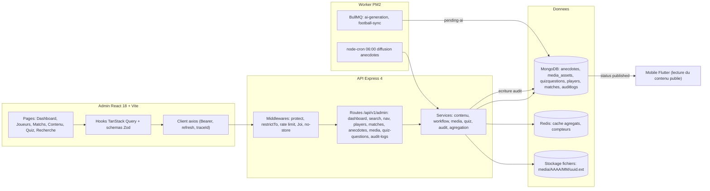
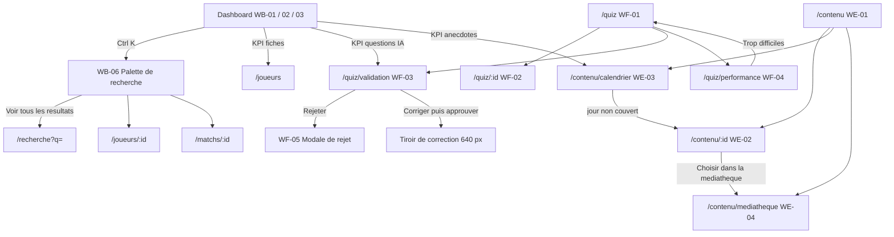
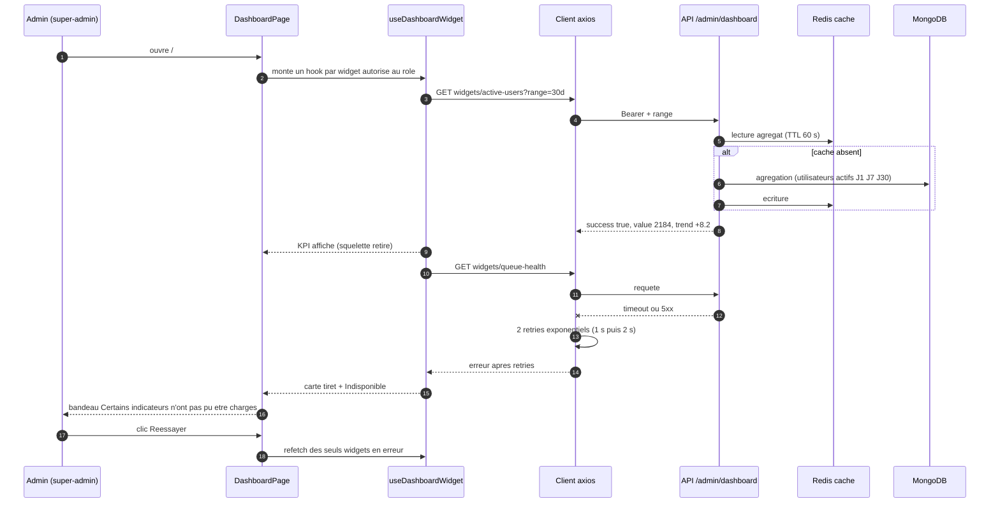
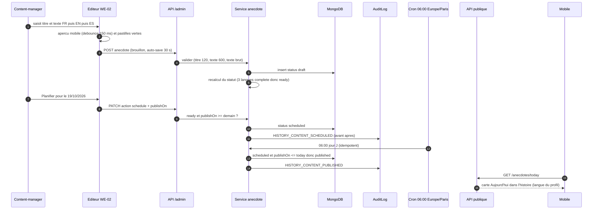
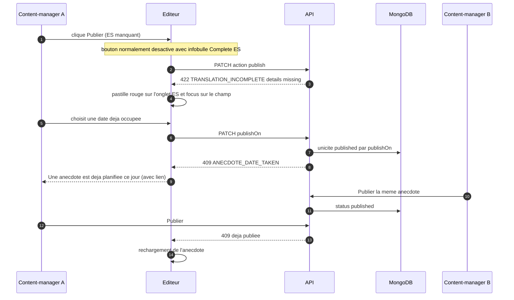
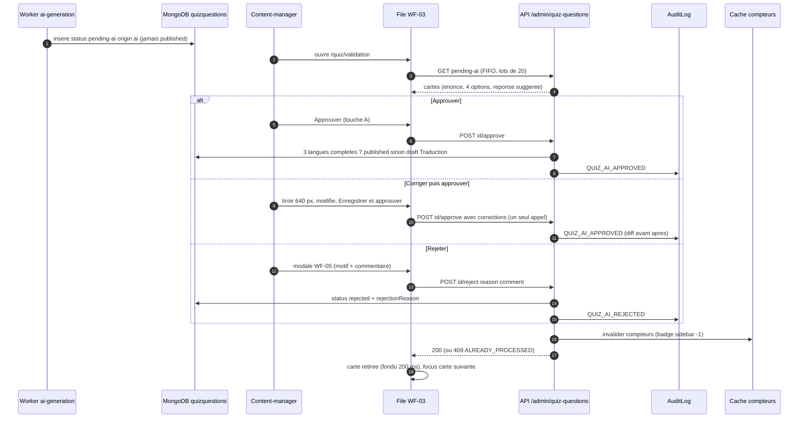
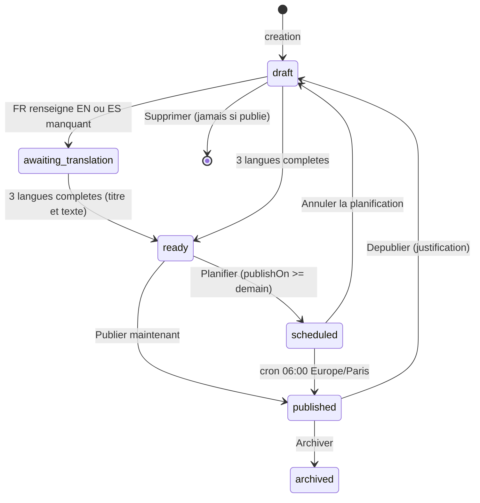
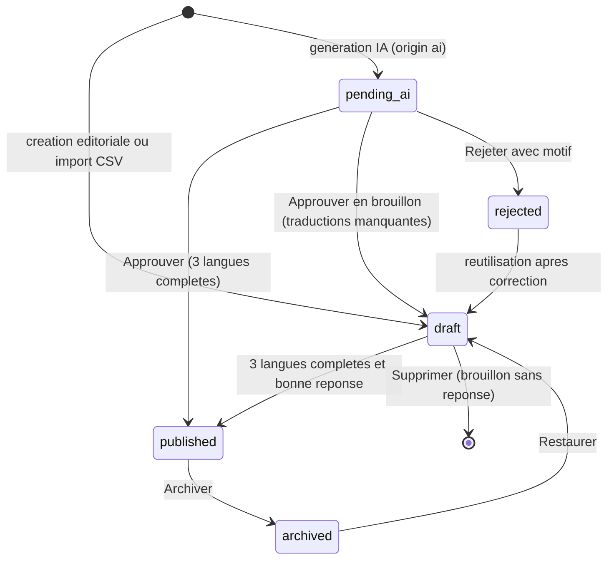
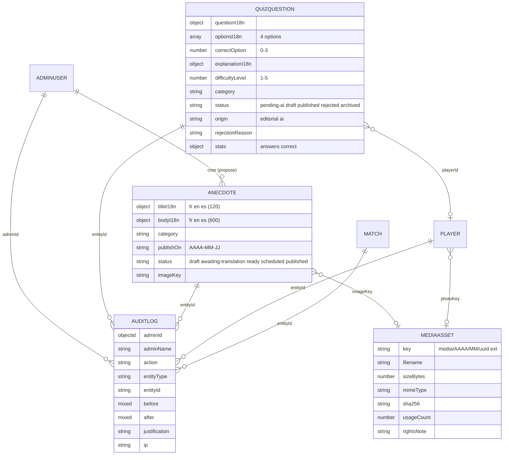
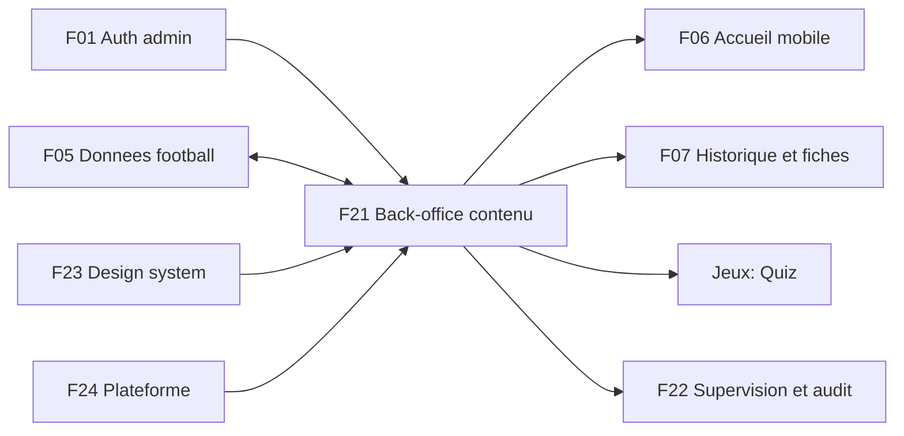

# F21 — Back-office : contenu éditorial, quiz, tableau de bord et recherche

> Documentation d'architecture · Univers Barça · fonctionnalité **F21**. Ce document explique comment l'équipe éditoriale pilote le contenu de l'application mobile depuis le back-office React : **tableau de bord par rôle et recherche globale** (`ADM-WB`), **joueurs** (`ADM-WC`), **matchs et compétitions** (`ADM-WD`), **contenu historique, calendrier éditorial et médiathèque** (`ADM-WE`), **questions de quiz et file de validation IA** (`ADM-WF`), avec le **workflow de publication**, les **rôles** et la **piste d'audit** qui les relient.

## 1. Résumé et fiche

**Valeur utilisateur.** Le supporter ouvre l'application et trouve chaque matin une anecdote « Aujourd'hui dans l'histoire » dans sa langue, des fiches joueurs complètes en FR, EN et ES, et des questions de quiz justes et bien calibrées. Rien de tout cela n'est écrit par hasard : une petite équipe de **content-managers** prépare, traduit, relit, planifie et publie depuis le back-office, avec des garde-fous (jamais de publication tant que les trois langues ne sont pas complètes, jamais de question générée par IA publiée sans relecture humaine, toute action tracée dans le journal d'audit).

**Pourquoi ce document existe.** Les quatre modules de contenu partagent les mêmes briques (éditeur trilingue, statuts, blocage de publication, audit, RBAC, listes filtrées dans l'URL, états chargement/vide/erreur). Les comprendre une fois permet de lire n'importe lequel d'entre eux. Le document F05 détaille la partie « données football » (synchronisation, conflits) ; ici on décrit **l'expérience d'édition** et ce qui est propre aux anecdotes, médias et quiz.

| Élément | Valeur |
|---|---|
| Phase / priorité | Phase 1 — MVP ; majoritairement `P0` (socle, workflow, RBAC), `P1` (médiathèque, filtres, performance), quelques `P2` (page de résultats complète, raccourcis de la file IA, export) |
| Épopées backlog admin | `ADM-WB` (16 issues), `ADM-WC` (28), `ADM-WD` (14), `ADM-WE` (14), `ADM-WF` (23) |
| Épopées backlog API | `API-FOOT` (anecdotes `API-FOOT-04`, `-10`, `-45`, `-46`, médias `API-FOOT-05`, `-47`, recherche `API-FOOT-48`, tableau de bord `API-FOOT-49`, traductions `API-FOOT-55`), `API-JEUX` (`API-JEUX-25` à `-30`), `API-MODER` (`API-MODER-22` audit, `API-MODER-24` recherche) |
| Écrans | `WB-01` à `WB-07`, `WC-01` à `WC-12`, `WD-01` à `WD-04`, `WE-01` à `WE-04`, `WF-01` à `WF-05` |
| Dépôts concernés | **admin** (React, tout le périmètre), **API** (routes `/admin/*`, modèles, audit, jobs), **mobile** (consomme le contenu publié, jamais d'édition) |
| Documents voisins | F05 (données football et synchro), F22 (supervision, comptes, flags), F23 (design system), F07 (historique côté mobile), F24 (plateforme) |

### Vocabulaire

* **Content-manager** : rôle éditorial (joueurs, matchs, anecdotes, médias, quiz). **Super-admin** : tous les droits. **Modérateur** : communauté uniquement, **aucun** accès au contenu éditorial.
* **Trilingue** : tout texte publiable existe en **FR, EN, ES**. Un contenu est *complet* quand les trois langues sont renseignées.
* **Anecdote** : court texte historique affiché sur le tableau de bord mobile (carte « AUJOURD'HUI DANS L'HISTOIRE »), titre ≤ 120 caractères, texte ≤ 600 par langue.
* **Médiathèque** : bibliothèque centralisée des illustrations réutilisables (collection `media_assets`, proposée).
* **File de validation IA** : liste des questions générées automatiquement (`status = pending-ai`) qui attendent une décision humaine.
* **Widget** : bloc indépendant du tableau de bord (une requête, un squelette, une erreur propres).
* **Audit** : enregistrement immuable de chaque mutation (qui, quoi, quand, avant/après, justification).

### État du code à la date de rédaction

* **Admin** (`univers_barca_admin`) : socle livré (routage par rôle dans `src/App.tsx` et `src/lib/navigation.ts`, `ProtectedRoute`, client axios avec refresh, `queryClient`, `authStore`, `uiStore`, tokens `src/index.css`). `DashboardPage` ne lit encore que `/health/deep` et `PlayersPage` est un premier écran ; les routes `/matchs`, `/contenu`, `/quiz` rendent `ModulePage` (placeholder listant les écrans prévus).
* **API** (`univers_barca_api`) : modèles Mongoose `Player`, `Team`, `Competition`, `Match` (`football.model.ts`), `Anecdote`, `FeatureFlag`, `AiQuota` (`platform.model.ts`), `QuizQuestion` (`gamification.model.ts`), `AuditLog` (`moderation.model.ts`), `AdminUser`/`AdminSession` (`admin-user.model.ts`) existent. Côté routes, seul `/admin/auth/*` est implémenté ; **toutes les routes `/admin/*` de contenu décrites ci-dessous sont la cible du backlog**.

### Écart avec les CDC

Les CDC parlent de NestJS/Prisma/PostgreSQL et d'un module `/admin/history-content` ; la **stack réelle** est Express 4 + TypeScript + Mongoose/MongoDB. Les contenus trilingues sont des sous-documents (`titleI18n { fr, en, es }`), pas des tables de traduction. Plusieurs écarts de nommage entre backlog admin et backlog API sont listés en section 14.

## 2. Acteurs et user stories

| Acteur | Besoin | Critères d'acceptation clés |
|---|---|---|
| Content-manager | Voir en un coup d'œil ce qui reste à faire | Tableau de bord `WB-02` : fiches publiées `64 / 71`, questions IA à valider, anecdotes planifiées, jours non couverts, taux de réussite moyen du quiz ; aucun widget de modération ni technique |
| Super-admin | Surveiller l'écosystème | `WB-01` : 4 KPI, courbe des utilisateurs actifs J1/J7/J30, santé technique, contenus incomplets, dernières actions ; un widget en erreur n'empêche pas les autres |
| Modérateur | Traiter les signalements urgents | `WB-03` : file « À traiter en priorité » triée par gravité, rafraîchie toutes les 30 s |
| Tout administrateur | Atteindre une fiche en quelques secondes | `Ctrl+K` ouvre la palette ; recherche après 300 ms, 2 caractères minimum, 5 résultats max par catégorie, filtrés par rôle |
| Content-manager | Écrire une anecdote trilingue et la programmer | Statut calculé par le serveur ; « Planifier » et « Publier » refusés en `422 TRANSLATION_INCOMPLETE` si une langue manque ; diffusion à 06:00 Europe/Paris |
| Content-manager | Ne laisser aucun jour sans anecdote | Calendrier mensuel avec jours « Non couvert », création en un clic depuis un jour libre, déplacement par glisser-déposer |
| Content-manager | Réutiliser des illustrations | Médiathèque : upload multiple (≤ 10 fichiers), formats JPEG/PNG/WebP, suppression interdite si `usageCount > 0` |
| Content-manager | Constituer un pool de questions équilibré | Liste filtrable (niveau, catégorie, statut, plage de réussite) dans l'URL, éditeur 4 réponses × 3 langues, page Performance |
| Content-manager | Relire les questions générées par IA | File `/quiz/validation` : Approuver, Corriger puis approuver, Rejeter avec motif ; **aucune publication sans relecture humaine** |
| Super-admin | Reconstituer qui a fait quoi | Journal d'audit immuable, chaque mutation produit une entrée avec avant/après |
| Système | Diffuser à l'heure | Job cron 06:00 Europe/Paris : `scheduled` du jour passe en `published`, idempotent |

## 3. Architecture de la fonctionnalité



**Légende.** Les pages appellent uniquement des hooks ; les hooks appellent `src/api/*.api.ts` (règle du dépôt : aucun appel HTTP ailleurs) ; le client axios ajoute le jeton d'accès, gère le refresh et propage le `traceId`. Côté API, chaque route admin passe par `protect` puis `restrictTo('content-manager','super-admin')` (ou super-admin seul), un limiteur de mutations (120 req/min/admin, proposé par `API-FOOT-32`) et l'en-tête `Cache-Control: no-store`. Le mobile ne lit que ce qui est `published` via les routes publiques (F06, F07) ; il n'appelle jamais `/admin/*`.

Pourquoi un back-office séparé du mobile : les droits, les risques (publication de contenu public) et les usages (tableaux, éditeurs longs, raccourcis clavier) sont très différents ; un déploiement indépendant (nginx statique, voir F22) permet de corriger un écran d'édition sans republier l'application.

## 4. Écrans et navigation

### 4.1 Tableau de bord et recherche (`ADM-WB`)

| Code | Écran | Rôle de l'écran |
|---|---|---|
| `WB-01` | Dashboard super-admin | 4 KPI, courbe J1/J7/J30, accès rapide, santé technique, contenus incomplets, dernières actions |
| `WB-02` | Dashboard content-manager | KPI éditoriaux, calendrier éditorial à venir, contenus incomplets |
| `WB-03` | Dashboard modérateur | KPI de traitement, tableau « À traiter en priorité » |
| `WB-04` | Chargement | Squelettes qui préservent la mise en page (pas de saut de contenu) |
| `WB-05` | Erreur partielle | Bandeau « Certains indicateurs n'ont pas pu être chargés », cartes « Indisponible », bouton « Réessayer » |
| `WB-06` | Recherche globale | Palette `Ctrl K` : JOUEURS, UTILISATEURS, MATCHS, GROUPES |
| `WB-07` | Recherche sans résultat | « AUCUN RÉSULTAT POUR « ZZZQ » » et conseil adapté au rôle |

### 4.2 Joueurs, matchs, contenu et quiz

| Code | Écran | Rôle de l'écran |
|---|---|---|
| `WC-01` à `WC-04` | Liste des joueurs (et états sans résultat / sans donnée) | Compteurs, filtres, pastilles de langues, sélection |
| `WC-05` à `WC-12` | Fiche joueur | Identité, biographie trilingue, stats par saison, photo, confirmation de publication, import CSV, archivage groupé (détail dans F05) |
| `WD-01` à `WD-04` | Matchs | Liste (onglets À venir / En direct / Historiques / Conflits), détail, résolution de conflit, saisie historique (détail dans F05) |
| `WE-01` | Bibliothèque d'anecdotes | Tableau paginé, filtres Catégorie / Statut / Langues / Mois |
| `WE-02` | Éditeur trilingue + aperçu mobile | Titre, texte FR/EN/ES, image, date, catégorie, aperçu clair/sombre |
| `WE-03` | Calendrier éditorial | Grille Lun–Dim, jours non couverts, vue Mois/Semaine |
| `WE-04` | Médiathèque | Grille de médias, upload, filtres Type / Utilisé / Date |
| `WF-01` | Liste des questions | `1 248 questions actives · 12 en attente de validation IA` |
| `WF-02` | Éditeur de question | Énoncé, 4 réponses, explication, paramètres, performance |
| `WF-03` | File de validation IA | Cartes avec Approuver / Corriger puis approuver / Rejeter |
| `WF-04` | Performance des questions | 4 KPI, histogramme de répartition, « À corriger en priorité » |
| `WF-05` | Rejet d'une question IA | Modale avec motif normalisé et commentaire |

<p>


</p>

*`WB-01` : sidebar groupée (PILOTAGE, CONTENU, COMMUNAUTÉ, SYSTÈME) avec pastilles de compteurs, barre supérieure avec champ `Ctrl K`, pastille « PRODUCTION » et bloc profil, quatre cartes KPI puis la courbe J1 (grenat), J7 (bleu), J30 (or). `WE-02` : badge « Prêt à publier », ligne « Diffusion planifiée le lundi 19 octobre 2026 à 06:00 », onglets FR/EN/ES à pastilles vertes, compteur `171 / 600`, bloc image en pointillés et carte « Aperçu mobile » avec bascule Clair/Sombre. `WF-03` : cartes à deux colonnes, réponse suggérée en vert avec coche, trois boutons par carte ; la première carte propose « Aucun » comme bonne réponse, cas typique que la relecture doit attraper.*

<p>


</p>



Routes React (cible du backlog) : `/` (dashboard par rôle), `/recherche`, `/joueurs…`, `/matchs…`, `/contenu`, `/contenu/nouveau`, `/contenu/:id`, `/contenu/calendrier`, `/contenu/mediatheque`, `/quiz`, `/quiz/nouvelle`, `/quiz/:id`, `/quiz/validation`, `/quiz/performance`. Toutes les routes de contenu sont sous `ProtectedRoute allowedRoles=['content-manager','super-admin']` ; un modérateur est redirigé vers `/403` (`WA-08`). La page 403 reste atteignable par URL directe même si l'entrée de menu est masquée.

**Sidebar** (`ADM-WB` issue 03) : rubriques PILOTAGE, CONTENU (Joueurs, Matchs, Contenu historique, Questions de quiz), COMMUNAUTÉ (Modération, Groupes locaux, Utilisateurs), SYSTÈME (Supervision, Journal d'audit, Notifications, Comptes admin, Configuration). Une rubrique vide pour le rôle est masquée. Pastilles : rond grenat, « 99+ » au-delà de 99, valeurs de `GET /admin/nav/counters` (`quizPending`, `reportsPending`, `groupsToValidate`), `staleTime` 30 s.

## 5. Flux détaillés

### 5.1 Tableau de bord : un widget par requête, panne partielle (nominal et cas limite)



**Pas à pas.** (1-2) Chaque widget a son propre hook : il s'exécute seulement si le rôle y a droit (`enabled=false` sinon, aucune requête n'est émise, un `403` masque simplement le widget). (4-8) L'API sert les agrégats depuis Redis (60 s) et ne recalcule que sur absence. Les compteurs instantanés ignorent `range` ; seules séries et tendances l'utilisent. (10-13) Timeout axios 20 s, puis 2 retries exponentiels (1 s, 2 s) **uniquement** sur timeout/réseau/5xx — jamais sur 4xx. (14-16) La carte en échec conserve icône et libellé, remplace la valeur par « — » et affiche « Indisponible » en rouge ; les autres restent valides (`WB-05`). « Réessayer » ne relance que les widgets en erreur ; la bannière disparaît d'elle-même quand tous sont rétablis. Si **tous** échouent, titre « Le tableau de bord n'a pas pu être chargé » et `EmptyState` d'erreur avec `traceId`.

Fréquences de rafraîchissement : compteurs de modération `staleTime` 30 s ; contenu éditorial 5 min ; `queue-health` et `reports-pending` `refetchInterval` 60 s ; file du modérateur 30 s (fraîcheur critique). Un squelette ne reste pas plus de 10 s ; si des données périmées existent, elles restent affichées (stale-while-revalidate) sans squelette.

### 5.2 Créer, traduire, planifier puis diffuser une anecdote (nominal)



**Pas à pas.** (2) L'aperçu est entièrement local : aucun appel réseau, texte échappé, jamais de HTML. (3) Le brouillon est sauvegardé toutes les 30 s dès que le formulaire est valide (repli `localStorage`). (5-6) Le **statut n'est pas choisi par l'admin** : le serveur le recalcule à partir de la complétion FR/EN/ES et de la date. (8-11) « Planifier » exige `ready` et `publishOn ≥ demain` ; « Publier » publie immédiatement (`publishOn = aujourd'hui`) après confirmation « Publier maintenant sur le dashboard mobile ? ». (13-15) Le cron quotidien est idempotent : rejouer le même jour ne change rien. La route de diffusion est `API-FOOT-10` ; le fuseau est configurable (`ANECDOTE_PUBLISH_TZ`, proposé).

### 5.3 Refus de publication, doublon de date et conflit d'édition (erreurs et cas limites)



**Points d'attention.** La validation est **double** : l'interface désactive les boutons avec une infobulle explicative, mais seul le serveur fait foi (`422 TRANSLATION_INCOMPLETE`). Le `409` de double publication provoque un rechargement plutôt qu'un écrasement. À la sortie d'un formulaire modifié, `useBlocker` demande confirmation. Dans le calendrier, un dépôt sur un jour occupé propose « Échanger les deux dates » ou annule ; la mise à jour optimiste est annulée automatiquement en cas d'erreur.

### 5.4 File de validation IA : approuver, corriger, rejeter



**Pas à pas.** (1) Le worker de génération (`API-JEUX-28`) n'a **aucun** droit de publier : un garde dans le service l'interdit, et il s'arrête à 50 questions en attente. (3-4) Tri FIFO (la plus ancienne d'abord) pour éviter l'accumulation. (5-8) « Approuver » publie seulement si l'énoncé, l'explication et les 4 réponses existent en FR, EN et ES ; une question IA est le plus souvent en français seul, elle devient alors un **brouillon « Traduction »** avec le toast « Approuvée en brouillon : traductions à compléter ». (9-11) La correction est atomique : un seul `POST approve` avec les corrections, tracées en diff dans l'audit pour améliorer le prompt. (12-15) Le motif de rejet est structuré (`ambiguous`, `factually-incorrect`, `difficulty`, `duplicate`) pour alimenter la qualité du générateur. (17) `409 ALREADY_PROCESSED` : un autre admin a déjà traité la carte, qui est retirée avec le toast « Déjà traitée par … ».

### 5.5 Cycle de vie d'une anecdote



Une anecdote publiée ne peut plus être supprimée, seulement dépubliée avec justification (audit `HISTORY_CONTENT_UNPUBLISHED`) ou archivée. Le modèle API réel porte les statuts `draft`, `awaiting-translation`, `ready`, `scheduled`, `published` ; `archived` est ajouté par `API-FOOT-04`.

### 5.6 Cycle de vie d'une question de quiz



Toute autre transition est refusée en `422 INVALID_TRANSITION`. Le statut « Traduction » vu dans l'interface n'existe **pas** dans le modèle API : c'est un `draft` dont les langues sont incomplètes, dérivé côté client (`ADM-WF` issue 01). Dépublier une question présente dans le quiz du jour est refusé en `409 IN_DAILY_QUIZ` (règle à confirmer).

## 6. Contrats d'API

Préfixe `/api/v1`. Enveloppe `{ success, data }` ; erreurs `{ success:false, error:{ code, message, details, traceId } }`. Pagination admin `{ items, total, page, totalPages, hasMore }` (ou curseur). Rôles : **CM** content-manager, **SA** super-admin, **Mod** modérateur. Les routes marquées « (cible) » ne sont pas encore implémentées.

### 6.1 Tableau de bord, navigation, recherche

| Méthode | Chemin | Rôle | Requête | Réponse | Erreurs |
|---|---|---|---|---|---|
| GET | `/admin/dashboard/widgets/:widgetId` (cible) | selon widget | `?range=7d\|30d` | `{ value, unit?, trend:{delta,direction,label}, hint? }` | 403 si le rôle n'a pas le widget ; 5xx isolé |
| GET | `/admin/dashboard/summary` (cible, variante API) | CM, SA, Mod | `?range=` | `{ widgets:{ activeUsers:{status:'ok',value,delta}, … } }`, chaque widget `ok\|error\|unavailable` | — |
| GET | `/admin/dashboard/export.csv` (cible) | rôle du widget | — | CSV (audit `DASHBOARD_EXPORTED`) | 403 |
| GET | `/admin/nav/counters` (cible) | tous | — | `{ quizPending:12, reportsPending:18, groupsToValidate:4 }` filtré par rôle | — |
| GET | `/admin/search` (cible) | CM, SA, Mod | `?q=ped&types=players,users,matches,groups&limit=5` | `{ players:[{id,name,position,status,photoUrl}], users:[{id,name,email}], matches:[{id,label,date}], groups:[{id,name,city}] }` | 400 si `q` < 2 caractères ; limite 60 req/min |

Identifiants de widgets : `active-users` (tous), `reports-pending`, `reports-processed-today`, `avg-handling-time`, `groups-to-validate`, `priority-reports` (modérateur, SA), `players-published`, `ai-questions-pending`, `editorial-planned`, `quiz-success-rate`, `editorial-calendar`, `incomplete-content` (CM, SA), `queue-health`, `critical-errors`, `tech-health`, `recent-actions` (SA), `quick-access` (tous, filtré).

### 6.2 Contenu historique, calendrier, médias

| Méthode | Chemin | Rôle | Requête / corps | Réponse | Erreurs |
|---|---|---|---|---|---|
| GET | `/admin/history-content` (admin) ≙ `/admin/anecdotes` (API) | CM, SA | `q, category, status, langs, month=2026-10, page, limit (5/10/25), sort=publishOn:asc` | page d'anecdotes + `total` | — |
| POST | idem | CM, SA | `{ titleI18n, bodyI18n, category, publishOn, imageKey? }` | 201 anecdote (`draft`) | 422 validation |
| GET/PATCH | `…/:id` | CM, SA | PATCH : champs ou `action: schedule\|publish\|unschedule\|unpublish`, `publishOn?`, `justification?` | anecdote | 422 `TRANSLATION_INCOMPLETE`, 409 `ANECDOTE_DATE_TAKEN` |
| DELETE | `…/:id` | CM, SA | — | 204 | refusé si publiée |
| GET | `/admin/anecdotes/calendar` | CM, SA | `month=AAAA-MM` ou `week=AAAA-Www` | jours `{ items[{id,title,status}], covered }` + `summary.uncovered` | — (cache 60 s) |
| GET | `/admin/anecdotes/:id/preview` | CM, SA | `locale, theme` | JSON exact servi au mobile (même mapper) | 404 |
| GET | `/admin/media` | CM, SA | `q, type, used, from, to, cursor, limit=30` | `{ items:[{id,key,filename,sizeBytes,mimeType,width,height,usageCount,createdAt,thumbUrl}], nextCursor, totals:{count,bytes} }` | — |
| POST | `/admin/media` | CM, SA | multipart `file` (un fichier par requête, jusqu'à 10 par lot) | 201 `{ id, key, variants:{thumb,card,full} }` | 413/507 quota, 415 format, 409 doublon SHA-256 |
| GET | `/admin/media/:id/usages` | CM, SA | — | `{ items:[{type,id,title}] }` | — |
| DELETE | `/admin/media/:id` | CM, SA | — | 204 | 409 `MEDIA_IN_USE` |

### 6.3 Questions de quiz

| Méthode | Chemin | Rôle | Requête / corps | Réponse | Erreurs |
|---|---|---|---|---|---|
| GET | `/admin/quiz-questions` | CM, SA | `level, category, status, minRate, maxRate, q, page, limit, sort` | `{ items:[{id, code:'q-00481', question, category, level, langs, status, successRate, origin}], total:1248 }` + méta `{activeCount, pendingAiCount}` | — |
| GET | `…/:id` | CM, SA | — | détail + `stats{answers,correct}` + `player` | 404 |
| POST | `…` | CM, SA | `{ questionI18n, optionsI18n[4], correctOption, explanationI18n, level, category, playerId? }` | 201 `{ id, code }` (`draft`) | 422 |
| PATCH | `…/:id` | CM, SA | champs partiels, `status ∈ draft\|published\|archived` | question | 422 `TRANSLATION_INCOMPLETE`, 422 `INVALID_TRANSITION`, 409 `IN_DAILY_QUIZ` |
| DELETE | `…/:id` | CM, SA | — | archive, ou 204 pour un brouillon sans réponse | 409 `HAS_ANSWERS` |
| GET | `…/pending-ai` | CM, SA | `limit=20, cursor` | cartes + `total` | — |
| POST | `…/:id/approve` | CM, SA | `{ corrections?, confirmCorrect? }` | `{ status, missingLocales }` | 409 `ALREADY_PROCESSED` |
| POST | `…/:id/reject` | CM, SA | `{ reason, comment? (≤ 300) }` | question `rejected` | 422 |
| POST | `…/approve-batch` | CM, SA | `{ ids[≤ 20] }` (backlog admin) ou `≤ 50` (API) | `{ published, drafted, skipped[] }` | — |
| GET | `…/counters` | CM, SA | — | `{ active, pendingAi }` | — |
| GET | `…/performance` (API) ≙ `…/stats/summary`, `/distribution`, `/to-fix` (admin) | CM, SA | `days=7\|30\|90, level, category` | `{ avgSuccessRate, deltaPoints, tooEasyCount, tooHardCount, answers30d, distribution[10], priority[] }` | — (cache 15 min) |
| POST/GET | `…/import?dryRun=true`, `…/export.csv` | CM, SA | CSV UTF-8 ≤ 2 Mo / 2 000 lignes, export ≤ 10 000 lignes | `{ importId, valid, invalid:[{line,errors}] }` | 422 |

### 6.4 Audit

| Méthode | Chemin | Rôle | Requête | Réponse |
|---|---|---|---|---|
| GET | `/admin/audit-logs` | SA (les autres : leurs propres actions, `?mine=true`) | `action, adminId, entityType, entityId, from, to, cursor` (50 par page) | `{ items, nextCursor }` ; **aucune** route PUT/DELETE |
| GET | `/admin/audit-logs/verify` | SA | — | état de la chaîne d'intégrité |

Exemples :

```json
// PATCH /api/v1/admin/history-content/6720a1f0  (planifier)
{ "action": "schedule", "publishOn": "2026-10-19" }
// 422 si l'espagnol manque
{ "success": false, "error": { "code": "TRANSLATION_INCOMPLETE",
  "message": "Publication bloquée : ES manquant(e)(s)",
  "details": { "missing": [{ "field": "bodyI18n", "locale": "es" }] }, "traceId": "f3a9…" } }
// POST /api/v1/admin/quiz-questions/:id/reject
{ "reason": "ambiguous", "comment": "Deux options sont acceptables." }
```

## 7. Modèle de données



**Collections et champs.**

* `anecdotes` — modèle réel (`platform.model.ts`) : `titleI18n`, `bodyI18n`, `category`, `publishOn` (indexé), `status`, `imageKey`. **Ajouts du backlog** (`API-FOOT-04`) : `publishOn` en vrai type date, `monthDay` (récurrence annuelle), `year` (année de l'événement, 1900-2100), `matchId`, `readingMinutes` (200 mots/min, min 1), statut `archived`. Unicité d'une anecdote `published` par `publishOn` (`409 ANECDOTE_DATE_TAKEN`).
* `media_assets` — **à créer** (`API-FOOT-05`) : clé `media/AAAA/MM/<uuid>.<ext>` (jamais le nom d'origine), `sha256` pour dédoublonner, `usageCount` tenu à jour par les références (`Player.photoKey`, `Anecdote.imageKey`), `rightsNote` obligatoire (« Illustration originale · aucune photographie sous droits »), variantes `thumb`/`card`/`full`.
* `quizquestions` — modèle réel (`gamification.model.ts`) : champs ci-dessus. **Ajouts du backlog** : `rejectionComment`, `reviewedBy`, `reviewedAt`, `publicId` (`q-` + 5 chiffres), `revision` (+1 si énoncé ou options modifiés, avec archivage de l'ancien taux), `duplicateOfId`.
* `auditlogs` — modèle réel (`moderation.model.ts`), index `createdAt:-1`, pas de `updatedAt`. `API-MODER-02` impose l'immuabilité (aucune route de modification), `API-MODER-22` la consultation.
* Actions d'audit de ce périmètre : `HISTORY_CONTENT_CREATED|UPDATED|SCHEDULED|PUBLISHED|UNPUBLISHED|RESCHEDULED`, `MEDIA_UPLOADED|DELETED`, `QUIZ_QUESTION_CREATED|UPDATED|PUBLISHED|ARCHIVED|DELETED`, `QUIZ_AI_APPROVED|REJECTED|BATCH_APPROVED`, `EXPORT_QUIZ_STATS`, `DASHBOARD_EXPORTED`, `CONTENT_TRANSLATED`, et côté football `PLAYER_*`, `MATCH_*` (voir F05).

**Clés Redis** (proposées, préfixe `ub:`) : `ub:admin:dash:{role}:{widgetId}:{range}` (TTL 60 s), `ub:admin:quiz:perf:{days}:{filtres}` (15 min), `ub:admin:nav:counters:{role}` (30 s), `ub:admin:cal:{mois}` (60 s). Le backlog nomme `admin:quiz:perf:{days}:{filters}` sans préfixe ; le préfixe `ub:` est ajouté par convention.

**Stockage navigateur** (préférences par administrateur, jamais de donnée serveur) : `localStorage` pour la période du dashboard, `ub:filters:quiz:<adminId>` (derniers filtres), brouillon d'anecdote en repli ; `uiStore` (Zustand, clé `ub-ui`) pour thème, sidebar, raccourcis.

**Migrations** : ajout des champs `anecdotes` (`monthDay`, `year`, `readingMinutes`), création de `media_assets` et rétro-calcul de `usageCount`, ajout des champs de revue sur `quizquestions` ; scripts idempotents dans `scripts/migrations`.

## 8. Traitements asynchrones et cache

| Traitement | Déclencheur | Détail | Idempotence |
|---|---|---|---|
| Diffusion des anecdotes | node-cron `0 6 * * *` fuseau `Europe/Paris` (proposé) | `scheduled` avec `publishOn <= today` passe à `published` | rejouable sans effet de bord |
| Génération de questions IA | manuel (SA) ou cron hebdomadaire dimanche 03:00 Madrid | job `generate-quiz-questions` `{category, level, count ≤ 20}` sur la file BullMQ `ai-generation` ; insère `pending-ai` ; plafond 200 questions/jour (`QUIZ_AI_DAILY_CAP`), arrêt à 50 en attente | dédoublonnage sur énoncé normalisé |
| Import CSV de questions volumineux | upload > 500 lignes | tâche BullMQ + suivi `GET import/:importId` | `importId` |
| Variantes d'image | upload | miniature, carte, plein écran générés côté serveur | clé SHA-256 |
| Agrégats du tableau de bord | requête | cache-aside Redis 60 s par rôle et plage | — |

Retries BullMQ (`src/jobs/queues.ts`) : 5 tentatives, backoff exponentiel 2 s, `removeOnComplete: 1000`, `removeOnFail: 5000`, file `dead-letter` rejouable depuis la supervision (F22). Invalidation : toute mutation d'anecdote invalide `ub:admin:cal:*` ; publier une question invalide la liste, les statistiques et `counters`.

**Côté React (TanStack Query).** Clés hiérarchiques : `['dashboard', widgetId, { range }]`, `['search', q]`, `['quiz','list',params]`, `['quiz','detail',id]`, `['quiz','pending-ai']`, `['quiz','counters']`, `['quiz','stats',…]`. `staleTime` : liste de questions 60 s, détail 5 min, file IA et compteurs 30 s (+ `refetchInterval` 60 s), statistiques 5 min, contenu éditorial 5 min. Règle : **aucune donnée serveur recopiée dans un état local** ; optimiste seulement pour des actions à faible risque (retrait d'une carte de la file, déplacement d'une chip du calendrier) avec rollback.

## 9. Règles de gestion

1. **Trois langues ou rien.** Aucune publication (anecdote, fiche joueur, question, match historique) tant que FR, EN et ES ne sont pas complets ; un champ est « renseigné » après `trim`. Pour une question : énoncé, explication **et** les 4 réponses dans chaque langue.
2. **Anecdote** : titre obligatoire ≤ 120 caractères, texte obligatoire ≤ 600 par langue, texte brut (HTML interdit), catégorie fermée (Histoire du club, Joueurs, Matchs, Légendes, Stade), image facultative.
3. **Date de diffusion** : format `JJ/MM/AAAA`, pas dans le passé pour un contenu non publié, heure fixe 06:00 Europe/Paris non éditable, une seule anecdote par jour (avertissement non bloquant côté éditeur, `409` côté serveur à la publication).
4. **Statut d'anecdote calculé par le serveur** (section 5.5) ; « Planifier » exige `ready` et `publishOn ≥ demain` ; une anecdote publiée ne se supprime pas.
5. **Jours non couverts** = jours à venir sans anecdote `scheduled` ou `published` ; les jours passés ne comptent pas (`« 9 jours non couverts ce mois-ci »`).
6. **Médiathèque** : JPEG, PNG, WebP ; pas de SVG ; clé de stockage jamais dérivée du nom d'origine ; validation par signature binaire en plus du type MIME ; badge « Nouveau » pendant 7 jours ; suppression seulement si `usageCount = 0`.
7. **Niveaux de quiz** : 1 « Supporter occasionnel », 2 « Culé », 3 « Socio », 4 « Historien du Barça », 5 « La Masia ». Catégories : `players`, `history`, `trophies`, `matches`.
8. **Question** : exactement 4 options distinctes (insensible à la casse), chacune 1 à 80 caractères (admin) ; énoncé ≤ 300, explication ≤ 500 ; une seule bonne réponse `correctOption ∈ 0..3`.
9. **Taux de réussite** = `stats.correct / stats.answers` arrondi à l'entier ; « — » si aucune réponse ; calibrage « trop facile » > 95 %, « trop difficile » < 15 %, « correct » sinon ; indicateurs comptés seulement avec **≥ 30 réponses** (seuil proposé).
10. **Aucune publication IA sans relecture humaine.** Seules les actions de `/quiz/validation` font passer `pending-ai` à `published` ou `rejected`. Approbation en lot : 20 cartes maximum (admin), uniquement des cartes affichées à l'écran, confirmation obligatoire.
11. **Archivage plutôt que suppression** : une question ayant reçu des réponses n'est jamais supprimée (`409 HAS_ANSWERS`) ; modifier substantiellement une question publiée remet ses statistiques à zéro (`revision + 1`).
12. **Alerte de file IA** : bannière jaune au-delà de 50 questions en attente (seuil proposé, `VITE_QUIZ_QUEUE_WARN`) ; badge de sidebar masqué à 0 et « 99+ » au-delà de 99.
13. **Recherche** : minimum 2 caractères, debounce 300 ms, insensible casse/accents, 5 résultats par catégorie, page complète paginée par 20 ; droits : CM → joueurs + matchs, Mod → utilisateurs + groupes, SA → tout.
14. **Tendances** : la couleur dépend de la polarité du KPI (+5 signalements = rouge, +8,2 % d'utilisateurs actifs = vert) ; format français `Intl.NumberFormat('fr-FR')`, pourcentages `+8,2 %`.
15. **Export CSV** : séparateur `;`, UTF-8 avec BOM, décimales à virgule, formules neutralisées (`=`, `+`, `-`, `@`), plafond 10 000 lignes, nom `tableau-de-bord_<role>_<AAAA-MM-JJ>.csv`.
16. **Audit systématique** : toute mutation (création, transition de statut, upload, suppression, export) crée une entrée avec `adminId`, `entityType`, `entityId`, `before`, `after`, `justification` éventuelle, `ip`.

## 10. Sécurité, RGPD et anti-abus

* **RBAC double** : `ProtectedRoute allowedRoles` côté React (confort, pas sécurité) **et** `restrictTo(...)` côté API (autorité) ; permissions fines `quiz:read|write|review|export` (`WA` issue 13). Un modérateur ne reçoit jamais de joueurs, anecdotes ni questions.
* **XSS** : tout contenu est affiché en **texte brut** (`react/no-danger`, jamais `dangerouslySetInnerHTML`) ; les textes générés par IA sont considérés **non fiables** (XSS stocké) ; le surlignage de la recherche est appliqué sur du texte échappé ; noms de fichiers échappés.
* **Uploads** : signature binaire (magic bytes), types MIME restreints, pas de SVG, dimension et poids bornés (backlog admin : 5 Mo proposé ; backlog API : 2 Mo, 4000 px — voir section 14), quota global de stockage (`MEDIA_QUOTA_BYTES`, ex. 5 Go), protection par jeton d'accès (intercepteur axios).
* **Données personnelles** : la recherche masque l'e-mail (`j***@gmail.com`) pour les rôles non autorisés ; le terme recherché n'est jamais stocké hors mémoire ni journalisé avec données personnelles ; l'audit tronque l'IP (/24) pour les modérateurs ; l'avertissement « N'indiquez pas de données personnelles » accompagne les commentaires de rejet.
* **Anti-abus** : limiteur de mutations 120 req/min/admin, recherche 60 req/min, `Cache-Control: no-store` sur `/admin/*`, 2FA et sessions (F01, F22).
* **Intégrité** : exports signés avec hash d'intégrité et `GET /admin/audit-logs/verify` (`API-MODER-22`).

## 11. Erreurs et états dégradés

| Situation | Serveur | Client |
|---|---|---|
| Un widget en panne | `5xx`/timeout isolé, les autres répondent | Carte « — Indisponible », bandeau avec « Réessayer », 2 retries (1 s, 2 s) |
| Tous les widgets en panne | — | Titre « Le tableau de bord n'a pas pu être chargé » + `EmptyState` avec `traceId` |
| Réponse invalide | — | Zod rejette : traité comme une erreur de widget |
| Rôle sans droit sur un widget | `403` | Widget simplement masqué, pas d'erreur |
| Recherche en échec | `5xx` | « La recherche est indisponible. Réessaie. » + bouton (pas de toast) |
| Aucun résultat | listes vides | « AUCUN RÉSULTAT POUR « ZZZQ » » (terme tronqué à 30 caractères) et conseil adapté au rôle |
| Publication incomplète | `422 TRANSLATION_INCOMPLETE` | boutons désactivés avec infobulle, pastille rouge, focus sur le premier champ manquant |
| Date occupée | `409 ANECDOTE_DATE_TAKEN` | avertissement avec lien vers l'anecdote existante |
| Question déjà traitée | `409 ALREADY_PROCESSED` | carte retirée, toast « Déjà traitée par … » |
| Média encore utilisé | `409 MEDIA_IN_USE` | « Ce média est encore utilisé par 3 contenus » avec liste des usages |
| Réseau coupé pendant un upload | — | reprise manuelle « Réessayer » par fichier ; les autres continuent |
| Session expirée (`401`) | refresh à rotation | un seul refresh à la fois (promesse partagée), sinon retour `/login` |
| Brouillon non enregistré | — | `useBlocker` / `useUnsavedChangesGuard` ; sauvegarde automatique 30 s, repli `localStorage` |
| Aucun contenu | — | `EmptyState` dédié : « Aucune anecdote ce mois-ci », « File vide, bravo ! », « Aucun média » |

Accessibilité de ces états : régions `aria-busy`, annonces `live polite`, animations de retrait de carte (200 ms) et shimmer (1,4 s) remplacés par un état statique sous `prefers-reduced-motion`.

## 12. Connexions avec les autres fonctionnalités

| Dépend de | Pourquoi |
|---|---|
| F01 Authentification et comptes (admin) | Connexion, 2FA, sessions, rôles utilisés par `ProtectedRoute` |
| F05 Données football | Joueurs, matchs, compétitions, conflits de synchro, recherche |
| F23 Design system | Composants (`TrilingualTextEditor`, `DataTable`, `MediaUploader`, `ConfirmDialog`, palette `Ctrl K`), tokens |
| F24 Plateforme | File `ai-generation`, cache Redis, métriques, dead-letter |

| Alimente | Comment |
|---|---|
| F06 Accueil mobile | Carte « Aujourd'hui dans l'histoire » (`GET /anecdotes/today`) |
| F07 Historique et fiches | Anecdotes, fiches joueurs, matchs historiques |
| Jeux (Quiz, Guess the Player) | Pool de questions `published` ; stats de réussite renvoyées vers l'éditeur |
| F22 Supervision | Journal d'audit alimenté ; widgets `queue-health`, `recent-actions` |

| Partage | Avec |
|---|---|
| Éditeur trilingue | joueurs (`WC`), matchs historiques (`WD-04`), anecdotes (`WE`), questions (`WF`) |
| Compteurs de file IA | sidebar, listes, tableau de bord (hook unique `useQuizBadge`) |



## 13. Observabilité et tests

**Métriques et logs.** Métriques Prometheus métier `ub_*` (F24) : jobs en échec par file (`jobsFailed`), échecs d'authentification (`authFailures`). Indicateurs de ce périmètre (proposés) : questions en attente de validation, délai médian de relecture, jours non couverts, uploads refusés par motif. Chaque erreur expose un `traceId` repris dans l'interface (`EmptyState`, page 500) pour retrouver le log structuré (Winston → Graylog).

**k6.** Règle du dépôt : toute nouvelle route est ajoutée aux scénarios `tests/load`. Scénarios à prévoir : `GET /admin/dashboard/*` (p95 cible 200 ms avec cache), `GET /admin/search` (p95 < 200 ms), liste de questions paginée, upload de médias à faible débit.

**Tests clés.**

* Vitest + MSW : handlers `widgets/:id` par rôle et `search` ; hook `useDashboardWidget` (aucune requête si `enabled=false`), `trendTone(polarité, direction)`, fonction de complétion des langues (partagée liste/éditeur), format `fr-FR`. Couverture visée 80 % sur `hooks/`.
* Playwright, avec fixtures par rôle : 3 rôles → widgets attendus/absents ; erreur partielle (abort sur un widget) ; recherche « ped » puis « zzzq » ; ouverture `Ctrl+K` ; créer une anecdote FR → EN → ES et la planifier au 19/10/2026 à 06:00 ; calendrier → jour « Non couvert » → formulaire pré-rempli ; upload puis sélection dans l'éditeur et aperçu mobile ; filtre « ES manquante » ; question : ES manquant → « Publiée » désactivé → complétion → publication ; file IA : touches `J`, `A` → badge 11 ; « Corriger puis approuver », « Rejeter » avec motif ; page Performance → « Trop difficiles » → liste filtrée `maxRate=14` → export.
* Accessibilité : `vitest-axe` sur chaque écran et modale ; thème clair et sombre ; viewport tablette ; navigation clavier complète.
* Budgets : bundle initial < 250 Ko gzip (Recharts chargé en `React.lazy`), LCP du dashboard < 2,5 s sur profil 4G émulé.
* API : intégration des routes admin (`API-FOOT-51`), sécurité des jeux (`API-JEUX-36` : fuite de solution, rôles admin).

## 14. Points ouverts et incohérences détectées

1. **Nommage des routes anecdotes** : le backlog admin utilise `/admin/history-content` (CDC Admin §4.12) ; le backlog API implémente `/admin/anecdotes` (`API-FOOT-45`, `-46`). À aligner (alias ou renommage) avant d'écrire les clients.
2. **Tableau de bord** : l'admin attend un endpoint **par widget** (`/admin/dashboard/widgets/:widgetId`) ; l'API prévoit un endpoint **agrégé** `GET /admin/dashboard/summary` avec statut par widget (`API-FOOT-49`). Les deux sont compatibles avec la tolérance de panne partielle, mais il faut en choisir un.
3. **Médiathèque** : poids maximum 5 Mo « à confirmer avec l'API » (admin) contre **2 Mo et 4000 px** (API, `API-FOOT-05`) ; l'admin décrit des variantes (vignette, carte, plein écran) que l'API doit générer.
4. **Questions de quiz** : taille de page 50 (admin) contre 25 par défaut, 100 max (API) ; l'admin propose `/stats/summary`, `/stats/distribution`, `/stats/to-fix`, l'API une route unique `/performance` ; lot d'approbation 20 (admin) contre 50 (API) ; motif de rejet **énuméré** (4 valeurs, admin) contre **texte libre 5 à 300 caractères** (API `JEUX-27`) ; l'API exige `confirmCorrect:true` pour approuver, l'admin ne le mentionne pas ; la route `/approve-batch` n'est pas dans le CDC.
5. **Statut « Traduction »** du quiz : dérivé côté client car absent du modèle ; si le besoin de filtrage serveur apparaît, un statut dédié ou un `missingLocales` calculé sera nécessaire.
6. **Seuils proposés à confirmer** : 30 réponses minimum pour le calibrage, alerte à 50 questions, écart de 40 points à la cible du niveau (niveau 1 ≈ 80 %, 2 ≈ 75 %, 3 ≈ 70 %, 4 ≈ 65 %), similarité de doublon > 85 %.
7. **Dépublier une question du quiz du jour** : `409 IN_DAILY_QUIZ` à confirmer avec l'équipe Jeux.
8. **Annulation d'approbation** (`POST /:id/revert`) : à créer si l'annulation de 5 s dans la file IA est retenue.
9. **Maquettes contraires au CDC** : `WB-03` (modérateur) montre aussi « Questions IA à valider » et « Contenus incomplets » dans l'accès rapide, contraire à la matrice des rôles (CDC Admin §3.1) ; la décision retenue est de **ne pas les afficher**.
10. **Défis du jour** (Guess the Player) : aucun écran admin dans les CDC ni les maquettes ; la navigation actuelle de `src/lib/navigation.ts` mentionne pourtant « Défis du jour » parmi les écrans prévus du module Contenu éditorial.
11. **Page résultats complète** `/recherche` : `P2`, la sélection de types diffère (`types=players,users,matches,groups` côté admin, `types=user,group,report` dans `API-MODER-24`).
12. **État du code** : `navigation.ts` libelle le module « Contenu éditorial » alors que les maquettes parlent de « Contenu historique » ; à harmoniser avec les libellés des maquettes.

## 15. Pour aller plus loin

* **Épopées admin** : `ADM-WB`, `ADM-WC`, `ADM-WD`, `ADM-WE`, `ADM-WF` ; transversales `ADM-WA` (rôles, 403), `ADM-ADS` (composants), `ADM-FND` (socle, exports, uploads).
* **Épopées API** : `API-FOOT`, `API-JEUX`, `API-MODER`, `API-PLAT`.
* **CDC** : CDC Admin §3.1 (matrice des rôles), §4.1 (tableau de bord), §4.4 et §4.4.1 (contenu et calendrier éditorial), §4.5 et §4.5.1 (questions et validation IA), §4.9 (recherche globale), §4.10 (filtres), §4.12 (routes), §5.2 à §5.5 (trilingue, médias), §6.4 (audit), §6.5 (exports), §9.7 (raccourcis) ; CDC Global §2.5 (quiz), §2.14 (administration) ; CDC Backend §3.4, §3.12.1 (niveaux), §12.4.
* **Code admin** : `src/App.tsx`, `src/lib/navigation.ts`, `src/lib/axios.ts`, `src/lib/queryClient.ts`, `src/store/authStore.ts`, `src/store/uiStore.ts`, `src/pages/dashboard/`, `src/pages/players/`, `src/pages/modules/ModulePage.tsx`, `src/components/auth/ProtectedRoute`.
* **Code API** : `src/models/platform.model.ts` (`Anecdote`, `FeatureFlag`), `src/models/gamification.model.ts` (`QuizQuestion`), `src/models/moderation.model.ts` (`AuditLog`), `src/models/football.model.ts`, `src/middleware/auth.ts` (`protect`, `restrictTo`), `src/jobs/queues.ts`, `src/jobs/scheduler.ts`, `src/routes/index.ts`.
* **Documents voisins** : F05 (joueurs et matchs en détail), F22 (supervision et comptes), F23 (design system), F24 (plateforme).
