# F22 — Back-office : supervision, comptes, configuration, notifications et architecture React

> Documentation d'architecture · Univers Barça · fonctionnalité **F22**. Ce document couvre la **moitié « système »** du back-office : la **supervision technique** (santé, files BullMQ, logs, consommation IA, journal d'audit — `ADM-WH`), les **comptes administrateurs, la configuration (feature flags, quotas IA, rapports) et les campagnes de notifications manuelles** (`ADM-WI`), les **utilisateurs et évolutions des phases 2 et 3** (`ADM-WJ`), la **sécurité d'accès du back-office** (`ADM-WA` : garde par rôle, pages 403/404/500, session, en-têtes) et, surtout, l'**architecture de l'application React** : routage par rôle, client axios avec refresh, TanStack Query, déploiement nginx.

## 1. Résumé et fiche

**Valeur utilisateur.** Le super-admin peut répondre à trois questions sans jamais ouvrir un terminal : *le système va-t-il bien ?* (santé, files de jobs, logs, coût de l'IA), *qui a le droit de faire quoi ?* (comptes, rôles, sessions, 2FA) et *peut-on piloter l'application en production sans republier ?* (feature flags, quotas IA, notification exceptionnelle à tous les supporters, avec double confirmation). Chaque action sensible est confirmée, tracée dans un journal d'audit immuable et réservée au bon rôle.

**Pourquoi c'est structurant.** Le back-office pilote un produit gratuit à coût variable (IA, notifications) et expose des données personnelles (utilisateurs, logs). Il doit donc être **cloisonné par rôle** (l'interface masque, l'API décide), **résilient** (un widget en panne ne casse pas la page) et **auditable**. Les choix techniques de l'application React (jeton en mémoire, refresh unique, clés de cache, nginx durci) servent directement ces objectifs.

| Élément | Valeur |
|---|---|
| Phase / priorité | Phase 1 — MVP pour `WH`, `WI`, `WA`, `WJ-01`/`WJ-02` (priorité majoritairement `P0`) ; `WJ-03` à `WJ-06` en phases 2 et 3 (`P1`/`P2`) |
| Épopées backlog admin | `ADM-WH` (15 issues), `ADM-WI` (21), `ADM-WJ` (13), `ADM-WA` (19), socle `ADM-FND` (25 : routes, client HTTP, QueryClient, nginx, CI) |
| Épopées backlog API | `API-PLAT-08` à `-19`, `-53` (flags, quotas, observabilité, audit, dead-letter), `API-NOTIF-22` à `-27` (campagnes), `API-AUTH-32` à `-40` (RBAC, comptes admin), `API-MODER-15`, `-22`, `-26` |
| Écrans | `WH-01` à `WH-05`, `WI-01` à `WI-09`, `WJ-01` à `WJ-06`, `WA-01` à `WA-09` |
| Dépôts concernés | **admin** (React/Vite/nginx), **API** (routes `/admin/*`, Prometheus, Graylog, BullMQ, FCM) ; le mobile est concerné indirectement (flags, notifications reçues) |
| Documents voisins | F01 (authentification complète), F21 (contenu), F23 (design system), F24 (plateforme, flags, jobs), F03/F04 (notifications côté mobile, états système) |

### Vocabulaire

* **RBAC** : contrôle d'accès par rôle (*role-based access control*). Trois rôles : `content-manager`, `moderator`, `super-admin`.
* **Dead letter** : file où échouent les jobs BullMQ ayant épuisé leurs tentatives ; ils restent visibles et rejouables.
* **Feature flag** : interrupteur serveur qui active un module (Fantasy, La Masia, wallpapers IA, streaming de l'assistant) sans nouvelle publication en magasin ; peut être déployé à un pourcentage d'utilisateurs.
* **Kill switch** : coupure d'urgence d'un flag, indépendante de son pourcentage de déploiement.
* **Campagne** : notification push manuelle (brouillon → programmée → envoyée), à un segment ou à tous.
* **traceId** : identifiant de corrélation renvoyé par l'API, repris dans l'interface et les logs.
* **SPA** : *single-page application* ; ici une seule page HTML servie par nginx, le routage se fait côté navigateur.

### État du code à la date de rédaction

* **Admin** : `src/App.tsx` (routes générées depuis `src/lib/navigation.ts`), `ProtectedRoute`, `MainLayout`/`Header`/`Sidebar`, `lib/axios.ts` (Bearer, refresh à promesse partagée), `lib/queryClient.ts` (`staleTime` 30 s, pas de retry sur 4xx), `store/authStore.ts` (profil persisté, jeton en mémoire), `store/uiStore.ts` (thème, sidebar), `components/shared` (`DataTable`, `EmptyState`, `ErrorBoundary`, `PageHeader`, `StatsCard`, `StatusBadge`), `Dockerfile` + `docker/nginx.conf` + compose staging/production, `docs/adr/` (0001 à 0004). Les modules `/supervision`, `/notifications`, `/comptes`, `/utilisateurs` rendent encore `ModulePage` (placeholder).
* **API** : `AdminUser`/`AdminSession` (`admin-user.model.ts`), `FeatureFlag` et `AiQuota` (`platform.model.ts`), `AuditLog` (`moderation.model.ts`), files BullMQ (`src/jobs/queues.ts` : `email`, `notifications`, `football-sync`, `ai-generation`, `rgpd`) ; **seules les routes `/admin/auth/*` existent**. Tout le reste est la cible du backlog.

### Écart avec les CDC

Le CDC Backend évoque PostgreSQL pour la carte « Services » de `WH-01` ; la stack réelle utilise MongoDB et le libellé doit venir de l'API (jamais codé en dur). Les noms de files des maquettes (`calendar-sync`, `wallpapers`, `quiz-generation`) ne correspondent pas encore aux files réelles (voir section 14).

## 2. Acteurs et user stories

| Acteur | Besoin | Critères d'acceptation clés |
|---|---|---|
| Super-admin | Savoir si le système est sain | `WH-01` : statut Opérationnel / Dégradé / Incident, disponibilité 99,94 % (objectif 99,5 %), erreurs 5xx 0,21 % (< 0,5 %), latence p95 212 ms (< 300 ms), rafraîchi toutes les 30 s |
| Super-admin | Comprendre une file bloquée | `WH-02` : compteurs par file, tableau dead-letter, relance d'un job avec confirmation, journalisée (`QUEUE_JOB_RETRIED`) |
| Super-admin | Diagnostiquer une erreur | `WH-03` : recherche par service, niveau, plage ≤ 7 jours, `traceId` ; données personnelles masquées ; conservation 90 jours |
| Super-admin | Maîtriser le coût de l'IA | `WH-04` : budget texte (4,2 M / 10 M tokens) et image (1 240 / 1 500), projection de dépassement, lien vers la coupure d'urgence |
| Super-admin | Prouver qui a fait quoi | `WH-05` : journal immuable filtrable, export CSV, avant/après |
| Super-admin | Gérer l'équipe | `WI-01` à `WI-04` : inviter (lien à usage unique 48 h), changer un rôle, révoquer des sessions, désactiver ; dernier super-admin protégé |
| Super-admin | Activer un module progressivement | `WI-05` : flag + pourcentage, confirmation avant coupure, audit, propagation < 5 s |
| Super-admin | Plafonner les coûts IA | `WI-06` : plafonds par utilisateur et budgets mensuels, relèvement confirmé |
| Super-admin / content-manager | Prévenir les supporters | `WI-07`/`WI-08` : audience, contenu FR (EN/ES recommandés), programmation ; « Tous » = super-admin + saisie du nombre de destinataires + case de relecture |
| Modérateur | Retrouver un utilisateur | `WJ-01`/`WJ-02` : liste filtrable, fiche minimisée, avertir / suspendre / bannir avec justification |
| Tout administrateur | Savoir pourquoi un accès est refusé | `WA-08` : page 403 nominative, session intacte ; `WA-09` : 404 contextuelle et erreur serveur avec `traceId` |
| Développeur | Déployer sans risque | Image nginx non-root, CSP, rollback automatique, `/healthz` |

## 3. Architecture de la fonctionnalité

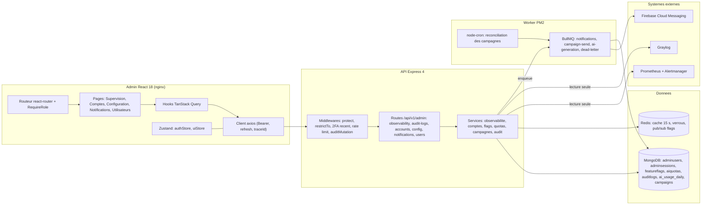

**Légende.** Les pages ne parlent jamais à Prometheus, Graylog ou FCM : l'API sert de **passerelle contrôlée** (jeton de service en lecture seule, hôte en liste blanche, timeout 5 s, données masquées). Toute mutation `/admin/*` traverse `restrictTo(...)`, un limiteur et le middleware `auditMutation(action, entityType)` (`API-PLAT-19`) : un test d'architecture échoue si une route de mutation n'est pas déclarée. Les envois de campagne passent par la file `notifications` (job `campaign-send`, `jobId = campaign:{id}`), jamais dans le cycle requête/réponse.

## 4. Écrans et navigation

### 4.1 Supervision (`ADM-WH`, super-admin uniquement)

| Code | Écran | Rôle |
|---|---|---|
| `WH-01` | Santé technique | Statut agrégé, 4 KPI, latence p50/p95/p99, services, bandeau d'alertes |
| `WH-02` | Files d'attente BullMQ | Cartes par file, tableau « Jobs en échec · dead letter », Relancer / Marquer traité |
| `WH-03` | Explorateur de logs | Filtres service / niveau / période / `traceId`, table, lien Graylog |
| `WH-04` | Consommation IA | Budgets texte/image, projection, plafonds par utilisateur |
| `WH-05` | Journal d'audit | Piste immuable, filtres, export CSV, détail avant/après |

### 4.2 Comptes, configuration, notifications (`ADM-WI`)

| Code | Écran | Rôle |
|---|---|---|
| `WI-01` | Comptes administrateurs | Liste, rôles, statuts, 2FA, dernière activité, trois cartes de rôles |
| `WI-02` | Inviter un administrateur | Modale nom, e-mail, rôle ; lien à usage unique |
| `WI-03` | Sessions actives | Panneau latéral 480 px, révocation d'une session ou de toutes |
| `WI-04` | Désactiver un compte | Confirmation ; suppression définitive renforcée |
| `WI-05` | Feature flags | Quatre interrupteurs et pourcentage de déploiement |
| `WI-06` | Quotas IA | Plafonds par utilisateur, budgets mensuels, seuil d'alerte |
| `WI-07` | Notification manuelle | Audience, contenu, programmation, aperçu push |
| `WI-08` | Double confirmation « Tous » | Saisie du nombre exact + case de relecture |
| `WI-09` | Exports et rapports | Rapport hebdomadaire du lundi 08:00, exports CSV/Excel |

### 4.3 Utilisateurs et évolutions (`ADM-WJ`) et accès (`ADM-WA`)

| Code | Écran | Phase |
|---|---|---|
| `WJ-01` / `WJ-02` | Liste des utilisateurs, fiche utilisateur (avertir, suspendre, bannir) | 1 |
| `WJ-03` | Barème Fantasy configurable (simulation, historique) | 2 |
| `WJ-04` | Tableau de bord GOAT : votes et anomalies | 2 |
| `WJ-05` | Supervision La Masia Academy | 3 |
| `WJ-06` | Modération des wallpapers IA | 3 |
| `WA-01` à `WA-07` | Connexion, erreur, blocage, TOTP, première connexion, 2FA, session expirée (voir F01) | 1 |
| `WA-08` / `WA-09` | Accès non autorisé (403), page introuvable (404) et erreur serveur | 1 |

<p>


</p>

*`WH-02` : quatre cartes de files (en attente / échecs / terminés) puis le tableau dead-letter avec identifiant monospace, erreur en rouge, tentatives `5 / 5` et boutons Relancer / Marquer traité. `WI-08` : modale « Envoyer à TOUS les utilisateurs ? » avec « 12 480 appareils », champ « Pour confirmer, saisis 12480 » et case de relecture trilingue. `WI-05` : un interrupteur par module, clé en monospace, phase et pourcentage.*

<p>


</p>

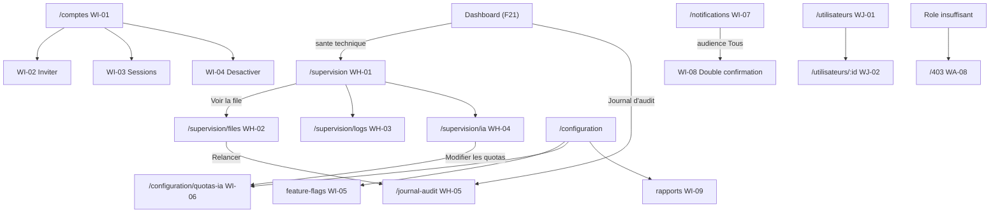

Routes cibles : `/supervision`, `/supervision/files`, `/supervision/logs`, `/supervision/ia`, `/journal-audit` (super-admin) ; `/comptes` (super-admin) ; `/configuration/feature-flags`, `/configuration/quotas-ia`, `/configuration/rapports` (super-admin) ; `/notifications` (content-manager et super-admin) ; `/utilisateurs`, `/utilisateurs/:id` (modérateur et super-admin) ; `/activation?token=` (publique, première connexion).

## 5. Flux détaillés

### 5.1 Santé technique et alertes (nominal et source indisponible)

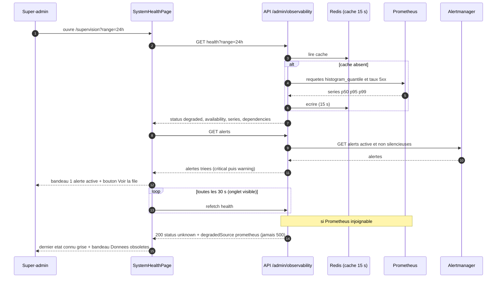

**Pas à pas.** (2-6) L'API ne calcule rien de lourd en direct : elle interroge Prometheus avec un **pas imposé** (1 h → 30 s, 24 h → 5 min, 7 j → 30 min, 336 points max) et met le résultat en cache 15 s pour que plusieurs super-admins ne multiplient pas les requêtes. (7-8) Les routes sont normalisées (`/matches/:id`) pour éviter l'explosion de cardinalité. (9-11) Les alertes viennent d'Alertmanager ; chacune porte une `resource` (`{type:'queue', id:'wallpapers'}`) qui sert à construire le lien « Voir la file ». (12-14) Le polling est suspendu quand l'onglet est caché (`refetchIntervalInBackground=false`) avec backoff 30 → 60 → 120 s sur erreur réseau. (15-16) Si la source de métriques est en panne, l'API **répond 200** avec `status:'unknown'` : l'écran de supervision ne doit jamais être lui-même la victime de la panne qu'il surveille.

Règle du statut global (`API-PLAT-12`) : **Incident** si l'API est down ou 5xx > 5 % sur 5 min ; **Dégradé** si une dépendance est down, p95 > 1 s sur 10 min ou une alerte est active ; sinon **Opérationnel**. L'interface n'utilise jamais la couleur seule (icône et libellé).

### 5.2 Relancer un job en échec (nominal et erreurs)

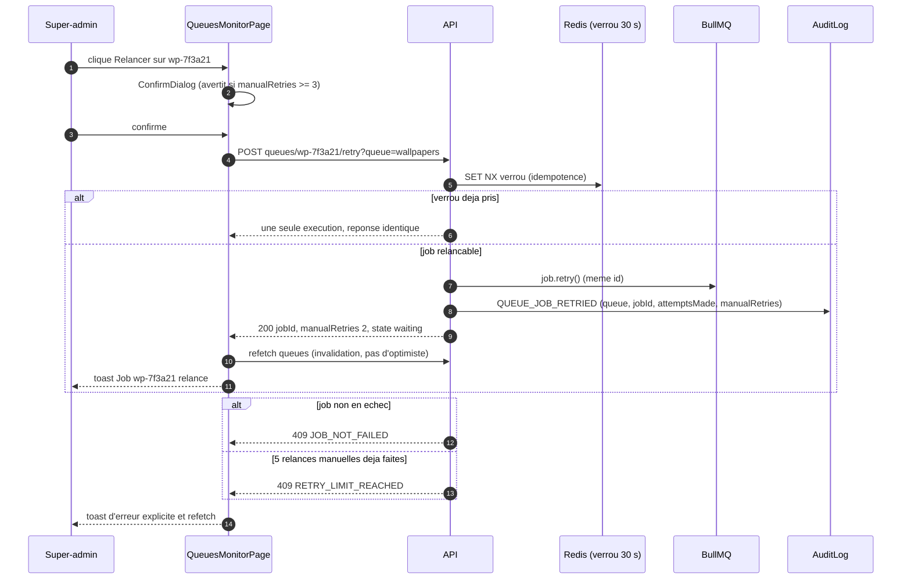

**Pas à pas.** (2) Avertissement dès **3** relances manuelles : un job qui échoue structurellement ne doit pas être relancé à l'infini ; l'API plafonne à **5** relances (`RETRY_LIMIT_REACHED`). (5) Un verrou Redis de 30 s garantit qu'un double-clic n'exécute qu'**une** relance. (7-8) Le job **garde son identifiant d'origine** ; `manualRetries` est incrémenté dans `job.data`. (10) Aucune mise à jour optimiste : l'action est sensible, la ligne ne bouge qu'après la réponse du serveur. « Marquer traité » (`POST …/dismiss`) retire la ligne sans rejouer, avec une justification d'au moins 10 caractères côté API (champ facultatif ≤ 200 caractères côté maquette, voir section 14).

### 5.3 Changer un feature flag et propagation

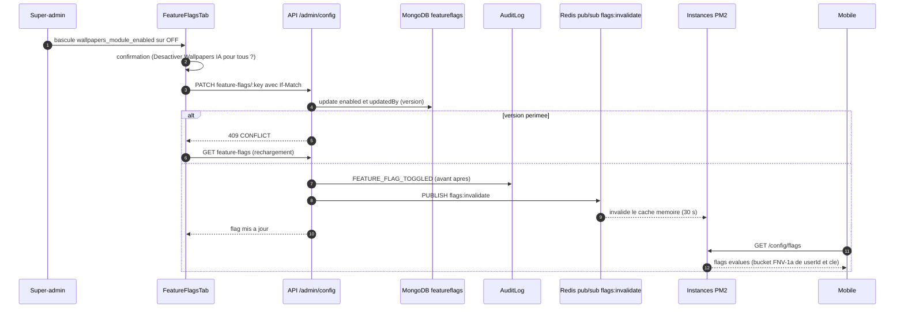

**Pas à pas.** Le flag n'est jamais supprimé ni créé depuis l'interface (migration uniquement). L'évaluation est **déterministe par utilisateur** : `bucket = FNV-1a(userId + ':' + key) % 100`, actif si `enabled && bucket < rolloutPercent`. Un `killSwitch=true` force `false` sans toucher au pourcentage (coupure d'urgence du budget IA, justification obligatoire). Le Switch affiche un spinner jusqu'à la réponse (pas d'optimiste) ; propagation visée < 5 s sur toutes les instances grâce au pub/sub Redis. Côté serveur, un flag désactivé est aussi appliqué par `requireFlag` : masquer un module côté mobile n'est jamais la seule protection. Détail des flags dans F24.

### 5.4 Envoi d'une notification à tous (double confirmation et garde-fous)

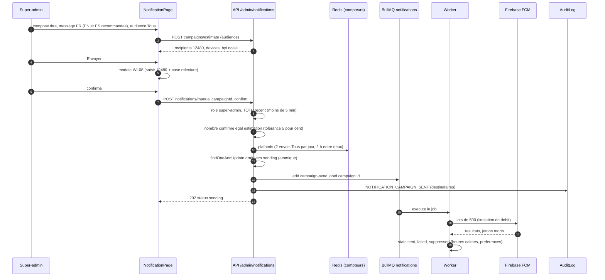

**Pas à pas.** (3-4) L'estimation ne renvoie **jamais la liste des destinataires** (minimisation RGPD) ; pour un segment de moins de 20 utilisateurs elle renvoie « < 20 » (k-anonymat) et seul un super-admin peut envoyer. (7-9) La double confirmation est **vérifiée aussi côté serveur** : `403 FORBIDDEN_ROLE` si le rôle n'est pas super-admin, `409 AUDIENCE_CHANGED` si le nombre confirmé s'écarte de plus de 5 % du décompte réel, `422` si `reviewedLanguages` n'est pas vrai. (10-12) Le passage `draft → sending` est atomique : un clic multiple n'envoie qu'une fois. (15-18) Le worker envoie par lots de 500 ; les utilisateurs bloqués par heures calmes, préférences, absence de consentement ou plafond (3 campagnes par 7 jours glissants, 1 par 24 h) sont comptés dans `stats.suppressed`, pas en erreur.

### 5.5 Garde par rôle et refresh de session côté React

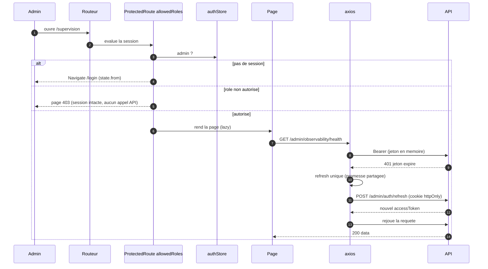

**Pas à pas.** (4-6) Un administrateur authentifié sans le bon rôle voit la **page 403 nominative** (« Ton rôle Content-manager ne permet pas d'accéder à la modération… ») et non un retour à la connexion : sa session n'est pas en cause. Dans le code actuel, `ProtectedRoute` redirige vers `/403` ; le backlog (`ADM-WA` issue 13) le remplace par un rendu de `ForbiddenPage` qui **conserve l'URL tentée**. (9-14) Le refresh est **unique** : N requêtes en 401 attendent la même promesse (`refreshing ??= axios.post(...)`) ; les routes `/admin/auth/*` sont exclues du rejeu ; si le refresh échoue, `authStore.clear()` puis redirection vers `/login`. Le jeton d'accès n'est **jamais** écrit dans le stockage navigateur (ADR 0003) ; seul le profil l'est pour un affichage immédiat.

### 5.6 Cycle de vie d'un compte administrateur

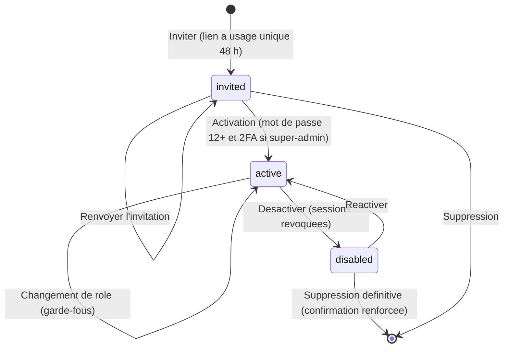

Garde-fous (`API-AUTH-37`, `ADM-WI` issues 06 et 09) : jamais de retrait du rôle au **dernier super-admin actif** (`409`), **pas d'auto-modification** de son propre rôle, pas d'auto-désactivation, justification d'au moins 10 caractères pour une désactivation ou suppression, e-mail à retaper pour une suppression définitive. Passage vers `super-admin` : 2FA obligatoire et révocation des sessions existantes. Le verrouillage de connexion (5 échecs → 15 min) et le 2FA sont décrits dans F01.

### 5.7 Cycle de vie d'une campagne de notification

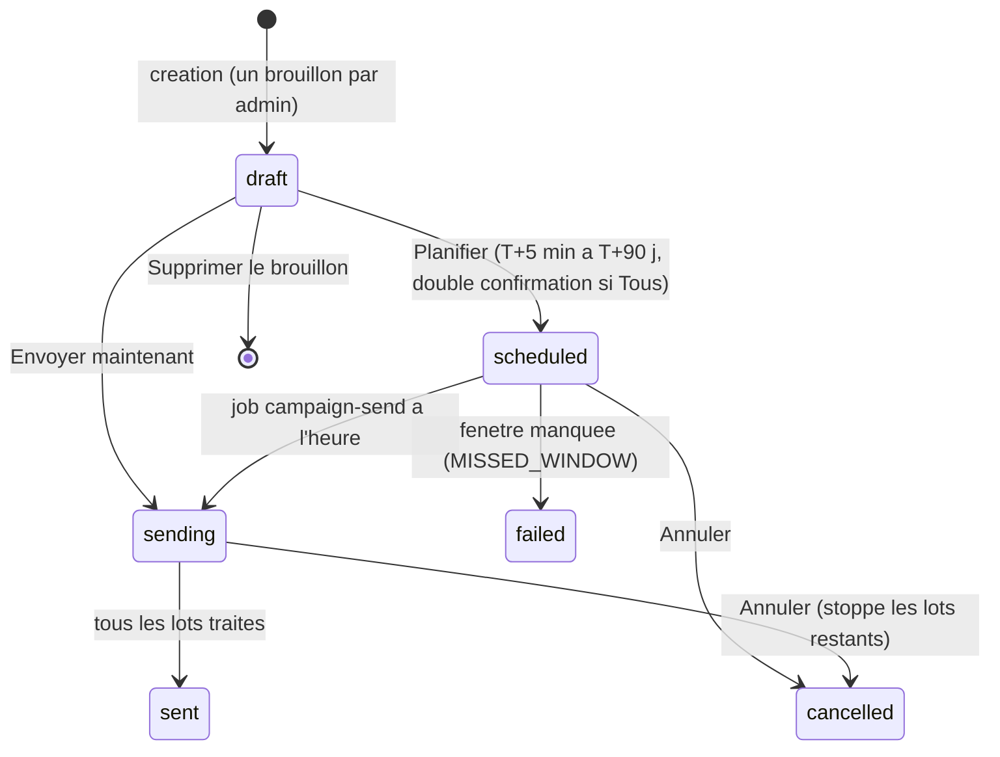

Un cron toutes les 5 minutes réconcilie les campagnes `scheduled` dont l'heure est dépassée si Redis a perdu des jobs : envoi si le retard est inférieur à 1 h, sinon `failed` avec `MISSED_WINDOW` (`API-NOTIF-25`).

## 6. Contrats d'API

Préfixe `/api/v1`. Enveloppe `{ success, data }` ; erreurs `{ success:false, error:{ code, message, details, traceId } }`. Toutes les routes ci-dessous : `protect` + `restrictTo(...)`, `Cache-Control: no-store`. **SA** = super-admin (+ 2FA exigé pour la configuration), **CM** content-manager, **Mod** modérateur. Sauf `/admin/auth/*`, ces routes sont **la cible du backlog**.

### 6.1 Supervision et audit

| Méthode | Chemin | Rôle | Requête | Réponse | Erreurs |
|---|---|---|---|---|---|
| GET | `/admin/observability/health` | SA | `range=1h\|24h\|7d` | `{ status, availability, series:{p50,p95,p99,errorRate}, endpoints[top 10], dependencies, grafanaUrl }` | `200 unknown` si Prometheus KO |
| GET | `/admin/observability/alerts` | SA | — | `{ items:[{ id, severity, summary, since, resource:{type,id} }] }` (≤ 50) | liste vide si Alertmanager KO |
| GET | `/admin/observability/queues` | SA | — | `{ items:[{ name, waiting, active, failed, completed, oldestWaitingAgeSeconds }] }` (cache 5 s) | — |
| GET | `/admin/observability/queues/:name/jobs` | SA | `state=failed, cursor` | 20 par page : `{ id, name, attemptsMade, failedReason (200 car.), manualRetries }`, données masquées | — |
| POST | `/admin/observability/queues/:jobId/retry` | SA | `?queue=` | `{ jobId, manualRetries, state }` | 409 `JOB_NOT_FAILED`, `RETRY_LIMIT_REACHED` |
| POST | `/admin/observability/queues/:jobId/dismiss` | SA | `{ justification ≥ 10 }` | `{ id }` | 422 |
| POST | `/admin/observability/dead-letter/replay` | SA | `{ queue, reason, max ≤ 100 }` | rejeu groupé 10 jobs/s (`API-PLAT-53`) | — |
| GET | `/admin/observability/logs` | SA | `service, level, from, to (≤ 7 j), traceId, q, limit=50` | `{ items:[{ ts, level, service, message, traceId }], total, graylogUrl }` | 422 si plage > 90 j |
| GET | `/admin/observability/ai-usage` | SA | `period=day\|week\|month` | `{ text:{used,budget,status}, image:{…,projectedDepletion}, byFeature[], errorRate }` | — |
| GET | `/admin/audit-logs` | SA (autres : `?mine=true`) | `action, adminId, entityType, from, to, cursor` | `{ items, nextCursor }` | — |
| GET | `/admin/audit-logs/export.csv` | SA | mêmes filtres | CSV UTF-8 BOM `;` ≤ 50 000 lignes (le backlog admin cite 100 000) | audit `AUDIT_EXPORTED` |

### 6.2 Comptes, configuration, notifications

| Méthode | Chemin | Rôle | Requête / corps | Réponse | Erreurs |
|---|---|---|---|---|---|
| GET/POST | `/admin/accounts` | SA | POST `{ name, email, role }` | `{ id, status:'invited' }` | 409 e-mail existant |
| PATCH/DELETE | `/admin/accounts/:id` | SA | `{ role? , status? , justification }` | compte | 409 dernier super-admin |
| GET/DELETE | `/admin/accounts/:id/sessions[/:sessionId]` | SA | — | sessions masquées (IP tronquée) | — |
| POST | `/admin/auth/accept-invite` ≙ `/admin/auth/activate` | publique (jeton) | `{ token, password }` | `{ admin, requires2fa }` | 410 `INVITE_EXPIRED`, 409 `INVITE_USED` |
| GET | `/admin/config/feature-flags` | SA | — | `{ items:[{ key,label,phase,enabled,rolloutPercent }] }` | — |
| PATCH | `/admin/config/feature-flags/:key` | SA + 2FA | `{ enabled?, rolloutPercent?, killSwitch?, justification? }` + `If-Match` | flag | 409 `CONFLICT` |
| GET/PATCH | `/admin/config/ai-quotas` | SA | `{ perUser:{…}, global:{…} }` partiel, tout ou rien | plafonds | 422 |
| PATCH | `/admin/config/weekly-report` | SA | `{ enabled, sections[], recipient }` | config | — |
| POST/PATCH | `/admin/notifications/campaigns` | CM, SA | `{ title:{fr,en,es}, body:{…}, deepLink?, audience }` | brouillon + `warnings[]` | 422 |
| POST | `/admin/notifications/campaigns/estimate` | CM, SA | `{ audience }` | `{ recipients, devices, byLocale, byPlatform }` | — |
| POST | `/admin/notifications/campaigns/:id/preview`, `/test` | CM, SA | `{ locale }` | rendu / envoi aux appareils de l'admin | — |
| PUT | `/admin/notifications/campaigns/:id/schedule` | CM, SA | `{ scheduledAt, confirm }` | `status:'scheduled'` | 422 date |
| POST | `/admin/notifications/manual` | SA (Tous), CM/SA (segment) | `{ campaignId, confirm:{ recipientCount, reviewedLanguages:true } }` + `X-Admin-Totp` | 202 `status:'sending'` | 403, 409 `AUDIENCE_CHANGED`, 422, 429 |
| GET | `/admin/notifications/campaigns[/:id]` | CM, Mod (lecture), SA | `status, période, page` | historique + `stats{sent,failed,suppressed,opened}` | — |

### 6.3 Utilisateurs et évolutions

| Méthode | Chemin | Rôle | Description |
|---|---|---|---|
| GET | `/admin/users`, `/admin/users/:id` | Mod, SA | liste (`q, status, country, from, to, lang, page, limit`), fiche minimisée ; **jamais de position GPS** |
| POST | `/admin/moderation/users/:id/action` | Mod, SA | `{ type:'warn'\|'suspend'\|'ban', severity, durationDays?, justification ≥ 10 }` → `{ status, recidiveRank }` |
| GET | `/admin/moderation/users/:id/history` | Mod, SA | historique de modération |
| POST | `/admin/fantasy/scoring-rules/simulate` (phase 2) | SA | impact d'un barème sur la dernière journée |
| — | routes GOAT, La Masia, wallpapers (phases 2-3) | SA / Mod | à spécifier par les épopées `API-GOAT`, `API-FANT`, `API-WALL` |

Exemples :

```json
// POST /api/v1/admin/notifications/manual   (en-tête X-Admin-Totp: 123456)
{ "campaignId": "6720b4…", "confirm": { "recipientCount": 12480, "reviewedLanguages": true } }
// 409 si l'audience a changé entre-temps
{ "success": false, "error": { "code": "AUDIENCE_CHANGED",
  "message": "L'audience a changé", "details": { "recipients": 12911 }, "traceId": "9f3a21c8…" } }
// PATCH /api/v1/admin/config/feature-flags/wallpapers_module_enabled
{ "killSwitch": true, "justification": "Budget image dépassé" }
```

## 7. Modèle de données

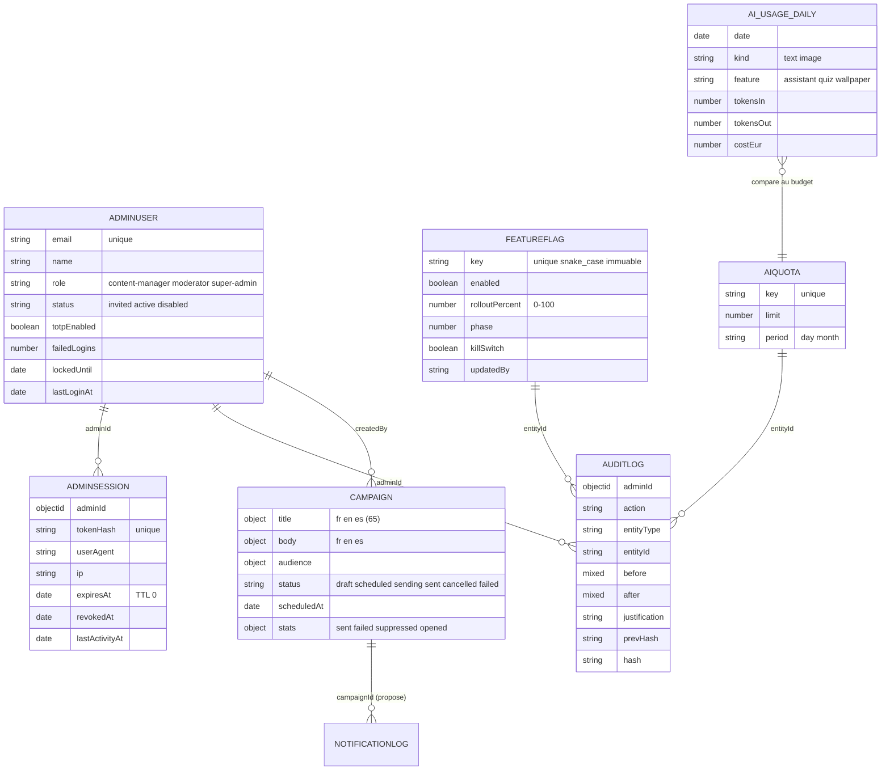

**Collections réelles** (code) : `adminusers` (email unique, `passwordHash`/`totpSecret`/`inviteTokenHash` en `select:false`, `failedLogins`, `lockedUntil`), `adminsessions` (`tokenHash` unique, **index TTL** `expiresAt` à 0 s, `revokedAt`, session de 8 h `SESSION_MS`), `featureflags` (`key` unique, `enabled` défaut false, `rolloutPercent` défaut 100), `aiquotas` (`key` unique, `limit`, `period`), `auditlogs` (index `createdAt:-1`, sans `updatedAt`).

**Ajouts du backlog** : `featureflags` + `label`, `phase`, `platforms[]`, `minAppVersion`, `killSwitch`, `updatedBy/At`, `exposed` (`API-PLAT-08`) ; `auditlogs` + `traceId`, `prevHash`, `hash` (chaîne SHA-256 d'intégrité, hooks Mongoose interdisant update/delete, utilisateur MongoDB sans droit `remove` en production, conservation illimitée — `API-PLAT-18`) ; `ai_usage_daily` (`$inc` atomique à chaque appel IA, **aucun prompt stocké**) ; `notificationcampaigns` (`API-NOTIF-01`) ; dead-letter `{ queue, jobId, name, data masqué, failedReason, attempts, manualRetries }` rétention 30 jours.

**Clés Redis** (proposées, préfixe `ub:`) : `ub:obs:health:{range}` (15 s), `ub:obs:queues` (5 s), `ub:lock:retry:{jobId}` (30 s), canal pub/sub `flags:invalidate`, `ub:notif:cap:user:{id}` (plafonds), `ub:notif:cap:all` (envois « Tous » du jour), `ub:admin:nav:counters:{role}` (30 s).

**Stockage navigateur** : `ub-auth` (profil seulement), `ub-ui` (thème, sidebar), `ub:prefs:<adminId>` (préférences versionnées, ≤ 50 Ko, repli mémoire si `localStorage` bloqué), `ub-last-activity` et `draft:<route>:<adminId>` (brouillons, purgés après 7 jours). **Jamais** de jeton ni de donnée personnelle de supporter.

**Migrations** : champs de `featureflags` (+ seed des quatre clés : `fantasy_module_enabled`, `academy_module_enabled`, `wallpapers_module_enabled`, `assistant_streaming_enabled`), index de `ai_usage_daily` `{date, kind, feature}`, chaîne de hachage rétro-calculée pour les entrées d'audit existantes ; scripts idempotents `scripts/migrations`.

## 8. Traitements asynchrones et cache

| Traitement | File / déclencheur | Paramètres | Idempotence |
|---|---|---|---|
| Envoi de campagne | BullMQ `notifications`, job `campaign-send` | `jobId = campaign:{id}`, lots de 500, backoff exponentiel 2 s, 5 tentatives | statut `draft → sending` atomique |
| Réconciliation des campagnes programmées | node-cron, toutes les 5 min | retard < 1 h : envoi, sinon `MISSED_WINDOW` | contrôle de statut |
| Rapport hebdomadaire | cron lundi 08:00 (`Europe/Paris`) | synthèse e-mail au super-admin (nouveaux utilisateurs, signalements traités, incidents, consommation IA) | une exécution par semaine |
| Exports volumineux (audit, listes) | job asynchrone, file `exports` (proposée) | plafond 100 000 lignes, concurrence 1 | nom de fichier horodaté |
| Dead-letter / retries | par file (`API-PLAT-53`) | `email` 5 (2 s exp.), `notifications` 5, `football-sync` 3 (30 s), `ai-generation` 2, `rgpd` 8 sur 24 h ; erreurs permanentes (`UnrecoverableError`) sans retry | `jobId` d'origine |
| Mesure de consommation IA | appel IA | `$inc` sur `ai_usage_daily` | atomique |
| Cache de supervision | Redis | health 15 s, alertes 15 s, files 5 s | cache-aside |

Valeurs actuelles de `src/jobs/queues.ts` : `attempts: 5`, `backoff: { type: 'exponential', delay: 2000 }`, `removeOnComplete: 1000`, `removeOnFail: 5000`.

**Côté React.** Fabrique de clés unique `src/lib/queryKeys.ts` (`['observability','health',{range}]`, `['observability','queues']`, `['audit',filters]`, `['admin-accounts',filters]`, `['config','feature-flags']`, `['config','ai-quotas']`). Profils de fraîcheur (`ADM-FND-05`) : `FRESHNESS.moderation` 30 s, `editorial` 5 min, `dashboard` 1 min, `static` 1 h ; `gcTime` 10 min ; `refetchOnWindowFocus: false` ; retry jamais sur 4xx, 2 essais exponentiels sur réseau/5xx. Supervision : `staleTime` et `refetchInterval` 30 s pour santé et files. **Optimiste interdit** pour publication, bannissement, suspension, archivage groupé, comptes, quotas, flags, relance de job ; `queryClient.clear()` à la déconnexion (aucune persistance du cache, données sensibles).

## 9. Règles de gestion

1. **Supervision réservée au super-admin** (CDC Admin §4.7) ; le modérateur qui saisit `/supervision` voit la page 403 et l'entrée de menu n'existe pas pour lui.
2. **Seuils d'affichage** : disponibilité objectif 99,5 %, erreur 5xx < 0,5 %, latence p95 < 300 ms ; alerte « file » à 10 jobs en attente (exemple de la maquette) ; budget IA : vert < 80 %, or 80–100 %, rouge ≥ 100 %.
3. **Projection de dépassement IA** = (consommation cumulée du mois ÷ jours écoulés) × jours du mois ; statuts « Dans le budget » (< 80 %), « À surveiller » / « Risque de dépassement » (80–100 %), « Dépassement anticipé » (projection > 100 %). Coupure automatique par `killSwitch` de `wallpapers_module_enabled` : optionnelle, désactivée par défaut.
4. **Relance de job** : état `failed` ou dead-letter uniquement ; maximum 5 relances manuelles ; avertissement dès 3 ; verrou 30 s.
5. **Logs** : plage ≤ 7 jours par requête, rétention 90 jours, 50 lignes par page, `traceId` en 8 à 32 caractères hexadécimaux ; e-mails → `a***@d***.com`, jetons → `[REDACTED]`, IP tronquées /24 ; la recherche libre refuse un e-mail complet.
6. **Audit** : immuable (aucune route de modification), chaque mutation `/admin/*` auditée avec `adminId`, `entityType`, `entityId`, `before`, `after`, `justification`, IP tronquée, `traceId` ; `before/after` excluent tout secret (liste noire `passwordHash`, `totpSecret`, jetons).
7. **Comptes** : invitation à usage unique valable 48 h ; mot de passe ≥ 12 caractères avec majuscule, minuscule, chiffre et symbole ; 2FA obligatoire pour un super-admin (8 codes de secours) ; session expirée après 8 h d'inactivité ; dernier super-admin protégé ; pas d'auto-désactivation.
8. **Rôles** : Super-admin (accès complet, configuration, supervision, comptes) ; Modérateur (signalements, groupes, utilisateurs, **pas de contenu éditorial**) ; Content-manager (joueurs, matchs, historique, quiz, **pas de modération**).
9. **Feature flags** : clé `snake_case` immuable ; `rolloutPercent` entier 0–100 ; `0 %` ≡ OFF, `> 0 %` force ON ; paliers proposés 0/10/25/50/100 ; confirmation si le saut dépasse 50 points ; `killSwitch` exige une justification.
10. **Quotas IA** : valeurs par utilisateur et par jour entières (maquette : 40 messages, 3 wallpapers, 30 questions IA) ; `0` coupe la fonction ; seuil d'alerte 50–100 % (défaut 80 %) ; hausse > 50 % : récapitulatif et justification ≥ 5 caractères ; modification atomique (tout ou rien).
11. **Notification** : titre ≤ 65 caractères, message ≤ 178 (API) ou 240 (maquette, voir section 14) ; FR obligatoire, EN/ES recommandés (contrôle non bloquant) ; programmation de T+5 min à T+90 jours (stockée en UTC, affichée Europe/Paris) ; un brouillon par administrateur ; **« Tous » : super-admin, TOTP récent < 5 min, nombre exact saisi, relecture cochée**, 2 envois « Tous » par jour, 2 h minimum entre deux.
12. **Anti-spam utilisateur final** : 3 notifications de campagne par 7 jours glissants et 1 par 24 h ; catégorie `news` en opt-in ; exception `maintenance` urgente (super-admin) limitée à 2 par jour.
13. **Sanctions** : justification ≥ 10 caractères pour suspendre ou bannir ; durées 7, 14, 30 jours ; barème indicatif Faible → avertissement (récidive : suspension 7 j), Moyenne → suspension 7–30 j (récidive : bannissement), Élevée → bannissement ; aide à la décision, jamais automatique ; rang de récidive envoyé avec l'action.
14. **Barème Fantasy** (phase 2) : valeurs entières −20 à +20, versionné, **jamais de recalcul rétroactif** ; **La Masia** (phase 3) : coefficients −50 à +50, effet à la semaine suivante.
15. **Exports** : CSV `;`, UTF-8 BOM, formules neutralisées, colonnes minimisées (utilisateurs : id, pseudo, pays, statut, date d'inscription ; e-mail seulement pour un super-admin avec justification), chaque export audité.

## 10. Sécurité, RGPD et anti-abus

* **Défense en profondeur du RBAC** : `ProtectedRoute allowedRoles` et `<Can action>` côté React (confort, jamais autorité) ; `restrictTo` et `requirePermission` côté API (`API-AUTH-32`) ; une action tentée via la console renvoie `403` affiché en toast « Action non autorisée pour ton rôle ». Un rôle inconnu dans un jeton altéré force la déconnexion.
* **Authentification forte** : mots de passe Argon2id, TOTP, blocage 5 échecs / 15 min, 2FA **récent** exigé pour les actions de masse (« Tous ») et la configuration, sessions révocables à distance (`DELETE /admin/accounts/:id/sessions`, invalidation immédiate du jeton).
* **Jeton** : accès en **mémoire** uniquement (ADR 0003) ; refresh en cookie `HttpOnly; Secure; SameSite=Strict; Path=/api/v1/admin/auth` ; admin et API partagent **la même origine** via le proxy nginx, ce qui rend `SameSite=Strict` possible. Jeton CSRF (`GET /admin/auth/csrf`, en-tête `X-CSRF-Token`) prévu par le backlog (`ADM-WA` issue 17) ; un `403 CSRF_INVALID` déclenche un unique rechargement puis rejeu.
* **Navigateur** : CSP stricte en deux temps (2 semaines en `Report-Only` avec `Reporting-Endpoints`, puis bloquante), `X-Frame-Options: DENY`, `Referrer-Policy`, `Permissions-Policy`, COOP/CORP, HSTS posé par le reverse proxy TLS, règle ESLint `react/no-danger`. Les images de contenus signalés ne sont servies que depuis le domaine de médias et floutées côté client ; aucun lien externe de contenu utilisateur n'est cliquable en modération.
* **RGPD** : minimisation (fiche utilisateur sans GPS, ville déclarée seulement ; estimation d'audience sans liste ; top utilisateurs IA anonymisés par hash ; aucun prompt stocké), masquage défensif des logs côté API **et** côté React, rétention 90 jours des logs, audit conservé sans TTL (valeur probante), exports restreints et journalisés, paramètre `from` de redirection validé (liste blanche de chemins internes, pas de redirection ouverte).
* **Anti-abus** : limiteurs sur `/admin/*` (campagnes 30 req/min/admin, mutations 120/min), plafonds d'envoi, garde SSRF sur les appels sortants Graylog/Alertmanager (hôte en liste blanche, timeout 5 s, jeton de service en lecture seule), sessions inactives purgées (TTL MongoDB sur `adminsessions`).
* **Intégrité de l'audit** : chaîne de hachage `prevHash`/`hash`, `GET /admin/audit-logs/verify` et script `npm run audit:verify` ; l'export est lui-même une entrée d'audit.

## 11. Erreurs et états dégradés

| Situation | Serveur | Client |
|---|---|---|
| Prometheus / Alertmanager injoignables | `200` + `status:'unknown'` + `degradedSource`, liste d'alertes vide | dernier état connu grisé, bandeau « Données obsolètes » |
| Graylog lent ou KO | timeout 5 s, erreur typée | `ErrorState` + « Réessayer » ; lien Graylog masqué si `VITE_GRAYLOG_URL` absent |
| Aucun job en échec | liste vide | « Aucun job en échec » |
| Double relance | verrou Redis | une seule exécution, toast cohérent |
| Job non relançable | `409 JOB_NOT_FAILED` | toast explicite + refetch |
| Plusieurs administrateurs modifient un flag | `409 CONFLICT` (`If-Match`) | rechargement avant nouvelle tentative |
| Audience changée avant l'envoi | `409 AUDIENCE_CHANGED` | la modale affiche le nouveau chiffre ; reconfirmation |
| 0 destinataire | — | bouton Envoyer désactivé + message |
| Rate limit | `429` + `Retry-After` | « Trop de requêtes, réessayez dans 12 s » ; pause des requêtes sur ce domaine |
| Jeton expiré | `401` | refresh unique et rejeu ; sinon `/login` ou `/session-expiree?from=` avec brouillons restaurés |
| Inactivité 8 h | `AdminSession` expirée | toast à 7 h 55 « Ta session expire dans 5 minutes », puis `WA-07` |
| Rôle insuffisant | `403 FORBIDDEN` | page `WA-08` (session intacte) ou toast sur mutation |
| Ressource introuvable | `404` | page « PAGE INTROUVABLE » contextuelle (« Voir la liste des joueurs »), sans toast |
| Erreur serveur | `5xx` + `traceId` | « ERREUR SERVEUR » + identifiant copiable + « Réessayer » |
| Chunk JavaScript obsolète après déploiement | — | rechargement **unique** (`sessionStorage.ub-chunk-reload`), sinon « Une nouvelle version est disponible · Recharger » ; `version.json` interrogé toutes les 10 min |
| Erreur de rendu React | — | frontière de route : zone de contenu seule, le menu reste utilisable ; brouillon local conservé |
| Hors-ligne | — | pas de déconnexion tant que le serveur est injoignable ; décision au retour du réseau |
| `localStorage` bloqué | — | repli mémoire sans erreur (`try/catch`) |

Toast d'erreur : titre, message, bouton « Copier l'identifiant » si `traceId`, durée 6 s (5xx persistantes) ; un même couple `code+route` n'émet qu'un toast par fenêtre de 3 s ; pas de toast pour `401` (refresh), `404` de ressource ni annulation (`ERR_CANCELED`).

## 12. Connexions avec les autres fonctionnalités

| Dépend de | Pourquoi |
|---|---|
| F01 Authentification et comptes | Connexion admin, 2FA, `AdminSession`, rôles |
| F24 Plateforme, jobs, cache, flags | Files BullMQ, dead-letter, métriques `ub_*`, évaluation des flags, maintenance |
| F23 Design system | Composants (`ConfirmDialog`, `Switch`, `DataTable`, tokens, thèmes) |
| F03/F04 Notifications et états système (mobile) | Préférences, consentement, heures calmes qui filtrent les campagnes |
| F21 Contenu | Audit commun, widgets du tableau de bord (`queue-health`, `recent-actions`) |

| Alimente | Comment |
|---|---|
| Mobile | `GET /config/flags` (flags évalués), notifications push des campagnes, sanctions de modération |
| F21 | Journal d'audit des actions de contenu, compteurs de file |
| Modération (`ADM-WG`) | Fiche utilisateur et historique de sanctions |
| Exploitation | Alertes, runbooks (un par alerte), tableaux Grafana |

| Partage | Avec |
|---|---|
| Journal d'audit | tous les modules admin (écriture), `WH-05` (lecture) |
| Budget IA | `WH-04` (lecture), `WI-06` (édition), assistant, quiz IA, wallpapers |
| Matrice de permissions | `src/lib/permissions.ts` (`usePermissions`, `<Can>`) pour tous les modules |

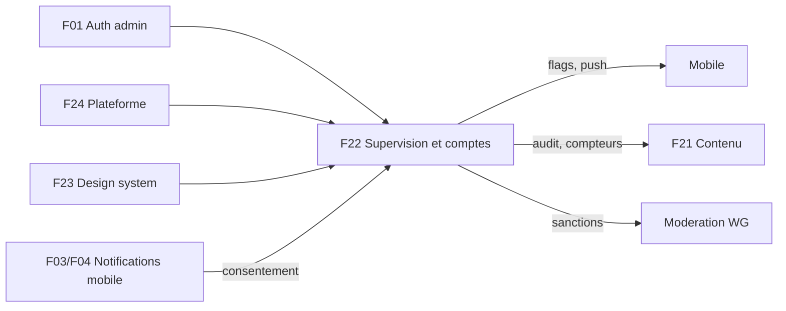

## 13. Observabilité et tests

**Ce que ce module affiche, il l'alimente aussi.** Métriques Prometheus `ub_*` (RED par route : `ub_http_request_duration_seconds`, erreurs ; `jobsFailed` par file ; `authFailures` par raison ; `ub_dead_letter_total{queue}`), tableaux Grafana provisionnés (santé, usage, coûts IA, sécurité), alerting e-mail/webhook (`API-PLAT-21` à `-23`), traces OpenTelemetry avec propagation du `traceId`, logs Winston → Graylog (rétention 90 jours). Côté front : `X-Request-Id` (UUID v4) par requête, journaux front structurés (`VITE_LOG_ENDPOINT` optionnel), `window.onerror`/`unhandledrejection` remontés sans écran bloquant, Web Vitals.

**k6.** Toute nouvelle route est ajoutée aux scénarios `tests/load` (règle de CI). À prévoir : `GET /admin/observability/health` sous cache, `POST /admin/notifications/manual` (fan-out de 100 000 notifications, `API-NOTIF-30`), refresh de session admin. Profils réalistes : soir de match, annonce push.

**Tests clés.**

* Unitaires : statut global de santé (seuils), projection de dépassement IA, masquage (e-mails, IPv4, jetons), `trendTone`, évaluation déterministe des flags (`bucket` stable), garde « dernier super-admin », compteur de relances, validation Zod des mots de passe.
* Intégration API : RBAC sur chaque route `/admin/*` (CM et Mod → `403`), audit présent pour chaque mutation (test d'architecture), double confirmation « Tous » (`403`, `409`, `422`), idempotence de l'envoi, immuabilité de l'audit, plafonds anti-spam, sécurité (XSS, IDOR, élévation de privilèges — `API-MODER-31`).
* Playwright : (1) super-admin `/supervision` → statut → « Voir la file » ; (2) relance du job `wp-7f3a21` → toast → entrée `QUEUE_JOB_RETRIED` ; (3) logs filtrés par `traceId` ; (4) modérateur → 403 sur `/supervision` ; (5) inviter un modérateur → statut « Invitation envoyée » ; (6) bascule d'un flag → audit ; (7) modification d'un quota → toast et audit ; (8) notification « Tous » bloquée sans la saisie `12480` ; (9) content-manager n'accède pas à `/configuration` ; (10) modérateur : utilisateur → fiche → suspension 7 jours → audit.
* Accessibilité : `axe` en CI sur chaque écran, navigation clavier complète, annonces `live polite` limitées au changement de statut global.
* Déploiement : smoke tests (`/healthz`, `/version.json`, en-têtes de sécurité, `/api/v1/health` via le proxy, formulaire de `/login`) ; échec = rollback automatique.

## 14. Points ouverts et incohérences détectées

1. **Noms de files** : les maquettes affichent `calendar-sync`, `wallpapers`, `quiz-generation` ; le code déclare `email`, `notifications`, `football-sync`, `ai-generation`, `rgpd` (+ `dead-letter`). `API-PLAT-14` demande de les aligner ; les noms affichés doivent venir de l'API.
2. **Route d'audit** : le backlog admin cite `/admin/audit-log` (singulier) ; l'API `/admin/audit-logs` (pluriel). Plafond d'export : **100 000** lignes (admin) contre **50 000** (API, `API-PLAT-18`). Pagination d'audit : `page/limit=50` (admin) contre curseur 50 (API).
3. **Retry de job** : le backlog admin indique `POST …/queues/:jobId/handled` (« marquer traité », à créer) et justification facultative ≤ 200 caractères ; l'API prévoit `…/dismiss` avec justification **obligatoire ≥ 10 caractères** et la relance sans `?queue=` côté admin.
4. **Activation de compte** : `POST /admin/auth/activate` (`ADM-WI`) ≙ `POST /admin/auth/accept-invite` (`ADM-WA`) ; à unifier.
5. **Quotas IA** : valeurs par défaut du CDC (`ASSISTANT_DAILY_QUOTA`…) contre maquette `WI-06` (40/3/30) contre API (`30`/`5`/`10`) ; bornes différentes (admin : 1–500, 0–50, 0–200 ; API : 0–1000). Clés d'audit : `AI_QUOTA_UPDATED` (admin) contre `AI_QUOTA_CHANGED` (API).
6. **Campagne** : message ≤ **240** caractères (maquette, « à confirmer ») contre ≤ **178** (API, `API-NOTIF-22`) ; clé d'audit `NOTIFICATION_BROADCAST_SENT` (admin) contre `NOTIFICATION_CAMPAIGN_SENT` (API) ; l'API exige un **TOTP récent** (`X-Admin-Totp`) que la modale `WI-08` ne prévoit pas.
7. **Rollout des flags** : l'admin décrit PATCH `{ key, enabled, rolloutPercent }` ; l'API `PATCH /…/:key` avec `If-Match` et `killSwitch`. L'interface doit gérer `409 CONFLICT`.
8. **Restriction réseau de production** : le CDC illustre Traefik avec `ADMIN_IP_WHITELIST` ; le dépôt utilise un reverse proxy TLS vers `127.0.0.1:8081` — la liste blanche d'IP / VPN réelle est à documenter (`ADM-FND-21`).
9. **Mode CSP** : l'actuel `docker/nginx.conf` utilise `style-src 'self' 'unsafe-inline'` et `img-src … https:` ; la cible (`ADM-FND-23`) est stricte avec nonce et domaine de médias.
10. **Garde de route** : le code redirige `/403` ; le backlog veut rendre la page 403 **en conservant l'URL** (`ADM-WA` issue 13). Le badge d'environnement (`PRODUCTION`) dépend de `VITE_APP_ENV_LABEL` (backlog) alors que le code et le Dockerfile utilisent `VITE_ENV`.
11. **Arbitrages d'accès** : lecture du tableau de bord GOAT par le modérateur « selon arbitrage » ; annulation d'un retrait de wallpaper sous 24 h « à confirmer côté API ».
12. **Services affichés** : la carte « Services » doit refléter MongoDB (et non PostgreSQL) ; libellés fournis par l'API.
13. **Phases 2 et 3** (`WJ-03` à `WJ-06`) : les routes API (barème Fantasy, GOAT, La Masia, wallpapers) ne sont décrites qu'en partie ; elles seront précisées avec les épopées correspondantes et derrière des flags.

## 15. Architecture de l'application React (synthèse)

Cette section regroupe ce qu'un développeur doit savoir pour travailler dans `univers_barca_admin`.

### 15.1 Pile et conventions

React 18, Vite, TypeScript strict, Tailwind sur tokens CSS, TanStack Query/Table, Zustand, React Hook Form + Zod, axios, Radix UI, Recharts (chargé en `React.lazy`), sonner (toasts), date-fns (locale `fr`), framer-motion, lucide-react. Interface **en français uniquement**. Règles du dépôt : pages `XxxPage` en export `default` chargées en `lazy`, composants en export nommé, **appels HTTP uniquement dans `src/api/*.api.ts`**, alias `@/`, jamais de couleur en dur.

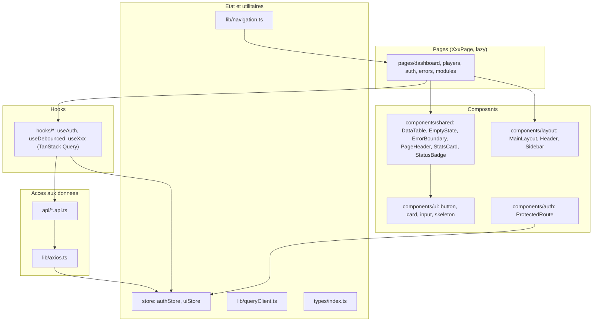

Règle de dépendances cible (`ADM-FND-02`, appliquée par `eslint-plugin-boundaries`) : `pages → hooks, components, lib` ; `hooks → api, lib, store` ; `api → lib/axios` ; `components` ne connaissent ni `api/` ni `useQuery` (les composants « connectés » sont des `*Container.tsx` ou vivent dans `pages/`) ; `lib` et `types` ne dépendent de rien d'applicatif.

### 15.2 Routage par rôle

`src/lib/navigation.ts` est la **source unique** : chaque entrée `NavItem` porte `to`, `label`, `icon`, `roles`, `module` (WB…WJ), `planned` et `implemented`. `src/App.tsx` en dérive à la fois le menu et les routes :

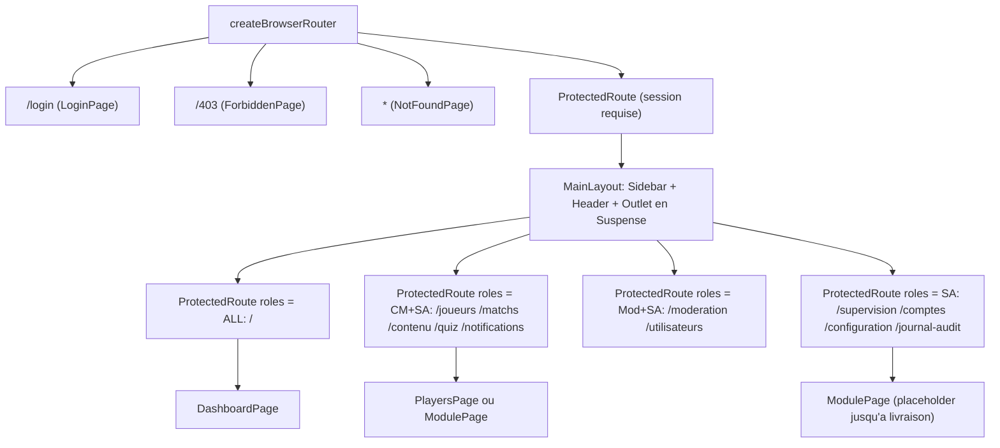

| Rôle | Entrées du menu (matrice de la sidebar, `WB-01/02/03`) |
|---|---|
| Super-admin | PILOTAGE ; CONTENU (Joueurs, Matchs, Contenu historique, Questions de quiz) ; COMMUNAUTÉ (Modération, Groupes locaux, Utilisateurs) ; SYSTÈME (Supervision, Journal d'audit, Notifications, Comptes admin, Configuration) |
| Content-manager | PILOTAGE + CONTENU (+ Notifications) |
| Modérateur | PILOTAGE + COMMUNAUTÉ (Modération, Groupes locaux, Utilisateurs) |

Cible (`ADM-FND-03`) : une table de routes unique `src/app/routes.tsx` avec `path`, `lazy`, `roles`, `handle:{crumb,title,module}` ; redirection post-connexion vers `state.from` si autorisée pour le rôle, sinon page d'accueil du rôle ; paramètres d'URL validés (identifiant invalide → 404 sans appel API) ; focus placé sur le `h1` à chaque changement de route.

### 15.3 Client axios et gestion de session

`src/lib/axios.ts` : instance `api` (`baseURL = VITE_API_URL ?? '/api/v1'`, `withCredentials: true`, `timeout: 20_000`) ; intercepteur de requête qui ajoute `Authorization: Bearer <accessToken>` depuis `authStore` ; intercepteur de réponse qui, sur `401` hors `/admin/auth/`, tente **un seul** `POST /admin/auth/refresh` partagé (`refreshing ??= …`) puis rejoue la requête (`_retry`), sinon `clear()` et redirection `/login`. `errorMessage(e)` convertit une erreur en texte lisible. Évolutions du backlog (`ADM-FND-04`, `ADM-WA` issue 16) : enveloppe typée `unwrap<T>`, `ApiError` avec `code/details/traceId`, `X-Request-Id`, annulation par `signal`, timeouts 120 s pour exports/imports, retry limité aux GET idempotents (2 essais, 500 ms puis 1 500 ms avec gigue), respect de `Retry-After`, jeton CSRF.

`authStore` (Zustand + `persist` clé `ub-auth`) : `admin` persisté, `accessToken` **jamais** persisté. `uiStore` (clé `ub-ui`) : `theme` (`light|dark|system`), `sidebarCollapsed` ; `applyTheme` pose `data-theme` sur `<html>`.

### 15.4 TanStack Query

`queryClient` : `staleTime` 30 s, `refetchOnWindowFocus: false`, `retry` : pas d'essai sur 4xx, 2 essais maximum sur le reste. Clés hiérarchiques (`['players', { q, page }]`), mutations qui **invalident explicitement** les clés concernées, optimiste réservé aux actions à faible risque avec rollback.

### 15.5 Déploiement nginx

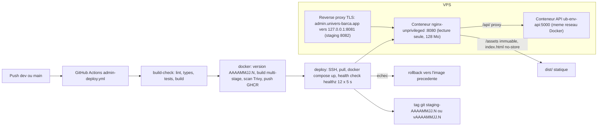

**Image** (`Dockerfile`) : étape 1 `node:22-alpine` (`npm ci`, `npm run build`, variables `VITE_API_URL` et `VITE_ENV` injectées **au build**, visibles dans le bundle donc jamais de secret) ; étape 2 `nginxinc/nginx-unprivileged:1.29-alpine`, utilisateur non-root, port 8080, `HEALTHCHECK` sur `/healthz`. **nginx** (`docker/nginx.conf`) : `/healthz`, en-têtes de sécurité (`X-Content-Type-Options`, `X-Frame-Options DENY`, `Referrer-Policy`, `Permissions-Policy`, CSP), proxy `/api/` vers `${API_UPSTREAM}` (résolveur Docker `127.0.0.11`) avec `Host` et `X-Forwarded-*`, `/assets/` en cache immuable un an, `index.html` en `no-store`, fallback SPA `try_files $uri $uri/ /index.html`, `gzip`. **Compose** : système de fichiers en lecture seule (`tmpfs` pour `/tmp`, `/var/cache/nginx`, `/etc/nginx/conf.d`), `no-new-privileges`, limite 128 Mo / 0,25 CPU, journaux 10 Mo × 3. Même origine admin/API : cookies `SameSite=Strict` possibles. Évolutions prévues (`ADM-FND-21/22/23`) : en-têtes factorisés dans chaque `location`, `client_max_body_size` dédié aux uploads (6 Mo médias, 3 Mo CSV), pages 502/504 statiques, journaux JSON, validation manuelle par reviewers pour la production, smoke tests et rollback manuel (`workflow_dispatch`).

## 16. Pour aller plus loin

* **Épopées admin** : `ADM-WH`, `ADM-WI`, `ADM-WJ`, `ADM-WA`, `ADM-FND`, `ADM-ADS` ; voisines `ADM-WB` (dashboard), `ADM-WG` (modération).
* **Épopées API** : `API-PLAT` (08–19, 21–25, 53), `API-NOTIF` (22–27), `API-AUTH` (32–40), `API-MODER` (15, 22, 26, 31).
* **CDC** : CDC Admin §3 (rôles), §3.2/§3.3 (comptes, activation), §4.7 à §4.7.2 (supervision), §4.8/§4.8.1 (configuration, flags), §4.11 (notifications manuelles), §4.12 (routes), §6.1 à §6.6 (sécurité, audit, exports, sessions), §2.4 à §2.6 (TanStack Query, erreurs, `RequireRole`), §9.7 (raccourcis) ; CDC Backend §3.10 (notifications), §3.11 (admin auth), §6 (observabilité), §7/§7.1 (BullMQ, dead letter), §11.2 à §11.4 (IA) ; CDC Global §2.14, §3.2, §3.6.
* **Code admin** : `src/App.tsx`, `src/lib/{navigation,axios,queryClient}.ts`, `src/store/{authStore,uiStore}.ts`, `src/components/{auth,layout,shared,ui}`, `Dockerfile`, `docker/nginx.conf`, `docker/docker-compose.{staging,production}.yml`, `docs/ARCHITECTURE.md`, `docs/DEPLOYMENT.md`, `docs/adr/0001`–`0004`.
* **Code API** : `src/models/{admin-user,platform,moderation}.model.ts`, `src/services/admin-auth.service.ts` (`MAX_FAILS = 5`, `LOCK_MS = 15 min`, `SESSION_MS = 8 h`), `src/middleware/auth.ts` (`protect`, `restrictTo`), `src/jobs/{queues,scheduler}.ts`, `src/routes/index.ts`.
* **Documents voisins** : F01 (auth admin complète), F21 (contenu), F23 (design system), F24 (plateforme et flags).
