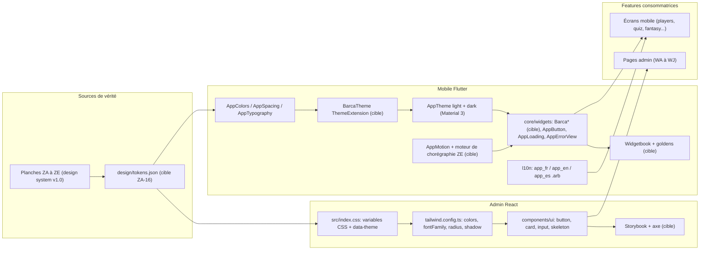
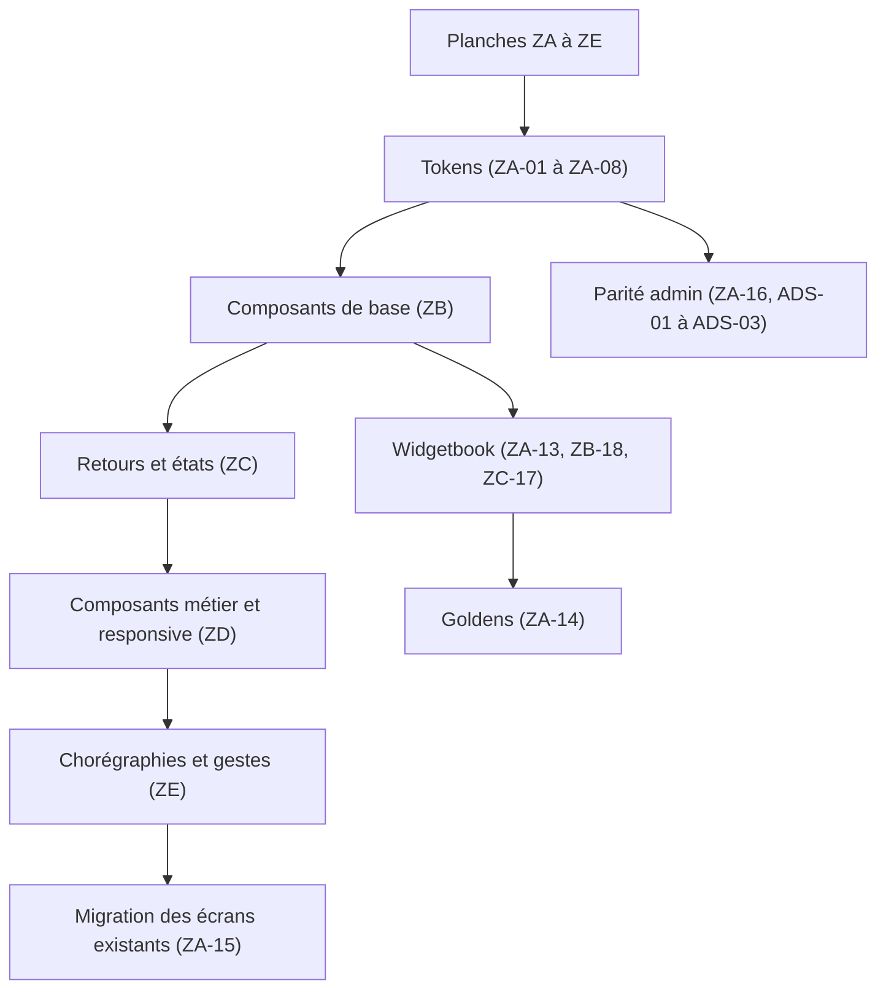
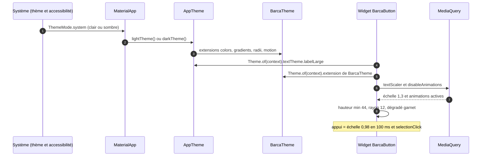
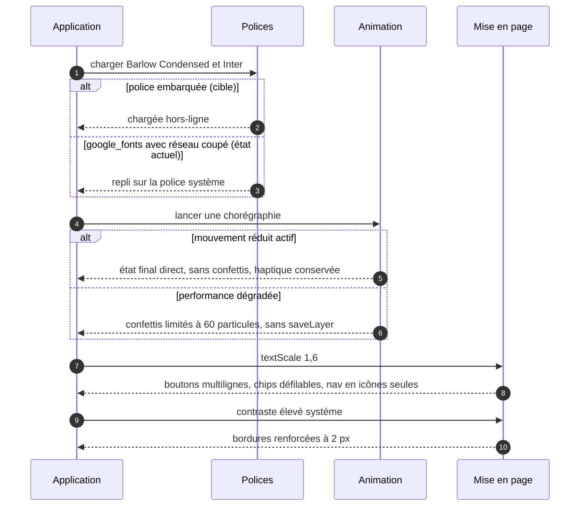
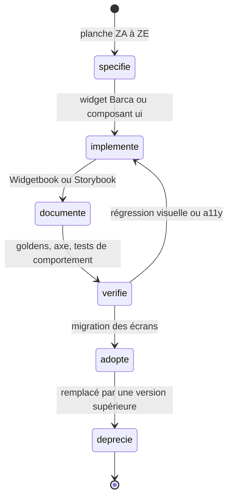
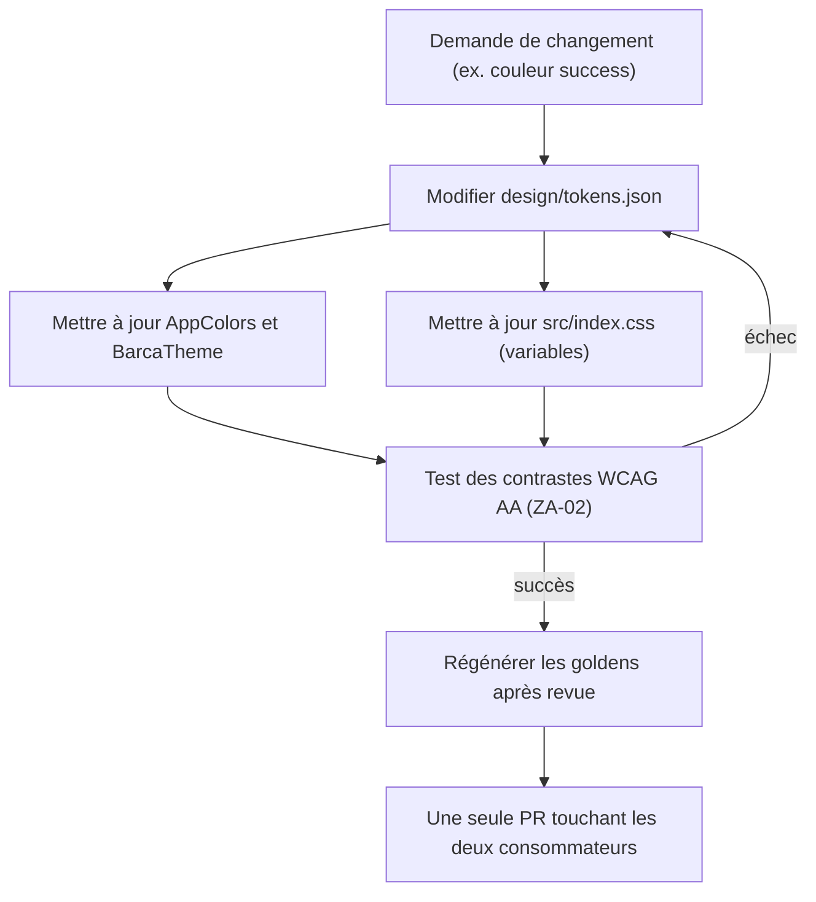
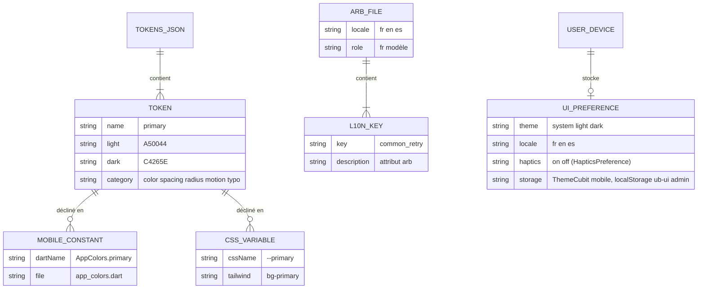
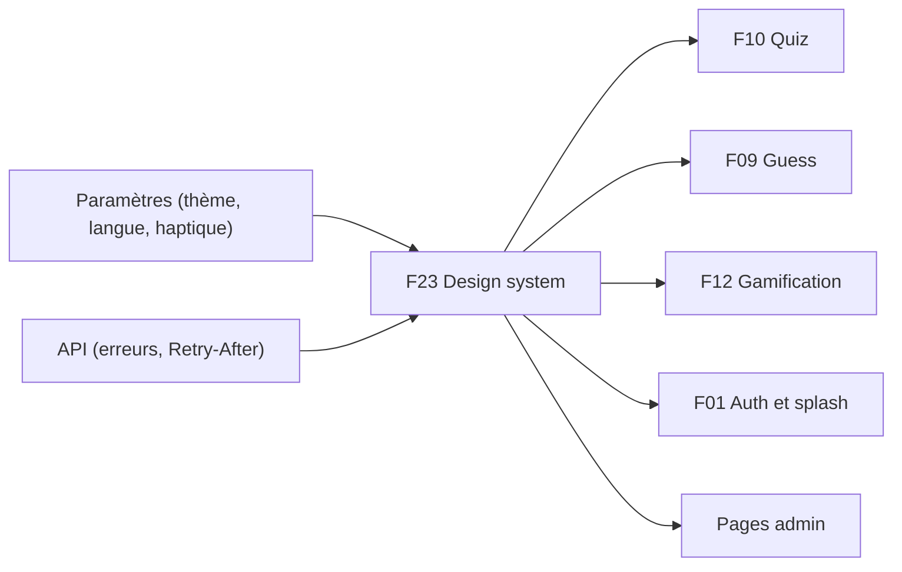

# F23 — Design system et expérience

> Documentation d'architecture · Univers Barça · fonctionnalité **F23**. Ce document explique le design system partagé par l'application mobile Flutter et le back-office React : jetons (tokens) de couleur, typographie, espacements, rayons, ombres, mouvement, composants réutilisables, thèmes clair/sombre, accessibilité, ergonomie tablette, chorégraphies d'animation, internationalisation et règles d'usage du logo. Il compare aussi, honnêtement, ce que le backlog demande et ce que le code contient aujourd'hui.

## 1. Résumé et fiche

**Valeur utilisateur.** Quel que soit l'écran, le supporter retrouve la même identité : grenat, marine et or, titres condensés, cartes arrondies, retours tactiles discrets. L'application reste lisible en plein soleil comme en mode sombre, utilisable à une main, accessible aux lecteurs d'écran et à l'agrandissement du texte (jusqu'à 160 %), et disponible en français, anglais et espagnol. Côté équipe, un seul langage visuel évite de réinventer boutons, champs, états vides ou erreurs à chaque écran.

**Valeur technique.** Les valeurs de design sont écrites **une fois** (planches ZA à ZE du design system) puis déclinées en code : classes Dart côté mobile, variables CSS + Tailwind côté admin. Une règle simple : **aucun écran n'écrit une couleur, un espacement ou un `TextStyle` en dur**.

| Élément | Valeur |
|---|---|
| Phase / priorité | Phase 0 — Socle technique pour les fondations (`MOB-ZA`, `ADM-ADS` tokens, thème, logo, polices) ; composants et états en Phase 0/1 selon les écrans qui les consomment (proposé : les priorités exactes sont dans chaque issue) |
| Épopées backlog | `MOB-ZA` (16 issues : fondations), `MOB-ZB` (18 : composants de base), `MOB-ZC` (17 : retours, chargement, états, données), `MOB-ZD` (13 : jeu, responsive, accessibilité, mouvement), `MOB-ZE` (18 : chorégraphies, haptique, ergonomie), `ADM-ADS` (37 : design system admin) |
| Écrans / planches | Mobile : `ZA-01` à `ZA-05`, `ZB-01` à `ZB-06`, `ZC-01` à `ZC-04`, `ZD-01` à `ZD-06`, `ZE-01` à `ZE-04` ; admin : les planches ZA/ZD sont partagées (`ADS` référence `ZA-01`, `ZA-02`, `ZD-04`, `ZD-05`…) |
| Dépôts concernés | **Mobile** (`lib/core/theme`, `lib/core/widgets`, `lib/l10n`, `assets/`), **admin** (`tailwind.config.ts`, `src/index.css`, `src/components/ui`, `src/components/shared`). **API** : aucun contrat dédié (voir §6) |
| Documents voisins | Tous : chaque feature consomme ce design system. Plus proches : F10 (options de quiz `ZD-02`/`ZE-09`), F09 (cellules Guess `ZD-01`), F12 (badges et confettis), F01 (splash et connexion) |

### Vocabulaire

* **Token** : valeur de design nommée (ex. `primary`, `space.md`, `dur.fast`), jamais écrite en dur dans un écran.
* **Garnet / navy / gold** : grenat `#A50044`, marine `#004D98`, or `#EDBB00`.
* **Hero** : dégradé de marque à 135° (grenat vers marine) réservé aux cartes mises en avant, au splash et aux notifications.
* **Chorégraphie** : animation multi-étapes décrite en millisecondes (`ZE`), distincte des micro-transitions de composants.
* **Mouvement réduit** : réglage système (`disableAnimations` Flutter, `prefers-reduced-motion` CSS) qui supprime les animations décoratives.
* **Widgetbook / Storybook** : catalogues interactifs de composants (Flutter / React).
* **Golden** : test d'image de référence (capture comparée au pixel près).

### Écart avec les CDC et état du code

Le CDC Flutter (§9.2 couleurs, §9.3 typographie, §9.4 tailles de référence) fixe l'exigence « tout passe par le thème » ; le backlog `ZA`–`ZE` la détaille en valeurs chiffrées. **Stack réelle** : Flutter (Material 3, `google_fonts`) côté mobile, React 18 + Vite + Tailwind + Radix côté admin ; l'API n'intervient pas dans ce périmètre.

> **État du code à la date de rédaction (écart principal)** : le socle existe mais reste **plus petit et partiellement divergent** de la cible.
> * Mobile `lib/core/theme/` : `app_colors.dart`, `app_spacing.dart`, `app_typography.dart`, `app_theme.dart` (thèmes clair et sombre Material 3). `lib/core/widgets/` : seulement `app_button.dart`, `app_error_view.dart`, `app_loading.dart`. `lib/l10n/` : `app_fr.arb` (modèle), `app_en.arb`, `app_es.arb` + classes générées. `assets/fonts/` est **vide** et `pubspec.yaml` charge les polices via `google_fonts` (téléchargement à l'exécution). Pas de `BarcaTheme`, `BarcaLogo`, `BarcaIcons`, `AppMotion`, Widgetbook ni goldens de fondations.
> * Admin : tokens CSS complets dans `src/index.css` (clair + `data-theme='dark'`), pont Tailwind dans `tailwind.config.ts`, composants `src/components/ui/{button,card,input,skeleton}.tsx` uniquement ; pas de Radix Select/Dialog/Tabs, ni Storybook, ni `Logo`.
> * Le détail des divergences chiffrées est au §9.5 (tableau d'écarts) et au §14.

## 2. Acteurs et user stories

| Acteur | Besoin | Critères d'acceptation clés |
|---|---|---|
| Supporter | Une application cohérente en clair et en sombre | Bascule immédiate sans redémarrage (`AnimatedTheme` 180 ms) ; suit le système par défaut (`ThemeMode.system`) ; contrastes AA dans les deux thèmes |
| Supporter malvoyant | Lire et naviguer au lecteur d'écran | Toute icône seule porte un `semanticLabel` traduit ; couleur jamais seule (icône + libellé) ; texte jusqu'à 160 % sans coupure |
| Supporter au pouce | Atteindre les actions d'une main | CTA principal en bas, jamais dans le tiers supérieur ; cibles >= 44 x 44 avec 8 px d'espace |
| Supporter sur tablette | Une mise en page adaptée | Rail 96 px au-delà de 600 px, contenu plafonné à 840 px, maître/détail |
| Supporter hispanophone / anglophone | Interface dans sa langue | FR/EN/ES via ARB, textes ES plus longs sans débordement |
| Sensible aux animations | Pouvoir les couper | Mouvement réduit : durées 0 (ou fondu 100 ms), pas de confettis, haptique conservée |
| Développeur mobile | Composer des écrans sans CSS ad hoc | Catalogue Widgetbook, goldens, composants `Barca*` |
| Développeur admin | Composants accessibles prêts à l'emploi | Storybook, Radix, couverture 75 % sur `ui` et `shared` |
| Designer / PO | Garantir la parité mobile/admin | `design/tokens.json` versionné, PR touchant les deux consommateurs |
| Équipe juridique/marque | Ne jamais reproduire le logo officiel | Emblème **original** uniquement, règles de zone de protection |

## 3. Architecture de la fonctionnalité

Le design system n'a pas de backend : c'est une **chaîne de production de valeurs** qui va des planches de design aux écrans. Le diagramme montre les sources, les couches de code et les consommateurs.

**Légende.** Flèches pleines = dépendance de code. `tokens.json` n'existe pas encore : aujourd'hui les valeurs sont **dupliquées à la main** dans `app_colors.dart` et `index.css` (l'admin est déjà conforme aux planches, le mobile non, voir §9.5).

**Pourquoi ce découpage.**
1. *Une vérité, deux consommateurs* : Flutter et CSS partagent noms et valeurs, sans générateur imposé (la parité est vérifiée par la PR, `ZA-16`).
2. *Thème = fournisseur unique* : un écran lit `Theme.of(context)` (ou `BarcaTheme`) ; changer un token change toute l'application.
3. *Composants avant écrans* : états vides, erreurs, chargement et boutons sont spécifiés une fois (`ZB`, `ZC`), donc identiques partout.
4. *Dégradation douce* : sans réseau, polices embarquées (cible) ; sans mouvement, état final direct.

## 4. Écrans et navigation

Ici, les « écrans » sont des **planches de référence** du design system, consultables dans Widgetbook (mobile) et Storybook (admin) une fois livrés.

### 4.1 Planches mobile

| Code | Planche | Rôle |
|---|---|---|
| `ZA-01` | Identité et logo | Emblème, wordmark, variantes, tailles minimales, icône d'application |
| `ZA-02` | Palette de couleurs | Marque, surfaces, états, ratios de contraste clair/sombre |
| `ZA-03` | Typographie | Barlow Condensed + Inter, échelle display à caption |
| `ZA-04` | Espacements, rayons et ombres | Grille 4/8, rayons 6 à 24, élévations |
| `ZA-05` | Iconographie | 146 icônes, grille 24 px, trait 1,8 px |
| `ZB-01` à `ZB-06` | Boutons, champs, contrôles de sélection, badges/tags/avatars, cartes/listes/grilles, navigation | Composants de base |
| `ZC-01` à `ZC-04` | Surfaces flottantes, chargement, états vide/erreur/hors-ligne, visualisation de données | Retours et états |
| `ZD-01` à `ZD-06` | Composants de jeu, carte/chat/calendrier, composants admin, responsive, accessibilité, mouvement et tokens | Composants métier et transverses |
| `ZE-01` à `ZE-04` | Bibliothèque d'animations, chorégraphies, zone du pouce et gestes, saisie/lisibilité/prévention des erreurs | Expérience |

*`ZA-02` : trois blocs (marque, surfaces et texte, états fonctionnels) avec valeurs claires et sombres et un tableau de ratios AA (texte principal sur fond 17,1:1 en clair et 16,7:1 en sombre ; blanc sur grenat 7,8:1 puis 5,5:1 ; texte sombre sur or 9,5:1). `ZB-01` : les 8 variantes de boutons en 5 hauteurs. `ZD-05` : anneau de focus, cibles tactiles, couleur non exclusive. `ZE-01` : images clés des animations (sheet, modale, quiz, badge).*

### 4.2 Planches admin

L'admin n'a pas de planches propres : `ADS` renvoie vers `ZA-01` (identité), `ZA-02` (palette), `ZD-04` (responsive) et `ZD-05` (accessibilité). Les composants admin (`StatusBadge`, `ConfirmDialog`, `Toast`, `DataTable`, `TrilingualTextEditor`, `MediaUploader`, `ModerationActionMenu`, palette Ctrl K) sont décrits par `ZD-03` et par les issues `ADS-12` à `ADS-27`.

### 4.3 Navigation d'adoption

Les codes `ZA-nn` du diagramme désignent la position de l'issue dans l'épopée (`MOB-ZA-nn`).

## 5. Flux détaillés

### 5.1 Résolution d'un style : du token au pixel (nominal)

**Pas à pas.** (1-2) L'application suit le thème système ; la bascule manuelle (réglage de l'utilisateur) passe par un `theme-cubit` (issue `FND`). (3) `BarcaTheme` est une `ThemeExtension` avec `lerp`, ce qui permet la transition animée de 180 ms. (5-6) Le widget ne connaît **aucune** valeur littérale. (7-8) `MediaQuery` fournit l'échelle de texte (plafonnée à 2,0 par `textScaler.clamp`) et le réglage de mouvement. (9) Les animations ne touchent que transform et opacité.

### 5.2 Cas limites : police absente, mouvement réduit, texte agrandi, contraste élevé

**Points d'attention.** (1-3) La cible interdit tout téléchargement de police : `GoogleFonts.config.allowRuntimeFetching = false` et échec de test si une police n'est pas dans le bundle (`ZA-05`). Le code actuel appelle `GoogleFonts.getFont(...)` dans un `try/catch` qui retombe sur `TextStyle(fontFamily: ...)` sans fichier : sans réseau et sans police système équivalente, le rendu se dégrade silencieusement. (4-6) La haptique est **conservée** en mouvement réduit (`ZE-02`), contrairement aux animations. (7-9) Aucune hauteur fixe sur un conteneur de texte.

### 5.3 Cycle de vie d'un composant du design system

`AppButton`, `AppLoading` et `AppErrorView` sont les premiers candidats à l'état `deprecie` : la cible en fait des alias dépréciés de `BarcaButton`, `BarcaLoadingIndicator` et `BarcaErrorState` (`MOB-ZA-15`).

### 5.4 Chaîne de changement d'un token

## 6. Contrats d'API (contrats de composants et de tokens)

**Aucune route API dédiée** : le design system n'expose pas d'endpoint. Seuls deux liens avec l'API existent : (1) le **format d'erreur** `{ success:false, error:{ code, message, details, traceId } }` alimente les états d'erreur et les toasts (`traceId` affiché en détail pour les erreurs, uniquement en dev/staging côté mobile) ; (2) l'en-tête `Retry-After` d'un HTTP 429 alimente `BarcaErrorState.rateLimited`. La langue de l'utilisateur et son thème sont des préférences locales (le stockage serveur d'une préférence de thème n'est **pas** dans le backlog consulté : « proposé » si besoin).

### 6.1 Jetons de couleur (cible = planche `ZA-02`)

| Token | Clair | Sombre | Usage |
|---|---|---|---|
| `primary` (garnet) | `#A50044` | `#C4265E` | actions principales, actif, liens |
| `secondary` (navy) | `#004D98` | `#4C86C9` | anneau de focus, tags, bouton marine |
| `accent` (gold) | `#EDBB00` | `#EDBB00` | accents ponctuels ; **texte `#1A1A2E` dessus, jamais blanc** |
| `background` | `#FFFFFF` | `#121218` | fond d'écran (jamais `#000000`) |
| `surface` | `#F7F7F9` | `#1E1E27` | cartes, feuilles |
| `text` | `#1A1A2E` | `#F2F2F5` | texte principal |
| `textSecondary` | `#595959` | `#A0A0AE` | texte secondaire (>= 4,5:1) |
| `line` / `outline` | `#E6E6EC` | `#2C2C39` | bordures, séparateurs |
| `success` | `#1E8E5A` | `#3CBE82` | succès |
| `error` | `#D64545` | `#E86C6C` | erreur, « EN DIRECT » |
| `warning` | `#E0A400` | `#F0C24B` | avertissement, hors-ligne |
| `info` | = secondary | = secondary | information |
| `hero` (dégradé 135°) | `#A50044` vers `#004D98` | `#C4265E` vers `#4C86C9` | cartes héros, splash |

Noms Dart du CDC §9.2 à exposer en plus (alias dépréciés pour ne rien casser) : `colorPrimary`, `colorSecondary`, `colorAccent`, `colorBackground`, `colorSurface`, `colorTextPrimary`, `colorTextSecondary`. Variables CSS admin : `--primary`, `--secondary`, `--accent`, `--bg`, `--surface`, `--text`, `--text-2`, `--line`, `--success`, `--error`, `--warning`, `--info`, `--hero`.

### 6.2 Typographie, espacements, rayons, ombres, mouvement

| Famille | Valeurs de la cible |
|---|---|
| Typo | Titres et scores : **Barlow Condensed** 600/700/800, MAJUSCULES, interlettrage +0,5 %. Texte : **Inter** 400 à 800. Échelle (ratio 1,25) : display 47/56, h1 37/44, h2 30/36, h3 24/30, bodyLarge 19/28, body 15/22, caption 12/16 (admin : caption 12 à 13, texte jamais < 14 px hors caption) |
| Espacement | xs 4, sm 8, md 12, lg 16, xl 24, 2xl 32, 3xl 40 ; marge d'écran 16 (tablette 24) ; gouttière de cartes 12 ; 8 px minimum entre cibles |
| Rayons | 6 tags, 8 petits boutons, 12 boutons et champs, 16 cartes, 24 feuilles et modales, 999 pilule |
| Élévations | `none`, `card`, `raised` (boutons, toasts), `overlay` (sheets, modales) ; clair : ombre douce (y 4, flou 16, noir 8 %) ; bouton primaire : ombre garnet 28 % (y 6, flou 14) ; **sombre : pas d'ombre portée, bordure 1 px** |
| Mouvement | `instant` 100, `fast` 180, `standard` 280, `expressive` 480 ms ; `springBadge` 700 et `modalPop` 500 (ZE) ; courbes `standard = Cubic(.2,0,0,1)`, `exit = Cubic(.4,0,.2,1)`, `emphasized = Cubic(.16,1,.3,1)` |
| Points de rupture | compact < 600, medium 600 à 1100, expanded > 1100 (admin : `sm` 600, `lg` 1100) |

### 6.3 Contrats des composants mobiles principaux

| Composant | Signature / props essentielles | Comportement clé |
|---|---|---|
| `BarcaButton` | constructeurs `.primary .secondary .tonal .ghost .text .navy .gold .danger` ; hauteurs XS 28, SM 36, MD 44, défaut 52, LG 56 ; `expanded` ; `BarcaButtonShape` | pressé : échelle 0,98 en 100 ms ; chargement : spinner 16 px, largeur conservée ; succès « Envoyé » 1 500 ms ; désactivé 38 % ; cible étendue à 44 pour XS/SM ; plafonné à 560 px sur tablette |
| `BarcaTextField` | tailles 44 / 52 / 60 ; libellé 6 px au-dessus ; aide/erreur 12 px | validation à la perte de focus, puis live pour effacer l'erreur ; pas d'erreur sur champ vide non touché |
| `BarcaIcon` | tailles 16/20/24/32 ; `semanticLabel` | obligatoire si interactive ou porteuse de sens |
| `BarcaLogo` | `BarcaLogoVariant.primary / .monochrome / .emblem / .wordmark` | emblème >= 24 px, jamais déformé |
| `BarcaBottomSheet` | rayon 24, poignée 36 x 4, hauteur max 90 % | ouverture 480 ms `emphasized`, panneau centré <= 600 px en tablette |
| `BarcaDialog` | largeur max 340, rayon 24, boutons empilés | variante destructive, focus sur l'action la moins risquée |
| `BarcaToast` | hauteur 48, rayon 12 | 4 s (erreur 6 s, avec action 8 s), 1 visible à la fois, doublons fusionnés < 2 s |
| `BarcaLoadingIndicator`, `BarcaSkeleton*` | spinners 18/28/44 ; shimmer 1 600 ms | couleurs dérivées de la surface |
| `BarcaEmptyState` | illustration 120 px, titre h3, action | variantes `groups`, `wallpapers`, `notifications`… |
| `BarcaErrorState` | types `offline`, `server`, `rateLimited(retryAfter)`, `generic` | décompte mm:ss, bouton « Réessayer » désactivé jusqu'à 00:00 |
| `BarcaTag`, `BarcaChip`, `BarcaAvatar` | tag 22/28, chips 36/28/22, avatars 24 à 80 | fond teinté 12 % + texte 100 % ; repli initiales (hash du pseudo) |
| `BarcaSwipeActionRow`, `BarcaLongPressMenu` | seuil 40 % ; appui long 400 ms | toast d'annulation 6 s ; jamais destructif sans annulation |
| `BottomActionBar` | suit `viewInsets.bottom` (280 ms) | CTA au-dessus du clavier |

### 6.4 Contrats des composants admin (React)

| Composant | Props / variantes cibles | Écart actuel |
|---|---|---|
| `Button` | variantes à avoir : primary, secondary, navy, ghost, danger + tonal, text, gold ; tailles xs 28, sm 36, md 44 (défaut), lg 52, xl 56 ; `loading` + `aria-busy` ; icône seule 44 x 44 | existe : primary, secondary, navy, ghost, outline, danger ; tailles `sm` 36 (`h-9`), `md` 44, `lg` 52, `icon` 40 (`size-10`, **< 44**) |
| `Input` / `Textarea` | 3 tailles, 6 états, `aria-describedby` pour l'erreur | `input.tsx` existe (états à vérifier) |
| `Card`, `KpiCard` | `default, flat, selected, hero, navy, gold, success, warning, error, info` | `card.tsx` existe ; `KpiCard` à créer |
| `Select`/`Combobox`, `Tabs`, `Dialog`, `Drawer`, `Tooltip` | Radix (+ `cmdk`) ; drawer 480 px ; dialog rayon 16, ouverture 280 ms | à ajouter |
| Toasts | `sonner` : succès 4 s, info 5 s, erreur 8 s, max 3 | à vérifier |
| `Skeleton` | `card, list, table-row, text, kpi`, shimmer 1,4 s | `skeleton.tsx` existe |
| `DataTable` | pagination serveur 25/50/100, tri serveur, filtres dans l'URL | à créer |
| `TrilingualTextEditor` | onglets FR/EN/ES, pastille verte/rouge, `maxLength` 800 | à créer (consommé par F10 `WF-02`) |

Exemple d'usage (cible, mobile) : `BarcaButton.primary(label: l10n.common_confirm, onPressed: _submit, isLoading: state.isLoading, expanded: true)`. Exemple admin : `<Button variant="danger" size="md" loading={mutation.isPending}>Archiver</Button>`.

## 7. Modèle de données

Pas de collection MongoDB ni de clé Redis `ub:` pour cette fonctionnalité. Les « données » sont des **fichiers de configuration et des préférences locales**.

* **Fichiers** : `design/tokens.json` (cible `ZA-16` : couleurs, typo, spacing, radii, durées ; l'admin consomme le même contenu) ; `lib/l10n/app_fr.arb` (modèle), `app_en.arb`, `app_es.arb` ; `assets/fonts/LICENSES/` (licences OFL, cible) ; `assets/images/{logo,app_icon,adaptive_foreground}.png` (existants).
* **Préférences locales** : mobile, thème et langue lus par le shell (`themeMode: ThemeMode.system` dans `main.dart` aujourd'hui) ; réglage « Retours haptiques » dans Paramètres (`HapticsPreference`) ; admin : store Zustand `uiStore.ts` persisté sous la clé `localStorage` **`ub-ui`**, thème posé par l'attribut `data-theme` sur `<html>`. Le jeton d'accès admin n'est jamais persisté (hors périmètre).
* **Migrations** : aucune. La migration est une **migration de code** (`MOB-ZA-15`) : remplacer `Color(0x…)`, `EdgeInsets.all(<nombre>)`, `fontSize:` par des tokens, sans changement fonctionnel, goldens régénérés après revue.
* **Règle de contrôle** : admin, aucune couleur hexadécimale en dur dans les composants (règle ESLint/grep CI, `ADS-01`).

## 8. Traitements asynchrones et cache

Aucun job BullMQ ni cron. Les traitements « asynchrones » sont côté client :

| Traitement | Détail |
|---|---|
| Chargement des polices | Cible : bundle local (`assets/fonts`, 600/700/800 Barlow Condensed + 400 à 800 Inter) ; admin : `@fontsource`, `font-display: swap`, préchargement de Inter variable. État actuel mobile : `google_fonts` avec mise en cache de la bibliothèque |
| Bascule de thème | `AnimatedTheme` 180 ms ; admin : changement d'attribut `data-theme` (variables CSS, sans rechargement) ; option « Système » suit `prefers-color-scheme` en direct |
| Cache d'images | `cached_network_image` (avatars, portraits), repli initiales |
| Chorégraphie d'accueil | Jouée **une seule fois par lancement à froid**, à l'arrivée des données (pas pendant les squelettes) |
| Toasts | file FIFO, un visible à la fois |
| Hors-ligne | Si un cache existe : contenu + bandeau hors-ligne plutôt qu'erreur plein écran (`ZC-12`) |
| Budget de performance | build + raster <= 16,6 ms au p95 (8,3 ms à 120 Hz) ; `RepaintBoundary` autour des éléments animés |

## 9. Règles de gestion

### 9.1 Couleur, thème, logo

1. Toute couleur vient d'un token ; couple texte/fond AA : **4,5:1** texte normal, **3:1** texte large (>= 24 px, ou >= 18,66 px gras) et composants d'interface, dans les **deux** thèmes, vérifié automatiquement (`ZA-02`).
2. Couples testés : texte/fond, texte/surface, texte secondaire/fond et surface, blanc/grenat, blanc/marine, `#1A1A2E` sur or, onSuccess/success, onError/error, onWarning/warning, primary/background (liens, focus).
3. Le texte **blanc sur or est interdit** (l'or porte `#1A1A2E`).
4. Le dégradé hero n'est utilisé que sur cartes héros, splash et notification mise en avant, jamais sur un bouton de formulaire courant (le bouton primaire a son propre dégradé garnet subtil). Si le contraste blanc n'atteint pas 4,5:1 à une extrémité, assombrir par un overlay noir de 12 %.
5. Thème : `useMaterial3: true`, `surfaceTint` transparent, bascule sans redémarrage ; fond sombre `#121218`, jamais `#000000`.
6. **Logo** : emblème **original** de l'application, jamais l'écusson ni les maillots officiels du FC Barcelone ; tailles minimales de l'emblème 24 / 32 / 48 / 64 px (jamais sous 24) ; zone de protection = hauteur de la lettre « U » du wordmark sur les 4 côtés ; fond uni ou dégradé de marque avec contraste AA ; interdits : déformer, recolorer, ajouter des effets ; variantes primaire, monochrome (blanc sur fond de marque), emblème, wordmark. Admin : composant `Logo` (full / mark / mono), pastille « ADMIN » (marine clair), marque seule quand la sidebar est repliée, badge d'environnement.
7. **Icône d'application** : prod = emblème sur dégradé hero sans bandeau ; dev = bandeau « DEV » (« Barça Dev ») ; staging = bandeau « STG » (« Barça Staging ») ; Android adaptative (foreground 108 dp, zone sûre 66 dp, couche monochrome) ; iOS 1024 x 1024 sans transparence. Admin : favicon et badge « PRODUCTION » (rouge) / « STAGING » / « DEV ».
8. **Icônes** : 146 icônes originales, grille 24 px, trait **1,8 px**, extrémités arrondies, zone sûre 2 px ; `kebab-case` en SVG, `lowerCamelCase` en Dart (`BarcaIcons.calendarPlus`) ; tailles 16 / 20 / 24 / 32 ; admin : mapping `iconMap.ts` vers lucide.

### 9.2 Typographie et mise en page

9. Aucun `TextStyle` ad hoc dans les écrans (CDC Flutter §9.3) : tout via `AppTypography` ou `textTheme`.
10. Titres h1 à h3 en Barlow Condensed majuscules ; chiffres **tabulaires** pour scores, KPI, chronomètres, tableaux.
11. Aucune hauteur fixe sur un conteneur de texte ; échelle de texte supportée jusqu'à **160 %** (plafond technique 2,0) ; chips, tags, onglets : défilement plutôt que troncature ; navigation inférieure : ellipsis à 1,3+, icônes seules à 1,6.
12. Marges d'écran 16 px (tablette 24), gouttière 12 px, contenu de lecture plafonné à **840 px** sur tablette, `SafeArea` et paysage gérés.
13. Barre d'onglets mobile : 5 entrées, hauteur 64 + safe area, icône 24 + libellé 11 px ; **rail 96 px** à partir de 600 px ; AppBar 56 avec <= 2 actions + menu `⋯`. Admin : sidebar **256 px** au-dessus de 1100 px, rail 96 px entre 600 et 1100, tiroir sous 600.
14. Cartes : rayon 16, padding 16 (compact 12), clair = ombre douce, sombre = bordure 1 px ; sélectionnée = bordure primary 2 px.

### 9.3 Interaction, accessibilité, mouvement

15. **Zones tactiles** : toute zone interactive >= **44 x 44 pt** dans les specs `ZD-11` (zone invisible étendue sans changer le visuel), 8 px minimum entre cibles ; **la règle projet de `CLAUDE.md` impose 48 dp** : à aligner (voir §14, la valeur la plus stricte, 48 dp, est celle du dépôt mobile).
16. Anneau de focus : 3 px `secondary`, décalage 2 px, rayon du composant + 2, visible en navigation clavier/switch ; admin `:focus-visible` outline 3 px secondary offset 2 (déjà dans `index.css`), skip link, ordre de tabulation logique.
17. Couleur jamais seule : états Correct / Proche / Faux / Verrouillé = icône ✓ / ≈ / ✕ / cadenas + libellé ; tags sémantiques avec icône obligatoire.
18. Lecteurs d'écran : toute icône seule porte un `semanticLabel` (mobile) ou `aria-label` (admin) traduit ; erreurs de champ reliées par `aria-describedby` ; `role=alert` (erreur) / `role=status` (autres).
19. **Mouvement** : seuls transform et opacité s'animent ; mouvement réduit = durées 0 ou fondu 100 ms, pas de confettis, haptique conservée ; aucune animation admin > 480 ms ; aucune animation ne retarde l'interaction (boutons actifs dès 400 ms sur l'accueil).
20. **Haptique** (`ZE-02`) : `modalPop` = succès (iOS) / `mediumImpact` (Android) ; `quizCorrect` = `lightImpact` ; `quizWrong` = vibration 40 ms ; `badgeUnlock` = `heavyImpact` ; `guessCell` et `pullThreshold` = `selectionClick` ; `streakKept` = `lightImpact` ; `sheetOpen` = aucune ; anti-rafale 1 par 50 ms ; désactivable (réglage « Retours haptiques » et vibration système).
21. **Chorégraphies** (`ZE`) : accueil **1 900 ms**, victoire Guess **2 600 ms**, montée de niveau quiz **2 200 ms**, splash vers accueil **1 600 ms** (min 700 ms, fondu de 300 ms) ; moteur = liste d'étapes `(id, startMs, endMs, curve)` avec `forward`, `reverse`, `seekTo(ms)` pour les tests ; confettis <= 60 particules (garnet, marine, or) ; « Skip » possible par tap.
22. Transitions : push 280 ms (déplacement 30 % + fondu), modal plein écran 480 ms `emphasized` (écran précédent à l'échelle 0,94), onglets : capsule 300 ms + fondu croisé 200 ms + translation 30 px, chaque onglet garde sa pile et son scroll.
23. **Zone du pouce** : CTA principal en barre fixe en bas (marge 16, au-dessus de la barre d'onglets) ; jamais de CTA dans le tiers supérieur ; action destructive séparée de >= 24 px du CTA et toujours confirmée.
24. **Saisie** : validation à la sortie du champ (`onTouched` côté admin), puis live après une première erreur ; claviers adaptés (`emailAddress`, numérique + `oneTimeCode`, `search`, multiligne) ; entrée sur le dernier champ = soumission si valide.
25. **Prévention des erreurs** : suppression de compte en 3 étapes (conséquences RGPD, mot de passe, mot de confirmation « SUPPRIMER ») ; action réversible = toast « Annuler » 6 s.
26. **États** : chargement initial = squelette ; rechargement = contenu conservé + indicateur discret ; liste vide = `BarcaEmptyState` ; `NetworkFailure` vers `offline`, `ServerFailure` vers `server`, `RateLimitFailure` vers `rateLimited(retryAfter)`, `Unauthorized` vers le flux de session sans écran, autre vers `generic`.
27. **Visualisation** : séries garnet, navy, or, success puis variantes, >= 3:1 vs fond, jamais la couleur seule (motifs/marqueurs dès la série 2) ; courbe 2,5 px lissée, barres de 16 de large (rayon haut 6) ; animation d'entrée 480 ms ; admin : wrappers Recharts `AreaTrend`, `LineCompare`, `BarSeries`, `DonutChart`, `Sparkline`.

### 9.4 Internationalisation

28. Textes **uniquement** via les ARB : `app_fr.arb` est le **modèle**, `app_en.arb` et `app_es.arb` suivent ; français pour l'utilisateur, **code en anglais** ; clés préfixées par domaine (`common_ok`, `common_retry`, `auth_login`…) avec `@clé.description`.
29. Tester FR/EN/ES pour les textes longs (l'espagnol est plus long) dans les goldens et Widgetbook ; l'admin est en **français uniquement**.
30. Heures et dates localisées selon le fuseau de l'utilisateur (calendrier, issue de ZD) ; icônes et illustrations sans texte incrusté.

### 9.5 Écart AppColors / AppSpacing existants vs specs

| Sujet | Code actuel (`lib/core/theme`) | Specs (`MOB-ZA`) | Action |
|---|---|---|---|
| Fond / surface clairs | `background #F7F7F9`, `surface #FFFFFF` | `background #FFFFFF`, `surface #F7F7F9` (admin déjà conforme) | **inversés** : corriger (`MOB-ZA-01`) |
| Marine en sombre | `secondary #004D98` (aucune variante sombre ; `secondaryLight #4C86C9` existe) | `#4C86C9` en sombre ; dans `darkTheme`, `secondary: AppColors.secondary` | brancher la variante sombre |
| Sémantiques sombres | `success/warning/error` identiques en clair et sombre | sombre `#3CBE82`, `#F0C24B`, `#E86C6C` | ajouter 3 jetons sombres |
| Texte secondaire | `textSecondaryDark #A0A0AE` OK ; dans `ColorScheme.dark`, `onSurfaceVariant` = `onSurfaceDark` | `text-2` distinct | corriger |
| Dégradé | `primaryGradient` = `primaryLight` vers `primary` (grenat clair vers grenat) | `hero` grenat vers marine, 135° | ajouter `AppGradients.hero` ; admin : `--hero` à 3 arrêts `#6B0030, #A50044, #004D98` (clair) |
| Espacement | `xs 4, sm 8, md 16, lg 24, xl 32, xxl 48, xxxl 64` | `xs 4, sm 8, md 12, lg 16, xl 24, 2xl 32, 3xl 40` | **valeurs décalées d'un cran** : migrer avec prudence (même nom, valeur différente) |
| Rayons | `radiusSm 8, Md 12, Lg 16, Xl 24, Full 999` | + 6 pour tags | ajouter `radiusXs 6` |
| Typographie | échelle Material 3 (57/45/36/32/28/24/22/16/14/12/11), titres en Barlow w500 à w700 | display 47, h1 37, h2 30, h3 24, bodyLarge 19, body 15, caption 12 | réécrire `AppTypography` |
| Polices | `google_fonts` à l'exécution ; `assets/fonts/` vide | embarquées, aucune requête réseau | bundler + `allowRuntimeFetching = false` |
| Champs | `fillColor: Color(0xFFF3F4F6)` en dur (clair) | tokens uniquement | remplacer par un token |
| Extension | pas de `BarcaTheme` | `ThemeExtension` avec `lerp` | créer |
| Widgets | `AppButton`, `AppLoading`, `AppErrorView` ; `AppErrorView` contient « Réessayer » **en dur** et une icône 64 px | `Barca*` + textes ARB | migrer, alias dépréciés |
| Zones tactiles | non vérifiées | 44 pt (specs) ou 48 dp (`CLAUDE.md`) | arbitrer (§14) |

Admin vs specs : tokens couleur et ombres **conformes** ; `Button.icon` fait 40 px (< 44) ; 3 variantes manquantes (tonal, text, gold) et tailles xs/xl ; `Select`, `Tabs`, `Dialog`, `Tooltip`, `DataTable`, `Logo`, `KpiCard` à créer ; `--hero` de l'admin utilise trois arrêts, différent des deux couleurs de `ZA-03`.

## 10. Sécurité, RGPD et anti-abus

1. **Pas de contenu protégé** : l'emblème, le wordmark et les illustrations sont originaux ; aucun écusson officiel (y compris pour les adversaires : écussons génériques `BarcaCrest`). Les licences des polices (SIL OFL) sont conservées dans `assets/fonts/LICENSES/`.
2. **Pas de requête tierce au rendu** : polices embarquées (cible) évitent une fuite d'adresse IP vers un CDN de polices, pertinent pour le RGPD.
3. **Messages d'erreur sûrs** : jamais de texte technique brut ; `traceId` copiable uniquement en dev/staging côté mobile ; côté admin, détail dans le toast pour support.
4. **Actions destructives** : confirmation systématique ; suppression de compte en 3 étapes avec explication RGPD et délai ; focus initial sur « Annuler » dans les dialogues destructifs admin.
5. **Données d'interface** : seules des préférences non sensibles sont stockées localement (thème, langue, haptique) ; le jeton d'accès admin n'est jamais persisté (`CLAUDE.md` admin).
6. **Accessibilité = conformité** : contraste AA, focus visible et alternatives textuelles sont des exigences testées, pas des options (WCAG 2.1 AA).
7. **Géolocalisation (carte, ZD)** : « ma zone » est un cercle flou de rayon >= 1 km ; aucune position exacte affichée (détail dans la feature carte).

## 11. Erreurs et états dégradés

| Situation | Serveur / API | Client mobile | Client admin |
|---|---|---|---|
| Hors-ligne | — | bandeau « Hors-ligne · derniers contenus » (hauteur 32, glissement 180 ms, disparaît 3 s après retour) ; cache affiché plutôt qu'erreur plein écran ; sans cache : `BarcaErrorState.offline` | `ErrorState` variante `network` (« Pas de connexion ») |
| Connexion instable | — | bandeau « Connexion instable » | bannière warning |
| 429 | `Retry-After` | `rateLimited` : décompte `00:42`, bouton désactivé jusqu'à 00:00 | toast d'erreur 8 s avec « Réessayer » |
| 5xx | `{success:false,error:{...,traceId}}` | `server` | `ErrorState` serveur, `traceId` en détail |
| 401 | refus | déclenche le flux de session (aucun écran d'erreur) | redirection connexion |
| 403 | refus | « Accès retiré » : cadenas, ton neutre, « Contacter le support », aucun contournement | `EmptyState` variante `forbidden` ; page 403 |
| Liste vide | `items: []` | `BarcaEmptyState` (illustration, message, action) | `no-data` ou `no-results` (+ « Réinitialiser les filtres ») |
| Fonctionnalité future | — | « Bientôt disponible » | `coming-soon` |
| Police absente | — | repli police système (état actuel) ; en cible, échec de test | `font-display: swap` |
| Mouvement réduit | — | états finaux directs | durées à 0 ms (`prefers-reduced-motion`) |
| Texte 160 % | — | boutons multilignes, nav en icônes seules | `zoom` navigateur, aucun défilement horizontal de page |
| Thème illisible | — | contraste élevé système : bordures 2 px | — |

## 12. Connexions avec les autres fonctionnalités

| Fonctionnalité | Relation | Détail |
|---|---|---|
| Toutes les features mobile | **alimente** | thème, composants, états, toasts, transitions |
| Toutes les pages admin | **alimente** | tokens CSS, `components/ui`, DataTable, toasts |
| F10 Quiz adaptatif | alimente | options de quiz (`ZD-02` : hauteur 56, appui 100 ms, validation 220 ms, coche 300 ms), chrono Barlow 28 tabulaire (urgence < 5 s), `TrilingualTextEditor` côté admin, chorégraphie de montée de niveau (2 200 ms) |
| F09 Guess the Player | alimente | cellules d'indice 44 de haut, chorégraphie de victoire (2 600 ms), haptique `guessCell` |
| F12 Passport et gamification | alimente | modale de célébration (hexagone, halo or, confettis, `springBadge` 700 ms) |
| F01 Authentification | alimente | splash 1 600 ms, `BarcaTextField` (mot de passe, OTP), suppression de compte en 3 étapes |
| F02 Navigation / shell | partage | barre d'onglets 5 entrées, rail tablette, `go_router` shell |
| Paramètres | dépend de | réglages thème, langue, retours haptiques (`HapticsPreference`) |
| Barça AI (assistant) | alimente | bulle IA (apparition 500 ms, respiration 2 400 ms, expansion 420 ms), chat `ZD-06` |
| API (erreurs, 429) | dépend de | format d'erreur et `Retry-After` |
| Build / CI | dépend de | `flutter analyze --fatal-warnings`, `dart format --line-length 100`, goldens, axe |

## 13. Observabilité et tests

**Métriques et logs.** Aucune métrique serveur. Recommandations (proposé) : mesurer côté client les frames lentes pendant les chorégraphies (cible p95 <= 16,6 ms / 8,3 ms à 120 Hz), et journaliser (`debugPrint`, jamais de données personnelles) l'échec de chargement d'une police. **k6** : non applicable (aucune route).

**Tests prévus par le backlog.**

| Niveau | Mobile | Admin |
|---|---|---|
| Contraste | test automatisé des couples texte/fond dans les deux thèmes (`ZA-02`) | idem, `ADS-01` |
| Goldens / visuels | fondations, composants, états sur **360 x 640** et **430 x 932**, clair/sombre, FR (états : FR/EN/ES), tolérance 0 %, échelle de texte 1,6 | snapshots Playwright des stories clés (bouton, champ, dialog, DataTable) en clair/sombre |
| Catalogue | Widgetbook (`dev_dependencies`, séparé) : thème, locale, appareils iPhone SE 375 / 15 Pro Max 430 / tablette 834, échelle 1,0 / 1,3 / 1,6, grille 4 px | Storybook 8 (Vite), addons a11y, themes, viewport 834 ; script « aucun composant sans story » |
| Accessibilité | `semanticLabel`, ordre de lecture, cibles | `vitest-axe` par composant, Playwright + axe par page |
| Animations | instants figés : sheet 0/120/240/360/480 ; modale 0/160/300/500 ; quiz 0/100/220/300 ; badge 0/260/520/900 ; Guess 0/80/160/240 ; onglet 0/90/180/300 ; bulle IA 0/120/240/420 ; confettis à graine déterministe | — |
| Couverture | — | **75 %** sur `src/components/ui` et `shared`, bloquant en CI |
| Polices | échec de test si une police n'est pas bundlée | — |

**Cas clés.** Bascule clair/sombre sans perte d'état ; 5 onglets conservent pile et scroll ; mouvement réduit supprime confettis mais garde la haptique ; texte à 1,6 sans coupure ; 429 avec décompte exact ; admin sans défilement horizontal à 834 x 1194 et 1440 x 900 ; aucune couleur hexadécimale en dur (grep CI).

## 14. Points ouverts / décisions à confirmer

1. **Zone tactile 44 pt ou 48 dp** : les specs (`ZD-11`, `ZB-01`, `ADS-06`, `ADS-33`) disent 44 x 44 ; `CLAUDE.md` du dépôt mobile impose **48 dp**. À trancher (proposé : 48 dp sur mobile Android, 44 pt toléré iOS) puis aligner `ZD-11`.
2. **Durées de mouvement** : `ZD-13` liste 100/180/280/480 ms mais `ZE-01` ajoute `springBadge` 700 et `modalPop` 500 ; à arbitrer et consigner dans un **ADR** (cité par le backlog).
3. **Valeurs d'espacement** : le code a `md 16 / lg 24 / xl 32`, les specs `md 12 / lg 16 / xl 24` (mêmes noms, autres valeurs). Stratégie de migration à décider (renommer ou recalibrer en une passe).
4. **Fond et surface inversés** entre mobile (actuel) et specs/admin : confirmer que les specs font foi.
5. **Dégradé hero admin** (trois arrêts) vs specs (deux couleurs) : choisir et unifier dans `tokens.json`.
6. **Générateur de tokens** : `ZA-16` demande un `tokens.json` versionné consommé par les deux dépôts ; le mode de partage entre dépôts (copie, paquet, sous-module) n'est pas défini.
7. **Mode de thème utilisateur** : le stockage d'une préférence (local seulement, ou synchronisé par compte) n'est pas fixé ; aujourd'hui `ThemeMode.system` en dur dans `main.dart`.
8. **Largeur des plafonds de bouton** (560 px) et **largeur de lecture** (840 px) : valeurs du backlog, à valider en recette tablette.
9. **Illustrations** d'états vides : « légères et vectorielles » ; fournisseur et format non précisés.
10. **Desktop Flutter** non ciblé : traité comme medium+ ; confirmer l'absence de besoin.
11. **Catalogue de 146 icônes** : source SVG et génération `BarcaIcons` à définir (outil non spécifié).
12. **Lisibilité plein soleil** : cible de contraste >= 7:1 pour le texte sur primaire « idéalement » ; non bloquant, à confirmer.

## 15. Pour aller plus loin

* **Épopées** : `MOB-ZA` (fondations, `MOB-ZA-01` à `MOB-ZA-16`), `MOB-ZB` (composants), `MOB-ZC` (états et données), `MOB-ZD` (jeu, responsive, accessibilité, mouvement), `MOB-ZE` (chorégraphies, haptique, ergonomie), `ADM-ADS` (`ADM-ADS-01` à `ADM-ADS-37`). Issues clés : `MOB-ZA-01` (couleurs), `MOB-ZA-02` (contrastes), `MOB-ZA-08` (`BarcaTheme`), `MOB-ZA-09` (logo), `MOB-ZA-15` (migration), `MOB-ZA-16` (parité), `MOB-ZD-11` (cibles), `MOB-ZD-13` (mouvement), `MOB-ZE-01` (moteur), `MOB-ZE-17` (budget de performance), `ADM-ADS-01`, `ADM-ADS-06`, `ADM-ADS-29`.
* **CDC** : CDC Flutter §9.2 (couleurs), §9.3 (typographie), §9.4 (tailles de référence 360 x 640 et 430 x 932) ; CDC Admin (design system, accessibilité, composants métier §4.2.1 statuts, §4.6 modération) (sections à relire par `grep -n` dans `/tmp/cdc/cdc_Flutter.md` et `cdc_Admin.md`).
* **Code mobile** : `lib/core/theme/app_colors.dart`, `app_spacing.dart`, `app_typography.dart`, `app_theme.dart` ; `lib/core/widgets/app_button.dart`, `app_error_view.dart`, `app_loading.dart` ; `lib/l10n/app_{fr,en,es}.arb` ; `lib/main.dart` (`themeMode`, `supportedLocales`) ; `pubspec.yaml` (polices, `google_fonts`, icône d'application) ; `assets/images/`.
* **Code admin** : `tailwind.config.ts` (`darkMode: ['selector', '[data-theme="dark"]']`, couleurs `var(--…)`, rayons `xs 6 … xl 24`, `fontFamily.title/body`) ; `src/index.css` (variables clair/sombre, focus 3 px, réduction de mouvement) ; `src/components/ui/{button,card,input,skeleton}.tsx` ; `src/store/uiStore.ts` (clé `ub-ui`) ; `src/lib/navigation.ts`.
* **Documentation** : `docs/ARCHITECTURE.md` et `docs/adr/` de chaque dépôt (ADR à créer pour les durées de mouvement).
* **Documents voisins** : F09, F10, F12, F01.
