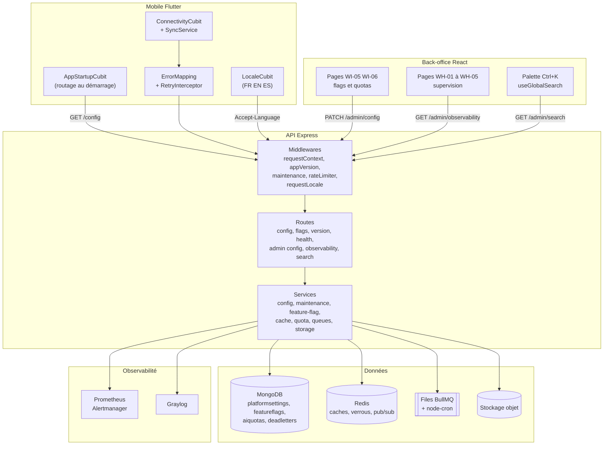
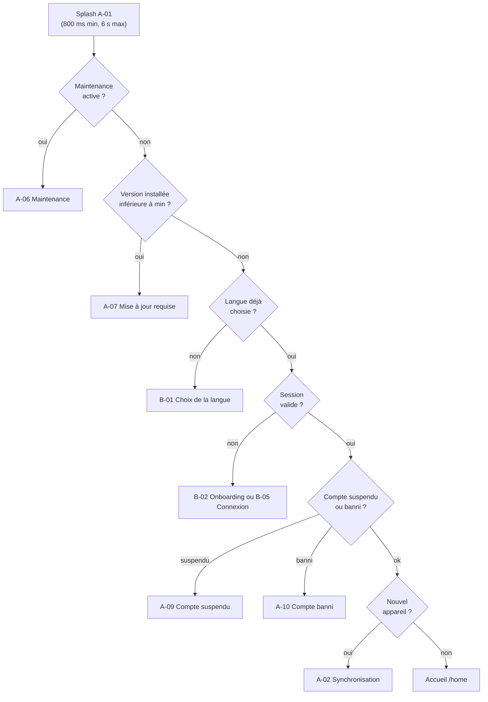
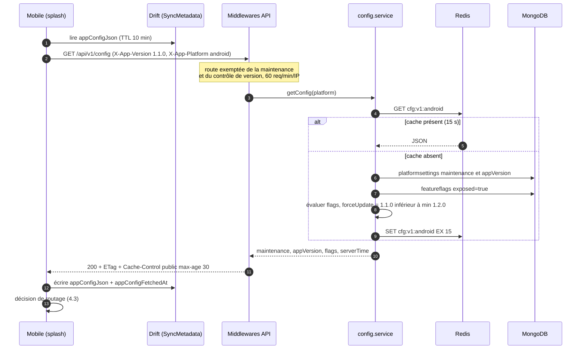
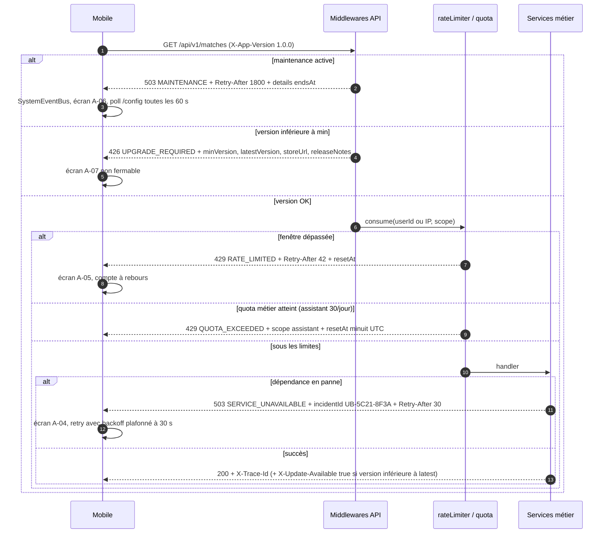
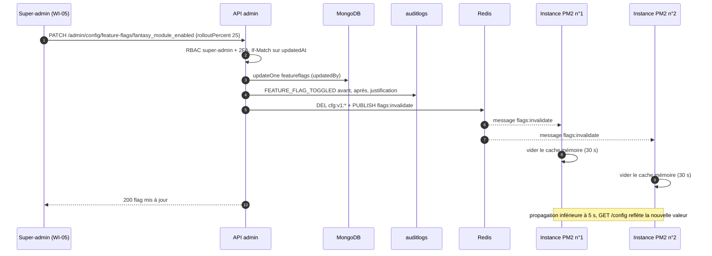
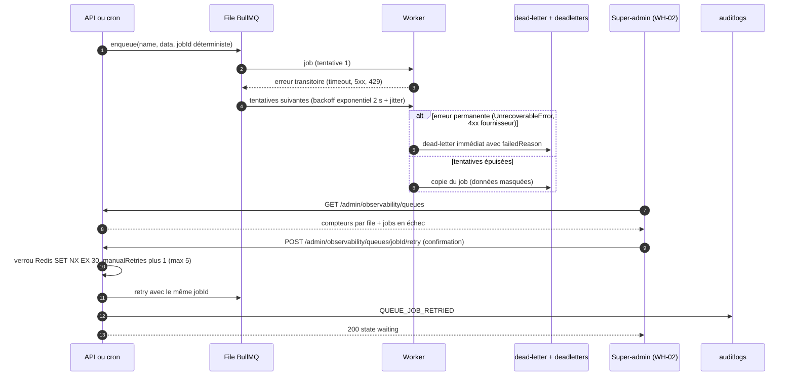
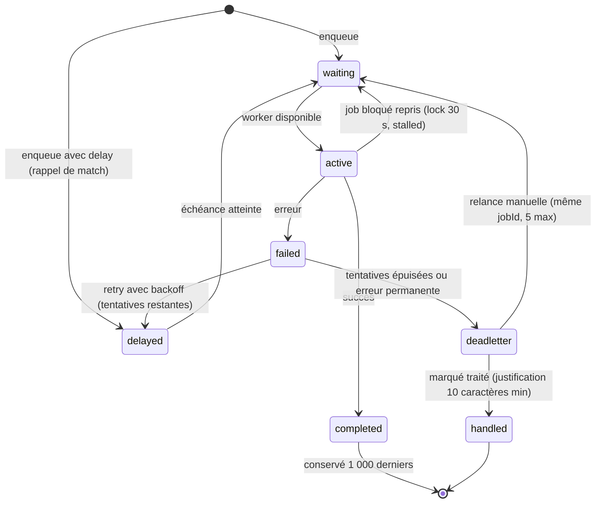
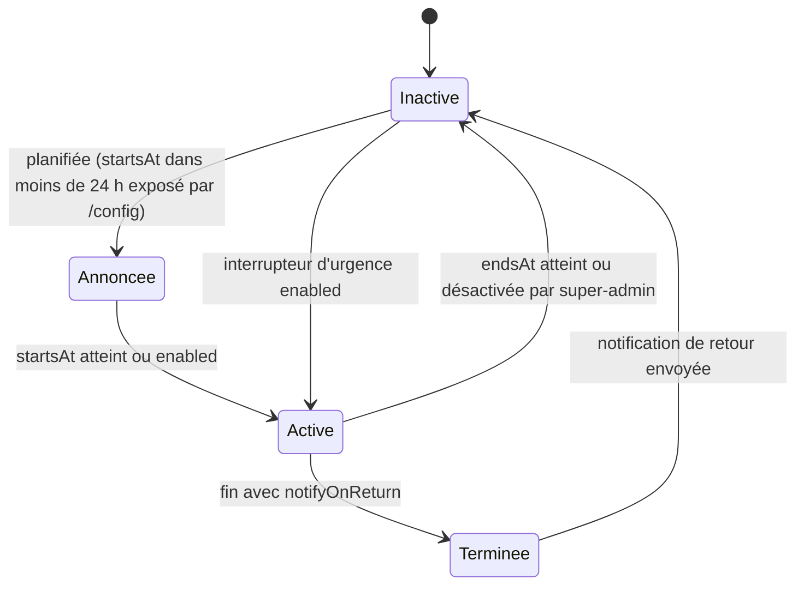
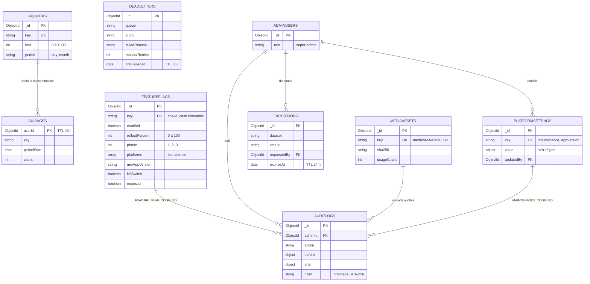
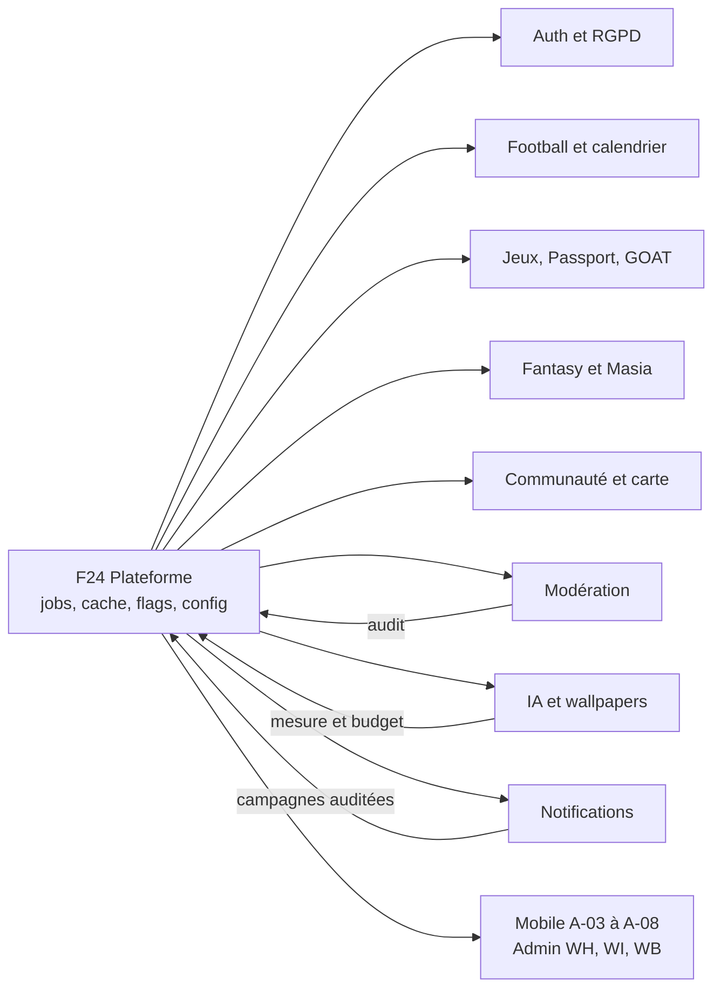

# F24 — Plateforme transverse : jobs, cache, feature flags, configuration

> **En une phrase.** Ce qui permet à *toutes* les autres fonctionnalités de tenir en production : les traitements en arrière-plan (files **BullMQ** et tâches **cron**), les **caches Redis**, les **feature flags**, la **configuration distante** (maintenance, version minimale), la **recherche globale** du back-office, les **uploads** de fichiers et l'**internationalisation des contenus** (FR / EN / ES).

## Sommaire

1. [Résumé et fiche](#1-résumé-et-fiche)
2. [Acteurs et user stories](#2-acteurs-et-user-stories)
3. [Architecture de la fonctionnalité](#3-architecture-de-la-fonctionnalité)
4. [Écrans et navigation](#4-écrans-et-navigation)
5. [Flux détaillés](#5-flux-détaillés)
6. [Contrats d'API](#6-contrats-dapi)
7. [Modèle de données](#7-modèle-de-données)
8. [Traitements asynchrones et cache](#8-traitements-asynchrones-et-cache)
9. [Règles de gestion](#9-règles-de-gestion)
10. [Sécurité, RGPD et anti-abus](#10-sécurité-rgpd-et-anti-abus)
11. [Erreurs et états dégradés](#11-erreurs-et-états-dégradés)
12. [Connexions avec les autres fonctionnalités](#12-connexions-avec-les-autres-fonctionnalités)
13. [Observabilité et tests](#13-observabilité-et-tests)
14. [Points ouverts et décisions à confirmer](#14-points-ouverts-et-décisions-à-confirmer)
15. [Pour aller plus loin](#15-pour-aller-plus-loin)

---

## 1. Résumé et fiche

### Valeur utilisateur

Un supporter ne voit jamais cette fonctionnalité *directement*, mais il la **ressent** : l'app démarre vite parce que la configuration et les contenus sont **en cache** ; elle l'informe clairement (« Maintenance en cours, retour vers 23:30 », « Nouvelle version disponible ») au lieu de planter ; un module instable peut être **coupé à distance en quelques secondes** sans republier l'application ; les notifications, les calculs de points et les générations d'images se font **en arrière-plan** sans bloquer l'écran. Côté équipe, c'est ce qui donne au super-admin la **maîtrise** (flags, quotas IA, supervision des files, journal d'audit) et au développeur des **briques communes** (cache, jobs, upload, i18n) au lieu de réinventer chaque mécanisme dans chaque module.

### Fiche

| Élément | Valeur |
| --- | --- |
| **Phase** | Phase 0 (socle) pour `/config`, erreurs, tests, CI ; Phase 1 (MVP) pour maintenance, version minimale, flags, supervision ; Phase 2 pour exports et rapport hebdomadaire |
| **Priorité** | Majoritairement **P0** (config, maintenance, version minimale, 5xx, 429, flags, cache standard, sauvegardes) ; **P1** (supervision, observabilité, circuit breakers, rétention, dead-letter) ; **P2** (exports, rafraîchissement auto) |
| **Épopées backlog (API)** | `API-PLAT` (55 issues, `API-PLAT-01` à `API-PLAT-55`), avec contributions de `API-AUTH-02` (worker e-mail), `API-AUTH-31` (avatar), `API-FOOT-05` (médiathèque), `API-FOOT-08` (négociation de langue), `API-FOOT-48` (recherche admin), `API-FOOT-55` (traduction), `API-COMM-18` (uploads), `API-IA-03/04` (quotas et mesure IA), `API-MODER-24` (recherche) |
| **Épopées backlog (mobile)** | `MOB-A` (états système `MOB-A-03` à `MOB-A-10`, `MOB-A-17`, `MOB-A-18`), `MOB-FND-20` à `MOB-FND-24` (cache, connectivité, file d'actions, i18n) |
| **Épopées backlog (admin)** | `ADM-WH` (supervision), `ADM-WI` (configuration : flags, quotas, rapports), `ADM-WB-11`/`ADM-WB-12` (recherche globale Ctrl+K), `ADM-FND-16` (socle d'upload), `ADM-WE-10`/`ADM-WE-11`/`ADM-WE-12` (médiathèque) |
| **Écrans** | Mobile : A-03 à A-08 (états système). Admin : WH-01 à WH-05, WI-05, WI-06, WI-09, WB-06 (recherche), WE (médiathèque) |
| **Dépôts concernés** | `univers_barca_api` (cœur), `univers_barca_mobile`, `univers_barca_admin` |
| **Stack** | Express 4 + TypeScript, MongoDB (Mongoose), Redis (ioredis, BullMQ, rate-limit-redis), node-cron, PM2, Prometheus / Grafana / Alertmanager, OpenTelemetry, Graylog |

> **Où en est le code ?** Aujourd'hui l'API contient : la **maintenance par variable d'environnement** (`MAINTENANCE_MODE`, middleware qui répond 503 sauf `/health`), les **sondes** `/health`, `/api/health`, `/health/deep`, `/metrics` (réservé aux IP autorisées), les **limiteurs** global/auth/sensible (`rate-limit-redis`), les **files BullMQ** (6 files, sans worker métier), le **scheduler** (2 tâches cron), le magasin clé/valeur Redis avec repli mémoire (hors production) et le modèle `FeatureFlag` (sans logique d'évaluation). Le reste de ce document décrit la **cible** du backlog ; les écarts sont signalés.

---

## 2. Acteurs et user stories

| Acteur | Besoin | User story | Critères d'acceptation clés |
| --- | --- | --- | --- |
| **Supporter** (mobile) | Savoir quand l'app est indisponible | *En tant que supporter, je veux voir l'heure de retour de la maintenance, afin de ne pas croire que l'app est cassée.* (A-06) | `GET /config` répond **200** (jamais 503) avec `maintenance.active=true` et `endsAt` ; toute autre route répond 503 `MAINTENANCE` + `Retry-After` ; l'écran affiche « Retour prévu aujourd'hui vers 23:30 » |
| **Supporter** | Être forcé de mettre à jour quand nécessaire | *En tant que supporter avec une vieille version, je veux comprendre pourquoi je dois mettre à jour.* (A-07) | `X-App-Version=1.0.0` et `min=1.2.0` → `forceUpdate=true` / **426** `UPGRADE_REQUIRED` ; 3 nouveautés localisées ; bouton vers le store |
| **Supporter** | Ne pas être bloqué sans explication | *En tant que supporter, je veux un compte à rebours quand je dépasse une limite.* (A-05) | 429 avec `Retry-After` entier ≥ 1 ; distinction `RATE_LIMITED` (fenêtre) / `QUOTA_EXCEEDED` (quota journalier) |
| **Supporter** | Savoir qu'un incident est côté serveur | *…je veux un code d'incident à communiquer au support.* (A-04) | Corps 5xx avec `details.incidentId` « UB-5C21-8F3A » et en-tête `X-Trace-Id`, jamais de stack |
| **Supporter** | Utiliser l'app dans sa langue | *…je veux les contenus en FR, EN ou ES.* | Ordre `?lang=` > `Accept-Language` > profil > `fr` ; repli signalé `localeFallback:true` |
| **Super-admin** | Couper ou ouvrir un module sans déployer | *En tant que super-admin, je veux activer Fantasy à 25 % puis 100 %, ou le couper en urgence.* (WI-05) | Évaluation déterministe par utilisateur ; propagation **< 5 s** sur toutes les instances ; audit `FEATURE_FLAG_TOGGLED` avec avant/après |
| **Super-admin** | Maîtriser le coût de l'IA | *…je veux plafonner messages et générations par utilisateur.* (WI-06) | Entier 0–1000 ; 0 = fonction coupée ; effet immédiat ; audit `AI_QUOTA_CHANGED` |
| **Super-admin** | Superviser et réparer | *…je veux voir les files BullMQ et relancer un job en échec.* (WH-02) | Compteurs par file ; relance idempotente (verrou 30 s), 5 relances manuelles max ; audit `QUEUE_JOB_RETRIED` |
| **Tout admin** | Naviguer vite | *…je veux chercher joueur, match, utilisateur, groupe avec Ctrl+K.* (WB-06) | ≥ 2 caractères, 5 résultats max/catégorie, résultats filtrés par rôle, p95 < 200 ms |
| **Content-manager** | Gérer les médias et traductions | *…je veux téléverser des images et voir ce qui manque en EN/ES.* | JPEG/PNG/WebP, validation par signature binaire, suppression refusée si média utilisé ; file « à traduire » |
| **Équipe technique** | Fiabilité et reprise | *…je veux des sauvegardes testées et des jobs rejouables sans doublon.* | `jobId` déterministe ; restauration trimestrielle automatisée (RPO 24 h, RTO 2 h) |

---

## 3. Architecture de la fonctionnalité



**Légende.** Les trois blocs du haut sont les clients ; **tout passe par les mêmes middlewares** (identifiant de trace, contrôle de version, maintenance, limitation de débit, langue). Les *services* de la plateforme sont les briques réutilisées par les autres modules : `cache.service` (cache-aside), `quota.service` (limites métier), `feature-flag.service`, `queues.service` (état et relance des files), `storage.service` (objet). Redis porte à la fois les caches, les verrous et le **pub/sub d'invalidation** entre les instances PM2.

**Ordre des middlewares (cible).** Aujourd'hui (`src/app.ts`) : `requestContext` → `helmet` → `cors` → `compression` → **sondes** (`/health`, `/health/deep`, `/metrics`) → `maintenance` → `globalLimiter` → `json` (1 Mo) → sanitisation NoSQL → `hpp` → `/api/v1`. Le backlog ajoute `appVersion` (426) **après** `requestContext` et **avant** les routes métier, et impose que `GET /config`, `/version`, `/health*`, `/metrics` et `/auth/logout` soient **exemptés** de la maintenance et du contrôle de version (sinon un client trop ancien ne pourrait jamais apprendre qu'il doit se mettre à jour).

---

## 4. Écrans et navigation

### 4.1 Écrans

| Code | Nom | Rôle |
| --- | --- | --- |
| **A-03** | Hors-ligne | Bannière persistante « Hors-ligne · derniers contenus synchronisés il y a 12 min » + écran « Pas de connexion » si la page n'est pas en cache |
| **A-04** | Erreur serveur 5xx | « Petit souci de notre côté… » + **code d'incident** `UB-5C21-8F3A` |
| **A-05** | Trop de requêtes 429 | « Doucement, champion ! » + compte à rebours (00:42) |
| **A-06** | Maintenance planifiée | « Maintenance en cours », heure de retour, invitation à activer les notifications |
| **A-07** | Mise à jour requise | « Nouvelle version disponible », 3 nouveautés, bouton « Mettre à jour » |
| **A-08** | Session expirée | Reconnexion (401 `TOKEN_EXPIRED` / `SESSION_REVOKED`, détaillé dans `API-AUTH`) |
| **WI-05** | Feature flags | Interrupteur et pourcentage de déploiement par module |
| **WI-06** | Quotas IA | Plafonds par utilisateur et budgets mensuels |
| **WI-09** | Exports et rapports | Exports CSV/Excel asynchrones, rapport hebdomadaire |
| **WH-01** | Santé technique | Statut agrégé, latences p50/p95/p99, taux 5xx, alertes actives |
| **WH-02** | Files d'attente BullMQ | Compteurs par file, jobs en échec (dead letter), relance |
| **WH-03** | Explorateur de logs | Recherche Graylog masquée, conservation 90 jours |
| **WH-04** | Consommation IA | Budgets texte/image, projection de dépassement |
| **WH-05** | Journal d'audit | Piste immuable filtrable, export CSV |
| **WB-06** | Recherche globale (Ctrl+K) | Palette de résultats groupés |

### 4.2 Captures


*À gauche : l'écran de maintenance annonce l'heure de retour (23:30) et propose de suivre le statut ; puis l'écran de mise à jour obligatoire liste les nouveautés de la version 1.2.0. À droite : la supervision des files affiche les compteurs par file et les jobs en échec avec « Relancer » / « Marquer traité » ; les feature flags montrent l'interrupteur et le pourcentage de déploiement de chaque module (Fantasy 100 %, Masia 0 %).*

### 4.3 Navigation au démarrage

Le mobile décide en quelques centaines de millisecondes où envoyer l'utilisateur (`MOB-A-01`). **Le premier cas qui s'applique gagne** :



Hors des cas de démarrage, **n'importe quel appel** peut rediriger vers un écran système : 503 `MAINTENANCE` → A-06 ; 426 → A-07 ; 429 → A-05 ; 5xx → A-04 ; 401 → A-08 ; réseau coupé → A-03. Ces redirections passent par un `SystemEventBus` écouté par `AppStartupCubit` (`MOB-A-05`). Au retour au premier plan après plus de 30 min, la configuration est réévaluée (`didChangeAppLifecycleState(resumed)`).

---

## 5. Flux détaillés

### 5.1 Démarrage : configuration, maintenance et version minimale (nominal)



**Pas à pas.**

1. Le mobile lit sa **dernière configuration valide** en base locale : s'il n'y a pas de réseau, on s'en sert plutôt que de bloquer à tort (`MOB-A-08`).
2. L'appel est **public** (pas de jeton) et porte la version installée et la plateforme.
3. Ces en-têtes permettent à l'API de calculer `forceUpdate` et les flags **par plateforme et version**.
4-5. L'API lit d'abord un cache Redis de **15 s** (`cfg:v1:<platform>`) ; **sans Redis**, elle calcule en mémoire : `/config` ne doit **jamais** échouer pour une panne Redis.
6-8. Sur cache absent, elle agrège **maintenance**, **version minimale** et **flags exposés**, puis met en cache.
10. La réponse est légère (< 2 Ko), avec **ETag** : si le client renvoie `If-None-Match`, il reçoit **304** sans corps.
11-12. Le mobile persiste et route (diagramme 4.3). Budget : p95 < 50 ms côté serveur, k6 p95 < 150 ms.

### 5.2 États dégradés : maintenance, version trop ancienne, limite atteinte (erreurs et cas limites)



**Points d'attention.**

* **`Retry-After` est la seule vérité du compte à rebours** : le mobile ne devine rien. Pour la maintenance c'est le nombre de secondes jusqu'à `endsAt` (à défaut 300) ; pour un quota journalier, jusqu'à minuit UTC (fuseau de référence).
* **Deux 429 distincts** : `RATE_LIMITED` (trop de requêtes dans une fenêtre) et `QUOTA_EXCEEDED` (quota quotidien métier : assistant, wallpapers, quiz IA). Le mobile n'affiche pas le même message.
* **Une mise à jour recommandée** (version ≥ min mais < latest) **ne bloque pas** : l'API ajoute seulement l'en-tête `X-Update-Available: true`.
* **Les 5xx ne divulguent rien** : `incidentId` dérivé du `traceId` (préfixe `UB-` + 4 + 4 hex), jamais de stack ni de message d'exception en production.

### 5.3 Changer un feature flag : propagation immédiate



**Évaluation déterministe.** Un utilisateur voit le module si `enabled && bucket(userId, key) < rolloutPercent`, avec `bucket = FNV-1a(userId + ':' + key) % 100`. Conséquence : à **25 %**, c'est **toujours les mêmes 25 %** d'utilisateurs (pas de clignotement d'un lancement à l'autre) ; passer à 50 % **ajoute** des utilisateurs sans en retirer. Le `killSwitch=true` force `false` **sans toucher au pourcentage** (utile pour couper un module si le budget IA est dépassé). Un utilisateur non connecté est évalué sur l'identifiant d'installation `X-Device-Id`.

### 5.4 Job en échec : dead-letter et relance manuelle



**Cycle de vie d'un job BullMQ.**



**Fenêtre de maintenance (état de l'entité `platform_settings.maintenance`).**



---

## 6. Contrats d'API

Base : `/api/v1`. Réponses `{ success, data }` ; erreurs `{ success:false, error:{ code, message, details, traceId } }`. Tous les codes applicatifs sont des constantes de `src/utils/errorCodes.ts` (cible `API-PLAT-07`) et documentés dans `docs/ERROR_CODES.md`.

### 6.1 Système (public)

| Méthode | Chemin | Auth / rôle | Rate limit | Requête | Réponse | Erreurs |
| --- | --- | --- | --- | --- | --- | --- |
| GET | `/config` | Publique | 60/min/IP | En-têtes `X-App-Version` (SemVer `^\d+\.\d+\.\d+(\+\d+)?$`), `X-App-Platform` (`ios`/`android`), `If-None-Match` | `maintenance{active,startsAt,endsAt,message}`, `appVersion{min,latest,forceUpdate,storeUrl}`, `flags{key:bool}`, `serverTime`, `apiVersion` ; **< 2 Ko** | 400 `VALIDATION_ERROR` (en-tête invalide), 304 |
| GET | `/config/flags` | JWT **optionnel** | — | `Authorization` (optionnel), `X-Device-Id` | `{ flags:{ key:boolean } }` (clés `exposed=true` seulement) ; `Cache-Control: private, max-age=60`, ETag | — |
| GET | `/version` | Publique | — | — | `version`, `build` (`AAAAMMJJ.N`), `commit` (7 car.), `builtAt`, `openapi`, `environment` ; `max-age=60` | — |
| GET | `/health` (aussi `/api/health`) | Publique | hors limiteur | — | `status`, `uptime`, `version` | — |
| GET | `/health/deep` | Publique | hors limiteur | — | `status` (`ok`/`degraded`), `checks{mongo,redis}` (+ `ai`, `providers` en cible) | 503 si indisponible |
| GET | `/metrics` | IP autorisées (`METRICS_ALLOWED_IPS`) + jeton `METRICS_TOKEN` optionnel | — | — | format Prometheus | 403 |
| GET | `/legal/documents` | Publique | — | — | versions CGU/confidentialité/charte | — |

```json
{
  "success": true,
  "data": {
    "maintenance": { "active": false, "startsAt": null, "endsAt": null, "message": null },
    "appVersion": { "min": "1.2.0", "latest": "1.2.0", "forceUpdate": false, "storeUrl": "https://..." },
    "flags": { "fantasy_module_enabled": true, "assistant_streaming_enabled": true },
    "serverTime": "2026-10-15T09:41:00Z",
    "apiVersion": "0.1.0"
  }
}
```

Erreurs système (contrat unique des écrans A-03 à A-08) :

| État | HTTP | `error.code` | En-têtes / `details` |
| --- | --- | --- | --- |
| A-03 Hors-ligne | aucune réponse | — | le mobile s'appuie sur `serverTime`, ETag, Last-Modified |
| A-04 Erreur serveur | 500 / 502 / 503 | `INTERNAL_ERROR`, `BAD_GATEWAY`, `SERVICE_UNAVAILABLE` | `details.incidentId` « UB-5C21-8F3A », `X-Trace-Id`, `Retry-After: 30` (503) |
| A-05 Trop de requêtes | 429 | `RATE_LIMITED`, `QUOTA_EXCEEDED` | `Retry-After`, `RateLimit-*` (draft-7), `details{scope,limit,remaining:0,retryAfterSeconds,resetAt}` |
| A-06 Maintenance | 503 | `MAINTENANCE` | `Retry-After`, `details{startsAt,endsAt}` |
| A-07 Mise à jour | 426 | `UPGRADE_REQUIRED` | `details{minVersion,latestVersion,storeUrl,releaseNotes[]}` |
| A-08 Session expirée | 401 | `TOKEN_EXPIRED`, `SESSION_REVOKED`, `TOKEN_REVOKED` | contrat détaillé dans `API-AUTH` |
| Module coupé | 403/404 | `MODULE_DISABLED` / `FEATURE_DISABLED` | `requireFlag(key)` |
| Timeout applicatif | 503 | `REQUEST_TIMEOUT` | 15 s (hors uploads et exports) |

### 6.2 Administration (super-admin sauf mention)

| Méthode | Chemin | Rôle | Rate limit | Requête | Réponse | Erreurs |
| --- | --- | --- | --- | --- | --- | --- |
| PUT | `/admin/config/maintenance` | super-admin + 2FA | — | `{enabled,startsAt,endsAt,messageI18n{fr,en,es},notifyOnReturn}` (`endsAt > startsAt`, message FR obligatoire) | `{active,endsAt}` | 400, 403 |
| PUT | `/admin/config/app-version` | super-admin | — | `{ios:{min,latest,storeUrl},android:{…},releaseNotesI18n}` (`min ≤ latest`, 3 puces max) | config | 400, 403 |
| GET | `/admin/config/feature-flags` | super-admin | — | — | `items[{key,label,phase,enabled,rolloutPercent}]` | 403 |
| PATCH | `/admin/config/feature-flags/:key` | super-admin + 2FA | 30/min/admin | `{enabled?,rolloutPercent?(0-100),killSwitch?,justification?}` + `If-Match` | flag | 403, **409** (`If-Match` périmé), 422 |
| GET / PATCH | `/admin/config/ai-quotas` | super-admin | — | `{perUser:{assistantMessagesPerDay:40}}` (tout ou rien) | `{…,warnings[]}` | 422 (0–1000) |
| PATCH | `/admin/config/reports` | super-admin | — | `{weeklyReportEnabled}` | — | — |
| GET | `/admin/observability/health` | super-admin | — | `?range=1h\|24h\|7d` | statut agrégé, séries p50/p95/p99, 5xx, disponibilité vs 99,5 %, top routes | `status:'unknown'` si Prometheus injoignable (jamais 500) |
| GET | `/admin/observability/alerts` | super-admin | — | — | alertes actives (≤ 50, critiques d'abord) | — |
| GET | `/admin/observability/queues` | super-admin | — | — | par file : `waiting,active,delayed,failed,completed,paused,oldestWaitingAgeSeconds,throughputPerMin` | — |
| GET | `/admin/observability/queues/:name/jobs` | super-admin | — | `?state=failed&cursor=` (20/page) | jobs avec données **masquées** | — |
| POST | `/admin/observability/queues/:jobId/retry` | super-admin + 2FA | 10/min/admin | `?queue=notifications` | `{jobId,manualRetries,state}` | 409 `JOB_NOT_FAILED`, 409 `RETRY_LIMIT_REACHED` |
| POST | `/admin/observability/queues/:jobId/dismiss` (« handled » côté admin) | super-admin | — | justification ≥ 10 car. | — | écart de chemin, voir §14 |
| POST | `/admin/observability/dead-letter/replay` | super-admin + 2FA | — | `{queue,reason,max:100}` | rejeu limité à 10 jobs/s | audit |
| GET | `/admin/observability/logs` | super-admin | — | `?service&level&from&to&traceId&q&limit=50` (plage ≤ 7 j, rétention 90 j) | logs **masqués** + lien Graylog | 422 (plage hors rétention) |
| GET | `/admin/observability/ai-usage` | super-admin | — | `?period=day\|week\|month` | usage vs budget, projection, top 10 anonymisés | — |
| GET | `/admin/observability/backups` | super-admin | — | — | dernière sauvegarde, taille | — |
| GET | `/admin/audit-logs` (+ `/export.csv`) | super-admin | — | filtres + curseur ; export ≤ **50 000** lignes, UTF-8 BOM, séparateur `;`, anti-formule | journal | l'export est lui-même audité |
| POST / GET | `/admin/exports`, `/admin/exports/:id` | selon dataset | — | `{dataset:players\|users\|reports,format:csv\|xlsx,filters}` | 202 `{exportId}` ; URL signée 15 min ; fichier supprimé à 24 h | droits par dataset |
| GET | `/admin/search` | tout admin (filtré par rôle) | 60/min | `?q=ped&types=players,users,matches,groups&limit=5` (≥ 2 car.) | groupes ≤ 5 résultats chacun | 422 |
| GET | `/admin/search/all` | tout admin | 60/min | `?type=&q=&cursor=` | liste paginée | — |

### 6.3 Uploads

| Méthode | Chemin | Auth | Limites | Réponse |
| --- | --- | --- | --- | --- |
| PUT / DELETE | `/users/me/avatar` | utilisateur | multipart, JPEG/PNG/WebP, **2 Mo**, 128–4096 px, 5/heure | `{avatarUrl}` ; erreurs 413 `FILE_TOO_LARGE`, 415 `UNSUPPORTED_MEDIA_TYPE`, 422 `IMAGE_TOO_SMALL` |
| POST | `/community/uploads` | utilisateur | multipart, **5 Mo**, ≤ 4096×4096, 20/jour | `{imageKey}` |
| POST | `/admin/media` | content-manager+ | 1 fichier par requête, JPEG/PNG/WebP, 2 Mo (5 Mo proposé par l'admin : à confirmer), pas de SVG | média + variantes |

---

## 7. Modèle de données

### 7.1 Collections de la plateforme



| Collection | Statut | Index / TTL | Rôle |
| --- | --- | --- | --- |
| `featureflags` | **existant**, à durcir (`API-PLAT-08`) | `key` unique | Flags, déploiement progressif, kill switch |
| `aiquotas` | **existant**, à étendre (`API-IA-03`, `API-PLAT-11`) | `key` unique | Limites IA configurables |
| `platformsettings` | à créer (`API-PLAT-03/04`) | `key` unique | `maintenance` : `{enabled, startsAt, endsAt, messageI18n, notifyOnReturn}` ; `appVersion` : `{ios{min,latest,storeUrl}, android{…}, releaseNotesI18n}` |
| `aiusages` | à créer | unique `{userId,key,periodStart}`, TTL 40 j | Consommation atomique par jour |
| `deadletters` | à créer (`API-PLAT-53`) | TTL 30 j | Échecs définitifs |
| `exportjobs` | à créer (`API-PLAT-20`) | TTL 24 h | Exports admin |
| `mediaassets` | à créer (`API-FOOT-05`) | `key` unique | Médiathèque |
| `auditlogs` | **existant**, durci (`API-PLAT-18`) | `{entityType,entityId,createdAt:-1}` etc. ; **aucun TTL** | Piste immuable |
| `aicalllogs`, `aiusagedailies` | à créer (`API-IA-04`, `API-PLAT-17`) | TTL 400 j / 24 mois | Mesure et budget IA |

### 7.2 Clés Redis de la plateforme

| Clé / canal | TTL | Rôle |
| --- | --- | --- |
| `cfg:v1:<platform>` | 15 s | Réponse de `/config` |
| `flags:invalidate` (pub/sub) | — | Invalidation inter-instances < 5 s |
| `cache:v1:<domaine>:<hash>` + `cache:tag:<tag>` | par domaine ±10 % | Cache-aside standard + étiquettes |
| verrou `SET NX PX 5000` | 5 s | Anti-stampede |
| `ai:quota:limit:<key>` | 60 s | Limite IA configurée |
| `rl:<nom>:*` | fenêtre | Limiteurs de débit |
| `jwt:bl:<jti>` | ≤ 15 min | Blacklist d'access token |
| verrou relance de job | 30 s | Idempotence de la relance manuelle |
| clé de leader du scheduler | 30 s | Un seul ordonnanceur |
| `ub_*` (métriques) | — | exposées par `/metrics`, pas dans Redis |

### 7.3 Migrations concernées

`*-seed-feature-flags` (4 flags désactivés : `fantasy_module_enabled`, `academy_module_enabled`, `wallpapers_module_enabled`, `assistant_streaming_enabled`) ; création de `platform_settings` ; seed des quotas par défaut ; index TTL manquants (`API-PLAT-52`) ; rôle MongoDB applicatif **sans droit `remove`** sur `auditlogs` (`docs/mongo-init`).

---

## 8. Traitements asynchrones et cache

### 8.1 Files BullMQ

**Principe.** Tout traitement long, planifié ou dépendant d'un service externe passe par une file, jamais dans la requête HTTP (CDC Backend §7). **Une file par domaine**, des jobs nommés, des *processors* idempotents.

| File | Jobs principaux | Tentatives (cible) | Concurrence | Notes |
| --- | --- | --- | --- | --- |
| `email` | `send` (`jobId` = `dedupeKey`) | 5, backoff 2 s | 5 ; 20 jobs/s | Jetons en clair dans le payload : `removeOnComplete: true`, `removeOnFail` 7 j |
| `notifications` | `match-reminder`, `campaign-send`, push | 5 | lots de **500** ; 3 000 msg/s | Flow BullMQ si > 100 000 destinataires |
| `football-sync` | `sync-live`, `sync-fixtures`, `refresh-calendar-feed` | **3**, délai 30 s | 2 | Quota API football |
| `ai-generation` | `generate-wallpaper`, `summarize-conversation` | **2** | 2–3 ; 20 images/min | Coûteux |
| `rgpd` | `export-user-data`, `purge-user`, `cleanup-exports` | **8** sur 24 h | — | Jamais de purge « à moitié » silencieuse |
| `exports` | `export` | 2 | 1 | Streaming, 100 000 lignes max |
| `dead-letter` | — | — | — | Document `deadletters`, rétention 30 j |

Réglages communs **réels** (`src/jobs/queues.ts`) : 5 tentatives, backoff exponentiel 2 s, `removeOnComplete: 1000`, `removeOnFail: 5000`, copie en `dead-letter` à l'échec définitif, métrique `ub_jobs_failed_total{queue}`. **Politique cible** (`API-PLAT-53`) : classification des erreurs — **permanentes** (`UnrecoverableError` : validation, 4xx fournisseur) = zéro retry ; **transitoires** (timeout, 5xx, 429) = retry avec backoff + jitter.

**Idempotence.** Le `jobId` déterministe est la clé : `sync-live:{matchId}`, `match-reminder:{matchId}:{icsSequence}`, `campaign:{id}`, `compute:{season}:{number}:{statsVersion}`, `daily-challenge:{date}`… Ré-enfiler un job existant est un **no-op**. Exemples de verrous complémentaires : `fantasy:lock:compute:*` (10 min), `lock:community:aggregates` (9 min), verrou de relance (30 s).

**Processus worker dédié (cible `API-PLAT-35`).** `src/worker.ts` démarre les workers et le scheduler ; l'API ne lance plus le cron. Arrêt gracieux : `/health/ready` répond 503 dès `SIGTERM`, attente des requêtes (25 s) puis des jobs actifs (60 s) ; `stopGracePeriod` Docker 70 s ; un job interrompu est repris (lock BullMQ 30 s). **Un seul scheduler** même avec plusieurs réplicas : élection par verrou Redis (TTL 30 s). *Aujourd'hui* : le cron n'est démarré que sur l'instance PM2 0 (`NODE_APP_INSTANCE === '0'`, `RUN_CRON !== 'false'`).

### 8.2 Tâches planifiées (node-cron) de la plateforme

| Cron | Fuseau | Tâche | Statut |
| --- | --- | --- | --- |
| `0 3 * * *` | Europe/Madrid | Purge RGPD J+30 | **existant** (sans cascade) |
| `30 3 * * *` | — | Purge des refresh tokens révoqués | **existant** (30 j, cible 90 j) |
| `30 3 * * *` | UTC | `retention-purge` (lots de 1 000, simulation, abandon si > 20 %) | à créer |
| `0 2 * * *` | UTC | `database-backup` (+ avant chaque déploiement prod) | à créer |
| `0 6 * * *` | — | `ai-budget-check` : projection de dépassement | à créer |
| lundi `0 8 * * 1` | Europe/Paris | `weekly-report` e-mail super-admin | à créer |
| hebdomadaire | — | `audit:verify` (chaîne de hachage) | à créer |
| mensuel (workflow CI) | — | Test de restauration (`restore-drill`) | à créer |

### 8.3 Cache Redis (cache-aside standard)

**Principe.** Un service commun `cache.service` (`API-PLAT-32`) évite que chaque module réinvente son cache : `getOrSet(key, ttl, loader, {tags})`, `invalidateTag`, `invalidateKey`. Les clés sont `cache:v1:<domaine>:<hash>` ; les TTL par défaut sont centralisés dans `src/config/cache-ttl.ts` avec **jitter ±10 %** (pour que des milliers de clés n'expirent pas à la même seconde). Valeurs JSON **compressées au-delà de 1 Ko**.

| Donnée | TTL | Invalidation |
| --- | --- | --- |
| Configuration publique (`/config`) | 15 s (client : `max-age=30`) | écriture admin (maintenance, version, flag) |
| Flags (mémoire) | 30 s | pub/sub `flags:invalidate` |
| Calendrier des matchs | 15 min (900 s) | changement d'horaire détecté |
| Prochain match | 5 min | fin de match |
| Fiche joueur | 1 h | publication éditoriale |
| Match | 24 h (terminé) / 15 s (live) | fin de match |
| Snapshot live | 120 s | écrasé à chaque synchro |
| Anecdote du jour | 1 h | publication |
| Agrégats de la carte | 10 min | recalcul par job |
| Comparateur GOAT | 1 h | vote significatif ou stats |
| Réponses FAQ de l'assistant | 1 h (CDC : 24 h) | mise à jour des données sources |
| Barème Fantasy actif | 1 h | nouvelle version |
| Classements Fantasy monde/journée | 120 s | fin de calcul |
| Liste des joueurs filtrée (Fantasy) | 60 s | — |

*(Détail complet : `02-architecture-donnees.md` §9.)*

**Anti-stampede.** Quand un cache populaire expire, des milliers de requêtes pourraient toutes aller recalculer en base. Parade : **un seul** chargement (verrou `SET NX PX 5000`) pendant que les autres reçoivent la valeur périmée (**stale-while-revalidate 30 s**).

**Mode dégradé.** Redis indisponible : **lecture directe en base**, jamais d'erreur 5xx ; après 3 échecs, un circuit court (30 s) évite de marteler Redis. Les classements retombent sur une agrégation Mongo limitée à 100 lignes. Sans `REDIS_URL` en développement, un **magasin mémoire** remplace Redis ; en production `REDIS_URL` est **obligatoire**.

**Règles d'or.** (1) Jamais de donnée personnelle dans une clé partagée (clés par utilisateur : préfixe `user:` avec TTL ≤ 5 min). (2) Jamais de cache d'une **solution** de jeu ou d'une donnée sensible. (3) Toute clé doit être **reconstructible** : Redis n'est pas sauvegardé.

### 8.4 Recherche globale (back-office)

`GET /admin/search?q=` exécute **quatre recherches en parallèle** (`Promise.allSettled`) : joueurs, matchs, utilisateurs, groupes ; 5 résultats maximum par catégorie ; filtrage **serveur** par rôle (content-manager → joueurs + matchs ; moderator → utilisateurs + groupes (+ joueurs) ; super-admin → tout). Requête normalisée (trim, insensible casse et accents) ; recherche préfixe/regex sur `searchName` (joueurs), `displayName`/e-mail (utilisateurs), `name` (groupes) ; e-mails **masqués** (`j***@gmail.com`) pour les non super-admin. Côté client : debounce **300 ms**, `staleTime` 30 s, annulation de la requête précédente, palette Radix accessible (`aria-activedescendant`). Cache serveur court (15 s). *Hors admin*, les recherches spécialisées du produit (autocomplétion Guess `GET /guess-the-player/players/search`, carte `GET /community/map/search`, groupes `GET /community/groups/search`) suivent le même principe : index dédiés, cache Redis 5 min, limites de longueur de requête.

### 8.5 Internationalisation des contenus (FR / EN / ES)

| Sujet | Règle |
| --- | --- |
| **Stockage** | Champs `{ fr, en, es }` (`i18nField`) : `bioI18n`, `titleI18n`, `questionI18n`, `labelI18n`, `contextI18n`, `messageI18n`… |
| **Langue obligatoire** | **Français** ; EN/ES requis **avant publication** (statut `awaiting-translation`, champ dérivé `missingLocales[]`) |
| **Négociation (API)** | `?lang=` > `Accept-Language` > `locale` du profil > `fr` ; autre valeur → `fr` ; si la langue demandée est vide : repli `fr` + `localeFallback:true` + `Content-Language` + `Vary: Accept-Language` ; le public ne reçoit que la langue résolue, l'admin les trois |
| **Workflow éditorial** | File « à traduire » `GET /admin/translations/pending` (joueurs, anecdotes) avec compteurs par langue ; PATCH d'une seule langue ; **aucune traduction automatique implicite** ; audit `CONTENT_TRANSLATED` |
| **Messages système** | Messages d'erreur et textes 5xx/429/maintenance localisés (clés dans `src/i18n`, dossier **vide aujourd'hui**) ; e-mails Handlebars + MJML par langue (`src/templates/locales/{fr,en,es}.json`, repli `fr`) |
| **Mobile** | Fichiers ARB (`app_fr.arb` modèle, `app_en.arb`, `app_es.arb`), contrôle CI de parité des clés ; `LocaleCubit` : langue système à la 1re ouverture, bascule persistée localement **et** par `PATCH /users/me {locale}` ; le changement de langue **invalide les caches localisés** |
| **Admin** | Interface **en français uniquement** (catalogue de textes figé) ; édition des contenus en 3 langues |
| **Nombres et dates** | UTC côté serveur ; affichage dans le fuseau de l'utilisateur ; formats via `intl` (mobile) |

### 8.6 Uploads : les règles communes

Cinq flux d'upload existent (avatar, image de groupe/post, médiathèque, wallpaper généré, import CSV admin). **Règles transverses** (détail stockage : `02-architecture-donnees.md` §11) :

1. Le type est contrôlé par **signature binaire** (*magic bytes*), jamais par `Content-Type` ni extension ; **SVG refusé** (script embarqué), GIF animé refusé.
2. L'image est **ré-encodée** (`sharp`) : EXIF/GPS supprimés, WebP, redimensionnement serveur (avatar 512 et 128 ; groupes ≤ 1 600 px ; vignette/carte/plein écran en médiathèque).
3. Le nom d'origine n'est **jamais** utilisé dans la clé d'objet (UUID ou hash).
4. Limites de poids : 2 Mo (avatar, médiathèque), 5 Mo (images de groupe) ; quotas par utilisateur (5/h avatar, 20/jour groupes).
5. En base, seule la **clé** est stockée ; l'URL est construite (ou signée) à la réponse.
6. Un fichier **non rattaché** sous 24 h est purgé ; une image **masquée par la modération** n'est plus servie.
7. Côté admin, un socle unique (`ADM-FND-16` : `useDropzone`, validateurs, `useUploadQueue` à concurrence 3, empreinte SHA-256 par blocs de 4 Mo pour détecter les doublons) est partagé par la médiathèque, la photo de joueur et l'import CSV.

---

## 9. Règles de gestion

**Configuration, maintenance et version**

1. `GET /config` est **public**, exempté de la maintenance et du contrôle de version ; réponse < 2 Ko ; `Cache-Control: public, max-age=30` + ETag ; cache Redis 15 s ; p95 < 50 ms (objectif global p95 < 300 ms).
2. Le mobile envoie `X-App-Version` (SemVer) et `X-App-Platform` (`ios`/`android`) sur **toutes** ses requêtes ; l'absence d'en-tête = client web/admin, **non contrôlé**.
3. La maintenance est active si `enabled` **ou** `startsAt ≤ now < endsAt`. Elle est annoncée par `/config` jusqu'à **24 h** avant la fenêtre.
4. Pendant la maintenance : **503** `MAINTENANCE` + `Retry-After` (secondes jusqu'à `endsAt`, sinon 300). Exemptions : `/health*`, `/config`, `/version`, `/metrics` et les routes `/admin/*` d'un super-admin authentifié.
5. La variable `MAINTENANCE_MODE=true` reste un **interrupteur d'urgence prioritaire** (utilisé par la procédure de restauration).
6. Comparaison de versions **SemVer stricte** (pas lexicographique) ; métadonnée de build ignorée. `< min` → **426** `UPGRADE_REQUIRED` ; `≥ min` et `< latest` → en-tête `X-Update-Available: true`.
7. La version minimale n'est relevée qu'après **≥ 90 %** du parc à jour (CDC Global §3.8) ; chaque changement est audité (`APP_MIN_VERSION_CHANGED`).
8. Toute (dés)activation de maintenance est auditée (`MAINTENANCE_TOGGLED`) ; l'endpoint exige `endsAt > startsAt` et un message FR.
9. Les migrations de base destructives se font **en deux temps** pour rester compatibles avec les versions mobiles en circulation.

**Feature flags**

10. Clés initiales : `fantasy_module_enabled`, `academy_module_enabled`, `wallpapers_module_enabled`, `assistant_streaming_enabled` ; format `^[a-z][a-z0-9_]{2,60}$`, **immuable** ; création/suppression **par migration uniquement**.
11. Évaluation : `enabled && FNV-1a(userId:key) % 100 < rolloutPercent` ; 0 % = OFF ; > 0 % force ON (l'inverse est refusé) ; `killSwitch` force `false`.
12. Un flag désactivé est **aussi** appliqué côté serveur (`requireFlag(key)` → 403/404) : le masquage mobile n'est **jamais** la seule protection.
13. Propagation sur toutes les instances en **< 5 s** (pub/sub `flags:invalidate`) ; `GET /config/flags` : `Cache-Control: private, max-age=60`, seulement les clés `exposed`.
14. Écriture : super-admin + 2FA ; concurrence optimiste `If-Match` (409 si périmé) ; justification **obligatoire** si `killSwitch` ; passage de > 50 points d'un coup : confirmation.

**Quotas et limitation de débit**

15. Limites par défaut (CDC Backend §10.2) : authentification **10 / 15 min / IP** ; lecture **120 / min / utilisateur** ; endpoints publics **60 / min / IP**. *(Code actuel : auth 20/15 min, global 300/min : à aligner.)*
16. Quotas métier : assistant **30/jour**, wallpapers **5/jour** (CDC) — maquettes **40** et **3** : écart à trancher ; jour = UTC, `resetAt` = prochain minuit UTC.
17. Consommation de quota **atomique** : `findOneAndUpdate({userId,key,periodStart,count:{$lt:limit}},{$inc:{count:1}},{upsert:true})` ; remboursement borné ≥ 0 (échec technique).
18. `QUOTA_EXCEEDED` et `RATE_LIMITED` sont deux codes **distincts**, avec `Retry-After` entier ≥ 1.
19. Quota IA modifiable : entier **0–1000** par utilisateur/jour ; **0 = fonction coupée** ; modification de trois valeurs « tout ou rien » ; effet immédiat (cache `ai:quota:limit:*` invalidé).

**Files, planification et cache**

20. Tout `jobId` est **déterministe** ; un processor doit pouvoir être rejoué sans effet double.
21. Au plus **5 relances manuelles** d'un job (`RETRY_LIMIT_REACHED`) ; seuls les jobs `failed` ou en dead-letter sont relançables (`JOB_NOT_FAILED`) ; « Marquer traité » exige une justification **≥ 10 caractères**.
22. Les données de jobs affichées à l'admin sont **masquées** (clés `email`, `token`, `password`, `pushToken` → `***`) ; jamais plus de 100 jobs listés d'un coup ; compteurs mis en cache 5 s.
23. **Un seul scheduler** en production (verrou de leader, TTL 30 s) ; un cron manqué est **rattrapé** au démarrage ou par un balayage périodique.
24. Rétention technique : `retention-purge` par lots de 1 000 ; **abandon** si le volume à supprimer dépasse 20 % de la collection ; `auditlogs` et actions de modération **jamais** purgés.
25. TTL de cache par défaut : calendrier **15 min**, fiches joueurs **1 h**, carte **10 min**, comparateur GOAT **1 h**, assistant **24 h** (CDC §5.6).
26. Sauvegardes : **30 quotidiennes + 26 hebdomadaires**, copie chiffrée hors VPS, alerte `BackupFailed` si > 26 h sans succès ; **RPO 24 h**, **RTO 2 h** ; restauration à blanc automatisée.

**Recherche, upload, langue**

27. Recherche admin : ≥ 2 caractères, **5 résultats** par catégorie, p95 < 200 ms, 60 req/min, filtrage par rôle côté serveur.
28. Un média utilisé (`usageCount > 0`) ne peut pas être supprimé (409) ; badge « Nouveau » < 7 jours ; `rightsNote` obligatoire.
29. Aucune clé de stockage ne contient le nom de fichier d'origine ; aucune coordonnée GPS ne survit à un upload (EXIF supprimé).
30. Le français est la langue de référence ; publier un contenu exige les **3 langues** ; la langue servie est signalée (`Content-Language`).

---

## 10. Sécurité, RGPD et anti-abus

* **RBAC** : toute route `/admin/config/*` et `/admin/observability/*` est **super-admin** (+ 2FA pour les actions sensibles : flags, maintenance, relance de jobs, rejeu dead-letter). Le rôle vient du JWT mais est **revérifié en base** (cache 60 s) : un admin rétrogradé ou désactivé perd l'accès sous 60 s. Un middleware `auditMutation(action, entityType)` couvre **toute** mutation `/admin/*` ; un test d'architecture parcourt le routeur et échoue si une mutation n'est pas déclarée.
* **Journal d'audit immuable** : hooks Mongoose interdisant `update`/`delete`, rôle MongoDB sans `remove`, chaînage `prevHash`/`hash` (SHA-256), secrets exclus de `before/after` (`passwordHash`, `totpSecret`, jetons), IP tronquée ; export CSV audité, **anti-injection de formule** (préfixe `'` pour `= + - @`).
* **Logs sans PII** : e-mails masqués (`a***@d***.com`), jetons/cookies → `[REDACTED]`, IP tronquées (/24), `userId` pseudonymisé ; **rétention 90 jours** ; toute recherche de logs est auditée (`LOGS_SEARCHED`) ; les requêtes Lucene sont **échappées** (anti-injection) ; hôtes Graylog/Prometheus en **liste blanche** (anti-SSRF).
* **Anti-énumération** : jeton de flux calendrier inconnu/révoqué/malformé → 404 identique, sans accès base si longueur invalide ; recherche admin : e-mails masqués selon le rôle.
* **En-têtes** : Helmet + CSP, CORS strict (liste `CORS_ORIGINS`), cookies admin httpOnly/SameSite=Strict ; `/api-docs` derrière *basic auth* ; `/metrics` limité aux IP autorisées + jeton optionnel.
* **SSRF** : tous les appels sortants passent par un client HTTP à liste blanche et validation d'URL (`API-PLAT-30`) ; délais : football 8 s, IA texte 30 s, IA image 60 s, FCM 10 s.
* **Secrets** : aucune valeur dans le dépôt ; secrets distincts par environnement ; **rotation** : JWT tous les 180 jours (clés multiples `kid`), clés football/IA/FCM tous les 365 jours ou immédiatement en cas de fuite.
* **Dépendances** : `npm audit`, Dependabot, Trivy bloquant, licences vérifiées en CI.
* **RGPD** : registre des traitements (`docs/rgpd/REGISTRE.md`), annotation `pii:true` des schémas et test qui échoue si un champ personnel n'est pas au registre ; sauvegardes (qui contiennent des données personnelles) à accès restreint et durée alignée ; restauration de test **isolée, sans Internet sortant ni e-mail/FCM** (`DR_MODE=true`) puis détruite ; notification de violation en **72 h** (runbook).
* **Anti-abus** : verrou de compte progressif (15 min / 1 h / 24 h), limiteurs par IP **et** par compte, plafond de campagnes (3/7 jours par utilisateur), détection multi-comptes GOAT par hash éphémère 24 h.
* **Uploads** : voir §8.6 (signature binaire, SVG refusé, EXIF supprimé).

---

## 11. Erreurs et états dégradés

| Situation | Côté serveur | Côté client |
| --- | --- | --- |
| **Redis indisponible** | `/config` calcule en mémoire ; caches contournés (lecture base) ; classements en repli Mongo (100 lignes) ; quotas et limiteurs : repli mémoire **interdit en production** ; `enqueue` renvoie `null` (job ignoré, avertissement) ou `503 QUEUE_UNAVAILABLE` pour les générations ; `/health/deep` → `degraded` | Aucun écran d'erreur pour le cache ; une action nécessitant la file affiche A-04 |
| **MongoDB indisponible** | `/health/deep` down ; 503 `SERVICE_UNAVAILABLE` + `Retry-After: 30` | A-04 avec code d'incident |
| **Fournisseur externe en panne** (football, IA, FCM, e-mail) | Disjoncteur (50 % d'échecs sur 20 appels → ouvert, demi-ouvert après 30 s) ; football → cache + `stale:true` ; IA → 503 ; wallpaper → job reporté ; FCM/e-mail → retry/backoff ; 4xx fournisseur (clé expirée) → ouverture **immédiate** + alerte | Bannière « données possiblement périmées » ; assistant indisponible |
| **Prometheus / Alertmanager / Graylog injoignable** | `/admin/observability/*` renvoie 200 avec `status:'unknown'` et `degradedSource` (jamais 500) | Widget « source indisponible » |
| **Quota football atteint** | À 80 % : alerte ; à 100 % : jobs non-live reportés à minuit UTC, live en polling 60 s | Données potentiellement un peu plus anciennes |
| **Job bloqué ou perdu** (redémarrage Redis) | Reprise des jobs `stalled` ; crons de rattrapage (campagnes `scheduled` toutes les 5 min, verrou de journée Fantasy chaque minute) | — |
| **Conflit de concurrence admin** | 409 `CONFLICT` (`If-Match` périmé) | Toast + rechargement |
| **Hors-ligne (mobile)** | — | Bannière A-03 + dernier cache ; actions interdites hors-ligne : vote GOAT, chat de groupe, défi du jour, assistant IA ; file `PendingActions` pour les écritures rejouables |
| **Configuration distante inaccessible** | — | On utilise la **dernière config en cache** ; ne **jamais** bloquer le démarrage pour une erreur de config |
| **Fin de maintenance** | `/config` repasse `active=false` | Poll toutes les 60 s sur A-06 ; retour automatique en fondu |
| **Timeout serveur** | 503 `REQUEST_TIMEOUT` après 15 s (hors uploads/exports) ; `maxTimeMS` 5 s par défaut sur les requêtes Mongo | Retry avec backoff (2 retries : 300 ms puis 900 ms, GET seulement) |
| **Arrêt/redéploiement** | `/health/ready` 503 dès `SIGTERM`, requêtes terminées, jobs repris | Retry transparent |

---

## 12. Connexions avec les autres fonctionnalités

| Fonctionnalité | Dépend de F24 | F24 en dépend / l'alimente | Partage |
| --- | --- | --- | --- |
| Authentification et compte (`API-AUTH`) | Worker `email`, jobs `rgpd` (export, purge), limiteurs, cache d'état de compte | Audit des comptes admin, `requireLatestLegal` | Blacklist JWT (`jwt:bl:`), `session:revoked:` |
| Football et calendrier (`API-FOOT`, `API-CAL`) | `football-sync`, quota API, cache calendrier, médiathèque | Fraîcheur des données (`X-Data-Freshness`) | Pub/sub `match:updated` |
| Jeux, Passport, GOAT (`API-JEUX`, `API-PASS`, `API-GOAT`) | File `daily-challenge`, `gamification`, ZSET, caches | Métriques de jeu | Réconciliation nocturne |
| Fantasy et Masia (`API-FANT`) | Files `fantasy`, verrous, flags `fantasy_module_enabled`, `academy_module_enabled` | Barème versionné audité | Classements Redis |
| Communauté et carte (`API-COMM`) | Cron agrégats, cache carte, uploads | — | `geocities` |
| Modération (`API-MODER`) | Jobs SLA/levée de sanction, audit immuable, filtre de mots (cache) | Journal d'audit | Recherche globale |
| IA et wallpapers (`API-IA`, `API-WALL`) | Quotas, flag `assistant_streaming_enabled`, `wallpapers_module_enabled`, file `ai-generation`, circuit breaker | Consommation IA (WH-04), `killSwitch` budget | `aicalllogs` |
| Notifications (`API-NOTIF`) | File `notifications`, dédoublonnage Redis, TTL FCM | Campagnes manuelles (WI-07/08, audit) | `devicetokens` |
| Mobile fondations (`MOB-FND`, `MOB-A`) | `/config`, codes d'erreur, `Retry-After` | Parc de versions (`ub_client_version_total`) | Contrat des états système |
| Back-office (`ADM-WH`, `ADM-WI`, `ADM-WB`) | Tous les endpoints `/admin/observability`, `/admin/config`, `/admin/search` | Actions auditées | RBAC |



---

## 13. Observabilité et tests

### Métriques (Prometheus, préfixe `ub_`)

* **Existantes** (`src/config/metrics.ts`) : `ub_http_request_duration_seconds{method,route,status}` (buckets 10 ms à 5 s), `ub_jobs_failed_total{queue}`, `ub_auth_failures_total{reason}`, métriques Node par défaut.
* **Cible** (`API-PLAT-21`) : `ub_http_requests_total`, `ub_http_5xx_total{route}`, `ub_rate_limited_total{scope}`, `ub_queue_jobs{queue,state}` (rafraîchie toutes les 15 s), `ub_job_duration_seconds`, `ub_external_call_duration_seconds{provider,outcome}`, `ub_cache_hits_total{cache,result}` (objectif hit > 80 % sur les catalogues), `ub_circuit_state{provider}`, `ub_feature_flag_evaluations_total{key,result}`, `ub_maintenance_active`, `ub_client_version_total{platform,version}` (cardinalité bornée : majeure.mineure), `ub_backup_last_success_timestamp`, `ub_retention_deleted_total{collection}`, `ub_dead_letter_total{queue}`. **Règles** : label `route` = gabarit Express (`/players/:id`), jamais l'URL brute ; ni `userId` ni user-agent en label ; budget **< 5 000 séries** (test automatisé).
* **Traces** (`API-PLAT-24`) : OpenTelemetry OTLP, échantillonnage 100 % des erreurs et requêtes > 1 s, 10 % du reste en production ; propagation W3C `traceparent` jusque dans les jobs BullMQ ; rétention 14 jours. **Logs** : Winston JSON → Graylog (GELF), 90 jours, `X-Trace-Id` corrélé.

### Alertes (`docker/prometheus/alerts.yml`)

Existantes : `ApiDown`, `HighLatencyP95`, `HighErrorRate`, `JobsFailing`. Cibles : `FootballApiDown`, `QueueBacklog` (> 10 en attente pendant 10 min), `QueueStalled`, `BackupFailed` (> 26 h), `AiBudgetOverrun`, `RedisDown`, `MongoDown`, `DiskUsage` (> 85 %), `CertExpiry` (< 14 j), `ProviderCircuitOpen`, `DeadLetterGrowth` (> 20 en 1 h), `RetentionAbort`, saturation (CPU > 80 % 10 min, RAM > 85 %, p95 > 1 s). Routage : critique → e-mail + Slack immédiat ; avertissement → e-mail groupé 30 min ; chaque règle porte `severity`, `resource_type`, `resource_id`, `runbook_url`.

### k6 (obligatoire pour toute nouvelle route)

* Scénario de démarrage `GET /config`, `/config/flags`, `/users/me`, `/matches/next` ; seuil `config_duration` **p95 < 150 ms**, `flags_duration` idem.
* Profils : `matchday` (50 → 500 utilisateurs virtuels en 2 min, 90 min), `push-burst` (400 connexions simultanées 30 s après une notification à 100 000 appareils), `cold-start`. Mix initial : démarrage 30 %, match live 25 %, catalogue 25 %, connexion 10 %, communauté 5 %, notifications 5 %.
* Base de charge : **100 000 utilisateurs**, 1 000 joueurs, 8 000 matchs, 300 000 refresh tokens, 2 M `notificationlogs`, 5 000 groupes, 200 000 posts (`seed-volume.ts`, jamais en production).
* Garde CI : toute nouvelle route doit apparaître dans le scénario k6 ; `explain-audit` échoue sur `COLLSCAN` ou `docsExamined/nReturned > 10`.

### Cas de tests clés

| Niveau | Cas |
| --- | --- |
| Intégration | `/config` sans jeton → 200 + schéma `AppConfig` ; reste **200 en maintenance** ; ETag/304 ; Redis arrêté → 200 ; en-tête `X-App-Version` invalide → 400 ; `1.0.0` vs `min 1.2.0` → `forceUpdate=true` / 426 |
| Intégration | Maintenance : 503 + `Retry-After` + exemptions (`/health`, `/config`, super-admin) ; 429 `RATE_LIMITED` vs `QUOTA_EXCEEDED` avec `Retry-After` |
| Unitaire | `hash-bucket` FNV-1a : distribution uniforme, stabilité par utilisateur ; `semver` comparaison ; `config.service` agrège trois sources ; `classifyError()` permanente/transitoire |
| Sécurité | En-tête de version falsifié ou géant ; non-fuite de message d'exception en production ; mutation interdite sur `auditlogs` ; masquage PII des logs |
| Contrat | Réponses conformes à OpenAPI (`npm run check:swagger`) ; catalogue `docs/ERROR_CODES.md` à jour (`git diff --exit-code` en CI) |
| Résilience | `SIGTERM` pendant un job de 5 s (le job termine) ; deux relances simultanées → une seule exécution ; relance après 5 relances → 409 |
| Architecture | Toute mutation `/admin/*` auditée ; collections avec champs personnels présentes au registre RGPD |
| Mobile | Golden tests A-03 à A-08 (clair/sombre, FR/EN/ES) ; scénarios d'intégration : maintenance, mise à jour, session expirée, suspension, bannissement, hors-ligne, 5xx, 429 |
| Reprise | Restauration mensuelle automatisée : durée (RTO), âge de la sauvegarde (RPO), intégrité, smoke tests ; échec = issue GitHub P0 |

---

## 14. Points ouverts et décisions à confirmer

| # | Point | Détail | Issue |
| --- | --- | --- | --- |
| 1 | **Contrat `/config` mobile ≠ API** | Mobile : `GET /config/app`, `minVersion`, `latestVersion`, `maintenance.until`, en-tête `X-Platform`, code `UPDATE_REQUIRED`. API : `GET /config`, `appVersion.min/latest/forceUpdate`, `maintenance.startsAt/endsAt`, `X-App-Platform`, code `UPGRADE_REQUIRED`. **À aligner** (l'API fait foi) | `MOB-A-08`, `API-PLAT-01/04` |
| 2 | **Quotas IA : 30 / 5 (CDC) vs 40 / 3 (maquettes)** ; clés de config divergentes (`assistant.messages` vs `assistant_messages_per_user_day`) | Trancher et rédiger un ADR | `API-IA-03`, `API-PLAT-11` |
| 3 | **Limites du code actuel** | auth 20/15 min (cible 10), global 300/min par IP (cible 120/min par utilisateur), corps JSON 1 Mo (cible 100 Ko), `maxPoolSize` 20 (cible 50 par instance, à valider par k6) | `API-PLAT-06/33` |
| 4 | **Noms de files** | Écran WH-02 (`calendar-sync`, `wallpapers`, `quiz-generation`) ≠ `QUEUE_NAMES` ≠ CDC (`sync-live-matches`…) : table de correspondance | `API-PLAT-14` |
| 5 | **Chemin « marquer traité »** | API : `.../:jobId/dismiss` ; admin : `.../:jobId/handled` « (à créer côté API) » | `API-PLAT-15`, `ADM-WH-07` |
| 6 | **Taille maximale d'upload médiathèque** | API 2 Mo ; admin propose 5 Mo (« à confirmer avec l'API ») | `API-FOOT-05`, `ADM-WE-11` |
| 7 | **Dimensionnement serveur** | API 1 Go/1 CPU, MongoDB 2 Go/1 CPU, Redis 512 Mo, PM2 × 2 : à valider par un run sur le VPS staging ; effectifs simultanés estimés via CDC Global §12 « à renseigner » | `API-PLAT-44` |
| 8 | **Séparation worker/API** | Quand passer au processus `worker.js` dédié (palier 2 du plan d'évolution) | `API-PLAT-35/44` |
| 9 | **Sauvegarde horaire** | RPO 24 h → 1 h si activée en option | `API-PLAT-49` |
| 10 | **Purge refresh tokens** | Code 30 j vs CDC 90 j | `API-AUTH-13` |
| 11 | **Préfixe Redis `ub:`** | Appliquer `keyPrefix` ioredis pour toutes les clés (proposé) | — |
| 12 | **Stockage objet en production** | Fournisseur S3 retenu, CDN, règles de cycle de vie à confirmer | `API-AUTH-25`, `API-FOOT-05` |
| 13 | **File des jobs de modération** | Nom de file pour `moderation-sanction-expiry` / `moderation-sla-check` non défini | `API-MODER-13/21` |
| 14 | **Coupure automatique au budget IA** | `killSwitch` automatique au-delà de 100 % du budget (désactivé par défaut) : à valider | `API-PLAT-17` |

---

## 15. Pour aller plus loin

* **Épopées backlog** : `API-PLAT` (en particulier `API-PLAT-01` config, `-03` maintenance, `-04` version, `-05` 5xx, `-06` 429, `-08/09/10` flags, `-11` quotas IA, `-12` à `-19` supervision et audit, `-20` exports, `-21` à `-25` observabilité, `-30` SSRF, `-31` index, `-32` cache, `-33` timeouts, `-34` circuit breakers, `-35` arrêt gracieux, `-49/50` sauvegardes, `-51` migrations, `-52` rétention, `-53` dead-letter, `-54` RGPD) ; `MOB-A`, `MOB-FND` (`-20` à `-24`) ; `ADM-WH`, `ADM-WI`, `ADM-WB-11/12`, `ADM-FND-16`, `ADM-WE-10` à `12` ; `API-FOOT-05/08/48/55`, `API-AUTH-02/03/31`, `API-COMM-18`, `API-IA-03/04`.
* **CDC** : CDC Backend §5 (sécurité, cache §5.6, rétention §5.7), §6 (observabilité), §7 (BullMQ), §8 (tests), §9 (déploiement, sauvegardes, rollback), §10 (rate limiting, versionnement), §11.6 (codes d'erreur) ; CDC Global §3 (non-fonctionnel), §6.5, §12 ; CDC Admin §4.7 (supervision), §4.8 (configuration), §4.9 (recherche globale), §6.4 ; CDC Flutter §5 (hors-ligne), §8 (i18n), §13.
* **Code API** : `src/app.ts` (ordre des middlewares), `src/middleware/maintenance.ts`, `src/middleware/rateLimiter.ts`, `src/config/redis.ts`, `src/config/env.ts`, `src/config/metrics.ts`, `src/jobs/queues.ts`, `src/jobs/scheduler.ts`, `src/models/platform.model.ts`, `src/services/health.service.ts`, `docs/ARCHITECTURE.md`, `docs/DEPLOYMENT.md`, `docs/DISASTER_RECOVERY.md`, `docs/LOAD_TESTING.md`.
* **Code mobile** : `lib/core/network`, `lib/routes/app_router.dart`, futur `lib/features/system` (`AppStartupCubit`, `AppConfig`), `lib/core/cache`, `lib/core/sync`, `lib/core/local_storage`.
* **Code admin** : `src/api/*.api.ts`, `src/hooks/useGlobalSearch.ts`, `src/components/search/GlobalSearchDialog.tsx`, `src/lib/files/`.
* **Document compagnon** : `../02-architecture-donnees.md` (collections, index, clés Redis, files BullMQ, stockage objet, Drift, migrations).
