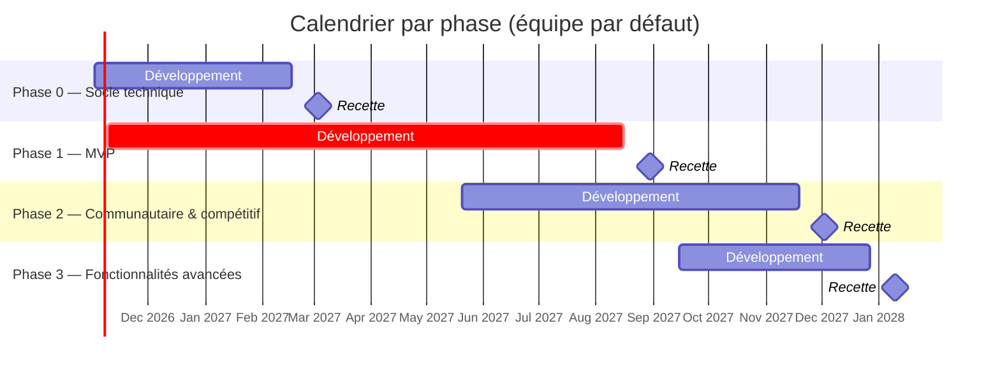
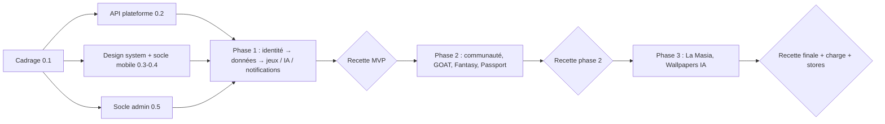

# Plan de réalisation — Univers Barça

Ce plan découle **directement du backlog** (1 322 issues réparties sur les dépôts API, mobile et admin). Il est calculé dans le fichier Excel de pilotage [`Univers-Barca-Plan-de-realisation-et-suivi.xlsx`](Univers-Barca-Plan-de-realisation-et-suivi.xlsx) : modifier les paramètres de l'équipe ou les statuts recalcule dates, Gantt et jalons.

## 1. Hypothèses du planning

| Paramètre | Valeur par défaut |
| --- | --- |
| Début du projet | 02/11/2026 |
| Facteur de focus | 80 % |
| Marge pour aléas | 15 % |
| Développeurs API / Mobile / Admin | 3 / 3 / 2 |
| Décalage Mobile/Admin sur l'API (phases 1-3) | 20 jours ouvrés |
| Recette par phase | 10 jours ouvrés |

Charge par taille d'issue : XS 0,25 j · S 0,5 j · M 1 j · L 2 j · XL 3,5 j (estimation indicative à recalibrer après les premiers sprints).

> **À savoir** : la charge totale du backlog est d'environ **1 372 jours·personne**. Avec l'équipe par défaut (8 développeurs) elle représente ~14 mois ; avec 3 développeurs ~2,5 ans ; en solo plusieurs années. Les estimations du CDC (26 à 38 semaines) ne couvrent pas ce niveau de détail : le choix du périmètre par phase (MVP d'abord) est le principal levier. Voir la feuille *Scénarios*.

## 2. Vue d'ensemble

| Phase | Issues | Charge (j) | Fin prévue (flux le plus long) | Jalon (après recette) |
| --- | --- | --- | --- | --- |
| Phase 0 — Socle technique | 223 | 224 | 17/02/2027 | **03/03/2027** |
| Phase 1 — MVP | 688 | 714 | 16/08/2027 | **30/08/2027** |
| Phase 2 — Communautaire & compétitif | 313 | 340 | 19/11/2027 | **03/12/2027** |
| Phase 3 — Fonctionnalités avancées | 98 | 92 | 27/12/2027 | **10/01/2028** |

## 3. Règles d'ordonnancement des issues

1. **Jalon (phase) dans l'ordre** : Phase 0 → 1 → 2 → 3. On ne démarre pas une issue d'une phase ultérieure tant que les issues **P0** de la phase courante ne sont pas terminées.
2. **Priorité** : `priorite:P0` avant `P1` avant `P2`.
3. **Dépendances** : la section « Dépendances » d'une issue liste les codes à terminer avant ; au sein d'une épopée, l'ordre des codes (`XXX-01`, `XXX-02`…) est l'ordre de réalisation conseillé.
4. **Contrat d'abord** : une issue mobile/admin qui consomme un endpoint attend l'issue API correspondante (codes `API-…`) ; en attendant, le mock se fait côté client.
5. **Une issue = une branche = une PR** vers `dev` (`Closes #N`), CI verte obligatoire.
6. **Points « à confirmer »** : voir la feuille *Décisions et risques* ; ne pas coder avant décision.

## 4. Étapes détaillées

### Phase 0 — Socle technique

#### Étape 0.1 — Cadrage et mise en place (avant J0)

- **Objectif** : Débloquer l’environnement de travail avant le premier jour de développement.
- **Épopées** : Aucune (actions manuelles)
- **Prérequis** : —
- **Livrables** : Secrets GitHub (VPS, Firebase, stores), environnements staging/production, projet GitHub relié, protection des branches, nom de domaine et DNS.
- **Critères de sortie** : Décisions « à confirmer » tranchées (voir feuille Décisions) ; pipelines CD capables de déployer.
- **Charge** : 0.0 j · **Période** : 19/10/2026 → 30/10/2026 (10 jours ouvrés)

#### Étape 0.2 — Socle API et plateforme

- **Objectif** : Rendre l’API exploitable : configuration, observabilité, sécurité de base, identité.
- **Épopées** : API-PLAT, API-AUTH
- **Prérequis** : 0.1
- **Livrables** : API en staging avec /health, /metrics, Swagger, migrations, jobs de base.
- **Critères de sortie** : CI verte ; staging déployé ; tests de charge « smoke » passants.
- **Charge** : 8.8 j · **Période** : 02/11/2026 → 06/11/2026 (5 jours ouvrés)

| Épopée | Flux | Intitulé | Issues | Charge (j) | Période |
| --- | --- | --- | --- | --- | --- |
| `API-PLAT` | API | Plateforme, qualité, performance et exploitation | 10 | 6.8 | 02/11/2026 → 05/11/2026 |
| `API-AUTH` | API | Identité, authentification, comptes et RGPD | 2 | 2.0 | 06/11/2026 → 06/11/2026 |

#### Étape 0.3 — Design system mobile

- **Objectif** : Implémenter tokens, composants et animations du design system Flutter.
- **Épopées** : MOB-ZA, MOB-ZB, MOB-ZC, MOB-ZD, MOB-ZE
- **Prérequis** : 0.1
- **Livrables** : Widgets sous lib/core/widgets, thèmes clair/sombre, golden tests.
- **Critères de sortie** : Planches ZA-ZE reproduites à l’identique ; goldens verts.
- **Charge** : 89.5 j · **Période** : 07/12/2026 → 05/02/2027 (45 jours ouvrés)

| Épopée | Flux | Intitulé | Issues | Charge (j) | Période |
| --- | --- | --- | --- | --- | --- |
| `MOB-ZA` | Mobile | Fondations | 16 | 14.5 | 07/12/2026 → 15/12/2026 |
| `MOB-ZB` | Mobile | Composants de base | 18 | 21.0 | 16/12/2026 → 30/12/2026 |
| `MOB-ZC` | Mobile | Retours et états | 17 | 18.0 | 31/12/2026 → 12/01/2027 |
| `MOB-ZD` | Mobile | Composants métier et responsive | 14 | 16.5 | 13/01/2027 → 22/01/2027 |
| `MOB-ZE` | Mobile | Animations et micro-interactions | 18 | 19.5 | 25/01/2027 → 05/02/2027 |

#### Étape 0.4 — Socle Flutter et états système

- **Objectif** : Navigation, réseau, stockage, i18n, Firebase, écrans système.
- **Épopées** : MOB-FND, MOB-A
- **Prérequis** : 0.3 (en parallèle)
- **Livrables** : ShellRoute 5 onglets, AuthBloc, Chopper + refresh, Drift, ARB FR/EN/ES, écrans A-01…A-10.
- **Critères de sortie** : App installable (APK/IPA) sur staging ; états offline/5xx/429/maintenance gérés.
- **Charge** : 66.2 j · **Période** : 02/11/2026 → 17/02/2027 (78 jours ouvrés)

| Épopée | Flux | Intitulé | Issues | Charge (j) | Période |
| --- | --- | --- | --- | --- | --- |
| `MOB-FND` | Mobile | Socle technique Flutter | 47 | 50.2 | 02/11/2026 → 04/12/2026 |
| `MOB-A` | Mobile | Lancement et système | 19 | 16.0 | 08/02/2027 → 17/02/2027 |

#### Étape 0.5 — Socle et design system admin

- **Objectif** : Base du back-office : routage par rôle, composants, qualité.
- **Épopées** : ADM-FND, ADM-ADS
- **Prérequis** : 0.1
- **Livrables** : Composants shadcn-style, layout responsive, tests Vitest/Playwright.
- **Critères de sortie** : Admin déployé en staging ; accessibilité de base validée.
- **Charge** : 60.0 j · **Période** : 02/11/2026 → 31/12/2026 (44 jours ouvrés)

| Épopée | Flux | Intitulé | Issues | Charge (j) | Période |
| --- | --- | --- | --- | --- | --- |
| `ADM-FND` | Admin | Socle technique admin | 25 | 27.5 | 02/11/2026 → 27/11/2026 |
| `ADM-ADS` | Admin | Design system admin | 37 | 32.5 | 30/11/2026 → 31/12/2026 |

### Phase 1 — MVP

#### Étape 1.1 — Identité, comptes et paramètres

- **Objectif** : Inscription, connexion, RGPD, profil et paramètres côté API, mobile et admin.
- **Épopées** : API-AUTH, MOB-B, MOB-Q, ADM-WA, ADM-WI
- **Prérequis** : 0.2, 0.4, 0.5
- **Livrables** : Parcours onboarding → compte vérifié ; export/suppression RGPD ; comptes admin + 2FA.
- **Critères de sortie** : Parcours d’inscription E2E vert ; consentements historisés ; tests de sécurité auth verts.
- **Charge** : 146.8 j · **Période** : 08/12/2026 → 25/06/2027 (144 jours ouvrés)

| Épopée | Flux | Intitulé | Issues | Charge (j) | Période |
| --- | --- | --- | --- | --- | --- |
| `API-AUTH` | API | Identité, authentification, comptes et RGPD | 43 | 51.0 | 08/12/2026 → 11/01/2027 |
| `MOB-B` | Mobile | Onboarding et authentification | 29 | 27.8 | 18/02/2027 → 09/03/2027 |
| `MOB-Q` | Mobile | Paramètres et compte | 31 | 26.5 | 10/03/2027 → 26/03/2027 |
| `ADM-WA` | Admin | Authentification et erreurs | 19 | 18.0 | 01/01/2027 → 19/01/2027 |
| `ADM-WI` | Admin | Comptes, configuration et notifications | 21 | 23.5 | 03/06/2027 → 25/06/2027 |

#### Étape 1.2 — Données football, historique et contenu

- **Objectif** : Alimenter et publier les données joueurs/matchs ; consultation côté mobile.
- **Épopées** : API-FOOT, MOB-F, ADM-WC, ADM-WD, ADM-WE
- **Prérequis** : 1.1 (auth)
- **Livrables** : Synchro API football, CRUD joueurs/matchs/anecdotes, historique et fiches mobiles.
- **Critères de sortie** : Données réelles visibles dans l’app ; workflow de publication et traductions opérationnel.
- **Charge** : 159.5 j · **Période** : 12/01/2027 → 03/05/2027 (80 jours ouvrés)

| Épopée | Flux | Intitulé | Issues | Charge (j) | Période |
| --- | --- | --- | --- | --- | --- |
| `API-FOOT` | API | Données football et contenu éditorial | 56 | 61.5 | 12/01/2027 → 22/02/2027 |
| `MOB-F` | Mobile | Historique et fiches | 27 | 27.5 | 14/04/2027 → 03/05/2027 |
| `ADM-WC` | Admin | Gestion des joueurs | 28 | 30.5 | 08/02/2027 → 09/03/2027 |
| `ADM-WD` | Admin | Matchs et compétitions | 14 | 20.5 | 10/03/2027 → 30/03/2027 |
| `ADM-WE` | Admin | Contenu éditorial | 14 | 19.5 | 31/03/2027 → 20/04/2027 |

#### Étape 1.3 — Accueil, calendrier et tableau de bord

- **Objectif** : Dashboard d’accueil, calendrier et export agenda, KPI admin.
- **Épopées** : API-CAL, MOB-C, MOB-L, ADM-WB
- **Prérequis** : 1.2
- **Livrables** : Dashboard, calendrier, export ICS / abonnement, KPI admin et recherche globale.
- **Critères de sortie** : Export ICS validé sur iOS/Android ; recherche admin < 300 ms.
- **Charge** : 94.0 j · **Période** : 20/01/2027 → 26/05/2027 (91 jours ouvrés)

| Épopée | Flux | Intitulé | Issues | Charge (j) | Période |
| --- | --- | --- | --- | --- | --- |
| `API-CAL` | API | Calendrier et export agenda | 24 | 18.0 | 23/02/2027 → 05/03/2027 |
| `MOB-C` | Mobile | Accueil — dashboard | 27 | 24.5 | 29/03/2027 → 13/04/2027 |
| `MOB-L` | Mobile | Calendrier et export agenda | 29 | 34.0 | 04/05/2027 → 26/05/2027 |
| `ADM-WB` | Admin | Tableau de bord et recherche | 16 | 17.5 | 20/01/2027 → 05/02/2027 |

#### Étape 1.4 — Jeux quotidiens

- **Objectif** : Guess the Player et Quiz adaptatif, classements, streaks.
- **Épopées** : API-JEUX, MOB-D, MOB-E, ADM-WF
- **Prérequis** : 1.2
- **Livrables** : Défi quotidien, quiz adaptatif, scoring, streaks, back-office des questions.
- **Critères de sortie** : Défi identique pour tous ; anti-triche testé ; test de charge « défi du soir ».
- **Charge** : 127.0 j · **Période** : 08/03/2027 → 05/07/2027 (86 jours ouvrés)

| Épopée | Flux | Intitulé | Issues | Charge (j) | Période |
| --- | --- | --- | --- | --- | --- |
| `API-JEUX` | API | Guess the Player & Quiz adaptatif | 37 | 48.0 | 08/03/2027 → 07/04/2027 |
| `MOB-D` | Mobile | Jeux — Guess the Player | 30 | 25.8 | 27/05/2027 → 14/06/2027 |
| `MOB-E` | Mobile | Quiz adaptatif | 34 | 29.2 | 15/06/2027 → 05/07/2027 |
| `ADM-WF` | Admin | Questions de quiz | 23 | 24.0 | 21/04/2027 → 14/05/2027 |

#### Étape 1.5 — Assistant IA Barça AI

- **Objectif** : Assistant conversationnel borné aux faits, avec garde-fous et quotas.
- **Épopées** : API-IA, MOB-N
- **Prérequis** : 1.2
- **Livrables** : Chat en streaming, historique, quotas, modération, kill switch.
- **Critères de sortie** : Jeu de tests de non-régression de prompts vert ; coûts suivis.
- **Charge** : 66.0 j · **Période** : 29/04/2027 → 29/07/2027 (66 jours ouvrés)

| Épopée | Flux | Intitulé | Issues | Charge (j) | Période |
| --- | --- | --- | --- | --- | --- |
| `API-IA` | API | Assistant IA Barça AI | 34 | 30.5 | 29/04/2027 → 19/05/2027 |
| `MOB-N` | Mobile | Assistant IA Barça AI | 31 | 35.5 | 06/07/2027 → 29/07/2027 |

#### Étape 1.6 — Notifications

- **Objectif** : Notifications push et centre de notifications.
- **Épopées** : API-NOTIF, MOB-O
- **Prérequis** : 1.1
- **Livrables** : Jetons d’appareil, préférences, envoi FCM, campagnes admin.
- **Critères de sortie** : Notification reçue sur iOS et Android en staging ; DLQ supervisée.
- **Charge** : 54.8 j · **Période** : 08/04/2027 → 16/08/2027 (93 jours ouvrés)

| Épopée | Flux | Intitulé | Issues | Charge (j) | Période |
| --- | --- | --- | --- | --- | --- |
| `API-NOTIF` | API | Notifications push et centre de notifications | 31 | 30.0 | 08/04/2027 → 28/04/2027 |
| `MOB-O` | Mobile | Notifications | 28 | 24.8 | 30/07/2027 → 16/08/2027 |

#### Étape 1.7 — Exploitation et supervision MVP

- **Objectif** : Industrialiser : monitoring, sauvegardes, charge, supervision admin.
- **Épopées** : API-PLAT, ADM-WH, ADM-WJ
- **Prérequis** : 1.1 à 1.6 (en continu)
- **Livrables** : Dashboards Grafana, alertes, sauvegardes testées, supervision technique admin, capacité mesurée.
- **Critères de sortie** : Restauration testée ; dimensionnement serveur documenté (tests de charge).
- **Charge** : 66.5 j · **Période** : 09/11/2026 → 05/07/2027 (171 jours ouvrés)

| Épopée | Flux | Intitulé | Issues | Charge (j) | Période |
| --- | --- | --- | --- | --- | --- |
| `API-PLAT` | API | Plateforme, qualité, performance et exploitation | 43 | 42.0 | 09/11/2026 → 07/12/2026 |
| `ADM-WH` | Admin | Supervision technique | 15 | 17.5 | 17/05/2027 → 02/06/2027 |
| `ADM-WJ` | Admin | Utilisateurs et évolutions phase 2-3 | 4 | 7.0 | 28/06/2027 → 05/07/2027 |

#### Étape 1.8 — Recette MVP et bêta fermée

- **Objectif** : Valider le MVP avec un cercle restreint.
- **Épopées** : Aucune épopée — durée fixe (Paramètres)
- **Prérequis** : 1.1 à 1.7
- **Livrables** : Rapport de recette, correctifs, version bêta (TestFlight / Firebase App Distribution).
- **Critères de sortie** : Critères de sortie du CDC §15.2 atteints (couverture, anomalies, doc, observation 48 h).
- **Charge** : 0.0 j · **Période** : 17/08/2027 → 30/08/2027 (10 jours ouvrés)

### Phase 2 — Communautaire & compétitif

#### Étape 2.1 — Communauté : carte, groupes et modération

- **Objectif** : Carte communautaire, groupes locaux, modération (côté API, mobile, admin).
- **Épopées** : API-COMM, API-MODER, MOB-J, MOB-K, ADM-WG, ADM-WJ
- **Prérequis** : Phase 1
- **Livrables** : Carte agrégée, groupes, signalements, sanctions, journal d’audit.
- **Critères de sortie** : Revue RGPD géolocalisation ; test de modération de bout en bout.
- **Charge** : 168.5 j · **Période** : 20/05/2027 → 04/11/2027 (121 jours ouvrés)

| Épopée | Flux | Intitulé | Issues | Charge (j) | Période |
| --- | --- | --- | --- | --- | --- |
| `API-COMM` | API | Carte communautaire et groupes locaux | 33 | 36.0 | 20/05/2027 → 14/06/2027 |
| `API-MODER` | API | Modération et sécurité communautaire | 32 | 38.5 | 15/06/2027 → 09/07/2027 |
| `MOB-J` | Mobile | Carte communautaire | 27 | 27.5 | 24/09/2027 → 13/10/2027 |
| `MOB-K` | Mobile | Groupes locaux | 31 | 32.0 | 14/10/2027 → 04/11/2027 |
| `ADM-WG` | Admin | Modération communautaire | 27 | 27.5 | 06/07/2027 → 02/08/2027 |
| `ADM-WJ` | Admin | Utilisateurs et évolutions phase 2-3 | 5 | 7.0 | 03/08/2027 → 10/08/2027 |

#### Étape 2.2 — Comparateur GOAT

- **Objectif** : Comparateur et votes.
- **Épopées** : API-GOAT, MOB-G
- **Prérequis** : Phase 1
- **Livrables** : Comparateur, votes, agrégats.
- **Critères de sortie** : Anti-abus testé.
- **Charge** : 43.0 j · **Période** : 12/07/2027 → 27/08/2027 (35 jours ouvrés)

| Épopée | Flux | Intitulé | Issues | Charge (j) | Période |
| --- | --- | --- | --- | --- | --- |
| `API-GOAT` | API | Comparateur GOAT et votes | 26 | 25.0 | 12/07/2027 → 27/07/2027 |
| `MOB-G` | Mobile | Comparateur GOAT | 17 | 18.0 | 17/08/2027 → 27/08/2027 |

#### Étape 2.3 — Fantasy Barça

- **Objectif** : Équipes fantasy, journées, classements, ligues.
- **Épopées** : API-FANT, MOB-H
- **Prérequis** : Phase 1 (données matchs)
- **Livrables** : Composition, scoring par journée, ligues.
- **Critères de sortie** : Calcul des points idempotent et testé sur matchs réels.
- **Charge** : 71.5 j · **Période** : 28/07/2027 → 23/09/2027 (42 jours ouvrés)

| Épopée | Flux | Intitulé | Issues | Charge (j) | Période |
| --- | --- | --- | --- | --- | --- |
| `API-FANT` | API | Fantasy Barça et La Masia Academy | 24 | 33.5 | 28/07/2027 → 19/08/2027 |
| `MOB-H` | Mobile | Fantasy Barça | 35 | 38.0 | 30/08/2027 → 23/09/2027 |

#### Étape 2.4 — Culé Passport

- **Objectif** : Profil de gamification transverse.
- **Épopées** : API-PASS, MOB-P
- **Prérequis** : 2.2, 2.3
- **Livrables** : XP, niveaux, badges, historique.
- **Critères de sortie** : Règles de badges validées.
- **Charge** : 54.5 j · **Période** : 20/08/2027 → 19/11/2027 (66 jours ouvrés)

| Épopée | Flux | Intitulé | Issues | Charge (j) | Période |
| --- | --- | --- | --- | --- | --- |
| `API-PASS` | API | Culé Passport et gamification transverse | 33 | 33.0 | 20/08/2027 → 10/09/2027 |
| `MOB-P` | Mobile | Culé Passport | 21 | 21.5 | 05/11/2027 → 19/11/2027 |

#### Étape 2.5 — Durcissement plateforme

- **Objectif** : Performance, sécurité et charge de la phase 2.
- **Épopées** : API-PLAT
- **Prérequis** : Phase 2 (en continu)
- **Livrables** : Index, caches, tests de charge étendus.
- **Critères de sortie** : Test de charge « soir de match » validé.
- **Charge** : 3.0 j · **Période** : 13/09/2027 → 14/09/2027 (2 jours ouvrés)

| Épopée | Flux | Intitulé | Issues | Charge (j) | Période |
| --- | --- | --- | --- | --- | --- |
| `API-PLAT` | API | Plateforme, qualité, performance et exploitation | 2 | 3.0 | 13/09/2027 → 14/09/2027 |

#### Étape 2.6 — Recette phase 2

- **Objectif** : Valider la version communautaire.
- **Épopées** : Aucune épopée — durée fixe (Paramètres)
- **Prérequis** : 2.1 à 2.5
- **Livrables** : Rapport de recette phase 2.
- **Critères de sortie** : Critères §15.2 atteints.
- **Charge** : 0.0 j · **Période** : 22/11/2027 → 03/12/2027 (10 jours ouvrés)

### Phase 3 — Fonctionnalités avancées

#### Étape 3.1 — La Masia Academy

- **Objectif** : Académie fantasy.
- **Épopées** : API-FANT, MOB-I
- **Prérequis** : Phase 2 (Fantasy)
- **Livrables** : Joueurs d’académie, progression.
- **Critères de sortie** : Règles validées avec le porteur du projet.
- **Charge** : 34.0 j · **Période** : 15/09/2027 → 06/12/2027 (59 jours ouvrés)

| Épopée | Flux | Intitulé | Issues | Charge (j) | Période |
| --- | --- | --- | --- | --- | --- |
| `API-FANT` | API | Fantasy Barça et La Masia Academy | 10 | 12.0 | 15/09/2027 → 22/09/2027 |
| `MOB-I` | Mobile | La Masia Academy | 22 | 22.0 | 22/11/2027 → 06/12/2027 |

#### Étape 3.2 — Wallpapers IA

- **Objectif** : Génération d’images, galerie, partage.
- **Épopées** : API-WALL, MOB-M
- **Prérequis** : Phase 1 (IA)
- **Livrables** : Génération, file d’attente, modération des images, galerie.
- **Critères de sortie** : Aucun logo du club ; coûts maîtrisés.
- **Charge** : 52.2 j · **Période** : 23/09/2027 → 27/12/2027 (68 jours ouvrés)

| Épopée | Flux | Intitulé | Issues | Charge (j) | Période |
| --- | --- | --- | --- | --- | --- |
| `API-WALL` | API | Wallpapers IA | 31 | 22.8 | 23/09/2027 → 07/10/2027 |
| `MOB-M` | Mobile | Wallpapers IA | 31 | 29.5 | 07/12/2027 → 27/12/2027 |

#### Étape 3.3 — Évolutions admin phase 3

- **Objectif** : Compléments du back-office.
- **Épopées** : ADM-WJ
- **Prérequis** : Phase 2
- **Livrables** : Écrans évolutions phase 3.
- **Critères de sortie** : Recette admin.
- **Charge** : 6.0 j · **Période** : 13/10/2027 → 19/10/2027 (5 jours ouvrés)

| Épopée | Flux | Intitulé | Issues | Charge (j) | Période |
| --- | --- | --- | --- | --- | --- |
| `ADM-WJ` | Admin | Utilisateurs et évolutions phase 2-3 | 4 | 6.0 | 13/10/2027 → 19/10/2027 |

#### Étape 3.4 — Recette finale, charge et mise en production

- **Objectif** : Finaliser, mesurer et publier.
- **Épopées** : Aucune épopée — durée fixe (Paramètres)
- **Prérequis** : 3.1 à 3.3
- **Livrables** : Campagne de charge finale, documentation, publication stores, tag de version production.
- **Critères de sortie** : Périmètre complet livré ; observabilité sans anomalie.
- **Charge** : 0.0 j · **Période** : 28/12/2027 → 10/01/2028 (10 jours ouvrés)

## 5. Dépendances entre flux

## 6. Suivi
- Mettre à jour la colonne **Statut** de la feuille *Backlog* (ou exporter le projet GitHub) : *Épopées*, *Gantt*, *Jalons* et *Suivi* se recalculent.
- Revue de planning à chaque fin d'étape ; recalibrer le barème de charge après les 2 premiers sprints.
- Tests de charge : à chaque nouvelle fonctionnalité exposée par l'API (voir `docs/LOAD_TESTING.md`).
